# Exploratory KLS routes — non-targets

**These temporary exploratory routes are not formalization targets.** Future proof and
infrastructure work follows the [published literature register](../progress/LITERATURE.md)
and its source-specific priorities. This page preserves research context, conditional
implications and existing local supporting proofs; it is not the active work plan.

<!-- BEGIN GENERATED DATE -->
Last updated: **2026-10-02**.

 ·  ·  · 
<!-- END GENERATED DATE -->

The four branches belong to a pinned exploratory portfolio. In [route-composition.yaml](route-composition.yaml),
`active` means a branch remains in the logical composition, not that its open gate is selected
for Lean formalization. AND/OR structure and mathematical provenance are preserved.
No branch is marked completed by this reorganization. Dimension-free KLS remains open.

## Retained route diagram

Solid arrows point from prerequisites to consumers, with AND inside a branch and OR between
sufficient alternatives. A pending gate retains its assumptions. Dashed links are analytic
context, not an additional sufficient KLS branch. Refuted packages stay outside the implication chain.

```mermaid
%%{init: {"themeVariables": {"fontSize": "20px"}, "flowchart": {"useMaxWidth": false, "nodeSpacing": 40, "rankSpacing": 65}}}%%
flowchart LR
    subgraph FOUND["Shared foundations"]
    DENS["✓ Log-concave density<br/>Intrinsic support"]
    NORM["✓ Affine / isotropic<br/>Reduction"]
    FORMS["✓ Closed forms<br/>Dirichlet property"]
    ENERGY["✓ Canonical energy<br/>= 2 × Cheeger energy"]
    CONST["✓ Poincaré frontend<br/>Equivalence"]
    end
    subgraph ANALYSIS["Analytic comparison"]
    MEAS["✓ Slice measurability"]
    GRAPH["✓ Open-domain<br/>Graph area"]
    REG["✓ Regular-domain<br/>Coarea"]
    CRIT["✓ Critical-slice nullity"]
    C1["✓ General C¹ coarea"]
    WHIT["✓ Compact Whitney jets<br/>Exact C¹ pieces"]
    LIP["✓ Coarea: Lipschitz<br/>and locally Lipschitz"]
    GG["✓ Global Gauss–Green"]
    REC["✓ Smooth recovery"]
    FWD["✓ h_M ≤ h_S"]
    SARD["✓ Scalar Sard<br/>Sharp finite regularity"]
    SCI["✓ Cheeger superlevel<br/>Integral bound"]
    CUT["✓ Distance cutoffs"]
    REV["✓ h_S ≤ h_M"]
    EQ["✓ h_M = h_S"]
    FRONT["✓ Density Cheeger<br/>Identification"]
    CB["✓ Cheeger–Buser<br/>4 and pi bounds"]
    MINK["✓ Minkowski coarea"]
    BV["✓ Closed-support BV<br/>identification (log-concave)"]
    end
    subgraph HEATPROGRAM["Buser analytic program — dotted links show related work"]
    SEMI["✓ Weighted-gradient<br/>Heat semigroup"]
    MARKOV["✓ Heat semigroup<br/>Markov properties"]
    DECAY["✓ Centered heat decay<br/>and literature gap"]
    GAUSS["✓ Gaussian convolution<br/>Smooth potential"]
    GSTAB["✓ Gaussian convolution<br/>Poincaré stability"]
    BE["◐ Generator / Bochner<br/>Gradient estimates"]
    HEAT["◐ Small-time heat bounds<br/>and pi Buser assembly"]
    end
    subgraph ELDAN["Eldan localization"]
    EG["○ Tight-prefix<br/>Carleson estimate"]
    EC["○ Tight-window<br/>Consumption"]
    EAND{"AND<br/>○ Eldan route"}
    end
    subgraph SPECTRAL["Moment-map spectral"]
    SG["○ Full-damping<br/>Occupation bound"]
    SC["○ Spectral<br/>Sufficiency"]
    SAND{"AND<br/>○ Spectral route"}
    end
    subgraph CMH["Moment-map CMH"]
    MH["○ W₂ limit and<br/>CMH comparison"]
    MG["○ Bounded CMH<br/>Recovery envelope"]
    MT["✓ Affine constant<br/>Translation invariance"]
    MC["○ Recovery-sequence<br/>Sufficiency"]
    MAND{"AND<br/>○ CMH route"}
    end
    subgraph FIBER["Conditional-fiber frames"]
    ONE["✓ One-dimensional<br/>Poincaré ≤ 4 Var"]
    FLOG["✓ Fiber log-concavity"]
    FP["✓ Fiber-bound<br/>Energy comparison"]
    F4["✓ Fiber energy<br/>≤ 4 × gradient energy"]
    FC["✓ Fiber Dirichlet form"]
    FG["○ Universal<br/>Frame bound"]
    FAND{"AND<br/>◐ Fiber route"}
    end
    subgraph VECTOR["Vector coarea extension — separate from the KLS implication routes"]
    VREG["✓ Vector coarea<br/>Regular region"]
    VZERO["✓ Vector slices<br/>Zero derivative"]
    VR123["✓ Rank and kernel<br/>R1–R3"]
    VR4["✓ Tangential estimate<br/>R4"]
    VFULL["✓ C¹ vector coarea<br/>Rank-deficient part closed"]
    VLIP["✓ Vector coarea<br/>Lipschitz and local"]
    end
    KLS["○ KLS<br/>Dimension-free bound"]
    ANY{"OR<br/>Any completed route"}
    EG --> EAND
    EC --> EAND
    CB --> EAND
    SG --> SAND
    SC --> SAND
    NORM --> SAND
    MH --> MAND
    MG --> MAND
    MT --> MAND
    MC --> MAND
    NORM --> MAND
    ONE --> F4
    FLOG --> F4
    FP --> F4
    FC --> FAND
    F4 --> FAND
    FG --> FAND
    NORM --> FAND
    DENS --> NORM
    FORMS -.-> ENERGY
    GRAPH --> REG
    MEAS -.-> REG
    REG --> C1
    CRIT --> C1
    C1 --> LIP
    WHIT --> LIP
    MEAS --> LIP
    GG --> REC
    REC --> FWD
    C1 --> SCI
    SARD --> SCI
    SCI --> REV
    CUT --> REV
    FWD --> EQ
    REV --> EQ
    EQ --> FRONT
    FRONT --> CB
    EAND --> ANY
    SAND --> ANY
    MAND --> ANY
    FAND --> ANY
    ANY --> KLS
    CONST -.-> ANY
    VR123 --> VR4
    VREG -.-> VFULL
    VZERO -.-> VFULL
    VR4 -.-> VFULL
    SEMI -.-> MARKOV
    MARKOV -.-> BE
    MARKOV -.-> DECAY
    DECAY -.-> HEAT
    BE -.-> HEAT
    GAUSS -.-> CB
    GSTAB -.-> CB
    HEAT -.-> CB
    VFULL -.-> VLIP
    classDef done fill:#dbeafe,stroke:#2563eb,color:#1e3a8a;
    class ENERGY,F4,MT,FP,FC,EQ,NORM,DENS,FRONT,CB,ONE,CONST,FORMS,MEAS,GRAPH,REG,CRIT,C1,WHIT,LIP,GG,REC,FWD,SARD,SCI,CUT,REV,MINK,BV,FLOG,VREG,VZERO,VR123,VR4,VFULL,SEMI,MARKOV,DECAY,GAUSS,GSTAB,VLIP done;
    classDef partial fill:#fff3df,stroke:#c88719,color:#66420d;
    class FAND,BE,HEAT partial;
    classDef todo fill:#fee2e2,stroke:#dc2626,color:#991b1b;
    class MG,EG,KLS,MC,EC,SC,FG,SG,MH,EAND,SAND,MAND todo;
    classDef logic fill:#fff,stroke:#555,color:#222;
    class ANY logic;
    click MG href "https://github.com/numina-functional-inequalities/kls-lean/blob/main/formalization/blueprint/src/chapters/50-kls-routes.tex" "Bounded CMH — Recovery envelope" _blank
    click EG href "https://github.com/numina-functional-inequalities/kls-lean/blob/main/formalization/blueprint/src/chapters/50-kls-routes.tex" "Tight-prefix — Carleson estimate" _blank
    click KLS href "https://github.com/numina-functional-inequalities/kls-lean/blob/main/formalization/FunctionalInequalities/KLS/Statement.lean" "KLS — Dimension-free bound" _blank
    click ENERGY href "https://github.com/numina-functional-inequalities/kls-lean/blob/main/formalization/FunctionalInequalities/Energy/Cheeger/Basic.lean" "Canonical energy — = 2 × Cheeger energy" _blank
    click MC href "https://github.com/numina-functional-inequalities/kls-lean/blob/main/formalization/blueprint/src/chapters/50-kls-routes.tex" "Recovery-sequence — Sufficiency" _blank
    click F4 href "https://github.com/numina-functional-inequalities/kls-lean/blob/main/formalization/FunctionalInequalities/KLS/LogConcave/ConditionalFiber.lean" "Fiber energy — ≤ 4 × gradient energy" _blank
    click EC href "https://github.com/numina-functional-inequalities/kls-lean/blob/main/formalization/blueprint/src/chapters/50-kls-routes.tex" "Tight-window — Consumption" _blank
    click MT href "https://github.com/numina-functional-inequalities/kls-lean/blob/main/formalization/FunctionalInequalities/Poincare/CovarianceGradient/Translation.lean" "Affine constant — Translation invariance" _blank
    click FP href "https://github.com/numina-functional-inequalities/kls-lean/blob/main/formalization/FunctionalInequalities/KLS/ConditionalFiber/EnergyComparison.lean" "Fiber-bound — Energy comparison" _blank
    click FC href "https://github.com/numina-functional-inequalities/kls-lean/blob/main/formalization/FunctionalInequalities/KLS/ConditionalFiber/Closed.lean" "Fiber Dirichlet form" _blank
    click EQ href "https://github.com/numina-functional-inequalities/kls-lean/blob/main/formalization/FunctionalInequalities/KLS/Geometry/Cheeger/Equality.lean" "h_M = h_S" _blank
    click SC href "https://github.com/numina-functional-inequalities/kls-lean/blob/main/formalization/blueprint/src/chapters/50-kls-routes.tex" "Spectral — Sufficiency" _blank
    click FG href "https://github.com/numina-functional-inequalities/kls-lean/blob/main/formalization/blueprint/src/chapters/50-kls-routes.tex" "Universal — Frame bound" _blank
    click SG href "https://github.com/numina-functional-inequalities/kls-lean/blob/main/formalization/blueprint/src/chapters/50-kls-routes.tex" "Full-damping — Occupation bound" _blank
    click NORM href "https://github.com/numina-functional-inequalities/kls-lean/blob/main/formalization/FunctionalInequalities/KLS/LogConcave/Isotropic.lean" "Affine / isotropic — Reduction" _blank
    click DENS href "https://github.com/numina-functional-inequalities/kls-lean/blob/main/formalization/FunctionalInequalities/KLS/LogConcave/Density/BorellRepresentation/Intrinsic.lean" "Log-concave density — Intrinsic support" _blank
    click MH href "https://github.com/numina-functional-inequalities/kls-lean/blob/main/formalization/blueprint/src/chapters/50-kls-routes.tex" "W₂ limit and — CMH comparison" _blank
    click FRONT href "https://github.com/numina-functional-inequalities/kls-lean/blob/main/formalization/blueprint/src/chapters/45-shared-analytic-bridges.tex" "Density Cheeger — Identification" _blank
    click CB href "https://github.com/numina-functional-inequalities/kls-lean/blob/main/formalization/blueprint/src/chapters/45-shared-analytic-bridges.tex" "Cheeger–Buser — 4 and pi bounds" _blank
    click ONE href "https://github.com/numina-functional-inequalities/kls-lean/blob/main/formalization/FunctionalInequalities/KLS/LogConcave/Line/SharpPoincare.lean" "One-dimensional — Poincaré ≤ 4 Var" _blank
    click CONST href "https://github.com/numina-functional-inequalities/kls-lean/blob/main/formalization/FunctionalInequalities/KLS/LogConcave/Poincare.lean" "Poincaré frontend — Equivalence" _blank
    click FORMS href "https://github.com/numina-functional-inequalities/kls-lean/blob/main/formalization/FunctionalInequalities/Energy/SmoothGradient/Dirichlet.lean" "Closed forms — Dirichlet property" _blank
    click MEAS href "https://github.com/numina-functional-inequalities/kls-lean/blob/main/formalization/FunctionalInequalities/KLS/Geometry/Slice/Measurable.lean" "Slice measurability" _blank
    click GRAPH href "https://github.com/numina-functional-inequalities/kls-lean/blob/main/formalization/FunctionalInequalities/Analysis/Graph/OpenIntegral.lean" "Open-domain — Graph area" _blank
    click REG href "https://github.com/numina-functional-inequalities/kls-lean/blob/main/formalization/FunctionalInequalities/KLS/Geometry/Coarea/Regular.lean" "Regular-domain — Coarea" _blank
    click CRIT href "https://github.com/numina-functional-inequalities/kls-lean/blob/main/formalization/FunctionalInequalities/KLS/Geometry/Slice/Critical.lean" "Critical-slice nullity" _blank
    click C1 href "https://github.com/numina-functional-inequalities/kls-lean/blob/main/formalization/FunctionalInequalities/KLS/Geometry/Coarea/Smooth.lean" "General C¹ coarea" _blank
    click WHIT href "https://github.com/numina-functional-inequalities/kls-lean/blob/main/research/decisions/2026-09-16-lipschitz-coarea.md" "Compact Whitney jets — Exact C¹ pieces" _blank
    click LIP href "https://github.com/numina-functional-inequalities/kls-lean/blob/main/formalization/FunctionalInequalities/KLS/Geometry/Coarea/LocallyLipschitz.lean" "Coarea: Lipschitz — and locally Lipschitz" _blank
    click GG href "https://github.com/numina-functional-inequalities/kls-lean/blob/main/formalization/FunctionalInequalities/KLS/Geometry/SmoothDomain/GaussGreen.lean" "Global Gauss–Green" _blank
    click REC href "https://github.com/numina-functional-inequalities/kls-lean/blob/main/formalization/FunctionalInequalities/KLS/Geometry/Perimeter/Recovery.lean" "Smooth recovery" _blank
    click FWD href "https://github.com/numina-functional-inequalities/kls-lean/blob/main/formalization/FunctionalInequalities/KLS/Geometry/Cheeger/Infimum.lean" "h_M ≤ h_S" _blank
    click SARD href "https://github.com/numina-functional-inequalities/kls-lean/blob/main/formalization/FunctionalInequalities/Analysis/Sard/Sharp.lean" "Scalar Sard — Sharp finite regularity" _blank
    click SCI href "https://github.com/numina-functional-inequalities/kls-lean/blob/main/formalization/FunctionalInequalities/KLS/Geometry/Cheeger/Equality.lean" "Cheeger superlevel — Integral bound" _blank
    click CUT href "https://github.com/numina-functional-inequalities/kls-lean/blob/main/formalization/FunctionalInequalities/KLS/Geometry/Cheeger/DistanceCutoff.lean" "Distance cutoffs" _blank
    click REV href "https://github.com/numina-functional-inequalities/kls-lean/blob/main/formalization/FunctionalInequalities/KLS/Geometry/Cheeger/Equality.lean" "h_S ≤ h_M" _blank
    click MINK href "https://github.com/numina-functional-inequalities/kls-lean/blob/main/formalization/FunctionalInequalities/KLS/Geometry/Cheeger/MinkowskiContent.lean" "Minkowski coarea" _blank
    click BV href "https://github.com/numina-functional-inequalities/kls-lean/blob/main/formalization/FunctionalInequalities/KLS/Geometry/Cheeger/BVIdentification.lean" "Closed-support BV — identification (log-concave)" _blank
    click EAND href "https://github.com/numina-functional-inequalities/kls-lean/blob/main/research/explorations/route-composition.yaml" "AND — Eldan route" _blank
    click SAND href "https://github.com/numina-functional-inequalities/kls-lean/blob/main/research/explorations/route-composition.yaml" "AND — Spectral route" _blank
    click MAND href "https://github.com/numina-functional-inequalities/kls-lean/blob/main/research/explorations/route-composition.yaml" "AND — CMH route" _blank
    click FLOG href "https://github.com/numina-functional-inequalities/kls-lean/blob/main/formalization/FunctionalInequalities/KLS/LogConcave/ConditionalFiber.lean" "Fiber log-concavity" _blank
    click FAND href "https://github.com/numina-functional-inequalities/kls-lean/blob/main/research/explorations/route-composition.yaml" "AND — Fiber route" _blank
    click ANY href "https://github.com/numina-functional-inequalities/kls-lean/blob/main/research/explorations/route-composition.yaml" "OR — Any completed route" _blank
    click VREG href "https://github.com/numina-functional-inequalities/kls-lean/blob/main/formalization/FunctionalInequalities/Analysis/Vector/Coarea/Regular.lean" "Vector coarea — Regular region" _blank
    click VZERO href "https://github.com/numina-functional-inequalities/kls-lean/blob/main/formalization/FunctionalInequalities/Analysis/Vector/Slice/Critical.lean" "Vector slices — Zero derivative" _blank
    click VR123 href "https://github.com/numina-functional-inequalities/kls-lean/blob/main/research/audits/RightInverseBoundAudit.lean" "Rank and kernel — R1–R3" _blank
    click VR4 href "https://github.com/numina-functional-inequalities/kls-lean/blob/main/research/decisions/2026-09-17-tangential-lipschitz.md" "Tangential estimate — R4" _blank
    click VFULL href "https://github.com/numina-functional-inequalities/kls-lean/blob/main/research/decisions/2026-09-17-rank-deficient-coarea.md" "C¹ vector coarea — Rank-deficient part closed" _blank
    click SEMI href "https://github.com/numina-functional-inequalities/kls-lean/blob/main/formalization/FunctionalInequalities/KLS/LogConcave/HeatSemigroup/Basic.lean" "Weighted-gradient — Heat semigroup" _blank
    click MARKOV href "https://github.com/numina-functional-inequalities/kls-lean/blob/main/formalization/FunctionalInequalities/KLS/LogConcave/HeatSemigroup/Markov.lean" "Heat semigroup — Markov properties" _blank
    click DECAY href "https://github.com/numina-functional-inequalities/kls-lean/blob/main/formalization/FunctionalInequalities/KLS/LogConcave/HeatSemigroup/Decay.lean" "Centered heat decay — and literature gap" _blank
    click GAUSS href "https://github.com/numina-functional-inequalities/kls-lean/blob/main/formalization/FunctionalInequalities/KLS/LogConcave/Density/GaussianSmoothing.lean" "Gaussian convolution — Smooth potential" _blank
    click GSTAB href "https://github.com/numina-functional-inequalities/kls-lean/blob/main/formalization/FunctionalInequalities/KLS/LogConcave/Density/GaussianPoincare.lean" "Gaussian convolution — Poincaré stability" _blank
    click BE href "https://github.com/numina-functional-inequalities/kls-lean/blob/main/formalization/FunctionalInequalities/Analysis/BakryEmery/Bochner.lean" "Generator / Bochner — Gradient estimates" _blank
    click HEAT href "https://github.com/numina-functional-inequalities/kls-lean/blob/main/formalization/FunctionalInequalities/KLS/LogConcave/SmoothBuser.lean" "Small-time heat bounds — and pi Buser assembly" _blank
    click VLIP href "https://github.com/numina-functional-inequalities/kls-lean/blob/main/formalization/FunctionalInequalities/Analysis/Lipschitz/Local.lean" "Vector coarea — Lipschitz and local" _blank
```

<!-- BEGIN GENERATED TREE -->

<!-- END GENERATED TREE -->

## Pinned upstream approach inventory

Upstream mathematical activity and local Lean status are separate. A completed supporting
result does not complete its route and does not certify a source paper.

<!-- BEGIN GENERATED APPROACHES -->
**19 approaches in the [pinned upstream portfolio](https://github.com/numina-functional-inequalities/kls-conjecture-search/blob/34b5fcd57fef17089e781616005fe6d3641bd11e/research/program/portfolio.yaml)** (`34b5fcd`).
Upstream activity and local Lean formalization are separate. Supporting results appear below.

| Family | Approach | Upstream state | Our Lean formalization | Objective / remaining work |
| --- | --- | --- | --- | --- |
| Eldan | [`ap:eldan-trace-upgrade`](https://github.com/numina-functional-inequalities/kls-conjecture-search/blob/34b5fcd57fef17089e781616005fe6d3641bd11e/research/program/portfolio.yaml) | active |  | Upgrade directional occupation control to trace scale for all balanced cuts, producing the tight-prefix absorptive trace estimate with every source and damping term matched to the scalar Riccati bound. |
| Eldan | [`ap:eldan-weighted-excess`](https://github.com/numina-functional-inequalities/kls-conjecture-search/blob/34b5fcd57fef17089e781616005fe6d3641bd11e/research/program/portfolio.yaml) | blocked; Original package refuted. |  | Propagate the perimeter excess with a global operator-norm covariance weight at the unit-rate scale. |
| Eldan | [`ap:eldan-screened-supply`](https://github.com/numina-functional-inequalities/kls-conjecture-search/blob/34b5fcd57fef17089e781616005fe6d3641bd11e/research/program/portfolio.yaml) | active |  | Charge the weighted excess only on the aligned screen where the trace term dominates, and return at most an absorbable fraction on its complement. |
| Eldan | [`ap:eldan-stein-weighted`](https://github.com/numina-functional-inequalities/kls-conjecture-search/blob/34b5fcd57fef17089e781616005fe6d3641bd11e/research/program/portfolio.yaml) | queued |  | Specify the tensor-stable replacement for the refuted weighted package and supply the matching localization-uniform almost-stability trace theorem modulo Jacobi zero modes. |
| Eldan | [`ap:eldan-taming-splitting`](https://github.com/numina-functional-inequalities/kls-conjecture-search/blob/34b5fcd57fef17089e781616005fe6d3641bd11e/research/program/portfolio.yaml) | queued |  | Define one bridge object carrying both the cut-free covariance index and the cut-indexed boundary geometry, and prove the covariance-taming or almost-splitting estimate from it. |
| Eldan | [`ap:eldan-alignment`](https://github.com/numina-functional-inequalities/kls-conjecture-search/blob/34b5fcd57fef17089e781616005fe6d3641bd11e/research/program/portfolio.yaml) | queued |  | Decide the incident-high product-cut model with a uniform analytic bound for fixed balanced product cuts, or a certified counterexample. |
| Spectral | [`ap:spectral-occupation`](https://github.com/numina-functional-inequalities/kls-conjecture-search/blob/34b5fcd57fef17089e781616005fe6d3641bd11e/research/program/portfolio.yaml) | active |  | Prove the universal-time full-damping source estimate uniformly on regular approximants, preserving tensor orientation under unwhitening. |
| Spectral | [`ap:spectral-window-chain`](https://github.com/numina-functional-inequalities/kls-conjecture-search/blob/34b5fcd57fef17089e781616005fe6d3641bd11e/research/program/portfolio.yaml) | completed; Conditional on Letwin; short-time only. |  | Close the occupation estimate on the published polylogarithmic covariance window through the initial-layer window chain. |
| CMH | [`ap:cmh-recovery-envelope`](https://github.com/numina-functional-inequalities/kls-conjecture-search/blob/34b5fcd57fef17089e781616005fe6d3641bd11e/research/program/portfolio.yaml) | active |  | Construct, for every centered log-concave law, one regular compact-target moment-map recovery sequence with a universal bound on the CMH liminf. |
| CMH | [`ap:cmh-anisotropic-bootstrap`](https://github.com/numina-functional-inequalities/kls-conjecture-search/blob/34b5fcd57fef17089e781616005fe6d3641bd11e/research/program/portfolio.yaml) | queued |  | Prove the anisotropic source-retention inequality that would bound the linear-test quotient through the exact isotropic-coordinate matrices, working from the weak column equation of the linear-sector gate-matrix spectral resolution without assuming its strong operator-domain form, and supplying the integrated corrector or nonlocal coercivity that matrix polarization alone cannot. |
| CMH | [`ap:cmh-uniform-approximants`](https://github.com/numina-functional-inequalities/kls-conjecture-search/blob/34b5fcd57fef17089e781616005fe6d3641bd11e/research/program/portfolio.yaml) | queued |  | Bound the CMH constant uniformly along the certified regular approximant families, a stronger premise than the recovery envelope and not needed if that one is discharged. |
| CMH | [`ap:cmh-invariant-lift`](https://github.com/numina-functional-inequalities/kls-conjecture-search/blob/34b5fcd57fef17089e781616005fe6d3641bd11e/research/program/portfolio.yaml) | queued |  | Derive the target-flat multiplier invariantly and reduce arbitrary split dimensions to controlled Codazzi components paired with named positive squares. |
| CMH | [`ap:cmh-square-root-commutator`](https://github.com/numina-functional-inequalities/kls-conjecture-search/blob/34b5fcd57fef17089e781616005fe6d3641bd11e/research/program/portfolio.yaml) | queued |  | Control the complete Haar sum of square-root commutators on a common core, accounting for every retained positive and error term without double spending. |
| CMH | [`ap:cmh-solenoidal-perturbation`](https://github.com/numina-functional-inequalities/kls-conjecture-search/blob/34b5fcd57fef17089e781616005fe6d3641bd11e/research/program/portfolio.yaml) | queued |  | Compute the exact second variation through the Hodge split at an admissible target-side perturbation of the saturating one-sided-exponential product, aimed at the radial Gamma factor rather than at the base of an exponential cone. |
| CMH | [`ap:cmh-gate-zero`](https://github.com/numina-functional-inequalities/kls-conjecture-search/blob/34b5fcd57fef17089e781616005fe6d3641bd11e/research/program/portfolio.yaml) | active |  | Decide the necessary linear moment-map inequality, first in the sharp form of gate zero and then at the CMH constant itself, by an independently checked analytic argument or a genuine moment-map counterexample, using the certified third-moment decomposition of the linear sector and the exact exponential-cone battery as the equality set any argument must be tight on. |
| Conditional fibers | [`ap:fiber-frame-construction`](https://github.com/numina-functional-inequalities/kls-conjecture-search/blob/34b5fcd57fef17089e781616005fe6d3641bd11e/research/program/portfolio.yaml) | active |  | Construct one test-independent isotropic frame with a universal L2 gap on the maximal closed form domain. |
| Conditional fibers | [`ap:fiber-simplex-dual`](https://github.com/numina-functional-inequalities/kls-conjecture-search/blob/34b5fcd57fef17089e781616005fe6d3641bd11e/research/program/portfolio.yaml) | queued |  | Refute the all-frame gate with an exact uniform-simplex dual certificate of polynomial degree at least three whose objective tends to zero, the certified degree-two floors of the root-frame degree-two pencil identity having ruled out every degree-two refuter. |
| Parked probes | [`ap:cone-boundary-gap`](https://github.com/numina-functional-inequalities/kls-conjecture-search/blob/34b5fcd57fef17089e781616005fe6d3641bd11e/research/program/portfolio.yaml) | blocked |  | Establish a universal tangential Poincare gap for normalized cone measure, feeding the published Hardy boundary bridge. |
| Parked probes | [`ap:laplace-brenier-simplex`](https://github.com/numina-functional-inequalities/kls-conjecture-search/blob/34b5fcd57fef17089e781616005fe6d3641bd11e/research/program/portfolio.yaml) | blocked |  | Decide the rotation-optimized simplex transmission bound before registering a Laplace-Brenier route. |
<!-- END GENERATED APPROACHES -->

## Supporting results and retained gaps

Completion markers describe only the linked declarations and their actual hypotheses.
Finite-dimensional numerical Cheeger–Buser comparisons, metric BV relaxation and coarea/Sard
results retain their current proof scope. They do not prove general RCD comparisons or KLS.
Use [the paper register](../progress/LITERATURE.md) for source matching and
[the node register](../progress/STATUS.md) for the complete evidence-backed descriptions.

<!-- BEGIN GENERATED RESULTS -->
| Result / step | Our Lean formalization | Source |
| --- | --- | --- |
| Bounded CMH — Recovery envelope |  | [Source](https://github.com/numina-functional-inequalities/kls-lean/blob/main/formalization/blueprint/src/chapters/50-kls-routes.tex) |
| Tight-prefix — Carleson estimate |  | [Source](https://github.com/numina-functional-inequalities/kls-lean/blob/main/formalization/blueprint/src/chapters/50-kls-routes.tex) |
| Canonical energy — = 2 × Cheeger energy |  | [Source](https://github.com/numina-functional-inequalities/kls-lean/blob/main/formalization/FunctionalInequalities/Energy/Cheeger/Basic.lean) |
| Recovery-sequence — Sufficiency |  | [Source](https://github.com/numina-functional-inequalities/kls-lean/blob/main/formalization/blueprint/src/chapters/50-kls-routes.tex) |
| Fiber energy — ≤ 4 × gradient energy |  | [Source](https://github.com/numina-functional-inequalities/kls-lean/blob/main/formalization/FunctionalInequalities/KLS/LogConcave/ConditionalFiber.lean) |
| Tight-window — Consumption |  | [Source](https://github.com/numina-functional-inequalities/kls-lean/blob/main/formalization/blueprint/src/chapters/50-kls-routes.tex) |
| Affine constant — Translation invariance |  | [Source](https://github.com/numina-functional-inequalities/kls-lean/blob/main/formalization/FunctionalInequalities/Poincare/CovarianceGradient/Translation.lean) |
| Fiber-bound — Energy comparison |  | [Source](https://github.com/numina-functional-inequalities/kls-lean/blob/main/formalization/FunctionalInequalities/KLS/ConditionalFiber/EnergyComparison.lean) |
| Fiber Dirichlet form |  | [Source](https://github.com/numina-functional-inequalities/kls-lean/blob/main/formalization/FunctionalInequalities/KLS/ConditionalFiber/Closed.lean) |
| h_M = h_S |  | [Source](https://github.com/numina-functional-inequalities/kls-lean/blob/main/formalization/FunctionalInequalities/KLS/Geometry/Cheeger/Equality.lean) |
| Spectral — Sufficiency |  | [Source](https://github.com/numina-functional-inequalities/kls-lean/blob/main/formalization/blueprint/src/chapters/50-kls-routes.tex) |
| Universal — Frame bound |  | [Source](https://github.com/numina-functional-inequalities/kls-lean/blob/main/formalization/blueprint/src/chapters/50-kls-routes.tex) |
| Full-damping — Occupation bound |  | [Source](https://github.com/numina-functional-inequalities/kls-lean/blob/main/formalization/blueprint/src/chapters/50-kls-routes.tex) |
| Affine / isotropic — Reduction |  | [Source](https://github.com/numina-functional-inequalities/kls-lean/blob/main/formalization/FunctionalInequalities/KLS/LogConcave/Isotropic.lean) |
| Log-concave density — Intrinsic support |  | [Source](https://github.com/numina-functional-inequalities/kls-lean/blob/main/formalization/FunctionalInequalities/KLS/LogConcave/Density/BorellRepresentation/Intrinsic.lean) |
| W₂ limit and — CMH comparison |  | [Source](https://github.com/numina-functional-inequalities/kls-lean/blob/main/formalization/blueprint/src/chapters/50-kls-routes.tex) |
| Density Cheeger — Identification |  | [Source](https://github.com/numina-functional-inequalities/kls-lean/blob/main/formalization/blueprint/src/chapters/45-shared-analytic-bridges.tex) |
| Cheeger–Buser — 4 and pi bounds |  | [Source](https://github.com/numina-functional-inequalities/kls-lean/blob/main/formalization/blueprint/src/chapters/45-shared-analytic-bridges.tex) |
| One-dimensional — Poincaré ≤ 4 Var |  | [Source](https://github.com/numina-functional-inequalities/kls-lean/blob/main/formalization/FunctionalInequalities/KLS/LogConcave/Line/SharpPoincare.lean) |
| Poincaré frontend — Equivalence |  | [Source](https://github.com/numina-functional-inequalities/kls-lean/blob/main/formalization/FunctionalInequalities/KLS/LogConcave/Poincare.lean) |
| Closed forms — Dirichlet property |  | [Source](https://github.com/numina-functional-inequalities/kls-lean/blob/main/formalization/FunctionalInequalities/Energy/SmoothGradient/Dirichlet.lean) |
| Slice measurability |  | [Source](https://github.com/numina-functional-inequalities/kls-lean/blob/main/formalization/FunctionalInequalities/KLS/Geometry/Slice/Measurable.lean) |
| Open-domain — Graph area |  | [Source](https://github.com/numina-functional-inequalities/kls-lean/blob/main/formalization/FunctionalInequalities/Analysis/Graph/OpenIntegral.lean) |
| Regular-domain — Coarea |  | [Source](https://github.com/numina-functional-inequalities/kls-lean/blob/main/formalization/FunctionalInequalities/KLS/Geometry/Coarea/Regular.lean) |
| Critical-slice nullity |  | [Source](https://github.com/numina-functional-inequalities/kls-lean/blob/main/formalization/FunctionalInequalities/KLS/Geometry/Slice/Critical.lean) |
| General C¹ coarea |  | [Source](https://github.com/numina-functional-inequalities/kls-lean/blob/main/formalization/FunctionalInequalities/KLS/Geometry/Coarea/Smooth.lean) |
| Compact Whitney jets — Exact C¹ pieces |  | [Source](https://github.com/numina-functional-inequalities/kls-lean/blob/main/research/decisions/2026-09-16-lipschitz-coarea.md) |
| Coarea: Lipschitz — and locally Lipschitz |  | [Source](https://github.com/numina-functional-inequalities/kls-lean/blob/main/formalization/FunctionalInequalities/KLS/Geometry/Coarea/LocallyLipschitz.lean) |
| Global Gauss–Green |  | [Source](https://github.com/numina-functional-inequalities/kls-lean/blob/main/formalization/FunctionalInequalities/KLS/Geometry/SmoothDomain/GaussGreen.lean) |
| Smooth recovery |  | [Source](https://github.com/numina-functional-inequalities/kls-lean/blob/main/formalization/FunctionalInequalities/KLS/Geometry/Perimeter/Recovery.lean) |
| h_M ≤ h_S |  | [Source](https://github.com/numina-functional-inequalities/kls-lean/blob/main/formalization/FunctionalInequalities/KLS/Geometry/Cheeger/Infimum.lean) |
| Scalar Sard — Sharp finite regularity |  | [Source](https://github.com/numina-functional-inequalities/kls-lean/blob/main/formalization/FunctionalInequalities/Analysis/Sard/Sharp.lean) |
| Cheeger superlevel — Integral bound |  | [Source](https://github.com/numina-functional-inequalities/kls-lean/blob/main/formalization/FunctionalInequalities/KLS/Geometry/Cheeger/Equality.lean) |
| Distance cutoffs |  | [Source](https://github.com/numina-functional-inequalities/kls-lean/blob/main/formalization/FunctionalInequalities/KLS/Geometry/Cheeger/DistanceCutoff.lean) |
| h_S ≤ h_M |  | [Source](https://github.com/numina-functional-inequalities/kls-lean/blob/main/formalization/FunctionalInequalities/KLS/Geometry/Cheeger/Equality.lean) |
| Minkowski coarea |  | [Source](https://github.com/numina-functional-inequalities/kls-lean/blob/main/formalization/FunctionalInequalities/KLS/Geometry/Cheeger/MinkowskiContent.lean) |
| Closed-support BV — identification (log-concave) |  | [Source](https://github.com/numina-functional-inequalities/kls-lean/blob/main/formalization/FunctionalInequalities/KLS/Geometry/Cheeger/BVIdentification.lean) |
| Fiber log-concavity |  | [Source](https://github.com/numina-functional-inequalities/kls-lean/blob/main/formalization/FunctionalInequalities/KLS/LogConcave/ConditionalFiber.lean) |
| Vector coarea — Regular region |  | [Source](https://github.com/numina-functional-inequalities/kls-lean/blob/main/formalization/FunctionalInequalities/Analysis/Vector/Coarea/Regular.lean) |
| Vector slices — Zero derivative |  | [Source](https://github.com/numina-functional-inequalities/kls-lean/blob/main/formalization/FunctionalInequalities/Analysis/Vector/Slice/Critical.lean) |
| Rank and kernel — R1–R3 |  | [Source](https://github.com/numina-functional-inequalities/kls-lean/blob/main/research/audits/RightInverseBoundAudit.lean) |
| Tangential estimate — R4 |  | [Source](https://github.com/numina-functional-inequalities/kls-lean/blob/main/research/decisions/2026-09-17-tangential-lipschitz.md) |
| C¹ vector coarea — Rank-deficient part closed |  | [Source](https://github.com/numina-functional-inequalities/kls-lean/blob/main/research/decisions/2026-09-17-rank-deficient-coarea.md) |
| Weighted-gradient — Heat semigroup |  | [Source](https://github.com/numina-functional-inequalities/kls-lean/blob/main/formalization/FunctionalInequalities/KLS/LogConcave/HeatSemigroup/Basic.lean) |
| Heat semigroup — Markov properties |  | [Source](https://github.com/numina-functional-inequalities/kls-lean/blob/main/formalization/FunctionalInequalities/KLS/LogConcave/HeatSemigroup/Markov.lean) |
| Centered heat decay — and literature gap |  | [Source](https://github.com/numina-functional-inequalities/kls-lean/blob/main/formalization/FunctionalInequalities/KLS/LogConcave/HeatSemigroup/Decay.lean) |
| Gaussian convolution — Smooth potential |  | [Source](https://github.com/numina-functional-inequalities/kls-lean/blob/main/formalization/FunctionalInequalities/KLS/LogConcave/Density/GaussianSmoothing.lean) |
| Gaussian convolution — Poincaré stability |  | [Source](https://github.com/numina-functional-inequalities/kls-lean/blob/main/formalization/FunctionalInequalities/KLS/LogConcave/Density/GaussianPoincare.lean) |
| Generator / Bochner — Gradient estimates |  | [Source](https://github.com/numina-functional-inequalities/kls-lean/blob/main/formalization/FunctionalInequalities/Analysis/BakryEmery/Bochner.lean) |
| Small-time heat bounds — and pi Buser assembly |  | [Source](https://github.com/numina-functional-inequalities/kls-lean/blob/main/formalization/FunctionalInequalities/KLS/LogConcave/SmoothBuser.lean) |
| Vector coarea — Lipschitz and local |  | [Source](https://github.com/numina-functional-inequalities/kls-lean/blob/main/formalization/FunctionalInequalities/Analysis/Lipschitz/Local.lean) |
<!-- END GENERATED RESULTS -->

## Diagram link directory

<!-- BEGIN GENERATED LINKS -->
| Node | Source |
| --- | --- |
| Bounded CMH — Recovery envelope | [Source](https://github.com/numina-functional-inequalities/kls-lean/blob/main/formalization/blueprint/src/chapters/50-kls-routes.tex) |
| Tight-prefix — Carleson estimate | [Source](https://github.com/numina-functional-inequalities/kls-lean/blob/main/formalization/blueprint/src/chapters/50-kls-routes.tex) |
| KLS — Dimension-free bound | [Source](https://github.com/numina-functional-inequalities/kls-lean/blob/main/formalization/FunctionalInequalities/KLS/Statement.lean) |
| Canonical energy — = 2 × Cheeger energy | [Source](https://github.com/numina-functional-inequalities/kls-lean/blob/main/formalization/FunctionalInequalities/Energy/Cheeger/Basic.lean) |
| Recovery-sequence — Sufficiency | [Source](https://github.com/numina-functional-inequalities/kls-lean/blob/main/formalization/blueprint/src/chapters/50-kls-routes.tex) |
| Fiber energy — ≤ 4 × gradient energy | [Source](https://github.com/numina-functional-inequalities/kls-lean/blob/main/formalization/FunctionalInequalities/KLS/LogConcave/ConditionalFiber.lean) |
| Tight-window — Consumption | [Source](https://github.com/numina-functional-inequalities/kls-lean/blob/main/formalization/blueprint/src/chapters/50-kls-routes.tex) |
| Affine constant — Translation invariance | [Source](https://github.com/numina-functional-inequalities/kls-lean/blob/main/formalization/FunctionalInequalities/Poincare/CovarianceGradient/Translation.lean) |
| Fiber-bound — Energy comparison | [Source](https://github.com/numina-functional-inequalities/kls-lean/blob/main/formalization/FunctionalInequalities/KLS/ConditionalFiber/EnergyComparison.lean) |
| Fiber Dirichlet form | [Source](https://github.com/numina-functional-inequalities/kls-lean/blob/main/formalization/FunctionalInequalities/KLS/ConditionalFiber/Closed.lean) |
| h_M = h_S | [Source](https://github.com/numina-functional-inequalities/kls-lean/blob/main/formalization/FunctionalInequalities/KLS/Geometry/Cheeger/Equality.lean) |
| Spectral — Sufficiency | [Source](https://github.com/numina-functional-inequalities/kls-lean/blob/main/formalization/blueprint/src/chapters/50-kls-routes.tex) |
| Universal — Frame bound | [Source](https://github.com/numina-functional-inequalities/kls-lean/blob/main/formalization/blueprint/src/chapters/50-kls-routes.tex) |
| Full-damping — Occupation bound | [Source](https://github.com/numina-functional-inequalities/kls-lean/blob/main/formalization/blueprint/src/chapters/50-kls-routes.tex) |
| Affine / isotropic — Reduction | [Source](https://github.com/numina-functional-inequalities/kls-lean/blob/main/formalization/FunctionalInequalities/KLS/LogConcave/Isotropic.lean) |
| Log-concave density — Intrinsic support | [Source](https://github.com/numina-functional-inequalities/kls-lean/blob/main/formalization/FunctionalInequalities/KLS/LogConcave/Density/BorellRepresentation/Intrinsic.lean) |
| W₂ limit and — CMH comparison | [Source](https://github.com/numina-functional-inequalities/kls-lean/blob/main/formalization/blueprint/src/chapters/50-kls-routes.tex) |
| Density Cheeger — Identification | [Source](https://github.com/numina-functional-inequalities/kls-lean/blob/main/formalization/blueprint/src/chapters/45-shared-analytic-bridges.tex) |
| Cheeger–Buser — 4 and pi bounds | [Source](https://github.com/numina-functional-inequalities/kls-lean/blob/main/formalization/blueprint/src/chapters/45-shared-analytic-bridges.tex) |
| One-dimensional — Poincaré ≤ 4 Var | [Source](https://github.com/numina-functional-inequalities/kls-lean/blob/main/formalization/FunctionalInequalities/KLS/LogConcave/Line/SharpPoincare.lean) |
| Poincaré frontend — Equivalence | [Source](https://github.com/numina-functional-inequalities/kls-lean/blob/main/formalization/FunctionalInequalities/KLS/LogConcave/Poincare.lean) |
| Closed forms — Dirichlet property | [Source](https://github.com/numina-functional-inequalities/kls-lean/blob/main/formalization/FunctionalInequalities/Energy/SmoothGradient/Dirichlet.lean) |
| Slice measurability | [Source](https://github.com/numina-functional-inequalities/kls-lean/blob/main/formalization/FunctionalInequalities/KLS/Geometry/Slice/Measurable.lean) |
| Open-domain — Graph area | [Source](https://github.com/numina-functional-inequalities/kls-lean/blob/main/formalization/FunctionalInequalities/Analysis/Graph/OpenIntegral.lean) |
| Regular-domain — Coarea | [Source](https://github.com/numina-functional-inequalities/kls-lean/blob/main/formalization/FunctionalInequalities/KLS/Geometry/Coarea/Regular.lean) |
| Critical-slice nullity | [Source](https://github.com/numina-functional-inequalities/kls-lean/blob/main/formalization/FunctionalInequalities/KLS/Geometry/Slice/Critical.lean) |
| General C¹ coarea | [Source](https://github.com/numina-functional-inequalities/kls-lean/blob/main/formalization/FunctionalInequalities/KLS/Geometry/Coarea/Smooth.lean) |
| Compact Whitney jets — Exact C¹ pieces | [Source](https://github.com/numina-functional-inequalities/kls-lean/blob/main/research/decisions/2026-09-16-lipschitz-coarea.md) |
| Coarea: Lipschitz — and locally Lipschitz | [Source](https://github.com/numina-functional-inequalities/kls-lean/blob/main/formalization/FunctionalInequalities/KLS/Geometry/Coarea/LocallyLipschitz.lean) |
| Global Gauss–Green | [Source](https://github.com/numina-functional-inequalities/kls-lean/blob/main/formalization/FunctionalInequalities/KLS/Geometry/SmoothDomain/GaussGreen.lean) |
| Smooth recovery | [Source](https://github.com/numina-functional-inequalities/kls-lean/blob/main/formalization/FunctionalInequalities/KLS/Geometry/Perimeter/Recovery.lean) |
| h_M ≤ h_S | [Source](https://github.com/numina-functional-inequalities/kls-lean/blob/main/formalization/FunctionalInequalities/KLS/Geometry/Cheeger/Infimum.lean) |
| Scalar Sard — Sharp finite regularity | [Source](https://github.com/numina-functional-inequalities/kls-lean/blob/main/formalization/FunctionalInequalities/Analysis/Sard/Sharp.lean) |
| Cheeger superlevel — Integral bound | [Source](https://github.com/numina-functional-inequalities/kls-lean/blob/main/formalization/FunctionalInequalities/KLS/Geometry/Cheeger/Equality.lean) |
| Distance cutoffs | [Source](https://github.com/numina-functional-inequalities/kls-lean/blob/main/formalization/FunctionalInequalities/KLS/Geometry/Cheeger/DistanceCutoff.lean) |
| h_S ≤ h_M | [Source](https://github.com/numina-functional-inequalities/kls-lean/blob/main/formalization/FunctionalInequalities/KLS/Geometry/Cheeger/Equality.lean) |
| Minkowski coarea | [Source](https://github.com/numina-functional-inequalities/kls-lean/blob/main/formalization/FunctionalInequalities/KLS/Geometry/Cheeger/MinkowskiContent.lean) |
| Closed-support BV — identification (log-concave) | [Source](https://github.com/numina-functional-inequalities/kls-lean/blob/main/formalization/FunctionalInequalities/KLS/Geometry/Cheeger/BVIdentification.lean) |
| AND — Eldan route | [Source](https://github.com/numina-functional-inequalities/kls-lean/blob/main/research/explorations/route-composition.yaml) |
| AND — Spectral route | [Source](https://github.com/numina-functional-inequalities/kls-lean/blob/main/research/explorations/route-composition.yaml) |
| AND — CMH route | [Source](https://github.com/numina-functional-inequalities/kls-lean/blob/main/research/explorations/route-composition.yaml) |
| Fiber log-concavity | [Source](https://github.com/numina-functional-inequalities/kls-lean/blob/main/formalization/FunctionalInequalities/KLS/LogConcave/ConditionalFiber.lean) |
| AND — Fiber route | [Source](https://github.com/numina-functional-inequalities/kls-lean/blob/main/research/explorations/route-composition.yaml) |
| OR — Any completed route | [Source](https://github.com/numina-functional-inequalities/kls-lean/blob/main/research/explorations/route-composition.yaml) |
| Vector coarea — Regular region | [Source](https://github.com/numina-functional-inequalities/kls-lean/blob/main/formalization/FunctionalInequalities/Analysis/Vector/Coarea/Regular.lean) |
| Vector slices — Zero derivative | [Source](https://github.com/numina-functional-inequalities/kls-lean/blob/main/formalization/FunctionalInequalities/Analysis/Vector/Slice/Critical.lean) |
| Rank and kernel — R1–R3 | [Source](https://github.com/numina-functional-inequalities/kls-lean/blob/main/research/audits/RightInverseBoundAudit.lean) |
| Tangential estimate — R4 | [Source](https://github.com/numina-functional-inequalities/kls-lean/blob/main/research/decisions/2026-09-17-tangential-lipschitz.md) |
| C¹ vector coarea — Rank-deficient part closed | [Source](https://github.com/numina-functional-inequalities/kls-lean/blob/main/research/decisions/2026-09-17-rank-deficient-coarea.md) |
| Weighted-gradient — Heat semigroup | [Source](https://github.com/numina-functional-inequalities/kls-lean/blob/main/formalization/FunctionalInequalities/KLS/LogConcave/HeatSemigroup/Basic.lean) |
| Heat semigroup — Markov properties | [Source](https://github.com/numina-functional-inequalities/kls-lean/blob/main/formalization/FunctionalInequalities/KLS/LogConcave/HeatSemigroup/Markov.lean) |
| Centered heat decay — and literature gap | [Source](https://github.com/numina-functional-inequalities/kls-lean/blob/main/formalization/FunctionalInequalities/KLS/LogConcave/HeatSemigroup/Decay.lean) |
| Gaussian convolution — Smooth potential | [Source](https://github.com/numina-functional-inequalities/kls-lean/blob/main/formalization/FunctionalInequalities/KLS/LogConcave/Density/GaussianSmoothing.lean) |
| Gaussian convolution — Poincaré stability | [Source](https://github.com/numina-functional-inequalities/kls-lean/blob/main/formalization/FunctionalInequalities/KLS/LogConcave/Density/GaussianPoincare.lean) |
| Generator / Bochner — Gradient estimates | [Source](https://github.com/numina-functional-inequalities/kls-lean/blob/main/formalization/FunctionalInequalities/Analysis/BakryEmery/Bochner.lean) |
| Small-time heat bounds — and pi Buser assembly | [Source](https://github.com/numina-functional-inequalities/kls-lean/blob/main/formalization/FunctionalInequalities/KLS/LogConcave/SmoothBuser.lean) |
| Vector coarea — Lipschitz and local | [Source](https://github.com/numina-functional-inequalities/kls-lean/blob/main/formalization/FunctionalInequalities/Analysis/Lipschitz/Local.lean) |
<!-- END GENERATED LINKS -->

## Maintenance

[Node records](../progress/nodes.json) carry descriptions and auxiliary evidence;
[portfolio.json](portfolio.json) retains the pinned upstream inventory. Mapped proof statuses
come from staged Blueprint/ledger records and cannot be overridden by upstream activity.
This page and `ROUTES.mmd` are generated by `python3 research/progress/update.py` along with
the primary literature views. Preserve the composition when updating relevant evidence,
while keeping exploratory hypotheses outside the formalization work plan.
