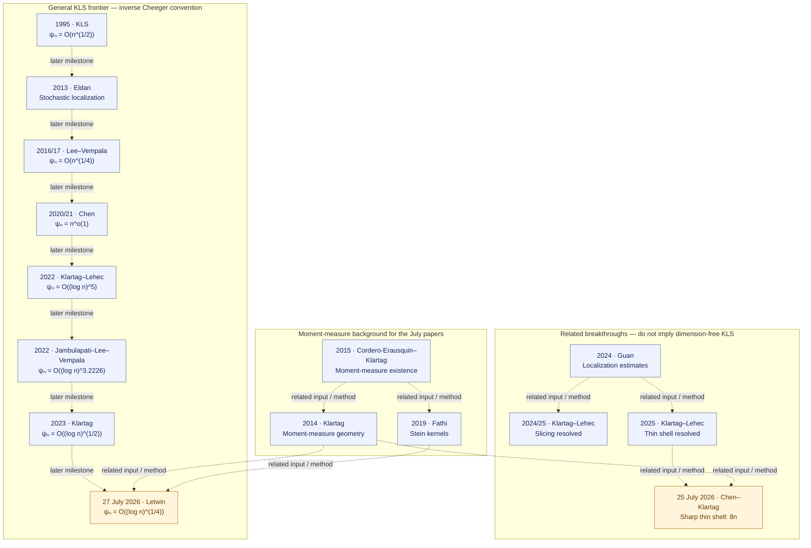
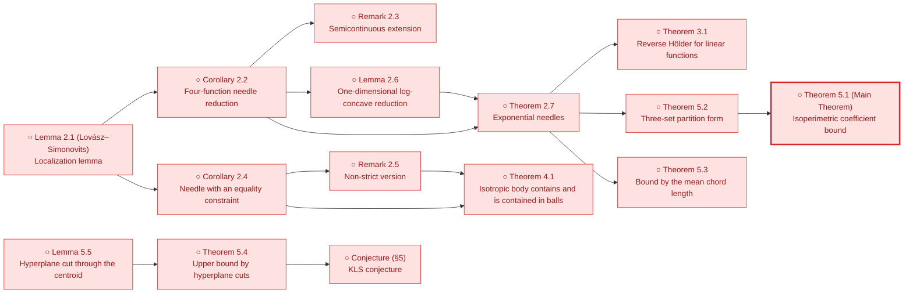
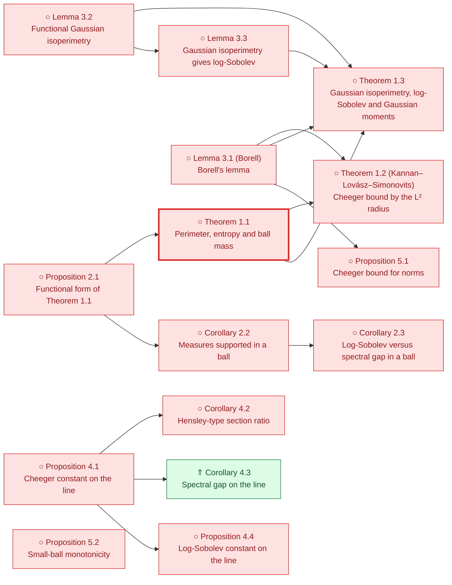
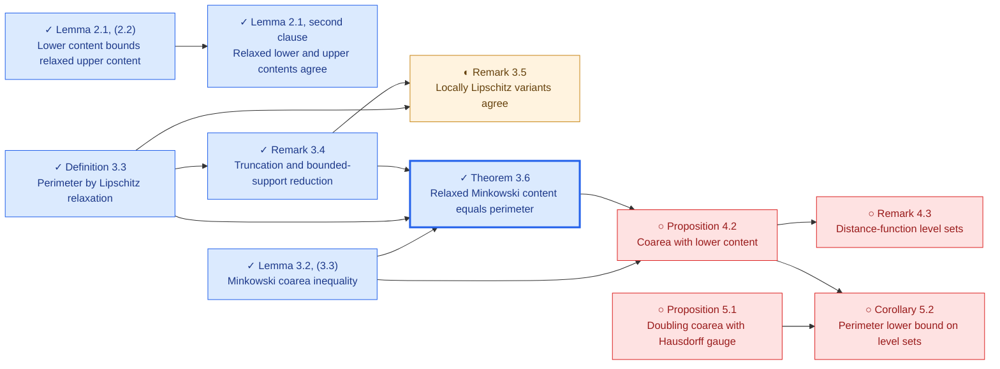
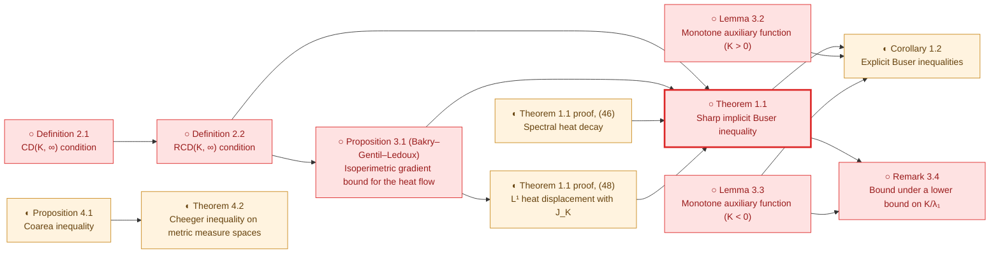

# KLS literature and local formalization

**Primary progress register** · [Progress hub](README.md) · [Route diagrams](README.md#proof-progress-tree) · [Node register](STATUS.md)

**Literature through July 2026 · Sources checked 2026-09-16 · 27 selected sources.**

Selected foundational sources, the main general KLS bound milestones, and the connected moment-map, slicing and thin-shell developments through July 2026; not an exhaustive bibliography or a paper-by-paper proof verification.

The literature has advanced to an inverse-Cheeger bound of order `(log n)^(1/4)` in the
[July 2026 Letwin preprint](https://arxiv.org/html/2607.24164v1). Our repository currently
formalizes selected analytic foundations and reductions; none of the general
dimension-dependent frontier bounds below is yet proved here. Dimension-free KLS remains open.

Publication status and local Lean status are separate columns. **◐ means named fragments or
restricted counterparts, never an entire paper; ○ means the selected main result is not
locally formalized.** A ✓ beside an individual local result is derived from the existing
Blueprint/progress records. It is not a new certificate or a certification of the source paper.

## When a paper is covered

A selected paper target is covered only after its main theorem has a faithful Lean statement
(including hypotheses, constants, normalization and dimensional scope), a proof without
nonstandard axioms, and a registered certificate with verification evidence for that exact
statement. A source review must identify the paper version and theorem being matched.
Supporting lemmas, restricted cases and conditional reductions do not meet this criterion.
**No complete paper target is currently registered as covered.** Existing fragment certificates
are listed explicitly below; an unregistered proved target is still awaiting certification.

## Current literature priorities

These are source-review and proof priorities, not claims that the targets are proved.
Every proof task must first pin its paper version, theorem, hypotheses and constants.

| Priority | Sources / target | Next action |
| --- | --- | --- |
| 1 | [Bakry–Gentil–Ledoux](https://link.springer.com/book/10.1007/978-3-319-00227-9) Audit the strongly log-concave Bakry–Émery C_P ≤ 1/ρ endpoint and select a separate Brascamp–Lieb source statement. | Pin the exact source theorem, positive-curvature assumptions and normalization; assess the existing Γ₂ and semigroup interfaces before proof work. |
| 2 | [Kannan–Lovász–Simonovits](https://link.springer.com/article/10.1007/BF02574061) Theorem 5.1, ψ(K) ≥ ln 2 / M₁(K) for convex bodies, through the needle reduction (Corollary 2.2, Lemma 2.6, Theorem 2.7). With the local Cheeger inequality it gives C_P ≲ E‖X − EX‖² for convex bodies. | Pin a proof of the cited localization lemma (Lovász–Simonovits 1993 or a modern account) and choose a Lean form for needles; keep the product denominator of (1.1) distinct from the min-denominator constant. |
| 3 | [E. Milman](https://arxiv.org/abs/0712.4092) Concentration implies a Cheeger bound under the source convexity hypotheses. | Pin the main theorem and its concentration/curvature assumptions; compare its analytic inputs with the current finite-dimensional Cheeger–Buser API. |
| 4 | [Eldan](https://arxiv.org/abs/1203.0893), [Lee–Vempala](https://annals.math.princeton.edu/2024/199-3/p02), [Chen](https://arxiv.org/abs/2011.13661), [Klartag–Lehec](https://arxiv.org/html/2203.15551v2), [Klartag](https://arxiv.org/html/2303.14938v2) Published stochastic-localization theorems and quantitative KLS bounds. | Reuse Mathlib probability foundations; build an isolated audited client of pinned external stochastic APIs before selecting the missing vector/matrix SDE bridges. |
| 5 | [Klartag–Lehec](https://arxiv.org/abs/2507.15495v2), [Chen–Klartag](https://arxiv.org/html/2607.23307v1), [Letwin](https://arxiv.org/html/2607.24164v1) Selected 2025–2026 thin-shell and quadratic-form results. | Retain exact preprint versions and assess moment-measure, stochastic and matrix-estimate dependencies; do not credit exploratory hypotheses as completed paper theorems. |

## Constant conventions

For isotropic log-concave laws, use `Var(f) ≤ C_P ∫‖∇f‖² dμ`, with no factor 1/2.
Write `h` for the Cheeger lower-bound constant with denominator `min(μ(A), 1−μ(A))`,
and `ψ = 1/h`, `ψₙ = sup_μ ψ(μ)` for the inverse convention. Some older papers use the
symbol ψ for h instead; their bounds are translated here. The original KLS paper also
uses a product denominator, so exact numerical constants cannot be copied unchanged.

The literature comparison is `ψ²/π ≤ C_P ≤ 4ψ²`; consequently `ψₙ = O((log n)^a)`
corresponds to `C_P = O((log n)^(2a))`. See [Letwin, introduction](https://arxiv.org/html/2607.24164v1#S1)
and [De Ponti–Mondino](https://arxiv.org/abs/1902.03835). The numerical comparison
for finite-dimensional log-concave laws is now a local Lean proof; the general RCD theorem
is not formalized here. Logarithmic bounds below use `n ≥ 2` (Guan’s iterated-log bound uses `n ≥ 3`).

## Literature map

Every node links to its source. Dashed arrows show later milestones or related methods,
**not logical implications, complete dependency lists, or Lean proof edges**. Blue is
literature context; amber highlights July 2026. Neither color means formalized.

The older dates in the KLS chain refer to first circulation/conference presentation;
the tables distinguish those dates from final journal publication. Slicing and thin shell
are separate achievements; their resolution does not give dimension-free KLS.

## Analytic foundations and selected local coverage

| Source and target theorem | Main result / role | Lean statements | Local coverage | Certificate | Remaining scope |
| --- | --- | --- | --- | --- | --- |
| [Borell — Convex measures on locally convex spaces](https://link.springer.com/article/10.1007/BF02384761) 1974 · Journal article Definition 1.1 and finite-dimensional density characterization | Convex/log-concave measures, inner measure and density representation on the affine support. | [Statement inventory](#borell1974-lean-statements) |  ✓ [Compact/Borel definitions with inner measure](../../formalization/blueprint/src/chapters/00-orientation-and-status.tex#L33) ✓ [Finite-dimensional intrinsic density representation](../../formalization/blueprint/src/chapters/00-orientation-and-status.tex#L95) | No paper-target certificate Supporting only: [`thm:borell-logconcave-density`](../../solutions/ThmBorellLogconcaveDensity.lean), [`thm:compact-borell-logconcavity-equivalence`](../../solutions/ThmCompactBorellLogconcavityEquivalence.lean) | The locally convex-space theory and the other convexity parameters are outside our finite-dimensional log-concave scope. |
| [Bobkov — Isoperimetric and analytic inequalities for log-concave probability measures](https://www-users.cse.umn.edu/~bobko001/papers/1999_AOP_Isop.pdf) 1999 · Journal article Corollary 4.3 and one-dimensional specialization | Cheeger/Poincaré inequalities for log-concave laws; the one-dimensional comparison yields C_P ≤ 12 Var. | [Statement inventory](#bobkov1999-lean-statements) |  ✓ [One-dimensional upper bound, now strengthened locally to 4 Var; the independent 12 Var proof is retained](../../formalization/blueprint/src/chapters/45-shared-analytic-bridges.tex#L700) | No paper-target certificate Supporting only: [`thm:one-dimensional-logconcave-poincare`](../../solutions/ThmOneDimensionalLogConcavePoincare.lean) | Our one-dimensional proof uses a different analytic argument. The paper’s general isoperimetric theory is not fully formalized. |
| [E. Milman — On the role of convexity in isoperimetry, spectral gap and concentration](https://arxiv.org/abs/0712.4092) 2009 · Journal article Main equivalence theorem | Under convexity, isoperimetry, spectral gap and concentration control one another up to universal constants. | No local target statement registered |  | No paper-target certificate | The full equivalence remains open locally; our forward infimum comparison is supporting infrastructure, not this theorem. |
| [Ambrosio–Gigli–Savaré — Density of Lipschitz functions and equivalence of weak gradients in metric measure spaces](https://arxiv.org/abs/1111.3730) 2011 preprint / 2013 publication · Journal article Weak-gradient and relaxed-energy equivalence theorems | Identifies weak-gradient notions and relaxed energies in metric measure spaces. | [Statement inventory](#ags2013-lean-statements) |  ✓ [Intrinsic absolutely-continuous E^can = 2 Ch in the local-slope convention](../../formalization/blueprint/src/chapters/30-open-canonical-bridges.tex#L121) | No paper-target certificate Supporting only: [`cor:absolutely-continuous-relaxation-two-cheeger`](../../solutions/CorAbsolutelyContinuousRelaxationTwoCheeger.lean) | The general metric-space theorem and unrestricted singular-law comparison are not formalized here. Our absolutely-continuous Euclidean identity is an independent restricted counterpart. |
| [Bakry–Gentil–Ledoux — Analysis and Geometry of Markov Diffusion Operators](https://link.springer.com/book/10.1007/978-3-319-00227-9) 2014 · Monograph Proposition 4.3.1; Gaussian Poincaré and Dirichlet-form background | Tensorization and Gaussian functional inequalities within the diffusion/Dirichlet-form framework. | [Statement inventory](#bgl2014-lean-statements) |  ✓ [Binary smooth-test tensorization](../../formalization/blueprint/src/chapters/40-certified-models.tex#L35) ✓ [Finite Hilbert-product constants, including empty products](../../formalization/blueprint/src/chapters/40-certified-models.tex#L52) ✓ [Exact one-dimensional Gaussian constant](../../formalization/blueprint/src/chapters/40-certified-models.tex#L70) | No paper-target certificate Supporting only: [`lem:poincare-finite-tensorization`](../../solutions/LemPoincareFiniteTensorization.lean), [`lem:poincare-gaussian-one-dimensional`](../../solutions/LemPoincareGaussianOneDimensional.lean), [`lem:poincare-tensorization`](../../solutions/LemPoincareTensorization.lean) | The full diffusion, semigroup and Γ-calculus theory is not covered by our selected results. |
| [Alonso-Gutiérrez–Bastero — Approaching the Kannan–Lovász–Simonovits and variance conjectures](https://link.springer.com/book/10.1007/978-3-319-13263-1) 2015 · Monograph Page 11; local source audit linked below | Records C_P ≤ 4 tr(Cov), whose one-dimensional specialization is 4 Var, in a broader account of KLS and the variance conjecture. | [Statement inventory](#alonsobastero2015-lean-statements) |  ✓ [One-dimensional 4 Var upper bound, including zero variance](../../formalization/blueprint/src/chapters/45-shared-analytic-bridges.tex#L700) | No paper-target certificate Supporting only: [`thm:one-dimensional-logconcave-poincare`](../../solutions/ThmOneDimensionalLogConcavePoincare.lean) | Only the one-dimensional bound is formalized here, by an independent proof. The high-dimensional trace bound, its original exact-constant attribution and optimality over all laws are not certified. |
| [Ambrosio–Di Marino–Gigli — Perimeter as relaxed Minkowski content in metric measure spaces](https://arxiv.org/abs/1603.08412) 2016 preprint / 2017 publication · Journal article Lemma 3.2; Theorem 3.6 | A Minkowski coarea inequality and identification of relaxed Minkowski content with BV perimeter. | [Statement inventory](#admg2017-lean-statements) |  ✓ [Minkowski coarea inequality in the local Euclidean scope](https://github.com/numina-functional-inequalities/kls-lean/blob/main/formalization/FunctionalInequalities/KLS/Geometry/Cheeger/MinkowskiContent.lean) ✓ [Published finite-mass target / finite-on-bounded measure scope: bounded-support reduction, full coarea radius chain, lower-to-upper recovery, both actual recoveries and both relaxed identities; convex closed-support Cheeger identification](https://github.com/numina-functional-inequalities/kls-lean/blob/main/formalization/FunctionalInequalities/KLS/Geometry/Cheeger/BVIdentification.lean) | No paper-target certificate | The complete lower/upper content, recovery and relaxation chain is formalized for finite Borel measures on arbitrary metric spaces. The new continuation proves the globally Lipschitz/global L1 bounded-support reduction of Remark 3.4 for every measurable finite-mass target under any Borel measure, the direct positive-level local-slope coarea upper bound under finite mass of a positive-support neighborhood (all levels for nonnegative functions), and perimeter at most lower content at measurable finite-mass targets. Under finiteness on bounded Borel sets, actual bounded measurable lower-recovery sets have finite mass and finite lower content term by term; indicators converge globally in L1 and lower contents converge to perimeter. The existing relaxed lower-content set infimum equals the perimeter at Theorem 3.6's measurable finite-mass target scope, including infinite perimeter and infinite total mass; convergence ensures eventual finite approximating-set masses without changing the class or excluding infinite-mass finite prefixes. Finite target mass and finite lower content imply a finite-mass positive neighborhood. Actual lower-to-upper radius recovery holds there, and a diagonal sequence gives bounded open upper-recovery sets with finite masses/contents and original global indicator L1 convergence. The existing relaxed upper infimum equals perimeter, hence the lower relaxation, at the published finite-mass target scope, including infinite perimeter by order. The full Lemma 3.2 chain is formalized with the actual right-radius liminf of integrated open-ball growth under nonnegativity and finite positive-support-neighborhood mass. Lemma 2.1 exposes the actual relaxed-upper <= lower-content bound at finite-mass Borel targets under any measure. Lemma 2.1's relaxed lower/upper-content equality is also formalized for every Borel measure at measurable finite-mass targets, and on proper metric spaces Remark 3.5's locally Lipschitz classes with global or compact-set L1 convergence have relaxation infima equal to the bounded-support perimeter at measurable finite-mass targets for every Borel measure (2026-10-01). The locally Lipschitz classes on nonproper spaces, nonconvex ambient/support transfer and general RCD comparisons remain pending. These local Lean results do not add ledger certificates; remote Lean verification is a separate check. |
| [De Ponti–Mondino — Sharp Cheeger–Buser type inequalities in RCD(K,∞) spaces](https://arxiv.org/abs/1902.03835) 2019 preprint / 2021 publication · Journal article Cheeger–Buser comparison; log-concave specialization in Letwin, introduction | Provides the sharp reverse-comparison input used to normalize ψ² and C_P; in the log-concave convention, 1/4 ≤ ψ²/C_P ≤ π. | [Statement inventory](#depontimondino2021-lean-statements) |  ✓ [Both numerical inequalities for every finite-dimensional log-concave probability law, including zero-dimensional affine support and extended optima](../../formalization/blueprint/src/chapters/45-shared-analytic-bridges.tex#L198) ✓ [Closed-support BV Cheeger constant equals the isoperimetric constant for finite-dimensional log-concave laws](https://github.com/numina-functional-inequalities/kls-lean/blob/main/formalization/FunctionalInequalities/KLS/Geometry/Cheeger/BVIdentification.lean) | No paper-target certificate | The numerical comparison is formalized for finite-dimensional log-concave laws. For the bounded-support metric BV test class, complement symmetry for finite measures, the half-mass/symmetric equality, the BV–Minkowski Cheeger identification for probability laws on normed spaces, and, for finite-dimensional log-concave laws, the identification of the BV Cheeger constant on the closed intrinsic support with the isoperimetric constant are formalized. Test-class equivalence is formalized for finite Borel measures (global Lipschitz/global L¹), and on proper spaces also for locally Lipschitz/global or compact-local L¹ approximants. The test-class comparison beyond this scope, constant identification on nonconvex supports, and the paper's RCD(K,∞) theorem remain unformalized. |

## General KLS bounds and stochastic localization

| Source and target theorem | Main result / role | Lean statements | Local coverage | Certificate | Remaining scope |
| --- | --- | --- | --- | --- | --- |
| [Kannan–Lovász–Simonovits — Isoperimetric problems for convex bodies and a localization lemma](https://link.springer.com/article/10.1007/BF02574061) 1995 · Journal article Theorem 5.1 (Main Theorem); needle reduction of Section 2 | For every convex body K, ψ(K) ≥ ln 2 / M₁(K), with M₁ the mean distance to the centroid; for isotropic bodies this is the dimension-scale bound ψₙ = O(n^(1/2)). States the KLS conjecture. The localization lemma is quoted from Lovász–Simonovits (1993) and extended to exponential needles. | No local target statement registered |  | No paper-target certificate | No statement of the paper is formalized. The localization lemma (Lemma 2.1) is only cited, so a Lean proof needs Lovász–Simonovits (1993) or a later proof. The paper proves no Poincaré or covariance bound; with the local Cheeger inequality, Theorem 5.1 would give C_P ≤ (16 / ln² 2) E‖X − EX‖² for convex bodies, the factor 2 coming from the product denominator, once the paper's boundary measure is matched with the local outer Minkowski content. |
| [Eldan — Thin shell implies spectral gap up to polylog via a stochastic localization scheme](https://arxiv.org/abs/1203.0893) 2012 preprint / 2013 publication · Journal article Main thin-shell/spectral-gap comparison | Introduces stochastic localization and transfers thin-shell control to KLS with logarithmic losses. | No local target statement registered |  | No paper-target certificate | The stochastic process, its covariance estimates and the transfer theorem are not locally formalized. |
| [Lee–Vempala — Eldan’s stochastic localization and the KLS conjecture: Isoperimetry, concentration and mixing](https://annals.math.princeton.edu/2024/199-3/p02) 2016 preprint / 2017 FOCS / 2024 journal · Journal article Main Poincaré estimate | For isotropic log-concave laws, C_P = O(n^(1/2)), equivalently ψₙ = O(n^(1/4)); the paper also studies mixing and concentration. | No local target statement registered |  | No paper-target certificate | The quantitative localization theorem, covariance bounds and mixing results are not locally formalized. |
| [Chen — An almost constant lower bound of the isoperimetric coefficient in the KLS conjecture](https://arxiv.org/abs/2011.13661) 2020 preprint / 2021 publication · Journal article Main bound, translated from the lower-bound convention for h | ψₙ ≤ exp(C√(log n · log log n)) = n^o(1); hence C_P = n^o(1), breaking the polynomial barrier. | No local target statement registered |  | No paper-target certificate | The stochastic-localization bootstrap and the subpolynomial bound are not locally formalized. |
| [Klartag–Lehec — Bourgain’s slicing problem and KLS isoperimetry up to polylog](https://arxiv.org/html/2203.15551v2) 2022 · Journal article Theorem 1.1 and end of Section 6 | First polylogarithmic KLS bound: ψₙ = O((log n)^5), hence C_P = O((log n)^10). | No local target statement registered |  | No paper-target certificate | The localization covariance window and spectral argument are not locally formalized. |
| [Jambulapati–Lee–Vempala — A slightly improved bound for the KLS constant](https://arxiv.org/html/2208.11644v2) 2022 · Preprint (v2) Theorem 2 | Improves the logarithmic exponent: ψₙ = O((log n)^3.2226), hence C_P = O((log n)^6.4452). | No local target statement registered |  | No paper-target certificate | The refined localization growth estimate and resulting bound are not locally formalized. |
| [Klartag — Logarithmic bounds for isoperimetry and slices of convex sets](https://arxiv.org/html/2303.14938v2) 2023 · Journal article Theorems 1.2 and 1.3 | ψₙ = O(√log n), hence C_P = O(log n), using an improved log-concave Lichnerowicz inequality. | No local target statement registered |  | No paper-target certificate | The improved Lichnerowicz estimate and stochastic localization remain unformalized locally. |
| [Letwin — The KLS constant is O(log^(1/4) n)](https://arxiv.org/html/2607.24164v1) 27 July 2026 · Preprint (v1) Theorems 1.1 and 1.2 | For isotropic log-concave X and symmetric M, Var(XᵀMX) ≤ 8‖M‖²_HS = 2 E‖∇(XᵀMX)‖². For n ≥ 2, ψₙ = O((log n)^(1/4)), hence C_P = O(√log n). | No local target statement registered |  | No paper-target certificate | The quadratic inequality, its moment-map/Stein proof and the κₙ-to-KLS conversion are not locally formalized. Quadratic tests do not suffice for full KLS. |

## Moment measures and Stein kernels

| Source and target theorem | Main result / role | Lean statements | Local coverage | Certificate | Remaining scope |
| --- | --- | --- | --- | --- | --- |
| [Klartag — Logarithmically-concave moment measures I](https://arxiv.org/abs/1309.2767) 2013 preprint / 2014 publication · Book chapter Theorem 1.1; weighted moment-measure geometry | Develops the Hessian metric and weighted Poincaré structure associated with log-concave moment measures. | No local target statement registered |  | No paper-target certificate | Moment-map existence/regularity, the Hessian metric and weighted geometric identities are not locally formalized. |
| [Cordero-Erausquin–Klartag — Moment measures](https://arxiv.org/abs/1304.0630) 2013 preprint / 2015 publication · Journal article Theorem 2 | A nonzero finite centered measure whose support spans the space is the moment measure of an essentially continuous convex potential, unique up to translation. | No local target statement registered |  | No paper-target certificate | The existence/uniqueness theorem is not locally formalized; generic closed forms do not supply its convex potential. |
| [Fathi — Stein kernels and moment maps](https://arxiv.org/abs/1804.04699) 2018 preprint / 2019 publication · Journal article Moment-map Stein-kernel construction | Constructs Stein kernels using moment maps, connecting Hessian geometry to probabilistic identities. | No local target statement registered |  | No paper-target certificate | The canonical moment-map Stein kernel is not locally formalized. |

## Thin shell and slicing

| Source and target theorem | Main result / role | Lean statements | Local coverage | Certificate | Remaining scope |
| --- | --- | --- | --- | --- | --- |
| [Guédon–Milman — Interpolating thin-shell and sharp large-deviation estimates for isotropic log-concave measures](https://arxiv.org/abs/1011.0943v3) 2010 preprint / 2011 publication · Journal article Main deviation estimate | Quantitative radial concentration across thin-shell and large-deviation scales for isotropic log-concave laws. | No local target statement registered |  | No paper-target certificate | Radial deviation estimates and their thin-shell/isoperimetric consequences are not locally formalized. |
| [Guan — A note on Bourgain’s slicing problem](https://arxiv.org/html/2412.09075v1) 2024 · Preprint (v1) Theorems 1.1 and 1.2; covariance estimates | Obtains an iterated-logarithmic slicing bound and localization estimates used in the later slicing and thin-shell work. | No local target statement registered |  | No paper-target certificate | The covariance process and Guan’s estimates are not locally formalized. |
| [Klartag–Lehec — Affirmative resolution of Bourgain’s slicing problem using Guan’s bound](https://arxiv.org/abs/2412.15044) 2024 preprint / 2025 publication · Journal article Main slicing theorem | Every volume-one convex body has a hyperplane section of volume at least a universal positive constant. This resolves slicing, not KLS. | No local target statement registered |  | No paper-target certificate | The slicing theorem, M-ellipsoids and entropy-stability inputs are not locally formalized. |
| [Bizeul — The slicing conjecture via small ball estimates](https://arxiv.org/abs/2501.06854) 2025 · Preprint Main alternative proof | An alternative proof of slicing via small-ball estimates and Guan’s localization bound. | No local target statement registered |  | No paper-target certificate | The small-ball argument and slicing conclusion are not locally formalized. |
| [Klartag–Lehec — Thin-shell bounds via parallel coupling](https://arxiv.org/abs/2507.15495v2) 21 July 2025 / v2 23 February 2026 · Preprint (v2) Main thin-shell theorem | For isotropic log-concave X, E(‖X‖ − √n)² ≤ C with a universal constant, via parallel coupling. | No local target statement registered |  | No paper-target certificate | The coupling construction and dimension-free thin-shell theorem are not locally formalized; thin shell alone does not remove the KLS logarithms. |
| [Chen–Klartag — Digesting the proof of the sharp thin-shell inequality](https://arxiv.org/html/2607.23307v1) 25 July 2026 · Preprint (v1) Theorems 1.1, 1.2 and 1.5 | For isotropic log-concave X: Var(‖X‖²) ≤ 8n and ‖T₃(X)‖²_HS ≤ 4n. The constants are sharp. | No local target statement registered |  | No paper-target certificate | The moment-Hessian estimate, third-order tensor identities and sharp conclusions are not locally formalized. A trace bound is not a universal matrix bound. |

## Reading guides

| Source and target theorem | Main result / role | Lean statements | Local coverage | Certificate | Remaining scope |
| --- | --- | --- | --- | --- | --- |
| [Lee–Vempala — The Kannan–Lovász–Simonovits conjecture](https://arxiv.org/abs/1807.03465) 2018 · Survey preprint Survey | A guide to KLS formulations, geometric consequences and algorithmic motivation at the 2018 frontier. | No local target statement registered |  | No paper-target certificate | Use for orientation; its historical frontier is superseded by the later papers in the frontier table. |
| [Klartag–Lehec — Isoperimetric inequalities in high-dimensional convex sets](https://arxiv.org/abs/2406.01324) 2024 preprint / 2025 publication · Published lecture notes Lecture notes | A detailed entry point to stochastic localization, KLS and slicing up to the period covered by the notes. | No local target statement registered |  | No paper-target certificate | Reading guide; the July 2026 frontier requires the newer sources in the frontier table. |

## Paper lemma maps

Each map lists the numbered statements of one pinned source and the Lean declarations
that state them. ✓, ◐ and ○ are derived from the declarations: no declaration is ○, a
declaration whose body contains `sorry` or a recorded partial scope is ◐. ⇑ marks a
reviewed stronger statement or a different proof route; dropping a hypothesis the paper
never uses stays ✓. A paper is covered only by its certified main theorem (thick border).

✓ Formalized in Lean · ◐ Partial or statement only · ○ Not yet formalized · ⇑ Stronger result or alternative route

### KLS1995 lemma map

Source: [Kannan–Lovász–Simonovits, Discrete Comput. Geom. 13 (1995), 541–559](https://link.springer.com/article/10.1007/BF02574061), reviewed 2026-10-02.

Standing assumptions: Convex bodies in R^n with Lebesgue (uniform) measure; the isoperimetric coefficient ψ(K) uses the product denominator vol(S)·vol(K∖S)/vol(K) of (1.1), within a factor 2 of the min-denominator form (1.2).

| Item | Statement | Status | Lean declarations | Note |
| --- | --- | --- | --- | --- |
| Lemma 2.1 (Lovász–Simonovits) | For lower semicontinuous integrable g, h on R^n with positive integrals, some needle (segment with a linear weight to the power n−1) has positive g- and h-integrals. | ○ Not yet formalized | — | Cited from Lovász–Simonovits (1993); its proof is not in this paper. |
| Corollary 2.2 | For nonnegative continuous f1..f4 and α, β > 0, an inequality between products of integral powers holds on every convex body iff it holds on every needle. | ○ Not yet formalized | — |  |
| Remark 2.3 | Corollary 2.2 extends to upper semicontinuous f1, f2 and lower semicontinuous f3, f4. | ○ Not yet formalized | — |  |
| Corollary 2.4 | On a bounded open convex T, if ∫g > 0 and ∫h = 0 for bounded lower semicontinuous g and continuous h, some needle in T has positive g-integral and zero h-integral. | ○ Not yet formalized | — |  |
| Remark 2.5 | Strict inequalities in Corollary 2.4 may be replaced by non-strict ones. | ○ Not yet formalized | — |  |
| Lemma 2.6 | On an interval, a four-function inequality holds for every log-concave weight iff it holds for every exponential weight on every subinterval. | ○ Not yet formalized | — |  |
| Theorem 2.7 | For nonnegative continuous f1..f4 on R^n, the four-function inequality holds for every compactly supported log-concave F iff it holds on every exponential needle. | ○ Not yet formalized | — |  |
| Theorem 3.1 | For 0 < p < q there is C(p, q), independent of n and K, with ‖f‖_q ≤ C(p, q)‖f‖_p for every linear f on a convex body K. | ○ Not yet formalized | — |  |
| Theorem 4.1 | An isotropic convex body satisfies √((n+2)/n) B ⊆ K ⊆ √(n(n+2)) B. | ○ Not yet formalized | — |  |
| **Theorem 5.1 (Main Theorem)** (main) | For every convex body K, ψ(K) ≥ ln 2 / M₁(K), where M₁ is the mean distance to the centroid. | ○ Not yet formalized | — | Convex bodies only; the later log-concave version is quoted as Theorem 5.11 of Milman (2009). |
| Theorem 5.2 | If K = K1 ∪ K2 ∪ K3 with dist(K1, K2) ≥ ε > 0, then ε·vol(K1)·vol(K2) ≤ vol(K)·vol(K3)·M₁(K)/ln 2. | ○ Not yet formalized | — |  |
| Theorem 5.3 | ψ(K) ≥ 1/χ(K), where χ(K) averages the longest chord of K centred at each point. | ○ Not yet formalized | — |  |
| Conjecture (§5) | ψ(K) is of order 1/√a(K), where a(K) is the largest eigenvalue of the inertia matrix. | ○ Not yet formalized | — | The repository states a covariance-normalized Poincaré version for log-concave laws (KLS.Conjecture); it is not a literal form of this convex-body conjecture. |
| Theorem 5.4 | ψ(K) ≤ 10/√a(K) for every convex body K. | ○ Not yet formalized | — |  |
| Lemma 5.5 | For b(K) = 0 and a unit vector u, the two halves of K cut by u^⊥ satisfy a product-volume bound against the section area and β = E(u·x)². | ○ Not yet formalized | — |  |

Not listed: Remark 2.8 is a normalization comment. The paper proves no Poincaré or trace-of-covariance bound; those appear in later literature.

### Bobkov1999 lemma map

Source: [Bobkov, Ann. Probab. 27 (1999), no. 4, 1903–1921 (author PDF)](https://www-users.cse.umn.edu/~bobko001/papers/1999_AOP_Isop.pdf), reviewed 2026-10-02.

Standing assumptions: Absolutely continuous log-concave probability measures on R^n; μ⁺ is the Minkowski boundary measure; Is(μ) is the min-denominator Cheeger constant h, λ₁ = 1/C_P is the spectral gap and ρ the log-Sobolev constant.

| Item | Statement | Status | Lean declarations | Note |
| --- | --- | --- | --- | --- |
| **Theorem 1.1** (main) | For log-concave μ on R^n, every measurable A, x₀ and r > 0: 2rμ⁺(A) ≥ μ(A)log(1/μ(A)) + (1 − μ(A))log(1/(1 − μ(A))) + log μ{&#124;x − x₀&#124; ≤ r}. | ○ Not yet formalized | — |  |
| Theorem 1.2 (Kannan–Lovász–Simonovits) | Is(μ) ≥ 1/(K‖&#124;x − x₀&#124;‖_{L²(μ)}) with x₀ the barycenter and K universal; hence λ₁ ≥ 1/(4K²‖&#124;x − x₀&#124;‖²_{L²}) by Cheeger. | ○ Not yet formalized | — | The proof gives Is(μ) ≥ 1/(6r) with r the 2/3-quantile of &#124;x − x₀&#124; (3.3). |
| Theorem 1.3 | For log-concave μ, Gaussian-type isoperimetry, a log-Sobolev inequality and ∫exp(ε&#124;x&#124;²)dμ < ∞ are equivalent, with ρ ≥ 1/(K‖&#124;x − x₀&#124;‖²_ψ) for ψ(u) = exp(u²) − 1. | ○ Not yet formalized | — |  |
| Proposition 2.1 | For locally Lipschitz f with values in [0, 1] and a symmetric convex body B: 2∫‖∇f‖_{B°}dμ ≥ Ent(f) + Ent(1 − f) + log μ(B(x₀)). | ○ Not yet formalized | — | Proved by the Prékopa–Leindler inequality. |
| Corollary 2.2 | If μ is concentrated in a ball of radius r, then 2r∫&#124;∇f&#124;dμ ≥ Ent(f) + Ent(1 − f) and 2rμ⁺(A) ≥ μ(A)log(1/μ(A)) + (1 − μ(A))log(1/(1 − μ(A))); hence Is(μ) ≥ log 2/r and λ₁ ≥ log²2/(4r²). | ○ Not yet formalized | — |  |
| Corollary 2.3 | If μ is concentrated in a ball of radius r, then λ₁/(1 + 2r√λ₁) ≤ ρ ≤ λ₁, so ρ ≥ 1/(10r²). | ○ Not yet formalized | — |  |
| Lemma 3.1 (Borell) | For symmetric convex B with θ = μ(B) > 1/2 and t ≥ 1: 1 − μ(tB) ≤ (1 − θ)((1 − θ)/θ)^((t−1)/2). | ○ Not yet formalized | — |  |
| Lemma 3.2 | If μ⁺(A) ≥ cI(μ(A)) for the Gaussian isoperimetric function I, then c[I(∫f) − ∫I(f)] ≤ ∫&#124;∇f&#124; for locally Lipschitz f with values in [0, 1]. | ○ Not yet formalized | — |  |
| Lemma 3.3 | Inequality (3.10) implies (c²/2)Ent(f²) ≤ ∫&#124;∇f&#124;² dμ. | ○ Not yet formalized | — |  |
| Proposition 4.1 | For log-concave μ on R: 1/(3Var) ≤ Is²(μ) ≤ 2/Var, with equality cases the uniform and two-sided exponential laws; Is(μ) = 2f(m) at the median. | ○ Not yet formalized | — | Locally only weaker bounds are proved: Ψ² ≤ 12 C_P on the line and Ψ² ≤ π C_P in general, which with C_P ≤ 4 Var do not give the constant 3. |
| Corollary 4.2 | For a convex body satisfying the isotropy condition, central sections by hyperplanes cutting B into equal volumes have ratio at most √6. | ○ Not yet formalized | — |  |
| Corollary 4.3 | For log-concave μ on R: 1/(12 Var) ≤ λ₁ ≤ 1/Var, i.e. Var ≤ C_P ≤ 12 Var. | ⇑ Stronger result or alternative route | [`localSlope_constant_le_four_variance`](../../formalization/FunctionalInequalities/KLS/LogConcave/Line/SharpPoincare.lean) [`localSlope_constant_le_twelve_variance_of_four`](../../formalization/FunctionalInequalities/KLS/LogConcave/Line/SharpPoincare.lean) [`evariance_le_smoothTest_constant`](../../formalization/FunctionalInequalities/KLS/LogConcave/Line/Buser.lean) | Sharper upper constant C_P ≤ 4 Var, proved by a different argument that does not use Proposition 4.1; the paper's 12 Var follows as a corollary, and Var ≤ C_P is the linear test. |
| Proposition 4.4 | For log-concave μ on R: 1/(24‖ξ − Eξ‖²_ψ) ≤ ρ ≤ 8/(3‖ξ − Eξ‖²_ψ) with ψ(x) = exp(x²) − 1. | ○ Not yet formalized | — |  |
| Proposition 5.1 | For a random vector X with log-concave law in a normed space, Is(μ_X) ≥ 1/(6r) with r the 2/3-quantile of ‖X‖, where μ_X is the law of ‖X‖. | ○ Not yet formalized | — |  |
| Proposition 5.2 | With F(t) = P(‖X‖ ≤ t), the function F(t)/t^(1/(2e)) is nondecreasing where 0 < F(t) ≤ e/(e + 1). | ○ Not yet formalized | — |  |

Not listed: The displayed consequences (1.8), (2.7), (2.8) and (2.10) are recorded with the statements they follow from.

### Milman2009 lemma map

Source: [E. Milman, arXiv:0712.4092v5](https://arxiv.org/abs/0712.4092v5), reviewed 2026-10-02.

Standing assumptions: Metric probability spaces; "convexity assumptions" mean total-variation limits of weighted Riemannian manifolds with Ric + Hess ψ ≥ 0. D_Che is the min-denominator Cheeger constant h and D_Poin = 1/√C_P, so D_Poin ≥ D_Che/2 is C_P ≤ 4Ψ². Attributed statements are quoted from the cited authors.

```mermaid
flowchart LR
    Milman2009_DChe["◐ Definition (§1.1, Cheeger)<br/>Cheeger constant D_Che"]
    Milman2009_DPoin["◐ Definition (§1.1, Poincaré)<br/>Poincaré constant D_Poin"]
    Milman2009_DExp["○ Definition (§1.1, exponential concentration)<br/>Exponential concentration D_Exp"]
    Milman2009_DFM["○ Definition (§1.3, first moment)<br/>First-moment concentration D_FM"]
    Milman2009_T11["◐ Theorem 1.1 (Maz'ya, Cheeger)<br/>Cheeger inequality"]
    Milman2009_T12["○ Theorem 1.2 (Gromov–Milman)<br/>Poincaré implies exponential concentration"]
    Milman2009_T13["○ Theorem 1.3 (Buser)<br/>Buser inequality on closed manifolds"]
    Milman2009_T14["◐ Theorem 1.4 (Ledoux)<br/>Buser–Ledoux inequality"]
    Milman2009_T15["○ Theorem 1.5 (Main Theorem)<br/>Cheeger, Poincaré and concentration are equivalent"]
    Milman2009_T16["○ Theorem 1.6<br/>Lipschitz-distance form of D_Che"]
    Milman2009_T17["○ Theorem 1.7<br/>Stability of D_Che for convex domains"]
    Milman2009_T18["○ Theorem 1.8 (Bavard–Pansu, …, Bobkov)<br/>Concavity of the isoperimetric profile"]
    Milman2009_L21["○ Lemma 2.1<br/>Mean versus median in Orlicz norms"]
    Milman2009_L22["○ Lemma 2.2 (Maz'ya, Federer–Fleming, Bobkov–Houdré)<br/>Cheeger as an L¹ Poincaré inequality"]
    Milman2009_R23["✓ Remark 2.3<br/>Metric gradient"]
    Milman2009_T24["○ Theorem 2.4<br/>All (p, q) Poincaré inequalities are equivalent"]
    Milman2009_P25["○ Proposition 2.5<br/>Monotonicity of (p, q) constants"]
    Milman2009_C26["◐ Corollary 2.6<br/>Maz'ya–Cheeger inequality, new proof"]
    Milman2009_C27["○ Corollary 2.7<br/>Gromov–Milman inequality, new proof"]
    Milman2009_R28["○ Remark 2.8<br/>Concentration from (r, r) Poincaré"]
    Milman2009_T29["○ Theorem 2.9<br/>Poincaré versus profile decay"]
    Milman2009_P210["○ Proposition 2.10 (Maz'ya, Federer–Fleming, Bobkov–Houdré)<br/>L¹-type Poincaré versus isoperimetry"]
    Milman2009_R211["○ Remark 2.11<br/>Uniform measures strengthen the results"]
    Milman2009_L31["◐ Lemma 3.1 (Bakry–Ledoux)<br/>Reverse local Poincaré inequality"]
    Milman2009_C32["◐ Corollary 3.2 (Ledoux)<br/>L¹ heat displacement"]
    Milman2009_L41["○ Lemma 4.1<br/>Paley–Zygmund-type quantile bound"]
    Milman2009_P42["○ Proposition 4.2<br/>Optimal 1-Lipschitz functions behave like linear ones"]
    Milman2009_C43["○ Corollary 4.3<br/>Slow tail decay suffices"]
    Milman2009_L51["○ Lemma 5.1<br/>Going down to a large convex subset"]
    Milman2009_L52["○ Lemma 5.2<br/>Going up to a convex superset"]
    Milman2009_C53["○ Corollary 5.3<br/>Stability under Banach–Mazur-close bodies"]
    Milman2009_L54["○ Lemma 5.4<br/>Log-concave version of Lemmas 5.1–5.2"]
    Milman2009_T55["○ Theorem 5.5<br/>Total-variation stability of D_Che"]
    Milman2009_E56["○ Example 5.6<br/>Optimality of the stability exponent"]
    Milman2009_E57["○ Example 5.7<br/>Optimality of Corollary 5.3"]
    Milman2009_R58["○ Remark 5.8<br/>Sharper stability near the Euclidean ball"]
    Milman2009_T59["○ Theorem 5.9<br/>Lipschitz-on-average transport"]
    Milman2009_T510["○ Theorem 5.10 (Payne–Weinberger, Li–Yau)<br/>Diameter bound for convex domains"]
    Milman2009_T511["○ Theorem 5.11 (Kannan–Lovász–Simonovits)<br/>KLS first-moment bound"]
    Milman2009_T512["○ Theorem 5.12<br/>First-moment bound under convexity assumptions"]
    Milman2009_T514["○ Theorem 5.14 (Kannan–Lovász–Simonovits)<br/>Mean chord bound"]
    Milman2009_T515["○ Theorem 5.15 (Bobkov)<br/>Variance-of-norm bound"]
    Milman2009_T516["○ Theorem 5.16 (Sodin)<br/>Uniform bound for ℓ_p balls"]
    Milman2009_L61["○ Lemma 6.1<br/>Profile lower semicontinuity from above"]
    Milman2009_L62["○ Lemma 6.2<br/>Profile lower semicontinuity from within"]
    Milman2009_P64["○ Proposition 6.4 (Maz'ya, Federer–Fleming, Bobkov–Houdré)<br/>Profile versus capacity"]
    Milman2009_C65["○ Corollary 6.5<br/>Profile symmetry"]
    Milman2009_L66["○ Lemma 6.6<br/>Upper semicontinuity under concavity"]
    Milman2009_P68["○ Proposition 6.8<br/>Convergence of profiles"]
    Milman2009_L69["○ Lemma 6.9<br/>Hölder continuity of the profile"]
    Milman2009_T610["○ Theorem 6.10<br/>Approximation preserves concavity"]
    Milman2009_C611["○ Corollary 6.11<br/>Convex bodies satisfy the assumptions"]
    Milman2009_C612["○ Corollary 6.12<br/>Log-concave measures satisfy the assumptions"]
    Milman2009_L613["○ Lemma 6.13<br/>Borell-type tail bound"]
    Milman2009_T614["○ Theorem 6.14 (Cordero-Erausquin–McCann–Schmuckenschläger)<br/>Riemannian Prékopa–Leindler"]
    Milman2009_TA1["○ Theorem A.1 (Bavard–Pansu, …, Bayle–Rosales)<br/>Concavity for uniform measures"]
    Milman2009_TA2["○ Theorem A.2 (Bayle, Morgan)<br/>Concavity for weighted manifolds"]
    Milman2009_TA3["○ Theorem A.3 (after Sternberg–Zumbrun, Bayle)<br/>Concavity on locally convex domains"]
    Milman2009_TA4["○ Theorem A.4 (Bobkov)<br/>One-dimensional log-concave profile"]
    Milman2009_RA5["○ Remark A.5<br/>Half-lines are minimizers"]
    Milman2009_DChe --> Milman2009_T11
    Milman2009_DPoin --> Milman2009_T11
    Milman2009_DExp --> Milman2009_T12
    Milman2009_DPoin --> Milman2009_T12
    Milman2009_L31 --> Milman2009_T14
    Milman2009_T24 --> Milman2009_T15
    Milman2009_C26 --> Milman2009_T15
    Milman2009_C27 --> Milman2009_T15
    Milman2009_T610 --> Milman2009_T15
    Milman2009_L613 --> Milman2009_T15
    Milman2009_L22 --> Milman2009_T16
    Milman2009_L21 --> Milman2009_T16
    Milman2009_T15 --> Milman2009_T16
    Milman2009_L51 --> Milman2009_T17
    Milman2009_L52 --> Milman2009_T17
    Milman2009_TA1 --> Milman2009_T18
    Milman2009_TA2 --> Milman2009_T18
    Milman2009_TA3 --> Milman2009_T18
    Milman2009_TA4 --> Milman2009_T18
    Milman2009_DChe --> Milman2009_L22
    Milman2009_T29 --> Milman2009_T24
    Milman2009_T18 --> Milman2009_T24
    Milman2009_P25 --> Milman2009_T24
    Milman2009_C65 --> Milman2009_T24
    Milman2009_P25 --> Milman2009_C26
    Milman2009_L22 --> Milman2009_C26
    Milman2009_L21 --> Milman2009_C27
    Milman2009_P25 --> Milman2009_C27
    Milman2009_C27 --> Milman2009_R28
    Milman2009_C32 --> Milman2009_T29
    Milman2009_L21 --> Milman2009_T29
    Milman2009_P25 --> Milman2009_T29
    Milman2009_P210 --> Milman2009_T29
    Milman2009_T18 --> Milman2009_R211
    Milman2009_P210 --> Milman2009_R211
    Milman2009_L31 --> Milman2009_C32
    Milman2009_C27 --> Milman2009_P42
    Milman2009_L613 --> Milman2009_P42
    Milman2009_L21 --> Milman2009_P42
    Milman2009_L41 --> Milman2009_P42
    Milman2009_P42 --> Milman2009_C43
    Milman2009_P42 --> Milman2009_L51
    Milman2009_L21 --> Milman2009_L51
    Milman2009_C611 --> Milman2009_L52
    Milman2009_C612 --> Milman2009_L52
    Milman2009_T18 --> Milman2009_L52
    Milman2009_T610 --> Milman2009_L52
    Milman2009_L51 --> Milman2009_C53
    Milman2009_L52 --> Milman2009_C53
    Milman2009_L51 --> Milman2009_L54
    Milman2009_L52 --> Milman2009_L54
    Milman2009_L54 --> Milman2009_T55
    Milman2009_T17 --> Milman2009_E56
    Milman2009_C53 --> Milman2009_E57
    Milman2009_L51 --> Milman2009_R58
    Milman2009_C53 --> Milman2009_R58
    Milman2009_L22 --> Milman2009_T59
    Milman2009_L21 --> Milman2009_T59
    Milman2009_T15 --> Milman2009_T512
    Milman2009_T514 --> Milman2009_T515
    Milman2009_T512 --> Milman2009_T515
    Milman2009_T55 --> Milman2009_T515
    Milman2009_P64 --> Milman2009_C65
    Milman2009_L61 --> Milman2009_P68
    Milman2009_L62 --> Milman2009_P68
    Milman2009_L66 --> Milman2009_P68
    Milman2009_P68 --> Milman2009_T610
    Milman2009_L69 --> Milman2009_T610
    Milman2009_T18 --> Milman2009_T610
    Milman2009_T610 --> Milman2009_C611
    Milman2009_T610 --> Milman2009_C612
    Milman2009_TA4 --> Milman2009_C612
    Milman2009_T614 --> Milman2009_L613
    Milman2009_TA4 --> Milman2009_RA5
    classDef lemma_formalized fill:#dbeafe,stroke:#2563eb,color:#1e3a8a;
    class Milman2009_R23 lemma_formalized;
    classDef lemma_partial fill:#fff3df,stroke:#c88719,color:#66420d;
    class Milman2009_DChe,Milman2009_DPoin,Milman2009_T11,Milman2009_T14,Milman2009_C26,Milman2009_L31,Milman2009_C32 lemma_partial;
    classDef lemma_pending fill:#fee2e2,stroke:#dc2626,color:#991b1b;
    class Milman2009_DExp,Milman2009_DFM,Milman2009_T12,Milman2009_T13,Milman2009_T15,Milman2009_T16,Milman2009_T17,Milman2009_T18,Milman2009_L21,Milman2009_L22,Milman2009_T24,Milman2009_P25,Milman2009_C27,Milman2009_R28,Milman2009_T29,Milman2009_P210,Milman2009_R211,Milman2009_L41,Milman2009_P42,Milman2009_C43,Milman2009_L51,Milman2009_L52,Milman2009_C53,Milman2009_L54,Milman2009_T55,Milman2009_E56,Milman2009_E57,Milman2009_R58,Milman2009_T59,Milman2009_T510,Milman2009_T511,Milman2009_T512,Milman2009_T514,Milman2009_T515,Milman2009_T516,Milman2009_L61,Milman2009_L62,Milman2009_P64,Milman2009_C65,Milman2009_L66,Milman2009_P68,Milman2009_L69,Milman2009_T610,Milman2009_C611,Milman2009_C612,Milman2009_L613,Milman2009_T614,Milman2009_TA1,Milman2009_TA2,Milman2009_TA3,Milman2009_TA4,Milman2009_RA5 lemma_pending;
    style Milman2009_T15 stroke-width:3px
```

| Item | Statement | Status | Lean declarations | Note |
| --- | --- | --- | --- | --- |
| Definition (§1.1, Cheeger) | Best D with Ĩ(t) ≥ D t on [0, 1/2], where Ĩ is the isoperimetric profile. | ◐ Partial or statement only | [`constant`](../../formalization/FunctionalInequalities/KLS/Isoperimetry.lean) | Finite-dimensional laws on their affine support, with outer Minkowski content. |
| Definition (§1.1, Poincaré) | Best D with D‖f − Ef‖₂ ≤ ‖&#124;∇f&#124;‖₂ for Lipschitz-on-balls f. | ◐ Partial or statement only | [`constant`](../../formalization/FunctionalInequalities/Poincare/LocalSlope/Basic.lean) | Stored as C_P = D_Poin^(−2) for finite-dimensional laws. |
| Definition (§1.1, exponential concentration) | Best D with μ(&#124;f − Ef&#124; ≥ t) ≤ e·exp(−Dt) for 1-Lipschitz f. | ○ Not yet formalized | — |  |
| Definition (§1.3, first moment) | Best D with ‖f − Ef‖₁ ≤ 1/D for 1-Lipschitz f. | ○ Not yet formalized | — |  |
| Theorem 1.1 (Maz'ya, Cheeger) | D_Poin ≥ D_Che/2. | ◐ Partial or statement only | [`literatureConstant_le_four_mul_inverseScale_sq`](../../formalization/FunctionalInequalities/KLS/Geometry/Cheeger/Inequality.lean) | Proved as C_P ≤ 4Ψ² for finite-dimensional log-concave laws; the paper states it on general metric probability spaces. |
| Theorem 1.2 (Gromov–Milman) | D_Exp ≥ c·D_Poin for a universal c. | ○ Not yet formalized | — |  |
| Theorem 1.3 (Buser) | For uniform measure on a closed manifold with Ric ≥ 0, D_Che ≥ c·D_Poin. | ○ Not yet formalized | — |  |
| Theorem 1.4 (Ledoux) | Under smooth convexity assumptions, D_Che ≥ c·D_Poin. | ◐ Partial or statement only | [`inverseScale_sq_le_pi_literature`](../../formalization/FunctionalInequalities/KLS/LogConcave/Density/GaussianBuser.lean) | Euclidean case only, as Ψ² ≤ π C_P, i.e. c = 1/√π, for every finite-dimensional log-concave law including nonsmooth ones; weighted manifolds are not covered. |
| **Theorem 1.5 (Main Theorem)** (main) | Under convexity assumptions, D_Che ≃ D_Poin ≃ D_Exp ≃ D_FM up to universal constants. | ○ Not yet formalized | — |  |
| Theorem 1.6 | D_Che ≃ inf over A with μ(A) ≥ 1/2 of 1/∫d(x, A)dμ. | ○ Not yet formalized | — |  |
| Theorem 1.7 | If vol(K ∩ L) ≥ v_K vol(K) and ≥ v_L vol(L), then D_Che(K) ≥ c·v_K²/log(1 + 1/v_L)·D_Che(L). | ○ Not yet formalized | — |  |
| Theorem 1.8 (Bavard–Pansu, …, Bobkov) | Under generalized smooth convexity the isoperimetric profile is concave on (0, 1); I^(n/(n−1)) is concave for uniform measures. | ○ Not yet formalized | — |  |
| Lemma 2.1 | ½‖f − Ef‖_N ≤ ‖f − Mf‖_N ≤ 3‖f − Ef‖_N for every Orlicz norm. | ○ Not yet formalized | — |  |
| Lemma 2.2 (Maz'ya, Federer–Fleming, Bobkov–Houdré) | Cheeger's inequality with D_Che holds iff D_Che‖f − Mf‖₁ ≤ ‖&#124;∇f&#124;‖₁ for all f. | ○ Not yet formalized | — |  |
| Remark 2.3 | On metric probability spaces &#124;∇f&#124;(x) is the limsup of &#124;f(y) − f(x)&#124;/d(x, y) as y → x, and 0 at isolated points. | ✓ Formalized in Lean | [`apply`](../../formalization/FunctionalInequalities/Energy/LocalSlope/Basic.lean) | Same convention, including isolated points. |
| Theorem 2.4 | Under convexity assumptions, D_{p,q} ≤ C p′ D_{p′,q′} for 1 ≤ p ≤ q ≤ ∞ and 1 ≤ p′ ≤ q′ ≤ ∞. | ○ Not yet formalized | — |  |
| Proposition 2.5 | If 1/p − 1/q = 1/p′ − 1/q′ with p ≤ p′, q ≤ q′, then D_{p′,q′} ≥ (p/p′) D_{p,q}, without convexity. | ○ Not yet formalized | — |  |
| Corollary 2.6 | D_Poin ≥ D_Che/2. | ◐ Partial or statement only | [`literatureConstant_le_four_mul_inverseScale_sq`](../../formalization/FunctionalInequalities/KLS/Geometry/Cheeger/Inequality.lean) | Same Lean result as Theorem 1.1, by a different proof; finite-dimensional log-concave laws only. |
| Corollary 2.7 | D_Exp ≥ c·D_Poin. | ○ Not yet formalized | — |  |
| Remark 2.8 | D_Exp ≥ c_r D_{r,r} for every r ≥ 1. | ○ Not yet formalized | — |  |
| Theorem 2.9 | Under smooth convexity, a (p, q) Poincaré inequality is equivalent to Ĩ(t) ≥ D′ t^r with r = 1 + 1/p − 1/q in [1/2, 2], with comparable constants. | ○ Not yet formalized | — |  |
| Proposition 2.10 (Maz'ya, Federer–Fleming, Bobkov–Houdré) | For 0 < r ≤ 1, the (1/r, 1) Poincaré inequality is equivalent to Ĩ(t) ≥ D t^r, without convexity. | ○ Not yet formalized | — |  |
| Remark 2.11 | For uniform measures, concavity of I^(n/(n−1)) upgrades the main theorem to an (n/(n−1), 1) Poincaré inequality. | ○ Not yet formalized | — |  |
| Lemma 3.1 (Bakry–Ledoux) | Under Ric + Hess ψ ≥ −K, c(t)&#124;∇P_t f&#124;² ≤ P_t(f²) − (P_t f)² pointwise, with c(t) = 2t when K = 0. | ◐ Partial or statement only | [`two_mul_integral_mul_weakGamma_le`](../../formalization/FunctionalInequalities/KLS/LogConcave/HeatSemigroup/ReversePoincare.lean) | K = 0 for smooth convex potentials on Euclidean spaces, integrated against nonnegative C_c^∞ tests (a.e. form for bounded data). |
| Corollary 3.2 (Ledoux) | ‖f − P_t f‖₁ ≤ √(2t)‖&#124;∇f&#124;‖₁. | ◐ Partial or statement only | [`integral_abs_indicator_sub_operator_le`](../../formalization/FunctionalInequalities/KLS/LogConcave/HeatSemigroup/Perimeter.lean) | Indicator data of smooth domains with relative perimeter, smooth convex potential; a sharper coefficient 2√(t/π) is also proved. |
| Lemma 4.1 | If ‖f‖₂ ≤ D‖f‖₁ then the (1 − ε) quantile of &#124;f&#124; is at least θ‖f‖₁ with ε = (1 − θ)²/D². | ○ Not yet formalized | — |  |
| Proposition 4.2 | An essentially optimal 1-Lipschitz f₀ for first-moment concentration has ‖f₀‖_Ψ₁ ≤ C₀‖f₀‖₁ and a quantile lower bound. | ○ Not yet formalized | — |  |
| Corollary 4.3 | An arbitrarily slow uniform tail decay of 1-Lipschitz functions implies the main theorem's statements with constants depending only on the decay. | ○ Not yet formalized | — |  |
| Lemma 5.1 | If L ⊆ K is convex with vol(L) ≥ v vol(K), then D_FM(L) ≥ c/log(1 + 1/v)·D_Exp(K). | ○ Not yet formalized | — |  |
| Lemma 5.2 | If L ⊆ K are convex with vol(L) ≥ v vol(K), then D_Che(K) ≥ v² D_Che(L). | ○ Not yet formalized | — |  |
| Corollary 5.3 | If d_G(K, L) ≤ 1 + s/n for 1 ≤ s ≤ C₁n, then D_Che(K) and D_Che(L) agree up to a factor C₂ s. | ○ Not yet formalized | — |  |
| Lemma 5.4 | Lemmas 5.1 and 5.2 hold for absolutely continuous log-concave measures with density domination dμ_K/dx ≥ v dμ_L/dx. | ○ Not yet formalized | — |  |
| Theorem 5.5 | If d_TV(μ₁, μ₂) ≤ 1 − ε for log-concave μ₁, μ₂, their Cheeger constants agree up to c(ε) = c′ε²/log(1 + 1/ε). | ○ Not yet formalized | — |  |
| Example 5.6 | Products of cubes and ℓ₁-balls show the quadratic dependence in Theorem 1.7 is necessary. | ○ Not yet formalized | — |  |
| Example 5.7 | Truncated ℓ₁-balls show the linear dependence on s in Corollary 5.3 is necessary. | ○ Not yet formalized | — |  |
| Remark 5.8 | Near B₂ⁿ the bound in Corollary 5.3 improves to 1/(C₂√s). | ○ Not yet formalized | — |  |
| Theorem 5.9 | If T pushes μ to ν and ν satisfies convexity assumptions, then D_Che(ν) ≥ c/∫‖DT‖_op dμ·D_Che(μ). | ○ Not yet formalized | — |  |
| Theorem 5.10 (Payne–Weinberger, Li–Yau) | For locally convex smooth K with Ric ≥ 0, D_Poin ≥ π/(2 diam K), and π/diam K in Euclidean space. | ○ Not yet formalized | — |  |
| Theorem 5.11 (Kannan–Lovász–Simonovits) | For log-concave μ on R^n, D_Che(μ) ≥ c/∫&#124;x − x₀&#124;dμ for every x₀. | ○ Not yet formalized | — |  |
| Theorem 5.12 | Under convexity assumptions, D_Che ≥ c/∫d(x, x₀)dμ for every x₀. | ○ Not yet formalized | — |  |
| Theorem 5.14 (Kannan–Lovász–Simonovits) | For log-concave μ with bounded support B, D_Che(μ) ≥ c/∫θ_B dμ, θ_B the longest symmetric chord. | ○ Not yet formalized | — |  |
| Theorem 5.15 (Bobkov) | For log-concave μ, D_Che(μ) ≥ c/Var_μ(&#124;x − x₀&#124;²)^(1/4). | ○ Not yet formalized | — |  |
| Theorem 5.16 (Sodin) | Normalized ℓ_pⁿ balls with p ∈ [1, 2] have D_Che bounded below uniformly in n. | ○ Not yet formalized | — |  |
| Lemma 6.1 | If μ_m tends to μ from above, liminf of I_{μ_m}(t) is at least the lower limit of I_μ near t. | ○ Not yet formalized | — |  |
| Lemma 6.2 | The same conclusion when μ_m tends to μ from within. | ○ Not yet formalized | — |  |
| Proposition 6.4 (Maz'ya, Federer–Fleming, Bobkov–Houdré) | inf over [a, b] of I ≤ Cap₁(a, b) ≤ inf over [a, b) of I. | ○ Not yet formalized | — |  |
| Corollary 6.5 | If I is lower semicontinuous at t and 1 − t, then I(t) = I(1 − t). | ○ Not yet formalized | — |  |
| Lemma 6.6 | If μ_m → μ in total variation with concave profiles, the lower limit of I_μ near t dominates limsup I_{μ_m}(t). | ○ Not yet formalized | — |  |
| Proposition 6.8 | Under total-variation convergence from above or within, with concave profiles, I_{μ_m}(t) converges to the lower limit of I_μ near t. | ○ Not yet formalized | — |  |
| Lemma 6.9 | For densities bounded above on balls, the profile is absolutely continuous and locally (n−1)/n-Hölder. | ○ Not yet formalized | — |  |
| Theorem 6.10 | Smooth convex approximations from above or within give pointwise profile convergence, so the limit profile is concave. | ○ Not yet formalized | — |  |
| Corollary 6.11 | Uniform measures on convex domains satisfy the convexity assumptions, with I and I^(n/(n−1)) concave. | ○ Not yet formalized | — |  |
| Corollary 6.12 | Absolutely continuous log-concave measures on R^n satisfy the convexity assumptions, with concave profile. | ○ Not yet formalized | — |  |
| Lemma 6.13 | If μ_m(B(x₀, R)) = θ > 1/2, then μ_m(M ∖ B(x₀, tR)) ≤ θ((1 − θ)/θ)^((t+1)/2) for t ≥ 1. | ○ Not yet formalized | — |  |
| Theorem 6.14 (Cordero-Erausquin–McCann–Schmuckenschläger) | Under Ric + Hess ψ ≥ 0, the weighted Prékopa–Leindler inequality holds along geodesic interpolation. | ○ Not yet formalized | — |  |
| Theorem A.1 (Bavard–Pansu, …, Bayle–Rosales) | For locally convex smooth domains in manifolds with Ric ≥ 0, I and I^(n/(n−1)) are concave. | ○ Not yet formalized | — |  |
| Theorem A.2 (Bayle, Morgan) | Under Ric + Hess ψ ≥ 0 the profile is concave. | ○ Not yet formalized | — |  |
| Theorem A.3 (after Sternberg–Zumbrun, Bayle) | On locally convex C² domains with Ric + Hess ψ ≥ 0 the profile is concave. | ○ Not yet formalized | — |  |
| Theorem A.4 (Bobkov) | For absolutely continuous log-concave μ on R, the isoperimetric profile is concave on (0, 1). | ○ Not yet formalized | — |  |
| Remark A.5 | In dimension one the minimizers are half-lines, so I(t) = min(F′∘F⁻¹(t), F′∘F⁻¹(1 − t)). | ○ Not yet formalized | — |  |

Not listed: Remarks 3.3, 4.4, 5.13, 6.3 and 6.7 are expository; the unnumbered regularity theorems for isoperimetric minimizers in the appendix are quoted background.

### ADMG2017 lemma map

Source: [Ambrosio–Di Marino–Gigli, arXiv:1603.08412v1](https://arxiv.org/abs/1603.08412v1), reviewed 2026-10-02.

Standing assumptions: Metric space with a Borel measure finite on bounded Borel sets; contents are defined for Borel sets of finite measure.

| Item | Statement | Status | Lean declarations | Note |
| --- | --- | --- | --- | --- |
| Lemma 2.1, (2.2) | For a Borel set A of finite measure, the relaxed upper Minkowski content is at most the lower Minkowski content. | ✓ Formalized in Lean | [`relaxedUpperMinkowskiContent_le_minkowskiContent_of_measure_lt_top`](../../formalization/FunctionalInequalities/KLS/Geometry/Perimeter/RelaxedMinkowski.lean) | Holds for every Borel measure; the standing finiteness on bounded sets is not needed. |
| Lemma 2.1, second clause | The relaxed lower and upper Minkowski contents coincide. | ✓ Formalized in Lean | [`relaxedUpperMinkowskiContent_eq_relaxedMinkowskiContent_of_measure_lt_top`](../../formalization/FunctionalInequalities/KLS/Geometry/Perimeter/RelaxedMinkowski.lean) | Measurable finite-mass targets under every Borel measure. |
| Lemma 3.2, (3.3) | For a nonnegative Lipschitz f with a finite-mass neighbourhood of {f > 0}, the integrated lower content of superlevel sets is at most the liminf of the integrated open-ball growth, which is at most the slope integral. | ✓ Formalized in Lean | [`setLIntegral_minkowskiContent_superlevel_coarea_of_finite_neighborhood`](../../formalization/FunctionalInequalities/KLS/Geometry/Cheeger/LocalSlopeCoarea.lean) | Both inequalities of the chain, with the actual open-ball supremum semigroup. |
| Definition 3.3 | Per(A) is the infimum of liminf of slope integrals over Lipschitz approximants converging to the indicator of A in L¹. | ✓ Formalized in Lean | [`lipschitzRelaxation`](../../formalization/FunctionalInequalities/KLS/Geometry/Perimeter/TestClassRelaxation.lean) | The library perimeter uses bounded-support tests; lipschitzRelaxation_eq_perimeter_of_measure_lt_top identifies the two at finite-mass targets. |
| Remark 3.4 | Only approximants with values in [0, 1] and bounded positivity set need to be considered in Definition 3.3. | ✓ Formalized in Lean | [`exists_approximatingSequence_of_lipschitz_of_measure_lt_top`](../../formalization/FunctionalInequalities/KLS/Geometry/Perimeter/MetricBV.lean) [`lipschitzRelaxation_eq_perimeter_of_measure_lt_top`](../../formalization/FunctionalInequalities/KLS/Geometry/Perimeter/TestClassRelaxation.lean) | Measurable finite-mass targets under every Borel measure. |
| Remark 3.5 | The locally Lipschitz variants of the perimeter (L¹ or L¹_loc convergence) agree with Definition 3.3 on proper spaces, and on complete separable spaces by a non-elementary argument. | ◐ Partial or statement only | [`locallyLipschitzRelaxation_eq_perimeter_of_measure_lt_top`](../../formalization/FunctionalInequalities/KLS/Geometry/Perimeter/TestClassRelaxation.lean) [`compactLocallyLipschitzRelaxation_eq_perimeter_of_measure_lt_top`](../../formalization/FunctionalInequalities/KLS/Geometry/Perimeter/TestClassRelaxation.lean) | Proper spaces only. The complete separable case, cited from Di Marino's thesis, is not formalized. |
| **Theorem 3.6** (main) | For every Borel set A with finite measure, the relaxed lower Minkowski content equals Per(A) of Definition 3.3. | ✓ Formalized in Lean | [`relaxedMinkowskiContent_eq_perimeter_of_finite_on_bounded`](../../formalization/FunctionalInequalities/KLS/Geometry/Perimeter/RelaxedMinkowski.lean) [`lipschitzRelaxation_eq_perimeter_of_measure_lt_top`](../../formalization/FunctionalInequalities/KLS/Geometry/Perimeter/TestClassRelaxation.lean) | The exact statement is the composition of these two declarations under the standing assumption. No single declaration states it yet and no certificate is registered, so the paper is not covered. |
| Proposition 4.2 | Under the regularity assumption (4.2), the total variation of a nonnegative Lipschitz f equals the integrated lower content of its superlevel sets; lower content equals perimeter for almost every level, and lower and upper contents agree for unit-slope functions. | ○ Not yet formalized | — | Needs the BV total variation of functions and the Fleming–Rishel coarea formula (4.1), which the paper cites. |
| Remark 4.3 | Under a length assumption and (4.2), almost every level set of a distance function has equal lower content, upper content and perimeter, and has a Minkowski content. | ○ Not yet formalized | — |  |
| Proposition 5.1 | For a doubling measure and nonnegative Lipschitz f with finite-mass positivity set, the integrated gauge-Hausdorff measure of B ∩ {f = t} is bounded by the asymptotic Lipschitz integral and by twice the slope integral over B. | ○ Not yet formalized | — | Needs the Carathéodory gauge measure and Vitali covering for doubling measures. |
| Corollary 5.2 | On complete doubling spaces satisfying (4.2), almost every superlevel set has finite perimeter with perimeter measure at least half the gauge-Hausdorff measure on its essential boundary. | ○ Not yet formalized | — |  |

Not listed: Remarks 3.1, 4.1 and 4.4 are expository (literature context, Euclidean background and a cited counterexample) and are not separate formalization targets.

### DePontiMondino2021 lemma map

Source: [De Ponti–Mondino, arXiv:1902.03835v2](https://arxiv.org/abs/1902.03835v2), reviewed 2026-10-02.

Standing assumptions: RCD(K, ∞) metric measure spaces; h(X) is the min-denominator Cheeger constant and λ₁ = 1/C_P the spectral gap (λ₀ the bottom of the spectrum when m(X) = ∞). Finite-dimensional log-concave laws on Euclidean spaces are RCD(0, ∞) with m(X) = 1. Unnumbered proof steps (46) and (48) are listed because local Lean results state them.

| Item | Statement | Status | Lean declarations | Note |
| --- | --- | --- | --- | --- |
| **Theorem 1.1** (main) | On RCD(K, ∞) spaces with m(X) = 1, h(X) ≥ sup over t > 0 of (1 − e^(−λ₁t))/J_K(t), sharp for the Gaussian when K > 0; with m(X) = ∞, h(X) ≥ 2 sup (1 − e^(−λ₀t))/J_K(t). Here J₀(t) = 2√t/√π. | ○ Not yet formalized | — | No implicit (supremum over t) form is stated locally; only the explicit π bound of Corollary 1.2 is proved, in the Euclidean log-concave case. |
| Corollary 1.2 | For K > 0 and K/λ₁ ≥ c: λ₁ ≤ (π/2c)h²; for K = 0 and m(X) = 1: λ₁ ≤ (4/π)h² inf_T T/(1 − e^(−T))² < πh²; explicit bounds for K < 0 and for infinite measure. | ◐ Partial or statement only | [`inverseScale_sq_le_pi_literature`](../../formalization/FunctionalInequalities/KLS/LogConcave/Density/GaussianBuser.lean) | The K = 0, m(X) = 1 case in its weaker displayed form λ₁ ≤ πh², i.e. Ψ² ≤ π C_P, for every finite-dimensional log-concave law; the sharper constant (4/π) inf_T T/(1 − e^(−T))², the K ≠ 0 cases and infinite measure are not formalized. |
| Definition 2.1 | Entropy is K-convex along some W₂-geodesic between any two measures of finite entropy. | ○ Not yet formalized | — |  |
| Definition 2.2 | CD(K, ∞) together with a quadratic Cheeger energy. | ○ Not yet formalized | — |  |
| Proposition 3.1 (Bakry–Gentil–Ledoux) | For f with values in [0, 1]: &#124;D(H_t f)&#124;² ≤ j_K(t)([I(H_t f)]² − [H_t(I(f))]²) with I the Gaussian isoperimetric profile; hence ‖&#124;D H_t f&#124;‖_∞ ≤ √(2/π)√(j_K(t))‖f‖_∞, with j₀(t) = 1/(2t). | ○ Not yet formalized | — | Not stated locally. The local reverse Poincaré inequality gives &#124;∇P_t f&#124; ≤ ‖f‖_∞/√(2t), a weaker constant for the L^∞ gradient bound. |
| Theorem 1.1 proof, (46) | For mean-zero f ∈ L²: ‖H_t f‖₂ ≤ e^(−λ₁t)‖f‖₂. | ◐ Partial or statement only | [`norm_center_operator_sq_le_exp_of_literature_le`](../../formalization/FunctionalInequalities/KLS/LogConcave/HeatSemigroup/Decay.lean) | Squared form with C = 1/λ₁ for the weighted-gradient heat semigroup of a smooth convex tilted law. |
| Theorem 1.1 proof, (48) | ‖f − H_t f‖₁ ≤ J_K(t)‖&#124;Df&#124;‖₁ for bounded Lipschitz f. | ◐ Partial or statement only | [`integral_abs_indicator_sub_operator_le_pi`](../../formalization/FunctionalInequalities/KLS/LogConcave/HeatSemigroup/Perimeter.lean) | K = 0 coefficient J₀(t) = 2√(t/π), for indicator data of smooth domains with relative perimeter under a smooth convex potential. |
| Lemma 3.2 | f₁(x) = √x / arctan(√(e^(Tx) − 1)) is increasing on (0, ∞) with f₁ ≥ 1/√T. | ○ Not yet formalized | — |  |
| Lemma 3.3 | f₂(x) = √x / log(e^(Tx) + √(e^(2Tx) − 1)) is decreasing on (0, ∞). | ○ Not yet formalized | — |  |
| Remark 3.4 | If K/λ₁ ≥ −c, an explicit lower bound for h(X) in terms of √λ₁ and c follows from Theorem 1.1 and Lemma 3.3. | ○ Not yet formalized | — |  |
| Proposition 4.1 | On a complete metric space with a measure finite on bounded sets, for bounded Lipschitz u ≥ 0 with M = sup u: ∫₀^M Per({u > t})dt ≤ ∫&#124;∇u&#124;dm, and almost every {u > t} has finite perimeter. | ◐ Partial or statement only | [`lintegral_perimeter_superlevel_le_localSlope`](../../formalization/FunctionalInequalities/KLS/Geometry/Perimeter/MetricBVMinkowski.lean) | Finite measures and closed superlevel sets {u ≥ t}, for every globally Lipschitz u; the local-finiteness case is not stated in this form. |
| Theorem 4.2 | On a complete metric space with a measure finite on bounded sets: λ₁ ≥ h²/4 if m(X) < ∞, and λ₀ ≥ h²/4 if m(X) = ∞. | ◐ Partial or statement only | [`literatureConstant_le_four_mul_inverseScale_sq`](../../formalization/FunctionalInequalities/KLS/Geometry/Cheeger/Inequality.lean) | Finite-dimensional log-concave probability laws only, as C_P ≤ 4Ψ². |

Not listed: Remark 1.3 (discreteness of the spectrum) is expository.

## Local Lean statement inventory

The links below retain the actual declarations and their full hypotheses.
Mappings labelled supporting are not the complete paper target.

### Borell1974 Lean statements

- Supporting scope: [Compact/Borel definitions with inner measure](../../formalization/blueprint/src/chapters/00-orientation-and-status.tex#L33).
  Declaration: `FunctionalInequalities.KLS.BorelLogConcave`.
  Declaration: `FunctionalInequalities.KLS.LogConcave.borel_iff`.
  Declaration: `FunctionalInequalities.KLS.innerMeasure`.
  Declaration: `Solutions.ThmCompactBorellLogconcavityEquivalence.certificate`.
- Supporting scope: [Finite-dimensional intrinsic density representation](../../formalization/blueprint/src/chapters/00-orientation-and-status.tex#L95).
  Declaration: `FunctionalInequalities.KLS.IsBorellDensity`.
  Declaration: `FunctionalInequalities.KLS.IsBorellDensity.exists_bounds_of_isCompact`.
  Declaration: `FunctionalInequalities.KLS.IsBorellDensity.pos_of_mem_interior_support`.
  Declaration: `FunctionalInequalities.KLS.LogConcave.closure_convexHull_intrinsic_support`.
  Declaration: `FunctionalInequalities.KLS.LogConcave.exists_isBorellDensity`.
  Declaration: `FunctionalInequalities.KLS.LogConcave.intrinsic_integrable_exp_norm`.
  Declaration: `FunctionalInequalities.KLS.LogConcave.intrinsic_integrable_norm_pow`.
  Declaration: `FunctionalInequalities.KLS.LogConcave.intrinsic_interior_support_compl`.
  Declaration: `Solutions.ThmBorellLogconcaveDensity.certificate`.

### Bobkov1999 Lean statements

- Supporting scope: [One-dimensional upper bound, now strengthened locally to 4 Var; the independent 12 Var proof is retained](../../formalization/blueprint/src/chapters/45-shared-analytic-bridges.tex#L700).
  Declaration: `FunctionalInequalities.KLS.LineDensity`.
  Declaration: `FunctionalInequalities.KLS.LineDensity.cdf_mul_one_sub_cdf_le_sd_mul`.
  Declaration: `FunctionalInequalities.KLS.LineDensity.exists_supergradient`.
  Declaration: `FunctionalInequalities.KLS.LineDensity.groundState_inequality`.
  Declaration: `FunctionalInequalities.KLS.LineDensity.integral_sq_clipCentered_eq`.
  Declaration: `FunctionalInequalities.KLS.LineDensity.integral_sq_div_le`.
  Declaration: `FunctionalInequalities.KLS.LineDensity.le_add_mul_cdf_sub`.
  Declaration: `FunctionalInequalities.KLS.LineDensity.le_add_mul_cdf_sub_of_mem`.
  Declaration: `FunctionalInequalities.KLS.LineDensity.mul_le_mul_of_add_eq`.
  Declaration: `FunctionalInequalities.KLS.LineDensity.one_div_le_variance`.
  Declaration: `FunctionalInequalities.KLS.LineDensity.setIntegral_Iic_sq_sub_le_of_le`.
  Declaration: `FunctionalInequalities.KLS.LineDensity.setIntegral_Ioi_sq_sub_le_of_le`.
  Declaration: `FunctionalInequalities.KLS.LineDensity.smoothTest_holds`.
  Declaration: `FunctionalInequalities.KLS.LineDensity.two_mul_cdf_le`.
  Declaration: `FunctionalInequalities.KLS.LineDensity.two_mul_measureReal_Ioi_le`.
  Declaration: `FunctionalInequalities.KLS.LineDensity.variance_clip_le`.
  Declaration: `FunctionalInequalities.KLS.LineDensity.variance_ge_of_affine_bound`.
  Declaration: `FunctionalInequalities.KLS.LineDensity.variance_le_four_variance_mul`.
  Declaration: `FunctionalInequalities.KLS.LogConcave.exists_lineDensity`.
  Declaration: `FunctionalInequalities.KLS.LogConcave.localSlope_constant_le_four_evariance`.
  Declaration: `FunctionalInequalities.KLS.LogConcave.localSlope_constant_le_four_variance`.
  Declaration: `FunctionalInequalities.KLS.LogConcave.localSlope_constant_le_twelve_evariance`.
  Declaration: `FunctionalInequalities.KLS.LogConcave.localSlope_constant_le_twelve_variance`.
  Declaration: `FunctionalInequalities.KLS.LogConcave.smoothTest_holds_four_variance`.
  Declaration: `FunctionalInequalities.KLS.LogConcave.smoothTest_holds_twelve_variance`.
  Declaration: `FunctionalInequalities.KLS.clip`.
  Declaration: `FunctionalInequalities.KLS.logConcave_dirac`.
  Declaration: `FunctionalInequalities.Probability.Line.affineQuantile`.
  Declaration: `FunctionalInequalities.Probability.Line.cdf`.
  Declaration: `FunctionalInequalities.Probability.Line.map_cdf_eq_uniform`.
  Declaration: `FunctionalInequalities.Probability.Line.one_div_le_variance_affineQuantile`.
  Declaration: `Solutions.ThmOneDimensionalLogConcavePoincare.certificate`.

### AGS2013 Lean statements

- Supporting scope: [Intrinsic absolutely-continuous E^can = 2 Ch in the local-slope convention](../../formalization/blueprint/src/chapters/30-open-canonical-bridges.tex#L121).
  Declaration: `FunctionalInequalities.Energy.Cheeger.Intrinsic.energy`.
  Declaration: `FunctionalInequalities.Energy.Cheeger.energy`.
  Declaration: `FunctionalInequalities.Energy.SmoothGradient.Intrinsic.energy_eq_two_mul_cheeger_of_absolutelyContinuous`.
  Declaration: `FunctionalInequalities.Energy.SmoothGradient.relaxation_eq_localSlope_of_absolutelyContinuous`.
  Declaration: `FunctionalInequalities.KLS.LogConcave.intrinsicSmooth_energy_eq_two_mul_cheeger`.
  Declaration: `Solutions.CorAbsolutelyContinuousRelaxationTwoCheeger.certificate`.

### BGL2014 Lean statements

- Supporting scope: [Binary smooth-test tensorization](../../formalization/blueprint/src/chapters/40-certified-models.tex#L35).
  Declaration: `Solutions.LemPoincareTensorization.certificate`.
- Supporting scope: [Finite Hilbert-product constants, including empty products](../../formalization/blueprint/src/chapters/40-certified-models.tex#L52).
  Declaration: `Solutions.LemPoincareFiniteTensorization.certificate`.
- Supporting scope: [Exact one-dimensional Gaussian constant](../../formalization/blueprint/src/chapters/40-certified-models.tex#L70).
  Declaration: `Solutions.LemPoincareGaussianOneDimensional.certificate`.

### AlonsoBastero2015 Lean statements

- Supporting scope: [One-dimensional 4 Var upper bound, including zero variance](../../formalization/blueprint/src/chapters/45-shared-analytic-bridges.tex#L700).
  Declaration: `FunctionalInequalities.KLS.LineDensity`.
  Declaration: `FunctionalInequalities.KLS.LineDensity.cdf_mul_one_sub_cdf_le_sd_mul`.
  Declaration: `FunctionalInequalities.KLS.LineDensity.exists_supergradient`.
  Declaration: `FunctionalInequalities.KLS.LineDensity.groundState_inequality`.
  Declaration: `FunctionalInequalities.KLS.LineDensity.integral_sq_clipCentered_eq`.
  Declaration: `FunctionalInequalities.KLS.LineDensity.integral_sq_div_le`.
  Declaration: `FunctionalInequalities.KLS.LineDensity.le_add_mul_cdf_sub`.
  Declaration: `FunctionalInequalities.KLS.LineDensity.le_add_mul_cdf_sub_of_mem`.
  Declaration: `FunctionalInequalities.KLS.LineDensity.mul_le_mul_of_add_eq`.
  Declaration: `FunctionalInequalities.KLS.LineDensity.one_div_le_variance`.
  Declaration: `FunctionalInequalities.KLS.LineDensity.setIntegral_Iic_sq_sub_le_of_le`.
  Declaration: `FunctionalInequalities.KLS.LineDensity.setIntegral_Ioi_sq_sub_le_of_le`.
  Declaration: `FunctionalInequalities.KLS.LineDensity.smoothTest_holds`.
  Declaration: `FunctionalInequalities.KLS.LineDensity.two_mul_cdf_le`.
  Declaration: `FunctionalInequalities.KLS.LineDensity.two_mul_measureReal_Ioi_le`.
  Declaration: `FunctionalInequalities.KLS.LineDensity.variance_clip_le`.
  Declaration: `FunctionalInequalities.KLS.LineDensity.variance_ge_of_affine_bound`.
  Declaration: `FunctionalInequalities.KLS.LineDensity.variance_le_four_variance_mul`.
  Declaration: `FunctionalInequalities.KLS.LogConcave.exists_lineDensity`.
  Declaration: `FunctionalInequalities.KLS.LogConcave.localSlope_constant_le_four_evariance`.
  Declaration: `FunctionalInequalities.KLS.LogConcave.localSlope_constant_le_four_variance`.
  Declaration: `FunctionalInequalities.KLS.LogConcave.localSlope_constant_le_twelve_evariance`.
  Declaration: `FunctionalInequalities.KLS.LogConcave.localSlope_constant_le_twelve_variance`.
  Declaration: `FunctionalInequalities.KLS.LogConcave.smoothTest_holds_four_variance`.
  Declaration: `FunctionalInequalities.KLS.LogConcave.smoothTest_holds_twelve_variance`.
  Declaration: `FunctionalInequalities.KLS.clip`.
  Declaration: `FunctionalInequalities.KLS.logConcave_dirac`.
  Declaration: `FunctionalInequalities.Probability.Line.affineQuantile`.
  Declaration: `FunctionalInequalities.Probability.Line.cdf`.
  Declaration: `FunctionalInequalities.Probability.Line.map_cdf_eq_uniform`.
  Declaration: `FunctionalInequalities.Probability.Line.one_div_le_variance_affineQuantile`.
  Declaration: `Solutions.ThmOneDimensionalLogConcavePoincare.certificate`.

### ADMG2017 Lean statements

- Selected target: [`FunctionalInequalities.KLS.MetricBV.lipschitzRelaxation_eq_perimeter_of_measure_lt_top`](../../formalization/FunctionalInequalities/KLS/Geometry/Perimeter/TestClassRelaxation.lean).
- Selected target: [`FunctionalInequalities.KLS.MetricBV.relaxedMinkowskiContent_eq_perimeter_of_finite_on_bounded`](../../formalization/FunctionalInequalities/KLS/Geometry/Perimeter/RelaxedMinkowski.lean).
- Selected target: [`FunctionalInequalities.KLS.MetricBV.relaxedUpperMinkowskiContent_eq_perimeter_of_finite_on_bounded`](../../formalization/FunctionalInequalities/KLS/Geometry/Perimeter/RelaxedMinkowski.lean).
- [Target scope review](../../research/decisions/2026-10-02-literature-register.md#admg-target-review); no registered target certificate.
- Supporting scope: [Minkowski coarea inequality in the local Euclidean scope](https://github.com/numina-functional-inequalities/kls-lean/blob/main/formalization/FunctionalInequalities/KLS/Geometry/Cheeger/MinkowskiContent.lean).
  This auxiliary assessment links to source; it has no separate Blueprint declaration inventory or ledger certificate.
- Supporting scope: [Published finite-mass target / finite-on-bounded measure scope: bounded-support reduction, full coarea radius chain, lower-to-upper recovery, both actual recoveries and both relaxed identities; convex closed-support Cheeger identification](https://github.com/numina-functional-inequalities/kls-lean/blob/main/formalization/FunctionalInequalities/KLS/Geometry/Cheeger/BVIdentification.lean).
  This auxiliary assessment links to source; it has no separate Blueprint declaration inventory or ledger certificate.

### DePontiMondino2021 Lean statements

- Supporting scope: [Both numerical inequalities for every finite-dimensional log-concave probability law, including zero-dimensional affine support and extended optima](../../formalization/blueprint/src/chapters/45-shared-analytic-bridges.tex#L198).
  Declaration: `FunctionalInequalities.KLS.Isoperimetry.smoothTest_constant_le`.
  Declaration: `FunctionalInequalities.KLS.LogConcave.inverseScale_sq_le_pi_literature`.
  Declaration: `FunctionalInequalities.KLS.LogConcave.literatureConstant_le_four_mul_inverseScale_sq`.
- Supporting scope: [Closed-support BV Cheeger constant equals the isoperimetric constant for finite-dimensional log-concave laws](https://github.com/numina-functional-inequalities/kls-lean/blob/main/formalization/FunctionalInequalities/KLS/Geometry/Cheeger/BVIdentification.lean).
  This auxiliary assessment links to source; it has no separate Blueprint declaration inventory or ledger certificate.

## What the July papers would require here

Both July results need a local moment-measure construction and its regularity theory.
The sharp thin-shell paper then needs the weighted Hessian identities and third-order
tensor estimates. The quadratic-form paper additionally needs its matrix inequality,
Stein/H⁻¹ argument and the conversion through the directional third-moment parameter.
These are missing mathematical developments, despite our existing density, closed-form
and Euclidean calculus infrastructure. The existing CMH and spectral route propositions
are conditional research routes and do not certify either paper.

## Source and coverage notes

- July statements are pinned to `2607.23307v1` and `2607.24164v1`. Both are preprints;
  this map checks bibliographic data, main statements and normalization, not every proof step.
- The 2025 parallel-coupling preprint is read at `2507.15495v2` (23 February 2026).
- The book’s coefficient 4 is a recorded statement; our one-dimensional proof is independent.
  The original attribution remains distinct from mathematical proof and formal verification:
  see the [source audit](../explorations/2026-09-11-poincare-constant-4-audit.md).
  Book metadata was checked on the publisher pages; detailed book-page correspondences
  use the existing source audits, rather than a fresh reading of the complete monographs.
- General auxiliary progress, such as locally Lipschitz coarea and smooth recovery, is listed
  in the [supporting node register](STATUS.md); it is not automatically credited
  as a completed fragment of every paper that could use it.
- No percentage of a paper is reported: result counts do not measure proof coverage.

### Additional primary-source metadata

- Kannan–Lovász–Simonovits, 1995: [additional primary source 1](https://arxiv.org/abs/2406.01324).
- Klartag, 2013 preprint / 2014 publication: [additional primary source 1](https://www.weizmann.ac.il/math/klartag/publications-0).
- Cordero-Erausquin–Klartag, 2013 preprint / 2015 publication: [additional primary source 1](https://webusers.imj-prg.fr/~dario.cordero/Docs/articles/2015_moment_measures.pdf).
- Lee–Vempala, 2016 preprint / 2017 FOCS / 2024 journal: [additional primary source 1](https://arxiv.org/abs/1612.01507).
- Chen, 2020 preprint / 2021 publication: [additional primary source 1](https://link.springer.com/article/10.1007/s00039-021-00558-4).
- De Ponti–Mondino, 2019 preprint / 2021 publication: [additional primary source 1](https://arxiv.org/html/2607.24164v1#S1).
- Klartag–Lehec, 2024 preprint / 2025 publication: [additional primary source 1](https://lehec.pages.math.cnrs.fr/website/).
- Klartag–Lehec, 2024 preprint / 2025 publication: [additional primary source 1](https://lehec.pages.math.cnrs.fr/website/).

### Maintenance

Edit [literature.json](literature.json), then run `python3 research/progress/update.py`
with the intended canonical proof/metadata inputs staged. Coverage is derived from
the same resolved node records as the route map. Generated files are not edited by hand.
