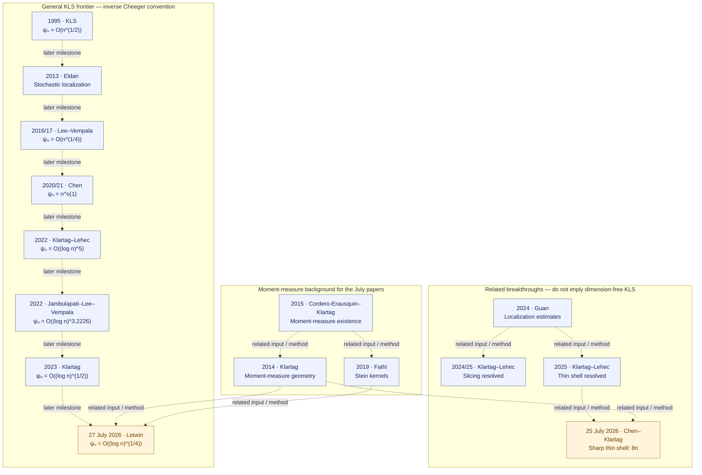

# KLS literature and local formalization

**Primary progress register** · [Literature overview](README.md) · [Supporting node register](STATUS.md)

**Literature through July 2026 · Sources checked 2026-09-16 · 27 selected sources.**

Selected foundational sources, the main general KLS bound milestones, and the connected moment-map, slicing and thin-shell developments through July 2026; not an exhaustive bibliography or a paper-by-paper proof verification.

The literature has advanced to an inverse-Cheeger bound of order `(log n)^(1/4)` in the
[July 2026 Letwin preprint](https://arxiv.org/html/2607.24164v1). Our repository currently
formalizes selected analytic foundations and reductions; none of the general
dimension-dependent frontier bounds below is yet proved here. Dimension-free KLS remains open.

Publication status and local Lean status are separate columns. **◐ means named fragments or
restricted counterparts, never an entire paper; ○ means the selected main result is not
locally formalized.** A ✓ beside an individual local result is derived from the existing
Blueprint/progress records. It is not a new certificate or a certification of the source paper.

## When a paper is covered

A selected paper target is covered only after its main theorem has a faithful Lean statement
(including hypotheses, constants, normalization and dimensional scope), a proof without
nonstandard axioms, and a registered certificate with verification evidence for that exact
statement. A source review must identify the paper version and theorem being matched.
Supporting lemmas, restricted cases and conditional reductions do not meet this criterion.
**No complete paper target is currently registered as covered.** Existing fragment certificates
are listed explicitly below; an unregistered proved target is still awaiting certification.

## Current literature priorities

These are source-review and proof priorities, not claims that the targets are proved.
Every proof task must first pin its paper version, theorem, hypotheses and constants.

| Priority | Sources / target | Next action |
| --- | --- | --- |
| 1 | [Bakry–Gentil–Ledoux](https://link.springer.com/book/10.1007/978-3-319-00227-9) Audit the strongly log-concave Bakry–Émery C_P ≤ 1/ρ endpoint and select a separate Brascamp–Lieb source statement. | Pin the exact source theorem, positive-curvature assumptions and normalization; assess the existing Γ₂ and semigroup interfaces before proof work. |
| 2 | [Kannan–Lovász–Simonovits](https://link.springer.com/article/10.1007/BF02574061) Localization lemma and the dimension-dependent trace/covariance bound. | Separate the localization theorem from the Poincaré consequence; audit denominator and constant conventions before defining either Lean target. |
| 3 | [E. Milman](https://arxiv.org/abs/0712.4092) Concentration implies a Cheeger bound under the source convexity hypotheses. | Pin the main theorem and its concentration/curvature assumptions; compare its analytic inputs with the current finite-dimensional Cheeger–Buser API. |
| 4 | [Eldan](https://arxiv.org/abs/1203.0893), [Lee–Vempala](https://annals.math.princeton.edu/2024/199-3/p02), [Chen](https://arxiv.org/abs/2011.13661), [Klartag–Lehec](https://arxiv.org/html/2203.15551v2), [Klartag](https://arxiv.org/html/2303.14938v2) Published stochastic-localization theorems and quantitative KLS bounds. | Reuse Mathlib probability foundations; build an isolated audited client of pinned external stochastic APIs before selecting the missing vector/matrix SDE bridges. |
| 5 | [Klartag–Lehec](https://arxiv.org/abs/2507.15495v2), [Chen–Klartag](https://arxiv.org/html/2607.23307v1), [Letwin](https://arxiv.org/html/2607.24164v1) Selected 2025–2026 thin-shell and quadratic-form results. | Retain exact preprint versions and assess moment-measure, stochastic and matrix-estimate dependencies; do not credit exploratory hypotheses as completed paper theorems. |

## Constant conventions

For isotropic log-concave laws, use `Var(f) ≤ C_P ∫‖∇f‖² dμ`, with no factor 1/2.
Write `h` for the Cheeger lower-bound constant with denominator `min(μ(A), 1−μ(A))`,
and `ψ = 1/h`, `ψₙ = sup_μ ψ(μ)` for the inverse convention. Some older papers use the
symbol ψ for h instead; their bounds are translated here. The original KLS paper also
uses a product denominator, so exact numerical constants cannot be copied unchanged.

The literature comparison is `ψ²/π ≤ C_P ≤ 4ψ²`; consequently `ψₙ = O((log n)^a)`
corresponds to `C_P = O((log n)^(2a))`. See [Letwin, introduction](https://arxiv.org/html/2607.24164v1#S1)
and [De Ponti–Mondino](https://arxiv.org/abs/1902.03835). The numerical comparison
for finite-dimensional log-concave laws is now a local Lean proof; the general RCD theorem
is not formalized here. Logarithmic bounds below use `n ≥ 2` (Guan’s iterated-log bound uses `n ≥ 3`).

## Literature map

Every node links to its source. Dashed arrows show later milestones or related methods,
**not logical implications, complete dependency lists, or Lean proof edges**. Blue is
literature context; amber highlights July 2026. Neither color means formalized.

The older dates in the KLS chain refer to first circulation/conference presentation;
the tables distinguish those dates from final journal publication. Slicing and thin shell
are separate achievements; their resolution does not give dimension-free KLS.

## Analytic foundations and selected local coverage

| Source and target theorem | Main result / role | Lean statements | Local coverage | Certificate | Remaining scope |
| --- | --- | --- | --- | --- | --- |
| [Borell — Convex measures on locally convex spaces](https://link.springer.com/article/10.1007/BF02384761) 1974 · Journal article Definition 1.1 and finite-dimensional density characterization | Convex/log-concave measures, inner measure and density representation on the affine support. | [Statement inventory](#borell1974-lean-statements) |  ✓ [Compact/Borel definitions with inner measure](../../formalization/blueprint/src/chapters/00-orientation-and-status.tex#L33) ✓ [Finite-dimensional intrinsic density representation](../../formalization/blueprint/src/chapters/00-orientation-and-status.tex#L95) | No paper-target certificate Supporting only: [`thm:borell-logconcave-density`](../../solutions/ThmBorellLogconcaveDensity.lean), [`thm:compact-borell-logconcavity-equivalence`](../../solutions/ThmCompactBorellLogconcavityEquivalence.lean) | The locally convex-space theory and the other convexity parameters are outside our finite-dimensional log-concave scope. |
| [Bobkov — Isoperimetric and analytic inequalities for log-concave probability measures](https://www-users.cse.umn.edu/~bobko001/papers/1999_AOP_Isop.pdf) 1999 · Journal article Corollary 4.3 and one-dimensional specialization | Cheeger/Poincaré inequalities for log-concave laws; the one-dimensional comparison yields C_P ≤ 12 Var. | [Statement inventory](#bobkov1999-lean-statements) |  ✓ [One-dimensional upper bound, now strengthened locally to 4 Var; the independent 12 Var proof is retained](../../formalization/blueprint/src/chapters/45-shared-analytic-bridges.tex#L700) | No paper-target certificate Supporting only: [`thm:one-dimensional-logconcave-poincare`](../../solutions/ThmOneDimensionalLogConcavePoincare.lean) | Our one-dimensional proof uses a different analytic argument. The paper’s general isoperimetric theory is not fully formalized. |
| [E. Milman — On the role of convexity in isoperimetry, spectral gap and concentration](https://arxiv.org/abs/0712.4092) 2009 · Journal article Main equivalence theorem | Under convexity, isoperimetry, spectral gap and concentration control one another up to universal constants. | No local target statement registered |  | No paper-target certificate | The full equivalence remains open locally; our forward infimum comparison is supporting infrastructure, not this theorem. |
| [Ambrosio–Gigli–Savaré — Density of Lipschitz functions and equivalence of weak gradients in metric measure spaces](https://arxiv.org/abs/1111.3730) 2011 preprint / 2013 publication · Journal article Weak-gradient and relaxed-energy equivalence theorems | Identifies weak-gradient notions and relaxed energies in metric measure spaces. | [Statement inventory](#ags2013-lean-statements) |  ✓ [Intrinsic absolutely-continuous E^can = 2 Ch in the local-slope convention](../../formalization/blueprint/src/chapters/30-open-canonical-bridges.tex#L121) | No paper-target certificate Supporting only: [`cor:absolutely-continuous-relaxation-two-cheeger`](../../solutions/CorAbsolutelyContinuousRelaxationTwoCheeger.lean) | The general metric-space theorem and unrestricted singular-law comparison are not formalized here. Our absolutely-continuous Euclidean identity is an independent restricted counterpart. |
| [Bakry–Gentil–Ledoux — Analysis and Geometry of Markov Diffusion Operators](https://link.springer.com/book/10.1007/978-3-319-00227-9) 2014 · Monograph Proposition 4.3.1; Gaussian Poincaré and Dirichlet-form background | Tensorization and Gaussian functional inequalities within the diffusion/Dirichlet-form framework. | [Statement inventory](#bgl2014-lean-statements) |  ✓ [Binary smooth-test tensorization](../../formalization/blueprint/src/chapters/40-certified-models.tex#L35) ✓ [Finite Hilbert-product constants, including empty products](../../formalization/blueprint/src/chapters/40-certified-models.tex#L52) ✓ [Exact one-dimensional Gaussian constant](../../formalization/blueprint/src/chapters/40-certified-models.tex#L70) | No paper-target certificate Supporting only: [`lem:poincare-finite-tensorization`](../../solutions/LemPoincareFiniteTensorization.lean), [`lem:poincare-gaussian-one-dimensional`](../../solutions/LemPoincareGaussianOneDimensional.lean), [`lem:poincare-tensorization`](../../solutions/LemPoincareTensorization.lean) | The full diffusion, semigroup and Γ-calculus theory is not covered by our selected results. |
| [Alonso-Gutiérrez–Bastero — Approaching the Kannan–Lovász–Simonovits and variance conjectures](https://link.springer.com/book/10.1007/978-3-319-13263-1) 2015 · Monograph Page 11; local source audit linked below | Records C_P ≤ 4 tr(Cov), whose one-dimensional specialization is 4 Var, in a broader account of KLS and the variance conjecture. | [Statement inventory](#alonsobastero2015-lean-statements) |  ✓ [One-dimensional 4 Var upper bound, including zero variance](../../formalization/blueprint/src/chapters/45-shared-analytic-bridges.tex#L700) | No paper-target certificate Supporting only: [`thm:one-dimensional-logconcave-poincare`](../../solutions/ThmOneDimensionalLogConcavePoincare.lean) | Only the one-dimensional bound is formalized here, by an independent proof. The high-dimensional trace bound, its original exact-constant attribution and optimality over all laws are not certified. |
| [Ambrosio–Di Marino–Gigli — Perimeter as relaxed Minkowski content in metric measure spaces](https://arxiv.org/abs/1603.08412) 2016 preprint / 2017 publication · Journal article Lemma 3.2; Theorem 3.6 | A Minkowski coarea inequality and identification of relaxed Minkowski content with BV perimeter. | [Statement inventory](#admg2017-lean-statements) |  ✓ [Minkowski coarea inequality in the local Euclidean scope](https://github.com/numina-functional-inequalities/kls-lean/blob/main/formalization/FunctionalInequalities/KLS/Geometry/Cheeger/MinkowskiContent.lean) ✓ [Published finite-mass target / finite-on-bounded measure scope: bounded-support reduction, full coarea radius chain, lower-to-upper recovery, both actual recoveries and both relaxed identities; convex closed-support Cheeger identification](https://github.com/numina-functional-inequalities/kls-lean/blob/main/formalization/FunctionalInequalities/KLS/Geometry/Cheeger/BVIdentification.lean) | No paper-target certificate | The complete lower/upper content, recovery and relaxation chain is formalized for finite Borel measures on arbitrary metric spaces. The new continuation proves the globally Lipschitz/global L1 bounded-support reduction of Remark 3.4 for every measurable finite-mass target under any Borel measure, the direct positive-level local-slope coarea upper bound under finite mass of a positive-support neighborhood (all levels for nonnegative functions), and perimeter at most lower content at measurable finite-mass targets. Under finiteness on bounded Borel sets, actual bounded measurable lower-recovery sets have finite mass and finite lower content term by term; indicators converge globally in L1 and lower contents converge to perimeter. The existing relaxed lower-content set infimum equals the perimeter at Theorem 3.6's measurable finite-mass target scope, including infinite perimeter and infinite total mass; convergence ensures eventual finite approximating-set masses without changing the class or excluding infinite-mass finite prefixes. Finite target mass and finite lower content imply a finite-mass positive neighborhood. Actual lower-to-upper radius recovery holds there, and a diagonal sequence gives bounded open upper-recovery sets with finite masses/contents and original global indicator L1 convergence. The existing relaxed upper infimum equals perimeter, hence the lower relaxation, at the published finite-mass target scope, including infinite perimeter by order. The full Lemma 3.2 chain is formalized with the actual right-radius liminf of integrated open-ball growth under nonnegativity and finite positive-support-neighborhood mass. Lemma 2.1 exposes the actual relaxed-upper <= lower-content bound at finite-mass Borel targets under any measure. Lemma 2.1's relaxed lower/upper-content equality is also formalized for every Borel measure at measurable finite-mass targets, and on proper metric spaces Remark 3.5's locally Lipschitz classes with global or compact-set L1 convergence have relaxation infima equal to the bounded-support perimeter at measurable finite-mass targets for every Borel measure (2026-10-01). The locally Lipschitz classes on nonproper spaces, nonconvex ambient/support transfer and general RCD comparisons remain pending. These local Lean results do not add ledger certificates; remote Lean verification is a separate check. |
| [De Ponti–Mondino — Sharp Cheeger–Buser type inequalities in RCD(K,∞) spaces](https://arxiv.org/abs/1902.03835) 2019 preprint / 2021 publication · Journal article Cheeger–Buser comparison; log-concave specialization in Letwin, introduction | Provides the sharp reverse-comparison input used to normalize ψ² and C_P; in the log-concave convention, 1/4 ≤ ψ²/C_P ≤ π. | [Statement inventory](#depontimondino2021-lean-statements) |  ✓ [Both numerical inequalities for every finite-dimensional log-concave probability law, including zero-dimensional affine support and extended optima](../../formalization/blueprint/src/chapters/45-shared-analytic-bridges.tex#L198) ✓ [Closed-support BV Cheeger constant equals the isoperimetric constant for finite-dimensional log-concave laws](https://github.com/numina-functional-inequalities/kls-lean/blob/main/formalization/FunctionalInequalities/KLS/Geometry/Cheeger/BVIdentification.lean) | No paper-target certificate | The numerical comparison is formalized for finite-dimensional log-concave laws. For the bounded-support metric BV test class, complement symmetry for finite measures, the half-mass/symmetric equality, the BV–Minkowski Cheeger identification for probability laws on normed spaces, and, for finite-dimensional log-concave laws, the identification of the BV Cheeger constant on the closed intrinsic support with the isoperimetric constant are formalized. Test-class equivalence is formalized for finite Borel measures (global Lipschitz/global L¹), and on proper spaces also for locally Lipschitz/global or compact-local L¹ approximants. The test-class comparison beyond this scope, constant identification on nonconvex supports, and the paper's RCD(K,∞) theorem remain unformalized. |

## General KLS bounds and stochastic localization

| Source and target theorem | Main result / role | Lean statements | Local coverage | Certificate | Remaining scope |
| --- | --- | --- | --- | --- | --- |
| [Kannan–Lovász–Simonovits — Isoperimetric problems for convex bodies and a localization lemma](https://link.springer.com/article/10.1007/BF02574061) 1995 · Journal article Localization lemma; historical dimension bound, also reviewed in Klartag–Lehec lecture notes | Introduces the conjecture and localization; the classical dimension-scale bound is ψₙ = O(n^(1/2)), hence C_P = O(n). | No local target statement registered |  | No paper-target certificate | The high-dimensional localization theorem and this general dimension bound are not locally formalized. |
| [Eldan — Thin shell implies spectral gap up to polylog via a stochastic localization scheme](https://arxiv.org/abs/1203.0893) 2012 preprint / 2013 publication · Journal article Main thin-shell/spectral-gap comparison | Introduces stochastic localization and transfers thin-shell control to KLS with logarithmic losses. | No local target statement registered |  | No paper-target certificate | The stochastic process, its covariance estimates and the transfer theorem are not locally formalized. |
| [Lee–Vempala — Eldan’s stochastic localization and the KLS conjecture: Isoperimetry, concentration and mixing](https://annals.math.princeton.edu/2024/199-3/p02) 2016 preprint / 2017 FOCS / 2024 journal · Journal article Main Poincaré estimate | For isotropic log-concave laws, C_P = O(n^(1/2)), equivalently ψₙ = O(n^(1/4)); the paper also studies mixing and concentration. | No local target statement registered |  | No paper-target certificate | The quantitative localization theorem, covariance bounds and mixing results are not locally formalized. |
| [Chen — An almost constant lower bound of the isoperimetric coefficient in the KLS conjecture](https://arxiv.org/abs/2011.13661) 2020 preprint / 2021 publication · Journal article Main bound, translated from the lower-bound convention for h | ψₙ ≤ exp(C√(log n · log log n)) = n^o(1); hence C_P = n^o(1), breaking the polynomial barrier. | No local target statement registered |  | No paper-target certificate | The stochastic-localization bootstrap and the subpolynomial bound are not locally formalized. |
| [Klartag–Lehec — Bourgain’s slicing problem and KLS isoperimetry up to polylog](https://arxiv.org/html/2203.15551v2) 2022 · Journal article Theorem 1.1 and end of Section 6 | First polylogarithmic KLS bound: ψₙ = O((log n)^5), hence C_P = O((log n)^10). | No local target statement registered |  | No paper-target certificate | The localization covariance window and spectral argument are not locally formalized. |
| [Jambulapati–Lee–Vempala — A slightly improved bound for the KLS constant](https://arxiv.org/html/2208.11644v2) 2022 · Preprint (v2) Theorem 2 | Improves the logarithmic exponent: ψₙ = O((log n)^3.2226), hence C_P = O((log n)^6.4452). | No local target statement registered |  | No paper-target certificate | The refined localization growth estimate and resulting bound are not locally formalized. |
| [Klartag — Logarithmic bounds for isoperimetry and slices of convex sets](https://arxiv.org/html/2303.14938v2) 2023 · Journal article Theorems 1.2 and 1.3 | ψₙ = O(√log n), hence C_P = O(log n), using an improved log-concave Lichnerowicz inequality. | No local target statement registered |  | No paper-target certificate | The improved Lichnerowicz estimate and stochastic localization remain unformalized locally. |
| [Letwin — The KLS constant is O(log^(1/4) n)](https://arxiv.org/html/2607.24164v1) 27 July 2026 · Preprint (v1) Theorems 1.1 and 1.2 | For isotropic log-concave X and symmetric M, Var(XᵀMX) ≤ 8‖M‖²_HS = 2 E‖∇(XᵀMX)‖². For n ≥ 2, ψₙ = O((log n)^(1/4)), hence C_P = O(√log n). | No local target statement registered |  | No paper-target certificate | The quadratic inequality, its moment-map/Stein proof and the κₙ-to-KLS conversion are not locally formalized. Quadratic tests do not suffice for full KLS. |

## Moment measures and Stein kernels

| Source and target theorem | Main result / role | Lean statements | Local coverage | Certificate | Remaining scope |
| --- | --- | --- | --- | --- | --- |
| [Klartag — Logarithmically-concave moment measures I](https://arxiv.org/abs/1309.2767) 2013 preprint / 2014 publication · Book chapter Theorem 1.1; weighted moment-measure geometry | Develops the Hessian metric and weighted Poincaré structure associated with log-concave moment measures. | No local target statement registered |  | No paper-target certificate | Moment-map existence/regularity, the Hessian metric and weighted geometric identities are not locally formalized. |
| [Cordero-Erausquin–Klartag — Moment measures](https://arxiv.org/abs/1304.0630) 2013 preprint / 2015 publication · Journal article Theorem 2 | A nonzero finite centered measure whose support spans the space is the moment measure of an essentially continuous convex potential, unique up to translation. | No local target statement registered |  | No paper-target certificate | The existence/uniqueness theorem is not locally formalized; generic closed forms do not supply its convex potential. |
| [Fathi — Stein kernels and moment maps](https://arxiv.org/abs/1804.04699) 2018 preprint / 2019 publication · Journal article Moment-map Stein-kernel construction | Constructs Stein kernels using moment maps, connecting Hessian geometry to probabilistic identities. | No local target statement registered |  | No paper-target certificate | The canonical moment-map Stein kernel is not locally formalized. |

## Thin shell and slicing

| Source and target theorem | Main result / role | Lean statements | Local coverage | Certificate | Remaining scope |
| --- | --- | --- | --- | --- | --- |
| [Guédon–Milman — Interpolating thin-shell and sharp large-deviation estimates for isotropic log-concave measures](https://arxiv.org/abs/1011.0943v3) 2010 preprint / 2011 publication · Journal article Main deviation estimate | Quantitative radial concentration across thin-shell and large-deviation scales for isotropic log-concave laws. | No local target statement registered |  | No paper-target certificate | Radial deviation estimates and their thin-shell/isoperimetric consequences are not locally formalized. |
| [Guan — A note on Bourgain’s slicing problem](https://arxiv.org/html/2412.09075v1) 2024 · Preprint (v1) Theorems 1.1 and 1.2; covariance estimates | Obtains an iterated-logarithmic slicing bound and localization estimates used in the later slicing and thin-shell work. | No local target statement registered |  | No paper-target certificate | The covariance process and Guan’s estimates are not locally formalized. |
| [Klartag–Lehec — Affirmative resolution of Bourgain’s slicing problem using Guan’s bound](https://arxiv.org/abs/2412.15044) 2024 preprint / 2025 publication · Journal article Main slicing theorem | Every volume-one convex body has a hyperplane section of volume at least a universal positive constant. This resolves slicing, not KLS. | No local target statement registered |  | No paper-target certificate | The slicing theorem, M-ellipsoids and entropy-stability inputs are not locally formalized. |
| [Bizeul — The slicing conjecture via small ball estimates](https://arxiv.org/abs/2501.06854) 2025 · Preprint Main alternative proof | An alternative proof of slicing via small-ball estimates and Guan’s localization bound. | No local target statement registered |  | No paper-target certificate | The small-ball argument and slicing conclusion are not locally formalized. |
| [Klartag–Lehec — Thin-shell bounds via parallel coupling](https://arxiv.org/abs/2507.15495v2) 21 July 2025 / v2 23 February 2026 · Preprint (v2) Main thin-shell theorem | For isotropic log-concave X, E(‖X‖ − √n)² ≤ C with a universal constant, via parallel coupling. | No local target statement registered |  | No paper-target certificate | The coupling construction and dimension-free thin-shell theorem are not locally formalized; thin shell alone does not remove the KLS logarithms. |
| [Chen–Klartag — Digesting the proof of the sharp thin-shell inequality](https://arxiv.org/html/2607.23307v1) 25 July 2026 · Preprint (v1) Theorems 1.1, 1.2 and 1.5 | For isotropic log-concave X: Var(‖X‖²) ≤ 8n and ‖T₃(X)‖²_HS ≤ 4n. The constants are sharp. | No local target statement registered |  | No paper-target certificate | The moment-Hessian estimate, third-order tensor identities and sharp conclusions are not locally formalized. A trace bound is not a universal matrix bound. |

## Reading guides

| Source and target theorem | Main result / role | Lean statements | Local coverage | Certificate | Remaining scope |
| --- | --- | --- | --- | --- | --- |
| [Lee–Vempala — The Kannan–Lovász–Simonovits conjecture](https://arxiv.org/abs/1807.03465) 2018 · Survey preprint Survey | A guide to KLS formulations, geometric consequences and algorithmic motivation at the 2018 frontier. | No local target statement registered |  | No paper-target certificate | Use for orientation; its historical frontier is superseded by the later papers in the frontier table. |
| [Klartag–Lehec — Isoperimetric inequalities in high-dimensional convex sets](https://arxiv.org/abs/2406.01324) 2024 preprint / 2025 publication · Published lecture notes Lecture notes | A detailed entry point to stochastic localization, KLS and slicing up to the period covered by the notes. | No local target statement registered |  | No paper-target certificate | Reading guide; the July 2026 frontier requires the newer sources in the frontier table. |

## Local Lean statement inventory

The links below retain the actual declarations and their full hypotheses.
Mappings labelled supporting are not the complete paper target.

### Borell1974 Lean statements

- Supporting scope: [Compact/Borel definitions with inner measure](../../formalization/blueprint/src/chapters/00-orientation-and-status.tex#L33).
  Declaration: `FunctionalInequalities.KLS.BorelLogConcave`.
  Declaration: `FunctionalInequalities.KLS.LogConcave.borel_iff`.
  Declaration: `FunctionalInequalities.KLS.innerMeasure`.
  Declaration: `Solutions.ThmCompactBorellLogconcavityEquivalence.certificate`.
- Supporting scope: [Finite-dimensional intrinsic density representation](../../formalization/blueprint/src/chapters/00-orientation-and-status.tex#L95).
  Declaration: `FunctionalInequalities.KLS.IsBorellDensity`.
  Declaration: `FunctionalInequalities.KLS.IsBorellDensity.exists_bounds_of_isCompact`.
  Declaration: `FunctionalInequalities.KLS.IsBorellDensity.pos_of_mem_interior_support`.
  Declaration: `FunctionalInequalities.KLS.LogConcave.closure_convexHull_intrinsic_support`.
  Declaration: `FunctionalInequalities.KLS.LogConcave.exists_isBorellDensity`.
  Declaration: `FunctionalInequalities.KLS.LogConcave.intrinsic_integrable_exp_norm`.
  Declaration: `FunctionalInequalities.KLS.LogConcave.intrinsic_integrable_norm_pow`.
  Declaration: `FunctionalInequalities.KLS.LogConcave.intrinsic_interior_support_compl`.
  Declaration: `Solutions.ThmBorellLogconcaveDensity.certificate`.

### Bobkov1999 Lean statements

- Supporting scope: [One-dimensional upper bound, now strengthened locally to 4 Var; the independent 12 Var proof is retained](../../formalization/blueprint/src/chapters/45-shared-analytic-bridges.tex#L700).
  Declaration: `FunctionalInequalities.KLS.LineDensity`.
  Declaration: `FunctionalInequalities.KLS.LineDensity.cdf_mul_one_sub_cdf_le_sd_mul`.
  Declaration: `FunctionalInequalities.KLS.LineDensity.exists_supergradient`.
  Declaration: `FunctionalInequalities.KLS.LineDensity.groundState_inequality`.
  Declaration: `FunctionalInequalities.KLS.LineDensity.integral_sq_clipCentered_eq`.
  Declaration: `FunctionalInequalities.KLS.LineDensity.integral_sq_div_le`.
  Declaration: `FunctionalInequalities.KLS.LineDensity.le_add_mul_cdf_sub`.
  Declaration: `FunctionalInequalities.KLS.LineDensity.le_add_mul_cdf_sub_of_mem`.
  Declaration: `FunctionalInequalities.KLS.LineDensity.mul_le_mul_of_add_eq`.
  Declaration: `FunctionalInequalities.KLS.LineDensity.one_div_le_variance`.
  Declaration: `FunctionalInequalities.KLS.LineDensity.setIntegral_Iic_sq_sub_le_of_le`.
  Declaration: `FunctionalInequalities.KLS.LineDensity.setIntegral_Ioi_sq_sub_le_of_le`.
  Declaration: `FunctionalInequalities.KLS.LineDensity.smoothTest_holds`.
  Declaration: `FunctionalInequalities.KLS.LineDensity.two_mul_cdf_le`.
  Declaration: `FunctionalInequalities.KLS.LineDensity.two_mul_measureReal_Ioi_le`.
  Declaration: `FunctionalInequalities.KLS.LineDensity.variance_clip_le`.
  Declaration: `FunctionalInequalities.KLS.LineDensity.variance_ge_of_affine_bound`.
  Declaration: `FunctionalInequalities.KLS.LineDensity.variance_le_four_variance_mul`.
  Declaration: `FunctionalInequalities.KLS.LogConcave.exists_lineDensity`.
  Declaration: `FunctionalInequalities.KLS.LogConcave.localSlope_constant_le_four_evariance`.
  Declaration: `FunctionalInequalities.KLS.LogConcave.localSlope_constant_le_four_variance`.
  Declaration: `FunctionalInequalities.KLS.LogConcave.localSlope_constant_le_twelve_evariance`.
  Declaration: `FunctionalInequalities.KLS.LogConcave.localSlope_constant_le_twelve_variance`.
  Declaration: `FunctionalInequalities.KLS.LogConcave.smoothTest_holds_four_variance`.
  Declaration: `FunctionalInequalities.KLS.LogConcave.smoothTest_holds_twelve_variance`.
  Declaration: `FunctionalInequalities.KLS.clip`.
  Declaration: `FunctionalInequalities.KLS.logConcave_dirac`.
  Declaration: `FunctionalInequalities.Probability.Line.affineQuantile`.
  Declaration: `FunctionalInequalities.Probability.Line.cdf`.
  Declaration: `FunctionalInequalities.Probability.Line.map_cdf_eq_uniform`.
  Declaration: `FunctionalInequalities.Probability.Line.one_div_le_variance_affineQuantile`.
  Declaration: `Solutions.ThmOneDimensionalLogConcavePoincare.certificate`.

### AGS2013 Lean statements

- Supporting scope: [Intrinsic absolutely-continuous E^can = 2 Ch in the local-slope convention](../../formalization/blueprint/src/chapters/30-open-canonical-bridges.tex#L121).
  Declaration: `FunctionalInequalities.Energy.Cheeger.Intrinsic.energy`.
  Declaration: `FunctionalInequalities.Energy.Cheeger.energy`.
  Declaration: `FunctionalInequalities.Energy.SmoothGradient.Intrinsic.energy_eq_two_mul_cheeger_of_absolutelyContinuous`.
  Declaration: `FunctionalInequalities.Energy.SmoothGradient.relaxation_eq_localSlope_of_absolutelyContinuous`.
  Declaration: `FunctionalInequalities.KLS.LogConcave.intrinsicSmooth_energy_eq_two_mul_cheeger`.
  Declaration: `Solutions.CorAbsolutelyContinuousRelaxationTwoCheeger.certificate`.

### BGL2014 Lean statements

- Supporting scope: [Binary smooth-test tensorization](../../formalization/blueprint/src/chapters/40-certified-models.tex#L35).
  Declaration: `Solutions.LemPoincareTensorization.certificate`.
- Supporting scope: [Finite Hilbert-product constants, including empty products](../../formalization/blueprint/src/chapters/40-certified-models.tex#L52).
  Declaration: `Solutions.LemPoincareFiniteTensorization.certificate`.
- Supporting scope: [Exact one-dimensional Gaussian constant](../../formalization/blueprint/src/chapters/40-certified-models.tex#L70).
  Declaration: `Solutions.LemPoincareGaussianOneDimensional.certificate`.

### AlonsoBastero2015 Lean statements

- Supporting scope: [One-dimensional 4 Var upper bound, including zero variance](../../formalization/blueprint/src/chapters/45-shared-analytic-bridges.tex#L700).
  Declaration: `FunctionalInequalities.KLS.LineDensity`.
  Declaration: `FunctionalInequalities.KLS.LineDensity.cdf_mul_one_sub_cdf_le_sd_mul`.
  Declaration: `FunctionalInequalities.KLS.LineDensity.exists_supergradient`.
  Declaration: `FunctionalInequalities.KLS.LineDensity.groundState_inequality`.
  Declaration: `FunctionalInequalities.KLS.LineDensity.integral_sq_clipCentered_eq`.
  Declaration: `FunctionalInequalities.KLS.LineDensity.integral_sq_div_le`.
  Declaration: `FunctionalInequalities.KLS.LineDensity.le_add_mul_cdf_sub`.
  Declaration: `FunctionalInequalities.KLS.LineDensity.le_add_mul_cdf_sub_of_mem`.
  Declaration: `FunctionalInequalities.KLS.LineDensity.mul_le_mul_of_add_eq`.
  Declaration: `FunctionalInequalities.KLS.LineDensity.one_div_le_variance`.
  Declaration: `FunctionalInequalities.KLS.LineDensity.setIntegral_Iic_sq_sub_le_of_le`.
  Declaration: `FunctionalInequalities.KLS.LineDensity.setIntegral_Ioi_sq_sub_le_of_le`.
  Declaration: `FunctionalInequalities.KLS.LineDensity.smoothTest_holds`.
  Declaration: `FunctionalInequalities.KLS.LineDensity.two_mul_cdf_le`.
  Declaration: `FunctionalInequalities.KLS.LineDensity.two_mul_measureReal_Ioi_le`.
  Declaration: `FunctionalInequalities.KLS.LineDensity.variance_clip_le`.
  Declaration: `FunctionalInequalities.KLS.LineDensity.variance_ge_of_affine_bound`.
  Declaration: `FunctionalInequalities.KLS.LineDensity.variance_le_four_variance_mul`.
  Declaration: `FunctionalInequalities.KLS.LogConcave.exists_lineDensity`.
  Declaration: `FunctionalInequalities.KLS.LogConcave.localSlope_constant_le_four_evariance`.
  Declaration: `FunctionalInequalities.KLS.LogConcave.localSlope_constant_le_four_variance`.
  Declaration: `FunctionalInequalities.KLS.LogConcave.localSlope_constant_le_twelve_evariance`.
  Declaration: `FunctionalInequalities.KLS.LogConcave.localSlope_constant_le_twelve_variance`.
  Declaration: `FunctionalInequalities.KLS.LogConcave.smoothTest_holds_four_variance`.
  Declaration: `FunctionalInequalities.KLS.LogConcave.smoothTest_holds_twelve_variance`.
  Declaration: `FunctionalInequalities.KLS.clip`.
  Declaration: `FunctionalInequalities.KLS.logConcave_dirac`.
  Declaration: `FunctionalInequalities.Probability.Line.affineQuantile`.
  Declaration: `FunctionalInequalities.Probability.Line.cdf`.
  Declaration: `FunctionalInequalities.Probability.Line.map_cdf_eq_uniform`.
  Declaration: `FunctionalInequalities.Probability.Line.one_div_le_variance_affineQuantile`.
  Declaration: `Solutions.ThmOneDimensionalLogConcavePoincare.certificate`.

### ADMG2017 Lean statements

- Selected target: [`FunctionalInequalities.KLS.MetricBV.lipschitzRelaxation_eq_perimeter_of_measure_lt_top`](../../formalization/FunctionalInequalities/KLS/Geometry/Perimeter/TestClassRelaxation.lean).
- Selected target: [`FunctionalInequalities.KLS.MetricBV.relaxedMinkowskiContent_eq_perimeter_of_finite_on_bounded`](../../formalization/FunctionalInequalities/KLS/Geometry/Perimeter/RelaxedMinkowski.lean).
- Selected target: [`FunctionalInequalities.KLS.MetricBV.relaxedUpperMinkowskiContent_eq_perimeter_of_finite_on_bounded`](../../formalization/FunctionalInequalities/KLS/Geometry/Perimeter/RelaxedMinkowski.lean).
- [Target scope review](../../research/decisions/2026-10-01-issue-8.md#admg-target-review); no registered target certificate.
- Supporting scope: [Minkowski coarea inequality in the local Euclidean scope](https://github.com/numina-functional-inequalities/kls-lean/blob/main/formalization/FunctionalInequalities/KLS/Geometry/Cheeger/MinkowskiContent.lean).
  This auxiliary assessment links to source; it has no separate Blueprint declaration inventory or ledger certificate.
- Supporting scope: [Published finite-mass target / finite-on-bounded measure scope: bounded-support reduction, full coarea radius chain, lower-to-upper recovery, both actual recoveries and both relaxed identities; convex closed-support Cheeger identification](https://github.com/numina-functional-inequalities/kls-lean/blob/main/formalization/FunctionalInequalities/KLS/Geometry/Cheeger/BVIdentification.lean).
  This auxiliary assessment links to source; it has no separate Blueprint declaration inventory or ledger certificate.

### DePontiMondino2021 Lean statements

- Supporting scope: [Both numerical inequalities for every finite-dimensional log-concave probability law, including zero-dimensional affine support and extended optima](../../formalization/blueprint/src/chapters/45-shared-analytic-bridges.tex#L198).
  Declaration: `FunctionalInequalities.KLS.Isoperimetry.smoothTest_constant_le`.
  Declaration: `FunctionalInequalities.KLS.LogConcave.inverseScale_sq_le_pi_literature`.
  Declaration: `FunctionalInequalities.KLS.LogConcave.literatureConstant_le_four_mul_inverseScale_sq`.
- Supporting scope: [Closed-support BV Cheeger constant equals the isoperimetric constant for finite-dimensional log-concave laws](https://github.com/numina-functional-inequalities/kls-lean/blob/main/formalization/FunctionalInequalities/KLS/Geometry/Cheeger/BVIdentification.lean).
  This auxiliary assessment links to source; it has no separate Blueprint declaration inventory or ledger certificate.

## What the July papers would require here

Both July results need a local moment-measure construction and its regularity theory.
The sharp thin-shell paper then needs the weighted Hessian identities and third-order
tensor estimates. The quadratic-form paper additionally needs its matrix inequality,
Stein/H⁻¹ argument and the conversion through the directional third-moment parameter.
These are missing mathematical developments, despite our existing density, closed-form
and Euclidean calculus infrastructure. Existing supporting tools do not certify either paper.

## Source and coverage notes

- July statements are pinned to `2607.23307v1` and `2607.24164v1`. Both are preprints;
  this map checks bibliographic data, main statements and normalization, not every proof step.
- The 2025 parallel-coupling preprint is read at `2507.15495v2` (23 February 2026).
- The book’s coefficient 4 is a recorded statement; our one-dimensional proof is independent.
  The original attribution remains distinct from mathematical proof and formal verification:
  see the [source audit](../explorations/2026-09-11-poincare-constant-4-audit.md).
  Book metadata was checked on the publisher pages; detailed book-page correspondences
  use the existing source audits, rather than a fresh reading of the complete monographs.
- General auxiliary progress, such as locally Lipschitz coarea and smooth recovery, is listed
  in the [supporting node register](STATUS.md); it is not automatically credited
  as a completed fragment of every paper that could use it.
- No percentage of a paper is reported: result counts do not measure proof coverage.

### Additional primary-source metadata

- Kannan–Lovász–Simonovits, 1995: [additional primary source 1](https://arxiv.org/abs/2406.01324).
- Klartag, 2013 preprint / 2014 publication: [additional primary source 1](https://www.weizmann.ac.il/math/klartag/publications-0).
- Cordero-Erausquin–Klartag, 2013 preprint / 2015 publication: [additional primary source 1](https://webusers.imj-prg.fr/~dario.cordero/Docs/articles/2015_moment_measures.pdf).
- Lee–Vempala, 2016 preprint / 2017 FOCS / 2024 journal: [additional primary source 1](https://arxiv.org/abs/1612.01507).
- Chen, 2020 preprint / 2021 publication: [additional primary source 1](https://link.springer.com/article/10.1007/s00039-021-00558-4).
- De Ponti–Mondino, 2019 preprint / 2021 publication: [additional primary source 1](https://arxiv.org/html/2607.24164v1#S1).
- Klartag–Lehec, 2024 preprint / 2025 publication: [additional primary source 1](https://lehec.pages.math.cnrs.fr/website/).
- Klartag–Lehec, 2024 preprint / 2025 publication: [additional primary source 1](https://lehec.pages.math.cnrs.fr/website/).

### Maintenance

Edit [literature.json](literature.json), then run `python3 research/progress/update.py`
with the intended canonical proof/metadata inputs staged. Coverage is derived from
the same resolved node records as the route map. Generated files are not edited by hand.
