# KLS literature and local formalization

**Primary progress register** · [Progress hub](README.md) · [Route diagrams](README.md#proof-progress-tree) · [Node register](STATUS.md)

**Literature through July 2026 · Sources checked 2026-09-16 · 28 selected sources.**

Selected foundational sources, the main general KLS bound milestones, and the connected moment-map, slicing and thin-shell developments through July 2026; not an exhaustive bibliography or a paper-by-paper proof verification; the October 2026 Bizeul–Klartag–Lehec preprint is added after the cutoff as the pinned current formalization target.

The literature has advanced to an inverse-Cheeger bound of order `(log n)^(1/4)` in the
[July 2026 Letwin preprint](https://arxiv.org/html/2607.24164v1). Our repository currently
formalizes selected analytic foundations and reductions; none of the general
dimension-dependent frontier bounds below is yet proved here. Dimension-free KLS remains open.

Publication status and local Lean status are separate columns. **◐ means named fragments or
restricted counterparts, never an entire paper; ○ means the selected main result is not
locally formalized.** A ✓ beside an individual local result is derived from the existing
Blueprint/progress records. It is not a new certificate or a certification of the source paper.

## When a paper is covered

A selected paper target is covered only after its main theorem has a faithful Lean statement
(including hypotheses, constants, normalization and dimensional scope), a proof without
nonstandard axioms, and a registered certificate with verification evidence for that exact
statement. A source review must identify the paper version and theorem being matched.
Supporting lemmas, restricted cases and conditional reductions do not meet this criterion.
**Covered by a registered paper-target certificate: Bakry–Gentil–Ledoux (Corollary 4.8.2, p. 212), Ambrosio–Di Marino–Gigli (Theorem 3.6).**
Existing fragment certificates are listed explicitly below; an unregistered proved target
is still awaiting certification.

## Current literature priorities

These are source-review and proof priorities, not claims that the targets are proved.
Every proof task must first pin its paper version, theorem, hypotheses and constants.

| Priority | Sources / target | Next action |
| --- | --- | --- |
| 1 | [Bizeul–Klartag–Lehec](https://arxiv.org/abs/2610.05474v1)<br/>Theorem 1.1 through Theorems 3.1 (certified, thm:bkl-taylor-criterion), 4.1 and Proposition 7.1: Section 3 is formalized by the operator route; Lemma 2.2, Lemma 3.6 (⇑), Corollary 3.7 (⇑), Lemmas 3.2–3.4, 3.8, 3.9 for the D(A) iterates (⇑) and the regular-law adapter for (12) are formalized; Lemma 2.1 on 𝒜, (19), steps of Proposition 7.1 and Lemma 4.2 conditional on the Letwin bound are partial, restricted or conditional counterparts. | Current focus: complete BKL Proposition 7.1, starting with the joint-law identification and mixed cumulant identity (111)–(112); convexity (109)–(110) and the finite-N choice are formalized. Then the regular approximation and Theorem 4.1 (Eldan localization) connect to the certified Theorem 3.1. Letwin stays a prerequisite of Lemma 4.2. Lemma 2.1 on 𝒜 and (19) are not needed by the operator route. |
| 2 | [Bakry–Gentil–Ledoux](https://link.springer.com/book/10.1007/978-3-319-00227-9)<br/>Corollary 4.8.2 (strongly log-concave Bakry–Émery C_P ≤ 1/ρ) is certified as thm:bakry-emery-poincare and committed in 36e7c78 (remote run 37516844384 succeeded); select a separate Brascamp–Lieb source statement. | Pin a Brascamp–Lieb source theorem, its assumptions and normalization, and assess reuse of the heat-semigroup and Γ₂ interfaces before proof work. |
| 3 | [Kannan–Lovász–Simonovits](https://link.springer.com/article/10.1007/BF02574061)<br/>Theorem 5.1, ψ(K) ≥ ln 2 / M₁(K) for convex bodies, through the needle reduction (Corollary 2.2, Lemma 2.6, Theorem 2.7). With the local Cheeger inequality it gives C_P ≲ E‖X − EX‖² for convex bodies. | Pin a proof of the cited localization lemma (Lovász–Simonovits 1993 or a modern account) and choose a Lean form for needles; keep the product denominator of (1.1) distinct from the min-denominator constant. |
| 4 | [E. Milman](https://arxiv.org/abs/0712.4092)<br/>Concentration implies a Cheeger bound under the source convexity hypotheses. | Pin the main theorem and its concentration/curvature assumptions; compare its analytic inputs with the current finite-dimensional Cheeger–Buser API. |
| 5 | [Eldan](https://arxiv.org/abs/1203.0893), [Lee–Vempala](https://annals.math.princeton.edu/2024/199-3/p02), [Chen](https://arxiv.org/abs/2011.13661), [Klartag–Lehec](https://arxiv.org/html/2203.15551v2), [Klartag](https://arxiv.org/html/2303.14938v2)<br/>Published stochastic-localization theorems and quantitative KLS bounds. | Reuse Mathlib probability foundations; build an isolated audited client of pinned external stochastic APIs before selecting the missing vector/matrix SDE bridges. |
| 6 | [Klartag–Lehec](https://arxiv.org/abs/2507.15495v2), [Chen–Klartag](https://arxiv.org/html/2607.23307v1), [Letwin](https://arxiv.org/html/2607.24164v1)<br/>Selected 2025–2026 thin-shell and quadratic-form results. | Retain exact preprint versions and assess moment-measure, stochastic and matrix-estimate dependencies; do not credit exploratory hypotheses as completed paper theorems. |

## Constant conventions

For isotropic log-concave laws, use `Var(f) ≤ C_P ∫‖∇f‖² dμ`, with no factor 1/2.
Write `h` for the Cheeger lower-bound constant with denominator `min(μ(A), 1−μ(A))`,
and `ψ = 1/h`, `ψₙ = sup_μ ψ(μ)` for the inverse convention. Some older papers use the
symbol ψ for h instead; their bounds are translated here. The original KLS paper also
uses a product denominator, so exact numerical constants cannot be copied unchanged.

The literature comparison is `ψ²/π ≤ C_P ≤ 4ψ²`; consequently `ψₙ = O((log n)^a)`
corresponds to `C_P = O((log n)^(2a))`. See [Letwin, introduction](https://arxiv.org/html/2607.24164v1#S1)
and [De Ponti–Mondino](https://arxiv.org/abs/1902.03835). The numerical comparison
for finite-dimensional log-concave laws is now a local Lean proof; the general RCD theorem
is not formalized here. Logarithmic bounds below use `n ≥ 2` (Guan’s iterated-log bound uses `n ≥ 3`).

## Literature map

Every node links to its source. Dashed arrows show later milestones or related methods,
**not logical implications, complete dependency lists, or Lean proof edges**. Blue is
literature context; amber highlights July 2026. Neither color means formalized.

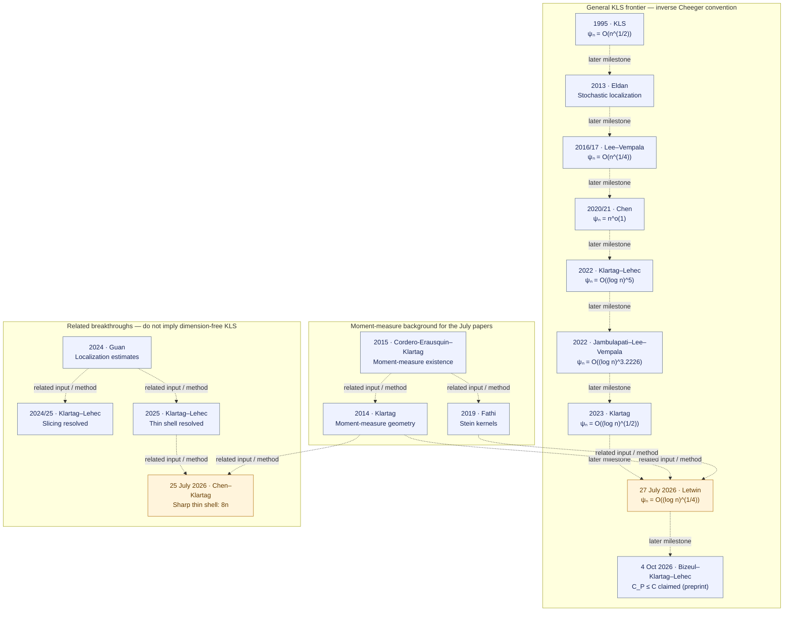

The older dates in the KLS chain refer to first circulation/conference presentation;
the tables distinguish those dates from final journal publication. Slicing and thin shell
are separate achievements; their resolution does not give dimension-free KLS.

## Analytic foundations and selected local coverage

| Source and target theorem | Main result / role | Lean statements | Local coverage | Certificate | Remaining scope |
| --- | --- | --- | --- | --- | --- |
| [Borell — Convex measures on locally convex spaces](https://link.springer.com/article/10.1007/BF02384761)<br/>1974 · Journal article<br/>Definition 1.1 and finite-dimensional density characterization | Convex/log-concave measures, inner measure and density representation on the affine support. | [Statement inventory](#borell1974-lean-statements) | <br/>✓ [Compact/Borel definitions with inner measure](../../formalization/blueprint/src/chapters/00-orientation-and-status.tex#L33)<br/>✓ [Finite-dimensional intrinsic density representation](../../formalization/blueprint/src/chapters/00-orientation-and-status.tex#L95) | No paper-target certificate<br/>Supporting only: [`thm:borell-logconcave-density`](../../solutions/ThmBorellLogconcaveDensity.lean), [`thm:compact-borell-logconcavity-equivalence`](../../solutions/ThmCompactBorellLogconcavityEquivalence.lean) | The locally convex-space theory and the other convexity parameters are outside our finite-dimensional log-concave scope. |
| [Bobkov — Isoperimetric and analytic inequalities for log-concave probability measures](https://www-users.cse.umn.edu/~bobko001/papers/1999_AOP_Isop.pdf)<br/>1999 · Journal article<br/>Corollary 4.3 and one-dimensional specialization | Cheeger/Poincaré inequalities for log-concave laws; the one-dimensional comparison yields C_P ≤ 12 Var. | [Statement inventory](#bobkov1999-lean-statements) | <br/>✓ [One-dimensional upper bound, now strengthened locally to 4 Var; the independent 12 Var proof is retained](../../formalization/blueprint/src/chapters/45-shared-analytic-bridges.tex#L739) | No paper-target certificate<br/>Supporting only: [`thm:one-dimensional-logconcave-poincare`](../../solutions/ThmOneDimensionalLogConcavePoincare.lean) | Our one-dimensional proof uses a different analytic argument. The paper’s general isoperimetric theory is not fully formalized. |
| [E. Milman — On the role of convexity in isoperimetry, spectral gap and concentration](https://arxiv.org/abs/0712.4092)<br/>2009 · Journal article<br/>Main equivalence theorem | Under convexity, isoperimetry, spectral gap and concentration control one another up to universal constants. | No local target statement registered |  | No paper-target certificate | The full equivalence remains open locally; our forward infimum comparison is supporting infrastructure, not this theorem. |
| [Ambrosio–Gigli–Savaré — Density of Lipschitz functions and equivalence of weak gradients in metric measure spaces](https://arxiv.org/abs/1111.3730)<br/>2011 preprint / 2013 publication · Journal article<br/>Weak-gradient and relaxed-energy equivalence theorems | Identifies weak-gradient notions and relaxed energies in metric measure spaces. | [Statement inventory](#ags2013-lean-statements) | <br/>✓ [Intrinsic absolutely-continuous E^can = 2 Ch in the local-slope convention](../../formalization/blueprint/src/chapters/30-open-canonical-bridges.tex#L121) | No paper-target certificate<br/>Supporting only: [`cor:absolutely-continuous-relaxation-two-cheeger`](../../solutions/CorAbsolutelyContinuousRelaxationTwoCheeger.lean) | The general metric-space theorem and unrestricted singular-law comparison are not formalized here. Our absolutely-continuous Euclidean identity is an independent restricted counterpart. |
| [Bakry–Gentil–Ledoux — Analysis and Geometry of Markov Diffusion Operators](https://link.springer.com/book/10.1007/978-3-319-00227-9)<br/>2014 · Monograph<br/>Corollary 4.8.2 (Poincaré P(1/ρ) for e^{-W} dx with ∇∇W ≥ ρ Id); Propositions 4.1.1 and 4.3.1 as background | Tensorization and Gaussian functional inequalities within the diffusion/Dirichlet-form framework. | [Statement inventory](#bgl2014-lean-statements) | <br/>✓ [Binary smooth-test tensorization](../../formalization/blueprint/src/chapters/40-certified-models.tex#L35)<br/>✓ [Finite Hilbert-product constants, including empty products](../../formalization/blueprint/src/chapters/40-certified-models.tex#L52)<br/>✓ [Exact one-dimensional Gaussian constant](../../formalization/blueprint/src/chapters/40-certified-models.tex#L70)<br/>✓ [Corollary 4.8.2 in a reviewed stronger form: e^{-W} dx with W ∈ C², ∇∇W ≥ ρ Id, on any finite-dimensional real inner product space](../../formalization/blueprint/src/chapters/45-shared-analytic-bridges.tex#L867) | **Paper-target certificate:** [`thm:bakry-emery-poincare`](../../solutions/ThmBakryEmeryPoincare.lean)<br/>Supporting only: [`lem:poincare-finite-tensorization`](../../solutions/LemPoincareFiniteTensorization.lean), [`lem:poincare-gaussian-one-dimensional`](../../solutions/LemPoincareGaussianOneDimensional.lean), [`lem:poincare-tensorization`](../../solutions/LemPoincareTensorization.lean) | Corollary 4.8.2 is certified in a reviewed stronger form (thm:bakry-emery-poincare): C² potential, any normalization, any finite-dimensional real inner product space, through the semigroup route in the Euclidean heat model. The general Markov-triple, diffusion and Γ-calculus framework of the book is not formalized: Proposition 4.8.1 under CD(ρ, ∞) stays partial, and CD(ρ, n), Theorem 4.8.4, Riemannian versions and log-Sobolev inequalities are not covered. Coverage refers to the selected Corollary 4.8.2 only. |
| [Alonso-Gutiérrez–Bastero — Approaching the Kannan–Lovász–Simonovits and variance conjectures](https://link.springer.com/book/10.1007/978-3-319-13263-1)<br/>2015 · Monograph<br/>Page 11; local source audit linked below | Records C_P ≤ 4 tr(Cov), whose one-dimensional specialization is 4 Var, in a broader account of KLS and the variance conjecture. | [Statement inventory](#alonsobastero2015-lean-statements) | <br/>✓ [One-dimensional 4 Var upper bound, including zero variance](../../formalization/blueprint/src/chapters/45-shared-analytic-bridges.tex#L739) | No paper-target certificate<br/>Supporting only: [`thm:one-dimensional-logconcave-poincare`](../../solutions/ThmOneDimensionalLogConcavePoincare.lean) | Only the one-dimensional bound is formalized here, by an independent proof. The high-dimensional trace bound, its original exact-constant attribution and optimality over all laws are not certified. |
| [Ambrosio–Di Marino–Gigli — Perimeter as relaxed Minkowski content in metric measure spaces](https://arxiv.org/abs/1603.08412)<br/>2016 preprint / 2017 publication · Journal article<br/>Theorem 3.6 with Definition 3.3; Lemma 3.2 | A Minkowski coarea inequality and identification of relaxed Minkowski content with BV perimeter. | [Statement inventory](#admg2017-lean-statements) | <br/>✓ [Minkowski coarea inequality in the local Euclidean scope](https://github.com/numina-functional-inequalities/kls-lean/blob/main/formalization/FunctionalInequalities/KLS/Geometry/Cheeger/MinkowskiContent.lean)<br/>✓ [Published finite-mass target / finite-on-bounded measure scope: bounded-support reduction, full coarea radius chain, lower-to-upper recovery, both actual recoveries and both relaxed identities; convex closed-support Cheeger identification](https://github.com/numina-functional-inequalities/kls-lean/blob/main/formalization/FunctionalInequalities/KLS/Geometry/Cheeger/BVIdentification.lean) | **Paper-target certificate:** [`thm:relaxed-minkowski-content-perimeter`](../../solutions/ThmRelaxedMinkowskiContentPerimeter.lean) | The complete lower/upper content, recovery and relaxation chain is formalized for finite Borel measures on arbitrary metric spaces. The new continuation proves the globally Lipschitz/global L1 bounded-support reduction of Remark 3.4 for every measurable finite-mass target under any Borel measure, the direct positive-level local-slope coarea upper bound under finite mass of a positive-support neighborhood (all levels for nonnegative functions), and perimeter at most lower content at measurable finite-mass targets. Under finiteness on bounded Borel sets, actual bounded measurable lower-recovery sets have finite mass and finite lower content term by term; indicators converge globally in L1 and lower contents converge to perimeter. The existing relaxed lower-content set infimum equals the perimeter at Theorem 3.6's measurable finite-mass target scope, including infinite perimeter and infinite total mass; convergence ensures eventual finite approximating-set masses without changing the class or excluding infinite-mass finite prefixes. Finite target mass and finite lower content imply a finite-mass positive neighborhood. Actual lower-to-upper radius recovery holds there, and a diagonal sequence gives bounded open upper-recovery sets with finite masses/contents and original global indicator L1 convergence. The existing relaxed upper infimum equals perimeter, hence the lower relaxation, at the published finite-mass target scope, including infinite perimeter by order. The full Lemma 3.2 chain is formalized with the actual right-radius liminf of integrated open-ball growth under nonnegativity and finite positive-support-neighborhood mass. Lemma 2.1 exposes the actual relaxed-upper <= lower-content bound at finite-mass Borel targets under any measure. Lemma 2.1's relaxed lower/upper-content equality is also formalized for every Borel measure at measurable finite-mass targets, and on proper metric spaces Remark 3.5's locally Lipschitz classes with global or compact-set L1 convergence have relaxation infima equal to the bounded-support perimeter at measurable finite-mass targets for every Borel measure (2026-10-01). The locally Lipschitz classes on nonproper spaces, nonconvex ambient/support transfer and general RCD comparisons remain pending. These local Lean results do not add ledger certificates; remote Lean verification is a separate check. |
| [De Ponti–Mondino — Sharp Cheeger–Buser type inequalities in RCD(K,∞) spaces](https://arxiv.org/abs/1902.03835)<br/>2019 preprint / 2021 publication · Journal article<br/>Cheeger–Buser comparison; log-concave specialization in Letwin, introduction | Provides the sharp reverse-comparison input used to normalize ψ² and C_P; in the log-concave convention, 1/4 ≤ ψ²/C_P ≤ π. | [Statement inventory](#depontimondino2021-lean-statements) | <br/>✓ [Both numerical inequalities for every finite-dimensional log-concave probability law, including zero-dimensional affine support and extended optima](../../formalization/blueprint/src/chapters/45-shared-analytic-bridges.tex#L198)<br/>✓ [Closed-support BV Cheeger constant equals the isoperimetric constant for finite-dimensional log-concave laws](https://github.com/numina-functional-inequalities/kls-lean/blob/main/formalization/FunctionalInequalities/KLS/Geometry/Cheeger/BVIdentification.lean) | No paper-target certificate | The numerical comparison is formalized for finite-dimensional log-concave laws. For the bounded-support metric BV test class, complement symmetry for finite measures, the half-mass/symmetric equality, the BV–Minkowski Cheeger identification for probability laws on normed spaces, and, for finite-dimensional log-concave laws, the identification of the BV Cheeger constant on the closed intrinsic support with the isoperimetric constant are formalized. Test-class equivalence is formalized for finite Borel measures (global Lipschitz/global L¹), and on proper spaces also for locally Lipschitz/global or compact-local L¹ approximants. The test-class comparison beyond this scope, constant identification on nonconvex supports, and the paper's RCD(K,∞) theorem remain unformalized. |

## General KLS bounds and stochastic localization

| Source and target theorem | Main result / role | Lean statements | Local coverage | Certificate | Remaining scope |
| --- | --- | --- | --- | --- | --- |
| [Kannan–Lovász–Simonovits — Isoperimetric problems for convex bodies and a localization lemma](https://link.springer.com/article/10.1007/BF02574061)<br/>1995 · Journal article<br/>Theorem 5.1 (Main Theorem); needle reduction of Section 2 | For every convex body K, ψ(K) ≥ ln 2 / M₁(K), with M₁ the mean distance to the centroid; for isotropic bodies this is the dimension-scale bound ψₙ = O(n^(1/2)). States the KLS conjecture. The localization lemma is quoted from Lovász–Simonovits (1993) and extended to exponential needles. | No local target statement registered |  | No paper-target certificate | No statement of the paper is formalized. The localization lemma (Lemma 2.1) is only cited, so a Lean proof needs Lovász–Simonovits (1993) or a later proof. The paper proves no Poincaré or covariance bound; with the local Cheeger inequality, Theorem 5.1 would give C_P ≤ (16 / ln² 2) E‖X − EX‖² for convex bodies, the factor 2 coming from the product denominator, once the paper's boundary measure is matched with the local outer Minkowski content. |
| [Eldan — Thin shell implies spectral gap up to polylog via a stochastic localization scheme](https://arxiv.org/abs/1203.0893)<br/>2012 preprint / 2013 publication · Journal article<br/>Main thin-shell/spectral-gap comparison | Introduces stochastic localization and transfers thin-shell control to KLS with logarithmic losses. | No local target statement registered |  | No paper-target certificate | The stochastic process, its covariance estimates and the transfer theorem are not locally formalized. |
| [Lee–Vempala — Eldan’s stochastic localization and the KLS conjecture: Isoperimetry, concentration and mixing](https://annals.math.princeton.edu/2024/199-3/p02)<br/>2016 preprint / 2017 FOCS / 2024 journal · Journal article<br/>Main Poincaré estimate | For isotropic log-concave laws, C_P = O(n^(1/2)), equivalently ψₙ = O(n^(1/4)); the paper also studies mixing and concentration. | No local target statement registered |  | No paper-target certificate | The quantitative localization theorem, covariance bounds and mixing results are not locally formalized. |
| [Chen — An almost constant lower bound of the isoperimetric coefficient in the KLS conjecture](https://arxiv.org/abs/2011.13661)<br/>2020 preprint / 2021 publication · Journal article<br/>Main bound, translated from the lower-bound convention for h | ψₙ ≤ exp(C√(log n · log log n)) = n^o(1); hence C_P = n^o(1), breaking the polynomial barrier. | No local target statement registered |  | No paper-target certificate | The stochastic-localization bootstrap and the subpolynomial bound are not locally formalized. |
| [Klartag–Lehec — Bourgain’s slicing problem and KLS isoperimetry up to polylog](https://arxiv.org/html/2203.15551v2)<br/>2022 · Journal article<br/>Theorem 1.1 and end of Section 6 | First polylogarithmic KLS bound: ψₙ = O((log n)^5), hence C_P = O((log n)^10). | No local target statement registered |  | No paper-target certificate | The localization covariance window and spectral argument are not locally formalized. |
| [Jambulapati–Lee–Vempala — A slightly improved bound for the KLS constant](https://arxiv.org/html/2208.11644v2)<br/>2022 · Preprint (v2)<br/>Theorem 2 | Improves the logarithmic exponent: ψₙ = O((log n)^3.2226), hence C_P = O((log n)^6.4452). | No local target statement registered |  | No paper-target certificate | The refined localization growth estimate and resulting bound are not locally formalized. |
| [Klartag — Logarithmic bounds for isoperimetry and slices of convex sets](https://arxiv.org/html/2303.14938v2)<br/>2023 · Journal article<br/>Theorems 1.2 and 1.3 | ψₙ = O(√log n), hence C_P = O(log n), using an improved log-concave Lichnerowicz inequality. | No local target statement registered |  | No paper-target certificate | The improved Lichnerowicz estimate and stochastic localization remain unformalized locally. |
| [Letwin — The KLS constant is O(log^(1/4) n)](https://arxiv.org/html/2607.24164v1)<br/>27 July 2026 · Preprint (v1)<br/>Theorems 1.1 and 1.2 | For isotropic log-concave X and symmetric M, Var(XᵀMX) ≤ 8‖M‖²_HS = 2 E‖∇(XᵀMX)‖². For n ≥ 2, ψₙ = O((log n)^(1/4)), hence C_P = O(√log n). | No local target statement registered |  | No paper-target certificate | The quadratic inequality, its moment-map/Stein proof and the κₙ-to-KLS conversion are not locally formalized. Quadratic tests do not suffice for full KLS. |
| [Bizeul–Klartag–Lehec — Presenting a proof of the Kannan–Lovász–Simonovits conjecture](https://arxiv.org/abs/2610.05474v1)<br/>4 October 2026 · Preprint (v1)<br/>Theorem 1.1 (through Theorems 3.1 and 4.1 and Proposition 7.1); first dependencies Lemmas 2.1, 2.2, 3.4, 3.6, Corollaries 3.5, 3.7 and conditional Lemma 4.2 | Claims C_P(μ) ≤ C for every isotropic log-concave μ in every dimension (the KLS conjecture with a universal constant): Taylor coefficients of tilt averages bounded by cumulant bounds along Eldan localization give the criterion of Theorem 3.1. Not peer reviewed. | [Statement inventory](#bkl2026-lean-statements) | <br/>✓ [Lemma 2.2 in the source form, d ≥ 0, every n and k ≥ 3d](../../formalization/blueprint/src/chapters/45-shared-analytic-bridges.tex#L908)<br/>✓ [Lemma 2.1, operator-domain part in the heat model (restricted)](../../formalization/blueprint/src/chapters/45-shared-analytic-bridges.tex#L930)<br/>✓ [Temperate functions in the generator domain, A[f] = [−ℒf]; identification of the centered inverse with temperate solutions](../../formalization/blueprint/src/chapters/45-shared-analytic-bridges.tex#L1269)<br/>✓ [Lemma 3.6 and (48) for scalar and tensor-valued u ∈ 𝒜 (reviewed stronger form)](../../formalization/blueprint/src/chapters/45-shared-analytic-bridges.tex#L959)<br/>✓ [Linear-function step of Proposition 7.1](../../formalization/blueprint/src/chapters/45-shared-analytic-bridges.tex#L997)<br/>✓ [Corollary 3.7 for every pair of temperate tensor fields satisfying (30) (reviewed stronger form)](../../formalization/blueprint/src/chapters/45-shared-analytic-bridges.tex#L1104)<br/>✓ [Regular laws (12): derived probability normalization, exponential moments, growth; the general identities for regular laws](../../formalization/blueprint/src/chapters/45-shared-analytic-bridges.tex#L1148)<br/>✓ [Poincaré on 𝒜, (20)-type bound, (32) and Lemma 3.2 with λ = 1/C for supplied pairs in the heat model](../../formalization/blueprint/src/chapters/45-shared-analytic-bridges.tex#L1293)<br/>✓ [Lemma 3.2 for a supplied pair satisfying (30) (partial: iterates not constructed)](../../formalization/blueprint/src/chapters/45-shared-analytic-bridges.tex#L1242)<br/>✓ [Lemma 3.4 and Corollary 3.5 for supplied iterates satisfying (30), (33) (partial: iterates not constructed)](../../formalization/blueprint/src/chapters/45-shared-analytic-bridges.tex#L1179)<br/>✓ [Lemma 4.2 conditional on the Letwin bound, all exponential moments](../../formalization/blueprint/src/chapters/45-shared-analytic-bridges.tex#L1219)<br/>✓ [Hilbert–Schmidt coefficient arrays of Taylor tensors; symmetrizeML = S_k](../../formalization/blueprint/src/chapters/45-shared-analytic-bridges.tex#L1013)<br/>✓ [Smoothness of tilt averages and continuity of T_d on L²(μ)](../../formalization/blueprint/src/chapters/45-shared-analytic-bridges.tex#L1035)<br/>✓ [Integration by parts (15) for scalar tests of temperate growth](../../formalization/blueprint/src/chapters/45-shared-analytic-bridges.tex#L1056)<br/>✓ [Integrated Bochner formula (16) and its curvature form on the scalar class 𝒜](../../formalization/blueprint/src/chapters/45-shared-analytic-bridges.tex#L1079)<br/>✓ [Approximate first eigenfunctions at λ = 1/C_P in the heat model (operator-route replacement for (19); no eigenfunction asserted)](../../formalization/blueprint/src/chapters/45-shared-analytic-bridges.tex#L1320)<br/>✓ [Weak Hessian, curvature form of (16), (48) and Lemma 3.6 on the generator domain D(A) (operator route)](../../formalization/blueprint/src/chapters/45-shared-analytic-bridges.tex#L1343)<br/>✓ [Section 3 for the iterates in D(A): (32)–(36), (47), Lemmas 3.2–3.4, 3.8, 3.9 (route form), Corollaries 3.5, 3.7](../../formalization/blueprint/src/chapters/45-shared-analytic-bridges.tex#L1367)<br/>✓ [Theorem 3.1 in the source form (paper-target certificate; Theorem 1.1 not covered)](../../formalization/blueprint/src/chapters/45-shared-analytic-bridges.tex#L1404)<br/>✓ [Proposition 7.1, (109)–(110): continuous convex suspension potential and existence of a positive finite N; joint law, isotropy and (112) remain open](../../formalization/blueprint/src/chapters/45-shared-analytic-bridges.tex#L1120) | No paper-target certificate<br/>Supporting only: [`thm:bkl-taylor-criterion`](../../solutions/ThmBklTaylorCriterion.lean) | Theorem 3.1 is formalized in the source form and certified (thm:bkl-taylor-criterion) by the operator route: the iterates are built in the generator domain D(A) and an approximate first eigenfunction at λ = 1/C_P replaces (19); (32)–(36), (47), Lemmas 3.2–3.4, 3.3 for every q, 3.8, 3.9 and Corollaries 3.5, 3.7 hold for these iterates (reviewed stronger forms), with the weak Hessian, the curvature form of (16), (48) and Lemma 3.6 on D(A). Lemma 2.2 is formalized in the source form, Lemma 3.6 also on 𝒜; the regular-law adapter derives the probability normalization, Gaussian tails and all exponential moments from (12). Lemma 2.1 (operator-domain inverse, componentwise lift; temperate functions in the generator domain), (15) and (16) on 𝒜, steps of Proposition 7.1 (linear functions, continuity of T_d on L², convexity of the suspension potential under (110) and choice of finite N) and Lemma 4.2 conditionally on the Letwin bound have restricted or conditional counterparts. Theorems 1.1 and 4.1, Lemmas 4.3, 5.1 and 5.2, Proposition 7.1, Lemma 2.1 on 𝒜 (smooth representatives and the pointwise equation), the existence of a first eigenfunction (19), Eldan localization, the regular approximation and the Letwin theorem are not formalized. Theorem 3.1 is a certified supporting theorem; the paper is not covered until Theorem 1.1 is. |

## Moment measures and Stein kernels

| Source and target theorem | Main result / role | Lean statements | Local coverage | Certificate | Remaining scope |
| --- | --- | --- | --- | --- | --- |
| [Klartag — Logarithmically-concave moment measures I](https://arxiv.org/abs/1309.2767)<br/>2013 preprint / 2014 publication · Book chapter<br/>Theorem 1.1; weighted moment-measure geometry | Develops the Hessian metric and weighted Poincaré structure associated with log-concave moment measures. | No local target statement registered |  | No paper-target certificate | Moment-map existence/regularity, the Hessian metric and weighted geometric identities are not locally formalized. |
| [Cordero-Erausquin–Klartag — Moment measures](https://arxiv.org/abs/1304.0630)<br/>2013 preprint / 2015 publication · Journal article<br/>Theorem 2 | A nonzero finite centered measure whose support spans the space is the moment measure of an essentially continuous convex potential, unique up to translation. | No local target statement registered |  | No paper-target certificate | The existence/uniqueness theorem is not locally formalized; generic closed forms do not supply its convex potential. |
| [Fathi — Stein kernels and moment maps](https://arxiv.org/abs/1804.04699)<br/>2018 preprint / 2019 publication · Journal article<br/>Moment-map Stein-kernel construction | Constructs Stein kernels using moment maps, connecting Hessian geometry to probabilistic identities. | No local target statement registered |  | No paper-target certificate | The canonical moment-map Stein kernel is not locally formalized. |

## Thin shell and slicing

| Source and target theorem | Main result / role | Lean statements | Local coverage | Certificate | Remaining scope |
| --- | --- | --- | --- | --- | --- |
| [Guédon–Milman — Interpolating thin-shell and sharp large-deviation estimates for isotropic log-concave measures](https://arxiv.org/abs/1011.0943v3)<br/>2010 preprint / 2011 publication · Journal article<br/>Main deviation estimate | Quantitative radial concentration across thin-shell and large-deviation scales for isotropic log-concave laws. | No local target statement registered |  | No paper-target certificate | Radial deviation estimates and their thin-shell/isoperimetric consequences are not locally formalized. |
| [Guan — A note on Bourgain’s slicing problem](https://arxiv.org/html/2412.09075v1)<br/>2024 · Preprint (v1)<br/>Theorems 1.1 and 1.2; covariance estimates | Obtains an iterated-logarithmic slicing bound and localization estimates used in the later slicing and thin-shell work. | No local target statement registered |  | No paper-target certificate | The covariance process and Guan’s estimates are not locally formalized. |
| [Klartag–Lehec — Affirmative resolution of Bourgain’s slicing problem using Guan’s bound](https://arxiv.org/abs/2412.15044)<br/>2024 preprint / 2025 publication · Journal article<br/>Main slicing theorem | Every volume-one convex body has a hyperplane section of volume at least a universal positive constant. This resolves slicing, not KLS. | No local target statement registered |  | No paper-target certificate | The slicing theorem, M-ellipsoids and entropy-stability inputs are not locally formalized. |
| [Bizeul — The slicing conjecture via small ball estimates](https://arxiv.org/abs/2501.06854)<br/>2025 · Preprint<br/>Main alternative proof | An alternative proof of slicing via small-ball estimates and Guan’s localization bound. | No local target statement registered |  | No paper-target certificate | The small-ball argument and slicing conclusion are not locally formalized. |
| [Klartag–Lehec — Thin-shell bounds via parallel coupling](https://arxiv.org/abs/2507.15495v2)<br/>21 July 2025 / v2 23 February 2026 · Preprint (v2)<br/>Main thin-shell theorem | For isotropic log-concave X, E(‖X‖ − √n)² ≤ C with a universal constant, via parallel coupling. | No local target statement registered |  | No paper-target certificate | The coupling construction and dimension-free thin-shell theorem are not locally formalized; thin shell alone does not remove the KLS logarithms. |
| [Chen–Klartag — Digesting the proof of the sharp thin-shell inequality](https://arxiv.org/html/2607.23307v1)<br/>25 July 2026 · Preprint (v1)<br/>Theorems 1.1, 1.2 and 1.5 | For isotropic log-concave X: Var(‖X‖²) ≤ 8n and ‖T₃(X)‖²_HS ≤ 4n. The constants are sharp. | No local target statement registered |  | No paper-target certificate | The moment-Hessian estimate, third-order tensor identities and sharp conclusions are not locally formalized. A trace bound is not a universal matrix bound. |

## Reading guides

| Source and target theorem | Main result / role | Lean statements | Local coverage | Certificate | Remaining scope |
| --- | --- | --- | --- | --- | --- |
| [Lee–Vempala — The Kannan–Lovász–Simonovits conjecture](https://arxiv.org/abs/1807.03465)<br/>2018 · Survey preprint<br/>Survey | A guide to KLS formulations, geometric consequences and algorithmic motivation at the 2018 frontier. | No local target statement registered |  | No paper-target certificate | Use for orientation; its historical frontier is superseded by the later papers in the frontier table. |
| [Klartag–Lehec — Isoperimetric inequalities in high-dimensional convex sets](https://arxiv.org/abs/2406.01324)<br/>2024 preprint / 2025 publication · Published lecture notes<br/>Lecture notes | A detailed entry point to stochastic localization, KLS and slicing up to the period covered by the notes. | No local target statement registered |  | No paper-target certificate | Reading guide; the July 2026 frontier requires the newer sources in the frontier table. |

## Paper lemma maps

Each map lists the numbered statements of one pinned source and the Lean declarations
that state them. ✓, ◐ and ○ are derived from the declarations: no declaration is ○, a
declaration whose body contains `sorry` or a recorded partial scope is ◐. ⇑ marks a
reviewed stronger statement or a different proof route; dropping a hypothesis the paper
never uses stays ✓. A paper is covered only by its certified main theorem (thick border).

✓ Formalized in Lean · ◐ Partial or statement only · ○ Not yet formalized · ⇑ Stronger result or alternative route

### KLS1995 lemma map

Source: [Kannan–Lovász–Simonovits, Discrete Comput. Geom. 13 (1995), 541–559](https://link.springer.com/article/10.1007/BF02574061), reviewed 2026-10-02.

Standing assumptions: Convex bodies in R^n with Lebesgue (uniform) measure; the isoperimetric coefficient ψ(K) uses the product denominator vol(S)·vol(K∖S)/vol(K) of (1.1), within a factor 2 of the min-denominator form (1.2).

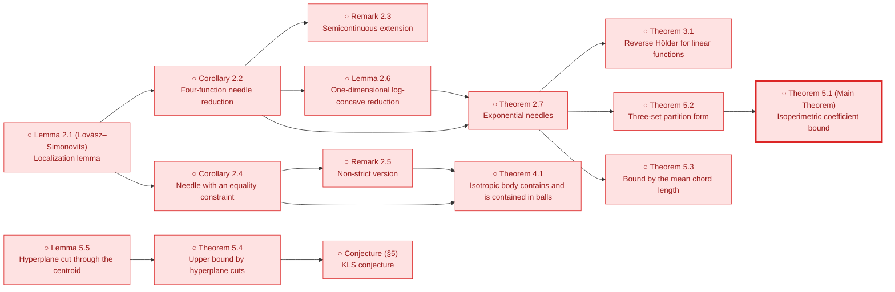

| Item | Statement | Status | Lean declarations | Note |
| --- | --- | --- | --- | --- |
| Lemma 2.1 (Lovász–Simonovits) | For lower semicontinuous integrable g, h on R^n with positive integrals, some needle (segment with a linear weight to the power n−1) has positive g- and h-integrals. | ○ Not yet formalized | — | Cited from Lovász–Simonovits (1993); its proof is not in this paper. |
| Corollary 2.2 | For nonnegative continuous f1..f4 and α, β > 0, an inequality between products of integral powers holds on every convex body iff it holds on every needle. | ○ Not yet formalized | — |  |
| Remark 2.3 | Corollary 2.2 extends to upper semicontinuous f1, f2 and lower semicontinuous f3, f4. | ○ Not yet formalized | — |  |
| Corollary 2.4 | On a bounded open convex T, if ∫g > 0 and ∫h = 0 for bounded lower semicontinuous g and continuous h, some needle in T has positive g-integral and zero h-integral. | ○ Not yet formalized | — |  |
| Remark 2.5 | Strict inequalities in Corollary 2.4 may be replaced by non-strict ones. | ○ Not yet formalized | — |  |
| Lemma 2.6 | On an interval, a four-function inequality holds for every log-concave weight iff it holds for every exponential weight on every subinterval. | ○ Not yet formalized | — |  |
| Theorem 2.7 | For nonnegative continuous f1..f4 on R^n, the four-function inequality holds for every compactly supported log-concave F iff it holds on every exponential needle. | ○ Not yet formalized | — |  |
| Theorem 3.1 | For 0 < p < q there is C(p, q), independent of n and K, with ‖f‖_q ≤ C(p, q)‖f‖_p for every linear f on a convex body K. | ○ Not yet formalized | — |  |
| Theorem 4.1 | An isotropic convex body satisfies √((n+2)/n) B ⊆ K ⊆ √(n(n+2)) B. | ○ Not yet formalized | — |  |
| **Theorem 5.1 (Main Theorem)** (main) | For every convex body K, ψ(K) ≥ ln 2 / M₁(K), where M₁ is the mean distance to the centroid. | ○ Not yet formalized | — | Convex bodies only; the later log-concave version is quoted as Theorem 5.11 of Milman (2009). |
| Theorem 5.2 | If K = K1 ∪ K2 ∪ K3 with dist(K1, K2) ≥ ε > 0, then ε·vol(K1)·vol(K2) ≤ vol(K)·vol(K3)·M₁(K)/ln 2. | ○ Not yet formalized | — |  |
| Theorem 5.3 | ψ(K) ≥ 1/χ(K), where χ(K) averages the longest chord of K centred at each point. | ○ Not yet formalized | — |  |
| Conjecture (§5) | ψ(K) is of order 1/√a(K), where a(K) is the largest eigenvalue of the inertia matrix. | ○ Not yet formalized | — | The repository states a covariance-normalized Poincaré version for log-concave laws (KLS.Conjecture); it is not a literal form of this convex-body conjecture. |
| Theorem 5.4 | ψ(K) ≤ 10/√a(K) for every convex body K. | ○ Not yet formalized | — |  |
| Lemma 5.5 | For b(K) = 0 and a unit vector u, the two halves of K cut by u^⊥ satisfy a product-volume bound against the section area and β = E(u·x)². | ○ Not yet formalized | — |  |

Not listed: Remark 2.8 is a normalization comment. The paper proves no Poincaré or trace-of-covariance bound; those appear in later literature.

### Bobkov1999 lemma map

Source: [Bobkov, Ann. Probab. 27 (1999), no. 4, 1903–1921 (author PDF)](https://www-users.cse.umn.edu/~bobko001/papers/1999_AOP_Isop.pdf), reviewed 2026-10-02.

Standing assumptions: Absolutely continuous log-concave probability measures on R^n; μ⁺ is the Minkowski boundary measure; Is(μ) is the min-denominator Cheeger constant h, λ₁ = 1/C_P is the spectral gap and ρ the log-Sobolev constant.

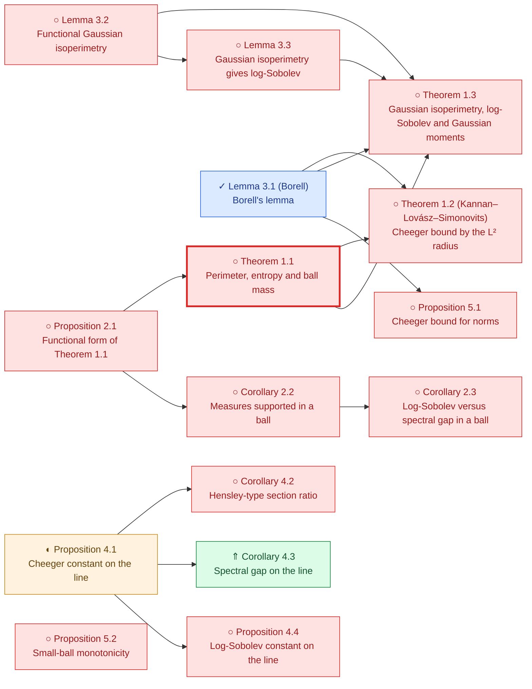

| Item | Statement | Status | Lean declarations | Note |
| --- | --- | --- | --- | --- |
| **Theorem 1.1** (main) | For log-concave μ on R^n, every measurable A, x₀ and r > 0: 2rμ⁺(A) ≥ μ(A)log(1/μ(A)) + (1 − μ(A))log(1/(1 − μ(A))) + log μ{&#124;x − x₀&#124; ≤ r}. | ○ Not yet formalized | — |  |
| Theorem 1.2 (Kannan–Lovász–Simonovits) | Is(μ) ≥ 1/(K‖&#124;x − x₀&#124;‖_{L²(μ)}) with x₀ the barycenter and K universal; hence λ₁ ≥ 1/(4K²‖&#124;x − x₀&#124;‖²_{L²}) by Cheeger. | ○ Not yet formalized | — | The proof gives Is(μ) ≥ 1/(6r) with r the 2/3-quantile of &#124;x − x₀&#124; (3.3). |
| Theorem 1.3 | For log-concave μ, Gaussian-type isoperimetry, a log-Sobolev inequality and ∫exp(ε&#124;x&#124;²)dμ < ∞ are equivalent, with ρ ≥ 1/(K‖&#124;x − x₀&#124;‖²_ψ) for ψ(u) = exp(u²) − 1. | ○ Not yet formalized | — |  |
| Proposition 2.1 | For locally Lipschitz f with values in [0, 1] and a symmetric convex body B: 2∫‖∇f‖_{B°}dμ ≥ Ent(f) + Ent(1 − f) + log μ(B(x₀)). | ○ Not yet formalized | — | Proved by the Prékopa–Leindler inequality. |
| Corollary 2.2 | If μ is concentrated in a ball of radius r, then 2r∫&#124;∇f&#124;dμ ≥ Ent(f) + Ent(1 − f) and 2rμ⁺(A) ≥ μ(A)log(1/μ(A)) + (1 − μ(A))log(1/(1 − μ(A))); hence Is(μ) ≥ log 2/r and λ₁ ≥ log²2/(4r²). | ○ Not yet formalized | — |  |
| Corollary 2.3 | If μ is concentrated in a ball of radius r, then λ₁/(1 + 2r√λ₁) ≤ ρ ≤ λ₁, so ρ ≥ 1/(10r²). | ○ Not yet formalized | — |  |
| Lemma 3.1 (Borell) | For symmetric convex B with θ = μ(B) > 1/2 and t ≥ 1: 1 − μ(tB) ≤ (1 − θ)((1 − θ)/θ)^((t−1)/2). | ✓ Formalized in Lean | [`one_sub_measure_smul_le`](../../formalization/FunctionalInequalities/KLS/LogConcave/Tail.lean) | For every log-concave law on a finite-dimensional real normed space. The Lean statement assumes B measurable, which the paper's μ(B) presupposes (a convex set need not be Borel). |
| Lemma 3.2 | If μ⁺(A) ≥ cI(μ(A)) for the Gaussian isoperimetric function I, then c[I(∫f) − ∫I(f)] ≤ ∫&#124;∇f&#124; for locally Lipschitz f with values in [0, 1]. | ○ Not yet formalized | — |  |
| Lemma 3.3 | Inequality (3.10) implies (c²/2)Ent(f²) ≤ ∫&#124;∇f&#124;² dμ. | ○ Not yet formalized | — |  |
| Proposition 4.1 | For log-concave μ on R: 1/(3Var) ≤ Is²(μ) ≤ 2/Var, with equality cases the uniform and two-sided exponential laws; Is(μ) = 2f(m) at the median. | ◐ Partial or statement only | [`minkowskiConstant_eq_two_mul`](../../formalization/FunctionalInequalities/KLS/LogConcave/Line/CheegerVariance.lean)<br/>[`inv_minkowskiConstant_sq_le_three_mul_evariance`](../../formalization/FunctionalInequalities/KLS/LogConcave/Line/CheegerVariance.lean) | Formalized: Is(μ) = 2f(m) at a median, and the lower bound 1/(3 Var) ≤ Is² as Is⁻² ≤ 3 Var for every log-concave law on the line. Not formalized: the upper bound Is² ≤ 2/Var and the equality cases. |
| Corollary 4.2 | For a convex body satisfying the isotropy condition, central sections by hyperplanes cutting B into equal volumes have ratio at most √6. | ○ Not yet formalized | — |  |
| Corollary 4.3 | For log-concave μ on R: 1/(12 Var) ≤ λ₁ ≤ 1/Var, i.e. Var ≤ C_P ≤ 12 Var. | ⇑ Stronger result or alternative route | [`localSlope_constant_le_four_variance`](../../formalization/FunctionalInequalities/KLS/LogConcave/Line/SharpPoincare.lean)<br/>[`localSlope_constant_le_twelve_variance_of_four`](../../formalization/FunctionalInequalities/KLS/LogConcave/Line/SharpPoincare.lean)<br/>[`evariance_le_smoothTest_constant`](../../formalization/FunctionalInequalities/KLS/LogConcave/Line/Buser.lean) | Sharper upper constant C_P ≤ 4 Var, proved by a different argument that does not use Proposition 4.1; the paper's 12 Var follows as a corollary, and Var ≤ C_P is the linear test. |
| Proposition 4.4 | For log-concave μ on R: 1/(24‖ξ − Eξ‖²_ψ) ≤ ρ ≤ 8/(3‖ξ − Eξ‖²_ψ) with ψ(x) = exp(x²) − 1. | ○ Not yet formalized | — |  |
| Proposition 5.1 | For a random vector X with log-concave law in a normed space, Is(μ_X) ≥ 1/(6r) with r the 2/3-quantile of ‖X‖, where μ_X is the law of ‖X‖. | ○ Not yet formalized | — |  |
| Proposition 5.2 | With F(t) = P(‖X‖ ≤ t), the function F(t)/t^(1/(2e)) is nondecreasing where 0 < F(t) ≤ e/(e + 1). | ○ Not yet formalized | — |  |

Not listed: The displayed consequences (1.8), (2.7), (2.8) and (2.10) are recorded with the statements they follow from.

### Milman2009 lemma map

Source: [E. Milman, arXiv:0712.4092v5](https://arxiv.org/abs/0712.4092v5), reviewed 2026-10-02.

Standing assumptions: Metric probability spaces; "convexity assumptions" mean total-variation limits of weighted Riemannian manifolds with Ric + Hess ψ ≥ 0. D_Che is the min-denominator Cheeger constant h and D_Poin = 1/√C_P, so D_Poin ≥ D_Che/2 is C_P ≤ 4Ψ². Attributed statements are quoted from the cited authors.

```mermaid
flowchart LR
    Milman2009_DChe["◐ Definition (§1.1, Cheeger)<br/>Cheeger constant D_Che"]
    Milman2009_DPoin["◐ Definition (§1.1, Poincaré)<br/>Poincaré constant D_Poin"]
    Milman2009_DExp["○ Definition (§1.1, exponential concentration)<br/>Exponential concentration D_Exp"]
    Milman2009_DFM["○ Definition (§1.3, first moment)<br/>First-moment concentration D_FM"]
    Milman2009_T11["◐ Theorem 1.1 (Maz'ya, Cheeger)<br/>Cheeger inequality"]
    Milman2009_T12["○ Theorem 1.2 (Gromov–Milman)<br/>Poincaré implies exponential concentration"]
    Milman2009_T13["○ Theorem 1.3 (Buser)<br/>Buser inequality on closed manifolds"]
    Milman2009_T14["◐ Theorem 1.4 (Ledoux)<br/>Buser–Ledoux inequality"]
    Milman2009_T15["○ Theorem 1.5 (Main Theorem)<br/>Cheeger, Poincaré and concentration are equivalent"]
    Milman2009_T16["○ Theorem 1.6<br/>Lipschitz-distance form of D_Che"]
    Milman2009_T17["○ Theorem 1.7<br/>Stability of D_Che for convex domains"]
    Milman2009_T18["○ Theorem 1.8 (Bavard–Pansu, …, Bobkov)<br/>Concavity of the isoperimetric profile"]
    Milman2009_L21["○ Lemma 2.1<br/>Mean versus median in Orlicz norms"]
    Milman2009_L22["○ Lemma 2.2 (Maz'ya, Federer–Fleming, Bobkov–Houdré)<br/>Cheeger as an L¹ Poincaré inequality"]
    Milman2009_R23["✓ Remark 2.3<br/>Metric gradient"]
    Milman2009_T24["○ Theorem 2.4<br/>All (p, q) Poincaré inequalities are equivalent"]
    Milman2009_P25["○ Proposition 2.5<br/>Monotonicity of (p, q) constants"]
    Milman2009_C26["◐ Corollary 2.6<br/>Maz'ya–Cheeger inequality, new proof"]
    Milman2009_C27["○ Corollary 2.7<br/>Gromov–Milman inequality, new proof"]
    Milman2009_R28["○ Remark 2.8<br/>Concentration from (r, r) Poincaré"]
    Milman2009_T29["○ Theorem 2.9<br/>Poincaré versus profile decay"]
    Milman2009_P210["○ Proposition 2.10 (Maz'ya, Federer–Fleming, Bobkov–Houdré)<br/>L¹-type Poincaré versus isoperimetry"]
    Milman2009_R211["○ Remark 2.11<br/>Uniform measures strengthen the results"]
    Milman2009_L31["◐ Lemma 3.1 (Bakry–Ledoux)<br/>Reverse local Poincaré inequality"]
    Milman2009_C32["◐ Corollary 3.2 (Ledoux)<br/>L¹ heat displacement"]
    Milman2009_L41["✓ Lemma 4.1<br/>Paley–Zygmund-type quantile bound"]
    Milman2009_P42["○ Proposition 4.2<br/>Optimal 1-Lipschitz functions behave like linear ones"]
    Milman2009_C43["○ Corollary 4.3<br/>Slow tail decay suffices"]
    Milman2009_L51["○ Lemma 5.1<br/>Going down to a large convex subset"]
    Milman2009_L52["○ Lemma 5.2<br/>Going up to a convex superset"]
    Milman2009_C53["○ Corollary 5.3<br/>Stability under Banach–Mazur-close bodies"]
    Milman2009_L54["○ Lemma 5.4<br/>Log-concave version of Lemmas 5.1–5.2"]
    Milman2009_T55["○ Theorem 5.5<br/>Total-variation stability of D_Che"]
    Milman2009_E56["○ Example 5.6<br/>Optimality of the stability exponent"]
    Milman2009_E57["○ Example 5.7<br/>Optimality of Corollary 5.3"]
    Milman2009_R58["○ Remark 5.8<br/>Sharper stability near the Euclidean ball"]
    Milman2009_T59["○ Theorem 5.9<br/>Lipschitz-on-average transport"]
    Milman2009_T510["○ Theorem 5.10 (Payne–Weinberger, Li–Yau)<br/>Diameter bound for convex domains"]
    Milman2009_T511["○ Theorem 5.11 (Kannan–Lovász–Simonovits)<br/>KLS first-moment bound"]
    Milman2009_T512["○ Theorem 5.12<br/>First-moment bound under convexity assumptions"]
    Milman2009_T514["○ Theorem 5.14 (Kannan–Lovász–Simonovits)<br/>Mean chord bound"]
    Milman2009_T515["○ Theorem 5.15 (Bobkov)<br/>Variance-of-norm bound"]
    Milman2009_T516["○ Theorem 5.16 (Sodin)<br/>Uniform bound for ℓ_p balls"]
    Milman2009_L61["○ Lemma 6.1<br/>Profile lower semicontinuity from above"]
    Milman2009_L62["○ Lemma 6.2<br/>Profile lower semicontinuity from within"]
    Milman2009_P64["○ Proposition 6.4 (Maz'ya, Federer–Fleming, Bobkov–Houdré)<br/>Profile versus capacity"]
    Milman2009_C65["○ Corollary 6.5<br/>Profile symmetry"]
    Milman2009_L66["○ Lemma 6.6<br/>Upper semicontinuity under concavity"]
    Milman2009_P68["○ Proposition 6.8<br/>Convergence of profiles"]
    Milman2009_L69["○ Lemma 6.9<br/>Hölder continuity of the profile"]
    Milman2009_T610["○ Theorem 6.10<br/>Approximation preserves concavity"]
    Milman2009_C611["○ Corollary 6.11<br/>Convex bodies satisfy the assumptions"]
    Milman2009_C612["○ Corollary 6.12<br/>Log-concave measures satisfy the assumptions"]
    Milman2009_L613["○ Lemma 6.13<br/>Borell-type tail bound"]
    Milman2009_T614["○ Theorem 6.14 (Cordero-Erausquin–McCann–Schmuckenschläger)<br/>Riemannian Prékopa–Leindler"]
    Milman2009_TA1["○ Theorem A.1 (Bavard–Pansu, …, Bayle–Rosales)<br/>Concavity for uniform measures"]
    Milman2009_TA2["○ Theorem A.2 (Bayle, Morgan)<br/>Concavity for weighted manifolds"]
    Milman2009_TA3["○ Theorem A.3 (after Sternberg–Zumbrun, Bayle)<br/>Concavity on locally convex domains"]
    Milman2009_TA4["○ Theorem A.4 (Bobkov)<br/>One-dimensional log-concave profile"]
    Milman2009_RA5["○ Remark A.5<br/>Half-lines are minimizers"]
    Milman2009_DChe --> Milman2009_T11
    Milman2009_DPoin --> Milman2009_T11
    Milman2009_DExp --> Milman2009_T12
    Milman2009_DPoin --> Milman2009_T12
    Milman2009_L31 --> Milman2009_T14
    Milman2009_T24 --> Milman2009_T15
    Milman2009_C26 --> Milman2009_T15
    Milman2009_C27 --> Milman2009_T15
    Milman2009_T610 --> Milman2009_T15
    Milman2009_L613 --> Milman2009_T15
    Milman2009_L22 --> Milman2009_T16
    Milman2009_L21 --> Milman2009_T16
    Milman2009_T15 --> Milman2009_T16
    Milman2009_L51 --> Milman2009_T17
    Milman2009_L52 --> Milman2009_T17
    Milman2009_TA1 --> Milman2009_T18
    Milman2009_TA2 --> Milman2009_T18
    Milman2009_TA3 --> Milman2009_T18
    Milman2009_TA4 --> Milman2009_T18
    Milman2009_DChe --> Milman2009_L22
    Milman2009_T29 --> Milman2009_T24
    Milman2009_T18 --> Milman2009_T24
    Milman2009_P25 --> Milman2009_T24
    Milman2009_C65 --> Milman2009_T24
    Milman2009_P25 --> Milman2009_C26
    Milman2009_L22 --> Milman2009_C26
    Milman2009_L21 --> Milman2009_C27
    Milman2009_P25 --> Milman2009_C27
    Milman2009_C27 --> Milman2009_R28
    Milman2009_C32 --> Milman2009_T29
    Milman2009_L21 --> Milman2009_T29
    Milman2009_P25 --> Milman2009_T29
    Milman2009_P210 --> Milman2009_T29
    Milman2009_T18 --> Milman2009_R211
    Milman2009_P210 --> Milman2009_R211
    Milman2009_L31 --> Milman2009_C32
    Milman2009_C27 --> Milman2009_P42
    Milman2009_L613 --> Milman2009_P42
    Milman2009_L21 --> Milman2009_P42
    Milman2009_L41 --> Milman2009_P42
    Milman2009_P42 --> Milman2009_C43
    Milman2009_P42 --> Milman2009_L51
    Milman2009_L21 --> Milman2009_L51
    Milman2009_C611 --> Milman2009_L52
    Milman2009_C612 --> Milman2009_L52
    Milman2009_T18 --> Milman2009_L52
    Milman2009_T610 --> Milman2009_L52
    Milman2009_L51 --> Milman2009_C53
    Milman2009_L52 --> Milman2009_C53
    Milman2009_L51 --> Milman2009_L54
    Milman2009_L52 --> Milman2009_L54
    Milman2009_L54 --> Milman2009_T55
    Milman2009_T17 --> Milman2009_E56
    Milman2009_C53 --> Milman2009_E57
    Milman2009_L51 --> Milman2009_R58
    Milman2009_C53 --> Milman2009_R58
    Milman2009_L22 --> Milman2009_T59
    Milman2009_L21 --> Milman2009_T59
    Milman2009_T15 --> Milman2009_T512
    Milman2009_T514 --> Milman2009_T515
    Milman2009_T512 --> Milman2009_T515
    Milman2009_T55 --> Milman2009_T515
    Milman2009_P64 --> Milman2009_C65
    Milman2009_L61 --> Milman2009_P68
    Milman2009_L62 --> Milman2009_P68
    Milman2009_L66 --> Milman2009_P68
    Milman2009_P68 --> Milman2009_T610
    Milman2009_L69 --> Milman2009_T610
    Milman2009_T18 --> Milman2009_T610
    Milman2009_T610 --> Milman2009_C611
    Milman2009_T610 --> Milman2009_C612
    Milman2009_TA4 --> Milman2009_C612
    Milman2009_T614 --> Milman2009_L613
    Milman2009_TA4 --> Milman2009_RA5
    classDef lemma_formalized fill:#dbeafe,stroke:#2563eb,color:#1e3a8a;
    class Milman2009_R23,Milman2009_L41 lemma_formalized;
    classDef lemma_partial fill:#fff3df,stroke:#c88719,color:#66420d;
    class Milman2009_DChe,Milman2009_DPoin,Milman2009_T11,Milman2009_T14,Milman2009_C26,Milman2009_L31,Milman2009_C32 lemma_partial;
    classDef lemma_pending fill:#fee2e2,stroke:#dc2626,color:#991b1b;
    class Milman2009_DExp,Milman2009_DFM,Milman2009_T12,Milman2009_T13,Milman2009_T15,Milman2009_T16,Milman2009_T17,Milman2009_T18,Milman2009_L21,Milman2009_L22,Milman2009_T24,Milman2009_P25,Milman2009_C27,Milman2009_R28,Milman2009_T29,Milman2009_P210,Milman2009_R211,Milman2009_P42,Milman2009_C43,Milman2009_L51,Milman2009_L52,Milman2009_C53,Milman2009_L54,Milman2009_T55,Milman2009_E56,Milman2009_E57,Milman2009_R58,Milman2009_T59,Milman2009_T510,Milman2009_T511,Milman2009_T512,Milman2009_T514,Milman2009_T515,Milman2009_T516,Milman2009_L61,Milman2009_L62,Milman2009_P64,Milman2009_C65,Milman2009_L66,Milman2009_P68,Milman2009_L69,Milman2009_T610,Milman2009_C611,Milman2009_C612,Milman2009_L613,Milman2009_T614,Milman2009_TA1,Milman2009_TA2,Milman2009_TA3,Milman2009_TA4,Milman2009_RA5 lemma_pending;
    style Milman2009_T15 stroke-width:3px
```

| Item | Statement | Status | Lean declarations | Note |
| --- | --- | --- | --- | --- |
| Definition (§1.1, Cheeger) | Best D with Ĩ(t) ≥ D t on [0, 1/2], where Ĩ is the isoperimetric profile. | ◐ Partial or statement only | [`constant`](../../formalization/FunctionalInequalities/KLS/Isoperimetry.lean) | Finite-dimensional laws on their affine support, with outer Minkowski content. |
| Definition (§1.1, Poincaré) | Best D with D‖f − Ef‖₂ ≤ ‖&#124;∇f&#124;‖₂ for Lipschitz-on-balls f. | ◐ Partial or statement only | [`constant`](../../formalization/FunctionalInequalities/Poincare/LocalSlope/Basic.lean) | Stored as C_P = D_Poin^(−2) for finite-dimensional laws. |
| Definition (§1.1, exponential concentration) | Best D with μ(&#124;f − Ef&#124; ≥ t) ≤ e·exp(−Dt) for 1-Lipschitz f. | ○ Not yet formalized | — |  |
| Definition (§1.3, first moment) | Best D with ‖f − Ef‖₁ ≤ 1/D for 1-Lipschitz f. | ○ Not yet formalized | — |  |
| Theorem 1.1 (Maz'ya, Cheeger) | D_Poin ≥ D_Che/2. | ◐ Partial or statement only | [`literatureConstant_le_four_mul_inverseScale_sq`](../../formalization/FunctionalInequalities/KLS/Geometry/Cheeger/Inequality.lean) | Proved as C_P ≤ 4Ψ² for finite-dimensional log-concave laws; the paper states it on general metric probability spaces. |
| Theorem 1.2 (Gromov–Milman) | D_Exp ≥ c·D_Poin for a universal c. | ○ Not yet formalized | — |  |
| Theorem 1.3 (Buser) | For uniform measure on a closed manifold with Ric ≥ 0, D_Che ≥ c·D_Poin. | ○ Not yet formalized | — |  |
| Theorem 1.4 (Ledoux) | Under smooth convexity assumptions, D_Che ≥ c·D_Poin. | ◐ Partial or statement only | [`inverseScale_sq_le_pi_literature`](../../formalization/FunctionalInequalities/KLS/LogConcave/Density/GaussianSmoothing/Buser.lean) | Euclidean case only, as Ψ² ≤ π C_P, i.e. c = 1/√π, for every finite-dimensional log-concave law including nonsmooth ones; weighted manifolds are not covered. |
| **Theorem 1.5 (Main Theorem)** (main) | Under convexity assumptions, D_Che ≃ D_Poin ≃ D_Exp ≃ D_FM up to universal constants. | ○ Not yet formalized | — |  |
| Theorem 1.6 | D_Che ≃ inf over A with μ(A) ≥ 1/2 of 1/∫d(x, A)dμ. | ○ Not yet formalized | — |  |
| Theorem 1.7 | If vol(K ∩ L) ≥ v_K vol(K) and ≥ v_L vol(L), then D_Che(K) ≥ c·v_K²/log(1 + 1/v_L)·D_Che(L). | ○ Not yet formalized | — |  |
| Theorem 1.8 (Bavard–Pansu, …, Bobkov) | Under generalized smooth convexity the isoperimetric profile is concave on (0, 1); I^(n/(n−1)) is concave for uniform measures. | ○ Not yet formalized | — |  |
| Lemma 2.1 | ½‖f − Ef‖_N ≤ ‖f − Mf‖_N ≤ 3‖f − Ef‖_N for every Orlicz norm. | ○ Not yet formalized | — |  |
| Lemma 2.2 (Maz'ya, Federer–Fleming, Bobkov–Houdré) | Cheeger's inequality with D_Che holds iff D_Che‖f − Mf‖₁ ≤ ‖&#124;∇f&#124;‖₁ for all f. | ○ Not yet formalized | — |  |
| Remark 2.3 | On metric probability spaces &#124;∇f&#124;(x) is the limsup of &#124;f(y) − f(x)&#124;/d(x, y) as y → x, and 0 at isolated points. | ✓ Formalized in Lean | [`apply`](../../formalization/FunctionalInequalities/Energy/LocalSlope/Basic.lean) | Same convention, including isolated points. |
| Theorem 2.4 | Under convexity assumptions, D_{p,q} ≤ C p′ D_{p′,q′} for 1 ≤ p ≤ q ≤ ∞ and 1 ≤ p′ ≤ q′ ≤ ∞. | ○ Not yet formalized | — |  |
| Proposition 2.5 | If 1/p − 1/q = 1/p′ − 1/q′ with p ≤ p′, q ≤ q′, then D_{p′,q′} ≥ (p/p′) D_{p,q}, without convexity. | ○ Not yet formalized | — |  |
| Corollary 2.6 | D_Poin ≥ D_Che/2. | ◐ Partial or statement only | [`literatureConstant_le_four_mul_inverseScale_sq`](../../formalization/FunctionalInequalities/KLS/Geometry/Cheeger/Inequality.lean) | Same Lean result as Theorem 1.1, by a different proof; finite-dimensional log-concave laws only. |
| Corollary 2.7 | D_Exp ≥ c·D_Poin. | ○ Not yet formalized | — |  |
| Remark 2.8 | D_Exp ≥ c_r D_{r,r} for every r ≥ 1. | ○ Not yet formalized | — |  |
| Theorem 2.9 | Under smooth convexity, a (p, q) Poincaré inequality is equivalent to Ĩ(t) ≥ D′ t^r with r = 1 + 1/p − 1/q in [1/2, 2], with comparable constants. | ○ Not yet formalized | — |  |
| Proposition 2.10 (Maz'ya, Federer–Fleming, Bobkov–Houdré) | For 0 < r ≤ 1, the (1/r, 1) Poincaré inequality is equivalent to Ĩ(t) ≥ D t^r, without convexity. | ○ Not yet formalized | — |  |
| Remark 2.11 | For uniform measures, concavity of I^(n/(n−1)) upgrades the main theorem to an (n/(n−1), 1) Poincaré inequality. | ○ Not yet formalized | — |  |
| Lemma 3.1 (Bakry–Ledoux) | Under Ric + Hess ψ ≥ −K, c(t)&#124;∇P_t f&#124;² ≤ P_t(f²) − (P_t f)² pointwise, with c(t) = 2t when K = 0. | ◐ Partial or statement only | [`two_mul_integral_mul_weakGamma_le`](../../formalization/FunctionalInequalities/KLS/LogConcave/HeatSemigroup/ReversePoincare.lean) | K = 0 for smooth convex potentials on Euclidean spaces, integrated against nonnegative C_c^∞ tests (a.e. form for bounded data). |
| Corollary 3.2 (Ledoux) | ‖f − P_t f‖₁ ≤ √(2t)‖&#124;∇f&#124;‖₁. | ◐ Partial or statement only | [`integral_abs_indicator_sub_operator_le`](../../formalization/FunctionalInequalities/KLS/LogConcave/HeatSemigroup/Perimeter.lean) | Indicator data of smooth domains with relative perimeter, smooth convex potential; a sharper coefficient 2√(t/π) is also proved. |
| Lemma 4.1 | If ‖f‖₂ ≤ D‖f‖₁ then the (1 − ε) quantile of &#124;f&#124; is at least θ‖f‖₁ with ε = (1 − θ)²/D². | ✓ Formalized in Lean | [`mul_eLpNorm_one_le_lowerQuantile`](../../formalization/FunctionalInequalities/Probability/Quantile.lean) | Stated with the paper's hypotheses (D > 0, θ ∈ (0, 1)) and Q_δ as the real infimum; in the degenerate case f = 0 with 1 − ε < 0 the paper's quantile is −∞ and the real convention gives 0. |
| Proposition 4.2 | An essentially optimal 1-Lipschitz f₀ for first-moment concentration has ‖f₀‖_Ψ₁ ≤ C₀‖f₀‖₁ and a quantile lower bound. | ○ Not yet formalized | — |  |
| Corollary 4.3 | An arbitrarily slow uniform tail decay of 1-Lipschitz functions implies the main theorem's statements with constants depending only on the decay. | ○ Not yet formalized | — |  |
| Lemma 5.1 | If L ⊆ K is convex with vol(L) ≥ v vol(K), then D_FM(L) ≥ c/log(1 + 1/v)·D_Exp(K). | ○ Not yet formalized | — |  |
| Lemma 5.2 | If L ⊆ K are convex with vol(L) ≥ v vol(K), then D_Che(K) ≥ v² D_Che(L). | ○ Not yet formalized | — |  |
| Corollary 5.3 | If d_G(K, L) ≤ 1 + s/n for 1 ≤ s ≤ C₁n, then D_Che(K) and D_Che(L) agree up to a factor C₂ s. | ○ Not yet formalized | — |  |
| Lemma 5.4 | Lemmas 5.1 and 5.2 hold for absolutely continuous log-concave measures with density domination dμ_K/dx ≥ v dμ_L/dx. | ○ Not yet formalized | — |  |
| Theorem 5.5 | If d_TV(μ₁, μ₂) ≤ 1 − ε for log-concave μ₁, μ₂, their Cheeger constants agree up to c(ε) = c′ε²/log(1 + 1/ε). | ○ Not yet formalized | — |  |
| Example 5.6 | Products of cubes and ℓ₁-balls show the quadratic dependence in Theorem 1.7 is necessary. | ○ Not yet formalized | — |  |
| Example 5.7 | Truncated ℓ₁-balls show the linear dependence on s in Corollary 5.3 is necessary. | ○ Not yet formalized | — |  |
| Remark 5.8 | Near B₂ⁿ the bound in Corollary 5.3 improves to 1/(C₂√s). | ○ Not yet formalized | — |  |
| Theorem 5.9 | If T pushes μ to ν and ν satisfies convexity assumptions, then D_Che(ν) ≥ c/∫‖DT‖_op dμ·D_Che(μ). | ○ Not yet formalized | — |  |
| Theorem 5.10 (Payne–Weinberger, Li–Yau) | For locally convex smooth K with Ric ≥ 0, D_Poin ≥ π/(2 diam K), and π/diam K in Euclidean space. | ○ Not yet formalized | — |  |
| Theorem 5.11 (Kannan–Lovász–Simonovits) | For log-concave μ on R^n, D_Che(μ) ≥ c/∫&#124;x − x₀&#124;dμ for every x₀. | ○ Not yet formalized | — |  |
| Theorem 5.12 | Under convexity assumptions, D_Che ≥ c/∫d(x, x₀)dμ for every x₀. | ○ Not yet formalized | — |  |
| Theorem 5.14 (Kannan–Lovász–Simonovits) | For log-concave μ with bounded support B, D_Che(μ) ≥ c/∫θ_B dμ, θ_B the longest symmetric chord. | ○ Not yet formalized | — |  |
| Theorem 5.15 (Bobkov) | For log-concave μ, D_Che(μ) ≥ c/Var_μ(&#124;x − x₀&#124;²)^(1/4). | ○ Not yet formalized | — |  |
| Theorem 5.16 (Sodin) | Normalized ℓ_pⁿ balls with p ∈ [1, 2] have D_Che bounded below uniformly in n. | ○ Not yet formalized | — |  |
| Lemma 6.1 | If μ_m tends to μ from above, liminf of I_{μ_m}(t) is at least the lower limit of I_μ near t. | ○ Not yet formalized | — |  |
| Lemma 6.2 | The same conclusion when μ_m tends to μ from within. | ○ Not yet formalized | — |  |
| Proposition 6.4 (Maz'ya, Federer–Fleming, Bobkov–Houdré) | inf over [a, b] of I ≤ Cap₁(a, b) ≤ inf over [a, b) of I. | ○ Not yet formalized | — |  |
| Corollary 6.5 | If I is lower semicontinuous at t and 1 − t, then I(t) = I(1 − t). | ○ Not yet formalized | — |  |
| Lemma 6.6 | If μ_m → μ in total variation with concave profiles, the lower limit of I_μ near t dominates limsup I_{μ_m}(t). | ○ Not yet formalized | — |  |
| Proposition 6.8 | Under total-variation convergence from above or within, with concave profiles, I_{μ_m}(t) converges to the lower limit of I_μ near t. | ○ Not yet formalized | — |  |
| Lemma 6.9 | For densities bounded above on balls, the profile is absolutely continuous and locally (n−1)/n-Hölder. | ○ Not yet formalized | — |  |
| Theorem 6.10 | Smooth convex approximations from above or within give pointwise profile convergence, so the limit profile is concave. | ○ Not yet formalized | — |  |
| Corollary 6.11 | Uniform measures on convex domains satisfy the convexity assumptions, with I and I^(n/(n−1)) concave. | ○ Not yet formalized | — |  |
| Corollary 6.12 | Absolutely continuous log-concave measures on R^n satisfy the convexity assumptions, with concave profile. | ○ Not yet formalized | — |  |
| Lemma 6.13 | If μ_m(B(x₀, R)) = θ > 1/2, then μ_m(M ∖ B(x₀, tR)) ≤ θ((1 − θ)/θ)^((t+1)/2) for t ≥ 1. | ○ Not yet formalized | — |  |
| Theorem 6.14 (Cordero-Erausquin–McCann–Schmuckenschläger) | Under Ric + Hess ψ ≥ 0, the weighted Prékopa–Leindler inequality holds along geodesic interpolation. | ○ Not yet formalized | — |  |
| Theorem A.1 (Bavard–Pansu, …, Bayle–Rosales) | For locally convex smooth domains in manifolds with Ric ≥ 0, I and I^(n/(n−1)) are concave. | ○ Not yet formalized | — |  |
| Theorem A.2 (Bayle, Morgan) | Under Ric + Hess ψ ≥ 0 the profile is concave. | ○ Not yet formalized | — |  |
| Theorem A.3 (after Sternberg–Zumbrun, Bayle) | On locally convex C² domains with Ric + Hess ψ ≥ 0 the profile is concave. | ○ Not yet formalized | — |  |
| Theorem A.4 (Bobkov) | For absolutely continuous log-concave μ on R, the isoperimetric profile is concave on (0, 1). | ○ Not yet formalized | — |  |
| Remark A.5 | In dimension one the minimizers are half-lines, so I(t) = min(F′∘F⁻¹(t), F′∘F⁻¹(1 − t)). | ○ Not yet formalized | — |  |

Not listed: Remarks 3.3, 4.4, 5.13, 6.3 and 6.7 are expository; the unnumbered regularity theorems for isoperimetric minimizers in the appendix are quoted background.

### GuedonMilman2011 lemma map

Source: [Guédon–Milman, arXiv:1011.0943v3](https://arxiv.org/abs/1011.0943v3), reviewed 2026-10-03.

Standing assumptions: C, c, c_1, c_2, C' denote universal positive constants independent of n and all other parameters, changing between occurrences. X is an isotropic random vector in R^n (E X = 0, E X tensor X = Id) with log-concave density; X is psi_alpha with constant b_alpha (alpha in [1,2]) if (E|<X,y>|^p)^{1/p} <= b_alpha p^{1/alpha} (E|<X,y>|^2)^{1/2} for all p >= 2 and y (always true for alpha = 1 with b_1 <= C, and b_alpha >= 2^{-1/alpha}). A in M_n(R) with ||A||_HS^2 = n, eta = n/(||A||_op^2 b_alpha^2), G_n an independent standard Gaussian vector and Y = (AX + G_n)/sqrt 2 with density g. Throughout the proofs eta (hence n) is assumed larger than a universal constant. SO(n) carries the bi-invariant metric |B|^2 = ||B||_HS^2/2 on antisymmetric B; Z^+_q(w) is the one-sided L_q-centroid body h(y) = (2 int <x,y>_+^q w)^{1/q}, Z_q(w) the standard one with h(y) = (int |<x,y>|^q w)^{1/q}, K_q(w) Ball's body with gauge (q int_0^infty t^{q-1} w(tx) dt)^{-1/q}, and d(K,L) = inf{C_2/C_1 : C_1 L in K in C_2 L} the geometric distance.

```mermaid
flowchart LR
    GuedonMilman2011_DISO["✓ Section 1 (unnumbered definition of isotropy)<br/>Isotropic random vector"]
    GuedonMilman2011_DLC["◐ Section 1 (unnumbered definition of log-concavity)<br/>Log-concave density"]
    GuedonMilman2011_T11["○ Theorem 1.1<br/>Deviation and thin-shell estimates"]
    GuedonMilman2011_T12["○ Theorem 1.2<br/>Moment estimates for |AX|"]
    GuedonMilman2011_R13["○ Remark 1.3<br/>Scale-invariant normalization"]
    GuedonMilman2011_C14["○ Corollary 1.4<br/>Cheeger bound n^{-5/12}"]
    GuedonMilman2011_T15["○ Theorem 1.5<br/>Improved log-Lipschitz bound"]
    GuedonMilman2011_T21["○ Theorem 2.1<br/>Log-Lipschitz via centroid bodies"]
    GuedonMilman2011_L22["✓ Lemma 2.2 (Grunbaum)<br/>Grunbaum half-line mass bound"]
    GuedonMilman2011_L23["○ Lemma 2.3<br/>Centroid bodies of Gaussian convolution"]
    GuedonMilman2011_C24["○ Corollary 2.4<br/>Distance and Lipschitz bound"]
    GuedonMilman2011_T25["○ Theorem 2.5<br/>Distance of K_{m+p} to ball"]
    GuedonMilman2011_P26["○ Proposition 2.6<br/>Comparing K_{m+q} and Z^+_q"]
    GuedonMilman2011_T31["○ Theorem 3.1<br/>Moment estimates for Y"]
    GuedonMilman2011_R32["○ Remark 3.2<br/>Sharpness of exponent balance"]
    GuedonMilman2011_R33["○ Remark 3.3 (using Bobkov)<br/>Bobkov concavity alternative"]
    GuedonMilman2011_T41["○ Theorem 4.1<br/>Deviation estimates for Y"]
    GuedonMilman2011_A1["○ Lemma A.1<br/>Support of Z^+_q(K)"]
    GuedonMilman2011_A2["✓ Lemma A.2<br/>Log-concave density at zero"]
    GuedonMilman2011_A3["○ Lemma A.3<br/>Half-space mass of K_{m+q}"]
    GuedonMilman2011_A4["○ Lemma A.4<br/>Lower bound for Z^+_2"]
    GuedonMilman2011_T41 --> GuedonMilman2011_T11
    GuedonMilman2011_T31 --> GuedonMilman2011_T11
    GuedonMilman2011_DISO --> GuedonMilman2011_T11
    GuedonMilman2011_DLC --> GuedonMilman2011_T11
    GuedonMilman2011_T31 --> GuedonMilman2011_T12
    GuedonMilman2011_T11 --> GuedonMilman2011_T12
    GuedonMilman2011_T11 --> GuedonMilman2011_R13
    GuedonMilman2011_T12 --> GuedonMilman2011_R13
    GuedonMilman2011_T11 --> GuedonMilman2011_C14
    GuedonMilman2011_DISO --> GuedonMilman2011_C14
    GuedonMilman2011_DLC --> GuedonMilman2011_C14
    GuedonMilman2011_C24 --> GuedonMilman2011_T15
    GuedonMilman2011_T25 --> GuedonMilman2011_T21
    GuedonMilman2011_L22 --> GuedonMilman2011_T21
    GuedonMilman2011_L22 --> GuedonMilman2011_L23
    GuedonMilman2011_DISO --> GuedonMilman2011_L23
    GuedonMilman2011_DLC --> GuedonMilman2011_L23
    GuedonMilman2011_L23 --> GuedonMilman2011_C24
    GuedonMilman2011_T21 --> GuedonMilman2011_C24
    GuedonMilman2011_P26 --> GuedonMilman2011_T25
    GuedonMilman2011_A1 --> GuedonMilman2011_P26
    GuedonMilman2011_A2 --> GuedonMilman2011_P26
    GuedonMilman2011_A3 --> GuedonMilman2011_P26
    GuedonMilman2011_C24 --> GuedonMilman2011_T31
    GuedonMilman2011_DISO --> GuedonMilman2011_T31
    GuedonMilman2011_DLC --> GuedonMilman2011_T31
    GuedonMilman2011_T31 --> GuedonMilman2011_R32
    GuedonMilman2011_C24 --> GuedonMilman2011_R32
    GuedonMilman2011_T31 --> GuedonMilman2011_T41
    GuedonMilman2011_L22 --> GuedonMilman2011_A3
    GuedonMilman2011_L22 --> GuedonMilman2011_A4
    GuedonMilman2011_DISO --> GuedonMilman2011_A4
    GuedonMilman2011_DLC --> GuedonMilman2011_A4
    classDef lemma_formalized fill:#dbeafe,stroke:#2563eb,color:#1e3a8a;
    class GuedonMilman2011_DISO,GuedonMilman2011_L22,GuedonMilman2011_A2 lemma_formalized;
    classDef lemma_partial fill:#fff3df,stroke:#c88719,color:#66420d;
    class GuedonMilman2011_DLC lemma_partial;
    classDef lemma_pending fill:#fee2e2,stroke:#dc2626,color:#991b1b;
    class GuedonMilman2011_T11,GuedonMilman2011_T12,GuedonMilman2011_R13,GuedonMilman2011_C14,GuedonMilman2011_T15,GuedonMilman2011_T21,GuedonMilman2011_L23,GuedonMilman2011_C24,GuedonMilman2011_T25,GuedonMilman2011_P26,GuedonMilman2011_T31,GuedonMilman2011_R32,GuedonMilman2011_R33,GuedonMilman2011_T41,GuedonMilman2011_A1,GuedonMilman2011_A3,GuedonMilman2011_A4 lemma_pending;
    style GuedonMilman2011_T11 stroke-width:3px
```

| Item | Statement | Status | Lean declarations | Note |
| --- | --- | --- | --- | --- |
| Section 1 (unnumbered definition of isotropy) | A random vector X in R^n (and its density) is isotropic if E X = 0 and E X tensor X = Id, i.e. barycenter at the origin and identity covariance; then E&#124;AX&#124;^2 = &#124;&#124;A&#124;&#124;_HS^2 for every n by n matrix A. | ✓ Formalized in Lean | [`Isotropic`](../../formalization/FunctionalInequalities/KLS/Isotropic.lean) | Unnumbered definition, listed because a Lean declaration states it. Lean states the three conditions (MemLp id 2, zero mean, centered covariance operator equal to the identity) coordinate-free on a finite-dimensional real inner-product space and for arbitrary probability laws; in orthonormal coordinates this is the paper's definition. The paper always adds a log-concave density; that hypothesis is DLC. |
| Section 1 (unnumbered definition of log-concavity) | A function g : R^n -> R_+ is log-concave if -log g : R^n -> R union {+infinity} is convex; the paper's random vectors X have log-concave densities with respect to Lebesgue measure on R^n. | ◐ Partial or statement only | [`LogConcave`](../../formalization/FunctionalInequalities/KLS/Definitions.lean)<br/>[`compactLogConcave`](../../formalization/FunctionalInequalities/KLS/LogConcave/Density/FromBorell.lean) | Unnumbered definition, listed because Lean states a counterpart. Lean's LogConcave is Borell's compact-set inequality mu(tK0+(1-t)K1) >= mu(K0)^t mu(K1)^(1-t) for probability laws on a finite-dimensional normed space (degenerate supports allowed). IsBorellDensity.compactLogConcave proves that a law with a pointwise log-concave density is LogConcave (Prekopa-Leindler); the paper's full-dimensional density hypothesis is therefore a special case, but log-concavity of functions itself is not a separate Lean definition. |
| **Theorem 1.1** (main) | If X is isotropic in R^n with log-concave density and psi_alpha (alpha in [1,2]) with constant b_alpha, and A in M_n(R) has &#124;&#124;A&#124;&#124;_HS^2 = n, then P(&#124;&#124;AX&#124; - sqrt n&#124; >= t sqrt n) <= C exp(-c eta^{alpha/2} min(t^{2+alpha}, t)) for all t >= 0, where eta = n/(&#124;&#124;A&#124;&#124;_op^2 b_alpha^2) (1.8), with universal c, C > 0. In particular sqrt(Var&#124;AX&#124;) <= C n^{1/2} eta^{-alpha/(2(2+alpha))} (1.9); the text adds the one-sided forms (1.10) without the prefactor C and (1.11) with max(t^{2+alpha}, log(c_2/(1-t))), and for alpha = 1, A = Id the thin-shell bound sqrt(Var&#124;X&#124;) <= C n^{1/3} (1.12). | ○ Not yet formalized | — | Main theorem: it is the headline estimate of the abstract and of the register entry (Main deviation estimate), and contains the thin-shell bound sigma_n <= C n^{1/3} cited downstream (Eldan 2013, Lee-Vempala). The authors call the moment estimates of Theorem 1.2 the main result and say Theorem 1.1 is essentially equivalent to them; logically (1.7) is derived in Section 4 from Theorem 4.1 for Y = (AX+G_n)/sqrt 2 via Klartag's reduction [KlartagCLP, Prop. 4.1], (1.10) via the moment reduction (4.7) from Theorem 3.1, and (1.11) additionally uses Paouris' small-ball estimate (1.5), so the full Theorem 1.2 depends on Theorem 1.1 rather than conversely. No Lean counterpart: radial moments, psi_alpha, deviation and thin-shell bounds are not formalized. Marked main as the register's target (the deviation estimate); the authors call Theorem 1.2 their main result, and its proof uses this theorem. |
| Theorem 1.2 | Under the hypotheses of Theorem 1.1, for 1 <= &#124;p-2&#124; <= c_1 eta^{alpha/(2(alpha+2))} one has &#124;(E&#124;AX&#124;^p)^{1/p}/(E&#124;AX&#124;^2)^{1/2} - 1&#124; <= C &#124;p-2&#124;/eta^{alpha/(alpha+2)}, and for c_1 eta^{alpha/(2(alpha+2))} <= &#124;p-2&#124; <= c_2 eta^{alpha/2} one has &#124;(E&#124;AX&#124;^p)^{1/p}/(E&#124;AX&#124;^2)^{1/2} - 1&#124; <= C (&#124;p-2&#124;/eta^{alpha/2})^{1/(alpha+1)}, with the L_0-norm read as exp(E log&#124;AX&#124;). | ○ Not yet formalized | — | Called the main result by the authors. Proved in Section 4: positive moments for p >= 3 from Theorem 3.1 via (4.7); the small-range positive moments via Fleury's Lemma 6 applied to the deviations of Theorem 1.1; negative moments by integrating (4.8), which combines (1.11)-type bounds with Paouris' small-ball estimate. No Lean counterpart. |
| Remark 1.3 | The assumption &#124;&#124;A&#124;&#124;_HS^2 = n is only cosmetic: scaling X, all deviation estimates hold around (E&#124;AX&#124;^2)^{1/2} = &#124;&#124;A&#124;&#124;_HS with the scale-invariant parameter eta = &#124;&#124;A&#124;&#124;_HS^2/(b_alpha^2 &#124;&#124;A&#124;&#124;_op^2). | ○ Not yet formalized | — | Reformulation remark, no separate proof. No Lean counterpart. |
| Corollary 1.4 | If mu is a probability measure on R^n with isotropic log-concave density, then its Cheeger constant satisfies D_Che(mu) >= c n^{-5/12} for a universal c > 0 (improving to c n^{-3/8} when the density is psi_2). | ○ Not yet formalized | — | Proved by combining Bobkov's theorem D_Che(mu)^2 >= c/(E&#124;X&#124; sqrt(Var&#124;X&#124;)) (cited, not proved) with the thin-shell bound (1.12). Not mapped: Lean's literatureConstant_le_four_mul_inverseScale_sq and inverseScale_sq_le_pi_literature compare the Poincare and Minkowski-Cheeger constants of a fixed log-concave law, but neither Bobkov's variance bound nor any dimension-dependent lower bound on the Cheeger constant is formalized, so no Lean statement states or restricts this corollary. |
| Theorem 1.5 | Under the hypotheses of Theorem 1.1, with Y = (AX + G_n)/sqrt 2 and h_{k,p}(u) = vol(S^{k-1}) int_0^infty t^{p+k-1} pi_{u(E_0)} g(t u(theta_0)) dt on SO(n) (g the density of Y), if p >= -k+1 then the log-Lipschitz constant satisfies L_{k,p} <= C &#124;&#124;A&#124;&#124;_op b_alpha max(k,p)^{1/alpha+1/2}. | ○ Not yet formalized | — | Introduction version of Corollary 2.4 (which uses &#124;&#124;A&#124;&#124;_op >= 1, automatic when &#124;&#124;A&#124;&#124;_HS^2 = n). No Lean counterpart; SO(n) Riemannian structure and h_{k,p} are not formalized. |
| Theorem 2.1 | For Y with log-concave density g on R^n and barycenter 0, integers 1 <= k <= n, real p >= -k+1, E_0 in G_{n,k} and theta_0 in S(E_0), the log-Lipschitz constant of h_{k,p} on SO(n) (metric &#124;B&#124;^2 = &#124;&#124;B&#124;&#124;_HS^2/2) is at most C max(k,p) d(Z^+_{max(k,p)}(g), B_2^n), where Z^+_q is the one-sided L_q-centroid body h_{Z^+_q(w)}(y) = (2 int <x,y>_+^q w)^{1/q} and d is the geometric distance. | ○ Not yet formalized | — | Proof via Type-1/2/3 movements using K. Ball's K_q(w) norm theorem (unnumbered, cited from Ball and Klartag), the inclusions (2.3) between the Z^+_q (uses Lemma 2.2), projection and Theorem 2.5. No Lean counterpart. |
| Lemma 2.2 (Grunbaum) | If X_1 is a real random variable with log-concave density and barycenter at the origin, then 1/e <= P(X_1 >= 0) <= 1 - 1/e. | ✓ Formalized in Lean | [`exp_neg_one_le_measureReal_Ici`](../../formalization/FunctionalInequalities/KLS/LogConcave/Line/Grunbaum.lean) | Lean states it for a log-concave law on the line whose support has nonempty interior (equivalently, one with a log-concave density) and mean 0. Proof: the tail is log-concave and lies below its tangent exponential at 0; the layer-cake formula and the barycenter condition give P(X > 0) ≥ 1/e, and the reflected law gives P(X < 0) ≥ 1/e. |
| Lemma 2.3 | Let X be isotropic in R^n with log-concave density, A in M_n(R), Y = (AX + G_n)/sqrt 2 with density g. Then for all q >= 2: Z^+_q(g) contains c sqrt q B_2^n, and if X is psi_alpha (alpha in [1,2]) with constant b_alpha then Z^+_q(g) is contained in (C_1 &#124;&#124;A&#124;&#124;_op b_alpha q^{1/alpha} + C_2 sqrt q) B_2^n. | ○ Not yet formalized | — | Lower bound uses P(<AX,theta> >= 0) >= 1/e from Lemma 2.2 and Gaussian moments. No Lean counterpart. |
| Corollary 2.4 | Under the hypotheses of Lemma 2.3 with X psi_alpha (alpha in [1,2]) with constant b_alpha, d(Z^+_q(g), B_2^n) <= C_1 (1 + &#124;&#124;A&#124;&#124;_op b_alpha q^{1/alpha - 1/2}); consequently, when &#124;&#124;A&#124;&#124;_op >= 1, L_{k,p} <= C_2 &#124;&#124;A&#124;&#124;_op b_alpha max(k,p)^{1/alpha+1/2}. | ○ Not yet formalized | — | Immediate from Lemma 2.3 and Theorem 2.1. No Lean counterpart. |
| Theorem 2.5 | If w is log-concave on R^m with 0 < int w < infinity and barycenter at the origin, then for every p >= -m+1, d(K_{m+p}(w), B_2^m) <= C max(m/(m+p), 1) d(Z^+_{max(p,m)}(w), B_2^m). | ○ Not yet formalized | — | Uses the cited inclusions (2.7) between K_q bodies, the polar identity Z^+_q(K_{m+q}(w)) = Z^+_q(w) (2.8), Proposition 2.6 and Stirling's formula. No Lean counterpart. |
| Proposition 2.6 | With w as in Theorem 2.5 and any q >= 1, C_1 Z^+_q(K_{m+q}(w)) is contained in vol(K_{m+q}(w))^{1/q} K_{m+q}(w), which is contained in C_2 (Gamma(m+q+1)/(Gamma(m) Gamma(q+1)))^{1/q} Z^+_q(K_{m+q}(w)). | ○ Not yet formalized | — | Proof in the Appendix; the non-even (non-centrally-symmetric) case is the new part. No Lean counterpart. |
| Theorem 3.1 | Let X be isotropic in R^n with log-concave density, psi_alpha (alpha in [1,2]) with constant b_alpha, A in M_n(R) with &#124;&#124;A&#124;&#124;_HS^2 = n, and Y = (AX + G_n)/sqrt 2 with G_n an independent standard Gaussian. Then for &#124;p&#124; <= c eta^{alpha/2}, 1 - C (&#124;p-2&#124;/eta^{alpha/2})^{1/(alpha+1)} <= (E&#124;Y&#124;^p)^{1/p}/(E&#124;Y&#124;^2)^{1/2} <= 1 + C (&#124;p-2&#124;/eta^{alpha/2})^{1/(alpha+1)}. | ○ Not yet formalized | — | Proof: Fleury's passage to SO(n) and Grassmann averaging, entropy decomposition of d/dp log (E&#124;Y&#124;^p)^{1/p}, the SO(n) log-Sobolev inequality and Herbst reverse Holder bound (cited), Borell's concavity of q -> log(int t^q w/Gamma(q+1)) (cited), Stirling, Corollary 2.4, optimization of k, and Fleury's argument near p = 0. No Lean counterpart. |
| Remark 3.2 | For alpha = 1 and A = Id, if L_{k,p} <= C p^beta k^gamma for 2 <= p <= k, the proof recovers the sharp large deviation P(&#124;X&#124; >= C sqrt n) <= exp(-sqrt n) if and only if beta + gamma = 3/2; the paper's bounds give beta = 0, gamma = 3/2. | ○ Not yet formalized | — | Proof-analysis remark, not proved in detail; speculates that beta = 1, gamma = 1/2 should hold. No Lean counterpart. |
| Remark 3.3 (using Bobkov) | The Stirling computation behind (3.11) can be avoided using Bobkov's result that for any log-concave density w on R_+, q -> log(int_0^infty t^q w(t) dt / q^q) is concave on R_+. | ○ Not yet formalized | — | Cited result of Bobkov; no proof in the paper. No Lean counterpart. |
| Theorem 4.1 | Under the hypotheses of Theorem 3.1, P(&#124;Y&#124; >= (1+t) sqrt n) <= exp(-c eta^{alpha/2} min(t^{2+alpha}, t)) for all t >= 0, and P(&#124;Y&#124; <= (1-t) sqrt n) <= C exp(-c eta^{alpha/2} max(t^{2+alpha}, log(c_2/(1-t)))) for all t in [0,1]. | ○ Not yet formalized | — | Markov-Chebyshev with optimized p from Theorem 3.1, plus Borell's lemma (cited) for t >= t_0. No Lean counterpart. |
| Lemma A.1 | For a convex body K in R^m, theta in S^{m-1} and f_theta the marginal of 1_K on span(theta): (f_theta(0)/&#124;&#124;f_theta&#124;&#124;_infty)^{1/q} (Gamma(m) Gamma(q+1)/Gamma(m+q+1))^{1/q} h_K(theta) <= h_{Z^+_q(K)}(theta)/(2 vol(K intersect H^+_theta))^{1/q} <= h_K(theta). | ○ Not yet formalized | — | Left inequality follows Paouris [Lemma 4.1 of Small-Diameter] using (m-1)^{-1}-concavity of marginals; only sketched. No Lean counterpart. |
| Lemma A.2 | If mu = f(x)dx is a log-concave probability measure on R and eps <= int_0^infty f <= 1 - eps for some eps > 0, then f(0) >= eps &#124;&#124;f&#124;&#124;_infty. | ✓ Formalized in Lean | [`ofReal_mul_eLpNorm_top_le`](../../formalization/FunctionalInequalities/KLS/LogConcave/Line/DensityBound.lean) | Folklore (Fradelizi). Lean takes f to be the Borell representative of a LineDensity (continuous on the interior of the support, which contains 0 here) and ‖f‖_∞ the essential supremum eLpNorm f ⊤; the proof uses the existing hazard-rate monotonicity, the paper's route. |
| Lemma A.3 | If w is log-concave on R^m with barycenter at the origin, then for every theta in S^{m-1}, (vol(K_{m+q}(w) intersect H^+_theta)/vol(K_{m+q}(w)))^{1/q} >= c > 0. | ○ Not yet formalized | — | Uses the cited inclusions (2.7), Stirling and Lemma 2.2 for the marginal of w. No Lean counterpart. |
| Lemma A.4 | If g : R^m -> R_+ is a log-concave isotropic density, then Z^+_2(g) contains c B_2^m, e.g. with c = (3 e^2 (1 + (e-1)^3))^{-1/2}. | ○ Not yet formalized | — | Proof compares one-dimensional moments via (2.7) and uses Lemma 2.2. No Lean counterpart. |

Not listed: Every numbered statement (Theorems 1.1, 1.2, 1.5, 2.1, 2.5, 3.1, 4.1; Lemmas 2.2, 2.3, A.1-A.4; Corollaries 1.4, 2.4; Proposition 2.6; Remarks 1.3, 3.2, 3.3) is listed; no numbered statement is purely expository. Not listed: the unnumbered Theorem in Section 2.2 (K. Ball, Klartag: K_q(w) gauge is a possibly non-even norm), the unnumbered conjectures in the Introduction (Anttila-Ball-Perissinaki thin shell, Bobkov-Koldobsky, KLS in Poincare form; none has a Lean declaration other than the target hole FunctionalInequalities.KLS.kls, which is deliberately not mapped), and cited displayed facts used in proofs: Paouris' estimates (1.3)-(1.5), Klartag's and Fleury's bounds, Borell's concavity (1.18), the SO(n) log-Sobolev inequality (1.19) and reverse Holder bound (1.20), the inclusions (2.2)-(2.3) and (2.7), the polar identity (2.8), Prekopa-Leindler, Bobkov's Cheeger-variance theorem, and Klartag's Gaussian-convolution reduction [KlartagCLP, Prop. 4.1]. The unnumbered definitions of isotropy and log-concavity are listed (DISO, DLC) because Lean declarations state them.

### Eldan2013 lemma map

Source: [Eldan, arXiv:1203.0893v5](https://arxiv.org/abs/1203.0893v5), reviewed 2026-10-03.

Standing assumptions: Universal constants c, C change from line to line. G_n^{-1} = inf over isotropic log-concave measures mu on R^n and Borel A with mu(A) <= 1/2 of mu^+(A)/mu(A), with mu^+ the lower Minkowski boundary measure of the closed eps-extension A_eps (the printed definition omits y in A); sigma_n^2 = sup E(|X| - sqrt n)^2 and K_n = sup ||E[X tensor X X_1]||_HS over isotropic log-concave X; kappa = liminf log sigma_n / log n, tau_n = max(1, max_j sigma_j j^{-kappa}). From Section 2 on the isotropic log-concave density f is assumed WLOG to satisfy supp f in n B_n (justified only by citing concentration bounds). Gamma_t(f) = f_t = f F_t is the stochastic localization driven by an n-dimensional standard Wiener process W_t, with barycenter a_t, covariance A_t, B_t = int_0^t A_s^{-1} ds; ||A||_OP is the largest eigenvalue of a positive semidefinite A.

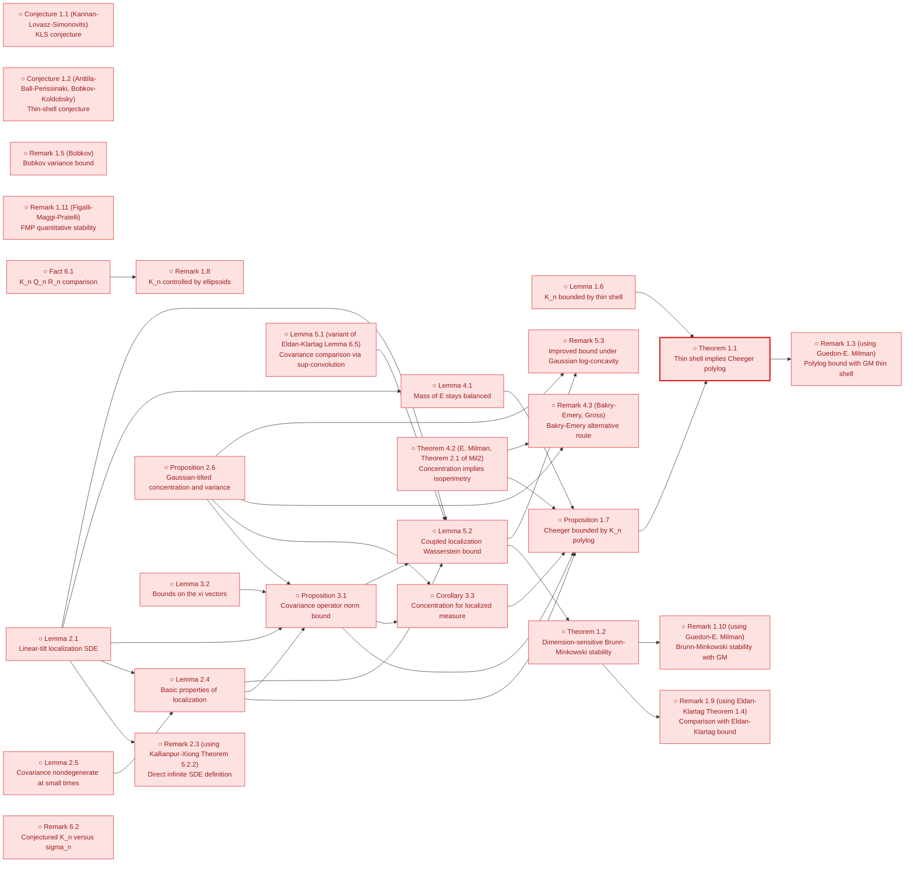

| Item | Statement | Status | Lean declarations | Note |
| --- | --- | --- | --- | --- |
| Conjecture 1.1 (Kannan-Lovasz-Simonovits) | There is a universal constant C with G_n < C for all n, where G_n^{-1} is the infimum of mu^+(A)/mu(A) over isotropic log-concave measures mu on R^n and Borel A with mu(A) <= 1/2. | ○ Not yet formalized | — | Stated as an open conjecture, not proved in the paper. Deliberately not mapped to FunctionalInequalities.KLS.kls; the paper's G_n is the uniform Minkowski-Cheeger constant of isotropic laws. |
| Conjecture 1.2 (Anttila-Ball-Perissinaki, Bobkov-Koldobsky) | There is a universal constant C with sigma_n < C for all n, where sigma_n^2 = sup E[(&#124;X&#124; - sqrt n)^2] over isotropic log-concave random vectors X in R^n. | ○ Not yet formalized | — | Open conjecture, used only as a hypothesis in the corollary discussion after Theorem 1.1. No Lean counterpart. |
| **Theorem 1.1** (main) | There is a universal constant C > 0 such that for all n >= 2, G_n <= C sqrt((log n) sum_{k=1}^n sigma_k^2 / k). In particular sigma_k <= k^kappa for all k gives G_n <= C sqrt(log n) n^kappa, and the thin-shell conjecture gives G_n <= C log n. | ○ Not yet formalized | — | Main theorem: the title result, thin shell implies the Cheeger (equivalently, via Ledoux's comparison (4), spectral gap) constant up to polylog. Proof is the two-line combination of Lemma 1.6 and Proposition 1.7. The spectral-gap reading uses the unnumbered comparison (4) quoted from Ledoux; the Lean Cheeger half literatureConstant_le_four_mul_inverseScale_sq (KLS/Geometry/Cheeger/Inequality.lean) gives only the direction C_P <= 4 Psi^2 of that comparison and is not a restricted case of this theorem, so no declaration is mapped. |
| Remark 1.3 (using Guedon-E. Milman) | Combined with the Guedon-E. Milman bound sigma_n <= C n^{1/3}, Theorem 1.1 gives G_n <= C n^{1/3} sqrt(log n), improving the bound G_n <= C n^{5/12} obtained from Guedon-Milman and Bobkov. | ○ Not yet formalized | — | Corollary of T11 plus an external thin-shell estimate that is not proved in the paper. |
| Remark 1.5 (Bobkov) | For every log-concave random vector X and smooth phi, Var[phi(X)] / E[&#124;grad phi(X)&#124;^2] <= C E[&#124;X&#124;] sqrt(Var[&#124;X&#124;]); under the thin-shell hypothesis this gives G_n <= C n^{1/4}. | ○ Not yet formalized | — | Quoted from Bobkov for comparison only; not proved and not used in the proofs. |
| Lemma 1.6 | There is a universal constant C > 0 such that for all n >= 2, K_n <= C sqrt(sum_{k=1}^n sigma_k^2 / k), where K_n = sup over isotropic log-concave mu and unit theta of the Hilbert-Schmidt norm of int x tensor x <x,theta> dmu. | ○ Not yet formalized | — | Proved in Section 6 by projecting onto k-dimensional eigenspaces of A = E[X tensor X <X,theta>] and Cauchy-Schwarz with Var&#124;P X&#124;^2 <= C k sigma_k^2. Purely deterministic; the opening sentence of Section 6 mistakenly says the bound is in terms of tau_n and kappa. |
| Proposition 1.7 | There is a universal constant C > 0 such that for all n >= 2, G_n <= C K_n sqrt(log n). | ○ Not yet formalized | — | Core result of Section 4. For an isotropic f and E with f-mass 1/2, the martingale property (Lemma 2.4(iv)), the event F of Proposition 3.1, Lemma 4.1 at time T and Corollary 3.3 give f(E_{Theta/delta} minus E) >= c with delta = 1/(K_n sqrt(log n)); Theorem 4.2 converts this concentration bound into the isoperimetric bound. |
| Remark 1.8 | There is a universal c > 0 with K_n^{-1} >= c inf_mu inf_E mu^+(E)/mu(E), the infimum over isotropic log-concave mu and ellipsoids E with mu(E) <= 1/2; that is, K_n <= C R_n. | ○ Not yet formalized | — | Restates the second inequality chain of Fact 6.1; with Proposition 1.7 it reduces the Cheeger constant to ellipsoids up to sqrt(log n). |
| Theorem 1.2 | For every epsilon > 0 there is C(epsilon) such that for convex bodies K, T in R^n of volume 1 with barycenters at the origin and Cov(uniform on K) = L_K Id, with V = Vol_n((K+T)/2) and delta = C(epsilon) L_K V^5 tau_n n^{2(kappa - kappa^2) + epsilon}, one has Vol_n(K_delta cap T) >= 1 - epsilon. | ○ Not yet formalized | — | Second main result, independent of Theorem 1.1. kappa = liminf log sigma_n / log n and tau_n = max(1, max_j sigma_j / j^kappa). The statement says covariance L_K Id but the proof uses L_K^2 Id and concludes Vol_n(K minus T_delta) <= 2 epsilon with delta = L_K Theta / sqrt(epsilon); the roles of K and T in the conclusion differ between statement and proof. |
| Remark 1.9 (using Eldan-Klartag Theorem 1.4) | By Theorem 1.4 of Eldan-Klartag, the estimate of Theorem 1.2 also holds with delta = C(epsilon) sqrt(tau_n) n^{1/4 + kappa/2} V^{5/2}; the bound of Theorem 1.2 is tight up to C(epsilon) n^epsilon under thin shell, as shown by the cube and the cube truncated by the ball of radius sqrt n. | ○ Not yet formalized | — | Quoted external bound and an asserted tightness example; neither is proved in the paper. |
| Remark 1.10 (using Guedon-E. Milman) | With sigma_n <= C n^{1/3}, Theorem 1.2 holds with delta = C(epsilon) n^{4/9 + epsilon} V^5 L_K; without the volume assumption on (K+T)/2, even with equal covariances, the best possible bound is delta = C sqrt(n) L_K, as for a cube and a ball. | ○ Not yet formalized | — | Specialisation kappa = 1/3 of T12 plus an asserted optimality example. |
| Remark 1.11 (Figalli-Maggi-Pratelli) | Figalli-Maggi-Pratelli prove Vol_n((K + x_0) symmetric-difference T)^2 <= n^7 (Vol_n((K+T)/2) - 1) for some x_0. | ○ Not yet formalized | — | Quoted for comparison; not used. The quoted exponent is as printed in the paper. |
| Lemma 2.1 | For the solution (c_t, B_t) of the SDE (11) on [0, t_0], F_t(x) = V_t^{-1} exp(<c_t,x> - <B_t x,x>/2) satisfies F_0 = 1 and dF_t(x) = <x - a_t, A_t^{-1/2} dW_t> F_t(x) for every x, where a_t and A_t are the barycenter and covariance of f F_t. | ○ Not yet formalized | — | Proof is Ito's formula for G_t(x), V_t^{-1} and the product V_t^{-1} G_t(x), with an interchange of stochastic differential and spatial integral justified by the compact-support assumption supp f in n B_n. |
| Remark 2.3 (using Kallianpur-Xiong Theorem 5.2.2) | The process F_t may alternatively be defined directly by the infinite system of SDEs dF_t(x) = <x - a_t, A_t^{-1/2} dW_t> F_t(x), with existence and uniqueness following from Kallianpur-Xiong Theorem 5.2.2 after verifying its hypotheses. | ○ Not yet formalized | — | Asserted without proof (the paper notes extra work is needed); not used later. |
| Lemma 2.4 | (i) Gamma_t(f) is almost surely well defined, finite and log-concave for all t > 0 (the explosion time t_0 is infinite); (ii) int f_t = 1; (iii) the semigroup property Gamma_{s+t}(f) ~ det(A_s)^{-1/2} Gamma_t(sqrt(det A_s) Gamma_s(f) o L^{-1}) o L with L(x) = A_s^{-1/2}(x - a_s); (iv) for every x the process f_t(x) is a martingale. | ○ Not yet formalized | — | (ii) and (iv) follow from (13); t_0 = infinity uses Lemma 2.5 and a restart argument at the hitting times of &#124;&#124;A_t^{-1}&#124;&#124;_OP = c(n)^{-1}, i.e. a strong Markov renewal argument. (iii) is equality in law. Martingale (not merely local martingale) status is asserted from (13) without a separate integrability argument. |
| Lemma 2.5 | For every n there is c(n) > 0 such that P(A_t >= c(n) Id for all 0 <= t <= c(n)) >= c(n). | ○ Not yet formalized | — | Proved in Section 6 with dimension-dependent constants: a lower bound on A_f(c,B) for &#124;c&#124; < c_4 and B <= Id from log-concave density and exponential moment bounds (Lovasz-Vempala Theorem 5.14, Lemma 5.7), Ito's formula for &#124;c_t&#124;^2, Dambis-Dubins-Schwarz and stopping times T_1, T_2. |
| Proposition 2.6 | There is a universal Theta > 0 such that if phi is convex, K > 0 and dmu = Z exp(-phi(x) - &#124;x&#124;^2/(2K^2)) dx is a probability measure with barycenter 0, then (i) mu(A_{K Theta}) >= 0.95 for every Borel A with 0.1 <= mu(A) <= 0.9, and (ii) int <x,theta>^2 dmu <= Theta K^2 for every unit theta. | ○ Not yet formalized | — | Proof via the parallelogram law and the Prekopa-Leindler inequality, then log-concavity of the tail function for (ii). Lean has Prekopa-Leindler (prekopaLeindler in Probability/BrunnMinkowski.lean) as an ingredient, but no declaration states this proposition, so nothing is mapped. The proof applies (i) to a half-space of measure 1/2. The printed display has &#124;x&#124;^2 twice where &#124;y&#124;^2 is meant. |
| Proposition 3.1 | There are universal C, c > 0 such that for n >= 2 and isotropic log-concave f, with A_t the covariance of Gamma_t(f): (i) the event F = {&#124;&#124;A_t&#124;&#124;_OP < C K_n^2 (log n) e^{-ct} for all t > 0} has P(F) >= 1 - n^{-10}; (ii) E[Tr A_t] <= n for all t > 0; (iii) on F, for every t > 1/(K_n^2 log n), f_t(x) = exp(-&#124;x/(C K_n sqrt(log n))&#124;^2 - phi_t(x)) with phi_t convex. | ○ Not yet formalized | — | Proof: dA_t formula by Ito, the dominating process tilde A_t without drift, Ito for S_t = Tr(tilde A_t^p) with p = ceil(log n), Dambis-Dubins-Schwarz and the reflection principle on [0, 1/(K_n^2 log n)], then the deterministic bound (14) A_t <= Theta &#124;&#124;B_t^{-1}&#124;&#124;_OP Id from P26(ii) and exponential growth of B_t. The proof only establishes &#124;&#124;A_t&#124;&#124;_OP <= C' on the initial interval and C delta^{-2} e^{(delta^2 - t)/Theta} afterwards; the prefactor K_n^2 log n arises as delta^{-2}. |
| Lemma 3.2 | For the vectors xi_{i,j} of (19) one has (i) &#124;xi_{i,i}&#124; < C for a universal C and every i, and (ii) sum_j &#124;xi_{i,j}&#124;^2 <= K_n^2 for every i. | ○ Not yet formalized | — | Deterministic: after normalising f_t to the isotropic tilde f_t, (i) is Cauchy-Schwarz with the universal fourth-moment bound for isotropic log-concave marginals (Lovasz-Vempala Lemma 5.7) and (ii) is the definition of K_n. |
| Corollary 3.3 | There are universal c, Theta > 0 such that on the event F, with delta = 1/(K_n sqrt(log n)), every t > delta^2 and every measurable E with 0.1 <= int_E f_t <= 0.9 satisfy int_{E_{Theta/delta} minus E} f_t >= c. | ○ Not yet formalized | — | Immediate from P31(iii) and P26(i) with K = C K_n sqrt(log n). |
| Lemma 4.1 | If f is isotropic log-concave, int_E f = 1/2 and g(t) = int_E f_t, then there is a universal T > 0 with P(0.1 <= g(t) <= 0.9) > 0.5 for all t in [0, T]. | ○ Not yet formalized | — | dg = <int_{E_t} y tilde f_t(y) dy, dW_t> with integrand of norm at most 1 by isotropy, so d[g]_t/dt <= 1, E[(g(t) - 1/2)^2] <= t by Ito, and Chebyshev's inequality. |
| Theorem 4.2 (E. Milman, Theorem 2.1 of Mil2) | If a log-concave probability measure mu has constants 0 < lambda < 1/2 and Theta > 0 with mu(E_Theta) >= 1 - lambda for all measurable E with mu(E) >= 1/2, then mu^+(E)/mu(E) >= (1 - 2 lambda)/Theta for all measurable E with mu(E) <= 1/2. | ○ Not yet formalized | — | Quoted from E. Milman in a weakened form and not proved here; it is the only deep non-stochastic input of Theorem 1.1. No Lean counterpart. |
| Remark 4.3 (Bakry-Emery, Gross) | Proposition 2.6 can be replaced by the Bakry-Emery result that a density of the form (12), log-concave relative to a Gaussian, has a corresponding Cheeger constant, which would bound the surface area of every set under f_t directly and avoid Theorem 4.2. | ○ Not yet formalized | — | Alternative proof sketch, asserted without proof. |
| Lemma 5.1 (variant of Eldan-Klartag Lemma 6.5) | There are universal C, C_1 > 0 such that for log-concave probability densities f, g on R^n, with A = Cov(f)^{-1/2} Cov(g) Cov(f)^{-1/2} - Id and eigenvalues delta_i ordered so that &#124;delta_i - 1&#124; decreases, &#124;delta_i - 1&#124; <= C K(f,g)^4 for all i and &#124;delta_i - 1&#124; <= C K(f,g) tau_n i^{kappa - 1/2} for (log K(f,g))^{C_1} <= i <= n, where K(f,g) = int sup_y sqrt(f(x+y) g(x-y)) dx. | ○ Not yet formalized | — | Stated without proof as a variant of a lemma of Eldan-Klartag. As printed the subtraction of Id and the quantity &#124;delta_i - 1&#124; are inconsistent, and the use in Lemma 5.2 (with K^5 and j^kappa/sqrt j) does not match the printed exponents; recorded as printed. |
| Lemma 5.2 | For epsilon > 0 and log-concave densities f, g with f isotropic and g centred, there are subdensities tilde f <= f, tilde g <= g with equal mass at least 1 - epsilon and W_2(tilde f, tilde g) <= C epsilon^{-6} tau_n K(f,g)^5 n^{2(kappa - kappa^2) + epsilon}. | ○ Not yet formalized | — | Coupled localizations of f and g driven by the same W_t with the drift matrix A_t of f, the sup-convolution martingale S_t, Doob's maximal inequality, optional stopping, a trace inequality of Tam, Hoelder and the convergence of f_t to a point mass. The final display of the proof gives W_2^2 <= C epsilon^{-11} K^{10} tau_n^2 n^{4 kappa - 4 kappa^2 + epsilon}, whose square root carries epsilon^{-11/2}; this implies the stated epsilon^{-6} for epsilon <= 1. |
| Remark 5.3 | If instead f and g are log-concave with respect to the Gaussian measure, the same argument with Proposition 2.6 gives W_2(tilde f, tilde g) <= C(epsilon) K(f,g) sqrt(log n). | ○ Not yet formalized | — | Asserted without proof. |
| Fact 6.1 | There are universal C_1, C_2 with K_n <= C_1 Q_n <= C_2 R_n, where Q_n^2 = sup Var[Q(X)]/E&#124;grad Q(X)&#124;^2 over isotropic log-concave X and quadratic forms Q, and R_n^{-1} = inf mu^+(E)/mu(E) over isotropic log-concave mu and ellipsoids E with mu(E) <= 1/2. | ○ Not yet formalized | — | The left inequality is proved by duality for the Hilbert-Schmidt norm and Cauchy-Schwarz (giving K_n <= sqrt 2 Q_n); the right inequality is called standard (coarea formula and Cauchy-Schwarz) and not proved. |
| Remark 6.2 | The author suspects that K_n <= C sigma_n for a universal C but cannot prove it. | ○ Not yet formalized | — | Open question; recorded so that the paper's conjectural claims are complete. |

Not listed: Remarks 1.4 (connection to the hyperplane conjecture and Ball-Nguyen), 2.2 (heuristic discrete-step interpretation) and 2.7 (comparison with Lehec's drift construction) are expository and listed here instead of as items. Unnumbered displayed claims are covered inside the items that use them: the Ledoux Cheeger/spectral-gap comparison (4), the bounds (14)-(15) and the W_2 convergence (16) after Proposition 2.6, the Gaussian worked example at the end of Section 2, and the dA_t computation in Section 3. There is no appendix.

### AGS2013 lemma map

Source: [Ambrosio–Gigli–Savaré, arXiv:1111.3730v3](https://arxiv.org/abs/1111.3730v3), reviewed 2026-10-03.

Standing assumptions: q ∈ (1, ∞) with dual exponent p = q/(q − 1). Section 3: (X, d) compact, f Lipschitz, no reference measure. Sections 4–5: (X, d) complete and separable, m a nonnegative σ-finite Borel measure. Section 6: m finite. Section 7: (X, d) compact and m a finite Borel measure; Section 8 relaxes this to bounded complete separable spaces with finite m and to locally finite spaces.

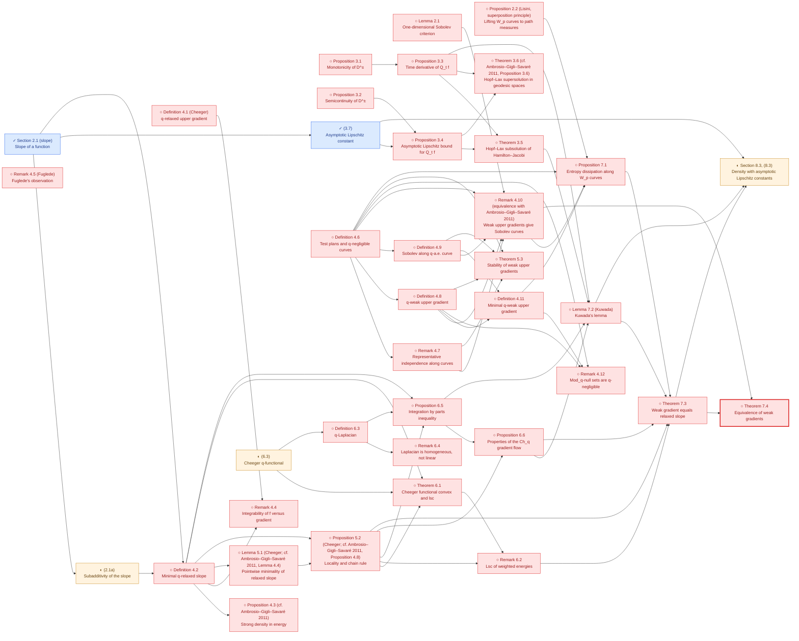

| Item | Statement | Status | Lean declarations | Note |
| --- | --- | --- | --- | --- |
| Section 2.1 (slope) | For f : X → R on a metric space, the slope (local Lipschitz constant) is &#124;∇f&#124;(x) = limsup_{y→x} &#124;f(y) − f(x)&#124;/d(y, x). | ✓ Formalized in Lean | [`apply`](../../formalization/FunctionalInequalities/Energy/LocalSlope/Basic.lean) | Lean takes values in [0, ∞] on any metric space and is 0 at isolated points, where the paper's limsup is left unspecified. |
| (2.1a) | For Lipschitz f, g : X → R and α, β ∈ R: &#124;∇(αf + βg)&#124; ≤ &#124;α&#124;&#124;∇f&#124; + &#124;β&#124;&#124;∇g&#124;. | ◐ Partial or statement only | [`apply_le_add`](../../formalization/FunctionalInequalities/Energy/LocalSlope/Basic.lean) | Lean proves &#124;∇g&#124;(x) ≤ &#124;∇a&#124;(x) + &#124;∇b&#124;(x) whenever every secant of g near x is bounded by the sum of the secants of a and b; this gives the case α = β = 1 (for any functions), but scalar homogeneity &#124;∇(αf)&#124; = &#124;α&#124;&#124;∇f&#124; is not stated with it. |
| Lemma 2.1 | If f : (0,1) → R, q ∈ [1, ∞] and 0 ≤ g ∈ L^q(0,1) satisfy &#124;f(s) − f(t)&#124; ≤ &#124;∫_s^t g&#124; for L²-a.e. (s, t) ∈ (0,1)², then f ∈ W^{1,q}(0,1) and &#124;f′&#124; ≤ g a.e. | ○ Not yet formalized | — |  |
| Proposition 2.2 (Lisini, superposition principle) | If (X, d) is complete and separable with d bounded, p ∈ (1, ∞) and μ_t ∈ AC^p([0,T]; (P(X), W_p)), there is π ∈ P(C([0,1], X)) concentrated on AC^p([0,1], X) with (e_t)_#π = μ_t for all t and ∫&#124;γ̇_t&#124;^p dπ = &#124;μ̇_t&#124;^p for a.e. t. | ○ Not yet formalized | — | Quoted from Lisini (2007); no proof in the paper. |
| Proposition 3.1 | For compact (X, d), Lipschitz f and every x: D⁺(x, t) ≤ D⁻(x, s) for 0 ≤ t < s; hence D^±(x, ·) are nondecreasing and coincide outside a countable subset of [0, ∞). | ○ Not yet formalized | — | The printed proof says nonincreasing; nondecreasing is what is stated and proved. |
| Proposition 3.2 | For compact (X, d) and Lipschitz f, D⁺ is upper semicontinuous and D⁻ is lower semicontinuous on X × [0, ∞). | ○ Not yet formalized | — |  |
| Proposition 3.3 | For compact (X, d) and Lipschitz f, t ↦ Q_t f is Lipschitz from [0, ∞) to C(X) and, for every x, d/dt Q_t f(x) = −(1/q)[D^±(x, t)/t]^p for all t > 0 outside a countable set. | ○ Not yet formalized | — |  |
| (3.7) | Lip_a(f, x) = inf_{r>0} Lip(f, B_r(x)) = lim_{r↓0} Lip(f, B_r(x)); it satisfies Lip(f) ≥ Lip_a(f, x) ≥ &#124;∇f&#124;*(x), the upper semicontinuous envelope of the slope, with equality in length spaces. | ✓ Formalized in Lean | [`apply`](../../formalization/FunctionalInequalities/Energy/LocalSlope/Relaxation.lean) | The definition is the same (open balls, values in [0, ∞]); the comparison with the u.s.c. envelope of the slope is not stated in Lean, only the pointwise bound LocalSlope.apply_le_asymptoticLipschitz. |
| Proposition 3.4 | For compact (X, d), Lipschitz f and (x, t) ∈ X × (0, ∞): Lip_a(Q_t f, x) ≤ [D⁺(x, t)/t]^{p−1}; in particular Lip(Q_t f) ≤ p Lip(f). | ○ Not yet formalized | — |  |
| Theorem 3.5 | For compact (X, d), Lipschitz f and every x: d/dt Q_t f(x) + (1/q)&#124;∇Q_t f&#124;^q(x) ≤ 0 for all t ∈ (0, ∞) outside a countable set. | ○ Not yet formalized | — |  |
| Theorem 3.6 (cf. Ambrosio–Gigli–Savaré 2011, Proposition 3.6) | If (X, d) is also geodesic, equality holds in Proposition 3.4, hence d/dt Q_t f(x) + (1/q)&#124;∇Q_t f&#124;^q(x) = 0 for every x and all t > 0 outside a countable set. | ○ Not yet formalized | — | Stated without proof (analogous to the cited q = 2 argument); not used later. |
| Definition 4.1 (Cheeger) | g ∈ L^q(X, m) is a q-relaxed upper gradient of f ∈ L^q(X, m) if f_n → f in L^q with upper gradients g_n of f_n converging weakly in L^q to some g̃ ≤ g m-a.e.; &#124;∇f&#124;_C,q is the one of minimal L^q norm. | ○ Not yet formalized | — |  |
| Definition 4.2 | g ∈ L^q(X, m) is a q-relaxed slope of f ∈ L^q(X, m) if Lipschitz f_n → f in L^q with &#124;∇f_n&#124; converging weakly in L^q to some g̃ ≤ g m-a.e.; &#124;∇f&#124;_*,q is the one of minimal L^q norm. | ○ Not yet formalized | — | Well posed: by Mazur's lemma and (2.1a) the q-relaxed slopes form a closed convex set, and L^q is uniformly convex. Lean defines no relaxed-slope function, only relaxed energies. |
| Proposition 4.3 (cf. Ambrosio–Gigli–Savaré 2011) | If f ∈ L^q(X, m) has a q-relaxed slope, there are Lipschitz f_n with ∫&#124;f_n − f&#124;^q dm + ∫&#124;&#124;∇f_n&#124; − &#124;∇f&#124;_*,q&#124;^q dm → 0. | ○ Not yet formalized | — | Proof only sketched (uniform convexity, as in the cited q = 2 case). Not mapped: the generic Lean recovery sequences of Energy/Relaxation/Recovery.lean give energy convergence only, with no relaxed-slope function to converge to. |
| Remark 4.4 | The L^q integrability of f could be decoupled from that of the gradient or replaced by m-a.e. convergence; by locality and truncation the relaxed definitions extend beyond L^q, see (6.2). | ○ Not yet formalized | — | Mainly expository. |
| Remark 4.5 (Fuglede) | If Mod_q(Γ) = 0 and ε > 0, there is ρ ∈ L^q(X, m) with ‖ρ‖_q < ε and ∫_γ ρ = ∞ for every γ ∈ Γ. | ○ Not yet formalized | — |  |
| Definition 4.6 | A p-test plan is π ∈ P(C([0,1], X)) concentrated on AC^p with ∫∫_0^1 &#124;γ̇_t&#124;^p dt dπ < ∞ and (e_t)_#π ≤ C(π) m for all t; a Borel set of curves is q-negligible if it is π-null for every p-test plan. | ○ Not yet formalized | — |  |
| Remark 4.7 | If m-measurable f, g agree m-a.e. and T ⊂ [0,1] is countable, then f∘γ = g∘γ on T and L¹-a.e. on (0,1) for q-a.e. γ. | ○ Not yet formalized | — |  |
| Definition 4.8 | A Borel g : X → [0, ∞] is a q-weak upper gradient of f : X → R if &#124;f(γ_1) − f(γ_0)&#124; ≤ ∫_γ g for q-a.e. curve γ. | ○ Not yet formalized | — |  |
| Definition 4.9 | f : X → R is Sobolev along q-a.e. curve if for q-a.e. γ, f∘γ agrees a.e. in [0,1] and at 0, 1 with an absolutely continuous f_γ. | ○ Not yet formalized | — |  |
| Remark 4.10 (equivalence with Ambrosio–Gigli–Savaré 2011) | If g is a q-weak upper gradient of f with ∫_γ g < ∞ for q-a.e. γ (e.g. g ∈ L^q), then f is Sobolev along q-a.e. curve and &#124;d/dt(f∘γ)&#124; ≤ g∘γ &#124;γ̇&#124; a.e. for π-a.e. γ, for every p-test plan π (4.11). | ○ Not yet formalized | — |  |
| Definition 4.11 | For f Sobolev along q-a.e. curve, &#124;∇f&#124;_w,q is the q-weak upper gradient with &#124;∇f&#124;_w,q ≤ g m-a.e. for every q-weak upper gradient g; it exists and is unique up to m-null sets when m is σ-finite. | ○ Not yet formalized | — | Existence is proved after the definition by minimizing ∫θ arctan g dm. |
| Remark 4.12 | For Borel Γ and a p-test plan π: π(Γ) ≤ C(π)^{1/q} Mod_q(Γ)^{1/q} (∫∫&#124;γ̇&#124;^p)^{1/p}; hence every q-upper gradient is a q-weak upper gradient and &#124;∇f&#124;_w,q ≤ &#124;∇f&#124;_S,q m-a.e. (4.14). | ○ Not yet formalized | — |  |
| Lemma 5.1 (Cheeger; cf. Ambrosio–Gigli–Savaré 2011, Lemma 4.4) | If g_1, g_2 are q-relaxed slopes of f, so is min{g_1, g_2}; hence &#124;∇f&#124;_*,q ≤ g m-a.e. for every q-relaxed slope g of f. | ○ Not yet formalized | — | Proof by reference to the cited sources. |
| Proposition 5.2 (Cheeger; cf. Ambrosio–Gigli–Savaré 2011, Proposition 4.8) | If f ∈ L^q(X, m) has a q-relaxed slope: (a) &#124;∇h&#124;_*,q = &#124;∇f&#124;_*,q m-a.e. on {h = f} for every h with a q-relaxed slope; (b) &#124;∇φ(f)&#124;_*,q ≤ &#124;φ′(f)&#124;&#124;∇f&#124;_*,q for C¹ Lipschitz φ, with equality for nondecreasing φ. | ○ Not yet formalized | — | Proof by reference to the cited q = 2 case. |
| Theorem 5.3 | If f_n are m-measurable and Sobolev along q-a.e. curve with q-weak upper gradients g_n ∈ L^q, f_n → f ∈ R m-a.e. and g_n ⇀ g weakly in L^q, then g is a q-weak upper gradient of f and f is Sobolev along q-a.e. curve. | ○ Not yet formalized | — |  |
| (6.3) | For finite m, Ch_q(f) = (1/q)∫&#124;∇f&#124;_*,q^q dm on L²(X, m), set to +∞ outside 𝒞. | ◐ Partial or statement only | [`energy`](../../formalization/FunctionalInequalities/Energy/Cheeger/Basic.lean) | Only q = 2, on a finite-dimensional real inner-product space with a Borel probability law. Lean defines Ch directly as one half of the sequential L²-lower-semicontinuous relaxation of ∫&#124;∇f&#124;² over locally Lipschitz L² tests of finite slope energy; agreement with the relaxed-slope definition (via Proposition 4.3, Theorem 6.1, (5.1) and the reduction to Lipschitz tests) is not stated in Lean. |
| Theorem 6.1 | For complete separable (X, d), finite m and q ∈ (1, ∞), Ch_q is convex and lower semicontinuous on L²(X, m). | ○ Not yet formalized | — | Only lower semicontinuity, for q = 2 on a finite-dimensional real inner-product space with a Borel probability law; convexity is not stated. In Lean the functional is by definition a sequential L² relaxation (see E63), so lower semicontinuity holds by construction rather than by the paper's weak-compactness argument. Not mapped: the local relaxation is lower semicontinuous by construction, which does not state this theorem. |
| Remark 6.2 | For every α > 0, f ↦ ∫&#124;∇f&#124;_*,q^q / &#124;f&#124;^α dm is lower semicontinuous on 𝒞 in L²(X, m). | ○ Not yet formalized | — |  |
| Definition 6.3 | For f ∈ L²(X, m) with ∂⁻Ch_q(f) ≠ ∅, −Δ_q f is the element of minimal L² norm of ∂⁻Ch_q(f); D(Δ_q) is the set of such f. | ○ Not yet formalized | — |  |
| Remark 6.4 | Even for q = 2, Δ_q need not be linear; v ∈ ∂⁻Ch_q(f) implies λ^{q−1}v ∈ ∂⁻Ch_q(λf), so Δ_q and the gradient flow are (q − 1)-homogeneous. | ○ Not yet formalized | — |  |
| Proposition 6.5 | For f ∈ D(Δ_q) and g ∈ D(Ch_q): −∫ g Δ_q f dm ≤ ∫ &#124;∇g&#124;_*,q &#124;∇f&#124;_*,q^{q−1} dm, with equality for g = φ(f), φ ∈ C¹(R) with bounded derivative on the image of f. | ○ Not yet formalized | — |  |
| Proposition 6.6 | For the gradient flow (f_t) of Ch_q from f_0 ∈ L²(X, m): ∫f_t dm = ∫f_0 dm; f_0 ≤ C (resp. ≥ c) implies f_t ≤ C (resp. ≥ c); and if 0 < c ≤ f_0 ≤ C and Φ ∈ C²([c, C]), then t ↦ ∫Φ(f_t) dm is locally absolutely continuous with derivative −∫Φ″(f_t)&#124;∇f_t&#124;_*,q^q dm a.e. | ○ Not yet formalized | — | Not mapped: the Lean heat semigroup of KLS/LogConcave/HeatSemigroup/Markov.lean (mass preservation, sub-Markov bounds) is generated by the closed weighted-gradient form, and no Lean statement identifies it with the gradient flow of Cheeger.energy. |
| Proposition 7.1 | For compact (X, d), finite m and μ_t = f_t m ∈ AC^p([0,1], (P(X), W_p)) with c ≤ f_t ≤ C and f_0 Sobolev along q-a.e. curve with &#124;∇f_0&#124;_w,q ∈ L^q, every convex Φ ∈ C²([c, C]) satisfies ∫Φ(f_0) − ∫Φ(f_t) ≤ (1/q)∫∫_0^t (Φ″(f_0)&#124;∇f_0&#124;_w,q)^q f_s ds dm + (1/p)∫_0^t &#124;μ̇_s&#124;^p ds. | ○ Not yet formalized | — |  |
| Lemma 7.2 (Kuwada) | For compact (X, d), finite m and the gradient flow (f_t) of Ch_q from f_0 with c ≤ f_0 ≤ C and ∫f_0 dm = 1, μ_t = f_t m is W_p-absolutely continuous and &#124;μ̇_t&#124;^p ≤ ∫ &#124;∇f_t&#124;_*,q^q / f_t^{p−1} dm for a.e. t. | ○ Not yet formalized | — | The idea is credited to Kuwada (2010). |
| Theorem 7.3 | For compact (X, d) and finite m, if f : X → R is Borel, Sobolev along q-a.e. curve and &#124;∇f&#124;_w,q ∈ L^q(X, m), then f ∈ 𝒞 and &#124;∇f&#124;_*,q = &#124;∇f&#124;_w,q m-a.e. | ○ Not yet formalized | — |  |
| **Theorem 7.4** (main) | For compact (X, d), finite m and f ∈ L^q(X, m), the following are equivalent: f has a q-relaxed upper gradient; a q-relaxed slope; a q-upper gradient in L^q; a q-weak upper gradient in L^q. The four minimal gradients &#124;∇f&#124;_C,q, &#124;∇f&#124;_*,q, &#124;∇f&#124;_S,q and &#124;∇f&#124;_w,q then coincide m-a.e. | ○ Not yet formalized | — | Section 8 extends it to bounded complete separable spaces with finite m and to locally finite spaces (S81, S82). No Lean declaration states weak, Mod_q or test-plan gradients. |
| Section 8.3, (8.3) | Under the hypotheses of Theorem 7.3 there are Lipschitz f_n → f m-a.e. with &#124;∇f_n&#124; → &#124;∇f&#124;_w,q in L^q, and even with Lip_a(f_n, ·) → &#124;∇f&#124;_w,q in L^q: the Cheeger energy relaxed from Lip_a coincides with Ch_q. | ◐ Partial or statement only | [`conventions_agree`](../../solutions/ThmSmoothGradientRelaxationTwoCheeger.lean)<br/>[`relaxation_eq_asymptoticLipschitz`](../../formalization/FunctionalInequalities/Energy/Cheeger/Identification.lean)<br/>[`energy_eq_ofAsymptoticLipschitz`](../../formalization/FunctionalInequalities/Energy/Cheeger/Identification.lean) | Lean proves the energy-level identity (relaxation of ∫Lip_a² equals relaxation of ∫&#124;∇f&#124;², and the two Cheeger conventions agree) only for q = 2 and Borel probability laws on finite-dimensional real inner-product spaces, by a different route (McShane patches and mollification, not Hopf–Lax); weak upper gradients and the L^q convergence of Lip_a(f_n) are not stated. The paper only sketches the argument. |

Not listed: Nothing numbered is omitted: the source has 33 numbered statements (Lemma 2.1 to Theorem 7.4; Section 8 and the introduction have none, and there is no appendix). Unnumbered expository passages are omitted: the introduction's outline, the independence-of-q conjecture in Section 5, the Orlicz–Wasserstein outlook of Section 8.4, and the acknowledgement. Unnumbered displayed claims are listed only where a local Lean declaration states them; 21 other unnumbered claims (Sections 1–8) are not listed.

### BGL2014 lemma map

Source: [Bakry–Gentil–Ledoux, Springer 2014, Grundlehren der mathematischen Wissenschaften 348 (DOI 10.1007/978-3-319-00227-9), Chapter 4](https://link.springer.com/book/10.1007/978-3-319-00227-9), reviewed 2026-10-04.

Standing assumptions: Unless stated otherwise, the Full Markov Triple (E, μ, Γ) of Sect. 3.4 (called a Markov Triple): state space E, invariant reversible measure μ (a probability measure wherever a Poincaré inequality is stated), carré du champ Γ on an algebra A₀ of bounded measurable functions (smooth compactly supported functions in examples) with extended algebra A ⊃ A₀ for the Γ-calculus, Dirichlet form E(f) = ∫Γ(f) dμ with domain D(E) (A₀ dense in it), diffusion generator L with domain D(L), Markov semigroup P_t = e^{tL} with kernels p_t(x, dy), and Γ₂(f) = ½(LΓ(f) − 2Γ(f, Lf)). Var_μ(f) = ∫f² dμ − (∫f dμ)²; P(C) means Var_μ(f) ≤ C E(f) for f ∈ D(E) (Definition 4.2.1); CD(ρ, n) means Γ₂(f) ≥ ρΓ(f) + (Lf)²/n on A₀ (Definition 3.3.14), with CD(ρ, ∞) for n = ∞. Sect. 4.5.2 uses Diffusion Markov Triples, Sect. 4.6 allows infinite μ for local inequalities, Sect. 4.7 needs no invariant probability, and Sects. 4.10.1–4.10.2 use the minimal triple of Sect. 3.1. Repository counterparts (not identified with these notions): Poincare.SmoothTest.constant and Poincare.LocalSlope.Intrinsic.constant are ENNReal optimal constants over smooth L² finite-energy (resp. locally Lipschitz local-slope) tests with Γ(f) = |∇f|² on finite-dimensional real inner product spaces, and no Dirichlet-domain equivalence is asserted; the heat semigroup model in formalization/FunctionalInequalities/KLS/LogConcave/HeatSemigroup takes a full-dimensional log-concave law ν = m.tilted (−U) with smooth convex potential U, the closed weighted gradient T̄ and P_t = exp(−tT̄†T̄), whose generator is ℒf = Δf − ⟨∇U, ∇f⟩ on C_c^∞.

```mermaid
flowchart LR
    BGL2014_P411["◐ Proposition 4.1.1 (Poincaré inequality for the Gaussian measure), p. 180<br/>Gaussian Poincaré inequality"]
    BGL2014_D421["○ Definition 4.2.1 (Poincaré inequality), p. 181<br/>Poincaré inequality P(C)"]
    BGL2014_R422["○ Remark 4.2.2, p. 182<br/>Poincaré inequalities are tight"]
    BGL2014_L423["○ Lemma 4.2.3, p. 182<br/>Poincaré for functions vanishing outside A"]
    BGL2014_R424["○ Remark 4.2.4, p. 183<br/>Faber–Krahn-type inequalities"]
    BGL2014_T425["◐ Theorem 4.2.5 (Exponential decay in variance), p. 183<br/>Variance decay equivalent to Poincaré"]
    BGL2014_L426["○ Lemma 4.2.6, p. 184<br/>Log-convexity of the L² norm"]
    BGL2014_P427["○ Proposition 4.2.7 (Bounded perturbation), p. 185<br/>Bounded perturbation"]
    BGL2014_P431["◐ Proposition 4.3.1 (Stability under products), p. 185<br/>Tensorization of Poincaré inequalities"]
    BGL2014_L432["○ Lemma 4.3.2, p. 186<br/>Partial integration and Dirichlet energy"]
    BGL2014_R433["○ Remark 4.3.3, p. 187<br/>Tensorization via heat kernels"]
    BGL2014_P441["○ Proposition 4.4.1, p. 188<br/>Exponential measure on half-line"]
    BGL2014_P442["○ Proposition 4.4.2 (Exponential integrability), p. 190<br/>Exponential integrability of Lipschitz functions"]
    BGL2014_R443["○ Remark 4.4.3, p. 190<br/>Lipschitz functions lie in D(E)"]
    BGL2014_P444["○ Proposition 4.4.4 (Contraction principle), p. 192<br/>Contraction principle"]
    BGL2014_R445["○ Remark 4.4.5, p. 193<br/>Concentration versus Poincaré"]
    BGL2014_T451["○ Theorem 4.5.1 (Muckenhoupt's criterion), p. 194<br/>Muckenhoupt criterion"]
    BGL2014_P452["○ Proposition 4.5.2, p. 195<br/>Integrable Hardy weights suffice"]
    BGL2014_P453["○ Proposition 4.5.3, p. 198<br/>Dirichlet Poincaré on an interval"]
    BGL2014_P454["○ Proposition 4.5.4, p. 199<br/>Neumann Poincaré on an interval"]
    BGL2014_P455["○ Proposition 4.5.5, p. 199<br/>Sharp constants on [0, 1]"]
    BGL2014_R461["○ Remark 4.6.1, p. 201<br/>Local Poincaré equals Neumann Poincaré"]
    BGL2014_T462["○ Theorem 4.6.2 (Lyapunov's criterion), p. 202<br/>Lyapunov criterion"]
    BGL2014_T463["◐ Theorem 4.6.3 (Kannan–Lovász–Simonovits–Bobkov Theorem), p. 203<br/>Log-concave measures satisfy Poincaré"]
    BGL2014_P464["○ Proposition 4.6.4, p. 205<br/>Glueing local Poincaré constants"]
    BGL2014_L465["○ Lemma 4.6.5, p. 205<br/>Mean-square glueing lemma"]
    BGL2014_R471["○ Remark 4.7.1, p. 209<br/>Gaussian heat kernel inequalities"]
    BGL2014_T472["◐ Theorem 4.7.2 (Local Poincaré inequalities), p. 209<br/>Local Poincaré under CD(ρ, ∞)"]
    BGL2014_R473["○ Remark 4.7.3, p. 211<br/>Gradient bound with constant K"]
    BGL2014_R474["○ Remark 4.7.4, p. 211<br/>Small-time characterization of CD(ρ, ∞)"]
    BGL2014_P481["◐ Proposition 4.8.1 (Poincaré inequality under CD(ρ, ∞)), p. 212<br/>Poincaré under CD(ρ, ∞)"]
    BGL2014_C482["⇑ Corollary 4.8.2, p. 212<br/>Strongly log-concave measures: P(1/ρ)"]
    BGL2014_P483["○ Proposition 4.8.3, p. 214<br/>Dual form of Poincaré"]
    BGL2014_T484["○ Theorem 4.8.4 (Poincaré inequality under CD(ρ, n)), p. 215<br/>Poincaré under CD(ρ, n)"]
    BGL2014_T491["○ Theorem 4.9.1 (Brascamp–Lieb inequality), p. 215<br/>Brascamp–Lieb inequality"]
    BGL2014_L492["○ Lemma 4.9.2, p. 216<br/>Operator monotonicity of inversion"]
    BGL2014_T493["○ Theorem 4.9.3, p. 218<br/>Riemannian Brascamp–Lieb inequality"]
    BGL2014_R4101["○ Remark 4.10.1, p. 221<br/>Dirichlet eigenvalue and exit time"]
    BGL2014_P4102["○ Proposition 4.10.2, p. 222<br/>Hyperbolic space spectral bound"]
    BGL2014_P4103["○ Proposition 4.10.3, p. 223<br/>Essential spectrum and finite-rank defect"]
    BGL2014_P4104["○ Proposition 4.10.4, p. 224<br/>Discrete spectrum gives weighted Nash"]
    BGL2014_T4105["○ Theorem 4.10.5, p. 225<br/>Weighted Nash with kernel: σ_ess bound"]
    BGL2014_D4106["○ Definition 4.10.6 (Persson operator), p. 227<br/>Persson operator"]
    BGL2014_P4107["○ Proposition 4.10.7, p. 227<br/>Criterion for Persson operators"]
    BGL2014_T4108["○ Theorem 4.10.8, p. 229<br/>Persson: discreteness iff weighted Nash"]
    BGL2014_C4109["○ Corollary 4.10.9, p. 229<br/>Discrete spectrum criterion on ℝⁿ"]
    BGL2014_D421 --> BGL2014_R422
    BGL2014_D421 --> BGL2014_L423
    BGL2014_L423 --> BGL2014_R424
    BGL2014_D421 --> BGL2014_T425
    BGL2014_L426 --> BGL2014_T425
    BGL2014_D421 --> BGL2014_P427
    BGL2014_D421 --> BGL2014_P431
    BGL2014_L432 --> BGL2014_P431
    BGL2014_T425 --> BGL2014_R433
    BGL2014_D421 --> BGL2014_P442
    BGL2014_P442 --> BGL2014_R443
    BGL2014_D421 --> BGL2014_P444
    BGL2014_P442 --> BGL2014_R445
    BGL2014_T451 --> BGL2014_R445
    BGL2014_T472 --> BGL2014_R445
    BGL2014_L423 --> BGL2014_T451
    BGL2014_P453 --> BGL2014_P454
    BGL2014_P454 --> BGL2014_R461
    BGL2014_T462 --> BGL2014_T463
    BGL2014_L465 --> BGL2014_P464
    BGL2014_P411 --> BGL2014_R471
    BGL2014_T472 --> BGL2014_R473
    BGL2014_T472 --> BGL2014_R474
    BGL2014_T472 --> BGL2014_P481
    BGL2014_P481 --> BGL2014_C482
    BGL2014_D421 --> BGL2014_P483
    BGL2014_P483 --> BGL2014_T484
    BGL2014_L492 --> BGL2014_T491
    BGL2014_T491 --> BGL2014_T493
    BGL2014_L492 --> BGL2014_T493
    BGL2014_P4103 --> BGL2014_P4104
    BGL2014_P4103 --> BGL2014_T4105
    BGL2014_D4106 --> BGL2014_P4107
    BGL2014_D4106 --> BGL2014_T4108
    BGL2014_P4104 --> BGL2014_T4108
    BGL2014_D4106 --> BGL2014_C4109
    BGL2014_P4107 --> BGL2014_C4109
    classDef lemma_partial fill:#fff3df,stroke:#c88719,color:#66420d;
    class BGL2014_P411,BGL2014_T425,BGL2014_P431,BGL2014_T463,BGL2014_T472,BGL2014_P481 lemma_partial;
    classDef lemma_pending fill:#fee2e2,stroke:#dc2626,color:#991b1b;
    class BGL2014_D421,BGL2014_R422,BGL2014_L423,BGL2014_R424,BGL2014_L426,BGL2014_P427,BGL2014_L432,BGL2014_R433,BGL2014_P441,BGL2014_P442,BGL2014_R443,BGL2014_P444,BGL2014_R445,BGL2014_T451,BGL2014_P452,BGL2014_P453,BGL2014_P454,BGL2014_P455,BGL2014_R461,BGL2014_T462,BGL2014_P464,BGL2014_L465,BGL2014_R471,BGL2014_R473,BGL2014_R474,BGL2014_P483,BGL2014_T484,BGL2014_T491,BGL2014_L492,BGL2014_T493,BGL2014_R4101,BGL2014_P4102,BGL2014_P4103,BGL2014_P4104,BGL2014_T4105,BGL2014_D4106,BGL2014_P4107,BGL2014_T4108,BGL2014_C4109 lemma_pending;
    classDef lemma_improved fill:#dcfce7,stroke:#15803d,color:#14532d;
    class BGL2014_C482 lemma_improved;
    style BGL2014_C482 stroke-width:3px
```

| Item | Statement | Status | Lean declarations | Note |
| --- | --- | --- | --- | --- |
| Proposition 4.1.1 (Poincaré inequality for the Gaussian measure), p. 180 | For the standard Gaussian measure μ on ℝⁿ and every f in the Dirichlet domain D(E): ∫f² dμ − (∫f dμ)² ≤ E(f) = ∫&#124;∇f&#124;² dμ, i.e. P(1). For a centered Gaussian with covariance matrix Q, Var_μ(f) ≤ ∫ Q∇f·∇f dμ for every smooth f. | ◐ Partial or statement only | [`holds_stdGaussian`](../../formalization/FunctionalInequalities/Poincare/Gaussian/Multivariate.lean)<br/>[`holds_gaussianReal`](../../formalization/FunctionalInequalities/Poincare/Gaussian/Real.lean) | The one-dimensional case (4.1.1) is proved by the Hermite expansion (Sect. 2.7.1); the n-dimensional case by multiple Hermite polynomials or tensorization (Proposition 4.3.1, see the remark after Remark 4.3.3); the covariance form by a change of variables. Affine functions are extremal. P(1) for the standard Gaussian on any finite-dimensional real inner product space, for smooth L² tests of finite energy (a dense class, as Definition 4.2.1 allows). The covariance clause is covered only in dimension one (holds_gaussianReal, with arbitrary variance v). |
| Definition 4.2.1 (Poincaré inequality), p. 181 | A Markov Triple (E, μ, Γ) with μ a probability measure satisfies a Poincaré (spectral gap) inequality P(C), C > 0, if Var_μ(f) ≤ C E(f) for all f ∈ D(E); the best such C is the Poincaré constant. | ○ Not yet formalized | — | Variance (4.2.1). It suffices to check P(C) on a dense subfamily of D(E), typically A₀. Under P(C) the spectrum of −L lies in {0} ∪ [1/C, ∞) (Sect. A.4). |
| Remark 4.2.2, p. 182 | Under a Poincaré inequality, E(f) = 0 forces f to be μ-a.e. constant (tightness, strengthening ergodicity and connexity); a non-tight form ∫f² dμ ≤ a(∫f dμ)² + C E(f) on a probability space forces a ≥ 1 and reduces to the case a = 1. | ○ Not yet formalized | — | Refers to Definition 3.1.11 (ergodicity), Definition 3.3.7 (connexity), Sect. 1.8 and the Nash-type inequalities of Sect. 7.4.1. |
| Lemma 4.2.3, p. 182 | Under P(C), if f ∈ D(E) vanishes outside a set A ∈ F with μ(A) < 1, then ∫ f² dμ ≤ (C/(1 − μ(A))) E(f). | ○ Not yet formalized | — | Proof by Cauchy–Schwarz: (∫f dμ)² ≤ μ(A)∫f² dμ, so (1 − μ(A))∫f² dμ ≤ Var_μ(f). |
| Remark 4.2.4, p. 183 | Inequalities ∫_A f² dμ ≤ Θ(μ(A)) E(f) for f ∈ D(E) supported in A, with a function Θ of the measure of A, hold in various contexts, e.g. the Faber–Krahn inequalities associated with Nash inequalities. | ○ Not yet formalized | — | Cross-references Remark 6.2.4 and Remark 8.2.2. The function symbol in front of μ(A) is lost in the extracted text; Θ is a placeholder. |
| Theorem 4.2.5 (Exponential decay in variance), p. 183 | For a Markov Triple with semigroup (P_t)_{t≥0}, the following are equivalent: (i) P(C); (ii) Var_μ(P_t f) ≤ e^{−2t/C} Var_μ(f) for all f ∈ L²(μ) and t ≥ 0; (iii) for every f ∈ L²(μ) there is c(f) > 0 with Var_μ(P_t f) ≤ c(f) e^{−2t/C} for all t ≥ 0. | ◐ Partial or statement only | [`norm_center_operator_sq_le_exp`](../../formalization/FunctionalInequalities/KLS/LogConcave/HeatSemigroup/Decay.lean) | (ii)⇒(i) by a first-order expansion at t = 0; (i)⇒(ii) from d/dt Var_μ(P_t f) = −2E(P_t f) (4.2.2) and Gronwall; (iii)⇒(ii) by Lemma 4.2.6. Uses Proposition 3.1.6 and Remark 3.1.7 (P_t maps L² into D(Lᵏ)). The unnumbered consequence (4.2.3), ∫(f − P_t f)² dμ ≤ 2t E(f) for f ∈ D(E), is recorded here. Only (i) ⇒ (ii), for the heat semigroup of a full-dimensional log-concave law with the Poincaré hypothesis on the form domain. |
| Lemma 4.2.6, p. 184 | For every non-zero f ∈ L²(μ), the map t ↦ log ‖P_t f‖₂ is convex on ℝ₊. | ○ Not yet formalized | — | With Λ(t) = ∫(P_t f)² dμ, Λ″(t) = 4∫(LP_t f)² dμ and Cauchy–Schwarz gives Λ′² ≤ ΛΛ″. |
| Proposition 4.2.7 (Bounded perturbation), p. 185 | If (E, μ, Γ) satisfies P(C) and μ₁ is a probability measure with density h with respect to μ such that 1/b ≤ h ≤ b for some b > 0, then μ₁ satisfies P(b³C) with respect to Γ. | ○ Not yet formalized | — | Proof via the duplication formula (4.2.4), Var_ν(f) = ½∬(f(x) − f(y))² dν(x)dν(y). The text adds that Lemma 5.1.7 improves b³ to b², and to e^{osc(k)} when h = e^k. The preceding unnumbered observation (Γ ≤ aΓ₁ and P(C) for Γ give P(aC) for Γ₁) is recorded here. |
| Proposition 4.3.1 (Stability under products), p. 185 | If (E₁, μ₁, Γ₁) and (E₂, μ₂, Γ₂) satisfy Poincaré inequalities with constants C₁ and C₂, then the product Markov Triple (E₁ × E₂, μ₁ ⊗ μ₂, Γ₁ ⊕ Γ₂) satisfies a Poincaré inequality with constant max(C₁, C₂). | ◐ Partial or statement only | [`prod`](../../formalization/FunctionalInequalities/Poincare/Product/Tensorization.lean)<br/>[`constant_prod_le`](../../formalization/FunctionalInequalities/Poincare/Product/Tensorization.lean) | Product Dirichlet form E(f) = ∫E₁(f) dμ₂ + ∫E₂(f) dμ₁ and the variance decomposition Var(f) = Var_{μ₁}(g) + ∫∫(f − g)² dμ₂ dμ₁ with g = ∫f dμ₂. Exact constant max(C₁, C₂), but for the Euclidean carré du champ on Hilbert spaces and smooth tests rather than general Markov Triples; finite products and the reverse bound are proved separately (constant_pi_eq, constant_prod_eq). |
| Lemma 4.3.2, p. 186 | If f(x₁, x₂) is measurable in x₂ and f(·, x₂) ∈ D(E₁) for every x₂ ∈ E₂, then g(x₁) = ∫ f(x₁, x₂) dμ₂(x₂) lies in D(E₁) and E₁(g) ≤ ∫ E₁(f(·, x₂)) dμ₂(x₂). | ○ Not yet formalized | — | Only sketched in the book: convexity of the Dirichlet form and Jensen's inequality, 'under suitable integrability properties'. |
| Remark 4.3.3, p. 187 | With ν_t(dx, dy) = p_t(x, dy)μ(dx), ∬(f(x) − f(y))² dν_t = 2(∫f² dμ − ∫f P_t f dμ), and P(C) is equivalent to ∬(f(x) − f(y))² dν_t ≥ (1 − e^{−t/C}) ∬(f(x) − f(y))² dμ(x)dμ(y) for all t ≥ 0; this condition is stable under products since ν_t = ν_t¹ ⊗ ν_t², giving another proof of Proposition 4.3.1. | ○ Not yet formalized | — | The following paragraph notes that Proposition 4.3.1 recovers Proposition 4.1.1 from (4.1.1). |
| Proposition 4.4.1, p. 188 | For dμ(x) = e^{−x}dx on ℝ₊ and every f in the Dirichlet domain for Γ(f) = f′², Var_μ(f) ≤ 4 ∫_{ℝ₊} f′² dμ. | ○ Not yet formalized | — | Proof: reduce to f(0) = 0, then ∫f² dμ = 2∫ff′ dμ and Cauchy–Schwarz. The book notes that this Dirichlet domain generates a sub-Markov semigroup (no ESA). Recorded here: the Laguerre form (4.4.1) Var_μ(f) ≤ ∫x f′² dμ, and P(4) for ½e^{−&#124;x&#124;}dx on ℝ (4.4.3) via h = &#124;x&#124;; the constant 4 is optimal (Proposition 4.4.2 with f = &#124;x&#124;). |
| Proposition 4.4.2 (Exponential integrability), p. 190 | If μ satisfies P(C) for some C > 0, then every 1-Lipschitz f (‖Γ(f)‖_∞ ≤ 1) satisfies ∫ e^{sf} dμ < ∞ for every s < 2/√C; more precisely ∫ e^{sf} dμ ≤ e^{s∫f dμ} ∏_{ℓ≥0} (1 − Cs²/4^{ℓ+1})^{−2^ℓ} (4.4.4). | ○ Not yet formalized | — | Proof: apply P(C) to e^{sf/2} and iterate s → s/2; integrability of Lipschitz functions by truncation. Recorded here: (4.4.5) ∫e^{s(f − ∫f dμ)} dμ ≤ (2 + s√C)/(2 − s√C), the concentration bound (4.4.6) μ(f ≥ ∫f dμ + r) ≤ 3e^{−r/(√C‖f‖_Lip)}, and its dimension-free tensorized form via Proposition 4.3.1. The bound s < 2/√C is read from the proof (1 − Cs²/4 > 0); the extracted statement is garbled. |
| Remark 4.4.3, p. 190 | Lipschitz functions lie a priori in A or D(E); part of Proposition 4.4.2 is that they belong to L²(μ), hence to D(E), and the proof (by truncation in D(E)) adapts to A by smooth truncation. | ○ Not yet formalized | — |  |
| Proposition 4.4.4 (Contraction principle), p. 192 | If (μ, Γ) satisfies P(C) on E and F : E → ℝ is 1-Lipschitz with respect to Γ, then the image measure μ_F of μ by F satisfies P(C) with respect to the usual carré du champ g′² on ℝ. | ○ Not yet formalized | — | Var_{μ_F}(g) = Var_μ(g ∘ F) and Γ(g ∘ F) = g′(F)² Γ(F) ≤ g′(F)². |
| Remark 4.4.5, p. 193 | Exponential integrability (Proposition 4.4.2) or the tail bound (4.4.6) do not imply a Poincaré inequality in general, but under CD(0, ∞) the concentration bound (4.4.6) implies P(C′) with a proportional constant. | ○ Not yet formalized | — | Forward reference to Sect. 8.7, based on the reverse local inequalities of Theorem 4.7.2; no proof in this chapter. |
| Theorem 4.5.1 (Muckenhoupt's criterion), p. 194 | Let μ be a Borel probability measure on ℝ with Lebesgue density p and median m, and set B₊ = sup_{x>m} μ([x, ∞)) ∫_m^x dt/p(t) and B₋ = sup_{x<m} μ((−∞, x]) ∫_x^m dt/p(t). Then μ satisfies a Poincaré inequality for Γ(f) = f′² iff B = max(B₊, B₋) < ∞, and B ≤ 2C ≤ 8B where C is the Poincaré constant of μ. | ○ Not yet formalized | — | Sufficiency (C ≤ 4B) by a weighted Cauchy–Schwarz with k = √h₊·p, proved with suprema over the smallest closed interval carrying μ (general case left to the reader); necessity (B ≤ 2C) by Lemma 4.2.3 with A = [m, ∞) and test functions ∫_m^x 1_{[m,r]}/(p + ε). |
| Proposition 4.5.2, p. 195 | If μ has density p and median m, and ∫_m^∞ h₊ p dx < ∞ and ∫_{−∞}^m h₋ p dx < ∞, where h₊(x) = ∫_m^x dt/p(t) (x ≥ m) and h₋(x) = ∫_x^m dt/p(t) (x ≤ m), then μ satisfies a Poincaré inequality with constant C = max(∫_m^∞ h₊ p dx, ∫_{−∞}^m h₋ p dx). | ○ Not yet formalized | — | Proof by Cauchy–Schwarz on (f(x) − f(m))², as for Proposition 4.4.1. |
| Proposition 4.5.3, p. 198 | For Lf = f″ + (w′/w)f′ on a bounded interval I with w smooth, w ≥ a > 0 and invariant probability dμ = w dx, there is C > 0 with ∫_I f² dμ ≤ C ∫_I f′² dμ for all smooth f compactly supported in I (4.5.1); the best constant is 1/λ₀, where −λ₀ is the lowest eigenvalue of L with Dirichlet boundary conditions. | ○ Not yet formalized | — | Proof via the Friedrichs extension and the discrete spectrum (Sect. 2.6); positivity and simplicity of λ₀ are stated without proof. Diffusion (not Full) Markov Triples in Sect. 4.5.2. |
| Proposition 4.5.4, p. 199 | In the setting of Proposition 4.5.3, there is C > 0 with Var_μ(f) ≤ C ∫_I f′² dμ for every smooth f on I (restriction of a smooth function on a neighbourhood of I) (4.5.2); the best constant is 1/λ₁, where −λ₁ is the first non-zero eigenvalue of L with Neumann boundary conditions. | ○ Not yet formalized | — | As for Proposition 4.5.3 plus an approximation by functions with vanishing boundary derivatives; details left to the reader. |
| Proposition 4.5.5, p. 199 | For Lf = f″ on [0, 1] with Lebesgue measure: (i) ∫f² dx ≤ π^{−2}∫f′² dx if f(0) = f(1) = 0, sharp for sin(πx); (ii) Var(f) ≤ π^{−2}∫f′² dx for all smooth f, sharp for cos(πx); (iii) Var(f) ≤ (4π²)^{−1}∫f′² dx if f(0) = f(1), sharp for a cos(2πx) + b sin(2πx) + c (Wirtinger). | ○ Not yet formalized | — | (iii) by Fourier series; (i) from (iii) by odd reflection and periodization; (ii) by even reflection (the text says 'from (i)', but the even extension satisfies the periodic condition of (iii)). (i) is the Dirichlet case of Proposition 4.5.3, (ii) the Neumann case of Proposition 4.5.4. |
| Remark 4.6.1, p. 201 | On ℝⁿ (or a manifold with a measure locally equivalent to Lebesgue measure) and K compact with smooth boundary, the local Poincaré inequality (4.6.1), ∫_K (f − m_K)² dμ ≤ C_K ∫_K Γ(f) dμ, is the Poincaré inequality on K with Neumann boundary conditions; the Dirichlet-type inequality (4.10.1) on a larger L ⊃ K gives the weaker form (4.6.2). | ○ Not yet formalized | — | Approximation argument only sketched (normal coordinates near the boundary). |
| Theorem 4.6.2 (Lyapunov's criterion), p. 202 | Let (E, μ, Γ) be a Markov Triple with μ a probability measure satisfying the completeness property (Definition 3.3.9). If J : E → [1, ∞) in A satisfies 1 ≤ −LJ/(λJ) + b1_K with λ, b > 0, where K satisfies the local Poincaré inequality (4.6.2) ∫_K (f − m_K)² dμ ≤ C_{K,L} ∫_L Γ(f) dμ for some L ⊃ K, then μ satisfies P(C) with C = 1/λ + bC_{K,L}. | ○ Not yet formalized | — | Proof: −∫(LJ/J)g² dμ = ∫Γ(g²/J, J) dμ ≤ ∫Γ(g) dμ by the diffusion property and Cauchy–Schwarz (1.4.3), with m = m_K; completeness justifies the integration by parts. Examples: the Gaussian with J = 1 + &#124;x&#124;², the exponential law with J = e^{c&#124;x&#124;}. |
| Theorem 4.6.3 (Kannan–Lovász–Simonovits–Bobkov Theorem), p. 203 | Every log-concave probability measure dμ = e^{−W}dx on ℝⁿ (W smooth and convex) satisfies a Poincaré inequality with respect to Γ(f) = &#124;∇f&#124;². | ◐ Partial or statement only | [`localSlope_constant_le_four_variance`](../../formalization/FunctionalInequalities/KLS/LogConcave/Line/SharpPoincare.lean) | Proof via Theorem 4.6.2 with J = e^{c&#124;x&#124;} for &#124;x&#124; ≥ R; the key fact liminf_{&#124;x&#124;→∞} x·∇W/&#124;x&#124; > 0 for convex W with ∫e^{−W} < ∞ is left as an exercise; the dimension dependence of the constant is poor. Applied to uniform measures on convex bodies (4.6.6); the Payne–Weinberger bound C ≤ D²/π² (4.6.7) is quoted without proof. Dimension one only, with the explicit constant 4 Var; the general Rⁿ statement is not formalized. |
| Proposition 4.6.4, p. 205 | If K, L ⊂ E are measurable with μ(K ∩ L) > 0 and μ(K ∪ L) < ∞, then the local Poincaré constants of (4.6.1) satisfy C_{K∪L} ≤ (μ(K ∪ L)/μ(K ∩ L)) max(C_K, C_L). | ○ Not yet formalized | — | μ need not be a probability measure; the local inequalities are assumed on a class A₁ of functions. |
| Lemma 4.6.5, p. 205 | In a measure space with μ(K ∩ L) > 0 and μ(K ∪ L) < ∞, every measurable f with ∫_{K∪L} f² dμ < ∞ and ∫_{K∪L} f dμ = 0 satisfies (1/μ(K))(∫_K f dμ)² + (1/μ(L))(∫_L f dμ)² ≤ (1 − μ(K ∩ L)/μ(K ∪ L)) ∫_{K∪L} f² dμ. | ○ Not yet formalized | — | Cauchy–Schwarz on K \ L, L \ K and K ∩ L; the final optimization is left as 'tedious details'. |
| Remark 4.7.1, p. 209 | Since the Brownian and Ornstein–Uhlenbeck heat kernels are Gaussian, the local inequalities (4.7.2) P_t(f²) − (P_t f)² ≤ (1 − e^{−2t})P_tΓ(f) and (4.7.4) 2tΓ(P_t f) ≤ P_t(f²) − (P_t f)² ≤ 2tP_tΓ(f) are variants of Proposition 4.1.1 with other means and variances. | ○ Not yet formalized | — | The semigroup-interpolation proofs of (4.7.1)–(4.7.4) precede the remark; the point is the approach via commutation and Γ₂. |
| Theorem 4.7.2 (Local Poincaré inequalities), p. 209 | For a Markov Triple with semigroup (P_t) and ρ ∈ ℝ, the following are equivalent: (i) CD(ρ, ∞); (ii) Γ(P_t f) ≤ e^{−2ρt} P_tΓ(f); (iii) P_t(f²) − (P_t f)² ≤ ((1 − e^{−2ρt})/ρ) P_tΓ(f); (iv) P_t(f²) − (P_t f)² ≥ ((e^{2ρt} − 1)/ρ) Γ(P_t f); each for all f ∈ A₀ and t ≥ 0, the constants being read as 2t when ρ = 0. | ◐ Partial or statement only | [`integral_mul_weakGamma_le`](../../formalization/FunctionalInequalities/KLS/LogConcave/HeatSemigroup/GradientEstimate.lean)<br/>[`two_mul_integral_mul_weakGamma_le`](../../formalization/FunctionalInequalities/KLS/LogConcave/HeatSemigroup/ReversePoincare.lean) | (i)⇔(ii) is Corollary 3.3.19; (ii)⇒(iii),(iv) by the interpolation s ↦ P_s((P_{t−s}f)²); (iii) or (iv)⇒(i) by a second-order expansion at t = 0. Consequence (4.7.7): Γ(P_t f) ≤ ρ/(e^{2ρt} − 1) for measurable &#124;f&#124; ≤ 1. Assertions (ii) and (iv) at ρ = 0 only, integrated against nonnegative C_c^∞ tests, for e^{-U} with smooth convex U. |
| Remark 4.7.3, p. 211 | The implications (ii)⇒(iii),(iv) of Theorem 4.7.2 persist if Γ(P_t f) ≤ Ke^{−2ρt}P_tΓ(f) with some K ≥ 1, giving e.g. P_t(f²) − (P_t f)² ≤ (K(1 − e^{−2ρt})/ρ) P_tΓ(f); only K = 1 returns CD(ρ, ∞). | ○ Not yet formalized | — | Relevant for hypocoercive examples (Remark 3.3.22). |
| Remark 4.7.4, p. 211 | Each assertion of Theorem 4.7.2 is equivalent to the existence of t₀ > 0 and c(t) = 2t − 2ρt² + o(t²) such that P_t(f²) − (P_t f)² ≤ c(t)P_tΓ(f) (respectively ≥ c(t)Γ(P_t f)) for all t ∈ (0, t₀) and f ∈ A₀. | ○ Not yet formalized | — | Read off from the proof of Theorem 4.7.2. The book states the same c(t) for both directions; the expansion of (e^{2ρt} − 1)/ρ in (iv) is 2t + 2ρt² + o(t²), so the reverse case as printed needs review. |
| Proposition 4.8.1 (Poincaré inequality under CD(ρ, ∞)), p. 212 | Under the curvature condition CD(ρ, ∞) with ρ > 0, the Markov Triple satisfies P(1/ρ): Var_μ(f) ≤ (1/ρ) E(f) for every f ∈ D(E). | ◐ Partial or statement only | [`norm_sq_sub_norm_apply_sq_le`](../../formalization/FunctionalInequalities/Analysis/Semigroup/Generated/Curvature.lean)<br/>[`literatureConstant_le_inv_of_tendsto`](../../formalization/FunctionalInequalities/KLS/LogConcave/HeatSemigroup/Curvature.lean)<br/>[`norm_center_sq_le_inv_mul`](../../formalization/FunctionalInequalities/KLS/LogConcave/HeatSemigroup/Curvature.lean) | Let t → ∞ in (4.7.5) of Theorem 4.7.2, using Theorem 3.3.23 (μ finite when ρ > 0) and ergodicity P_∞ f = ∫f dμ (Sect. 1.8). Formally the case n = ∞ of Theorem 4.8.4. The semigroup argument is formalized abstractly (finite-time bound ‖f‖² − ‖P_t f‖² ≤ (1 − e^{-2ρt})/ρ ‖Tf‖² under ρ‖Ty‖² ≤ ‖Ay‖²) and for the Euclidean heat model, where ergodicity is now proved (2026-10-04: tendsto_norm_center_apply) and P(1/ρ) holds on the whole form domain (norm_center_sq_le_inv_mul); no general Markov-Triple CD(ρ, ∞) framework, so the relation stays partial. |
| **Corollary 4.8.2, p. 212** (main) | Let dμ = e^{−W}dx be a probability measure on the Borel sets of ℝⁿ, where W : ℝⁿ → ℝ is smooth with ∇∇W ≥ ρ Id for some ρ > 0. Then μ satisfies P(1/ρ): Var_μ(f) ≤ (1/ρ) ∫&#124;∇f&#124;² dμ. | ⇑ Stronger result or alternative route | [`certificate`](../../solutions/ThmBakryEmeryPoincare.lean)<br/>[`literatureConstant_le_inv_of_eq_tilted`](../../formalization/FunctionalInequalities/KLS/LogConcave/HeatSemigroup/Curvature.lean)<br/>[`smoothTest_holds_inv_of_eq_tilted`](../../formalization/FunctionalInequalities/KLS/LogConcave/HeatSemigroup/Curvature.lean)<br/>[`norm_center_sq_le_inv_mul`](../../formalization/FunctionalInequalities/KLS/LogConcave/HeatSemigroup/Curvature.lean) | Proof: L = Δ − ∇W·∇ with Γ(f) = &#124;∇f&#124;² (Sect. 1.11.3) and Γ₂(f) = &#124;∇∇f&#124;² + ∇∇W(∇f, ∇f) ≥ ρΓ(f) ((1.16.5)), so CD(ρ, ∞) holds and Proposition 4.8.1 applies. Also a consequence of Theorem 4.9.1. The weighted Riemannian analogue under Ric_g + ∇∇W ≥ ρg is stated without a separate proof. Local Lean proof (2026-10-04), a reviewed stronger statement: for ν = volume.tilted (−W) on any finite-dimensional real inner product space (ℝⁿ as EuclideanSpace ℝ (Fin n), n = 0 included), W of class C² (the book: smooth) and ρ‖v‖² ≤ D²W(x)(v, v), ρ > 0, the literature Poincaré constant satisfies C_P(ν) ≤ 1/ρ (literatureConstant_le_inv_of_eq_tilted) and Var_ν(f) ≤ ρ⁻¹ ∫‖∇f‖² dν for smooth L² tests with L² gradient (smoothTest_holds_inv_of_eq_tilted). The tilted law has density e^{−W}/∫e^{−W}, so the book's normalized e^{−W} dx is the case ∫e^{−W} = 1. The Dirichlet-domain form Var(u) ≤ ρ⁻¹‖T̄u‖² holds for every u in the domain of the closed unit gradient, the closure of C_c^∞ in the energy norm, i.e. the book's D(E) (norm_center_sq_le_inv_mul, heat model ν = m.tilted (−U) for any Haar m), and the literature constant equals the optimal constant on that domain (closedWeightedOperator_id_constant_eq_literature). Route: ergodicity from ker T̄ = constants (WeightedGradient/Kernel.lean, Energy/Euclidean/ZeroGradient.lean) and strong convergence on (ker T)ᗮ (Analysis/Semigroup/Generated/Convergence.lean); log-concavity and full support of the tilted law (Density/Tilted.lean). Registered as the paper-target certificate thm:bakry-emery-poincare (owner review accepted 2026-10-04, relation stronger); the certificate's gaussian witness constructs the scaled Gaussian law and discharges every hypothesis, so the statement is not vacuous. |
| Proposition 4.8.3, p. 214 | A Markov Triple satisfies P(C) for some C > 0 iff E(f) = ∫Γ(f) dμ ≤ C ∫(Lf)² dμ for every f ∈ D(L) (4.8.2). | ○ Not yet formalized | — | ⇒ by Cauchy–Schwarz ∫f(−Lf) dμ ≤ Var_μ(f)^{1/2}‖Lf‖₂ and P(C); ⇐ via Λ(t) = ∫(P_t f)² dμ with Λ″ ≥ −(2/C)Λ′, as in the proof of Lemma 4.2.6. Under ESA, (4.8.2) is equivalent to E(f) ≤ C∫Γ₂(f) dμ on A₀ (4.8.3). |
| Theorem 4.8.4 (Poincaré inequality under CD(ρ, n)), p. 215 | Under the curvature-dimension condition CD(ρ, n) with ρ > 0 and n > 1, the Markov Triple satisfies P(C) with C = (n − 1)/(ρn). | ○ Not yet formalized | — | Integrate CD(ρ, n) and use ∫Γ₂(f) dμ = ∫(Lf)² dμ to get (4.8.2) with C = (n − 1)/(ρn). Includes the Lichnerowicz bound λ₁ ≥ ρn/(n − 1) (4.8.1), sharp on the sphere Sⁿ (CD(n − 1, n)). |
| Theorem 4.9.1 (Brascamp–Lieb inequality), p. 215 | For a probability measure dμ = e^{−W}dx on ℝⁿ with W smooth and strictly convex, Var_μ(f) ≤ ∫(∇∇W)^{−1}(∇f, ∇f) dμ for every smooth compactly supported f. | ○ Not yet formalized | — | Proof only sketched: vector-valued operator on H = L²(μ)ⁿ, commutation ∇Lf = (L − ∇∇W)∇f (4.9.2), Lemma 4.9.2 with A₁ = ε + M and A₂ = ε + M − L, g_ε = (ε − L)^{−1/2}f and ε → 0. Improves Corollary 4.8.2 when ∇∇W ≥ ρ Id. |
| Lemma 4.9.2, p. 216 | Let A₁, A₂ be symmetric operators on a common dense domain D₀ of a Hilbert space H with ε⟨u, u⟩ ≤ ⟨A₁u, u⟩ ≤ ⟨A₂u, u⟩ for some ε > 0 and all u ∈ D₀. Then the Friedrichs extensions have bounded inverses of norm at most 1/ε, and ⟨A₂^{−1}u, u⟩ ≤ ⟨A₁^{−1}u, u⟩ for every u ∈ H. | ○ Not yet formalized | — | Reduce to u = A₂v with v ∈ D(A₂) ⊂ D(A₁); with B = A₂ − A₁ ≥ 0 the claim is ⟨A₁^{−1}Bv, Bv⟩ + ⟨Bv, v⟩ ≥ 0. |
| Theorem 4.9.3, p. 218 | On a weighted Riemannian manifold with L = Δ_g − ∇W·∇ and reversible probability μ with density e^{−W}, if Ric(L) = Ric_g + ∇∇W is positive definite everywhere, then Var_μ(f) ≤ ∫ Ric(L)^{−1}(∇f, ∇f) dμ for every smooth compactly supported f. | ○ Not yet formalized | — | Proof only indicated: as for Theorem 4.9.1 with 1-forms and the commutation dLf = (L − Ric(L))df. Recorded here: the consequence (4.9.4) Var_μ(f) ≤ ∫&#124;∇f&#124;²/ρ(x) dμ and the Feynman–Kac (Bismut) representation (4.9.5)–(4.9.6) of Sect. 4.9.2, which uses Proposition 3.2.5. |
| Remark 4.10.1, p. 221 | For the Laplacian on a relatively compact open O ⊂ ℝⁿ with Dirichlet conditions and the Brownian exit time T, E_x(e^{λT}) < ∞ for λ < λ₀ and E_x(e^{λT}) = ∞ for λ ≥ λ₀, where λ₀ is the bottom of the spectrum of −Δ with Dirichlet conditions. | ○ Not yet formalized | — | Heuristic martingale argument with the positive ground state; not a complete proof. The spectral reading of (4.10.1) ∫f² dμ ≤ C E(f), with best constant 1/λ₀, is recorded here. |
| Proposition 4.10.2, p. 222 | On hyperbolic space Hⁿ (n ≥ 2) in the upper half-space model with dμ = x_n^{−n}dx and Γ(f) = x_n²&#124;∇f&#124;², every smooth compactly supported f satisfies ∫ f² dμ ≤ (4/(n − 1)²) E(f). | ○ Not yet formalized | — | Proof as for Proposition 4.4.1, from L x_n = −(n − 2)x_n, Γ(x_n) = x_n² and Cauchy–Schwarz (the written argument divides by n − 2). Optimality of 4/(n − 1)² is asserted ('one may check'). |
| Proposition 4.10.3, p. 223 | If σ_ess(−L) ⊂ [σ₀, ∞) with σ₀ > 0, then for every r > 1/σ₀ there is a finite-dimensional subspace F ⊂ L²(μ) with ∫f² dμ ≤ r E(f) + ∫(Π_F f)² dμ for all f ∈ D(E) (4.10.2), Π_F the orthogonal projection onto F; conversely, if (4.10.2) holds for some r > 0 and some finite-dimensional F, then σ_ess(−L) ⊂ [1/r, ∞). | ○ Not yet formalized | — | Converse by Weyl's criterion (Theorem A.4.4) and weak convergence of orthonormal sequences. Minimal Markov triple setting (Sect. 3.1). |
| Proposition 4.10.4, p. 224 | If σ_ess(−L) = ∅, there exist a positive w ∈ L²(μ) and β : (0, ∞) → (0, ∞) with ∫f² dμ ≤ r E(f) + β(r)(∫&#124;f&#124;w dμ)² for all r > 0 and f ∈ D(E) (4.10.3); equivalently, there are a positive w ∈ L²(μ) and an increasing concave Φ : (0, ∞) → (0, ∞) with Φ(r)/r → 0 as r → ∞ such that ∫f² dμ ≤ Φ(E(f)) whenever ∫&#124;f&#124;w dμ = 1 (4.10.4). | ○ Not yet formalized | — | w = Σα_k&#124;f_k&#124; over an eigenbasis, β(r) = n(r)α_{n(r)}^{−2}, Φ(r) = inf_{s>0}(rs + β(s)). Generalized weighted Nash inequalities, Sect. 7.4.3. |
| Theorem 4.10.5, p. 225 | If for some r > 0 and positive w ∈ L²(μ), ∫f² dμ ≤ r E(f) + (∫&#124;f&#124;w dμ)² for all f ∈ D(E) (4.10.5), and P_t has an L²-density kernel for some t > 0, then σ_ess(−L) ⊂ [1/r, ∞). In particular, if (4.10.3) holds for every r > 0 with some β(r) and P_t has an L²-density kernel for some t > 0, then the spectrum of −L is discrete. | ○ Not yet formalized | — | Due to F.-Y. Wang. Compactness of the closure of P_t(G_w), G_w = {&#124;g&#124; ≤ w}, plus Weyl's criterion as in Proposition 4.10.3. The kernel hypothesis may be replaced by operator-norm approximation by kernel operators. |
| Definition 4.10.6 (Persson operator), p. 227 | Given an increasing sequence (A_k) of measurable sets with ∪A_k = E and μ(A_k) < ∞, L is Persson with respect to (A_k) if λ_ess = inf σ_ess(−L) equals sup_k λ_k, where λ_k = inf{E(f) : f ∈ D(E), f = 0 on A_k, ∫f² dμ = 1}. | ○ Not yet formalized | — | The sequence (λ_k) is increasing; for a Persson operator, λ_k → ∞ gives a discrete spectrum. |
| Proposition 4.10.7, p. 227 | If for each k there is ψ_k ∈ D(E) with values in [0, 1], ψ_k = 0 on A_k, ψ_k = 1 on A_{k+1}^c and Γ(ψ_k) bounded, and the embedding H¹(A_k) → L²(A_k, μ) is compact for each k, then L is Persson with respect to (A_k). | ○ Not yet formalized | — | λ_ess ≤ sup λ_k holds for every exhaustion; the reverse inequality uses Weyl's criterion (Theorem A.4.4), compactness and the cutoffs ψ_k. |
| Theorem 4.10.8, p. 229 | If L is Persson, the spectrum of −L is discrete iff there is a positive w ∈ L²(μ) such that for every r > 0 some β(r) > 0 gives ∫f² dμ ≤ r E(f) + β(r)(∫&#124;f&#124;w dμ)² for all f ∈ D(E). | ○ Not yet formalized | — | ⇐: choose k(r) with β(r)∫_{A_k^c} w² dμ ≤ ½ to get λ_{k(r)} ≥ 1/(2r); ⇒ is Proposition 4.10.4. |
| Corollary 4.10.9, p. 229 | For L = Δ − ∇W·∇ on ℝⁿ (dμ = e^{−W}dx) with lim_{&#124;x&#124;→∞}(−ΔW(x) + ½&#124;∇W&#124;²(x)) = ∞, the spectrum of −L is discrete; the same holds on an open O ⊂ ℝⁿ if L is essentially self-adjoint on C_c^∞(O) and the limit holds at the boundary of O. | ○ Not yet formalized | — | The Laplacian symbols are lost in the extracted text and are restored from the proof (R = −½ΔW + ¼&#124;∇W&#124;²). Proof: balls A_k, Proposition 4.10.7 with Rellich–Kondrachov (Theorem 6.4.3), ground-state transform f = g e^{W/2}; ESA on ℝⁿ by Corollary 3.2.2. The open-set proof uses an exhaustion {J ≤ k} not defined in the text. Example: c_α e^{−&#124;x&#124;^α}dx, α > 1, has discrete spectrum. |

Not listed: This map covers Chapter 4 only; Chapters 1–3, 5–9, the appendices and the Notes and References of Sect. 4.11 are out of scope. All 46 numbered statements of Chapter 4 are listed. No numbered display or unnumbered claim is listed as a separate item; each is recorded in the note of the statement it follows from or accompanies: (4.1.1) with Proposition 4.1.1; (4.2.1) with Definition 4.2.1; (4.2.2)–(4.2.3) with Theorem 4.2.5; (4.2.4) and the Γ ≤ aΓ₁ comparison with Proposition 4.2.7; (4.4.1) and (4.4.3) with Proposition 4.4.1; (4.4.4)–(4.4.6) and the tensorized deviation bound with Proposition 4.4.2; (4.5.1)–(4.5.5) with Propositions 4.5.3–4.5.5; (4.6.1)–(4.6.5) with Remark 4.6.1, Theorem 4.6.2 and Proposition 4.6.4; (4.6.6)–(4.6.7) (Payne–Weinberger, quoted) with Theorem 4.6.3; (4.7.1)–(4.7.4) with Remark 4.7.1; (4.7.5)–(4.7.7) with Theorem 4.7.2; the Γ₂ formula for e^{−W}dx with Corollary 4.8.2; (4.8.1) (Lichnerowicz; Obata quoted) with Theorem 4.8.4; (4.8.2)–(4.8.3) with Proposition 4.8.3; (4.9.1)–(4.9.3) with Lemma 4.9.2 and Theorem 4.9.1; (4.9.4)–(4.9.6) with Theorem 4.9.3; (4.10.1) with Remark 4.10.1; (4.10.2)–(4.10.6) with Propositions 4.10.3–4.10.4 and Theorem 4.10.5; the example c_α e^{−|x|^α} with Corollary 4.10.9. Page numbers are the printed pages where each statement begins.

### Klartag2014Moment lemma map

Source: [Klartag, arXiv:1309.2767v1](https://arxiv.org/abs/1309.2767v1), reviewed 2026-10-03.

Standing assumptions: mu is a log-concave probability measure on R^n with barycenter at the origin, supported on a bounded open convex set K (convex body), with density e^{-rho}, rho : K -> R convex, C^infinity, and bounded with all derivatives (condition (1)); psi : R^n -> R is the convex function, unique up to translation (normalised to be centered in Section 2), whose moment measure is mu, i.e. (nabla psi)_# e^{-psi(x)} dx = mu; under (1) psi is finite and C^infinity (condition (2), quoted from Wang-Zhu, Donaldson and Berman-Berndtsson) and solves the transport equation e^{-rho(nabla psi)} det Hess psi = e^{-psi} (display (3)). phi = psi^* is the Legendre transform, smooth with positive definite Hessian on K, (phi^{ij}) = (Hess phi)^{-1} and Einstein summation is used. M_mu^* = (R^n, Hess psi, e^{-psi} dx) and M_mu = (K, Hess phi, mu) are isomorphic weighted Riemannian manifolds via nabla psi. R(K) = sup_{x in K} |x| is the outer radius. Section 2 allows arbitrary centered convex psi with compactly supported moment measures; Section 4 allows a general potential V in place of psi and an open K; Section 3, Lemma 5.5 and Corollary 5.7 add the strict-convexity condition (star): smooth boundary of K with positive Gauss curvature and Hess rho >= eps_0 Id.

```mermaid
flowchart LR
    Klartag2014Moment_T11["○ Theorem 1.1<br/>Laplacian bound for moment map"]
    Klartag2014Moment_C12["○ Corollary 1.2<br/>Payne-Weinberger type Poincare bound"]
    Klartag2014Moment_P21["○ Proposition 2.1<br/>Continuity of the moment measure"]
    Klartag2014Moment_L22["○ Lemma 2.2<br/>Linear growth of centered potentials"]
    Klartag2014Moment_L23["○ Lemma 2.3<br/>Two-sided linear bounds"]
    Klartag2014Moment_P31["○ Proposition 3.1<br/>Hessian of psi is bounded"]
    Klartag2014Moment_L32["○ Lemma 3.2 (Berman and Berndtsson)<br/>Legendre dual is bounded"]
    Klartag2014Moment_L33["○ Lemma 3.3<br/>Gradient approaches support function gradient"]
    Klartag2014Moment_C34["○ Corollary 3.4<br/>Second difference attains supremum"]
    Klartag2014Moment_R35["○ Remark 3.5<br/>Explicit operator norm bound"]
    Klartag2014Moment_P41["○ Proposition 4.1<br/>Stochastic completeness criterion"]
    Klartag2014Moment_R42["○ Remark 4.2<br/>Log-concave case is stochastically complete"]
    Klartag2014Moment_L43["○ Lemma 4.3<br/>Laplacian in moment coordinates"]
    Klartag2014Moment_L44["○ Lemma 4.4<br/>L psi bounded above"]
    Klartag2014Moment_P45["○ Proposition 4.5<br/>Global non-exploding diffusion"]
    Klartag2014Moment_L46["○ Lemma 4.6<br/>Symmetric smooth heat kernel"]
    Klartag2014Moment_C47["○ Corollary 4.7<br/>Stationarity of nu"]
    Klartag2014Moment_L51["○ Lemma 5.1<br/>Laplacian of M_mu"]
    Klartag2014Moment_L52["○ Lemma 5.2<br/>Power of phi^{11} supersolution"]
    Klartag2014Moment_L53["○ Lemma 5.3<br/>Mean and second moment"]
    Klartag2014Moment_R54["○ Remark 5.4<br/>Equality in second moment"]
    Klartag2014Moment_L55["○ Lemma 5.5<br/>Reverse bound along diffusion"]
    Klartag2014Moment_R56["○ Remark 5.6<br/>Small epsilon limit"]
    Klartag2014Moment_C57["○ Corollary 5.7<br/>Inverse Hessian bounded by covariance"]
    Klartag2014Moment_C58["○ Corollary 5.8<br/>Covariance bound without strict convexity"]
    Klartag2014Moment_P61["○ Proposition 6.1<br/>Moments of inverse Hessian"]
    Klartag2014Moment_C57 --> Klartag2014Moment_T11
    Klartag2014Moment_P21 --> Klartag2014Moment_T11
    Klartag2014Moment_T11 --> Klartag2014Moment_C12
    Klartag2014Moment_L22 --> Klartag2014Moment_P21
    Klartag2014Moment_L23 --> Klartag2014Moment_P21
    Klartag2014Moment_L22 --> Klartag2014Moment_L23
    Klartag2014Moment_L32 --> Klartag2014Moment_P31
    Klartag2014Moment_L33 --> Klartag2014Moment_P31
    Klartag2014Moment_C34 --> Klartag2014Moment_P31
    Klartag2014Moment_L32 --> Klartag2014Moment_L33
    Klartag2014Moment_L33 --> Klartag2014Moment_C34
    Klartag2014Moment_P31 --> Klartag2014Moment_R35
    Klartag2014Moment_P45 --> Klartag2014Moment_P41
    Klartag2014Moment_P41 --> Klartag2014Moment_R42
    Klartag2014Moment_L43 --> Klartag2014Moment_L44
    Klartag2014Moment_L44 --> Klartag2014Moment_P45
    Klartag2014Moment_P45 --> Klartag2014Moment_L46
    Klartag2014Moment_L46 --> Klartag2014Moment_C47
    Klartag2014Moment_L43 --> Klartag2014Moment_L51
    Klartag2014Moment_P45 --> Klartag2014Moment_L53
    Klartag2014Moment_R42 --> Klartag2014Moment_L53
    Klartag2014Moment_T11 --> Klartag2014Moment_R54
    Klartag2014Moment_L53 --> Klartag2014Moment_R54
    Klartag2014Moment_P31 --> Klartag2014Moment_L55
    Klartag2014Moment_L52 --> Klartag2014Moment_L55
    Klartag2014Moment_L53 --> Klartag2014Moment_L55
    Klartag2014Moment_L55 --> Klartag2014Moment_R56
    Klartag2014Moment_L53 --> Klartag2014Moment_C57
    Klartag2014Moment_L55 --> Klartag2014Moment_C57
    Klartag2014Moment_T11 --> Klartag2014Moment_C58
    Klartag2014Moment_L52 --> Klartag2014Moment_C58
    Klartag2014Moment_L53 --> Klartag2014Moment_C58
    Klartag2014Moment_C57 --> Klartag2014Moment_C58
    Klartag2014Moment_C58 --> Klartag2014Moment_P61
    Klartag2014Moment_C47 --> Klartag2014Moment_P61
    Klartag2014Moment_R42 --> Klartag2014Moment_P61
    classDef lemma_pending fill:#fee2e2,stroke:#dc2626,color:#991b1b;
    class Klartag2014Moment_T11,Klartag2014Moment_C12,Klartag2014Moment_P21,Klartag2014Moment_L22,Klartag2014Moment_L23,Klartag2014Moment_P31,Klartag2014Moment_L32,Klartag2014Moment_L33,Klartag2014Moment_C34,Klartag2014Moment_R35,Klartag2014Moment_P41,Klartag2014Moment_R42,Klartag2014Moment_L43,Klartag2014Moment_L44,Klartag2014Moment_P45,Klartag2014Moment_L46,Klartag2014Moment_C47,Klartag2014Moment_L51,Klartag2014Moment_L52,Klartag2014Moment_L53,Klartag2014Moment_R54,Klartag2014Moment_L55,Klartag2014Moment_R56,Klartag2014Moment_C57,Klartag2014Moment_C58,Klartag2014Moment_P61 lemma_pending;
    style Klartag2014Moment_T11 stroke-width:3px
```

| Item | Statement | Status | Lean declarations | Note |
| --- | --- | --- | --- | --- |
| **Theorem 1.1** (main) | Let mu be a log-concave probability measure on R^n with barycenter at the origin, supported on a bounded open convex set K with density e^{-rho}, rho convex, C^infinity, and bounded with all its derivatives on K (condition (1)), and let psi be the smooth convex function whose moment measure is mu. Then Delta psi(x) <= 2 R(K)^2 for every x in R^n, where R(K) = sup_{x in K} &#124;x&#124;. | ○ Not yet formalized | — | Main theorem: it is the first statement of the paper, the result announced in the abstract (bounding the second derivatives of the toric Kahler-Einstein solution), and Section 5 is its proof; Corollary 1.2 and Proposition 6.1 are applications. Proof: under the strict-convexity assumptions (smooth K with positive Gauss curvature, Hess rho >= eps_0 Id), Corollary 5.7 at t = log 2 gives Tr (Hess phi)^{-1}(z) <= 2 Tr Cov(X_t^{(z)}) <= 2 R(K)^2 and Hess psi(x) = (Hess phi)^{-1}(nabla psi(x)); the general case follows by approximating mu by such measures mu_l, using Proposition 2.1 to get psi_l -> psi pointwise, Rockafellar Theorem 24.5 for the gradients, and the divergence theorem on small balls. Smoothness of psi (condition (2)) and the transport equation (3) are quoted from Wang-Zhu, Donaldson and Berman-Berndtsson. No Lean counterpart: the library has no moment measures, Legendre-dual Hessian metrics or Monge-Ampere equations. |
| Corollary 1.2 | Under the hypotheses of Theorem 1.1, every mu-integrable smooth f : K -> R satisfies int f^2 dmu - (int f dmu)^2 <= 2 R(K)^2 int_K &#124;nabla f&#124;^2 dmu. | ○ Not yet formalized | — | Proved at the end of Section 6: the Brascamp-Lieb inequality for e^{-psi}, transported by nabla psi, gives Var_mu(f) <= int phi^{ij} f_i f_j dmu (display (90)), and Theorem 1.1 yields (Hess phi)^{-1} <= 2 R(K)^2 Id. The constant 2 R(K)^2 is not optimal (Payne-Weinberger give 4 R(K)^2 / pi^2 for symmetric convex bodies). No Lean counterpart: no Lean theorem bounds Poincare.LocalSlope.Intrinsic.constant by an outer radius; such a statement would read Intrinsic.constant mu <= 2 R(K)^2 for laws with LogConcave mu and the regularity (1), and through Intrinsic.constant_eq_iInf_gradient_of_logConcave it would follow from this gradient form only after extending from smooth to locally Lipschitz tests. The definition alone does not state the item, so it is not mapped. |
| Proposition 2.1 | Let Omega be a compact subset of R^n and let psi, psi_1, psi_2, ... : R^n -> R be centered convex functions (int e^{-psi} = 1 and barycenter of e^{-psi} dx at the origin) whose moment measures mu, mu_1, mu_2, ... are supported in Omega. Then psi_l -> psi pointwise on R^n if and only if mu_l -> mu weakly, i.e. int b dmu_l -> int b dmu for every continuous b : Omega -> R. | ○ Not yet formalized | — | (i) => (ii): local uniform convergence (Rockafellar Theorem 10.8), gradient convergence (Theorem 24.5) and dominated convergence via the linear lower bound from Lemma 2.2. (ii) => (i): nondegeneracy of mu (Cordero-Erausquin-Klartag Proposition 1), the uniform two-sided linear bounds of Lemma 2.3 with L = sup_{Omega} &#124;x&#124;, Arzela-Ascoli, the direction (i) => (ii), and uniqueness of moment-measure potentials (Cordero-Erausquin-Klartag). No Lean counterpart. |
| Lemma 2.2 | If psi : R^n -> R is a centered convex function, then psi(x) >= n &#124;&#124;x&#124;&#124;_psi + psi(0) - 2n for every x in R^n, where &#124;&#124;.&#124;&#124;_psi is the Minkowski functional of K(psi) = {x : psi(x) <= 2n + inf psi}. | ○ Not yet formalized | — | Proof: Fradelizi's inequality psi(0) <= n + inf psi for centered log-concave densities, then convexity along the ray through x / &#124;&#124;x&#124;&#124;_psi. Stated as well known, proof given for completeness. No Lean counterpart. |
| Lemma 2.3 | Let L, eps > 0 and let psi : R^n -> R be a centered, L-Lipschitz convex function with int &#124;nabla psi(x) . theta&#124; e^{-psi(x)} dx >= eps for every theta in S^{n-1}. Then alpha &#124;x&#124; - beta <= psi(x) <= L &#124;x&#124; + gamma for all x in R^n, with alpha, beta, gamma > 0 depending only on L, eps and n. | ○ Not yet formalized | — | Proof: Fubini along lines gives int &#124;nabla psi . theta&#124; e^{-psi} = 2 int_{theta^perp} e^{-m_theta}, a convexity argument bounds this by 2^n e^{2n} / &#124;I_theta&#124;, so K(psi) is contained in B(0, C_n / eps); Lemma 2.2 then gives the lower bound and integrability gives psi(0) bounded above and below. No Lean counterpart. |
| Proposition 3.1 | Under the hypotheses of Theorem 1.1, assume further (condition (star)) that K has smooth boundary with everywhere positive Gauss curvature and Hess rho >= eps_0 Id on K for some eps_0 > 0. Then sup_{x in R^n} &#124;&#124;Hess psi(x)&#124;&#124;_op < +infinity. | ○ Not yet formalized | — | A preliminary weak form of Theorem 1.1, needed in Lemma 5.5. Proof follows Caffarelli's contraction theorem: the maximum principle for the second difference delta_{theta theta}^{(eps)} psi, whose supremum is attained by Corollary 3.4, combined with the concavity inequality log det B <= log det A + Tr[A^{-1} B] - n and the transport equation, yields delta_{theta theta}^{(eps)} psi <= 4 eps^2 / eps_0. No Lean counterpart. |
| Lemma 3.2 (Berman and Berndtsson) | Under the assumptions of Section 3, sup_{x in K} phi(x) < +infinity, where phi = psi^* is the Legendre transform. | ○ Not yet formalized | — | Attributed to Berman-Berndtsson, proof reproduced: Morrey-Sobolev embedding on the convex domain K with int_K &#124;nabla phi&#124;^p dx < infinity for some p > n, from int_K &#124;nabla phi&#124;^p dmu = int &#124;x&#124;^p e^{-psi(x)} dx (pushforward) and boundedness of rho. Uses only the exponential decay of e^{-psi}, display (8). No Lean counterpart. |
| Lemma 3.3 | Under the assumptions of Section 3 (including (star)), lim_{R -> infinity} sup_{&#124;x&#124; >= R} &#124;nabla psi(x) - nabla h_K(x)&#124; = 0, where h_K(x) = sup_{y in K} x . y is the support function of K. | ○ Not yet formalized | — | Analogue of Caffarelli's Lemma 4. Proof: with M = sup_K &#124;phi&#124; (Lemma 3.2), Legendre duality gives (nabla h_K(x) - nabla psi(x)) . x/&#124;x&#124; <= 2M/&#124;x&#124;, and positive Gauss curvature of the boundary converts this into &#124;nabla h_K(x) - nabla psi(x)&#124; <= alpha_K sqrt(2M/&#124;x&#124;) for &#124;x&#124; >= R_K. No Lean counterpart. |
| Corollary 3.4 | Under the assumptions of Section 3 (including (star)), for each fixed 0 < eps < 1 the supremum of delta_{theta theta}^{(eps)} psi(x) = psi(x + eps theta) + psi(x - eps theta) - 2 psi(x) over x in R^n and theta in S^{n-1} is attained. | ○ Not yet formalized | — | Proof: Lemma 3.3 and the 0-homogeneity and continuity of nabla h_K show the second difference tends to 0 uniformly as &#124;x&#124; -> infinity, and it is nonnegative and continuous. No Lean counterpart. |
| Remark 3.5 | The proof of Proposition 3.1 gives sup_{x in R^n} &#124;&#124;Hess psi(x)&#124;&#124;_op <= 4 / eps_0; arguing as in Caffarelli's erratum, the bound improves to 1 / eps_0. | ○ Not yet formalized | — | The bound 4 / eps_0 is proved in the proof of Proposition 3.1; the improvement to 1 / eps_0 is asserted with details omitted. No Lean counterpart. |
| Proposition 4.1 | Let K be an open subset of R^n and V, psi : R^n -> R, rho : K -> R smooth with psi convex, inf_{&#124;x&#124; >= R} psi(x) -> +infinity as R -> infinity, e^{-rho(nabla psi(x))} det Hess psi(x) = e^{-V(x)} on R^n, and inf_{x in K} nabla rho(x) . x > -infinity. Then the weighted Riemannian manifold (R^n, Hess psi, e^{-V(x)} dx) is stochastically complete. | ○ Not yet formalized | — | Stochastic completeness is defined as non-explosion of the Ito diffusion dY = sqrt(2) (Hess psi(Y))^{-1/2} dB - nabla rho(nabla psi(Y)) dt with generator L; the proposition is stated to follow from Proposition 4.5. Generalises Kolesnikov's setting. No Lean counterpart: no Riemannian metrics or SDEs in the library. |
| Remark 4.2 | When V = psi the manifold of Proposition 4.1 is M_mu^* = (R^n, Hess psi, e^{-psi} dx); if mu is log-concave with barycenter at the origin then nabla rho(x) . x >= rho(x) - rho(0) >= -n on K, so M_mu^* is stochastically complete whenever mu also satisfies condition (1). | ○ Not yet formalized | — | Uses Fradelizi's inequality rho(0) <= n + inf_K rho and convexity of rho. This is property (i) of the Introduction; Section 5 transfers it to M_mu = (K, Hess phi, mu) via the isomorphism nabla psi. No Lean counterpart. |
| Lemma 4.3 | Under the assumptions of Proposition 4.1, the Laplacian of (R^n, Hess psi, e^{-V} dx) is L u = psi^{ij} u_{ij} - sum_j rho_j(nabla psi(x)) u_j for every smooth u : R^n -> R, where (psi^{ij}) = (Hess psi)^{-1}. | ○ Not yet formalized | — | Proof: logarithmic derivative of the transport equation e^{-rho(nabla psi)} det Hess psi = e^{-V} gives psi^{ij}_i = -psi^{jl} V_l + rho_j(nabla psi), substituted into L u = psi^{ij} u_{ij} - (psi^{ij}_j + psi^{ij} V_j) u_i (display (55)). No Lean counterpart: FunctionalInequalities.Analysis.BakryEmery.weightedLaplacian is the Euclidean-metric operator Delta f - <nabla U, nabla f>, not this Hessian-metric Laplacian, and is not mapped. |
| Lemma 4.4 | Under the assumptions of Proposition 4.1 there is A >= 0 with (L psi)(x) <= A for every x in R^n; one may take A = max{0, n - inf_{y in K} nabla rho(y) . y}. | ○ Not yet formalized | — | Proof: by Lemma 4.3, L psi = n - sum_j rho_j(nabla psi) psi_j, and nabla psi(x) lies in K. No Lean counterpart. |
| Proposition 4.5 | Under the assumptions of Proposition 4.1, for every z in R^n there is a unique process (Y_t)_{t >= 0} adapted to the Brownian filtration, almost surely continuous, with Y_t = z + int_0^t sqrt(2) (Hess psi(Y_s))^{-1/2} dB_s - int_0^t nabla rho(nabla psi(Y_s)) ds for all t >= 0. | ○ Not yet formalized | — | Proof: local solutions up to the exit times T_k of {psi < k} (Kallenberg Theorem 21.3), Dynkin's formula with L psi <= A from Lemma 4.4, and Markov's inequality give P(T_k <= t) <= (2At + psi(z) + alpha)/(k + alpha) -> 0. No Lean counterpart. |
| Lemma 4.6 | Under the assumptions of Proposition 4.1, with nu = e^{-V(x)} dx, there is a smooth function p_t(x, y) (x, y in R^n, t > 0), symmetric in x and y, such that for every y in R^n and t > 0 the random vector Y_t^{(y)} of Proposition 4.5 has density x -> p_t(x, y) with respect to nu. | ○ Not yet formalized | — | Proof: existence of the minimal heat kernel (Grigor'yan Theorems 7.13 and 7.20), then Ito's formula for v(t_0 - t, Y_t) with v the heat extension of a compactly supported test, the bounded local martingale being a martingale. The author notes it is standard but found no precise reference. No Lean counterpart; the library's heat semigroup KLS/LogConcave/HeatSemigroup is the Euclidean-metric L^2 semigroup and has no kernel. |
| Corollary 4.7 | Under the assumptions of Proposition 4.1, if Z is distributed according to nu = e^{-V(x)} dx and is independent of the Brownian motion, then Y_t^{(Z)} is distributed according to nu for every t >= 0. | ○ Not yet formalized | — | Proof: Fubini with the symmetry of p_t and int p_t(x, z) dnu(z) = 1 (stochastic completeness). Implicitly nu is a probability measure. No Lean counterpart. |
| Lemma 5.1 | Under the hypotheses of Theorem 1.1, the operator L u(x) = phi^{ij}(x) u_{ij}(x) - x^i u_i(x) on smooth u : K -> R, with (phi^{ij}) = (Hess phi)^{-1} and phi = psi^*, is the Laplacian of the weighted Riemannian manifold M_mu = (K, Hess phi, mu): int_K phi^{ij} u_i v_j dmu = -int_K v L u dmu whenever one of the smooth u, v is compactly supported. | ○ Not yet formalized | — | Proof: the dual transport equation det Hess phi(x) = e^{x . nabla phi(x) - phi(x) - rho(x)} gives phi^{ij}_j = x^i - phi^{ij} rho_j, then integration by parts as in Lemma 4.3. In particular L x^i = -x^i (Section 6). No Lean counterpart: FunctionalInequalities.KLS.LogConcave.integral_inner_gradient_eq is weighted integration by parts for the Euclidean Dirichlet form int <nabla f, nabla g> dnu with nu = m.tilted(-U); it does not state or restrict this Hessian-metric identity (the two coincide only if Hess phi = Id, which the dual transport equation excludes for a probability measure on a bounded K), so it is not mapped. |
| Lemma 5.2 | Under the hypotheses of Theorem 1.1, fix eps > 0 and let f(x) = phi^{11}(x) on K. Then L(f^eps) + eps f^eps >= 0 on K, with L the Laplacian of Lemma 5.1. | ○ Not yet formalized | — | Proof: differentiating the logarithm of the dual transport equation twice gives L f = phi^{1j}_k phi^{1k}_j - phi^{11} + rho_{il} phi^{1i} phi^{1l} >= phi^{1j}_k phi^{1k}_j - f by convexity of rho; the chain rule for t -> t^eps and the Hilbert-Schmidt versus operator norm bound phi^{1j}_k phi^{1k}_j >= phi^{11}_j phi^{11j} / phi^{11} finish. Related to Gamma_2 >= Gamma/2 (property (ii), Kolesnikov); for eps >= 1/2 it follows from Bakry's Lemma 2.4. No Lean counterpart: FunctionalInequalities.Analysis.BakryEmery.gammaTwo and its Bochner bounds are for the Euclidean metric with drift nabla U, not the Hessian metric, and do not restrict this item. |
| Lemma 5.3 | Under the hypotheses of Theorem 1.1, for z in K let X_t = X_t^{(z)} solve dX_t = sqrt(2) (Hess phi(X_t))^{-1/2} dB_t - X_t dt, X_0 = z. Then E X_t = e^{-t} z for all t >= 0, and for every theta in S^{n-1}, e^{2t} E (X_t . theta)^2 >= (z . theta)^2 + 2 int_0^t e^{2s} E[(Hess phi)^{-1}(X_s) theta . theta] ds. | ○ Not yet formalized | — | The process exists for all time by Section 4 (stochastic completeness of M_mu^*, Remark 4.2, transported to M_mu by the isomorphism nabla psi). Proof: e^t X_t is a bounded local martingale since K is bounded; for the second moment, the local martingale part of e^{2t}(X_t . e_1)^2 is bounded above, hence a submartingale by Fatou. No Lean counterpart. |
| Remark 5.4 | Once Theorem 1.1 is established, equality holds in the second-moment inequality of Lemma 5.3, since the local martingale there is then bounded and hence a martingale. | ○ Not yet formalized | — | A posteriori strengthening; not used later. No Lean counterpart. |
| Lemma 5.5 | Under the hypotheses of Theorem 1.1, assume that K has smooth boundary with everywhere positive Gauss curvature and Hess rho >= eps_0 Id on K for some eps_0 > 0. For z in K, X_t = X_t^{(z)} and f = phi^{11}, f(z) <= e^t (E f^eps(X_t))^{1/eps} for all t, eps > 0. | ○ Not yet formalized | — | Proof: Proposition 3.1 gives f <= M on K; Ito's formula for e^{eps t} f^eps(X_t) and Lemma 5.2 make the local martingale part bounded above, hence a submartingale. The strict-convexity assumptions are used only for the bound M, which Theorem 1.1 later supplies with M = 2 R(K)^2. No Lean counterpart. |
| Remark 5.6 | Only the case eps = 1 of Lemma 5.5 is used, although small eps is stronger; as eps -> 0 the right-hand side of Lemma 5.5 tends to exp(t + E log f(X_t)). | ○ Not yet formalized | — | The limit is asserted as not too difficult, without proof. No Lean counterpart. |
| Corollary 5.7 | Under the hypotheses of Theorem 1.1, assume that K has smooth boundary with everywhere positive Gauss curvature and Hess rho >= eps_0 Id on K for some eps_0 > 0. Then (Hess phi)^{-1}(z) <= e^{2t} / (2(e^t - 1)) Cov(X_t^{(z)}) as symmetric matrices, for every z in K and t > 0. | ○ Not yet formalized | — | Proof: Lemma 5.3 and Lemma 5.5 with eps = 1 give e^{2t} E(X_t . e_1)^2 >= (z . e_1)^2 + 2 phi^{11}(z) int_0^t e^s ds, and E X_t = e^{-t} z converts the second moment into a variance. No Lean counterpart. |
| Corollary 5.8 | If mu is a log-concave probability measure with barycenter at the origin satisfying condition (1), then (Hess phi)^{-1}(z) <= e^{2t} / (2(e^t - 1)) Cov(X_t^{(z)}) as symmetric matrices, for every z in K and t > 0. | ○ Not yet formalized | — | Proof: as for Corollary 5.7, with the bound Hess psi <= M Id in the proof of Lemma 5.5 taken from Theorem 1.1 (M = 2 R(K)^2) instead of Proposition 3.1, so the strict-convexity assumptions are removed. No Lean counterpart. |
| Proposition 6.1 | Under the hypotheses of Theorem 1.1, fix theta in S^{n-1} and let V = int (x . theta)^2 dmu(x). Then for every p >= 1, (int_K &#124;((Hess phi)^{-1} theta . theta) / V&#124;^p dmu)^{1/p} <= 4 p^2. | ○ Not yet formalized | — | Proof: Corollary 5.8 at t = log 2 gives phi^{11}(z) <= 2 E(X_t^{(z)} . e_1)^2; stationarity of mu (Corollary 4.7 transported to M_mu) and Holder give E&#124;phi^{11}(Z)&#124;^p <= 2^p E&#124;Z . e_1&#124;^{2p}; Berwald's inequality for log-concave measures gives (E&#124;Z . e_1&#124;^{2p})^{1/(2p)} <= (2p / sqrt 2) sqrt V. Presented as a modest step towards bounding (Hess phi)^{-1} by Cov(mu) for KLS. No Lean counterpart. |

Not listed: Remark 4.8 is omitted as purely expository (the stochastic language is a matter of taste and the arguments can be rephrased analytically, as in Grigor'yan Sections 7.4 and 8.4). The unnumbered Introduction properties (i)-(iii) of M_mu (stochastic completeness, Bakry-Emery-Ricci tensor at least half the metric after Kolesnikov Theorem 4.3, and first nonzero eigenvalue -1 with linear eigenfunctions), the quoted regularity facts (1) => (2), and the unnumbered Section 6 transport of the Brascamp-Lieb inequality to Var_mu(f) <= int phi^{ij} f_i f_j dmu are not listed, as no Lean declaration states them. The paper has no numbered Definitions, Facts, Claims, Conjectures or appendix statements; its five theorem-like environments share the section-wise theorem counter.

### CorderoKlartag2015 lemma map

Source: [Cordero-Erausquin–Klartag, arXiv:1304.0630v1](https://arxiv.org/abs/1304.0630v1), reviewed 2026-10-03.

Standing assumptions: n ≥ 1. Convex functions ψ: R^n → R ∪ {+∞} are allowed to take the value +∞ (convexity is required where both values are finite; exp(−∞) = 0). For convex ψ with 0 < ∫ e^{−ψ} < ∞, μ_ψ is the measure with density e^{−ψ} on R^n and ∇ψ is defined almost everywhere in the interior of {ψ < +∞}. The Legendre transform is ψ*(y) = sup_{ψ(x)<∞} [x·y − ψ(x)]; ∂ψ is the subgradient; D²f is the Aleksandrov Hessian of a convex f; Supp(μ) is the closed support, conv its convex hull, H^{n−1} the (n−1)-dimensional Hausdorff measure, κ_n the volume of the Euclidean unit ball, S^{n−1} the unit sphere. Cited, unproved inputs: integrability of e^{−ψ} iff liminf_{|x|→∞} ψ(x)/|x| > 0 (display (7), from Klartag, Lemma 2.1), (13), Prékopa's inequality (17) and Dubuc's characterisation of its equality cases, the Brenier map and McCann's weak regularity (20), the Rogers–Shephard inequality, Fradelizi's inequality ψ(0) ≤ inf ψ + n at the barycenter, the functional Santaló inequality of Artstein–Klartag–Milman, Rockafellar's Theorem 10.9 and Berman–Berndtsson Lemma 2.7. Numbering: Theorem, Proposition, Lemma, Corollary, Remark, Notation, Fact and Conjecture share one global counter (theo); Definition has its own counter; no section-relative numbering and no appendix; no Corollary, Notation, Fact, Conjecture or Claim occurs. The printed numbers Definitions 1–2 and Theorem/Proposition/Lemma/Remark 1–17 were computed from the LaTeX counters and checked against the PDF text.

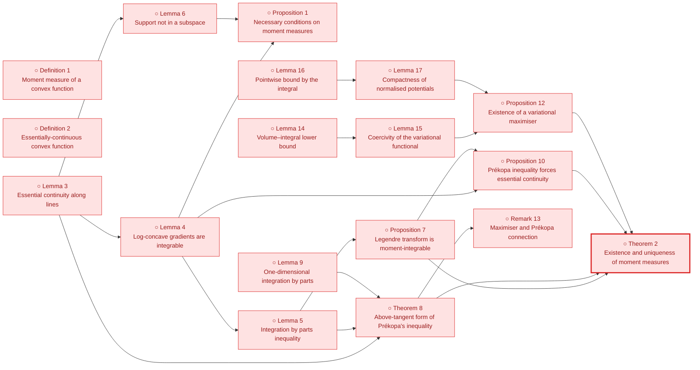

| Item | Statement | Status | Lean declarations | Note |
| --- | --- | --- | --- | --- |
| Definition 1 | For a convex ψ: R^n → R ∪ {+∞} with 0 < ∫ e^{−ψ} < ∞, the moment measure μ of ψ is the push-forward of μ_ψ = e^{−ψ(x)} dx under ∇ψ, i.e. ∫ b dμ = ∫ b(∇ψ(x)) e^{−ψ(x)} dx (display (2)) for every Borel b that is nonnegative or μ-integrable. | ○ Not yet formalized | — | Translation of ψ leaves μ unchanged; adding λ to ψ multiplies μ by e^{−λ}. No Lean declaration: the library has no extended-real convex potentials, Legendre transforms, gradient push-forwards or moment measures. |
| Definition 2 | A convex ψ: R^n → R ∪ {+∞} is essentially continuous if it is lower semicontinuous and its set of discontinuity points has zero H^{n−1}-measure; equivalently {ψ < ∞} = A ∪ B with A open convex and B ⊆ ∂A, H^{n−1}(B) = 0. | ○ Not yet formalized | — | Every finite convex function is essentially continuous; in dimension one the notion equals continuity. No Lean declaration: the library has no extended-real convex potentials, Legendre transforms, gradient push-forwards or moment measures. |
| Proposition 1 | If ψ: R^n → R ∪ {+∞} is convex and essentially continuous with 0 < ∫ e^{−ψ} < ∞, then its moment measure is not supported in any hyperplane and its barycenter lies at the origin. | ○ Not yet formalized | — | Proof: barycenter 0 from the 'furthermore' part of Lemma 4; support not in a hyperplane through 0 by Lemma 6, hence not in any hyperplane since the barycenter is 0. These are the necessity half of the bijection announced before Theorem 2. No Lean declaration: the library has no extended-real convex potentials, Legendre transforms, gradient push-forwards or moment measures. |
| **Theorem 2** (main) | Let μ be a Borel measure on R^n with 0 < μ(R^n) < ∞, not supported in a lower-dimensional subspace, and with barycenter at the origin (in particular with finite first moments). Then there is an essentially continuous convex ψ: R^n → R ∪ {+∞} whose moment measure is μ, and such ψ is unique up to translation. | ○ Not yet formalized | — | Main item: the paper calls it 'Our main result' and the title, abstract and Section 4 ('Existence and Uniqueness') are devoted to it; with Proposition 1 it gives the bijection between essentially continuous convex functions modulo translation and such measures. Uniqueness: for two potentials ψ0, ψ1, apply Theorem 8 to each against ψ_{1/2} = ((ψ0* + ψ1*)/2)* (integrability by Proposition 7), get equality in Prékopa's inequality (17), and conclude by Dubuc's equality characterisation. Existence: normalise μ to a probability, take the maximiser φ of Proposition 12, set ψ = φ*; Jensen and the Kantorovich dual problem (**) with the variation φ + t b (Berman–Berndtsson Lemma 2.7) give (∇ψ)_# e^{−ψ} = μ, and Proposition 10 gives essential continuity. No Lean declaration: the library has no extended-real convex potentials, Legendre transforms, gradient push-forwards or moment measures. The Prékopa–Leindler theorems FunctionalInequalities.Analysis.prekopaLeindler and FunctionalInequalities.Probability.Line.prekopaLeindler would supply (17) only after the Legendre-transform reduction. |
| Lemma 3 | If ψ: R^n → R ∪ {+∞} is convex and essentially continuous, 0 ≠ θ ∈ R^n and H = θ^⊥, then for H^{n−1}-almost every y ∈ H the function t ↦ ψ(y + tθ) is continuous on R (with values in R ∪ {+∞}) and locally Lipschitz in the interior of the interval where it is finite. | ○ Not yet formalized | — | Proof: the projection of the H^{n−1}-null discontinuity set onto H is H^{n−1}-null; convexity gives local Lipschitz continuity. No Lean declaration: the library has no extended-real convex potentials, Legendre transforms, gradient push-forwards or moment measures. |
| Lemma 4 | If ρ: R^n → [0, ∞) is integrable and log-concave, then ∫ &#124;∇ρ&#124; < ∞. If moreover ρ = e^{−ψ} with ψ essentially continuous, then ∫ ∂^i ρ = 0 for i = 1, ..., n. | ○ Not yet formalized | — | Proof: on each line t ↦ ρ(y,t) is unimodal, so ∫&#124;∂_t ρ&#124; dt ≤ 2 sup_t ρ(y,t), and the marginal infimum ψ1(y) = inf_t ψ(y,t) is convex with exp(−ψ1) integrable by (7); the vanishing integral follows from Lemma 3 and Fubini. Gives finite first moments of the moment measure. No Lean declaration: KLS/LogConcave/Density gives bounded Borell densities and exponential moments of the law, not integrability of ∇ρ. |
| Lemma 5 | If ψ: R^n → R ∪ {+∞} is convex with 0 < ∫ e^{−ψ} < ∞, then x·∇ψ(x) is μ_ψ-integrable; if ψ is moreover essentially continuous, then ∫ x·∇ψ(x) dμ_ψ(x) ≤ n ∫ e^{−ψ}. | ○ Not yet formalized | — | Proof: ∇ψ(x)·(x − x0) ≥ ψ(x) − ψ(x0) is bounded below; the divergence theorem on smooth convex compact K ∋ x0 inside {ψ < ∞} bounds the integral by n∫e^{−ψ}; Lemma 4 handles ∇ψ·x0. The paper notes equality holds but neither uses nor proves it. No Lean declaration: the library has no extended-real convex potentials, Legendre transforms, gradient push-forwards or moment measures. |
| Lemma 6 | If ψ: R^n → R ∪ {+∞} is convex and essentially continuous with 0 < ∫ e^{−ψ} < ∞ and μ is its moment measure, then Supp(μ) is not contained in any proper linear subspace E ⊊ R^n. | ○ Not yet formalized | — | Proof: if Supp(μ) ⊆ θ^⊥ then ∂_θ ρ = 0 a.e.; by Lemma 3, ρ is constant on almost every line in direction θ, so ∫ρ ∈ {0, ∞} by Fubini, a contradiction. No Lean declaration: the library has no extended-real convex potentials, Legendre transforms, gradient push-forwards or moment measures. |
| Proposition 7 | If ψ: R^n → R ∪ {+∞} is convex with 0 < ∫ e^{−ψ} < ∞, φ = ψ* and μ is the moment measure of ψ, then φ is μ-integrable. | ○ Not yet formalized | — | Proof: φ(∇ψ(x)) = x·∇ψ(x) − ψ(x) μ_ψ-a.e. (12); x·∇ψ ∈ L¹(μ_ψ) by Lemma 5, and ψ ∈ L¹(μ_ψ) since ψ is bounded below and ψe^{−ψ} ≤ 2e^{−ψ/2} with (7) (display (15)). No essential continuity is assumed. No Lean declaration: the library has no extended-real convex potentials, Legendre transforms, gradient push-forwards or moment measures. |
| Theorem 8 | Let e^{−ψ0}, e^{−ψ1} be log-concave on R^n with 0 < ∫ e^{−ψ0} < ∞, ψ1 not identically +∞, and ψ0 essentially continuous; with φ_i = ψ_i*, log ∫ e^{−ψ0} − log ∫ e^{−ψ1} ≥ ∫ (φ0 − φ1) dμ̄ (display (18)), where μ̄ is the moment measure of ψ0 normalised to a probability. | ○ Not yet formalized | — | Printed title 'Prékopa's theorem revisited'. Proof: Brenier map T = ∇f from e^{−ψ0} to e^{−ψ1}1_L (L a large ball), McCann's a.e. Monge–Ampère equation (20), log s ≤ s − 1 and the Legendre inequalities give (21); the integration by parts ∫(Δf − ∇ψ0·∇f) dμ_ψ0 ≤ 0 follows line by line from Lemma 9 using Lemma 3, and Lemma 5 controls the remaining term. Expresses −μ̄ as a subgradient of the convex functional J(u) = −log ∫ e^{−u*}. No Lean declaration: the library has no extended-real convex potentials, Legendre transforms, gradient push-forwards or moment measures. |
| Lemma 9 | If ρ = e^{−ψ} is an integrable, continuous, log-concave function on R, dμ_ψ = ρ dx, and f: R → R is convex and Lipschitz, then ∫ (f'' − f'ψ') dμ_ψ ≤ 0, with f'' the Aleksandrov (a.e.) second derivative. | ○ Not yet formalized | — | Proof: Lebesgue–Stieltjes integration by parts for the bounded nondecreasing right derivative V = f', using that V' dx is the absolutely continuous part of dV. No Lean declaration: the one-dimensional integration-by-parts results in KLS/LogConcave/Line/SharpHardy.lean concern clipped Poincaré tests, not convex f. |
| Proposition 10 | Let ψ: R^n → R ∪ {+∞} be lower semicontinuous and convex with ∫ e^{−ψ} = 1, μ its moment measure and φ = ψ*. If for every μ-integrable convex φ1 with ψ1 = φ1* one has log ∫ e^{−ψ} − log ∫ e^{−ψ1} ≥ ∫ (φ − φ1) dμ, then ψ is essentially continuous. | ○ Not yet formalized | — | Converse to Theorem 8. Proof: near x0 in A = {x ∈ ∂{ψ<∞} : ψ(x) < ∞} write the boundary as a Lipschitz graph; test with φ_ε = max{φ, φ + ε(y·θ) − 1}: the right side is o(ε) by first moments (Lemma 4), while ∫e^{−ψ_ε} gains at least ε c0^{n−1} e^{−(k0+1)} H^{n−1}(A^{k0}), forcing H^{n−1}(A^{k0}) = 0. μ-integrability of φ_ε uses Proposition 7. No Lean declaration: the library has no extended-real convex potentials, Legendre transforms, gradient push-forwards or moment measures. |
| Proposition 12 | Let μ be a probability measure on R^n satisfying the assumptions of Theorem 2 and I_μ(f) = log ∫ e^{−f*} − ∫ f dμ for μ-integrable f: R^n → R ∪ {+∞}. Then there is a μ-integrable convex φ with ∫ e^{−φ*} = 1 and I_μ(φ) = sup_f I_μ(f) (display (38)), the supremum over all μ-integrable f. | ○ Not yet formalized | — | Variational problem of Berman–Berndtsson. Proof: truncate a maximising sequence below, replace by biconjugates, normalise φ_ℓ(0) = inf φ_ℓ = 0; Lemma 15 and log t = o(t^{1/n}) bound sup_ℓ ∫e^{−φ_ℓ*} and sup_ℓ ∫φ_ℓ dμ; Lemma 17 extracts a limit with I_μ(φ) ≥ limsup I_μ(φ_ℓj). No Lean declaration: the library has no extended-real convex potentials, Legendre transforms, gradient push-forwards or moment measures. |
| Remark 13 | By Prékopa's inequality the functional f ↦ I_μ(f) is concave, and strictly concave modulo affine functions, on convex functions finite near 0; and if μ is the moment measure of ψ0 then Theorem 8 forces φ0 = ψ0* to be a maximiser in (38). | ○ Not yet formalized | — | Not purely expository: it asserts the concavity of I_μ (from (17)) and the maximising property of ψ0* (from Theorem 8), without separate proof. No Lean declaration: the library has no extended-real convex potentials, Legendre transforms, gradient push-forwards or moment measures. |
| Lemma 14 | Let μ be a probability measure on R^n satisfying the assumptions of Theorem 2. There is c_μ > 0 such that every μ-integrable convex φ: R^n → R ∪ {+∞} with e^{−φ} integrable and φ(0) = 0 satisfies (∫ e^{−φ})^{1/n} (∫ [φ − inf φ] dμ + 1) ≥ c_μ; one may take c_μ = κ_n^{1/n} m_μ / (4 e^{1/n}) with m_μ = inf_{θ ∈ S^{n−1}} ∫ &#124;x·θ&#124; dμ(x) > 0. | ○ Not yet formalized | — | Proof: with K = {φ ≤ 1}, Rogers–Shephard gives Vol(K − K) ≤ 4^n Vol(K), so K − K has inradius at most R_φ = 4κ_n^{−1/n} Vol(K)^{1/n}; convexity gives φ(x) ≥ &#124;x·θ0&#124;/R_φ + inf φ − 1 and ∫e^{−φ} ≥ Vol(K)/e. No Lean declaration: the library has no extended-real convex potentials, Legendre transforms, gradient push-forwards or moment measures. |
| Lemma 15 | Let μ be a probability measure on R^n satisfying the assumptions of Theorem 2, φ: R^n → R ∪ {+∞} μ-integrable and convex with φ(0) = 0, and ψ = φ*. Then ∫ φ dμ ≥ (c_μ / (2π)) (∫ e^{−ψ})^{1/n} − (n + 1), with c_μ the constant of Lemma 14. | ○ Not yet formalized | — | Proof: ∫φ dμ ≥ 0 via a subgradient at 0 and the zero barycenter; after translating ψ to have barycenter 0, Fradelizi's inequality gives inf φ = −ψ(0) ≥ −n, Lemma 14 applies, and the functional Santaló inequality ∫e^{−ψ} ∫e^{−φ} ≤ (2π)^n of Artstein–Klartag–Milman concludes. No Lean declaration: the library has no extended-real convex potentials, Legendre transforms, gradient push-forwards or moment measures. |
| Lemma 16 | Let μ be a finite Borel measure on R^n and K the interior of conv(Supp(μ)). For every x0 ∈ K there is C_{μ,x0} > 0 such that φ(x0) ≤ C_{μ,x0} ∫ φ dμ for every nonnegative μ-integrable convex φ: R^n → R ∪ {+∞}. | ○ Not yet formalized | — | Proof: m_{μ,x0} = inf_θ μ{(x − x0)·θ > 0} > 0 by Fatou and compactness of S^{n−1}; integrate the supporting-hyperplane bound over a half-space; C_{μ,x0} = 1/m_{μ,x0}. No Lean declaration: the library has no extended-real convex potentials, Legendre transforms, gradient push-forwards or moment measures. |
| Lemma 17 | Let μ satisfy the assumptions of Theorem 2 and let φ_ℓ: R^n → [0, ∞] be μ-integrable convex with φ_ℓ(0) = 0 and sup_ℓ ∫ φ_ℓ dμ < ∞. Then a subsequence φ_ℓj and a nonnegative μ-integrable convex φ satisfy ∫ φ dμ ≤ liminf_j ∫ φ_ℓj dμ and ∫ e^{−φ*} ≥ limsup_j ∫ e^{−φ_ℓj*}. | ○ Not yet formalized | — | Proof: Lemma 16 gives pointwise bounds on K = int conv(Supp μ); Rockafellar Theorem 10.9 gives a pointwise convergent subsequence on K; extend φ radially to ∂K, use Fatou and monotone convergence for the first inequality, and a finite dense max-affine approximation of φ* for the second. No Lean declaration: the library has no extended-real convex potentials, Legendre transforms, gradient push-forwards or moment measures. |

Not listed: All 19 numbered statements of v1 are listed except Remark 11, a purely expository heuristic (the measure in Theorem 8 might become a distribution acting through the asymptotic slope of φ when ψ0 is not essentially continuous). Unnumbered displayed claims are not listed: the integrability criterion (7) and (13), the Legendre identity (12), the support identity (16) (stated without proof), the Prékopa inequality (17) for Legendre transforms (deduced from Prékopa's theorem), the example moment measures (simplex, Gaussian, sphere, cube (5)), the Monge–Ampère equation (4), the one-dimensional formula, the end-of-Section-2 observations on conv(Supp μ), and the Section 5 discussion of cone-volume and surface-area variants. Reviewed Lean candidates with no item mapped: FunctionalInequalities.KLS.LogConcave (KLS/Definitions.lean), FunctionalInequalities.KLS.IsBorellDensity and its lemmas (KLS/LogConcave/Density/BorellRepresentation/Basic.lean, Density/Bounds.lean), FunctionalInequalities.Probability.Line.prekopaLeindler (Probability/Line/BrunnMinkowski.lean) and FunctionalInequalities.Analysis.prekopaLeindler (Probability/BrunnMinkowski.lean); the finite-dimensional Prékopa–Leindler inequality is an available ingredient for (17) (with f = e^{−u0*}, g = e^{−u1*}, h = e^{−[(1−λ)u0+λu1]*}) but states neither (17) nor any numbered item.

### ADMG2017 lemma map

Source: [Ambrosio–Di Marino–Gigli, arXiv:1603.08412v1](https://arxiv.org/abs/1603.08412v1), reviewed 2026-10-02.

Standing assumptions: Metric space with a Borel measure finite on bounded Borel sets; contents are defined for Borel sets of finite measure.

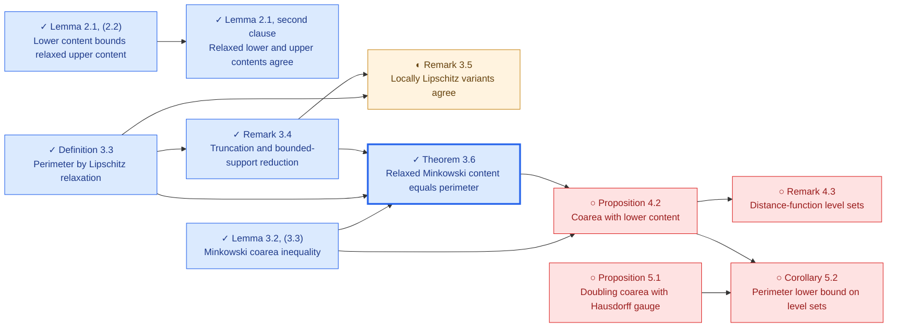

| Item | Statement | Status | Lean declarations | Note |
| --- | --- | --- | --- | --- |
| Lemma 2.1, (2.2) | For a Borel set A of finite measure, the relaxed upper Minkowski content is at most the lower Minkowski content. | ✓ Formalized in Lean | [`relaxedUpperMinkowskiContent_le_minkowskiContent_of_measure_lt_top`](../../formalization/FunctionalInequalities/KLS/Geometry/Perimeter/RelaxedMinkowski.lean) | Holds for every Borel measure; the standing finiteness on bounded sets is not needed. |
| Lemma 2.1, second clause | The relaxed lower and upper Minkowski contents coincide. | ✓ Formalized in Lean | [`relaxedUpperMinkowskiContent_eq_relaxedMinkowskiContent_of_measure_lt_top`](../../formalization/FunctionalInequalities/KLS/Geometry/Perimeter/RelaxedMinkowski.lean) | Measurable finite-mass targets under every Borel measure. |
| Lemma 3.2, (3.3) | For a nonnegative Lipschitz f with a finite-mass neighbourhood of {f > 0}, the integrated lower content of superlevel sets is at most the liminf of the integrated open-ball growth, which is at most the slope integral. | ✓ Formalized in Lean | [`setLIntegral_minkowskiContent_superlevel_coarea_of_finite_neighborhood`](../../formalization/FunctionalInequalities/KLS/Geometry/Cheeger/LocalSlopeCoarea.lean) | Both inequalities of the chain, with the actual open-ball supremum semigroup. |
| Definition 3.3 | Per(A) is the infimum of liminf of slope integrals over Lipschitz approximants converging to the indicator of A in L¹. | ✓ Formalized in Lean | [`lipschitzRelaxation`](../../formalization/FunctionalInequalities/KLS/Geometry/Perimeter/TestClassRelaxation.lean) | The library perimeter uses bounded-support tests; lipschitzRelaxation_eq_perimeter_of_measure_lt_top identifies the two at finite-mass targets. |
| Remark 3.4 | Only approximants with values in [0, 1] and bounded positivity set need to be considered in Definition 3.3. | ✓ Formalized in Lean | [`exists_approximatingSequence_of_lipschitz_of_measure_lt_top`](../../formalization/FunctionalInequalities/KLS/Geometry/Perimeter/MetricBV.lean)<br/>[`lipschitzRelaxation_eq_perimeter_of_measure_lt_top`](../../formalization/FunctionalInequalities/KLS/Geometry/Perimeter/TestClassRelaxation.lean) | Measurable finite-mass targets under every Borel measure. |
| Remark 3.5 | The locally Lipschitz variants of the perimeter (L¹ or L¹_loc convergence) agree with Definition 3.3 on proper spaces, and on complete separable spaces by a non-elementary argument. | ◐ Partial or statement only | [`locallyLipschitzRelaxation_eq_perimeter_of_measure_lt_top`](../../formalization/FunctionalInequalities/KLS/Geometry/Perimeter/TestClassRelaxation.lean)<br/>[`compactLocallyLipschitzRelaxation_eq_perimeter_of_measure_lt_top`](../../formalization/FunctionalInequalities/KLS/Geometry/Perimeter/TestClassRelaxation.lean) | Proper spaces only. The complete separable case, cited from Di Marino's thesis, is not formalized. |
| **Theorem 3.6** (main) | For every Borel set A with finite measure, the relaxed lower Minkowski content equals Per(A) of Definition 3.3. | ✓ Formalized in Lean | [`certificate`](../../solutions/ThmRelaxedMinkowskiContentPerimeter.lean)<br/>[`relaxedMinkowskiContent_eq_perimeter_of_finite_on_bounded`](../../formalization/FunctionalInequalities/KLS/Geometry/Perimeter/RelaxedMinkowski.lean)<br/>[`lipschitzRelaxation_eq_perimeter_of_measure_lt_top`](../../formalization/FunctionalInequalities/KLS/Geometry/Perimeter/TestClassRelaxation.lean) | Exact Definition 3.3 form, registered as the paper-target certificate thm:relaxed-minkowski-content-perimeter; the two library identities compose under the standing assumption. |
| Proposition 4.2 | Under the regularity assumption (4.2), the total variation of a nonnegative Lipschitz f equals the integrated lower content of its superlevel sets; lower content equals perimeter for almost every level, and lower and upper contents agree for unit-slope functions. | ○ Not yet formalized | — | Needs the BV total variation of functions and the Fleming–Rishel coarea formula (4.1), which the paper cites. |
| Remark 4.3 | Under a length assumption and (4.2), almost every level set of a distance function has equal lower content, upper content and perimeter, and has a Minkowski content. | ○ Not yet formalized | — |  |
| Proposition 5.1 | For a doubling measure and nonnegative Lipschitz f with finite-mass positivity set, the integrated gauge-Hausdorff measure of B ∩ {f = t} is bounded by the asymptotic Lipschitz integral and by twice the slope integral over B. | ○ Not yet formalized | — | Needs the Carathéodory gauge measure and Vitali covering for doubling measures. |
| Corollary 5.2 | On complete doubling spaces satisfying (4.2), almost every superlevel set has finite perimeter with perimeter measure at least half the gauge-Hausdorff measure on its essential boundary. | ○ Not yet formalized | — |  |

Not listed: Remarks 3.1, 4.1 and 4.4 are expository (literature context, Euclidean background and a cited counterexample) and are not separate formalization targets.

### LeeVempala2024 lemma map

Source: [Lee–Vempala, arXiv:1612.01507v3](https://arxiv.org/abs/1612.01507v3), reviewed 2026-10-03.

Standing assumptions: Log-concave densities p on R^n with mean mu and covariance matrix A; isotropic means mean 0 and A = I. psi_p is the KLS constant, the reciprocal of the Cheeger constant: 1/psi_p = inf_S p(boundary S)/min(p(S), p(R^n minus S)) (Conjecture 1 display), so upper bounds on psi_p are lower bounds on expansion; psi_n in Appendix A is the supremum over isotropic laws on R^n (implicit). The repository's Isoperimetry.constant is 1/psi_p on the affine support (outer Minkowski content) and Isoperimetry.inverseScale is psi_p. kappa_p and rho_p are the log-Cheeger and log-Sobolev constants (Definitions 10, 9); D is the diameter of the support. c, C are universal constants and a <~ b means a <= C b; ||.||_op is the spectral norm. From Section 3 on the support of p is truncated to a ball of radius R > n (justified by Lemma 24 and Theorem 25), W_t is a standard n-dimensional Wiener process and p_t, mu_t, A_t are the localization of Definition 26 with control matrix C_t = I. The Stieltjes potential u(X) is defined by display (1.1), Tr((uI - X)^{-q}) = Phi with X <= uI, which the paper cites as Definition 1.1.

```mermaid
flowchart LR
    LeeVempala2024_Dpsi["◐ Conjecture 1, defining display of psi_p<br/>KLS constant psi_p"]
    LeeVempala2024_C1["○ Conjecture 1 (Kannan-Lovasz-Simonovits)<br/>KLS conjecture"]
    LeeVempala2024_T2["○ Theorem 2 (Kannan-Lovasz-Simonovits)<br/>KLS trace bound"]
    LeeVempala2024_C3["○ Conjecture 3 (thin shell)<br/>Thin-shell conjecture"]
    LeeVempala2024_C4["○ Conjecture 4 (slicing, isotropic constant)<br/>Slicing conjecture"]
    LeeVempala2024_T5["⇑ Theorem 5 (Poincare constant; Maz'ya, Cheeger)<br/>Cheeger implies Poincare"]
    LeeVempala2024_T6["○ Theorem 6 (Lipschitz concentration; Gromov-Milman)<br/>Lipschitz concentration via psi_p"]
    LeeVempala2024_T7["○ Theorem 7 (Guedon-Milman, Paouris)<br/>Norm deviation bound"]
    LeeVempala2024_T8["○ Theorem 8 (central limit theorem; Anttila-Ball-Perissinaki)<br/>CLT for convex sets"]
    LeeVempala2024_D9["○ Definition 9<br/>Log-Sobolev constant rho_p"]
    LeeVempala2024_D10["○ Definition 10<br/>Log-Cheeger constant kappa_p"]
    LeeVempala2024_T11["○ Theorem 11 (Kannan-Lovasz-Montenegro)<br/>Previous log-Cheeger bound"]
    LeeVempala2024_T12["○ Theorem 12<br/>KLS constant n^{1/4} bound"]
    LeeVempala2024_C13["○ Corollary 13<br/>Slicing and thin-shell n^{1/4}"]
    LeeVempala2024_C14["○ Corollary 14<br/>Ball walk warm-start mixing"]
    LeeVempala2024_T15["○ Theorem 15<br/>Log-Sobolev bound 1/D"]
    LeeVempala2024_T16["○ Theorem 16<br/>Lipschitz large deviation"]
    LeeVempala2024_T17["○ Theorem 17<br/>Small ball probability"]
    LeeVempala2024_T18["○ Theorem 18<br/>Ball walk from any start"]
    LeeVempala2024_L19["○ Lemma 19 (Ito's formula)<br/>Ito's formula"]
    LeeVempala2024_L20["○ Lemma 20 (reflection principle)<br/>Reflection principle"]
    LeeVempala2024_T21["○ Theorem 21 (Dambis, Dubins-Schwarz)<br/>Time change of martingales"]
    LeeVempala2024_L22["◐ Lemma 22 (Dinghas, Prekopa, Leindler)<br/>Log-concavity is preserved"]
    LeeVempala2024_L23["○ Lemma 23 (log-concave moments)<br/>Reverse Holder moments"]
    LeeVempala2024_L24["○ Lemma 24 (log-concave concentration)<br/>Norm tail bound"]
    LeeVempala2024_T25["○ Theorem 25 (E. Milman, Theorem 1.8)<br/>Half-measure sets suffice"]
    LeeVempala2024_D26["○ Definition 26<br/>Stochastic localization with C_t = I"]
    LeeVempala2024_L27["○ Lemma 27<br/>Density is a martingale"]
    LeeVempala2024_L28["○ Lemma 28<br/>Covariance SDE"]
    LeeVempala2024_L29["○ Lemma 29<br/>Mass of a half set"]
    LeeVempala2024_T30["○ Theorem 30 (Cousins-Vempala)<br/>Gaussian-tilted isoperimetry"]
    LeeVempala2024_L31["○ Lemma 31<br/>Covariance control gives KLS"]
    LeeVempala2024_L32["○ Lemma 32<br/>Third-moment vector bound"]
    LeeVempala2024_L33["○ Lemma 33<br/>Third-moment tensor bound"]
    LeeVempala2024_L34["○ Lemma 34<br/>Ito formula for Tr A_t^2"]
    LeeVempala2024_L35["○ Lemma 35<br/>Potential Tr A_t^2 stays bounded"]
    LeeVempala2024_T36["○ Theorem 36<br/>Isotropic log-isoperimetry 1/D"]
    LeeVempala2024_L37["○ Lemma 37<br/>Spectral norm stays bounded"]
    LeeVempala2024_L38["○ Lemma 38<br/>Ito formula for Stieltjes potential"]
    LeeVempala2024_L39["○ Lemma 39<br/>Anisotropic third-moment bound"]
    LeeVempala2024_L40["○ Lemma 40<br/>Drift and diffusion of u_t"]
    LeeVempala2024_L41["○ Lemma 41<br/>Derivatives of the Stieltjes potential"]
    LeeVempala2024_L42["✓ Lemma 42 (Eldan)<br/>Trace shift inequality"]
    LeeVempala2024_L43["○ Lemma 43<br/>Quadratic variation of p_t(E)"]
    LeeVempala2024_L44["○ Lemma 44<br/>log(1/g_t) stays controlled"]
    LeeVempala2024_L45["○ Lemma 45<br/>g sqrt(log 1/g) is preserved"]
    LeeVempala2024_T46["○ Theorem 46 (Ledoux, Theorem 1.1)<br/>Gaussian-tilted log-isoperimetry"]
    LeeVempala2024_T47["○ Theorem 47 (Ledoux)<br/>Log-isoperimetry implies log-Sobolev"]
    LeeVempala2024_T48["○ Theorem 48<br/>Log-Sobolev for bounded isotropic laws"]
    LeeVempala2024_T49["○ Theorem 49 (Paouris, Theorem 1.3)<br/>Small ball under subgaussian tails"]
    LeeVempala2024_T50["○ Theorem 50<br/>Speedy walk log-Cheeger"]
    LeeVempala2024_L51["○ Lemma 51<br/>Local conductance facts"]
    LeeVempala2024_T52["○ Theorem 52<br/>Gaussian-tilted three-set inequality"]
    LeeVempala2024_L53["○ Lemma 53 (Kannan-Lovasz-Montenegro, Lemma 6.4)<br/>One-step coupling"]
    LeeVempala2024_L54["○ Lemma 54<br/>Log-Sobolev lower-bound example"]
    LeeVempala2024_L55["○ Lemma 55<br/>Ball walk lower bound"]
    LeeVempala2024_CL56["○ Claim 56<br/>Slices stay radially unimodal"]
    LeeVempala2024_L57["○ Lemma 57<br/>Isotropic-only third-moment bound"]
    LeeVempala2024_L58["○ Lemma 58<br/>Spectral norm bound, isotropic KLS"]
    LeeVempala2024_Dpsi --> LeeVempala2024_C1
    LeeVempala2024_Dpsi --> LeeVempala2024_T2
    LeeVempala2024_Dpsi --> LeeVempala2024_T5
    LeeVempala2024_Dpsi --> LeeVempala2024_T6
    LeeVempala2024_Dpsi --> LeeVempala2024_T8
    LeeVempala2024_Dpsi --> LeeVempala2024_D10
    LeeVempala2024_D9 --> LeeVempala2024_T11
    LeeVempala2024_D10 --> LeeVempala2024_T11
    LeeVempala2024_L35 --> LeeVempala2024_T12
    LeeVempala2024_L31 --> LeeVempala2024_T12
    LeeVempala2024_D26 --> LeeVempala2024_T12
    LeeVempala2024_T12 --> LeeVempala2024_C13
    LeeVempala2024_T12 --> LeeVempala2024_C14
    LeeVempala2024_T36 --> LeeVempala2024_T15
    LeeVempala2024_T48 --> LeeVempala2024_T15
    LeeVempala2024_T12 --> LeeVempala2024_T16
    LeeVempala2024_T36 --> LeeVempala2024_T16
    LeeVempala2024_L37 --> LeeVempala2024_T17
    LeeVempala2024_L28 --> LeeVempala2024_T17
    LeeVempala2024_L32 --> LeeVempala2024_T17
    LeeVempala2024_L43 --> LeeVempala2024_T17
    LeeVempala2024_D26 --> LeeVempala2024_T17
    LeeVempala2024_T49 --> LeeVempala2024_T17
    LeeVempala2024_T50 --> LeeVempala2024_T18
    LeeVempala2024_L19 --> LeeVempala2024_L27
    LeeVempala2024_D26 --> LeeVempala2024_L27
    LeeVempala2024_L19 --> LeeVempala2024_L28
    LeeVempala2024_L27 --> LeeVempala2024_L28
    LeeVempala2024_L27 --> LeeVempala2024_L29
    LeeVempala2024_T21 --> LeeVempala2024_L29
    LeeVempala2024_L20 --> LeeVempala2024_L29
    LeeVempala2024_Dpsi --> LeeVempala2024_T30
    LeeVempala2024_T25 --> LeeVempala2024_L31
    LeeVempala2024_L27 --> LeeVempala2024_L31
    LeeVempala2024_D26 --> LeeVempala2024_L31
    LeeVempala2024_T30 --> LeeVempala2024_L31
    LeeVempala2024_L29 --> LeeVempala2024_L31
    LeeVempala2024_L22 --> LeeVempala2024_L32
    LeeVempala2024_L23 --> LeeVempala2024_L32
    LeeVempala2024_L22 --> LeeVempala2024_L33
    LeeVempala2024_L23 --> LeeVempala2024_L33
    LeeVempala2024_L19 --> LeeVempala2024_L34
    LeeVempala2024_L28 --> LeeVempala2024_L34
    LeeVempala2024_L27 --> LeeVempala2024_L34
    LeeVempala2024_L34 --> LeeVempala2024_L35
    LeeVempala2024_L33 --> LeeVempala2024_L35
    LeeVempala2024_L32 --> LeeVempala2024_L35
    LeeVempala2024_L19 --> LeeVempala2024_L35
    LeeVempala2024_T21 --> LeeVempala2024_L35
    LeeVempala2024_L20 --> LeeVempala2024_L35
    LeeVempala2024_L27 --> LeeVempala2024_T36
    LeeVempala2024_D26 --> LeeVempala2024_T36
    LeeVempala2024_T46 --> LeeVempala2024_T36
    LeeVempala2024_L45 --> LeeVempala2024_T36
    LeeVempala2024_L40 --> LeeVempala2024_L37
    LeeVempala2024_T21 --> LeeVempala2024_L37
    LeeVempala2024_L20 --> LeeVempala2024_L37
    LeeVempala2024_L41 --> LeeVempala2024_L38
    LeeVempala2024_L19 --> LeeVempala2024_L38
    LeeVempala2024_L28 --> LeeVempala2024_L38
    LeeVempala2024_L42 --> LeeVempala2024_L38
    LeeVempala2024_T5 --> LeeVempala2024_L39
    LeeVempala2024_L22 --> LeeVempala2024_L39
    LeeVempala2024_L38 --> LeeVempala2024_L40
    LeeVempala2024_L32 --> LeeVempala2024_L40
    LeeVempala2024_L39 --> LeeVempala2024_L40
    LeeVempala2024_L27 --> LeeVempala2024_L43
    LeeVempala2024_L23 --> LeeVempala2024_L43
    LeeVempala2024_L43 --> LeeVempala2024_L44
    LeeVempala2024_L19 --> LeeVempala2024_L44
    LeeVempala2024_T21 --> LeeVempala2024_L44
    LeeVempala2024_L20 --> LeeVempala2024_L44
    LeeVempala2024_L44 --> LeeVempala2024_L45
    LeeVempala2024_L37 --> LeeVempala2024_L45
    LeeVempala2024_L43 --> LeeVempala2024_L45
    LeeVempala2024_L19 --> LeeVempala2024_L45
    LeeVempala2024_T47 --> LeeVempala2024_T48
    LeeVempala2024_T36 --> LeeVempala2024_T48
    LeeVempala2024_L51 --> LeeVempala2024_T50
    LeeVempala2024_L53 --> LeeVempala2024_T50
    LeeVempala2024_T52 --> LeeVempala2024_T50
    LeeVempala2024_L45 --> LeeVempala2024_T50
    LeeVempala2024_D26 --> LeeVempala2024_T50
    LeeVempala2024_T46 --> LeeVempala2024_T52
    LeeVempala2024_CL56 --> LeeVempala2024_L55
    LeeVempala2024_L39 --> LeeVempala2024_L57
    LeeVempala2024_T5 --> LeeVempala2024_L57
    LeeVempala2024_L57 --> LeeVempala2024_L58
    LeeVempala2024_L40 --> LeeVempala2024_L58
    LeeVempala2024_L37 --> LeeVempala2024_L58
    classDef lemma_formalized fill:#dbeafe,stroke:#2563eb,color:#1e3a8a;
    class LeeVempala2024_L42 lemma_formalized;
    classDef lemma_partial fill:#fff3df,stroke:#c88719,color:#66420d;
    class LeeVempala2024_Dpsi,LeeVempala2024_L22 lemma_partial;
    classDef lemma_pending fill:#fee2e2,stroke:#dc2626,color:#991b1b;
    class LeeVempala2024_C1,LeeVempala2024_T2,LeeVempala2024_C3,LeeVempala2024_C4,LeeVempala2024_T6,LeeVempala2024_T7,LeeVempala2024_T8,LeeVempala2024_D9,LeeVempala2024_D10,LeeVempala2024_T11,LeeVempala2024_T12,LeeVempala2024_C13,LeeVempala2024_C14,LeeVempala2024_T15,LeeVempala2024_T16,LeeVempala2024_T17,LeeVempala2024_T18,LeeVempala2024_L19,LeeVempala2024_L20,LeeVempala2024_T21,LeeVempala2024_L23,LeeVempala2024_L24,LeeVempala2024_T25,LeeVempala2024_D26,LeeVempala2024_L27,LeeVempala2024_L28,LeeVempala2024_L29,LeeVempala2024_T30,LeeVempala2024_L31,LeeVempala2024_L32,LeeVempala2024_L33,LeeVempala2024_L34,LeeVempala2024_L35,LeeVempala2024_T36,LeeVempala2024_L37,LeeVempala2024_L38,LeeVempala2024_L39,LeeVempala2024_L40,LeeVempala2024_L41,LeeVempala2024_L43,LeeVempala2024_L44,LeeVempala2024_L45,LeeVempala2024_T46,LeeVempala2024_T47,LeeVempala2024_T48,LeeVempala2024_T49,LeeVempala2024_T50,LeeVempala2024_L51,LeeVempala2024_T52,LeeVempala2024_L53,LeeVempala2024_L54,LeeVempala2024_L55,LeeVempala2024_CL56,LeeVempala2024_L57,LeeVempala2024_L58 lemma_pending;
    classDef lemma_improved fill:#dcfce7,stroke:#15803d,color:#14532d;
    class LeeVempala2024_T5 lemma_improved;
    style LeeVempala2024_T12 stroke-width:3px
```

| Item | Statement | Status | Lean declarations | Note |
| --- | --- | --- | --- | --- |
| Conjecture 1, defining display of psi_p | For a log-concave density p on R^n, 1/psi_p = inf over S of p(boundary S)/min(p(S), p(R^n minus S)), where p(boundary S) is the boundary measure (written as the integral of p over the boundary); psi_p is the reciprocal of the Cheeger constant, so upper bounds on psi_p are lower bounds on expansion. | ◐ Partial or statement only | [`constant`](../../formalization/FunctionalInequalities/KLS/Isoperimetry.lean)<br/>[`inverseScale`](../../formalization/FunctionalInequalities/KLS/Isoperimetry.lean) | Lean Isoperimetry.constant is h_mu = 1/psi_p, an infimum over measurable sets of mass in (0, 1) of the outer Minkowski content (liminf over open thickenings) divided by min(mu(B), 1 - mu(B)), computed on the affine support with its induced metric; Isoperimetry.inverseScale is Psi = h_mu^{-1} = psi_p, valued in [0, infinity]. The paper leaves the boundary measure and the admissible class of S unspecified, and uses the display only for densities on R^n. |
| Conjecture 1 (Kannan-Lovasz-Simonovits) | For every log-concave density p on R^n with covariance matrix A, 1/psi_p >= c/sqrt(&#124;&#124;A&#124;&#124;_op) for a universal constant c > 0; equivalently psi_p <= C for every isotropic log-concave p. | ○ Not yet formalized | — | Open conjecture, not proved in the paper. Deliberately not mapped to FunctionalInequalities.KLS.kls. |
| Theorem 2 (Kannan-Lovasz-Simonovits) | For every log-concave density p on R^n with covariance matrix A, psi_p <= C sqrt(Tr A) for a universal constant C; for isotropic p this is psi_p = O(sqrt n). | ○ Not yet formalized | — | Quoted from KLS95, not proved here. No Lean declaration bounds Psi by the covariance, even on the line (Line/Buser.lean gives Psi^2 <= 12 C_P and Line/Poincare.lean gives C_P <= 12 Var, in separate declarations). |
| Conjecture 3 (thin shell) | For X drawn from an isotropic log-concave density on R^n, sigma_p^2 = E[(&#124;&#124;X&#124;&#124; - sqrt n)^2] <= C for a universal constant C. | ○ Not yet formalized | — | Open conjecture; the text recalls sigma_p <= C psi_p and the Guedon-Milman bound sigma_p <= C n^{1/3}. No Lean counterpart. |
| Conjecture 4 (slicing, isotropic constant) | Every convex body of unit volume in R^n has a hyperplane section of volume at least a universal constant; equivalently L_K <= C for every unit-volume convex body K with covariance L_K^2 I. | ○ Not yet formalized | — | Open conjecture; the text recalls L_p <= C sigma_p <= C psi_p (Eldan-Klartag, Ball). No Lean counterpart. |
| Theorem 5 (Poincare constant; Maz'ya, Cheeger) | For every isotropic log-concave density p on R^n and every smooth g, Var_p g <= C psi_p^2 E_p &#124;&#124;grad g&#124;&#124;^2 for a universal constant C. | ⇑ Stronger result or alternative route | [`literatureConstant_le_four_mul_inverseScale_sq`](../../formalization/FunctionalInequalities/KLS/Geometry/Cheeger/Inequality.lean) | Quoted, not proved here; used in Lemmas 39 and 57 for non-isotropic laws as well. Lean proves C_P^lit(mu) <= 4 Psi(mu)^2 for every finite-dimensional log-concave law (no isotropy, explicit constant 4, Dirac laws included), which implies the theorem when psi_p is read as Isoperimetry.inverseScale and smooth g with finite energy are admissible local-slope tests. |
| Theorem 6 (Lipschitz concentration; Gromov-Milman) | For every L-Lipschitz g on R^n and isotropic log-concave p, P(&#124;g(x) - E g&#124; >= psi_p L t) <= exp(-c t) for a universal c > 0. | ○ Not yet formalized | — | Quoted for context, not proved or used. No Lean counterpart. |
| Theorem 7 (Guedon-Milman, Paouris) | For every isotropic log-concave p on R^n and t >= 0, P(&#124; &#124;&#124;x&#124;&#124; - sqrt n &#124; >= t) <= exp(-c min(t^3/n, t)). | ○ Not yet formalized | — | Quoted for comparison with Theorem 16; not proved or used. |
| Theorem 8 (central limit theorem; Anttila-Ball-Perissinaki) | For an isotropic symmetric convex set K with marginal densities g_theta of vol(K cap {x^T theta = s}) and g the standard Gaussian density, there are universal c_1, c_2 > 0 such that for every delta > 0 the set of theta in S^{n-1} with &#124;int_{-t}^t g_theta - int_{-t}^t g&#124; <= c_1(delta + psi_K/sqrt n) for all t has measure at least 1 - n e^{-c_2 delta^2 n}. | ○ Not yet formalized | — | Quoted for context; not proved or used. The printed vol of a subset of S^{n-1} is the normalized spherical measure. |
| Definition 9 | For a density p, rho_p is the largest rho such that (rho/2) int f^2 log f^2 dp <= int &#124;&#124;grad f&#124;&#124;^2 dp for every smooth f with int f^2 dp = 1. | ○ Not yet formalized | — | No log-Sobolev constant is defined in the Lean library. |
| Definition 10 | For a density p on R^n, kappa_p = inf over S of p(boundary S)/(min(p(S), p(R^n minus S)) sqrt(log(1/p(S)))). | ○ Not yet formalized | — | The defining display is typeset after the definition environment. The text asserts rho_p = Theta(kappa_p^2) citing Ledoux; only kappa_p^2 <~ rho_p follows from Theorem 47 as quoted. No Lean counterpart. |
| Theorem 11 (Kannan-Lovasz-Montenegro) | For a log-concave density p on R^n with support of diameter D, kappa_p >= c/D and rho_p >= c/D^2. | ○ Not yet formalized | — | Quoted; superseded by Theorem 15 in the isotropic case. |
| **Theorem 12** (main) | For every log-concave density p on R^n with covariance matrix A, psi_p <= C (Tr(A^2))^{1/4} for a universal constant C; in particular psi_p <= C n^{1/4} for isotropic p, where psi_p is the reciprocal of the Cheeger constant of Conjecture 1. | ○ Not yet formalized | — | Main theorem (the psi_n = O(n^{1/4}) bound). Proof (Section 4.3): Lemma 35 keeps Tr A_t^2 <= 8 Tr A_0^2, hence &#124;&#124;A_t&#124;&#124;_op <= sqrt(8 Tr A_0^2), on [0, c_1/sqrt(Tr A_0^2)] with probability 0.99; Lemma 31 with T = min(1/(64 sqrt 8), c_1)/sqrt(Tr A_0^2) gives psi_p = O(T^{-1/2}). Requires the stochastic-localization calculus of Section 3; the Lean library has no stochastic calculus and no declaration states this bound, even for n = 1. |
| Corollary 13 | For every isotropic log-concave density p on R^n, the isotropic constant L_p and the thin-shell constant sigma_p are O(n^{1/4}). | ○ Not yet formalized | — | Called immediate: combine Theorem 12 with the quoted comparisons L_p <= C sigma_p <= C psi_p (Eldan-Klartag; sigma_p <= C psi_p is folklore). The printed statement says any log-concave p, but L_p and sigma_p are defined for isotropic p. |
| Corollary 14 | The ball walk for an isotropic log-concave density on R^n mixes from a warm start in O*(n^{2.5}) steps. | ○ Not yet formalized | — | From Theorem 12 and the quoted O*(n^2 psi_p^2) warm-start bound of KLS97; no proof given. |
| Theorem 15 | For every isotropic log-concave density p with support of diameter D, kappa_p >= c/sqrt D and rho_p >= c/D for a universal constant c > 0. | ○ Not yet formalized | — | The paper's main log-Sobolev result (called our main theorem in Section 1.3); tight by Lemma 54. kappa_p follows from Theorem 36, rho_p is Theorem 48. |
| Theorem 16 | For every L-Lipschitz g on R^n, isotropic log-concave p and t > 0, P(&#124;g(x) - gbar&#124; >= L t) <= exp(-c t^2/(t + sqrt n)), where gbar is the median or mean of g under p and c > 0 is universal. | ○ Not yet formalized | — | Proof in Section 6.1: Theorem 12 gives a first tail estimate; truncation to balls makes the law almost isotropic with bounded diameter, and Theorem 36 then bounds d alpha_t/dt for alpha_t = log(1/p(E_t)). The printed gbar(x) means the constant gbar; renormalization of almost isotropic laws is asserted without proof. |
| Theorem 17 | If for some k >= 1, psi_p <= C (Tr A^k)^{1/(2k)} for every log-concave p with covariance A, then for every isotropic log-concave p on R^n and 0 <= epsilon <= c_1, P(&#124;&#124;x&#124;&#124;_2^2 <= epsilon n) <= epsilon^{c_2 n^{1-1/k}/k} with universal c_1, c_2 > 0. | ○ Not yet formalized | — | Proved in Section 6.2: on an event of probability 7/10, &#124;&#124;A_t&#124;&#124;_op <= 2 (Lemma 37), Tr A_t >~ n and p_t(E) >= e^{-O(nt)} p(E), and Paouris' Theorem 49 for the t-strongly log-concave p_t; with the k = 2 case of Theorem 12 it gives epsilon^{c sqrt n} (unnumbered remark). The printed proof says the diameter can be taken as 2 sqrt n by truncation. |
| Theorem 18 | The ball walk with step size delta = Theta(1/sqrt n) on an isotropic convex body K in R^n of diameter D mixes in O(n^2 D log log D) proper steps from any starting point at distance n^{-O(1)} from the boundary of K. | ○ Not yet formalized | — | Follows from Theorem 50 and Theorem 1.2 of Kannan-Lovasz-Montenegro (quoted); no further proof is written. |
| Lemma 19 (Ito's formula) | For a semimartingale x and a C^2 function f, df(x_t) = sum_i (partial_i f)(x_t) dx^i + (1/2) sum_{i,j} (partial_ij f)(x_t) d[x^i, x^j]_t. | ○ Not yet formalized | — | Standard stochastic calculus, quoted without proof. The Lean library has no stochastic calculus. |
| Lemma 20 (reflection principle) | For a standard one-dimensional Wiener process W and a, t >= 0, P(sup_{0<=s<=t} W(s) >= a) = 2 P(W(t) >= a). | ○ Not yet formalized | — | Standard, quoted without proof. No Lean counterpart. |
| Theorem 21 (Dambis, Dubins-Schwarz) | Every continuous local martingale M_t can be written as M_t = M_0 + W_{[M]_t} for all t >= 0 for some Wiener process W. | ○ Not yet formalized | — | Quoted without proof; as printed it omits the possible enlargement of the probability space when [M]_infinity < infinity. No Lean counterpart. |
| Lemma 22 (Dinghas, Prekopa, Leindler) | The convolution of two log-concave functions is log-concave; in particular every linear image and every marginal of a log-concave density is log-concave. | ◐ Partial or statement only | [`mapContinuousLinearEquiv`](../../formalization/FunctionalInequalities/KLS/LogConcave/Isotropic.lean) | Quoted. Lean proves only the invertible linear case in measure form: the image of a compact-set (Borell) log-concave law under a continuous linear equivalence of finite-dimensional inner-product spaces is log-concave. Convolution and marginals (non-invertible maps) are not stated; the Prekopa-Leindler inequality itself is in Probability/BrunnMinkowski.lean but does not state this lemma. |
| Lemma 23 (log-concave moments) | For a log-concave density p on R^n and k >= 1, E_p &#124;&#124;x&#124;&#124;^k <= (2k)^k (E_p &#124;&#124;x&#124;&#124;^2)^{k/2}. | ○ Not yet formalized | — | Folklore, quoted from Lovasz-Vempala. No Lean counterpart. |
| Lemma 24 (log-concave concentration) | For every isotropic log-concave density p on R^n and t > 0, P_p(&#124;&#124;x&#124;&#124; > t sqrt n) <= e^{-t+1}. | ○ Not yet formalized | — | Quoted from Lovasz-Vempala; used only to justify truncating the support in Section 3.1. |
| Theorem 25 (E. Milman, Theorem 1.8) | The Cheeger constant of every log-concave density is attained (up to the infimum) on subsets of measure 1/2. | ○ Not yet formalized | — | Quoted from Milman 2009 via concavity of the isoperimetric profile; not proved here. Used in Lemma 31 and Section 3.1. No Lean counterpart; the Lean halfConstant of MetricBV is a different (mass at most 1/2) normalization. |
| Definition 26 | For a log-concave p (with support in a ball of radius R > n), c_0 = 0 and dc_t = dW_t + mu_t dt, where p_t(x) = e^{c_t^T x - t&#124;&#124;x&#124;&#124;^2/2} p(x)/int e^{c_t^T y - t&#124;&#124;y&#124;&#124;^2/2} p(y) dy, mu_t = E_{p_t} x and A_t = Cov(p_t). | ○ Not yet formalized | — | Eldan's localization with identity control matrix: the Gaussian factor e^{-t&#124;&#124;x&#124;&#124;^2/2} is deterministic and the SDE is n-dimensional with additive noise and bounded drift mu_t that is Lipschitz in c_t (derivative A_t); existence and uniqueness are cited from Oksendal Sec. 5.2. The truncation to a ball is justified by Lemma 24 and Theorem 25. No Lean counterpart. |
| Lemma 27 | For every x in R^n, dp_t(x) = (x - mu_t)^T dW_t p_t(x). | ○ Not yet formalized | — | Proved in Section 4.4 by Ito's formula for q_t(x) = e^{c_t^T x - t&#124;&#124;x&#124;&#124;^2/2} p(x) and for V_t^{-1}, V_t = int q_t. The proofs then use that p_t(x), p_t(E) and the boundary measure p_t(boundary E) are true martingales and interchange d with spatial integrals, which the bounded support makes valid but is not argued. |
| Lemma 28 | dA_t = int (x - mu_t)(x - mu_t)^T ((x - mu_t)^T dW_t) p_t(x) dx - A_t^2 dt; in particular d mu_t = A_t dW_t. | ○ Not yet formalized | — | Proved in Section 4.4 by Ito's formula for A_t as a function of mu_t and p_t. |
| Lemma 29 | For every E with p(E) = 1/2 and t >= 0, P(1/4 <= p_t(E) <= 3/4) >= 9/10 - P(int_0^t &#124;&#124;A_s&#124;&#124;_op ds >= 1/64). | ○ Not yet formalized | — | d[g]_t <= &#124;&#124;A_t&#124;&#124;_op dt for g_t = p_t(E), then Dambis-Dubins-Schwarz, the reflection principle and P(N(0,1) > 2) <= 0.0228. |
| Theorem 30 (Cousins-Vempala) | If f is integrable log-concave and h = f e^{-t&#124;&#124;x&#124;&#124;^2/2}/int f e^{-t&#124;&#124;y&#124;&#124;^2/2}, then h is log-concave and h(boundary S) >= c sqrt t min(h(S), h(R^n minus S)) for every measurable S, i.e. psi_h <= C/sqrt t. | ○ Not yet formalized | — | Quoted from CV2014 (also used by Eldan); not proved here, but implied by Theorem 46. In Lean it would follow from inverseScale_sq_le_pi_literature (Psi^2 <= pi C_P) and a Brascamp-Lieb or Bakry-Emery bound C_P <= 1/t for t-strongly log-concave laws, which the library does not state; not mapped. |
| Lemma 31 | If p is log-concave and T > 0 satisfies P(int_0^T &#124;&#124;A_s&#124;&#124;_op ds <= 1/64) >= 3/4 for the localization of Definition 26 started at p, then psi_p = O(T^{-1/2}). | ○ Not yet formalized | — | For E with p(E) = 1/2: p(boundary E) = E p_T(boundary E) >~ sqrt T E min(p_T(E), p_T(E^c)) by Theorem 30, and Lemma 29 bounds the last expectation below. The martingale identity for the boundary measure needs only the inequality E p_T(boundary E) <= p(boundary E) (Fatou), which is the direction used. The display in the proof writes int_0^t for int_0^T. |
| Lemma 32 | For log-concave p with mean mu and covariance A and every PSD C, &#124;&#124;E_p (x - mu)(x - mu)^T C (x - mu)&#124;&#124;_2 <= C' &#124;&#124;A&#124;&#124;_op^{1/2} Tr(A^{1/2} C A^{1/2}) for a universal C'. | ○ Not yet formalized | — | Rank-one case by Cauchy-Schwarz and fourth moments of one-dimensional log-concave marginals, then spectral decomposition of C. Deterministic. |
| Lemma 33 | For log-concave p with mean mu and covariance A, E_{x,y ~ p} &#124;<x - mu, y - mu>&#124;^3 <= C (Tr A^2)^{3/2} for a universal C. | ○ Not yet formalized | — | Deterministic: one-dimensional reverse Holder in y, then Lemma 23 for A^{1/2} x. |
| Lemma 34 | d Tr A_t^2 = 2 E_{p_t}[(x - mu_t)^T A_t (x - mu_t)(x - mu_t)^T] dW_t - 2 Tr(A_t^3) dt + E_{x,y ~ p_t}[((x - mu_t)^T (y - mu_t))^3] dt. | ○ Not yet formalized | — | Proved in Section 4.4 from the matrix Ito formula and d[A_ij, A_ji]_t. |
| Lemma 35 | For log-concave p with covariance A and its localization, there is a universal c_1 > 0 such that P(max_{t in [0,T]} Tr A_t^2 >= 8 Tr A_0^2) <= 0.01 with T = c_1/sqrt(Tr A_0^2). | ○ Not yet formalized | — | Drift <= C' Phi_t^{3/2} by Lemma 33, martingale part &#124;&#124;v_t&#124;&#124; <~ Phi_t^{5/4} by Lemma 32 (the printed inequality drops the constant), then Ito for f(a) = -(a + Phi_0)^{-1/2}, Dambis-Dubins-Schwarz and the reflection principle. |
| Theorem 36 | For an isotropic log-concave p with support of diameter D and measurable S (with p(S) <= 1/2), p(boundary S) >= c (log(1/p(S))/D + sqrt(log(1/p(S))/D)) p(S) for a universal c > 0. | ○ Not yet formalized | — | Labelled lem:expand_p but typeset as a theorem. The printed statement omits p(S) <= 1/2, which the proof needs through Lemma 45. Proof in Section 5.5: martingale property, Theorem 46 at time T and Lemma 45, with the two admissible choices of T. |
| Lemma 37 | If for some k >= 1, psi_p <= C (Tr A^k)^{1/(2k)} for every log-concave p with covariance A, there is a universal c such that for the localization of an isotropic log-concave p and 0 <= T <= 1/(c k n^{1/k}), P(max_{t in [0,T]} &#124;&#124;A_t&#124;&#124;_op >= 2) <= 2 exp(-1/(cT)). | ○ Not yet formalized | — | Potential Psi_t = -(u_t + 1)^{-3} for the Stieltjes potential u of display (1.1) with Phi = 2^{-k} n and q = ceil k, then Dambis-Dubins-Schwarz and reflection. The statement leaves isotropy of p implicit (u_0 = 3/2 uses A_0 = I). The remark after it records that Theorem 12 gives the hypothesis with k = 2. |
| Lemma 38 | For u_t = u(A_t) with u defined by Tr((uI - X)^{-q}) = Phi, X <= uI, du_t = alpha_t^T dW_t + beta_t dt with alpha_t = kappa_t^{-1} E_{tilde p_t}[x^T (uI - A_t)^{-(q+1)} x x] and beta_t/(q+1) bounded by the three displayed third-moment terms, kappa_t = Tr((uI - A_t)^{-(q+1)}) and tilde p_t the centred p_t. | ○ Not yet formalized | — | Matrix Ito formula with the Hessian of Lemma 41 and Lemma 42 to merge the first Hessian term. The printed reference Definition 1.1 is display (1.1). |
| Lemma 39 | Under the hypothesis of Lemma 37, for log-concave p with mean mu and covariance A and PSD B1, B2, B3, &#124;E_{x,y ~ p} prod_{i=1}^3 (x - mu)^T B_i (y - mu)&#124; <= C Tr(A^{1/2} B1 A^{1/2}) (Tr (A^{1/2} B2 A^{1/2})^k)^{1/k} &#124;&#124;A^{1/2} B3 A^{1/2}&#124;&#124;_op. | ○ Not yet formalized | — | Uses Theorem 5 for the non-isotropic law of B2^{1/2} x together with the anisotropic KLS hypothesis (the printed exponent -1/2k is a sign typo for 1/2k); the reduction to isotropic p and diagonal B1 is by linear change of variables. |
| Lemma 40 | Under the hypothesis of Lemma 37 and q = ceil k, du_t = alpha_t^T dW_t + beta_t dt with &#124;&#124;alpha_t&#124;&#124;_2 <= C u_t^{3/2} and beta_t <= C k u_t^4 Phi^{1/k}. | ○ Not yet formalized | — | Deterministic estimates of the coefficients of Lemma 38. |
| Lemma 41 | Du(X)[H] = Tr((uI - X)^{-(q+1)} H)/Tr((uI - X)^{-(q+1)}), and D^2 u(X)[H1, H2] is given by the displayed four-term formula. | ○ Not yet formalized | — | Implicit differentiation of display (1.1). Deterministic matrix calculus. |
| Lemma 42 (Eldan) | For positive definite A, symmetric Delta and alpha, beta >= 0, Tr(A^alpha Delta A^beta Delta) <= Tr(A^{alpha+beta} Delta^2). | ✓ Formalized in Lean | [`trace_rpow_mul_rpow_mul_le`](../../formalization/FunctionalInequalities/Analysis/MatrixTrace.lean) | Attributed to Eldan 2013. Lean states it for real square matrices over any finite index type, with A^α the continuous functional calculus cfc (· ^ α) A; the proof diagonalizes A and uses (a^α − b^α)(a^β − b^β) ≥ 0 in place of weighted AM-GM. Deterministic. |
| Lemma 43 | For fixed E and g_t = p_t(E), g_t is a martingale with d[g]_t <= D^2 g_t^2 dt and d[g]_t <= 30 &#124;&#124;A_t&#124;&#124;_op g_t^2 log^2(e/g_t) dt, where D is the diameter of the support. | ○ Not yet formalized | — | First bound from the support diameter, second from Holder with ell = log(e/g_t) and Lemma 23. |
| Lemma 44 | For T, gamma >= 0, with probability at least 1 - 4 exp(-gamma^2/(2 T D^2)), for all 0 <= t <= T, log(1/g_0) - gamma <= log(1/g_t) <= log(1/g_0) + D^2 t/2 + gamma. | ○ Not yet formalized | — | The proof cites (5.3) in Lemma 29; the bound is (5.3) of Lemma 43 (cross-reference error in the source). |
| Lemma 45 | There is a universal c such that for measurable E with p_0(E) <= 1/2 and 0 <= T <= c max(D^{-2} log(1/p_0(E)), 1/(log(1/p_0(E)) + D)), E[p_T(E) sqrt(log(1/p_T(E))) 1_{p_T(E) <= 1/2}] >= p_0(E) sqrt(log(1/p_0(E)))/5. | ○ Not yet formalized | — | Two cases on T; the second applies Lemma 37 with k = 2 (hence relies on Theorem 12) using D >= sqrt n for isotropic laws; the proof cites (5.4) of Lemma 29 for Lemma 43 and mixes D and sqrt n in the time bound. |
| Theorem 46 (Ledoux, Theorem 1.1) | If f is integrable log-concave, t >= 0 and h = f e^{-t&#124;&#124;x&#124;&#124;^2/2}/int f e^{-t&#124;&#124;y&#124;&#124;^2/2}, then for every S with h(S) <= 1/2, h(boundary S) >= c sqrt t h(S) sqrt(log(1/h(S))). | ○ Not yet formalized | — | Quoted from Ledoux 1999 and reproved by the KLS localization lemma (reduction to one-dimensional needles e^{-gamma x - t x^2/2} on intervals) and three Gaussian tail cases. Implies Theorem 30. No Lean counterpart. |
| Theorem 47 (Ledoux) | If mu is absolutely continuous on R^n and mu(boundary A) >= phi mu(A) sqrt(log(1/mu(A))) for every open A with mu(A) <= 1/2, then int &#124;grad f&#124;^2 dmu >= c phi^2 int f^2 log f^2 dmu for every f with int f^2 dmu = 1. | ○ Not yet formalized | — | Quoted, not proved. |
| Theorem 48 | For an isotropic log-concave p with support of diameter D and every f with int f^2 p = 1, int &#124;grad f&#124;^2 p >= (c/D) int f^2 log f^2 p. | ○ Not yet formalized | — | Immediate from Theorems 47 and 36; tight by Lemma 54 (remark after it). |
| Theorem 49 (Paouris, Theorem 1.3) | If p is log-concave with covariance A and subgaussian constant beta, i.e. E<x, theta>^{2k} <= beta^{2k} E g^{2k} for all theta and k, then for every y and 0 <= epsilon <= c_1, P(&#124;&#124;x - y&#124;&#124;^2 <= epsilon Tr A) <= epsilon^{c_2 beta^{-2} &#124;&#124;A&#124;&#124;_op^{-1} Tr A}. | ○ Not yet formalized | — | Quoted from Paouris 2012 (printed with the hypothesis written for unit theta implicitly and b for beta). |
| Theorem 50 | For the speedy walk with steps delta <= C on an isotropic convex body K of diameter D, every subset of measure s with e^{-O(D/delta^2)} <= s <= 1/2 has expansion psi(s) >= c (delta/sqrt n)(sqrt(log(1/s)/D) + log(1/s)/D). | ○ Not yet formalized | — | Standard three-set partition, the martingale property of p_t, Theorem 52 at time T and Lemma 45. Here psi(s) denotes the Markov-chain expansion, not the KLS constant. |
| Lemma 51 | For a convex body K the local conductance ell(x) = vol(K cap (x + delta B_n))/vol(delta B_n) is log-concave and proportional to the speedy-walk stationary density; if K contains a unit ball, K' = {ell >= 3/4} has vol(K') >= (1 - 2 delta sqrt n) vol(K). | ○ Not yet formalized | — | Stated without proof (standard facts from the ball-walk literature). |
| Theorem 52 | For h as in Theorem 46 and a partition S1, S2, S3 of R^n with h(S1) <= h(S2) such that every u in S1, v in S2 has &#124;&#124;u - v&#124;&#124; >= d or d_h(u, v) >= d_h, h(S3) >= c min(d_h/sqrt n, d sqrt(t log(1/h(S1)))) h(S1). | ○ Not yet formalized | — | Proof sketch: localization reduces to needles, then Theorem 46 or Lemma 3.8 of KLS97. |
| Lemma 53 (Kannan-Lovasz-Montenegro, Lemma 6.4) | For x, y in K with &#124;&#124;x - y&#124;&#124; <= delta/sqrt n, d_TV(P_x, P_y) < 1 - d_ell(x, y). | ○ Not yet formalized | — | Quoted. |
| Lemma 54 | For every 2 sqrt n <= D <= n/2 there is an isotropic log-concave distribution of diameter D whose log-Cheeger constant is O(1/sqrt D) and log-Sobolev constant O(1/D). | ○ Not yet formalized | — | Truncated cone K_D; a slab S of measure e^{-Omega(D)} with expansion at most 2. The log-Sobolev part uses rho = Theta(kappa^2), cited from Ledoux. K_D is only asserted to be nearly isotropic. |
| Lemma 55 | For every 2 sqrt n <= D <= n/2 there is an isotropic convex body of diameter D on which the ball walk needs Omega~(n^2 D) proper steps to mix. | ○ Not yet formalized | — | Drift argument on the truncated cone from the slab start, using Claim 56; the proof takes delta = 1/sqrt n and D < 0.99 n. |
| Claim 56 | Started from the uniform law on the slab S, the ball-walk distribution on the cone at every time is spherically symmetric and unimodal on every cross-section. | ○ Not yet formalized | — | Proved inside the proof of Lemma 55 by a one-step monotonicity argument. |
| Lemma 57 | If psi_n <= C n^{1/(2k)} for all n for some k >= 2, then for log-concave p with mean mu, covariance A and PSD B1, B2, B3, the trilinear moment of Lemma 39 is at most C (log n)^{1-1/k} Tr(A^{1/2}B1A^{1/2}) (Tr(A^{1/2}B2A^{1/2})^k)^{1/k} &#124;&#124;A^{1/2}B3A^{1/2}&#124;&#124;_op. | ○ Not yet formalized | — | Appendix A: dyadic eigenvalue decomposition of B2 and the isotropic KLS bound for rank-r_i projections. psi_n (the supremum of psi_p over isotropic log-concave p on R^n) is not formally defined in the paper. |
| Lemma 58 | If psi_n <= C n^{1/(2k)} for all n for some k >= 2, there is a universal c such that for 0 <= T <= 1/(c k (log n)^{1-1/k} n^{1/k}), P(max_{t in [0,T]} &#124;&#124;A_t&#124;&#124;_op >= 2) <= 2 exp(-1/(cT)). | ○ Not yet formalized | — | Stated as the result of replacing Lemma 39 by Lemma 57 in Section 5.1; no separate proof. |

Not listed: The three unnumbered remarks (after Theorem 17: the k = 2 case recovers Paouris' small-ball bound epsilon^{c sqrt n}; after Lemma 37: Theorem 12 verifies its hypothesis with k = 2; after Theorem 48: the 1/D log-Sobolev bound is tight by Section 8) are expository and summarized in the notes of Theorems 17, 48 and Lemma 37; the acknowledgement is unnumbered. Unnumbered displays (the quadratic-variation conventions of Section 2.1, d log p_t(x) after Lemma 27, the Stieltjes potential (1.1), the Markov-chain log-Sobolev constant rho(P) of Section 1.2 and the Euclidean-norm tail after Theorem 16) are not listed, except the defining display of psi_p in Conjecture 1, which Lean states.

### Fathi2019 lemma map

Source: [Fathi, arXiv:1804.04699v3](https://arxiv.org/abs/1804.04699v3), reviewed 2026-10-03.

Standing assumptions: Probability measures on R^d; gamma is the standard Gaussian measure (gamma_1 in dimension one). A Stein kernel tau_mu : R^d -> M_d(R) for mu satisfies int x . f dmu = int <tau_mu, nabla f>_HS dmu for smooth vector-valued f (display (1) prints dnu for dmu), with tests in H^1(mu) when tau_mu is in L^2(mu) and mu has finite second moments; the Stein discrepancy is S(mu)^2 = inf_tau int |tau - Id|_HS^2 dmu. The moment map of a centered mu is a convex phi with (nabla phi)_# e^{-phi} dx = mu, equivalently the toric Kahler-Einstein equation e^{-phi} = rho(nabla phi) det(nabla^2 phi) (display (3)); phi^* is its Legendre transform. W_p is the p-Kantorovich-Wasserstein distance with Euclidean cost (the printed formula omits the 1/p power); mu_n is the law of n^{-1/2} sum_{i<=n} X_i for i.i.d. X_i ~ mu. Isotropic means centered with identity covariance.

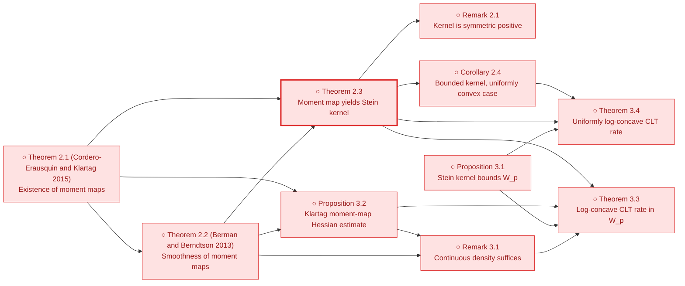

| Item | Statement | Status | Lean declarations | Note |
| --- | --- | --- | --- | --- |
| Theorem 2.1 (Cordero-Erausquin and Klartag 2015) | If mu is a centered measure on R^d with finite first moment, not supported on a hyperplane, then there is a convex function phi such that mu is the pushforward of the probability measure with density e^{-phi} under nabla phi; phi is called the moment map of mu. | ○ Not yet formalized | — | Quoted from Cordero-Erausquin and Klartag without proof; the probability normalisation of e^{-phi} is implicit. No Lean counterpart: the library has no moment maps or Monge-Ampere objects. |
| Theorem 2.2 (Berman and Berndtson 2013) | If mu is supported on a compact (bounded) open convex set with a smooth density rho satisfying C^{-1} <= rho <= C on its support for some C > 0, then the moment map phi of Theorem 2.1 is smooth and finite on all of R^d. | ○ Not yet formalized | — | Quoted from Berman and Berndtsson without proof (Caffarelli regularity). Equivalently phi solves the toric Kahler-Einstein equation e^{-phi} = rho(nabla phi) det(nabla^2 phi), display (3) of the PDF. No Lean counterpart. |
| **Theorem 2.3** (main) | If mu has a Lebesgue density rho and the solution phi of e^{-phi} = rho(nabla phi) det(nabla^2 phi) is C^2 and finite on all of R^d, then tau = Hess phi(nabla phi^*) = (Hess phi^*)^{-1} is a Stein kernel for mu with respect to the standard Gaussian, and S(mu)^2 <= int &#124;Hess phi - Id&#124;_HS^2 e^{-phi} dx. In particular this applies when mu is supported on a compact convex set with density bounded above and below by positive constants. | ○ Not yet formalized | — | Proof: Gaussian-type integration by parts against e^{-phi} (no boundary term since phi grows linearly, Klartag 2007 Lemma 2.1), test f = g(nabla phi), then the change of variables y = nabla phi^*(x). Main theorem: it is the construction announced first in the abstract, carries the LaTeX label main_thm_stein, and every later result (Corollary 2.4, Theorems 3.3 and 3.4, Section 4) is obtained from this kernel. No Lean counterpart: there is no Stein kernel, Stein discrepancy or moment map in the library; the scalar weighted integration by parts FunctionalInequalities.KLS.LogConcave.integral_inner_gradient_eq is a different identity (scalar Dirichlet form, compactly supported tests) and does not state this item. |
| Remark 2.1 | The Stein kernel of Theorem 2.3 takes values in symmetric positive definite matrices; in dimension one this explains why the explicit one-dimensional Stein kernel formula is nonnegative. | ○ Not yet formalized | — | Immediate from tau = Hess phi(nabla phi^*) with phi convex and C^2, Hess phi > 0. No Lean counterpart. |
| Corollary 2.4 | If mu = e^{-V} dx with Hess V >= epsilon Id for some epsilon > 0, then mu has a Stein kernel tau with positive symmetric values and &#124;&#124;tau&#124;&#124;_op <= epsilon^{-1} everywhere. | ○ Not yet formalized | — | Kernel of Theorem 2.3; the bound &#124;&#124;Hess phi&#124;&#124;_op <= 1/epsilon is Klartag's (2014) contraction estimate for moment maps, quoted without proof. No Lean counterpart. |
| Proposition 3.1 | If tau is a Stein kernel for a probability measure mu on R^d, then for every p >= 2, W_p(mu, gamma) <= C_p (int &#124;&#124;tau - Id&#124;&#124;_HS^p dmu)^{1/p} with C_p = (int &#124;x&#124;^p dgamma_1)^{1/p} = O(p). | ○ Not yet formalized | — | Proved in Section 3.2 via the Ornstein-Uhlenbeck interpolation of Ledoux-Nourdin-Peccati (Proposition 3.4 there), Jensen, and the moment bound E&#124;&#124;AZ&#124;&#124;^p <= C_p^p &#124;&#124;A&#124;&#124;_HS^p for symmetric A (Marcinkiewicz-Zygmund with sharp constant). The printed definition of W_p omits the 1/p power; the intended distance is (inf_pi int &#124;&#124;x-y&#124;&#124;^p dpi)^{1/p}. No Lean counterpart (no Wasserstein distances in the library). |
| Proposition 3.2 | If mu is a log-concave probability measure supported on an open bounded convex set with density bounded above and below, then its essentially continuous moment map phi is C^2 and, for all p >= 1 and theta in S^{d-1}, int &#124;<Hess phi(nabla phi^*) theta, theta>&#124;^p dmu <= 8^p p^{2p} (int (x . theta)^2 dmu)^p. | ○ Not yet formalized | — | Due to Klartag (2014); Section 3.1 reproves it via Kolesnikov's curvature bound Ric >= 1/2 for (R^d, Hess phi, e^{-phi}) under the regularity of Theorem 2.2, the eigenfunction identities L partial_e phi = -partial_e phi and Gamma(partial_e phi) = partial_ee phi, the reverse local Poincare bound Gamma(P_t f) <= P_t(f^2)/(2(e^t-1)) (BGL Theorem 4.7.2) at t = ln 2, and log-Sobolev hypercontractivity of eigenfunctions (BGL Section 5.3). No Lean counterpart: the library's Bakry-Emery files work with the Euclidean metric and a fixed potential, not the Hessian metric of a moment map. |
| Remark 3.1 | Klartag's results assume C^infinity smoothness via Berman-Berndtsson; since only C^2 smoothness of phi is needed, continuity of the density suffices. | ○ Not yet formalized | — | Regularity relaxation asserted without proof; it underlies the continuous-density hypotheses of Theorems 3.3 and 3.4. No Lean counterpart. |
| Theorem 3.3 | Let mu be an isotropic log-concave probability measure on R^d with strictly positive continuous density on its support, and mu_n the law of n^{-1/2}(X_1 + ... + X_n) for i.i.d. X_i ~ mu. Then for every p >= 2, W_p(mu_n, gamma) <= C~(p) d n^{-1/2}, with C~(p) depending only on p and growing like p^4. | ○ Not yet formalized | — | Proof for compact support and density bounded below: the kernel of Theorem 2.3, its conditional averaging as a Stein kernel for mu_n (Courtade-Fathi-Pananjady Theorem 3.2), Jensen and Rosenthal (K_p = O(p)), Proposition 3.2 with isotropy (int (x.theta)^2 dmu = 1), then Proposition 3.1; explicit constant 2 K_p (1 + 8^p p^{2p})^{1/p} C_p; the general case by convex compact truncation. No Lean counterpart; FunctionalInequalities.KLS.LogConcave is only the log-concavity predicate, does not restrict this rate statement, and is not mapped. |
| Theorem 3.4 | Let mu = e^{-V} be isotropic with strictly positive continuous density on its support and Hess V >= epsilon Id for some epsilon > 0; with mu_n as in Theorem 3.3, for every p >= 2, W_p(mu_n, gamma) <= C(p) sqrt(d) / (epsilon n^{1/2}), with C(p) growing like p^4. | ○ Not yet formalized | — | Proof omitted in the paper: same argument as Theorem 3.3 with the operator-norm bound of Corollary 2.4 replacing Proposition 3.2. The sqrt(d) dependence is sharp (product measures). No Lean counterpart. |

Not listed: Remark 2.2 is omitted as purely expository (it compares this kernel with the Courtade-Fathi-Pananjady construction and notes their earlier existence result under a Poincare inequality); the unnumbered Section 4 derivation of the weighted Poincare inequality Var_nu(f) <= int <tau nabla f, nabla f> dnu from Brascamp-Lieb and the unnumbered Section 5 transport of Stein kernels to non-Gaussian reference measures are not listed, as no Lean declaration states them; the paper has no numbered Definitions, Lemmas, Examples, Conjectures or appendix statements.

### Chen2021 lemma map

Source: [Chen, arXiv:2011.13661v2](https://arxiv.org/abs/2011.13661v2), reviewed 2026-10-03.

Standing assumptions: Log-concave probability densities p on R^d (absolutely continuous, hence full-dimensional). ψ(p) is the Cheeger isoperimetric coefficient of (2), a lower-bound quantity (larger is better), with p⁺ the lower outer Minkowski content over closed ε-neighbourhoods; ρ(p) = ‖Cov_p‖_op; log is natural; KLS reads ψ(p) ≥ c/√ρ(p). ψ_d of (7) is the infimum of ψ(p)√ρ(p) over compactly supported log-concave densities on R^d. The repository's Isoperimetry.constant is ψ on the affine support and Isoperimetry.inverseScale is Ψ = 1/ψ, so Chen's lower bounds on ψ are upper bounds on Ψ. The localization statements (Lemmas 3–8) assume compact support and invertible covariance A, with d ≥ 3 where stated; q = ⌈1/β⌉ + 1 ≥ 3 for 0 < β ≤ 1/2; c denotes unspecified universal constants.

```mermaid
flowchart LR
    Chen2021_CJ1["○ Conjecture 1 (Kannan–Lovász–Simonovits)<br/>KLS conjecture"]
    Chen2021_D2["◐ Equation (2)<br/>Isoperimetric coefficient ψ(p)"]
    Chen2021_T1["○ Theorem 1<br/>Almost constant KLS lower bound"]
    Chen2021_C1["○ Theorem 1, unnumbered corollary<br/>Subpolynomial form d^{-o(1)}"]
    Chen2021_L1["○ Lemma 1<br/>Main bound for compact support"]
    Chen2021_L2["○ Lemma 2<br/>One bootstrap step"]
    Chen2021_L3["○ Lemma 3<br/>Localization SDE well-posed"]
    Chen2021_L4["○ Lemma 4 (Lee–Vempala, Lemma 29)<br/>Half-mass set stays balanced"]
    Chen2021_L5["○ Lemma 5<br/>Spectral norm control"]
    Chen2021_L6["○ Lemma 6<br/>Potential drift and diffusion bounds"]
    Chen2021_L7["○ Lemma 7<br/>Potential stays small up to T₁"]
    Chen2021_L8["○ Lemma 8<br/>Polynomial growth of E Γ^{1/q}"]
    Chen2021_L9["○ Lemma 9<br/>Vector third-moment bound"]
    Chen2021_L10["○ Lemma 10<br/>Tensor bound from the hypothesis"]
    Chen2021_L11["○ Lemma 11<br/>Tensor bound under a Gaussian factor"]
    Chen2021_L12["○ Lemma 12 (Lee–Vempala, arXiv v2 Lemma 43)<br/>Tensor exponent swap"]
    Chen2021_L13a["○ Lemma 13, part 1 (Lee–Vempala, arXiv v2 Lemma 41; Eldan Lemma 6)<br/>Δ-trace bound for projections"]
    Chen2021_L13b["○ Lemma 13, part 2<br/>Δ-trace bound for PSD weights"]
    Chen2021_CH["◐ Proof of Lemma 13, step (ii) (Maz'ya; Cheeger; Milman Theorem 1.1)<br/>Cheeger's inequality"]
    Chen2021_L1 --> Chen2021_T1
    Chen2021_T1 --> Chen2021_C1
    Chen2021_L2 --> Chen2021_L1
    Chen2021_L3 --> Chen2021_L2
    Chen2021_L4 --> Chen2021_L2
    Chen2021_L5 --> Chen2021_L2
    Chen2021_L3 --> Chen2021_L4
    Chen2021_L7 --> Chen2021_L5
    Chen2021_L8 --> Chen2021_L5
    Chen2021_L9 --> Chen2021_L6
    Chen2021_L10 --> Chen2021_L6
    Chen2021_L11 --> Chen2021_L6
    Chen2021_L12 --> Chen2021_L6
    Chen2021_L6 --> Chen2021_L7
    Chen2021_L6 --> Chen2021_L8
    Chen2021_L12 --> Chen2021_L10
    Chen2021_L13b --> Chen2021_L10
    Chen2021_L12 --> Chen2021_L11
    Chen2021_CH --> Chen2021_L13a
    Chen2021_L13a --> Chen2021_L13b
    classDef lemma_partial fill:#fff3df,stroke:#c88719,color:#66420d;
    class Chen2021_D2,Chen2021_CH lemma_partial;
    classDef lemma_pending fill:#fee2e2,stroke:#dc2626,color:#991b1b;
    class Chen2021_CJ1,Chen2021_T1,Chen2021_C1,Chen2021_L1,Chen2021_L2,Chen2021_L3,Chen2021_L4,Chen2021_L5,Chen2021_L6,Chen2021_L7,Chen2021_L8,Chen2021_L9,Chen2021_L10,Chen2021_L11,Chen2021_L12,Chen2021_L13a,Chen2021_L13b lemma_pending;
    style Chen2021_T1 stroke-width:3px
```

| Item | Statement | Status | Lean declarations | Note |
| --- | --- | --- | --- | --- |
| Conjecture 1 (Kannan–Lovász–Simonovits) | There is a universal constant c > 0 such that every log-concave density p on R^d satisfies ψ(p) ≥ c/√ρ(p), where ρ(p) = ‖Cov_p‖_op is the spectral norm of the covariance and ψ is the coefficient of (2). | ○ Not yet formalized | — | Quoted and open. The repository names a covariance-normalized Poincaré form (KLS.Conjecture, C_P ≤ C‖Cov‖_op); it is equivalent to this form through the proved comparisons C_P ≤ 4Ψ² and Ψ² ≤ π C_P, but no Lean declaration states Conjecture 1 itself and none is mapped. |
| Equation (2) | For a density p on R^d, ψ(p) = inf over S ⊂ R^d of p⁺(∂S)/min(p(S), p(S^c)), where p⁺(∂S) = liminf as ε → 0⁺ of (p({x : d(x, S) ≤ ε}) − p(S))/ε. | ◐ Partial or statement only | [`constant`](../../formalization/FunctionalInequalities/KLS/Isoperimetry.lean) | Lean takes measurable sets of mass in (0, 1), open thickenings and the induced metric on the affine support of an arbitrary finite-dimensional law, with value ⊤ in dimension zero; Isoperimetry.inverseScale is Ψ = 1/ψ. Agreement with the closed-neighbourhood, all-subsets convention of (2) is not stated in Lean. |
| **Theorem 1** (main) | There is a universal constant c such that for every log-concave density p on R^d and every integer ℓ ≥ 1, ψ(p) ≥ 1/([c·ℓ(log(d) + 1)]^{ℓ/2} d^{16/ℓ} √ρ(p)), where ρ(p) = ‖Cov_p‖_op. | ○ Not yet formalized | — | Main theorem; the d^{-o(1)} form is its unnumbered corollary C1. Proof: truncate p to a ball B about its mean with p(B^c) ≤ 0.2, so ψ(p) ≥ ψ(ϱ)/2 for the compactly supported truncation ϱ (via P0), then apply Lemma 1; the needed ρ(ϱ) ≤ ρ(p)/p(B) ≤ 1.25 ρ(p) is used tacitly. In repository notation Ψ ≤ [cℓ(log d + 1)]^{ℓ/2} d^{16/ℓ}√ρ, and Cheeger's C_P ≤ 4Ψ² converts it to a Poincaré bound. No Lean statement. |
| Theorem 1, unnumbered corollary | Taking ℓ = ⌈(log(d)/log log(d))^{1/2}⌉ in Theorem 1 gives a constant c' with ψ(p) ≥ d^{−c'(log log(d)/log(d))^{1/2}}/√ρ(p), i.e. ψ(p)√ρ(p) ≥ exp(−c'√(log d · log log d)) = d^{−o(1)}, for d large enough that log log d > 0. | ○ Not yet formalized | — | The register's ψₙ ≤ exp(C√(log n log log n)) = n^{o(1)} is this bound in the inverse-scale convention. |
| Lemma 1 | There is a universal constant c such that every log-concave density p on R^d with compact support and every integer ℓ ≥ 1 satisfy ψ(p) ≥ 1/([c·ℓ(log(d) + 1)]^{ℓ/2} d^{16/ℓ} √ρ(p)). | ○ Not yet formalized | — | Induction on ℓ: assuming ψ_k ≥ 1/(α_ℓ(log d + 1)^{ℓ/2} k^{β_ℓ}) for k ≤ d, Lemma 2 with α = α_ℓ(log d + 1)^{ℓ/2} and q ≤ 2/β_ℓ yields the step ℓ + 1; the bounds (24) give the stated form. |
| Lemma 2 | If ψ_k ≥ 1/(αk^β) for all k ≤ d, with 0 ≤ β ≤ 1/2 and α ≥ 1, then for q = ⌈1/β⌉ + 1 there is a universal constant c with ψ_d ≥ 1/(c·q^{1/2} α log(d)^{1/2} d^{β − β/(8q)}). | ○ Not yet formalized | — | q requires β > 0 (Lemma 5 assumes 0 < β). For d ≥ 3: for p(E) = 1/2, p(∂E) ≥ E p_{T₂}(∂E) ≥ (1/8)T₂^{1/2}‖A‖^{−1/2} min(p(E), p(E^c)) using GI, Lemmas 4–5 and B_t = tA^{−1} (the martingale identity for the boundary measure needs Fatou, giving the correct inequality direction). As printed, the right side is undefined at d = 1 (log 1 = 0); the d = 1, 2 cases from (3) hold with log(d) read as log(d) + 1, which is how Lemma 1 uses it. |
| Lemma 3 | If p is a density on R^d with compact support and invertible covariance A, the SDE dc_t = A^{−1/2}dW_t + A^{−1}μ_t dt, dB_t = A^{−1}dt, c₀ = 0, B₀ = 0, with p_t(x) ∝ exp(c_tᵀx − xᵀB_t x/2)p(x) and μ_t its mean, has a unique solution on [0, T] for every T > 0, and for each x, p_t(x) is a martingale with dp_t(x) = (x − μ_t)ᵀA^{−1/2}dW_t p_t(x). | ○ Not yet formalized | — | Log-concavity is not assumed. Proved in Appendix A: Lipschitz coefficients from compact support, then Itô's formula for G_t(x) = exp(c_tᵀx − xᵀB_tx/2)p(x), V_t = ∫G_t and V_t^{−1}. |
| Lemma 4 (Lee–Vempala, Lemma 29) | Under the assumptions of Lemma 3, for every measurable E with p(E) = 1/2 and every t > 0, P(1/4 ≤ p_t(E) ≤ 3/4) ≥ 9/10 − P(∫₀ᵗ ‖A^{−1/2}A_sA^{−1/2}‖_op ds ≥ 1/64). | ○ Not yet formalized | — | The integrand is printed with A_t; read A_s. Proof: d[g]_t ≤ ‖Q_t‖_op dt for g_t = p_t(E) by Cauchy–Schwarz, then Dambis–Dubins–Schwarz, the reflection principle and P(N > 2) < 0.023. |
| Lemma 5 | Under the assumptions of Lemma 3, if ψ_k ≥ 1/(αk^β) for all k ≤ d with 0 < β ≤ 1/2 and α ≥ 1, then for q = ⌈1/β⌉ + 1, d ≥ 3 and T₂ = 1/(c·qα²log(d)d^{2β−β/(4q)}) with c universal, P(∫₀^{T₂} ‖A^{−1/2}A_tA^{−1/2}‖_op dt ≥ 1/64) < 4/10. | ○ Not yet formalized | — | The proof takes T₁ = 1/(32768qα²log(d)d^{2β}) and T₂ = d^{β/(4q)}T₁/40, i.e. c = 1310720: probability ≤ 3/10 on [0, T₁] by Lemma 7 and ≤ 1/10 on [T₁, T₂] by (18), Lemma 8 and Markov. Log-concavity of p, not part of Lemma 3, is needed through Lemma 6. |
| Lemma 6 | Under the assumptions of Lemma 5, dΓ_t = v_tᵀdW_t + δ_t dt with ‖v_t‖₂ ≤ 16qΓ_t^{1+1/(2q)} and δ_t ≤ min{64q²α²log(d)d^{2β−1/q}Γ_t^{1+1/q}, 2q²Γ_t/t}. | ○ Not yet formalized | — | The 1/t bound is new relative to Lee–Vempala: ϱ_t, the law of A^{−1/2}(X − μ_t), is log-concave (linear images of log-concave laws) and more log-concave than N(0, I_d/t). |
| Lemma 7 | Under the assumptions of Lemma 6, with h(a) = −(a + 1)^{−1/q} and T₁ = 1/(32768qα²log(d)d^{2β}), P(max_{t∈[0,T₁]} h(Γ_t) ≥ −(d + 1)^{−1/q}/2) ≤ exp(−(2/3)q log(d)) ≤ 3/10. | ○ Not yet formalized | — | Γ₀ = d. Itô's formula for the concave h drops the correction; the proof gives exp(−(2/3)qα²log(d)d^{2β−2/q}), which implies the printed bound since βq ≥ 1 and α ≥ 1; d ≥ 3 and q ≥ 2 give ≤ 3/10. |
| Lemma 8 | Under the assumptions of Lemma 6, with f(a) = a^{1/q}, E f(Γ_{t₂}) ≤ E f(Γ_{t₁})(t₂/t₁)^{2q} for all t₂ > t₁ > 0. | ○ Not yet formalized | — | Itô's formula for the concave f, the bound δ_t ≤ 2q²Γ_t/t and the asserted martingale property of ∫Γ_t^{1/q−1}v_tᵀdW_t give d E f(Γ_t) ≤ (2q/t)E f(Γ_t)dt, integrated by Grönwall. |
| Lemma 9 | If p is log-concave with mean μ and covariance A, then for all positive semi-definite B, C, ‖∫B^{1/2}(x − μ)(x − μ)ᵀC(x − μ)p(x)dx‖₂ ≤ 16‖A^{1/2}BA^{1/2}‖_op^{1/2} Tr(A^{1/2}CA^{1/2}). | ○ Not yet formalized | — | Eigen-decomposition of C, Cauchy–Schwarz and (29) with a = 4, b = 2. |
| Lemma 10 | If ψ_k ≥ 1/(αk^β) for all k ≤ d with 0 ≤ β ≤ 1/2 and α ≥ 1, and p is log-concave on R^d with invertible covariance A, then for q ≥ 1/(2β), T_p(A^{q−2}, I_d, I_d) ≤ 128α²log(d)d^{2β−1/q}Tr(A^q)^{1+1/q}. | ○ Not yet formalized | — | Standardize to the isotropic law ϱ, swap exponents by Lemma 12, expand A^q in eigenvectors and apply Lemma 13(2), then Hölder (called Cauchy–Schwarz). Effectively β > 0. Lemma 13 is applied to ϱ, which has compact support in the application. |
| Lemma 11 | If τ > 0 and p is log-concave, more log-concave than N(0, τ^{−1}I_d), with invertible covariance A, then for q ≥ 3, T_p(A^{q−2}, I_d, I_d) ≤ (4/τ)Tr(A^q). | ○ Not yet formalized | — | Eigen-decomposition of A, Brascamp–Lieb for the quadratics xᵀΔ_ix, Cauchy–Schwarz, Lemma 12 to raise A^{q−3}, then rearrangement. |
| Lemma 12 (Lee–Vempala, arXiv v2 Lemma 43) | If p is log-concave on R^d, δ ∈ [0, 1] and A, B, C are positive semi-definite, then T_p(B^{1/2}A^δB^{1/2}, B^{1/2}A^{1−δ}B^{1/2}, C) ≤ T_p(B^{1/2}AB^{1/2}, B, C). | ○ Not yet formalized | — | The proof does not use log-concavity, only finite third moments: both sides are sums of traces Tr(A^δΔ_iA^{1−δ}Δ_i) and Tr(AΔ_iΔ_i). |
| Lemma 13, part 1 (Lee–Vempala, arXiv v2 Lemma 41; Eldan Lemma 6) | If p is an isotropic log-concave density on R^d, v a unit vector and Δ = E(Xᵀv)XXᵀ, then Tr(ΔPΔ) ≤ 16ψ_{min(2r,d)}^{−2} for every orthogonal projection P of rank r. | ○ Not yet formalized | — | Cauchy–Schwarz and Cheeger's inequality for the quadratic xᵀΔPx, which depends on a projection of rank ≤ min(2r, d). The ψ_k hypothesis of the lemma is not needed for this part; ψ_k is defined over compactly supported densities, which holds in the application. |
| Lemma 13, part 2 | If ψ_k ≥ 1/(αk^β) for all k ≤ d with 0 < β ≤ 1/2 and α ≥ 1, then with p, v, Δ as in part 1, Tr(ΔAΔ) ≤ 128α²log(d)(Tr A^{1/(2β)})^{2β} for every positive semi-definite A. | ○ Not yet formalized | — | Groups the eigenvalues of A into J = ⌈log d⌉ exponential blocks plus a small remainder, applies part 1 and the hypothesis to each block, then Hölder. |
| Proof of Lemma 13, step (ii) (Maz'ya; Cheeger; Milman Theorem 1.1) | For a probability density with isoperimetric coefficient ψ, Var(g) ≤ 4ψ^{−2}E‖∇g‖² for locally Lipschitz g; equivalently the Poincaré constant satisfies C_P ≤ 4/ψ². | ◐ Partial or statement only | [`literatureConstant_le_four_mul_inverseScale_sq`](../../formalization/FunctionalInequalities/KLS/Geometry/Cheeger/Inequality.lean)<br/>[`minkowskiConstant_sq_mul_evariance_le`](../../formalization/FunctionalInequalities/KLS/Geometry/Cheeger/Inequality.lean) | Lean proves C_P ≤ 4Ψ² (Ψ = 1/ψ) for finite-dimensional log-concave laws, and h² Var(g) ≤ 4∫‖∇g‖² for bounded C¹ Lipschitz g under every probability law with the Minkowski constant h. Chen applies it to an unbounded quadratic on a marginal; that instance is not separately stated in Lean. |

Not listed: Figure 1 (proof diagram), the expository introduction (consequences for slicing, thin-shell, concentration and MCMC, and the cited bounds of Bourgain, Klartag, Eldan–Klartag and Eldan), the remark after Lemma 6 and the Notation paragraph are not items. Displays (1), (5)–(6), (8)–(14), (17), (19)–(22), (24), (27)–(28), (30)–(33) and (35) are definitions or proof steps recorded with the statements they define or prove. Appendix A contains only the proofs of Lemma 3 and (15)–(16); the paper has no numbered Definition, Proposition, Corollary or Remark environments, and a lemma commented out in the LaTeX source is not printed. Unnumbered displayed claims and cited tools are listed only where a local Lean declaration states them; 14 others (equations, cited SDE, Itô and Brascamp–Lieb tools) are not listed.

### DePontiMondino2021 lemma map

Source: [De Ponti–Mondino, arXiv:1902.03835v2](https://arxiv.org/abs/1902.03835v2), reviewed 2026-10-02.

Standing assumptions: RCD(K, ∞) metric measure spaces; h(X) is the min-denominator Cheeger constant and λ₁ = 1/C_P the spectral gap (λ₀ the bottom of the spectrum when m(X) = ∞). Finite-dimensional log-concave laws on Euclidean spaces are RCD(0, ∞) with m(X) = 1. Unnumbered proof steps (46) and (48) are listed because local Lean results state them.

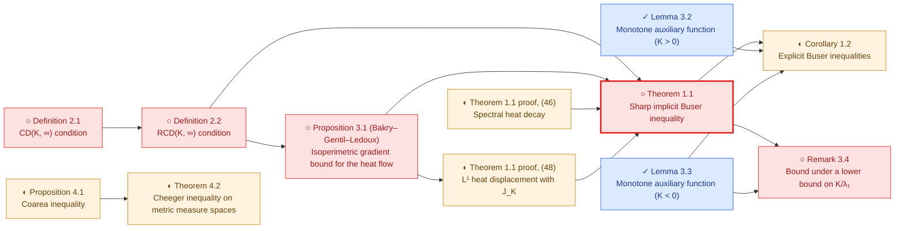

| Item | Statement | Status | Lean declarations | Note |
| --- | --- | --- | --- | --- |
| **Theorem 1.1** (main) | On RCD(K, ∞) spaces with m(X) = 1, h(X) ≥ sup over t > 0 of (1 − e^(−λ₁t))/J_K(t), sharp for the Gaussian when K > 0; with m(X) = ∞, h(X) ≥ 2 sup (1 − e^(−λ₀t))/J_K(t). Here J₀(t) = 2√t/√π. | ○ Not yet formalized | — | No implicit (supremum over t) form is stated locally; only the explicit π bound of Corollary 1.2 is proved, in the Euclidean log-concave case. |
| Corollary 1.2 | For K > 0 and K/λ₁ ≥ c: λ₁ ≤ (π/2c)h²; for K = 0 and m(X) = 1: λ₁ ≤ (4/π)h² inf_T T/(1 − e^(−T))² < πh²; explicit bounds for K < 0 and for infinite measure. | ◐ Partial or statement only | [`inverseScale_sq_le_pi_literature`](../../formalization/FunctionalInequalities/KLS/LogConcave/Density/GaussianSmoothing/Buser.lean) | The K = 0, m(X) = 1 case in its weaker displayed form λ₁ ≤ πh², i.e. Ψ² ≤ π C_P, for every finite-dimensional log-concave law; the sharper constant (4/π) inf_T T/(1 − e^(−T))², the K ≠ 0 cases and infinite measure are not formalized. |
| Definition 2.1 | Entropy is K-convex along some W₂-geodesic between any two measures of finite entropy. | ○ Not yet formalized | — |  |
| Definition 2.2 | CD(K, ∞) together with a quadratic Cheeger energy. | ○ Not yet formalized | — |  |
| Proposition 3.1 (Bakry–Gentil–Ledoux) | For f with values in [0, 1]: &#124;D(H_t f)&#124;² ≤ j_K(t)([I(H_t f)]² − [H_t(I(f))]²) with I the Gaussian isoperimetric profile; hence ‖&#124;D H_t f&#124;‖_∞ ≤ √(2/π)√(j_K(t))‖f‖_∞, with j₀(t) = 1/(2t). | ○ Not yet formalized | — | Not stated locally. The local reverse Poincaré inequality gives &#124;∇P_t f&#124; ≤ ‖f‖_∞/√(2t), a weaker constant for the L^∞ gradient bound. |
| Theorem 1.1 proof, (46) | For mean-zero f ∈ L²: ‖H_t f‖₂ ≤ e^(−λ₁t)‖f‖₂. | ◐ Partial or statement only | [`norm_center_operator_sq_le_exp_of_literature_le`](../../formalization/FunctionalInequalities/KLS/LogConcave/HeatSemigroup/Decay.lean) | Squared form with C = 1/λ₁ for the weighted-gradient heat semigroup of a smooth convex tilted law. |
| Theorem 1.1 proof, (48) | ‖f − H_t f‖₁ ≤ J_K(t)‖&#124;Df&#124;‖₁ for bounded Lipschitz f. | ◐ Partial or statement only | [`integral_abs_indicator_sub_operator_le_pi`](../../formalization/FunctionalInequalities/KLS/LogConcave/HeatSemigroup/Perimeter.lean) | K = 0 coefficient J₀(t) = 2√(t/π), for indicator data of smooth domains with relative perimeter under a smooth convex potential. |
| Lemma 3.2 | f₁(x) = √x / arctan(√(e^(Tx) − 1)) is increasing on (0, ∞) with f₁ ≥ 1/√T. | ✓ Formalized in Lean | [`strictMonoOn_buserRatioPos`](../../formalization/FunctionalInequalities/KLS/Geometry/Cheeger/BuserProfile.lean)<br/>[`one_div_sqrt_le_buserRatioPos`](../../formalization/FunctionalInequalities/KLS/Geometry/Cheeger/BuserProfile.lean) | Both claims, with f₁ = buserRatioPos T; monotonicity is stated strictly, which implies the paper's "increasing". |
| Lemma 3.3 | f₂(x) = √x / log(e^(Tx) + √(e^(2Tx) − 1)) is decreasing on (0, ∞). | ✓ Formalized in Lean | [`strictAntiOn_buserRatioNeg`](../../formalization/FunctionalInequalities/KLS/Geometry/Cheeger/BuserProfile.lean) | With f₂ = buserRatioNeg T; stated strictly, which implies the paper's "decreasing". The logarithm is identified with arcosh(e^{Tx}). |
| Remark 3.4 | If K/λ₁ ≥ −c, an explicit lower bound for h(X) in terms of √λ₁ and c follows from Theorem 1.1 and Lemma 3.3. | ○ Not yet formalized | — |  |
| Proposition 4.1 | On a complete metric space with a measure finite on bounded sets, for bounded Lipschitz u ≥ 0 with M = sup u: ∫₀^M Per({u > t})dt ≤ ∫&#124;∇u&#124;dm, and almost every {u > t} has finite perimeter. | ◐ Partial or statement only | [`lintegral_perimeter_superlevel_le_localSlope`](../../formalization/FunctionalInequalities/KLS/Geometry/Perimeter/MetricBVMinkowski.lean) | Finite measures and closed superlevel sets {u ≥ t}, for every globally Lipschitz u; the local-finiteness case is not stated in this form. |
| Theorem 4.2 | On a complete metric space with a measure finite on bounded sets: λ₁ ≥ h²/4 if m(X) < ∞, and λ₀ ≥ h²/4 if m(X) = ∞. | ◐ Partial or statement only | [`literatureConstant_le_four_mul_inverseScale_sq`](../../formalization/FunctionalInequalities/KLS/Geometry/Cheeger/Inequality.lean) | Finite-dimensional log-concave probability laws only, as C_P ≤ 4Ψ². |

Not listed: Remark 1.3 (discreteness of the spectrum) is expository.

### KlartagLehec2022 lemma map

Source: [Klartag–Lehec, arXiv:2203.15551v2](https://arxiv.org/abs/2203.15551v2), reviewed 2026-10-03.

Standing assumptions: Log-concave probability measures on R^n, n ≥ 2 and n larger than a universal constant WLOG; c, C, C₁, C_q etc. are universal constants (C_q, C_p depending only on q, p) changing from line to line; log is natural. ψ_μ is the inverse Cheeger constant (the display before (7)), ψ_n = sup ψ_μ over isotropic log-concave μ on R^n (8) (G_n in Eldan, ψ_n^{-1} in Chen), C_P(μ) the Poincaré constant (5), σ_μ the thin-shell constant n σ_μ² = Var_μ(|x|²) (4), σ_n = sup σ_μ, κ_n² = sup_X sup_θ ‖E⟨X, θ⟩ X ⊗ X‖_HS² over isotropic log-concave X (23). From Section 2 on, μ is isotropic log-concave with smooth positive density ρ; μ_s = μ ∗ γ_s, P_s f = f ∗ γ_s, Q_s φ = P_s(φρ)/P_s ρ; L = Δ + ∇log ρ · ∇ (closure in L²(μ)) with spectral resolution −L = ∫λ dE_λ and spectral measures ν_f. Stochastic localization in the Lee–Vempala form: tilt process (18) dθ_t = dW_t + a(t, θ_t) dt, p_t ∝ e^{⟨θ_t, x⟩ − t|x|²/2} ρ, dp_t = p_t⟨x − a_t, dW_t⟩ (19), barycenter a_t, covariance A_t, time reversal t = 1/s; ‖A‖_q = Tr[A^q]^{1/q}, ‖·‖_op the operator norm. The repository's Isoperimetry.inverseScale plays the role of ψ_μ.

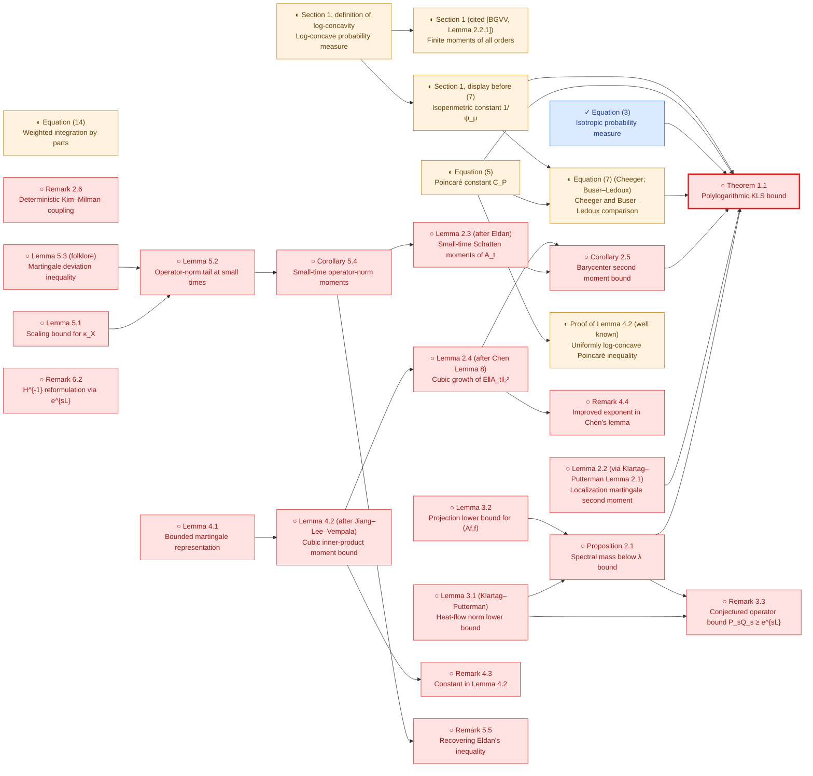

| Item | Statement | Status | Lean declarations | Note |
| --- | --- | --- | --- | --- |
| Section 1, definition of log-concavity | A probability density ρ on R^n is log-concave if {ρ > 0} is convex and log ρ is concave on it; a probability measure on R^n is log-concave if it is supported in an affine subspace and has a log-concave density there. | ◐ Partial or statement only | [`LogConcave`](../../formalization/FunctionalInequalities/KLS/Definitions.lean)<br/>[`exists_isBorellDensity`](../../formalization/FunctionalInequalities/KLS/LogConcave/Density/BorellRepresentation/Intrinsic.lean) | Lean defines log-concavity by Borell's compact-set inequality μ(tK₀+(1−t)K₁) ≥ μ(K₀)^t μ(K₁)^(1−t) on any finite-dimensional real normed space; exists_isBorellDensity proves only the direction from this to a log-concave density of the intrinsic law on the affine support. The converse (density ⇒ Borell inequality, Prékopa–Leindler) is not stated in Lean. |
| Section 1 (cited [BGVV, Lemma 2.2.1]) | Every log-concave probability measure on R^n has finite moments of all orders. | ◐ Partial or statement only | [`intrinsic_integrable_norm_pow`](../../formalization/FunctionalInequalities/KLS/LogConcave/Density/BorellRepresentation/Intrinsic.lean)<br/>[`memLp_id_two`](../../formalization/FunctionalInequalities/KLS/LogConcave/Translation.lean) | Lean proves integrability of ‖v‖^p for every natural p for the intrinsic law on the affine-support direction (via an exponential moment), and the ambient second moment MemLp id 2 only; an ambient all-orders statement is not stated. |
| Equation (3) | A probability measure μ on R^n with finite second moments is isotropic if ∫x_i dμ = 0 and ∫x_i x_j dμ = δ_ij for i, j = 1, …, n, i.e. it is centered with identity covariance. | ✓ Formalized in Lean | [`Isotropic`](../../formalization/FunctionalInequalities/KLS/Isotropic.lean) | Lean states the three conditions (MemLp id 2, zero mean, centered covariance operator equal to the identity) coordinate-free on any finite-dimensional real inner-product space; in orthonormal coordinates this is (3). |
| Equation (5) | For a Borel probability measure μ on R^n, C_P(μ) is the smallest C ≥ 0 such that Var_μ(f) ≤ C ∫&#124;∇f&#124;² dμ for every locally Lipschitz f ∈ L²(μ). | ◐ Partial or statement only | [`constant`](../../formalization/FunctionalInequalities/Poincare/LocalSlope/Basic.lean) | Lean takes the infimum (in [0, ∞]) of finite constants valid for all finite-energy L² tests, with &#124;∇f&#124; replaced by the pointwise local slope, computed for the intrinsic law on the affine support; for locally Lipschitz tests the slope equals &#124;∇f&#124; almost everywhere, but agreement with the ambient definition (5) for singular laws is not stated. |
| Section 1, display before (7) | For μ with log-concave density ρ on R^n, 1/ψ_μ = inf over open A ⊆ R^n with smooth boundary and 0 < μ(A) < 1 of ∫_{∂A} ρ / min{μ(A), 1 − μ(A)}; ψ_μ is the inverse Cheeger constant (larger is worse). | ◐ Partial or statement only | [`constant`](../../formalization/FunctionalInequalities/KLS/Isoperimetry.lean) | Lean's constant is the infimum over measurable sets of mass in (0, 1) of the outer Minkowski boundary content (open thickenings, induced metric on the affine support) over min{μ(B), 1 − μ(B)}, with value ⊤ in dimension zero; Isoperimetry.inverseScale = constant⁻¹ plays the role of ψ_μ. Agreement with the smooth-boundary surface-integral convention is not stated in Lean. |
| Equation (7) (Cheeger; Buser–Ledoux) | For every absolutely continuous log-concave probability measure μ on R^n, 1/4 ≤ ψ_μ²/C_P(μ) ≤ 9; the left inequality (Cheeger) does not need log-concavity. | ◐ Partial or statement only | [`literatureConstant_le_four_mul_inverseScale_sq`](../../formalization/FunctionalInequalities/KLS/Geometry/Cheeger/Inequality.lean)<br/>[`inverseScale_sq_le_pi_literature`](../../formalization/FunctionalInequalities/KLS/LogConcave/Density/GaussianSmoothing/Buser.lean) | Lean proves C_P ≤ 4Ψ² and Ψ² ≤ π C_P (Ψ = Isoperimetry.inverseScale) for every finite-dimensional log-concave law, including singular and Dirac laws, in the Lean conventions of D5 and DPSI; the Buser constant π is sharper than 9. Cheeger without log-concavity is not stated in this form. |
| **Theorem 1.1** (main) | For every n ≥ 2, ψ_n ≤ C (log n)^α, where ψ_n = sup ψ_μ over isotropic log-concave probability measures μ on R^n (equation (8)) and C, α > 0 are universal constants; the proof gives α = 5. | ○ Not yet formalized | — | Main theorem. The proof shows σ_n ≤ C(log n)^4 (unnumbered), then applies Eldan's inequality (10)/(24), which is cited (its hard half is re-derived in Remark 5.5 only modulo a cited implication), and the H^{-1} inequality (44) cited from Barthe–Klartag Proposition 10; it also yields L_n ≤ C(log n)^4 in (12). Via (7) it gives C_P(μ) ≤ C(log n)^10 for isotropic log-concave μ. Reduction to a smooth positive density with σ_μ > σ_n/2 (41) is by Gaussian convolution and re-isotropization. No Lean statement. |
| Equation (14) | For μ with smooth positive density ρ and L u = Δu + ∇(log ρ)·∇u, ∫(Lu)v dμ = −∫∇u·∇v dμ for smooth u, v with one of them compactly supported. | ◐ Partial or statement only | [`integral_inner_gradient_eq`](../../formalization/FunctionalInequalities/KLS/LogConcave/HeatSemigroup/Generator.lean) | Lean: for ν = m.tilted(−U) with U ∈ C¹ (so ρ ∝ e^{−U}, L = Δ − ⟨∇U, ∇·⟩), f ∈ C² compactly supported and g ∈ C¹, ∫⟨∇f, ∇g⟩ dν = ∫(−ℒf) g dν; only the case where the operator falls on the compactly supported function is stated. |
| Proposition 2.1 | Let μ be a probability measure on R^n with smooth positive density, and f ∈ L²(μ) with ∫f dμ = 0 and ‖f‖_{L²(μ)} = 1. Then for all s, λ > 0, ⟨E_λ f, f⟩_{L²(μ)} ≤ C(‖Q_s f‖_{L²(μ_s)} + sλ) with a universal C; the proof gives C = 4. | ○ Not yet formalized | — | E_λ is the spectral resolution of −L and Q_s φ = P_s(φρ)/P_sρ. The proof actually gives the stronger squared form ⟨E_λ f, f⟩ ≤ 4(‖Q_s f‖²_{L²(μ_s)} + sλ) (note ‖Q_s f‖ ≤ 1), which is the form used in (46). Section 3 assumes μ log-concave; the printed statement omits it, while the proof relies on Lemma 3.1 and on Klartag–Putterman facts (Q_s is a contraction with Q_s 1 = 1). Stochastic localization is not used here. |
| Lemma 2.2 (via Klartag–Putterman Lemma 2.1) | For φ ∈ L¹(μ), s > 0 and t = 1/s, the process M_t = ∫φ p_t of Eldan's stochastic localization (19) started at the isotropic log-concave smooth density ρ satisfies E M_t² = ‖Q_s φ‖²_{L²(μ_s)}. | ○ Not yet formalized | — | Uses Q_sφ(y) = ∫φ p_{t,ty} and that θ_t/t has law μ_s = μ ∗ γ_s (both cited from Klartag–Putterman). Applied coordinatewise it gives (21): E&#124;a_t&#124;² = ‖Q_s x‖²_{L²(μ_s)}. |
| Lemma 2.3 (after Eldan) | There is a universal C such that for t ≤ (C κ_n² log n)^{-1} and q ≥ 1, E‖A_t‖_q^q ≤ C_q n, where A_t is the localization covariance, ‖A‖_q = Tr[A^q]^{1/q}, κ_n is given by (23), and C_q depends only on q. | ○ Not yet formalized | — | Carries two LaTeX labels (lem_eldan, lem_1135), one printed number. Proved at the end of Section 5 from Corollary 5.4 and ‖A‖_q^q ≤ n‖A‖_op^q. |
| Lemma 2.4 (after Chen Lemma 8) | For 0 ≤ t₁ ≤ t₂ the localization covariance satisfies E‖A_{t₂}‖₂² ≤ (t₂/t₁)³ E‖A_{t₁}‖₂². | ○ Not yet formalized | — | Proof: Itô's formula (37) for Tr(A_t²), the almost sure bound (38) Σ&#124;H_ij&#124;² ≤ (3/t) Tr(A_t²) from Lemma 4.2 (p_t is t-uniformly log-concave), then Grönwall. The case t₁ = 0 is vacuous as printed. |
| Corollary 2.5 | With t₁ = (C κ_n² log n)^{-1}, the localization barycenter satisfies E&#124;a_t&#124;² ≤ C₁ n t max{1, t³/t₁³} for all t > 0, with universal C, C₁. | ○ Not yet formalized | — | Integrates (22) d/dt E&#124;a_t&#124;² = E‖A_t‖₂² with a₀ = 0, using Lemma 2.3 (q = 2) on [0, t₁] and Lemma 2.4 beyond t₁. |
| Remark 2.6 | The deterministic evolution (25) dθ_t = ½(a(t, θ_t) + θ_t/t) dt (the Kim–Milman map) is an alternative coupling: for 0 < t₁ < t₂, if θ_{t₁}/t₁ has law μ_{1/t₁}, then running (18) or (25) on [t₁, t₂] gives θ_{t₂}/t₂ with law μ_{1/t₂}. | ○ Not yet formalized | — | Also speculates that all stochastic processes could be replaced by heat-semigroup differentiation and integration by parts. The coupling claim is cited from Klartag–Putterman. |
| Lemma 3.1 (Klartag–Putterman) | Let μ be log-concave with smooth positive density and g ∈ H¹(μ) with ∫g² dμ = 1 and E = ∫&#124;∇g&#124;² dμ. Then ‖Q_s g‖²_{L²(μ_s)} ≥ exp(−sE) for all s > 0. | ○ Not yet formalized | — | Proof: log-convexity of s ↦ ‖Q_s g‖² (its −log has non-increasing derivative R_g(s), with R_g(0) = E), cited from Klartag–Putterman Section 2 and Lemma 2.5, plus density of C_c^∞ in H¹(μ) (Barthe–Klartag appendix). |
| Lemma 3.2 | Let A be a self-adjoint positive semi-definite operator on L²(μ) with ‖A‖ ≤ 1, f ∈ L²(μ) with ‖f‖ = 1, ε, β ∈ (0, 1], and g ∈ L²(μ) with ⟨Ag, g⟩ ≥ (1 − ε)β and β = ‖g‖² = ⟨f, g⟩. Then ⟨Af, f⟩ ≥ β/4 − ε. | ○ Not yet formalized | — | Pure Hilbert-space spectral argument with r = 1 − 4ε/β; when ε > β/4 the conclusion is trivial, which the proof leaves implicit. |
| Remark 3.3 | Proposition 2.1 would improve if P_s Q_s ≥ e^{sL} for all s > 0 (31), for which no counterexample is known; (31) holds weakly: Tr φ(P_s Q_s) ≥ Tr φ(e^{sL}) (32) for every continuous increasing φ : [0, 1] → [0, ∞) vanishing near 0. | ○ Not yet formalized | — | The weak form (32) is sketched from Lemma 3.1 (⟨P_sQ_s f, f⟩ ≥ exp(s⟨Lf, f⟩) for unit f ∈ Dom(L)) plus unspecified spectral theory; (31) itself is an open question. |
| Lemma 4.1 | If μ is a centered 1-uniformly log-concave probability measure on R^n and (B_t) a standard Brownian motion with B₀ = 0, there is an adapted process (Q_t) of symmetric matrices with 0 ≤ Q_t ≤ Id for all t ∈ [0, 1] almost surely and ∫₀¹ Q_t dB_t of law μ. | ○ Not yet formalized | — | t-uniformly log-concave means density exp(−φ(x) − t&#124;x&#124;²/2) with φ convex. Proof via the Brenier map and Caffarelli's contraction theorem, heat smoothing P_{1−t}T and the Itô representation of the martingale (P_{1−t}T)(B_t); alternatively Eldan–Lehec with a time change. |
| Proof of Lemma 4.2 (well known) | A 1-uniformly log-concave random vector satisfies the Poincaré inequality with constant 1; by scaling, a t-uniformly log-concave one has C_P ≤ 1/t. | ◐ Partial or statement only | [`holds_stdGaussian`](../../formalization/FunctionalInequalities/Poincare/Gaussian/Multivariate.lean)<br/>[`holds_stdGaussian_map_smul`](../../formalization/FunctionalInequalities/Poincare/Gaussian/Multivariate.lean) | Lean covers only the Gaussian case φ = 0: the standard Gaussian has smooth-test Poincaré constant 1, and its image under x ↦ r x has constant r² (r = t^{−1/2} gives 1/t), in any finite dimension. The proof of Lemma 4.2 actually uses the sharper Cordero-Erausquin–Fradelizi–Maurey bound 1/2 for functions with centered gradient, which is not in Lean. |
| Lemma 4.2 (after Jiang–Lee–Vempala) | If t > 0, μ is a centered t-uniformly log-concave probability measure on R^n and X, Y are independent with law μ, then E⟨X, Y⟩³ ≤ (3/t) E⟨X, Y⟩² = (3/t) Tr(A²), where A is the covariance matrix of μ. | ○ Not yet formalized | — | Reduce to t = 1 by scaling; Itô's formula (34) along X_t = ∫₀ᵗ Q_s dB_s, Cauchy–Schwarz, the Cordero-Erausquin–Fradelizi–Maurey Poincaré constant 1/2 for &#124;QY&#124;², and Q_t⁴ ≤ Q_t². |
| Remark 4.3 | The constant 3 in Lemma 4.2 directly controls the exponent of the logarithm in Theorem 1.1 and is probably not optimal; in dimension one the inequality of Lemma 4.2 holds with constant 2. | ○ Not yet formalized | — | The one-dimensional constant-2 claim is stated without proof. |
| Remark 4.4 | Using the Cordero-Erausquin–Fradelizi–Maurey inequality, the exponent in Chen's Lemma 8 improves from 2q to q − 1 for q ≥ 3, and with it the case q = 3 of Chen's Lemma 8 can replace Lemma 2.4 in the proof of Theorem 1.1. | ○ Not yet formalized | — | Stated without proof. |
| Lemma 5.1 | If X is a centered log-concave random vector in R^n, then κ_X² ≤ ‖Cov(X)‖_op³ κ_n², where κ_X² = sup_{θ ∈ S^{n−1}} ‖E⟨X, θ⟩ X ⊗ X‖_HS² and κ_n² is its supremum over isotropic log-concave X in R^n. | ○ Not yet formalized | — | Proof: homogeneity of degree 6 and adding an independent symmetric Gaussian Y with covariance Id − Cov(X) to make X + Y isotropic without changing third moments; uses that convolution preserves log-concavity. |
| Lemma 5.2 | There is a universal C such that for every t ≤ (C κ_n² log n)^{-1}, the localization covariance satisfies P(‖A_t‖_op ≥ 2) ≤ exp(−(Ct)^{-1}). | ○ Not yet formalized | — | Proof: Itô's formula for Φ_t = β^{-1} log Tr e^{βA_t} with β = 2 log n, reverse Hölder for log-concave measures, a stopping time at ‖A_t‖_op = 2 and Lemma 5.3; the explicit window used is t ≤ (32 κ_n² log n)^{-1}. |
| Lemma 5.3 (folklore) | If (M_t) is a continuous martingale with M₀ = 0 and [M]_t ≤ σ² almost surely for a fixed t > 0 and σ > 0, then P(M_t ≥ u) ≤ exp(−u²/(2σ²)) for all u ≥ 0. | ○ Not yet formalized | — | Proof: the exponential local martingale is a supermartingale by Fatou's lemma, then Markov's inequality. |
| Corollary 5.4 | There is a universal C such that for t ≤ (C κ_n² log n)^{-1} and p ≥ 1, E‖A_t‖_op^p ≤ C_p, with C_p depending only on p. | ○ Not yet formalized | — | Uses ‖A_t‖_op ≤ 1/t almost surely (p_t is t-uniformly log-concave) together with Lemma 5.2: E‖A_t‖_op^p ≤ 2^p + C^p p!. |
| Remark 5.5 | Corollary 5.4 with p = 1 gives E∫₀^{t₁}‖A_t‖_op dt ≤ C′t₁ ≤ Ĉ/log n for t₁ = (C κ_n² log n)^{-1}, which implies ψ_μ² ≤ C̃ t₁^{-1}; hence ψ_n² ≤ C₁ κ_n² log n, the hard half of (24). | ○ Not yet formalized | — | The implication from the integrated operator-norm bound to the isoperimetric bound is cited (Klartag's exposition of Chen, page 9), not proved. |
| Remark 6.2 | For centered f ∈ L²(μ), ‖f‖²_{H^{-1}(μ)} = ∫₀^∞ ⟨e^{sL} f, f⟩ ds, so (44) reads Var_μ(f) ≤ 2∫₀^∞ ‖e^{sL}∇f‖² ds (52); with Var_μ(f) = 2∫₀^∞ ‖∇e^{sL}f‖² ds (53) this gives, for log-concave μ, ∫₀^∞ ‖∇e^{sL}f‖² ds ≤ ∫₀^∞ ‖e^{sL}∇f‖² ds (54). | ○ Not yet formalized | — | Contrasts (54) with the Bakry–Émery pointwise bound &#124;∇e^{sL}f&#124;² ≤ e^{sL}&#124;∇f&#124;²; the pointwise inequality &#124;∇e^{sL}f&#124;² ≤ &#124;e^{sL}∇f&#124;² is suspected false. Relies on the cited H^{-1} inequality (44) of Barthe–Klartag. No Lean statement. |

Not listed: Remark 6.1 (non-optimality of the exponent and possible improvements) is purely expository and is not an item. Apart from the items for (3), (5), (7) and (14), the numbered equations (1)–(54) are definitions, cited results (Chen's bound (11), Eldan–Klartag (2), Eldan (10)/(24), the H^{-1} inequality (44)) or proof steps recorded inside the items that use them; claims outside numbered statement environments are listed only where a local Lean declaration states them (DLC, MOM, D3, D5, DPSI, E7, E14, UP). The thin-shell bound σ_μ² ≤ 4C_P(μ) (6), the definitions (4), (8), (23), finiteness of C_P for log-concave laws (Bobkov; KLS), and the unnumbered σ_n ≤ C(log n)^4 have no local Lean statement and are not listed. There is no appendix; Theorem, Lemma, Proposition, Corollary, Remark and Definition share the section-reset counter (Question has its own, unused), and no Definition, Conjecture, Question, Speculation or Problem environment is printed.

### JambulapatiLeeVempala2022 lemma map

Source: [Jambulapati–Lee–Vempala, arXiv:2208.11644v2](https://arxiv.org/abs/2208.11644v2), reviewed 2026-10-03.

Standing assumptions: Distributions on ℝⁿ, n ≥ 2; a ≲ b means a = O(b) with a universal implied constant (C, c universal unless they depend on q as stated). A log-concave density is nonnegative, integrates to 1 and has concave logarithm; α-strongly log-concave means p(x) = e^{−α‖x‖²/2} q(x) with q log-concave. Isotropic means mean 0 and covariance I. σ_n, κ_n and ψ_n are the suprema of σ_μ, κ_μ and ψ_μ (Definition 3) over isotropic log-concave μ on ℝⁿ. γ is the best constant in display (1.3), T_μ(I, I, I) ≤ (γ/α) Tr A² for every α-strongly log-concave μ with covariance A. a_t, A_t denote the mean and covariance of the stochastic-localization density p_t (Definition 4), and W_t is a standard Brownian motion in ℝⁿ.

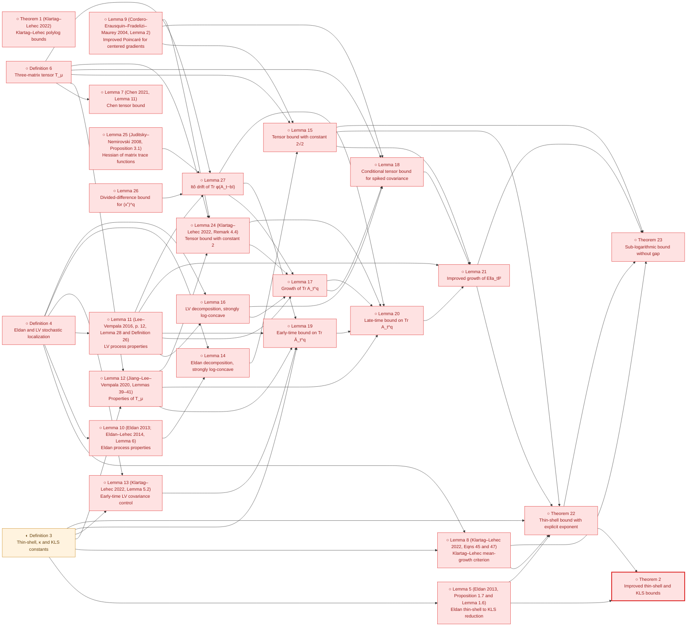

| Item | Statement | Status | Lean declarations | Note |
| --- | --- | --- | --- | --- |
| Theorem 1 (Klartag–Lehec 2022) | σ_n ≲ log⁴ n and ψ_n ≲ log⁵ n, with universal implied constants. | ○ Not yet formalized | — | Quoted background result; not proved in this paper. Section 1.2 re-derives it heuristically as σ_n ≲ log^{γ+1} n with γ = 3. |
| **Theorem 2** (main) | There is a universal constant C such that for all n ≥ 2, σ_n ≤ C·log^{2.2226} n and ψ_n ≤ C·log^{3.2226} n, where σ_n and ψ_n are the suprema of the thin-shell and KLS constants over isotropic log-concave distributions on ℝⁿ. | ○ Not yet formalized | — | The σ_n part is Theorem 22 with γ = 2√2 (Lemma 15) and the optimized q ≈ 3.058, giving η = (1 + 7√2 + √(53 − 4√2))/8 ≈ 2.22252; the ψ_n part adds one logarithm via ψ_n ≲ σ_n log n (Lemma 5). Not stated in Lean. |
| Definition 3 | For a distribution μ on ℝⁿ: σ_μ² = Var_μ(‖x‖²)/n, κ_μ² = sup_{‖θ‖=1} ‖E_μ[⟨x,θ⟩ x xᵀ]‖_F², and 1/ψ_μ = inf over open A ⊆ ℝⁿ with smooth boundary of ∫_{∂A} dμ / min(μ(A), 1 − μ(A)); σ_n, κ_n, ψ_n are the suprema of σ_μ, κ_μ, ψ_μ over isotropic log-concave μ on ℝⁿ. | ◐ Partial or statement only | [`constant`](../../formalization/FunctionalInequalities/KLS/Isoperimetry.lean)<br/>[`inverseScale`](../../formalization/FunctionalInequalities/KLS/Isoperimetry.lean)<br/>[`Isotropic`](../../formalization/FunctionalInequalities/KLS/Isotropic.lean) | Only the KLS-constant clause and the isotropy notion are represented. Isoperimetry.constant is h_μ = 1/ψ_μ and Isoperimetry.inverseScale is ψ_μ, defined with outer Minkowski content over measurable sets of mass in (0, 1) on the affine support (value ⊤, resp. 0, in dimension zero); agreement with the smooth-boundary surface-measure convention is not stated in Lean. KLS.Isotropic is mean zero, identity covariance and finite second moment. σ_μ, κ_μ and the dimensional suprema σ_n, κ_n, ψ_n are not defined in Lean. |
| Definition 4 | For a log-concave density p on ℝⁿ, Eldan's process is dp_t(x) = p_t(x)(x − a_t)ᵀ A_t^{−1/2} dW_t and the Lee–Vempala (LV) process is dp_t(x) = p_t(x)(x − a_t)ᵀ dW_t, both with p_0 = p, where a_t and A_t are the mean and covariance of p_t; both are martingales in the space of densities. | ○ Not yet formalized | — | Stochastic-calculus definition; outside the Lean library scope. |
| Lemma 5 (Eldan 2013, Proposition 1.7 and Lemma 1.6) | ψ_n² ≲ κ_n² log n ≲ σ_n² log² n, with universal implied constants. | ○ Not yet formalized | — | Quoted; proved by Eldan via stochastic localization. |
| Definition 6 | For a log-concave distribution μ on ℝⁿ with mean a and symmetric matrices A_1, A_2, A_3, T_μ(A_1, A_2, A_3) = E_{x,y∼μ} ∏_{i=1}^{3} (x − a)ᵀ A_i (y − a) with x, y independent; the same notation T_p is used for a density p. | ○ Not yet formalized | — |  |
| Lemma 7 (Chen 2021, Lemma 11) | For every α-strongly log-concave μ with covariance A and every q ≥ 3, T_μ(A^{q−2}, I, I) ≤ (4/α) Tr A^q. | ○ Not yet formalized | — | Quoted; superseded in this paper by the constant 2/α of Lemma 24. |
| Lemma 8 (Klartag–Lehec 2022, Eqns 45 and 47) | For a log-concave density p on ℝⁿ with LV process p_t and mean a_t, σ_p² ≲ ∫_{λ_1}^{∞} min_{t_λ > 0} { E‖a_{t_λ}‖²/(nλ²) + 1/(λ t_λ) } dλ, where λ_1 = Ω(ψ_p^{−2}) and the expectation is over the LV process. | ○ Not yet formalized | — | Quoted; relies on the LV stochastic localization and the heat-flow argument of Klartag–Lehec. |
| Lemma 9 (Cordero-Erausquin–Fradelizi–Maurey 2004, Lemma 2) | For any α-strongly log-concave μ and any smooth f ∈ L²(μ) with ∫ f dμ = 0 and ∫ ∇f dμ = 0, ∫ f² dμ ≤ (1/(2α)) ∫ ‖∇f‖² dμ. | ○ Not yet formalized | — | Quoted. The factor 1/(2α) (half the Brascamp–Lieb/Bakry–Émery constant) needs the extra centering ∫∇f dμ = 0; no Lean declaration states it. |
| Lemma 10 (Eldan 2013; Eldan–Lehec 2014, Lemma 6) | For Eldan's process with mean a_t and covariance A_t: da_t = A_t^{1/2} dW_t; dA_t = E_{x∼p_t}(x − a_t)(x − a_t)ᵀ(x − a_t)ᵀ A_t^{−1/2} dW_t − A_t dt; and if p_0 is 1-strongly log-concave then ‖A_t‖_op ≤ e^{−t}. | ○ Not yet formalized | — | Quoted stochastic-calculus facts. |
| Lemma 11 (Lee–Vempala 2016, p. 12, Lemma 28 and Definition 26) | For the LV process with mean a_t and covariance A_t: da_t = A_t dW_t; dA_t = E_{x∼p_t}(x − a_t)(x − a_t)ᵀ(x − a_t)ᵀ dW_t − A_t² dt; and p_t(x) ∝ exp(c_tᵀx − (t/2)‖x‖²) p_0(x) for a random process c_t. | ○ Not yet formalized | — | Quoted stochastic-calculus facts; in particular p_t is (α + t)-strongly log-concave when p_0 is α-strongly log-concave. |
| Lemma 12 (Jiang–Lee–Vempala 2020, Lemmas 39–41) | For log-concave μ with covariance A and symmetric M, N: T_μ(M_1, M_2, M_3) ≥ 0 for positive definite M_i; T_μ(M, I, I) ≲ κ_n² Tr&#124;A^{1/2} M A^{1/2}&#124; ‖A‖_op²; T_μ(M, N, I) ≤ T_μ(&#124;M&#124;^s, I, I)^{1/s} T_μ(&#124;N&#124;^t, I, I)^{1/t} for s, t ≥ 1 with 1/s + 1/t = 1; and T_μ(N^{1/2}M^βN^{1/2}, N^{1/2}M^{1−β}N^{1/2}, C) ≤ T_μ(N^{1/2}MN^{1/2}, N, C) for PSD M, N, C and β ∈ [0, 1]. | ○ Not yet formalized | — | Quoted; the paper writes the interpolation exponent as α, renamed β here to avoid a clash with the convexity parameter. |
| Lemma 13 (Klartag–Lehec 2022, Lemma 5.2) | For the LV process from an isotropic log-concave p_0 on ℝⁿ with covariance A_t, and T ≤ 1/(cκ_n² log n) for a large enough universal c, P[‖A_t‖_op ≥ 2 for some 0 ≤ t ≤ T] ≤ exp(−1/(cT)). | ○ Not yet formalized | — | Quoted. The printed event reads "‖A_t‖_op ≥ 2 for 0 ≤ t ≤ T"; it is used as the probability that the bound fails at some time in [0, T]. |
| Lemma 14 | For any 1-strongly log-concave μ on ℝⁿ with mean 0 and covariance A, μ is the law of ∫_0^∞ Q_t dW_t for an adapted process of positive definite matrices with 0 ⪯ Q_t ⪯ e^{−t/2} I and E Q_t² = e^{−t} A. | ○ Not yet formalized | — | Strengthens Klartag–Lehec Lemma 4.1 by the identity E Q_t² = e^{−t}A; Q_t = A_t^{1/2} from Eldan's process. Stochastic ingredient. |
| Lemma 15 | For any α-strongly log-concave μ on ℝⁿ with covariance A, T_μ(I, I, I) ≤ (2√2/α) Tr A²; hence the best constant γ in (1.3) satisfies γ ≤ 2√2. | ○ Not yet formalized | — | Improves the Klartag–Lehec constant 3. The proof applies Itô's formula along x_t = ∫_0^t Q_s dW_s. |
| Lemma 16 | For any α-strongly log-concave μ on ℝⁿ with mean 0 and covariance A, μ is the law of ∫_0^∞ Q_t dW_t for an adapted process of positive definite matrices with 0 ⪯ Q_t ⪯ (α + t)^{−1} I and E Q_t ⪯ A. | ○ Not yet formalized | — | Q_t = A_t from the LV process. Stochastic ingredient. |
| Lemma 17 | For α-strongly log-concave μ with covariance A, LV process covariance A_t and any q ≥ 3, E Tr A_t^q ≤ (1 + t/α)^{q(q−1)} Tr A^q; in particular the Q_t of Lemma 16 satisfies E Tr Q_t^q ≤ (1 + t/α)^{q(q−1)} Tr A^q. | ○ Not yet formalized | — | Proof: Lemma 27 with b = 0, then Lemma 24 for the (α + t)-strongly log-concave p_t, then Grönwall. |
| Lemma 18 | Let μ be α-strongly log-concave with covariance A, 3 ≤ q ≤ 8 and ζ > 0 with Tr A^q ≤ α^{−(q−2)} ζ^{−1} Tr A². Then T_μ(I, I, I) ≤ 12 α^{−1} ζ^{−1/(2(q²−2))} Tr A²; equivalently, without the hypothesis, T_μ(I, I, I) ≤ 12 α^{−3} (α^q Tr A^q)^c (α² Tr A²)^{1−c} with c = 1/(2(q²−2)). | ○ Not yet formalized | — | The final step bounds 3√2 · 2.8 ≤ 12. Implicitly needs ζ ≥ 1 so that the crossover time s* = ζ^{1/(q²−2)} − 1 is nonnegative. |
| Lemma 19 | For the LV process from an isotropic log-concave p_0 on ℝⁿ supported in a ball of radius n, with Ā_t = (A_t − I)^+ and t_1 = 1/(cκ_n² log n) for a large enough c depending only on q, for all 0 ≤ t ≤ t_1 and q ≥ 3, E Tr Ā_t^q ≤ 1 + (Cqκ_n² t)^{q/2} n for a universal constant C > 0. | ○ Not yet formalized | — | Proof uses Lemma 13 with t_1 ≈ (qκ_n² log n)^{−1} to make the failure probability at most n^{−(2q+1)}, and the support assumption to bound ‖A_t‖_op ≤ n². |
| Lemma 20 | Under the setting of Lemma 19 with 3 ≤ q ≤ 4, E Tr A_t^q ≲ n for t_1 ≤ t ≤ t̂ := t_1 log^{1/(2q−2)} n, and E Tr A_t^q ≲ (t/t_1)^{q(q−1)} n / log^{q/2} n for t ≥ t̂, where t_1 = 1/(cκ_n² log n). | ○ Not yet formalized | — | The first estimate is derived for t ≤ κ_n^{−2}; for t ≥ t̂ the proof restarts Lemma 17 from p_{t̂}, which is t̂-strongly log-concave. |
| Lemma 21 | Under the setting of Lemma 19 and for 3 ≤ q ≤ 4, E‖a_t‖² ≲ nt + n t^{γ+1}/(t*)^γ for all t > 0, where t* := κ_n^{−2(q²−q)/(q²−2)} log^{−(2q²−3q)/(2(q²−2))} n and γ ≤ 2√2 is the constant of (1.3). | ○ Not yet formalized | — | Uses Lemma 18 (second form, with α = t for p_t) up to t*, where E Tr A_t² ≲ n, and Lemma 15 after t*; d/dt E‖a_t‖² = Tr A_t² by Itô's formula. |
| Theorem 22 | σ_n ≲ log^η n with η = min_{3≤q≤4} (1 + γ(q² − 5q/4)/(q² − 2)) / (1 + γ(q − 2)/(q² − 2)), γ the constant of (1.3); with γ = 2√2 and q = (112 − 16√2 + √(5630 − 1892√2))/47 this gives η ≤ (1 + 7√2 + √(53 − 4√2))/8 ≤ 2.2226. | ○ Not yet formalized | — | The proof starts from an isotropic log-concave p_0 with σ_{p_0}² ≥ σ_n²/2 supported in a ball of radius n (truncation step not detailed) and solves 2η ≤ max{η + 1, αη + β}. Numerically η ≈ 2.222516 at q ≈ 3.0580. |
| Theorem 23 | If ψ_n ≲ σ_n, then σ_n ≲ log^η n with η = min_{3≤q≤4} (γ(q²/2 − 3q/4)/(q² − 2)) / (1 + γ(q − 2)/(q² − 2)); with γ = 2√2 and q = 3 this gives η ≤ (63√2 − 36)/82 ≤ 0.6476. | ○ Not yet formalized | — | Conditional on the no-gap hypothesis; the proof also uses κ_n ≲ σ_n under that hypothesis. The unconstrained optimum q ≈ 2.4588 is outside the range of Lemma 21. |
| Lemma 24 (Klartag–Lehec 2022, Remark 4.4) | For any α-strongly log-concave μ with covariance A and any q ≥ 3, T_μ(A^{q−2}, I, I) ≤ (2/α) Tr A^q. | ○ Not yet formalized | — | Improves Lemma 7 by a factor 2; proof given for completeness. |
| Lemma 25 (Juditsky–Nemirovski 2008, Proposition 3.1) | If f is twice differentiable on (α, β) and (f′(b) − f′(a))/(b − a) ≤ θ (f″(b) + f″(a))/2 + φ for all α ≤ a < b < β, then for every symmetric X with spectrum in (α, β) and every symmetric H, ∂² Tr f(X)/∂X²&#124;_{H,H} ≤ θ Tr(f″(X)H²) + φ Tr H². | ○ Not yet formalized | — | Quoted. |
| Lemma 26 | For φ(x) = x^q on x ≥ 0 and φ(x) = 0 otherwise, with q ≥ 3, every a < b satisfies (φ′(b) − φ′(a))/(b − a) ≤ (φ″(b) + φ″(a))/2. | ○ Not yet formalized | — |  |
| Lemma 27 | For log-concave μ on ℝⁿ, its LV process with covariance A_t, φ as in Lemma 26 and q ∈ {2} ∪ [3, ∞): d Tr φ(A_t − bI) = E_{x∼p_t}(x − a_t)ᵀφ′(A_t − bI)(x − a_t)(x − a_t)ᵀ dW_t − Tr(φ′(A_t − bI)A_t²) dt + ½ T_{p_t}(φ″(A_t − bI), I, I) dt, and hence d/dt E Tr φ(A_t − bI) ≤ ½ T_{p_t}(φ″(A_t − bI), I, I). | ○ Not yet formalized | — | Printed as an identity although the second-order term is only bounded via Lemma 25, so the first display is effectively an inequality for the drift. Stochastic ingredient. |

Not listed: All 27 numbered statement environments (one shared counter for Theorem, Definition and Lemma across sections and appendices) are listed. The numbered displays (1.1)–(1.3), (2.1)–(2.3), (3.1)–(3.3), (B.1), (B.2) are proof steps or the definition of γ and are absorbed into the listed items or the standing assumptions; Section 1.2 (heuristic re-derivation of the Klartag–Lehec bound) and Appendix A (localization heuristic and computer search suggesting γ ≈ 0.37 in dimension one) contain only unnumbered expository claims.

### Klartag2023 lemma map

Source: [Klartag, arXiv:2303.14938v2](https://arxiv.org/abs/2303.14938v2), reviewed 2026-10-03.

Standing assumptions: Probability measures on ℝⁿ; log-concave means a log-concave density on an affine subspace; isotropic means mean 0 and covariance Id. C_P is the optimal Poincaré constant for locally Lipschitz tests, ψ_μ the inverse Cheeger (isoperimetric) constant with min{μ(A), 1 − μ(A)} denominator, ψ_n = sup ψ_μ over isotropic log-concave μ on ℝⁿ, λ(μ) = 1/C_P(μ) the spectral gap. t-uniformly log-concave: the density relative to μ proportional to e^{t|x|²/2} is log-concave (∇²ψ ≥ t·Id). From Section 2 on μ is regular (smooth positive e^{−ψ} with ε·Id ≤ ∇²ψ ≤ Id/ε and polynomial growth of ψ and its derivatives). C, c denote universal constants. Numbered displays used as proof inputs, and the unnumbered definition of ψ_μ (stated by a Lean declaration), are listed alongside all thirteen numbered statement environments.

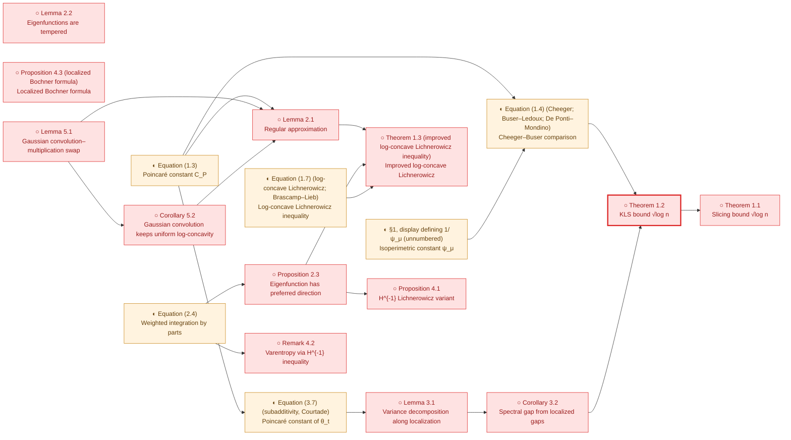

| Item | Statement | Status | Lean declarations | Note |
| --- | --- | --- | --- | --- |
| Equation (1.3) | C_P(X) is the infimum of C ≥ 0 with Var f(X) ≤ C·E&#124;∇f(X)&#124;² for every locally Lipschitz f: ℝⁿ → ℝ with E&#124;∇f(X)&#124;² < ∞; C_P(μ) = C_P(X) for X with law μ. | ◐ Partial or statement only | [`constant`](../../formalization/FunctionalInequalities/Poincare/LocalSlope/Basic.lean) | Intrinsic.constant is the extended (ENNReal) optimum of the local-slope Poincaré inequality for the intrinsic law on the affine support of a finite-dimensional law, with local slope in place of the a.e. gradient. Agreement with the paper's ambient a.e.-gradient formulation is not stated as a separate Lean theorem; for log-concave laws it equals the smooth-test optimum (KLS.LogConcave.smoothTest_constant_eq_localSlope). |
| §1, display defining 1/ψ_μ (unnumbered) | For μ with log-concave density ρ, 1/ψ_μ = inf over open A ⊆ ℝⁿ with smooth boundary and 0 < μ(A) < 1 of ∫_{∂A}ρ / min{μ(A), 1 − μ(A)}; this is finite and positive (Bobkov). | ◐ Partial or statement only | [`constant`](../../formalization/FunctionalInequalities/KLS/Isoperimetry.lean)<br/>[`inverseScale`](../../formalization/FunctionalInequalities/KLS/Isoperimetry.lean) | Isoperimetry.constant is h_μ = 1/ψ_μ and Isoperimetry.inverseScale is ψ_μ, defined with outer Minkowski content over measurable sets of mass in (0, 1) on the affine support, with value ⊤ (resp. 0) in dimension zero. Agreement with the smooth-boundary surface-integral convention is not stated in Lean; positivity and finiteness (Bobkov) are not stated. |
| Equation (1.4) (Cheeger; Buser–Ledoux; De Ponti–Mondino) | For every μ with a log-concave density, 1/4 ≤ ψ_μ²/C_P(μ) ≤ π. | ◐ Partial or statement only | [`literatureConstant_le_four_mul_inverseScale_sq`](../../formalization/FunctionalInequalities/KLS/Geometry/Cheeger/Inequality.lean)<br/>[`inverseScale_sq_le_pi_literature`](../../formalization/FunctionalInequalities/KLS/LogConcave/Density/GaussianSmoothing/Buser.lean) | Both halves are proved for every finite-dimensional log-concave law, including degenerate and zero-dimensional ones, as C_P ≤ 4Ψ² and Ψ² ≤ π·C_P with Ψ = Isoperimetry.inverseScale (Minkowski-content convention). Partial only because Ψ is not identified in Lean with the paper's smooth-boundary ψ_μ. |
| Equation (1.7) (log-concave Lichnerowicz; Brascamp–Lieb) | If t > 0 and μ is t-uniformly log-concave (μ has density ∝ e^{−t&#124;x&#124;²/2} times a log-concave function), then C_P(μ) ≤ 1/t. | ◐ Partial or statement only | [`holds_stdGaussian_map_smul`](../../formalization/FunctionalInequalities/Poincare/Gaussian/Multivariate.lean)<br/>[`gaussianLaw_smoothTest_holds`](../../formalization/FunctionalInequalities/KLS/LogConcave/Density/GaussianSmoothing/Poincare.lean) | Only Gaussian instances are formalized: the law of r·G for a standard Gaussian G (which is 1/r²-uniformly log-concave) satisfies the smooth-test Poincaré inequality with constant r², and the normalized kernel ∝ exp(−s&#124;x&#124;²) (2s-uniformly log-concave) with constant 1/(2s). These are smooth-test constants; the general uniformly log-concave case is not formalized. |
| Theorem 1.1 | For n ≥ 2, L_n ≤ C·√(log n) for a universal constant C > 0; equivalently every convex body in ℝⁿ of volume one has a hyperplane section of (n−1)-volume at least c/√(log n). | ○ Not yet formalized | — | Immediate from Theorem 1.2 and (1.6). |
| **Theorem 1.2** (main) | For n ≥ 2, ψ_n ≤ C·√(log n) for a universal constant C > 0, i.e. every isotropic log-concave probability measure on ℝⁿ has ψ_μ ≤ C√(log n) (equivalently C_P(μ) ≤ C' log n by (1.4)). | ○ Not yet formalized | — | Main theorem (abstract and title). Proof: choose μ with ψ_μ ≥ ψ_n/2, take t = cψ_n^{−2}/log n so that E√‖A_t‖ ≤ C by (3.13), check t ≤ c̄λ₀ via (1.4), apply Corollary 3.2 to get λ₀^{−1} ≤ C/√t ≤ C̃ψ_n√(log n), and close with ψ_n² ≤ 4ψ_μ² ≤ C̃λ₀^{−1} from (1.4). Dimension-dependent; not mapped to any Lean declaration. |
| Theorem 1.3 (improved log-concave Lichnerowicz inequality) | If t > 0 and μ is a t-uniformly log-concave probability measure on ℝⁿ, then C_P(μ) ≤ √(‖Cov(μ)‖_op / t) ≤ 1/t. | ○ Not yet formalized | — | Reduction to regular μ by Lemma 2.1; then (2.7)–(2.8) with ∇²ψ ≥ t give λ²‖Cov‖ ≥ t. The right inequality is ‖Cov(μ)‖ ≤ C_P(μ) ≤ 1/t via (2.6) on linear functions and (1.7) (the printed last step reads 1/λ ≤ t, a typo for ≤ 1/t). No local statement. |
| Lemma 2.1 | If μ is an absolutely continuous log-concave probability measure on ℝⁿ and 0 < ε < t, there is a regular log-concave ν (smooth positive density e^{−ψ} with ε'·Id ≤ ∇²ψ ≤ Id/ε' for some ε' > 0 and ψ and all derivatives of polynomial growth) with C_P(ν) ≥ C_P(μ) − ε and ‖Cov(μ) − Cov(ν)‖_op < ε; if μ is t-uniformly log-concave then ν is (t − ε)-uniformly log-concave. | ○ Not yet formalized | — | ν is the normalization of (ρ ∗ γ_δ)·γ_{1/δ}. The local GaussianSmoothing.smoothedProbabilityLaw_literatureConstant_le bounds the Poincaré constant of a Gaussian convolution from above (C_P(μ ∗ γ) ≤ C_P(μ) + 1/(2s)); the lemma needs the lower bound for convolution followed by Gaussian multiplication, so it is not a restricted case. The printed proof says 'covariance of ν ... close to that of ν' for 'of μ'. |
| Lemma 2.2 | For regular log-concave μ, every eigenfunction of L_μ = Δ − ∇ψ·∇ is μ-tempered: smooth, with every partial derivative bounded by C e^{−a&#124;x&#124;}/√ρ(x). | ○ Not yet formalized | — | Proof in the Appendix via the Schrödinger operator −Δ + V, V = &#124;∇ψ&#124;²/4 − Δψ/2, and exponential decay of its eigenfunctions (Agmon et al.), plus Green's representation for derivatives. |
| Equation (2.4) | For regular log-concave μ = e^{−ψ}dx and μ-tempered u, v, ∫(Lu)v dμ = −∫⟨∇u, ∇v⟩ dμ with Lu = Δu − ∇ψ·∇u. | ◐ Partial or statement only | [`integral_inner_gradient_tilted`](../../formalization/FunctionalInequalities/Analysis/BakryEmery/IntegrationByParts/Basic.lean) | Lean proves ∫⟨∇f, ∇g⟩ dμ = ∫(−ℒf)g dμ for μ = m.tilted(−U) with C¹ potential U, C² compactly supported f and C¹ g on a finite-dimensional space: compact support of one factor replaces μ-temperedness and no convexity is needed. |
| Proposition 2.3 | For regular log-concave μ = e^{−ψ}dx and an L²(μ)-normalized eigenfunction f ∈ F_μ of −L with eigenvalue λ(μ): &#124;∫∇f dμ&#124;² ≥ λ^{−1}∫⟨(∇²ψ)∇f, ∇f⟩ dμ, and &#124;∫∇f dμ&#124;² = λ²&#124;∫f(x)x dμ(x)&#124;² ≤ λ²‖Cov(μ)‖_op. | ○ Not yet formalized | — | Bochner formula plus the Poincaré inequality (2.6) applied to each ∂ⁱf; the identity uses (2.4) with g(x) = ⟨x, θ⟩ and Cauchy–Schwarz. |
| Equation (3.7) (subadditivity, Courtade) | C_P(θ_t) = C_P(tX + W_t) ≤ C_P(tX) + C_P(W_t) = t²/λ₀ + t, using subadditivity of C_P for independent sums, C_P(tX) = t²C_P(X) and C_P(W_t) = t. | ◐ Partial or statement only | [`constant_conv_le_add`](../../formalization/FunctionalInequalities/Poincare/Convolution.lean)<br/>[`map_smul`](../../formalization/FunctionalInequalities/Poincare/SmoothTest/Transport.lean)<br/>[`holds_stdGaussian_map_smul`](../../formalization/FunctionalInequalities/Poincare/Gaussian/Multivariate.lean) | Lean has the three ingredients for smooth-test constants: subadditivity under convolution of probability laws (constant_conv_le_add), the scaling bound Holds μ C → Holds (μ.map (r•)) (r²C), and Holds for r·G with constant r². The paper's locally Lipschitz constant agrees with the smooth-test one for log-concave laws (KLS.LogConcave.smoothTest_constant_eq_localSlope), which covers tX + W_t; the composed bound (3.7) is not stated as one theorem. |
| Lemma 3.1 | For regular log-concave μ, t > 0 and f ∈ L²(μ), E Var_{p_t}(f) ≤ Var_{p₀}(f) ≤ (2 + t/λ₀)·E Var_{p_t}(f), where λ₀ = λ(μ) = 1/C_P(μ). | ○ Not yet formalized | — | Law of total variance from (3.5), then the Poincaré inequality for θ_t (3.7) applied to θ ↦ M_f(t, θ) with &#124;∇_θ M_f&#124;² ≤ ‖A(t, θ)‖·Var_{p_{t,θ}}(f) and ‖A‖ ≤ 1/t from (3.2). Only the fixed-time law of θ_t and (3.5) are used. |
| Corollary 3.2 | For regular log-concave μ, A > 0 and 0 < t < Aλ₀: λ₀^{−1} ≤ C(A + 1)·E λ_t^{−1} ≤ C(A + 1)·E√‖A_t‖_op / √t, with C universal, λ_t = λ(μ_{t,θ_t}) and A_t = A(t, θ_t). | ○ Not yet formalized | — | Apply Lemma 3.1 to a near-extremal 1-Lipschitz f from (3.10) and use the Poincaré inequality for each p_t; the second inequality is (3.2). |
| Proposition 4.1 | If t > 0 and μ is regular, t-uniformly log-concave and centered, and R = sup over θ ∈ S^{n−1} of ‖⟨·, θ⟩‖²_{H^{−1}(μ)}, then λ(μ) ≥ (t/R)^{1/3}. | ○ Not yet formalized | — | Proof from (2.7), (2.8), (2.12) and the definition of the H^{−1}(μ) norm. |
| Remark 4.2 | For regular log-concave μ = e^{−ψ}dx, −∫⟨L^{−1}∇ψ, ∇ψ⟩ dμ = n, and with the H^{−1}-inequality Var_μ(f) ≤ ‖∇f‖²_{H^{−1}(μ)} (for Lipschitz f with ∫∇f dμ = 0) this gives the Bobkov–Madiman/Nguyen varentropy bound Var_μ(ψ) ≤ n. | ○ Not yet formalized | — | Substantive remark (alternative proof of the varentropy inequality), so it is listed. |
| Proposition 4.3 (localized Bochner formula) | For regular log-concave μ = e^{−ψ}dx, u ∈ F_μ and t > 0, almost surely u ∈ F_{μ_t}, and ∫(Lu)² dμ + t∫&#124;∇u&#124;² dμ = E∫(L_t u)² dμ_t, where μ_t has density p_t and L_t = L_{μ_t}. | ○ Not yet formalized | — | Bochner formula for μ_t with ∇²ψ_t = ∇²ψ + t·Id, then (3.5) and Fubini. Uses only the fixed-time law of p_t. |
| Lemma 5.1 | For s, t > 0, p = st/(s + t), q = t²/(s + t), r = t/(s + t), S_r f(x) = rⁿf(rx), and measurable f with fγ_t integrable, (fγ_t) ∗ γ_s = S_r[(f ∗ γ_p)γ_q], γ_s the N(0, s·Id) density. | ○ Not yet formalized | — | Completing the square. |
| Corollary 5.2 | For s, t > 0 and an absolutely continuous 1/t-uniformly log-concave probability measure μ on ℝⁿ, μ ∗ γ_s is 1/(t + s)-uniformly log-concave. | ○ Not yet formalized | — | Lemma 5.1 plus Prékopa–Leindler. The local GaussianSmoothing.smoothedProbabilityLaw_logConcave (log-concavity of the Gaussian convolution of a log-concave law) is the excluded limit t = ∞, not a restricted case. |

Not listed: No numbered statement environment is omitted; Remark 4.2 is substantive and is listed. The remaining numbered displays (1.1), (1.2) (Hensley–Fradelizi and Grünbaum facts quoted as background), (1.8) and (3.18) (restating or concluding listed items), the definitions (2.1)–(2.3) and the intermediate proof steps (2.7)–(2.12), (3.1), (3.3), (3.6), (3.8), (3.9), (3.11), (3.12), (3.15)–(3.17), (4.1)–(4.4) and (5.1)–(5.3) are absorbed into the listed items. Unnumbered or display-level claims are listed only where a local Lean declaration states them; 10 others are not listed.

### Guan2024 lemma map

Source: [Guan, arXiv:2412.09075v1](https://arxiv.org/abs/2412.09075v1), reviewed 2026-10-03.

Standing assumptions: Measures on R^n (Euclidean, n ≥ 1) are non-degenerate log-concave probability measures with density ρ; isotropic means barycenter 0 and identity covariance; L = Δ + ⟨∇log ρ, ∇⟩, C_p is the locally Lipschitz Poincaré constant, ψ_μ uses open sets with smooth boundary and the surface integral of ρ, σ_μ^2 = Var_μ(|x|^2)/n, μ_s = μ * γ_s with γ_s of covariance s·Id; (p_t) is the Lee–Vempala stochastic localization dp_t = p_t⟨x − a_t, dB_t⟩ with covariance A_t; C is a universal constant changing between lines. The printed definition of t-uniform log-concavity (density e^{-φ − t|x|^2}) is a factor 2 off from its uses (p_t ∝ e^{-t|x|^2/2} with C_p ≤ 1/t), so the operative convention is ∇^2(−log ρ) ≥ t. Lean hypotheses closest to these are the definitions FunctionalInequalities.KLS.LogConcave (KLS/Definitions.lean, compact-set Borell form admitting degenerate laws) and FunctionalInequalities.KLS.Isotropic (KLS/Isotropic.lean); as definitions they state no numbered item.

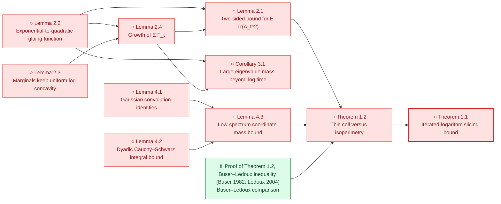

| Item | Statement | Status | Lean declarations | Note |
| --- | --- | --- | --- | --- |
| **Theorem 1.1** (main) | There is a universal C > 0 such that L_n ≤ C log(log n) for all n ≥ 3, where (L_n)^{-1} = inf over convex K ⊆ R^n of volume one of sup over hyperplanes H of Vol_{n-1}(K ∩ H). | ○ Not yet formalized | — | Main item: the paper calls it the main result of the note (title and abstract). Proof: Theorem 1.2 combined with the cited L_n ≤ C σ_n (Eldan–Klartag 2011, display (1.2)) and ψ_n ≤ C sqrt(log n) (Klartag 2023); neither cited bound is proved here. No Lean counterpart. |
| Theorem 1.2 | There is a universal C > 0 such that σ_n ≤ C log ψ_n, where n σ_μ^2 = Var_μ(&#124;x&#124;^2), σ_n and ψ_n are suprema of σ_μ and ψ_μ over isotropic log-concave probability measures on R^n, and 1/ψ_μ is the infimum of ∫_{∂A} ρ / min(μ(A), 1 − μ(A)) over open A with smooth boundary. | ○ Not yet formalized | — | Proof reduces (via ψ_n ≥ ψ_1 ≥ sqrt(π/2) and Buser–Ledoux) to σ_μ ≤ C&#124;log λ_μ&#124; + C for n ≥ C (4.21), approximates μ by regular measures (Klartag 2023), obtains (4.10) from Lemma 2.1 and (1.4), (1.8), applies Lemma 4.3, and closes with the cited H^{-1} bound (4.24) from Klartag–Lehec 2022 (48). Uses stochastic localization; the Lean library has no σ_μ, ψ_n or σ_n counterpart. |
| Lemma 2.1 | There is a universal C > 0 such that for every isotropic log-concave probability measure μ on R^n with n > C, the covariance A_t of the Lee–Vempala stochastic localization (1.3) started at the density of μ satisfies n/2 ≤ E Tr(A_t^2) ≤ 8n for t ∈ [0, e^{-1000}]. | ○ Not yet formalized | — | Proved in Section 3 by a finite induction over times t_{k+1} = &#124;log t_k&#124;^{-16} starting at t_1 = C_2^{-1}(log n)^{-2}, with f_k from Lemma 2.2 (r_0 = s_k, D_0 = &#124;log t_k&#124;^4). Cites κ_n^2 ≤ C log n (Klartag 2023), the operator-norm tail (3.2) from Klartag–Lehec 2022 Lemma 5.2, Lichnerowicz (1.11), and dA_t from Lee–Vempala 2024 Lemma 29. Stochastic calculus; no Lean counterpart. |
| Lemma 2.2 | For D_0 > 4 and r_0 ∈ [7/3, 8/3] there are b ∈ [1/20, 1/5] and an increasing f ∈ C^2(R) with f(r) = e^{D_0(r − r_0)} for r ≤ r_0 − D_0^{-1}, f(r) = b r^2 for r ≥ r_0, and &#124;f''(r)&#124; ≤ D_0^2 f(r) for all real r. | ○ Not yet formalized | — | Elementary real analysis: f is built by integrating a piecewise-linear second derivative and fixing parameters c, s, b by continuity. No Lean counterpart. |
| Lemma 2.3 | For t ≥ 0, if μ is a t-uniformly log-concave probability measure on R^n (density e^{-φ(x) − t&#124;x&#124;^2} with φ convex), then its projection (marginal) onto any linear subspace is again t-uniformly log-concave. | ○ Not yet formalized | — | Proof by the Prékopa–Leindler inequality (Brazitikos et al. 2014, Theorem 1.2.3). The case t = 0 is the classical marginal log-concavity; the Lean library has KLS.LogConcave as a definition but no marginal-projection theorem among the reviewed candidates. |
| Lemma 2.4 | For μ isotropic log-concave on R^n, D_0 > 4, r_0 ∈ [7/3, 8/3], f from Lemma 2.2 and F_t = Σ_i f(λ_{i;t}) over the eigenvalues of A_t, every t_0 ∈ (0, 1] gives E F_t ≤ (t/t_0)^{1000} E F_{t_0} for t ∈ [t_0, t_0 ∨ D_0^{-4}]. | ○ Not yet formalized | — | Proof by the Itô formula for eigenvalues (Klartag 2021; Klartag–Lehec 2022), a five-term decomposition of the drift, and a third-moment bound from Klartag's spectral-variance inequality (1.12) applied to a projected p_t via Lemma 2.3, plus Lichnerowicz (1.11). Display (2.23) of the proof is reused in Corollary 3.1. Stochastic calculus; no Lean counterpart. |
| Corollary 3.1 | Let N > 1, C_2 the constant of (3.2) and c̃ = 1 ∧ C_2^{-1}; there is C > 3 depending on N such that for μ isotropic log-concave on R^n with n ≥ C and t ∈ [c̃(log n)^{-2}, 1 ∧ N(log n)^{-1}], E Σ_{λ_{i;t} ≥ 8/3} λ_{i;t}^2 ≤ 20 e^{-10^{-4} N^{-1/2} (log n)^{1/2}} n. | ○ Not yet formalized | — | The printed left side carries a redundant inner E. Proof uses f from Lemma 2.2 with r_0 = 8/3, D_0 = 2^{-1}10^{-3}N^{-1/2}(log n)^{1/2}, display (2.23) from the proof of Lemma 2.4, (1.11) and the cited tail bound (3.2). Not used elsewhere in the paper. No Lean counterpart. |
| Lemma 4.1 | For μ isotropic log-concave with density ρ and ρ_s the density of μ * γ_s: ∫(&#124;x&#124;^2 − (1+s)n)^2 ρ_s = ∫(&#124;y&#124;^2 − n)^2 ρ + 2(s^2 + 2s)n for s ≥ 0, and −s^{-1} Id ≤ ∇^2 log ρ_s ≤ 0 for s > 0; if moreover ρ = e^{-φ} with φ smooth, then ∫ ∂_θ^2 φ dμ ≥ 1 for every unit vector θ. | ○ Not yet formalized | — | Direct Gaussian computation, a conditional-variance formula for ∂_θ^2 log ρ_s (upper bound via Lichnerowicz or Prékopa–Leindler), and integration by parts with Cauchy–Schwarz. Only the right half of (4.2) is used later (Lemma 4.3). No Lean counterpart. |
| Lemma 4.2 | If h ≥ 0 is differentiable and non-increasing on [0, ∞), then for every integer N ≥ 0, ∫_0^{2^N} (s^{-1/2} ∧ 1)(−h'(s))^{1/2} ds ≤ h(0)^{1/2}(N+1)^{1/2}. | ○ Not yet formalized | — | Dyadic splitting and Cauchy–Schwarz on each block. The proof integrates h' (fundamental theorem of calculus), implicitly needing h' integrable. No Lean counterpart. |
| Lemma 4.3 | Let μ be a regular log-concave probability measure on R^n, g_k(x) = x_k, and assume Σ_k ∫&#124;Q_s g_k&#124;^2 dμ_s ≤ c_1^{-1}(s^{-1} ∧ 1)n for all s > 0 with some c_1 ∈ (0, e^{-1}), where Q_s u = P_s(uρ)/ρ_s; then Σ_k ∫&#124;E_λ g_k&#124;^2 dμ ≤ 10^2 c_1^{-2} λ&#124;log λ&#124; n for λ ∈ (0, e^{-1}), with E_λ the spectral projection of −L below level λ. | ○ Not yet formalized | — | Regular means smooth positive density with ε Id ≤ ∇^2 φ ≤ ε^{-1} Id and polynomially growing derivatives. Proof uses the Klartag–Putterman Γ-calculus (1.9), Γ_2 formula (4.8), Bochner (4.9), the gradient contraction (4.18) and the Rayleigh-quotient bound (4.7) from Klartag–Lehec 2022 Lemma 3.1. Remark 4.4 notes the &#124;log λ&#124; factor might be removable. No Lean counterpart. |
| Proof of Theorem 1.2, Buser–Ledoux inequality (Buser 1982; Ledoux 2004) | For an isotropic log-concave probability measure μ on R^n with first nonzero eigenvalue λ_μ of −L on L^2(μ), ψ_μ^2 ≤ 9 λ_μ^{-1}. | ⇑ Stronger result or alternative route | [`inverseScale_sq_le_pi_literature`](../../formalization/FunctionalInequalities/KLS/LogConcave/Density/GaussianSmoothing/Buser.lean) | Unnumbered cited claim, listed because a Lean declaration states it. Lean proves Isoperimetry.inverseScale μ ^ 2 ≤ π · Poincare.LocalSlope.Intrinsic.constant μ for every log-concave μ (KLS.LogConcave, any affine-support dimension, extended values), with π < 9 and no isotropy. It implies the cited inequality once ψ_μ (smooth open sets, surface integral of ρ) is bounded by Lean's Minkowski-content inverse scale over measurable sets, and λ_μ^{-1} is identified with the intrinsic literature Poincaré constant; these classical identifications are not formalized. The Cheeger half literatureConstant_le_four_mul_inverseScale_sq is not used by the paper. |

Not listed: Remark 4.4 is a purely expository comment on possibly removing |log λ| from (4.11) and is omitted; there are no Definition, Proposition, Fact, Claim or Conjecture environments, and the in-text references to Klartag's Theorem 1.3 and Klartag–Putterman Proposition 2.3 are citations, not statements of this paper.

### KlartagLehecSlicing2025 lemma map

Source: [Klartag–Lehec, arXiv:2412.15044v1](https://arxiv.org/abs/2412.15044v1), reviewed 2026-10-03.

Standing assumptions: Isotropic means centered with identity covariance (probabilistic normalization), except that an isotropic convex body of volume one uses Bourgain's normalization Cov(K) = L_K^2 Id. L_K = (det Cov(K)/Vol_n(K)^2)^{1/(2n)}, L_n = sup_K L_K (2), and L_μ = e^{−Ent(μ)/n} det Cov(μ)^{1/(2n)} (3), taken on the affine hull of the support. Sections 2–3 fix an isotropic log-concave μ on R^n with stochastic localization θ_t (7), barycenter a_t and covariance A_t; Section 3 uses the Föllmer change of variables r = t/(t+1). c, C denote universal constants changing from line to line. Lean: FunctionalInequalities.KLS.Isotropic (KLS/Isotropic.lean: second moment, zero mean, identity covariance) and FunctionalInequalities.KLS.LogConcave (KLS/Definitions.lean: compact-set Borell log-concavity) match the paper's isotropy and log-concavity hypotheses but state no numbered item, so they are not mapped.

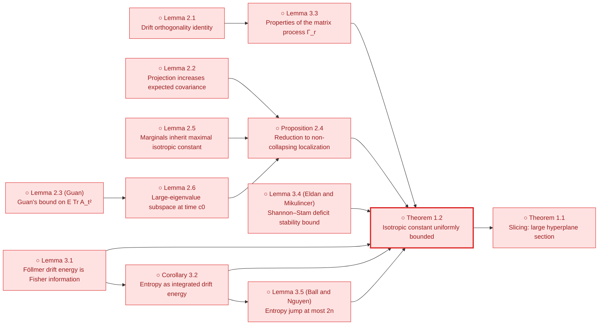

| Item | Statement | Status | Lean declarations | Note |
| --- | --- | --- | --- | --- |
| Theorem 1.1 | For every convex body K ⊆ R^n with Vol_n(K) = 1 there is a hyperplane H with Vol_{n−1}(K ∩ H) > c, where c > 0 is a universal constant independent of n. | ○ Not yet formalized | — | Geometric formulation; the paper derives it from Theorem 1.2 via the standard equivalence of slicing formulations (cited, e.g. Klartag–Milman, BGVV), not proved in the paper. |
| **Theorem 1.2** (main) | sup_{n ≥ 1} L_n < ∞, where L_n = sup_K L_K over convex bodies K ⊆ R^n and L_K = (det Cov(K) / Vol_n(K)^2)^{1/(2n)}; equivalently L_n ≤ C for a universal constant C. | ○ Not yet formalized | — | Main theorem: this is the slicing theorem L_n ≤ C in its isotropic-constant form (Theorem 1.1 is its corollary). Proof (Section 4): Proposition 2.4 gives an isotropic log-concave ν in R^m, m ≥ n/4, with L_ν ≳ L_n and E A_{t0} ≥ Id/4; Lemma 3.3 turns this into c·Id ≤ EΓ_r ≤ Id for r ≥ ξ; Lemmas 3.4 and 3.5 bound the variance of Γ_r; Lemmas 3.1, 3.3(iii) and Corollary 3.2 then give D(ν‖γ1) ≤ Cm, hence Ent(ν) ≥ −Cm and L_ν ≤ C by (3). Combined with Ball's lower bound it gives 1/√(2πe) ≤ L_μ ≤ C for all log-concave μ (6). No Lean declaration: the library has no isotropic constant, entropy or slicing statement. |
| Lemma 2.1 | For isotropic log-concave μ on R^n with stochastic localization (θ_t, a_t) started at μ and every t > 0, E (a_t − θ_t/(1+t)) ⊗ θ_t = 0. | ○ Not yet formalized | — | Proof via integration by parts for μ * γ_{1/t} and the Klartag–Putterman formula ∇ψ_s(y) = (y − a(t,θ))/s (13); stochastic localization is not formalized. |
| Lemma 2.2 | For a subspace E ⊆ R^n, with A_{E,t} the covariance process of stochastic localization started at μ_E = (Proj_E)_*μ, one has E A_{E,t} ≥ Proj_E · E A_t · Proj_E for every t > 0. | ○ Not yet formalized | — | Proof: A_t has the law of Cov(X &#124; X + √(1/t) Z), and conditioning on the coarser σ-field Proj_E(X + √(1/t) Z) increases expected conditional covariance. |
| Lemma 2.3 (Guan) | For isotropic log-concave μ on R^n and its stochastic-localization covariance process (A_t), E Tr[A_t^2] ≤ C n for every t > 0, with C a universal constant. | ○ Not yet formalized | — | Quoted from Guan (Lemma 2.1 there), restating display (1); no proof in this paper. |
| Proposition 2.4 | For n ≥ 10 there are an integer n/4 ≤ m ≤ n, a real t0 ∼ 1 and an isotropic log-concave ν on R^m with L_ν ≥ c L_n and E A_{t0} ≥ Id/4, where (A_t) is the covariance process of stochastic localization started at ν. | ○ Not yet formalized | — | Proof uses also Bourgain–Klartag–Milman L_m ≤ C L_n (m ≤ n) to assume 6 &#124; n and take m = n/3, ν = (Proj_E)_*μ with μ uniform on L_K^{-1}K for a maximizing isotropic K. |
| Lemma 2.5 | Let K ⊆ R^n be an isotropic convex body of volume one with L_K = L_n (n divisible by 6) and μ uniform on L_K^{-1}K; then for every subspace E with dim E = n/3 the marginal μ_E = (Proj_E)_*μ satisfies L_{μ_E} ≥ c L_n, c universal. | ○ Not yet formalized | — | Proof by Milman's M-ellipsoids, the maximality bound Vol_k(K ∩ E)^{1/(n−k)} ≤ C of BKM Corollary 3.5, minimal ellipsoid sections and Fradelizi's central-section bound, combined with (5). |
| Lemma 2.6 | In the setting of Lemma 2.5 there is a subspace E ⊆ R^n with dim E = n/3 such that Proj_E · E A_t · Proj_E ≥ Proj_E/4 at t = c0 = min{1/(2C), 1}, where C is the constant of Lemma 2.3. | ○ Not yet formalized | — | Uses E Tr A_{c0} ≥ n/2 from (10), (28)–(29) and E A_t ≤ Id from (9), then counts eigenvalues. |
| Lemma 3.1 | For isotropic log-concave μ on R^n and r ∈ (0,1), with X_r = (1−r)θ_{r/(1−r)}, ν_r its law and v_r = (1+t)a_t − θ_t (t = r/(1−r)), E&#124;v_r&#124;^2 = J(ν_r‖γ_r); moreover E&#124;v_r&#124;^2 ≤ 4n/(1−r)^2. | ○ Not yet formalized | — | Uses formula (13) from the proof of Lemma 2.1 and the variance decomposition (9); J is relative Fisher information and γ_r = N(0, r·Id). |
| Corollary 3.2 | For isotropic log-concave μ on R^n, D(μ‖γ1) = (1/2)∫_0^1 J(ν_r‖γ_r) dr = (1/2)∫_0^1 E&#124;v_r&#124;^2 dr, and D(μ‖γ1) = −Ent(μ) + (n/2) log(2πe). | ○ Not yet formalized | — | Via the de Bruijn identity (45)–(46) (quoted from Klartag–Ordentlich) and a change of variables s = (1−r)/r. |
| Lemma 3.3 | With Γ_r = (1+t)A_t and r = t/(t+1): (i) (1−r)EΓ_r = EA_t; (ii) E v_r⊗v_r = (Id − EΓ_r)/(1−r), so 0 ≤ EΓ_r ≤ Id; (iii) d/dr E v_r⊗v_r = E(Id − Γ_r)^2/(1−r)^2; (iv) d/dr EΓ_r = (EΓ_r − EΓ_r^2)/(1−r); (v) Γ_r ≤ Id/r almost surely. | ○ Not yet formalized | — | Also uses the variance decomposition (9), the derivative formula (10) and the Lichnerowicz bound A_t ≤ Id/t (11). |
| Lemma 3.4 (Eldan and Mikulincer) | For independent copies Γ^{(1)}, Γ^{(2)} of (Γ_r), δ_KL(μ) ≥ ∫_0^1 E Tr[(Γ^{(1)}_r − Γ^{(2)}_r)^2 (√(((Γ^{(1)}_r)^2 + (Γ^{(2)}_r)^2)/2) + (Γ^{(1)}_r + Γ^{(2)}_r)/2)^{−1}] / (4(1−r)) dr; consequently if Γ_r ≤ ε^{−1} Id a.s. for r ∈ (ξ,1), then δ_KL(μ) ≥ ε ∫_ξ^1 E&#124;Γ_r − EΓ_r&#124;^2 / (4(1−r)) dr. | ○ Not yet formalized | — | Quoted from Eldan–Mikulincer Lemma 2 with λ = 1/2; δ_KL(μ) = δ_KL(μ, μ) is the entropy deficit (57) of the Shannon–Stam inequality. |
| Lemma 3.5 (Ball and Nguyen) | For isotropic log-concave μ on R^n, δ_KL(μ) ≤ 2n. | ○ Not yet formalized | — | Proof: δ_KL(μ) = Ent((X^{(1)}+X^{(2)})/√2) − Ent(X^{(1)}) by Corollary 3.2, then Ball–Nguyen's bound by −log f(0) + 2n and (4). |

Not listed: The source has no numbered definition, remark, claim or conjecture environment; all 13 numbered statements (Theorems 1.1–1.2, Lemmas 2.1–2.3, Proposition 2.4, Lemmas 2.5–2.6, Lemma 3.1, Corollary 3.2, Lemmas 3.3–3.5) are listed. Unnumbered or equation-numbered facts (Guan's bound (1), the bounds (4)–(6), the variance decomposition (9), d/dt EA_t = −EA_t^2 (10), A_t ≤ Id/t (11), the de Bruijn identity (45)–(46), the Bourgain–Klartag–Milman monotonicity L_m ≤ C L_n) are cited inputs, not listed. No item is mapped to Lean: the library has no stochastic localization, isotropic constant, entropy or Fisher information, and the Poincaré and Cheeger/Buser declarations (Poincare.LocalSlope.Intrinsic.constant, LogConcave.literatureConstant_le_four_mul_inverseScale_sq, LogConcave.inverseScale_sq_le_pi_literature) concern quantities the paper does not use.

### Bizeul2025 lemma map

Source: [Bizeul, arXiv:2501.06854v1](https://arxiv.org/abs/2501.06854v1), reviewed 2026-10-03.

Standing assumptions: X is a random vector in R^n; isotropic means E X = 0 and E XXᵀ = I_n; b-subgaussian means (E|(X − E X)·θ|^p)^{1/p} ≤ b√p for all p ≥ 1 and unit θ; t-strongly log-concave means log-concave relative to a Gaussian of variance 1/t. C_P(X) is the optimal Poincaré constant for locally Lipschitz f and Ψ_n² its supremum over isotropic log-concave X in R^n. Convex isotropic position: Vol(K) = 1, barycenter 0, ∫_K xxᵀ = L_K² I_n; L_n = sup L_K and L̃_n = sup_f sup_x f(x)^{1/n} over isotropic log-concave densities. Stochastic localization: f_{t,θ} ∝ e^{−t|x|²/2 + θ·x} f, dθ_t = a_{t,θ_t} dt + dB_t, with barycenter a_t and covariance A_t of μ_t. Constants c, c_0, c_1, C_0, C_1 = 8C_0², c_2, C_2 are universal. Numbering: one shared counter for Theorem, Definition, Lemma, Proposition, Corollary, Remark etc. (only Theorem, Lemma, Corollary and Remark occur, numbered 1–10, no section prefix); cited results use a separate lettered counter (Theorems A–C); no appendix.

```mermaid
flowchart LR
    Bizeul2025_TA["○ Theorem A (Paouris)<br/>Subgaussian small ball bound"]
    Bizeul2025_TB["○ Theorem B (Lee–Vempala)<br/>Small ball with KLS loss"]
    Bizeul2025_T1["○ Theorem 1<br/>Optimal small ball estimate"]
    Bizeul2025_L2["○ Lemma 2<br/>Equivalent slicing formulations"]
    Bizeul2025_TC["○ Theorem C (Klartag–Lehec)<br/>Slicing conjecture"]
    Bizeul2025_C3["○ Corollary 3<br/>Bootstrapped small ball"]
    Bizeul2025_L4["○ Lemma 4<br/>Projected Paouris estimate"]
    Bizeul2025_L5["○ Lemma 5 (Borell's lemma)<br/>Borell moment comparison"]
    Bizeul2025_L6["○ Lemma 6<br/>Strong log-concavity gives subgaussianity"]
    Bizeul2025_R7["○ Remark 7<br/>Weaker subgaussian constant suffices"]
    Bizeul2025_L8["○ Lemma 8 (Guan)<br/>Guan trace lower bound"]
    Bizeul2025_L9["○ Lemma 9<br/>Set shrinkage along localization"]
    Bizeul2025_L10["○ Lemma 10<br/>Large covariance trace event"]
    Bizeul2025_TA --> Bizeul2025_T1
    Bizeul2025_L4 --> Bizeul2025_T1
    Bizeul2025_L5 --> Bizeul2025_T1
    Bizeul2025_L6 --> Bizeul2025_T1
    Bizeul2025_L8 --> Bizeul2025_T1
    Bizeul2025_L9 --> Bizeul2025_T1
    Bizeul2025_L10 --> Bizeul2025_T1
    Bizeul2025_T1 --> Bizeul2025_TC
    Bizeul2025_TC --> Bizeul2025_C3
    Bizeul2025_L2 --> Bizeul2025_C3
    Bizeul2025_TA --> Bizeul2025_L4
    Bizeul2025_L6 --> Bizeul2025_R7
    Bizeul2025_L8 --> Bizeul2025_L10
    classDef lemma_pending fill:#fee2e2,stroke:#dc2626,color:#991b1b;
    class Bizeul2025_TA,Bizeul2025_TB,Bizeul2025_T1,Bizeul2025_L2,Bizeul2025_TC,Bizeul2025_C3,Bizeul2025_L4,Bizeul2025_L5,Bizeul2025_L6,Bizeul2025_R7,Bizeul2025_L8,Bizeul2025_L9,Bizeul2025_L10 lemma_pending;
    style Bizeul2025_T1 stroke-width:3px
```

| Item | Statement | Status | Lean declarations | Note |
| --- | --- | --- | --- | --- |
| Theorem A (Paouris) | If X is a b-subgaussian log-concave vector in R^n with covariance A, there is a universal c > 0 such that for every ε < c and y ∈ R^n, P(‖X − y‖² ≤ ε Tr A) ≤ ε^{c Tr(A)/(b² ‖A‖_op ‖A^{-1}‖_op)}. | ○ Not yet formalized | — | Cited from Paouris (2012); not proved here. |
| Theorem B (Lee–Vempala) | For isotropic log-concave X in R^n there is a universal c_B > 0 such that for every y ∈ R^n and ε < c_B, P(‖X − y‖² ≤ εn) ≤ ε^{c_B n/(Ψ_n² log n)}, where Ψ_n² is the supremum of Poincaré constants of isotropic log-concave vectors in R^n. | ○ Not yet formalized | — | Cited from Lee–Vempala; not proved here. Ψ_n² is the paper's sup of C_P over isotropic log-concave laws, which Lean does not define as a supremum (Poincare.LocalSlope.Intrinsic.constant is only the per-measure C_P), so nothing is mapped. |
| **Theorem 1** (main) | For isotropic log-concave X in R^n there is a universal c_0 > 0 such that for every ε < c_0 and y ∈ R^n, P(‖X − y‖² ≤ εn) ≤ ε^{c_0 n}. | ○ Not yet formalized | — | Main item: the new result of the note (it removes the log n factor of Theorem B); Theorem C is then deduced from it in Section 3.2. Proof: Section 2.1 reduction (uses Lemma 5) to y = 0 and support of diameter √(C_1 n), C_1 = 8C_0²; then stochastic localization at time c_1 with Lemmas 8–10, 9, 6, 4. Printed constant c_0 = min(c, c_1^6/(256 e^{C_1}), c c_1^8 n/512) contains a stray n in the third term (should be c c_1^8/512). The Lean predicates FunctionalInequalities.KLS.Isotropic and FunctionalInequalities.KLS.LogConcave name its hypotheses only; no Lean statement asserts a small ball bound, so nothing is mapped. |
| Lemma 2 | Bourgain's slicing conjecture is equivalent to sup_n L_n < ∞ and to sup_n L̃_n < ∞, where L_n is the supremum of L_K over convex bodies in convex isotropic position and L̃_n the supremum of sup_x f(x)^{1/n} over isotropic log-concave densities f on R^n. | ○ Not yet formalized | — | Stated as well known with reference to Klartag's survey; no proof given. Isotropic constants are outside the Lean library. |
| Theorem C (Klartag–Lehec) | sup_{n ∈ N} L_n < ∞. | ○ Not yet formalized | — | Cited from Klartag–Lehec and re-proved in Section 3.2: an extremal K with L_K = L_n is in M-position, Vol(K ∩ √(C_2 n) B_2^n) > c_2^n (Bourgain–Klartag–Milman, cited), while Theorem 1 for the uniform law on L_K^{-1}K gives Vol(K ∩ L_K √(c_3 n) B_2^n) ≤ c_3^{c_0 n}; with c_3 = min(c_0, c_2^{1/c_0}) this yields L_n² < C_2/c_3. |
| Corollary 3 | For isotropic log-concave X in R^n there is a universal C'' > 0 such that for all ε > 0 and y ∈ R^n, P(‖X − y‖² ≤ ε² n) ≤ (C''ε)^n. | ○ Not yet formalized | — | No separate proof: from Theorem C via Lemma 2 (bounded L̃_n) and P ≤ (C')^n Vol(ε√n B_2^n) as in display (4). |
| Lemma 4 | If X is b-subgaussian log-concave with covariance A, then for all y ∈ R^n and ε < c (the constant of Theorem A), P(‖X − y‖² ≤ ε Tr A) ≤ (4n‖A‖_op ε/Tr A)^{c Tr(A)³/(8n² b² ‖A‖_op²)}. | ○ Not yet formalized | — | Proof projects onto the span of the top k = ⌊Tr A/(2λ_1)⌋ ∨ 1 eigenvectors, where λ_k ≥ Tr A/(2n), and applies Theorem A to X_E. The printed final exponent drops b² (it is restored in the statement). |
| Lemma 5 (Borell's lemma) | There is a constant C_0 > 1 such that every log-concave real random variable Y and every p ≥ 2 satisfy (E&#124;Y&#124;^p)^{2/p} ≤ C_0 E&#124;Y&#124;². | ○ Not yet formalized | — | Classical; quoted without proof. As printed, with one constant for every p ≥ 2, the statement is false: for a two-sided exponential Y, (E&#124;Y&#124;^p)^{2/p} / E&#124;Y&#124;² = Γ(p+1)^{2/p}/2 grows like p²/(2e²). The paper uses it only with p = 4 (the covariance bound after (eq_290)), where it holds; the standard form is (E&#124;Y&#124;^p)^{1/p} ≤ C p (E&#124;Y&#124;²)^{1/2}. |
| Lemma 6 | A t-strongly log-concave random vector (log-concave relative to the Gaussian of variance 1/t) is 1/√t-subgaussian. | ○ Not yet formalized | — | Proof via Hargé's inequality Cov_γ(f, g) ≤ 0 for log-concave f and convex g, applied with g(x) = (x·θ)^p after reducing to t = 1 and E X = 0. |
| Remark 7 | A c''/√t-subgaussian bound with a universal c'' would suffice; by Prékopa–Leindler each marginal X·θ of a strongly log-concave X is strongly log-concave, so one-dimensional Caffarelli contraction or a log-Sobolev inequality with Herbst's argument also gives it. | ○ Not yet formalized | — | Proof sketch only. |
| Lemma 8 (Guan) | If the stochastic localization starts at an isotropic log-concave μ, there is a universal c_1 > 0 with E Tr(A_{c_1}) ≥ c_1 n. | ○ Not yet formalized | — | Cited from Guan (2024), whose proof uses Klartag's improved Lichnerowicz inequality; not proved here. |
| Lemma 9 | If μ has support of diameter D and (μ_t) is its stochastic localization, then for every measurable S, t ≥ 0 and λ > 1, μ(S) ≤ e^{D² t/2} μ_t(S)^{1/λ} with probability at least 1 − 1/λ. | ○ Not yet formalized | — | From d[g]_t ≤ D² g_t² dt for g_t = μ_t(S), Itô's formula E log(1/g_t) ≤ log(1/g_0) + D² t/2 (display (17)) and Markov's inequality. |
| Lemma 10 | Under the reduced setting of Section 3.1 (isotropic log-concave μ with support of diameter √(C_1 n)), the event E_0 = {Tr A_{c_1} ≥ c_1 n/2} has P(E_0) ≥ c_1²/2. | ○ Not yet formalized | — | Proof: split E Tr A_{c_1} ≥ c_1 n over E_0 and its complement using the almost sure bound A_{c_1} ≤ Id/c_1 (display (14), log-concave Lichnerowicz). |

Not listed: All 13 numbered statements of v1 are listed (Theorems A–C, Theorem 1, Lemmas 2, 4, 5, 6, 8, 9, 10, Corollary 3, Remark 7); none is purely expository. Unnumbered displayed claims are covered in the items that use them: the easy direction (4) of the Dafnis–Paouris equivalence (Corollary 3), the Section 2.1 reduction to y = 0 and small diameter (Theorem 1), the tilt density (10) and SDE (11), the density SDE (12) and martingale identity (13), the Lichnerowicz bound A_t ≤ Id/t (14) (Lemma 10), and the M-position estimate (19) (Theorem C). No Lean declaration states any item: Isotropic and LogConcave are hypothesis predicates only, Poincare.LocalSlope.Intrinsic.constant is the per-measure Poincaré constant rather than Ψ_n², and the Cheeger/Buser comparisons literatureConstant_le_four_mul_inverseScale_sq and inverseScale_sq_le_pi_literature concern Cheeger–Poincaré relations that this paper does not use.

### KlartagLehecThin2025 lemma map

Source: [Klartag–Lehec, arXiv:2507.15495v2](https://arxiv.org/abs/2507.15495v2), reviewed 2026-10-03.

Standing assumptions: Log-concave measures may be degenerate (log-concave density on an affine subspace); isotropic means barycenter 0 and Cov = Id; C, c denote universal constants that change from line to line. From Section 2 on, μ is a compactly supported probability measure on R^n whose support affinely spans R^n, with logarithmic Laplace transform Λ_t(θ) = log ∫ exp(⟨θ, x⟩ − t|x|²/2) dμ(x), tilts dμ_{t,θ}/dμ = exp(⟨x, θ⟩ − t|x|²/2 − Λ_t(θ)), μ_θ = μ_{0,θ}, barycenter a(t, θ) = ∇Λ_t(θ) and covariance A(t, θ) = ∇²Λ_t(θ), bounded by a constant C_μ. B is a standard Brownian motion in R^n with B_0 = 0 and (F_t) its natural filtration. Section 3 writes K for the interior of the convex hull of supp μ. Section 4 adds log-concavity, giving A(t, θ) ≤ Id/t (display (36)); Sections 5–6 assume μ isotropic, compactly supported and log-concave, with θ_t = G_{t,B}(0), stochastic localization μ_t = μ_{t,θ_t}, a_t = a(t, θ_t), A_t = A(t, θ_t) with eigenvalues λ_1(t) ≥ ... ≥ λ_n(t) > 0 and eigenvectors u_i(t). ‖f‖_{H^{-1}(μ)} = sup{∫ f g dμ : g ∈ C_c^∞, ∫|∇g|² dμ ≤ 1} for centered f ∈ L²(μ); |M| is the Hilbert–Schmidt norm and W_p the L^p Wasserstein distance. Numbering: one shared counter within sections for Theorem, Definition, Lemma, Proposition, Corollary and Remark (no Question, Conjecture, Speculation or Problem occurs; no appendix).

```mermaid
flowchart LR
    KlartagLehecThin2025_T11["○ Theorem 1.1<br/>Thin-shell variance bound"]
    KlartagLehecThin2025_C12["○ Corollary 1.2<br/>Thin shell for the norm"]
    KlartagLehecThin2025_C13["○ Corollary 1.3<br/>Stretched-exponential thin-shell deviation"]
    KlartagLehecThin2025_T14["○ Theorem 1.4<br/>H^{-1} bound for coordinates"]
    KlartagLehecThin2025_L21["○ Lemma 2.1<br/>Pathwise flow and its derivative"]
    KlartagLehecThin2025_D22["○ Definition 2.2<br/>Flow map G_{t,w}"]
    KlartagLehecThin2025_L23["○ Lemma 2.3<br/>Continuity and adaptedness of flow"]
    KlartagLehecThin2025_L24["○ Lemma 2.4<br/>Lipschitz bound for the flow"]
    KlartagLehecThin2025_P25["○ Proposition 2.5<br/>Law of the driven flow"]
    KlartagLehecThin2025_C26["○ Corollary 2.6<br/>Large-time limit is the tilt"]
    KlartagLehecThin2025_P31["○ Proposition 3.1<br/>Flow maps are expanding diffeomorphisms"]
    KlartagLehecThin2025_D32["○ Definition 3.2<br/>Time-shifted flow map"]
    KlartagLehecThin2025_L33["○ Lemma 3.3 (Semigroup property)<br/>Semigroup property of flows"]
    KlartagLehecThin2025_L34["○ Lemma 3.4<br/>Barycenter map onto K"]
    KlartagLehecThin2025_D35["○ Definition 3.5<br/>Martingale diffeomorphisms S_{t,w}"]
    KlartagLehecThin2025_T36["○ Theorem 3.6<br/>Martingale diffeomorphism process"]
    KlartagLehecThin2025_R37["○ Remark 3.7<br/>Boundary extension of S_t"]
    KlartagLehecThin2025_L38["○ Lemma 3.8<br/>Barycenter process is martingale"]
    KlartagLehecThin2025_R39["○ Remark 3.9<br/>Stochastic localization as martingale"]
    KlartagLehecThin2025_R310["○ Remark 3.10<br/>Generator of S_t(ξ)"]
    KlartagLehecThin2025_L41["○ Lemma 4.1<br/>Monotone normalized flow distance"]
    KlartagLehecThin2025_P42["○ Proposition 4.2<br/>Wasserstein bound via parallel coupling"]
    KlartagLehecThin2025_C43["○ Corollary 4.3<br/>Infinitesimal Wasserstein bound"]
    KlartagLehecThin2025_L44["○ Lemma 4.4<br/>H^{-1} norm via W_2"]
    KlartagLehecThin2025_C45["○ Corollary 4.5<br/>H^{-1} sum via derivative"]
    KlartagLehecThin2025_P46["○ Proposition 4.6<br/>Product-integral Hilbert–Schmidt bound"]
    KlartagLehecThin2025_L47["⇑ Lemma 4.7<br/>Majorization Gronwall comparison"]
    KlartagLehecThin2025_R48["○ Remark 4.8<br/>Jensen form of the bound"]
    KlartagLehecThin2025_R49["○ Remark 4.9<br/>Tilt distances under Gaussian convolution"]
    KlartagLehecThin2025_C410["○ Corollary 4.10<br/>H^{-1} bound by eigenvalues"]
    KlartagLehecThin2025_P51["○ Proposition 5.1<br/>Few large eigenvalues, stopped"]
    KlartagLehecThin2025_L52["○ Lemma 5.2 (Guan)<br/>Guan's three-tensor bound"]
    KlartagLehecThin2025_L53["○ Lemma 5.3<br/>Itô drift of trace functionals"]
    KlartagLehecThin2025_L54["○ Lemma 5.4<br/>Gronwall drift bound for f"]
    KlartagLehecThin2025_L55["○ Lemma 5.5<br/>Existence of test functions f_{D,r}"]
    KlartagLehecThin2025_C61["○ Corollary 6.1<br/>Stopping-time tail and moment"]
    KlartagLehecThin2025_T62["○ Theorem 6.2<br/>Exponential eigenvalue integral bound"]
    KlartagLehecThin2025_T14 --> KlartagLehecThin2025_T11
    KlartagLehecThin2025_T11 --> KlartagLehecThin2025_C12
    KlartagLehecThin2025_T11 --> KlartagLehecThin2025_C13
    KlartagLehecThin2025_C410 --> KlartagLehecThin2025_T14
    KlartagLehecThin2025_T62 --> KlartagLehecThin2025_T14
    KlartagLehecThin2025_L21 --> KlartagLehecThin2025_D22
    KlartagLehecThin2025_D22 --> KlartagLehecThin2025_L23
    KlartagLehecThin2025_L23 --> KlartagLehecThin2025_L24
    KlartagLehecThin2025_D22 --> KlartagLehecThin2025_P25
    KlartagLehecThin2025_P25 --> KlartagLehecThin2025_C26
    KlartagLehecThin2025_L21 --> KlartagLehecThin2025_P31
    KlartagLehecThin2025_D22 --> KlartagLehecThin2025_P31
    KlartagLehecThin2025_D22 --> KlartagLehecThin2025_D32
    KlartagLehecThin2025_D22 --> KlartagLehecThin2025_L33
    KlartagLehecThin2025_D32 --> KlartagLehecThin2025_L33
    KlartagLehecThin2025_L34 --> KlartagLehecThin2025_D35
    KlartagLehecThin2025_D22 --> KlartagLehecThin2025_D35
    KlartagLehecThin2025_D32 --> KlartagLehecThin2025_D35
    KlartagLehecThin2025_P31 --> KlartagLehecThin2025_T36
    KlartagLehecThin2025_L34 --> KlartagLehecThin2025_T36
    KlartagLehecThin2025_D35 --> KlartagLehecThin2025_T36
    KlartagLehecThin2025_L38 --> KlartagLehecThin2025_T36
    KlartagLehecThin2025_L33 --> KlartagLehecThin2025_T36
    KlartagLehecThin2025_L23 --> KlartagLehecThin2025_T36
    KlartagLehecThin2025_T36 --> KlartagLehecThin2025_R37
    KlartagLehecThin2025_P25 --> KlartagLehecThin2025_L38
    KlartagLehecThin2025_L38 --> KlartagLehecThin2025_R39
    KlartagLehecThin2025_T36 --> KlartagLehecThin2025_R310
    KlartagLehecThin2025_D22 --> KlartagLehecThin2025_L41
    KlartagLehecThin2025_C26 --> KlartagLehecThin2025_P42
    KlartagLehecThin2025_L41 --> KlartagLehecThin2025_P42
    KlartagLehecThin2025_P42 --> KlartagLehecThin2025_C43
    KlartagLehecThin2025_L24 --> KlartagLehecThin2025_C43
    KlartagLehecThin2025_L21 --> KlartagLehecThin2025_C43
    KlartagLehecThin2025_L44 --> KlartagLehecThin2025_C45
    KlartagLehecThin2025_C43 --> KlartagLehecThin2025_C45
    KlartagLehecThin2025_L47 --> KlartagLehecThin2025_P46
    KlartagLehecThin2025_P46 --> KlartagLehecThin2025_R48
    KlartagLehecThin2025_C26 --> KlartagLehecThin2025_R49
    KlartagLehecThin2025_L41 --> KlartagLehecThin2025_R49
    KlartagLehecThin2025_C45 --> KlartagLehecThin2025_C410
    KlartagLehecThin2025_P46 --> KlartagLehecThin2025_C410
    KlartagLehecThin2025_L54 --> KlartagLehecThin2025_P51
    KlartagLehecThin2025_L55 --> KlartagLehecThin2025_P51
    KlartagLehecThin2025_L53 --> KlartagLehecThin2025_L54
    KlartagLehecThin2025_L52 --> KlartagLehecThin2025_L54
    KlartagLehecThin2025_P51 --> KlartagLehecThin2025_C61
    KlartagLehecThin2025_C61 --> KlartagLehecThin2025_T62
    classDef lemma_pending fill:#fee2e2,stroke:#dc2626,color:#991b1b;
    class KlartagLehecThin2025_T11,KlartagLehecThin2025_C12,KlartagLehecThin2025_C13,KlartagLehecThin2025_T14,KlartagLehecThin2025_L21,KlartagLehecThin2025_D22,KlartagLehecThin2025_L23,KlartagLehecThin2025_L24,KlartagLehecThin2025_P25,KlartagLehecThin2025_C26,KlartagLehecThin2025_P31,KlartagLehecThin2025_D32,KlartagLehecThin2025_L33,KlartagLehecThin2025_L34,KlartagLehecThin2025_D35,KlartagLehecThin2025_T36,KlartagLehecThin2025_R37,KlartagLehecThin2025_L38,KlartagLehecThin2025_R39,KlartagLehecThin2025_R310,KlartagLehecThin2025_L41,KlartagLehecThin2025_P42,KlartagLehecThin2025_C43,KlartagLehecThin2025_L44,KlartagLehecThin2025_C45,KlartagLehecThin2025_P46,KlartagLehecThin2025_R48,KlartagLehecThin2025_R49,KlartagLehecThin2025_C410,KlartagLehecThin2025_P51,KlartagLehecThin2025_L52,KlartagLehecThin2025_L53,KlartagLehecThin2025_L54,KlartagLehecThin2025_L55,KlartagLehecThin2025_C61,KlartagLehecThin2025_T62 lemma_pending;
    classDef lemma_improved fill:#dcfce7,stroke:#15803d,color:#14532d;
    class KlartagLehecThin2025_L47 lemma_improved;
    style KlartagLehecThin2025_T11 stroke-width:3px
```

| Item | Statement | Status | Lean declarations | Note |
| --- | --- | --- | --- | --- |
| **Theorem 1.1** (main) | If X is an isotropic log-concave random vector in R^n (mean zero, Cov(X) = Id), then Var(&#124;X&#124;²) = E(&#124;X&#124;² − n)² ≤ C n with a universal constant C > 0. | ○ Not yet formalized | — | Main item: the paper calls it its main result and it is the thin-shell conjecture in the variance form; the abstract's form E(&#124;X&#124; − √n)² ≤ C is the immediate Corollary 1.2. Derived from Theorem 1.4 via the cited Bochner-type inequality ‖f‖²_{L²(μ)} ≤ Σ‖∂_i f‖²_{H^{-1}(μ)} (display (6), Barthe–Klartag and Klartag 2010) applied to f = &#124;x&#124;² − n, giving display (7). Tight up to C (C = 2 Gaussian, 4/5 cube). No Lean declaration: FunctionalInequalities.KLS.Isotropic only encodes the isotropy hypothesis (finite second moment, zero mean, identity covariance), and no repository statement bounds Var(&#124;X&#124;²), even in dimension 1. |
| Corollary 1.2 | If X is an isotropic log-concave random vector in R^n, then Var(&#124;X&#124;) ≤ E(&#124;X&#124; − √n)² ≤ C with a universal constant C. | ○ Not yet formalized | — | Follows from Theorem 1.1 and E(&#124;X&#124; − √n)² ≤ n^{-1} E(&#124;X&#124;² − n)²; this is the normalization displayed in the abstract. |
| Corollary 1.3 | For every isotropic log-concave X in R^n and every t > 0, P(&#124;&#124;X&#124; − √n&#124; ≥ t) ≤ P(&#124;&#124;X&#124;² − n&#124;/√n ≥ t) ≤ C exp(−c√t), with universal constants C, c > 0. | ○ Not yet formalized | — | No proof is written; the paper combines Theorem 1.1 with the Bourgain / Nazarov–Sodin–Volberg reverse Hölder inequalities for polynomials of log-concave vectors. Stated to be suboptimal for large t. |
| Theorem 1.4 | If μ is an isotropic log-concave probability measure on R^n, then Σ_{i=1}^n ‖x_i‖²_{H^{-1}(μ)} ≤ C n with a universal constant C, where ‖f‖_{H^{-1}(μ)} = sup{∫ f g dμ : g ∈ C_c^∞(R^n), ∫&#124;∇g&#124;² dμ ≤ 1}. | ○ Not yet formalized | — | Proof in Section 6: the compactly supported case follows from Corollary 4.10 with t = 1 and Theorem 6.2; the general case uses weak lower semicontinuity of μ ↦ ‖x_i‖²_{H^{-1}(μ)} = sup_φ ∫(2x_iφ − &#124;∇φ&#124;²) dμ and approximation by re-isotropized restrictions to balls. |
| Lemma 2.1 | For μ compactly supported with affinely spanning support and any continuous path w with values in R^n, the equation θ_t = x + w_t + ∫_0^t a(s, θ_s) ds has a unique solution for every x ∈ R^n; θ_t(x) is jointly continuous in (t, x) and smooth in x, and M_t(x) = θ_t'(x) is jointly continuous, C¹ in t > 0, and the unique solution of M_0 = Id, dM_t/dt = A(t, θ_t(x)) M_t. | ○ Not yet formalized | — | Proof by Picard–Lindelöf (Hartman) using the uniform bounds &#124;a&#124; ≤ C_μ and 0 ≤ A ≤ C_μ Id from compact support. Deterministic, no stochastic calculus. |
| Definition 2.2 | For t ≥ 0, x ∈ R^n and a continuous path w, G_{t,w}(x) is the value at time t of the unique solution of θ_t = x + w_t + ∫_0^t a(s, θ_s) ds from Lemma 2.1. | ○ Not yet formalized | — |  |
| Lemma 2.3 | The map (x, w) ↦ (G_{t,w}(x))_{t≥0} into C([0, ∞), R^n) (topology of locally uniform convergence) is continuous, and for fixed t ≥ 0 and x the map w ↦ G_{t,w}(x) is F_t-measurable for the natural filtration of the coordinate process. | ○ Not yet formalized | — | Proof by Gronwall: &#124;G_{t,w}(x) − G_{t,w̃}(x̃)&#124; ≤ e^{C_μ t}(&#124;x − x̃&#124; + sup_{s≤t}&#124;w_s − w̃_s&#124;). |
| Lemma 2.4 | For t ≥ 0 and every continuous path w, the map G_{t,w}: R^n → R^n is e^{C_μ t}-Lipschitz, where C_μ bounds the covariance of all tilts of μ. | ○ Not yet formalized | — | Read off from the Gronwall estimate in the proof of Lemma 2.3. |
| Proposition 2.5 | Fix x ∈ R^n and let X have law μ_x (the exponential tilt dμ_x/dμ ∝ e^{⟨x,·⟩}) and be independent of the standard Brownian motion B; then the process (G_{t,B}(x))_{t≥0} has the same law as (x + B_t + tX)_{t≥0}. | ○ Not yet formalized | — | Proved through non-linear filtering: E[X &#124; G_t] = a(t, x + tX + B_t) (Cameron–Martin), and the innovation process is a Brownian motion by Lévy's characterization; the x = 0 case is the Girsanov argument of Klartag–Lehec 2022, Proposition 6.7. Uses Brownian motion and martingale theory. |
| Corollary 2.6 | For every x ∈ R^n, G_{t,B}(x)/t converges almost surely as t → ∞ and the limit has law μ_x. | ○ Not yet formalized | — | Using one Brownian motion for all x gives the parallel coupling of the tilts μ_{x1} and μ_{x2}. |
| Proposition 3.1 | For every t ≥ 0 and every continuous path w, the map G_{t,w}: R^n → R^n is a diffeomorphism and is expanding: &#124;G_{t,w}(x) − G_{t,w}(y)&#124; ≥ &#124;x − y&#124;. | ○ Not yet formalized | — | Section 3 is a digression not used for the thin-shell proof. Invertibility by solving the integral equation backwards; expansion from convexity of Λ_t. |
| Definition 3.2 | For t_1, t_2 ≥ 0, a continuous path w and x ∈ R^n, G_{t_1,t_2,w}(x) = θ_{t_2}, where θ_t = x + w_t + ∫_0^t a(t_1 + s, θ_s) ds; this is the flow of Definition 2.2 for the reference measure μ_{t_1,0}. | ○ Not yet formalized | — |  |
| Lemma 3.3 (Semigroup property) | For every continuous path w and t_1, t_2 ≥ 0, G_{t_1+t_2,w} = G_{t_1,t_2,σ_{t_1}(w)} ∘ G_{t_1,w}, where (σ_{t_1}(w))_t = w_{t+t_1} − w_{t_1} is the shift. | ○ Not yet formalized | — | Proof by concatenating solutions. |
| Lemma 3.4 | For a compactly supported μ with affinely spanning support and every t ≥ 0, θ ↦ ∇Λ_t(θ) is a diffeomorphism from R^n onto K, the interior of the convex hull of the support of μ. | ○ Not yet formalized | — | Standard; the paper cites Eldan–Klartag, Lemma 2.1, and proves it by strong convexity and Legendre duality. The printed display of Λ*(ξ) writes Λ(ξ) for Λ(θ). |
| Definition 3.5 | For a continuous path w and t ≥ 0, S_{t,w} = ∇Λ_t ∘ G_{t,w} ∘ (∇Λ_0)^{-1}, and for t_1, t_2 ≥ 0, S_{t_1,t_2,w} = ∇Λ_{t_1+t_2} ∘ G_{t_1,t_2,w} ∘ (∇Λ_{t_1})^{-1}; with S_t = S_{t,B} and S_{t_1,t_2} = S_{t_1,t_2,B}. | ○ Not yet formalized | — |  |
| Theorem 3.6 | For μ compactly supported with affinely spanning support and K the interior of the convex hull of its support: (a) almost surely every S_t: K → K is a diffeomorphism with S_0 = Id; (b) for fixed ξ ∈ K, (S_t(ξ)) is a martingale converging almost surely to S_∞(ξ), whose law is the unique exponential tilt of μ with barycenter ξ; (c) (S_t(ξ)) is a time-inhomogeneous Markov process with E[f(S_{t_1+t_2}(ξ)) &#124; F_{t_1}] = P_{t_1,t_2} f(S_{t_1}(ξ)) for bounded continuous f, where P_{t_1,t_2} f(ξ) = E f(S_{t_1,t_2}(ξ)). | ○ Not yet formalized | — | Digression; not used in the thin-shell proof. Uses Brownian motion, martingales and the Markov property. |
| Remark 3.7 | Under mild regularity assumptions and strict convexity of K, S_t extends to a homeomorphism of the closure of K with S_t = Id on ∂K for all t ≥ 0, almost surely. | ○ Not yet formalized | — | Claim stated without proof in the paper. |
| Lemma 3.8 | For x ∈ R^n, with θ_t = G_{t,B}(x) and a_t = a(t, θ_t), the process (a_t) is a martingale and its limit as t → ∞ has law μ_x. | ○ Not yet formalized | — | Via a_t = E[X &#124; G_t] for X ~ μ_x independent of B and martingale convergence. |
| Remark 3.9 | For every bounded test function φ, the process ∫ φ dμ_{t,θ_t} is a martingale, so the measure-valued process (μ_{t,θ_t}) is a martingale; it is Eldan's stochastic localization of μ. | ○ Not yet formalized | — | Stated without proof; also introduces terminology. |
| Remark 3.10 | The Markov process (S_t(ξ)) is a time-inhomogeneous diffusion with generator L_t f(ξ) = ½ Tr[∇²Λ_t((∇Λ_t)^{-1}(ξ)) ∇²f(ξ)] for suitable f: K → R. | ○ Not yet formalized | — | Proof omitted in the paper. |
| Lemma 4.1 | If μ (compactly supported, affinely spanning support) is log-concave, then for every continuous path w and x, y ∈ R^n, &#124;G_{t,w}(x) − G_{t,w}(y)&#124;/t is non-increasing in t ∈ (0, ∞). | ○ Not yet formalized | — | Uses the log-concave Lichnerowicz bound A(t, θ) ≤ Id/t (displays (36)-(37), cited). |
| Proposition 4.2 | If μ is log-concave (with the standing compact-support assumption) and θ_t^x = G_{t,B}(x), then for all x, y ∈ R^n, 1 ≤ p < ∞ and t > 0, W_p(μ_x, μ_y) ≤ t^{-1}(E&#124;θ_t^x − θ_t^y&#124;^p)^{1/p}. | ○ Not yet formalized | — | Optimal-transport coupling statement; the coupling is the parallel coupling of Corollary 2.6. |
| Corollary 4.3 | If μ is log-concave (compactly supported) and M_t = G_{t,B}'(0), then for every v ∈ R^n and t > 0, limsup_{ε→0+} W_2(μ, μ_{εv})/ε ≤ (E&#124;M_t v&#124;²)^{1/2}/t. | ○ Not yet formalized | — | Dominated convergence using Lemma 2.4. |
| Lemma 4.4 | For a centered compactly supported probability measure μ on R^n and every v ∈ R^n, ‖⟨x, v⟩‖_{H^{-1}(μ)} ≤ limsup_{ε→0+} W_2(μ, μ_{εv})/ε. | ○ Not yet formalized | — | No log-concavity needed. The last display of the proof writes ⟨x, u⟩ for ⟨x, v⟩. |
| Corollary 4.5 | If μ is centered, compactly supported and log-concave, then for every t > 0, Σ_{i=1}^n ‖x_i‖²_{H^{-1}(μ)} ≤ t^{-2} E&#124;M_t&#124;², where M_t = G_{t,B}'(0) and &#124;M&#124; = (Tr M*M)^{1/2} is the Hilbert–Schmidt norm. | ○ Not yet formalized | — |  |
| Proposition 4.6 | If (A_t)_{t≥0} is a continuous path of symmetric positive-definite n×n matrices with eigenvalues λ_1(t) ≥ ... ≥ λ_n(t) > 0 and M solves M_0 = Id, dM_t/dt = A_t M_t, then &#124;M_t&#124;²_{HS} ≤ Σ_{i=1}^n exp(2∫_0^t λ_i(s) ds) for every t > 0. | ○ Not yet formalized | — | Deterministic matrix inequality; proof uses the von Neumann trace inequality and the min-max principle (both cited, unnumbered). |
| Lemma 4.7 | Let μ_1(t), ..., μ_n(t) and λ_1(t) ≥ ... ≥ λ_n(t) be non-negative continuous functions on [0, ∞) with Σ_{i≤k} μ_i(t) ≤ Σ_{i≤k}[1 + 2∫_0^t μ_i(s)λ_i(s) ds] for all t ≥ 0 and k ≤ n; then Σ_{i≤k} μ_i(t) ≤ Σ_{i≤k} exp(2∫_0^t λ_i(s) ds) for all t ≥ 0 and k ≤ n. | ⇑ Stronger result or alternative route | [`sum_le_sum_exp`](../../formalization/FunctionalInequalities/Analysis/Majorization.lean) | Elementary induction on k, formalized along the paper's proof. Lean drops the hypothesis μ_i ≥ 0, which the proof never uses, so the statement is slightly stronger; indices are 0, …, n − 1 and λ_i is written ℓ i. The final display of the proof writes λ_i(t) inside the ds-integral for λ_i(s). |
| Remark 4.8 | Under the hypotheses of Proposition 4.6, Jensen's inequality gives &#124;M_t&#124;² ≤ t^{-1}∫_0^t Tr[e^{2tA_s}] ds. | ○ Not yet formalized | — | The paper notes that the sharper Proposition 4.6 is what the proof needs. |
| Remark 4.9 | For a log-concave probability measure μ on R^n, the standard Gaussian γ, θ_1, θ_2 ∈ R^n and p ≥ 1, W_p(μ_{θ_1}, μ_{θ_2}) ≤ W_p((μ*γ)_{θ_1}, (μ*γ)_{θ_2}). | ○ Not yet formalized | — | Proof omitted; the paper indicates it follows from the parallel couplings and A_t ≤ Id/t. Tilts are implicitly assumed to exist. |
| Corollary 4.10 | If μ is compactly supported, centered and log-concave, then for every fixed t > 0, Σ_{i=1}^n ‖x_i‖²_{H^{-1}(μ)} ≤ t^{-2} E[Σ_{i=1}^n exp(2∫_0^t λ_i(s) ds)], where λ_1(s) ≥ ... ≥ λ_n(s) > 0 are the eigenvalues of A_s = ∇²Λ_s(G_{s,B}(0)). | ○ Not yet formalized | — | Main novelty of the paper (parallel coupling + transport interpretation of H^{-1}). |
| Proposition 5.1 | Let μ be isotropic, compactly supported and log-concave, A_t its stochastic-localization covariance process with eigenvalues λ_1(t) ≥ ... ≥ λ_n(t), and τ any stopping time for the Brownian filtration; then for every t > 0, Σ_{i=1}^n P(λ_i(t∧τ) ≥ 3) ≤ C n exp(−t^{−α}) with universal C, α > 0, and the proof gives α = 1/8. | ○ Not yet formalized | — | Multi-scale iteration with t_k = 2^{−8k}t, D_k = t_k^{−1/4}, r_k ∈ [2, 3]; also uses the qualitative bound P(τ_* ≤ t) = o(t^k) for τ_* = inf{t : ‖A_t‖_op ≥ 2} (display (59), cited). The τ ≡ ∞ case essentially follows from Guan. |
| Lemma 5.2 (Guan) | Let t > 0 and X be a centered t-uniformly log-concave random vector in R^n with covariance eigenvalues λ_1, ..., λ_n, orthonormal eigenvectors v_1, ..., v_n and X_i = ⟨X, v_i⟩; then for 1 ≤ k ≤ n and u > 0, Σ_{i,j=1}^n (E X_i X_j X_k)² 1{max(λ_i, λ_j) ≤ u} ≤ 4 t^{−1/2} u^{3/2} λ_k. | ○ Not yet formalized | — | Proof uses the improved Lichnerowicz inequality C_P(Y) ≤ √(u/t) (Klartag 2023) for Y = Proj_E X and Prékopa–Leindler (both cited, unnumbered). No Lean declaration: Poincare.LocalSlope.Intrinsic.constant could express C_P(Y), but no repository theorem states the improved Lichnerowicz bound or this lemma. |
| Lemma 5.3 | For every C² function f: [0, ∞) → R and stopping time τ, d/dt E Tr f(A_{t∧τ}) = ½ Σ_{i,j} E[&#124;ξ_{ij}(t)&#124;² (f'(λ_i(t)) − f'(λ_j(t)))/(λ_i(t) − λ_j(t)) 1{t<τ}] − E[Σ_i λ_i(t)² f'(λ_i(t)) 1{t<τ}], where ξ_{ij}(t) = ∫⟨x − a_t, u_i(t)⟩⟨x − a_t, u_j(t)⟩(x − a_t) dμ_t(x) and the quotient means f''(λ_i) when λ_i = λ_j. | ○ Not yet formalized | — | Uses the stochastic differential equation dA_t = Σ_i H_{i,t} dB_{i,t} − A_t² dt (display (65), cited), Itô's formula and the Daleckii–Krein formula; stochastic calculus. |
| Lemma 5.4 | Let f: [0, ∞) → [0, ∞) be C², increasing, with f(x) = x² for x ≥ r and f'' ≤ D² f, where D > 1 and r ∈ [2, 3]; then for every stopping time τ and t > 0, d/dt E Tr f(A_{t∧τ}) ≤ C(1/t + D²/√t) E Tr f(A_{t∧τ}) with a universal C. | ○ Not yet formalized | — | The pathwise inequality (73) is credited to Guan and re-proved; uses λ_i(t) ≤ 1/t and t-uniform log-concavity of μ_t. |
| Lemma 5.5 | For every D > 1 and r ∈ [2, 3] there is a C², positive, increasing f = f_{D,r}: [0, ∞) → R with f(x) = e^{D(x−r)} for x ≤ r − 1/D, f(x) = x² for x ≥ r, and f'' ≤ (12D)² f on [0, ∞). | ○ Not yet formalized | — | Elementary construction; the last step is left as an exercise in the paper. |
| Corollary 6.1 | For μ isotropic, compactly supported and log-concave, τ_k = inf{t > 0 : λ_k(t) ≥ 3}, k = 1, ..., n, and t > 0: P(τ_k ≤ t) ≤ C_1 (n/k) exp(−t^{−α}) and E τ_k^{−2} ≤ C_2 (1 + log(n/k))^β, with universal constants, α = 1/8 and β = 16. | ○ Not yet formalized | — |  |
| Theorem 6.2 | If μ is an isotropic, compactly supported, log-concave probability measure on R^n and λ_i(t) are the eigenvalues of A_t = ∇²Λ_t(G_{t,B}(0)) as in Corollary 4.10, then E[Σ_{i=1}^n exp(2∫_0^1 λ_i(t) dt)] ≤ C n with a universal C. | ○ Not yet formalized | — | Variant of Guan's bound E Tr A_t² ≤ Cn; uses λ_k(t) ≤ 1/t (display (36)) and summability of (1 + log(n/k))^16. |

Not listed: All 37 numbered statements of v2 are listed (no numbered statement is purely expository; Remarks 3.7, 3.9, 3.10, 4.8 and 4.9 each assert a mathematical claim, mostly without proof). Unnumbered displayed claims are covered in the items that use them: the Gaussian and cube examples (2), the cited Bochner-type H^{-1} inequality (6) and its consequence (7) used for Theorem 1.1, the uniform tilt bounds (11)-(13), the log-concave Lichnerowicz bound (36)-(37), the von Neumann trace inequality (50) used for Proposition 4.6, Guan's estimate E Tr A_t² ≤ Cn (56), the short-time operator-norm bounds (58)-(59), the covariance SDE (65), and the conditions (71) and (75)-(76) on f. Equation numbers were recomputed from the LaTeX and checked against the PDF.

### ChenKlartag2026 lemma map

Source: [Chen–Klartag, arXiv:2607.23307v1](https://arxiv.org/abs/2607.23307v1), reviewed 2026-10-03.

Standing assumptions: X is an isotropic log-concave random vector in R^n (E X = 0, Cov(X) = Id) with law μ; T(X) = (E X_i X_j X_k) and ‖·‖_HS is the Hilbert–Schmidt norm; ‖f‖_{H^{-1}(μ)} = sup{∫ f g dμ : g ∈ C_c^∞, ∫ |∇g|² dμ ≤ 1}. From Section 2 on (the regularity assumptions of Klartag 2023, Logarithmically-concave moment measures I): μ is supported on a bounded open convex K with density ρ = e^{−V}, V smooth convex with all derivatives bounded; ψ is the smooth strictly convex function whose moment measure is μ (Cordero-Erausquin–Klartag), ν = e^{−ψ} dx, (∇ψ)_# ν = μ, H = ∇²ψ, solving the Monge–Ampère equation ρ(∇ψ) det ∇²ψ = e^{−ψ} (5); the weighted manifold M*_μ = (R^n, ∇²ψ, ν) has weighted Laplacian L u = ψ^{ij} u_ij − (V_i ∘ ∇ψ) u_i, carré du champ Γ(u, v) = ψ^{ij} u_i v_j and Dirichlet form E. Cited, unproved inputs: the H^{-1} inequality Var(|X|²) ≤ 4 Σ ‖x_i‖²_{H^{-1}(μ)} (2), the sharp Poincaré inequality (7)-(8) on M_μ, M*_μ, the trace bound tr H ≤ 2R(K)² (10), LH + H ≥ 0 (12), and the weak lower semicontinuity of Σ ‖x_i‖²_{H^{-1}(μ)}. Numbering: one shared counter within sections for Theorem, Definition, Question, Lemma, Example, Conjecture, Speculation, Proposition, Corollary, Remark and Problem; the appendix is Section A; no Definition, Question, Conjecture, Speculation, Proposition or Problem occurs, and Section 2 has no numbered statement.

```mermaid
flowchart LR
    ChenKlartag2026_T11["○ Theorem 1.1<br/>Sharp thin-shell variance bound"]
    ChenKlartag2026_T12["○ Theorem 1.2<br/>Sharp third-moment tensor bound"]
    ChenKlartag2026_C13["○ Corollary 1.3<br/>Sharp bounds for convex bodies"]
    ChenKlartag2026_T14["○ Theorem 1.4<br/>Sharp H^{-1} coordinate bound"]
    ChenKlartag2026_T15["○ Theorem 1.5<br/>Second trace moment of H"]
    ChenKlartag2026_L31["○ Lemma 3.1<br/>Exact identity LH+H = A+Q"]
    ChenKlartag2026_L32["○ Lemma 3.2<br/>Pointwise formula for L tr(H²)"]
    ChenKlartag2026_L33["○ Lemma 3.3<br/>Integrated trace identity"]
    ChenKlartag2026_L34["○ Lemma 3.4<br/>Poincaré bound for entries of H"]
    ChenKlartag2026_L35["○ Lemma 3.5<br/>Cyclic identity q_2 ≥ d_2"]
    ChenKlartag2026_E36["○ Example 3.6<br/>Exponential equality case for H"]
    ChenKlartag2026_L37["○ Lemma 3.7<br/>Third moments as cubic derivatives"]
    ChenKlartag2026_R41["○ Remark 4.1<br/>Moment-map Stein kernel"]
    ChenKlartag2026_L42["○ Lemma 4.2<br/>Cone construction moment formulas"]
    ChenKlartag2026_LA1["○ Lemma A.1<br/>Energy cutoffs and finite-energy domain"]
    ChenKlartag2026_LA2["○ Lemma A.2<br/>Vanishing integral of LG"]
    ChenKlartag2026_LA3["○ Lemma A.3<br/>Euclidean integration-by-parts identities"]
    ChenKlartag2026_T14 --> ChenKlartag2026_T11
    ChenKlartag2026_L37 --> ChenKlartag2026_T12
    ChenKlartag2026_T15 --> ChenKlartag2026_T12
    ChenKlartag2026_L42 --> ChenKlartag2026_C13
    ChenKlartag2026_T11 --> ChenKlartag2026_C13
    ChenKlartag2026_T12 --> ChenKlartag2026_C13
    ChenKlartag2026_T15 --> ChenKlartag2026_T14
    ChenKlartag2026_L33 --> ChenKlartag2026_T15
    ChenKlartag2026_L34 --> ChenKlartag2026_T15
    ChenKlartag2026_L35 --> ChenKlartag2026_T15
    ChenKlartag2026_L31 --> ChenKlartag2026_L32
    ChenKlartag2026_L32 --> ChenKlartag2026_L33
    ChenKlartag2026_LA2 --> ChenKlartag2026_L33
    ChenKlartag2026_L33 --> ChenKlartag2026_L34
    ChenKlartag2026_LA1 --> ChenKlartag2026_L34
    ChenKlartag2026_LA3 --> ChenKlartag2026_L34
    ChenKlartag2026_LA3 --> ChenKlartag2026_L37
    ChenKlartag2026_L33 --> ChenKlartag2026_L37
    ChenKlartag2026_T15 --> ChenKlartag2026_R41
    ChenKlartag2026_T14 --> ChenKlartag2026_R41
    ChenKlartag2026_LA1 --> ChenKlartag2026_LA2
    classDef lemma_pending fill:#fee2e2,stroke:#dc2626,color:#991b1b;
    class ChenKlartag2026_T11,ChenKlartag2026_T12,ChenKlartag2026_C13,ChenKlartag2026_T14,ChenKlartag2026_T15,ChenKlartag2026_L31,ChenKlartag2026_L32,ChenKlartag2026_L33,ChenKlartag2026_L34,ChenKlartag2026_L35,ChenKlartag2026_E36,ChenKlartag2026_L37,ChenKlartag2026_R41,ChenKlartag2026_L42,ChenKlartag2026_LA1,ChenKlartag2026_LA2,ChenKlartag2026_LA3 lemma_pending;
    style ChenKlartag2026_T11 stroke-width:3px
```

| Item | Statement | Status | Lean declarations | Note |
| --- | --- | --- | --- | --- |
| **Theorem 1.1** (main) | For every isotropic log-concave random vector X in R^n (E X = 0, Cov(X) = Id), E(&#124;X&#124;² − n)² = Var(&#124;X&#124;²) ≤ 8n. Equality holds when X_1, ..., X_n are i.i.d. standard centered exponential variables with density e^{−x−1} on [−1, ∞). | ○ Not yet formalized | — | Main item: the abstract and title designate the sharp thin-shell inequality Var(&#124;X&#124;²) ≤ 8n as the paper's result. Proof: the cited H^{-1} inequality Var(&#124;X&#124;²) ≤ 4 Σ_i ‖x_i‖²_{H^{-1}(μ)} (display (2), from Klartag 2010 and Barthe–Klartag 2020, not proved here) combined with Theorem 1.4; equality via E Z^4 = 9 for Z = E − 1. No Lean declaration: FunctionalInequalities.KLS.Isotropic (KLS/Isotropic.lean) only encodes the isotropy hypothesis, and no repository statement bounds Var(&#124;X&#124;²) or defines the H^{-1}(μ) norm or the exponential law. |
| Theorem 1.2 | For every isotropic log-concave random vector X in R^n, the third-moment tensor T_ijk = E[X_i X_j X_k] satisfies ‖T‖²_HS = Σ_{i,j,k} (E X_i X_j X_k)² ≤ 4n, with equality for i.i.d. standard centered exponential coordinates. | ○ Not yet formalized | — | Proved first under the regularity assumptions of Section 2 (Bessel's inequality for the orthonormal ψ_k in L²(ν) and display (22)), then for general μ by the regularisation 1_{B(0,R)} e^{−ε&#124;x&#124;²/2} (μ * γ_δ), re-isotropised, with convergence of moments up to order four. No Lean declaration states a third-moment bound; the Gaussian files under Poincare/Gaussian enter only through the convolution regulariser and do not state this item. |
| Corollary 1.3 | If X is isotropic and uniformly distributed on a convex body in R^n, then Var(&#124;X&#124;²) ≤ 4n(n+1)²/((n+3)(n+4)) and ‖T(X)‖²_HS ≤ 4n(n−1)(n+2)/(n+3)²; both are attained by the uniform distribution on an isotropic regular simplex. | ○ Not yet formalized | — | Apply Theorems 1.1 and 1.2 in dimension k = n + 1 to the cone vector of Lemma 4.2; sharpness via the representation (GX, G) = Σ_r E_r (v_r, 1) for a simplex with vertices v_r. No Lean declaration. |
| Theorem 1.4 | If μ is the law of an isotropic log-concave random vector in R^n, then Σ_{i=1}^n ‖x_i‖²_{H^{-1}(μ)} ≤ 2n, where ‖f‖_{H^{-1}(μ)} = sup{∫ f g dμ : g ∈ C_c^∞(R^n), ∫ &#124;∇g&#124;² dμ ≤ 1}; equality holds for i.i.d. standard centered exponential coordinates. | ○ Not yet formalized | — | Under the regularity assumptions, the moment-map Stein identity (23) ∫ y_i g dμ = ∫ Σ_j τ_ij ∂_j g dμ with τ = H ∘ (∇ψ)^{-1} (justified with the Euclidean cutoff ζ_R from the proof of Lemma A.3) and Cauchy–Schwarz give the bound ∫ ‖τ‖²_HS dμ ≤ 2n; the general case uses the regular approximations from the proof of Theorem 1.2 and the weak lower semicontinuity of the functional from the proof of Klartag–Lehec 2025, Theorem 1.4 (cited). Equality follows from T11's exponential example and display (2). Improves the non-sharp constant of Klartag–Lehec 2025. No Lean declaration. |
| Theorem 1.5 | If X is isotropic log-concave in R^n and its law μ satisfies the regularity assumptions of Section 2 (μ supported on a bounded open convex K with density e^{−V}, V smooth convex with all derivatives bounded), and ψ is the convex function whose moment measure is μ, ν = e^{−ψ} dx and H = ∇²ψ, then ∫ ‖H(x)‖²_HS dν(x) ≤ 2n. | ○ Not yet formalized | — | The paper's main technical estimate: N_2 = D_2 + A_2 + Q_2 ≥ 2D_2 and D_2 ≥ N_2 − n give N_2 ≤ 2n (display (22)). Depends on the moment-measure construction (Cordero-Erausquin–Klartag 2015) and the Monge–Ampère equation (5), which the repository does not formalize. No Lean declaration. |
| Lemma 3.1 | Under the regularity assumptions, with A = H(∇²V ∘ ∇ψ)H and Q_ij = tr(H^{-1} ∂_i H H^{-1} ∂_j H), the matrix fields A and Q are positive semi-definite and LH + H = A + Q entrywise, where Lu = Σ ψ^{ij} u_ij − Σ (V_i ∘ ∇ψ) u_i is the weighted Laplacian of the manifold (R^n, ∇²ψ, ν). | ○ Not yet formalized | — | Refines the cited inequality LH + H ≥ 0 (display (12), Klartag 2023 moment measures Lemma 5.2); proved by differentiating log of the Monge–Ampère equation (5) twice. Not mapped to FunctionalInequalities.Analysis.BakryEmery.gammaTwo_nonneg (Analysis/BakryEmery/Bochner/Basic.lean): that is the Euclidean Bochner bound Γ₂ ≥ 0 for a convex potential, whereas L here carries the Riemannian metric ∇²ψ and the identity is specific to the Monge–Ampère potential. |
| Lemma 3.2 | Under the regularity assumptions, pointwise on R^n, L tr(H²) = 2[−tr(H²) + d_2 + a_2 + q_2], where d_2 = ψ^{ab} tr(∂_a H ∂_b H), a_2 = tr(HA) and q_2 = tr(HQ) are non-negative. | ○ Not yet formalized | — | Leibniz rule for L applied to Σ H_ij² together with Lemma 3.1. No Lean declaration (the repository's BakryEmery.weightedLaplacian_mul is the Euclidean product rule). |
| Lemma 3.3 | Under the regularity assumptions, d_2, a_2, q_2 are ν-integrable and N_2 = D_2 + A_2 + Q_2, where N_2 = ∫ tr(H²) dν and D_2, A_2, Q_2 are the ν-integrals of d_2, a_2, q_2. | ○ Not yet formalized | — | Uses the cited boundedness tr H ≤ 2R(K)² (display (10), Klartag 2023) and the gradient bound Γ(G) ≤ 4G d_2 for G = tr(H²) (display (20)) to verify the hypotheses of Lemma A.2. No Lean declaration. |
| Lemma 3.4 | Under the regularity assumptions, N_2 − n ≤ D_2. | ○ Not yet formalized | — | Applies the cited sharp Poincaré inequality Var_ν(u) ≤ ∫ ψ^{ij} u_i u_j dν on (R^n, ∇²ψ, ν) (display (8), Klartag 2023) to each bounded finite-energy entry H_ij (via Lemma A.1), and ∫ H dν = Id (display (11), justified by Lemma A.3). Not mapped to FunctionalInequalities.Poincare.LocalSlope.Intrinsic.constant (Poincare/LocalSlope/Basic.lean) or Solutions.LemLinearTestLower.certificate (solutions/LemLinearTestLower.lean): both concern the Euclidean Poincaré constant of a law, not the weighted Riemannian inequality (8) with metric ∇²ψ. |
| Lemma 3.5 | Pointwise, in coordinates with H(x) = diag(λ_1, ..., λ_n), q_2 − d_2 = (1/6) Σ_{a,i,j} ψ_aij² [(λ_a − λ_i)² + (λ_i − λ_j)² + (λ_j − λ_a)²]/(λ_a λ_i λ_j) ≥ 0; consequently Q_2 ≥ D_2. | ○ Not yet formalized | — | The new elementary observation enabling the bootstrap; uses only the symmetry of ∇³ψ and cyclic averaging. No Lean declaration. |
| Example 3.6 | For the standard centered exponential law in dimension one, ψ(t) = e^t − t, dν = e^{−e^t + t} dt, H(t) = e^t and ∫ H² dν = 2; for n independent copies, ∫ ‖H‖²_HS dν = 2n, so Theorem 1.5 is sharp. | ○ Not yet formalized | — | Explicit computation via s = e^t. No Lean declaration. |
| Lemma 3.7 | Under the regularity assumptions, for all i, j, k, T_ijk = ∫ y_i y_j y_k dμ(y) = 2 ∫ ψ_ijk dν = 2 ∫ (H_ij − δ_ij) ψ_k dν. | ○ Not yet formalized | — | D_2 < ∞ (Lemma 3.3) with H ≤ 2R(K)² Id gives ψ_ijk ∈ L²(ν), so the identities (35)-(36) of Lemma A.3 apply; then (∇ψ)_# ν = μ and ∫ ψ_k dν = 0. No Lean declaration. |
| Remark 4.1 | Under the regularity assumptions, the matrix field τ = H ∘ (∇ψ)^{-1} of the Stein identity (23) is the moment-map Stein kernel of μ, so Theorem 1.5 gives a Stein kernel whose squared Hilbert–Schmidt norm has μ-integral at most 2n. | ○ Not yet formalized | — | Interpretive remark with a mathematical claim; the connection between moment maps and Stein kernels is attributed to Fathi. No Lean declaration (the repository defines no Stein kernel). |
| Lemma 4.2 | If X is isotropic and uniform on a convex body K ⊆ R^n, k = n + 1, G ~ Gamma(k, 1) is independent of X, and Y = (GX/√(k(k+1)), (G − k)/√k) ∈ R^k, then Y is isotropic and log-concave, Var(&#124;Y&#124;²) = (k+3)/(k(k+1)) · [(k+2) Var(&#124;X&#124;²) + 4k²] and ‖T(Y)‖²_HS = (k+2)²/(k(k+1)) ‖T(X)‖²_HS + 12 − 8/k. | ○ Not yet formalized | — | Standard conical integration (cf. Klartag, Mahler paper, Lemma 2.1) with the moments of G. No Lean declaration: FunctionalInequalities.KLS.Isotropic would only express the isotropy conclusion as a predicate; nothing states the lemma. |
| Lemma A.1 | Under the regularity assumptions there are χ_R ∈ C_c^∞(R^n) with 0 ≤ χ_R ≤ 1, χ_R → 1 in L²(ν) and ν-a.e., and E(χ_R, χ_R) ≤ CA/R with A < ∞ depending only on V and K; consequently every bounded smooth F with ∫ Γ(F) dν < ∞ lies in D(E), has Dirichlet energy ∫ Γ(F) dν, and satisfies the Poincaré inequality (8). | ○ Not yet formalized | — | χ_R = η(ψ/R), using L ψ ≤ A and integration by parts (9) on the Riemannian manifold. No Lean declaration: the repository's operator-core and cutoff results (KLS/LogConcave/HeatSemigroup) concern the Euclidean form ∫ &#124;∇f&#124;² dν. |
| Lemma A.2 | If G, S are smooth on R^n with 0 ≤ G ≤ B, S ≥ 0, LG = 2(S − G) and Γ(G) ≤ 4BS for some B < ∞, then S ∈ L¹(ν) and ∫ LG dν = 0. | ○ Not yet formalized | — | Not mapped to FunctionalInequalities.KLS.LogConcave.integral_weightedLaplacian_eq_zero (KLS/LogConcave/HeatSemigroup/Generator.lean): that states ∫ ℒf dν = 0 for the Euclidean weighted Laplacian Δf − ⟪∇U, ∇f⟫ and compactly supported C² f, whereas here L uses the metric ∇²ψ, G is not compactly supported, and the integrability of S is part of the conclusion. |
| Lemma A.3 | If ∇ψ and H = ∇²ψ are bounded on R^n, then ∫ ψ_ij dν = ∫ ψ_i ψ_j dν for all i, j; if in addition ψ_ijk ∈ L¹(ν), then ∫ ψ_ijk dν = ∫ ψ_ij ψ_k dν and ∫ ψ_i ψ_j ψ_k dν = 2 ∫ ψ_ijk dν, where dν = e^{−ψ} dx. | ○ Not yet formalized | — | Proved with Euclidean cutoffs ζ_R(x) = ζ(x/R) and dominated convergence. Not mapped to FunctionalInequalities.Analysis.BakryEmery.integral_inner_gradient_tilted (Analysis/BakryEmery/IntegrationByParts/Basic.lean) or FunctionalInequalities.KLS.LogConcave.integral_inner_gradient_eq (Generator.lean): those state ∫ ⟪∇f, ∇g⟫ dν = ∫ (−ℒf) g dν for compactly supported C² f against a tilted Haar law, a tool for the cutoff step, while the lemma concerns the non-compactly-supported functions ψ_i, ψ_ij and the passage R → ∞. |

Not listed: All 17 numbered statements of v1 are listed (Theorems 1.1, 1.2, 1.4, 1.5, Corollary 1.3, Lemmas 3.1-3.5, 3.7, 4.2, A.1-A.3, Example 3.6, Remark 4.1); none is purely expository, and Remark 4.1 asserts the Stein-kernel interpretation. Unnumbered or cited displayed claims ((2), (8), (10), (11), (12), the Stein identity (23) and the approximation arguments) are recorded in the notes of the items that use them; no Lean declaration states any of them. Labels and equation numbers were recomputed from the LaTeX counters and checked against the PDF text.

### Letwin2026 lemma map

Source: [Letwin, arXiv:2607.24164v1](https://arxiv.org/abs/2607.24164v1), reviewed 2026-10-03.

Standing assumptions: Probability measures on R^n, n >= 2; log-concave means a log-concave density on the affine hull of the support (Borell); isotropic means mean 0 and covariance Id. C_P is the optimal Poincare constant for locally Lipschitz tests, psi_mu the inverse isoperimetric (Cheeger) constant with min{mu(A), 1 - mu(A)} denominator over smooth-boundary open sets, psi_n = sup psi_mu over isotropic log-concave mu on R^n. Throughout Section 2 and Appendix A (except Lemmas A.1, A.2 and the general Stein-kernel statements Definition 2.6, Proposition 2.8, Lemmas 2.9 and A.7) mu is regular: dmu = e^{-V} 1_K dx with K bounded open convex and V smooth convex near the closure of K; phi is its moment map, nu = e^{-phi} dy, (phi^{ij}) = (Hess phi)^{-1}, L f = phi^{ij} d_ij f - (V_i o grad phi) d_i f, Einstein summation. C denotes absolute constants. All 18 numbered environments share one per-section counter (Theorem 1.1-1.2; Lemma 2.1-2.4, Theorem 2.5, Definition 2.6, Lemma 2.7, Proposition 2.8, Lemma 2.9; Lemma A.1-A.7) and are listed; the unnumbered definitions, the comparison display and the conjecture statement of Section 1 are listed because Lean declarations state them.

```mermaid
flowchart LR
    Letwin2026_DISO["✓ Section 1, definition of isotropic (unnumbered)<br/>Isotropic random vector"]
    Letwin2026_DCP["◐ Equation (1.1), definition of C_P(mu)<br/>Poincare constant C_P"]
    Letwin2026_DPSI["◐ Section 1, displays defining 1/psi_mu and psi_n (unnumbered)<br/>Isoperimetric and KLS constants"]
    Letwin2026_ECMP["◐ Section 1, unnumbered display (Cheeger; Buser, Ledoux; De Ponti and Mondino)<br/>Cheeger and Buser comparison"]
    Letwin2026_CONJ["◐ Section 1, statement of the KLS conjecture (unnumbered)<br/>KLS conjecture"]
    Letwin2026_T11["○ Theorem 1.1<br/>KLS constant O(log^{1/4} n)"]
    Letwin2026_T12["○ Theorem 1.2<br/>Quadratic-form Poincare inequality"]
    Letwin2026_L21["○ Lemma 2.1 (Cordero-Erausquin and Klartag [21, Theorem 2])<br/>Existence of moment maps"]
    Letwin2026_L22["○ Lemma 2.2 (Klartag [41])<br/>Regularity of the moment map"]
    Letwin2026_L23["○ Lemma 2.3<br/>Hessian of phi has mean Id"]
    Letwin2026_L24["○ Lemma 2.4<br/>Twice-differentiated Monge-Ampere equation"]
    Letwin2026_T25["○ Theorem 2.5<br/>Key moment-map Hessian bound"]
    Letwin2026_D26["○ Definition 2.6<br/>Stein kernel"]
    Letwin2026_L27["○ Lemma 2.7 (Fathi [29, Theorem 2.3])<br/>Moment map gives Stein kernel"]
    Letwin2026_P28["○ Proposition 2.8 (Barthe and Klartag [7, Proposition 10])<br/>H^{-1} variance inequality"]
    Letwin2026_L29["○ Lemma 2.9<br/>Stein kernel bounds H^{-1} norm"]
    Letwin2026_LA1["○ Lemma A.1<br/>Reduction to regular measures"]
    Letwin2026_LA2["○ Lemma A.2<br/>Reduction to invertible M"]
    Letwin2026_LA3["○ Lemma A.3<br/>Integration by parts under nu"]
    Letwin2026_LA4["○ Lemma A.4<br/>Cutoffs with small generator"]
    Letwin2026_LA5["○ Lemma A.5<br/>Mean zero of L f"]
    Letwin2026_LA6["○ Lemma A.6<br/>Brascamp-Lieb for nu"]
    Letwin2026_LA7["○ Lemma A.7<br/>Extended Stein identity"]
    Letwin2026_DISO --> Letwin2026_DPSI
    Letwin2026_DCP --> Letwin2026_ECMP
    Letwin2026_DPSI --> Letwin2026_ECMP
    Letwin2026_DISO --> Letwin2026_CONJ
    Letwin2026_DCP --> Letwin2026_CONJ
    Letwin2026_DPSI --> Letwin2026_CONJ
    Letwin2026_ECMP --> Letwin2026_CONJ
    Letwin2026_T12 --> Letwin2026_T11
    Letwin2026_ECMP --> Letwin2026_T11
    Letwin2026_DISO --> Letwin2026_T11
    Letwin2026_DCP --> Letwin2026_T11
    Letwin2026_DPSI --> Letwin2026_T11
    Letwin2026_L21 --> Letwin2026_T12
    Letwin2026_L22 --> Letwin2026_T12
    Letwin2026_L27 --> Letwin2026_T12
    Letwin2026_D26 --> Letwin2026_T12
    Letwin2026_T25 --> Letwin2026_T12
    Letwin2026_P28 --> Letwin2026_T12
    Letwin2026_L29 --> Letwin2026_T12
    Letwin2026_LA1 --> Letwin2026_T12
    Letwin2026_LA2 --> Letwin2026_T12
    Letwin2026_L21 --> Letwin2026_L22
    Letwin2026_LA1 --> Letwin2026_L22
    Letwin2026_L22 --> Letwin2026_L23
    Letwin2026_LA3 --> Letwin2026_L23
    Letwin2026_DISO --> Letwin2026_L23
    Letwin2026_L22 --> Letwin2026_L24
    Letwin2026_L22 --> Letwin2026_T25
    Letwin2026_L23 --> Letwin2026_T25
    Letwin2026_L24 --> Letwin2026_T25
    Letwin2026_LA3 --> Letwin2026_T25
    Letwin2026_LA5 --> Letwin2026_T25
    Letwin2026_LA6 --> Letwin2026_T25
    Letwin2026_L22 --> Letwin2026_L27
    Letwin2026_D26 --> Letwin2026_L27
    Letwin2026_D26 --> Letwin2026_L29
    Letwin2026_LA7 --> Letwin2026_L29
    Letwin2026_DISO --> Letwin2026_LA1
    Letwin2026_L22 --> Letwin2026_LA3
    Letwin2026_LA1 --> Letwin2026_LA3
    Letwin2026_L22 --> Letwin2026_LA4
    Letwin2026_LA1 --> Letwin2026_LA4
    Letwin2026_LA4 --> Letwin2026_LA5
    Letwin2026_L22 --> Letwin2026_LA6
    Letwin2026_LA1 --> Letwin2026_LA6
    Letwin2026_D26 --> Letwin2026_LA7
    classDef lemma_formalized fill:#dbeafe,stroke:#2563eb,color:#1e3a8a;
    class Letwin2026_DISO lemma_formalized;
    classDef lemma_partial fill:#fff3df,stroke:#c88719,color:#66420d;
    class Letwin2026_DCP,Letwin2026_DPSI,Letwin2026_ECMP,Letwin2026_CONJ lemma_partial;
    classDef lemma_pending fill:#fee2e2,stroke:#dc2626,color:#991b1b;
    class Letwin2026_T11,Letwin2026_T12,Letwin2026_L21,Letwin2026_L22,Letwin2026_L23,Letwin2026_L24,Letwin2026_T25,Letwin2026_D26,Letwin2026_L27,Letwin2026_P28,Letwin2026_L29,Letwin2026_LA1,Letwin2026_LA2,Letwin2026_LA3,Letwin2026_LA4,Letwin2026_LA5,Letwin2026_LA6,Letwin2026_LA7 lemma_pending;
    style Letwin2026_T11 stroke-width:3px
```

| Item | Statement | Status | Lean declarations | Note |
| --- | --- | --- | --- | --- |
| Section 1, definition of isotropic (unnumbered) | A random vector X in R^n (or its law mu) is isotropic if E X = 0 and Cov(X) = Id. | ✓ Formalized in Lean | [`Isotropic`](../../formalization/FunctionalInequalities/KLS/Isotropic.lean) | Lean states the three conditions (MemLp id 2, zero mean, centered covariance operator equal to the identity) coordinate-free on any finite-dimensional real inner-product space; in orthonormal coordinates this is the paper's definition (finite second moments are implicit in the paper). |
| Equation (1.1), definition of C_P(mu) | C_P(mu) is the infimum of C >= 0 such that Var_mu f(X) <= C E_mu &#124;grad f(X)&#124;^2 for every locally Lipschitz f: R^n -> R with E_mu &#124;grad f&#124;^2 <= 1; testing linear functions gives C_P(mu) >= 1 for isotropic mu. | ◐ Partial or statement only | [`constant`](../../formalization/FunctionalInequalities/Poincare/LocalSlope/Basic.lean) | Intrinsic.constant is the extended (ENNReal) optimum of the local-slope Poincare inequality for the intrinsic law on the affine support of a finite-dimensional law, with local slope in place of the a.e. gradient. Agreement with the paper's ambient gradient formulation is not a separate Lean theorem; for log-concave laws it equals the smooth-test optimum. The bound C_P >= 1 for isotropic laws is not stated in Lean. |
| Section 1, displays defining 1/psi_mu and psi_n (unnumbered) | For mu with log-concave density rho, 1/psi_mu = inf over open A with smooth boundary and 0 < mu(A) < 1 of the integral of rho over the boundary of A divided by min{mu(A), 1 - mu(A)}; psi_n = sup psi_mu over isotropic log-concave probability measures mu on R^n. | ◐ Partial or statement only | [`constant`](../../formalization/FunctionalInequalities/KLS/Isoperimetry.lean)<br/>[`inverseScale`](../../formalization/FunctionalInequalities/KLS/Isoperimetry.lean) | Isoperimetry.constant is h_mu = 1/psi_mu and Isoperimetry.inverseScale is psi_mu, defined with outer Minkowski content over measurable sets of mass in (0, 1) on the affine support (value top, resp. 0, in dimension zero). Agreement with the smooth-boundary surface-integral convention is not stated in Lean, and psi_n (the supremum over isotropic laws) has no Lean declaration. |
| Section 1, unnumbered display (Cheeger; Buser, Ledoux; De Ponti and Mondino) | For every log-concave probability measure mu on R^n with a density, 1/4 <= psi_mu^2 / C_P(mu) <= pi. | ◐ Partial or statement only | [`literatureConstant_le_four_mul_inverseScale_sq`](../../formalization/FunctionalInequalities/KLS/Geometry/Cheeger/Inequality.lean)<br/>[`inverseScale_sq_le_pi_literature`](../../formalization/FunctionalInequalities/KLS/LogConcave/Density/GaussianSmoothing/Buser.lean) | Quoted, not proved in the paper. Lean proves both halves for every finite-dimensional log-concave law, including degenerate and zero-dimensional ones, as C_P <= 4 Psi^2 and Psi^2 <= pi C_P with Psi = Isoperimetry.inverseScale (Minkowski-content convention). Partial only because Psi is not identified in Lean with the smooth-boundary psi_mu. The proof of Theorem 1.1 uses only the Buser direction psi_n^2 <= C sup C_P(mu). |
| Section 1, statement of the KLS conjecture (unnumbered) | There is an absolute constant C > 0 such that every isotropic log-concave probability measure mu on R^n, in every dimension, satisfies C_P(mu) <= C; equivalently sup_{n >= 2} psi_n <= C. | ◐ Partial or statement only | [`Conjecture`](../../formalization/FunctionalInequalities/KLS/Statement.lean) | Conjecture is a definition (a Prop), not a proof. It is the covariance-normalized form: one NNReal constant C with C_P^lit(mu) <= C &#124;&#124;Cov(mu)&#124;&#124;_op for every n (including n = 0) and every log-concave law with finite second moment, singular affine supports included. For isotropic laws &#124;&#124;Cov&#124;&#124; = 1 gives the paper's form; the affine/isotropic equivalence is proved separately in Lean (KLS/LogConcave/Isotropic.lean), and the psi_n form needs ECMP. The paper does not prove the conjecture. |
| **Theorem 1.1** (main) | For every n >= 2, psi_n <= C log^{1/4} n for an absolute constant C > 0, where psi_n = sup psi_mu over isotropic log-concave probability measures on R^n; equivalently C_P(mu) <= C' sqrt(log n) for every isotropic log-concave mu on R^n. | ○ Not yet formalized | — | Main theorem: it is the title and abstract claim and the only bound on the KLS constant psi_n; Theorem 1.2 is the new quadratic-form inequality from which it is derived. Proof (Section 1): for M = E<X,theta> X (x) X, Cauchy-Schwarz and Theorem 1.2 give &#124;&#124;M&#124;&#124;_HS^4 <= 8 &#124;&#124;M&#124;&#124;_HS^2, so Eldan's parameter kappa_n <= 2 sqrt 2; then the bound C_P(mu) <= C kappa_n sqrt(log n) is attributed to tracing Klartag 2023 (Theorem 1.3, Corollary 3.2 and the discussion after (3.13)) - the paper says it is not the final bound Klartag states and does not prove it - and finally psi_n^2 <= C sup C_P(mu). That traced bound is the unverified external step of this review. No Lean statement of psi_n or of this bound exists; the Lean Buser comparison covers only the last step. Unrefereed July 2026 preprint; the AI disclosure credits ChatGPT with the Appendix A regularity arguments. |
| Theorem 1.2 | If X ~ mu is an isotropic log-concave random vector in R^n and M is any symmetric n x n matrix, then Var(<MX,X>) <= 2 E&#124;grad <MX,X>&#124;^2 = 8 Tr(M^2) (equation (1.2)). | ○ Not yet formalized | — | Proof (end of Section 2): reduce to the regular class (Lemma A.1) and invertible M (Lemma A.2); push mu forward by &#124;M&#124;^{1/2} to eta, whose Stein kernel &#124;M&#124;^{1/2} tau_mu &#124;M&#124;^{1/2} has E&#124;&#124;tau_eta&#124;&#124;_HS^2 <= 2 Tr(M^2) by Theorem 2.5 with B = &#124;M&#124;; apply Proposition 2.8 to F(z) = <sgn(M) z, z> - Tr M and Lemma 2.9 to each partial derivative. Sharpness of the constant 2 (isotropic exponential vector, M = Id) is asserted as an exercise. The paper calls it the KLS conjecture for quadratic forms. No Lean statement; neither Stein kernels, moment measures nor H^{-1} norms are formalized. |
| Lemma 2.1 (Cordero-Erausquin and Klartag [21, Theorem 2]) | If mu is a Borel measure on R^n with 0 < mu(R^n) < infinity, support not contained in a proper linear subspace and barycenter at the origin, then there is an essentially continuous convex phi: R^n -> R cup {+infinity} with (grad phi)_#(e^{-phi(y)} dy) = mu, unique up to translation phi_1(y) = phi_0(y - y_0). | ○ Not yet formalized | — | Quoted, not proved. Moment-measure construction; not formalized. |
| Lemma 2.2 (Klartag [41]) | Under the regularity assumptions of Lemma A.1, the moment map phi of Lemma 2.1 is finite and smooth on R^n with positive definite Hessian everywhere, grad phi: R^n -> K is a diffeomorphism, and the Monge-Ampere equation rho(grad phi) det Hess phi = e^{-phi}, i.e. log det Hess phi = -phi + V(grad phi), holds pointwise. | ○ Not yet formalized | — | Quoted from Klartag 2014, not proved. The proofs also use Klartag 2014, Theorem 1 (0 <= Hess phi <= 2 sup_K &#124;x&#124;^2 Id, so grad phi and Hess phi are bounded), the weighted operator L f = phi^{ij} d_ij f - (V_i o grad phi) d_i f, which is symmetric on L^2(nu) with integration-by-parts formula (2.2) [41, Equations 53-55], and the product rule (2.3). Not formalized. |
| Lemma 2.3 | Under the regularity assumptions of Lemma A.1 (isotropic dmu = e^{-V} 1_K dx, K bounded open convex, V smooth convex near the closure of K), moment map phi and nu = e^{-phi} dy, E_{Y~nu} Hess phi(Y) = Id. | ○ Not yet formalized | — | Proof: integration by parts (2.1) with f = d_i phi, g = 1, and isotropy of mu = (grad phi)_# nu. Not formalized. |
| Lemma 2.4 | Under the regularity assumptions, for all i, j: L(d_ij phi) + d_ij phi = (Hess phi Hess V(grad phi) Hess phi)_ij + phi^{ac} phi^{bd} d_abi phi d_cdj phi, and both matrices on the right are positive semidefinite at every point. | ○ Not yet formalized | — | Proof: differentiate log det Hess phi = -phi + V(grad phi) twice (Jacobi's formula); positivity from convexity of V and a Hilbert-Schmidt Gram-matrix representation. Not formalized. |
| Theorem 2.5 | Under the regularity assumptions of Lemma A.1 (isotropic dmu = e^{-V} 1_K dx, K bounded open convex, V smooth convex near the closure of K), moment map phi and nu = e^{-phi} dy, every symmetric n x n matrix B satisfies E_{Y~nu} Tr(B Hess phi(Y) B Hess phi(Y)) <= 2 Tr(B^2). | ○ Not yet formalized | — | Proof: for B >= 0, apply L to Tr(B Hess phi B Hess phi), substitute Lemma 2.4, integrate using Lemma A.5 (c = 2), compare third-derivative terms pointwise ((b_i - b_j)^2 identity), and apply the Brascamp-Lieb inequality (Lemma A.6) to B^{1/2} Hess phi B^{1/2}, whose mean is B by Lemma 2.3; general B via &#124;B&#124;. Matrix inequalities: traces of products of PSD matrices, Hilbert-Schmidt Gram matrices. Not formalized. |
| Definition 2.6 | For a centered random vector W ~ lambda in R^n, a measurable matrix-valued tau_lambda with entries locally integrable under lambda (up to lambda-a.e. equality) is a Stein kernel if E[W_i f(W)] = E[sum_j tau_lambda(W)_ij d_j f(W)] for every f in C_c^infinity(R^n) and every i (equation (2.18)); it is symmetric if tau_lambda(u) is symmetric for lambda-a.e. u. | ○ Not yet formalized | — | Not formalized. |
| Lemma 2.7 (Fathi [29, Theorem 2.3]) | Under the regularity assumptions, tau_mu(x) = Hess phi((grad phi)^{-1}(x)) is a symmetric Stein kernel for mu that is positive definite mu-a.e., and tau_mu(X) = Hess phi(Y) in the coupling Y ~ nu, X = grad phi(Y). | ○ Not yet formalized | — | Quoted from Fathi 2019; the paper's proof only checks symmetry, positivity and the coupling identity, citing Fathi for the Stein identity. Not formalized. |
| Proposition 2.8 (Barthe and Klartag [7, Proposition 10]) | If W ~ lambda is log-concave and f: R^n -> R is locally Lipschitz with f, d_i f in L^2(lambda) and E d_i f(W) = 0 for every i, then Var f(W) <= sum_i &#124;&#124;d_i f&#124;&#124;_{H^{-1}(lambda)}^2, where &#124;&#124;g&#124;&#124;_{H^{-1}(lambda)} = sup E[g h] over locally Lipschitz h in L^2(lambda) with E&#124;grad h&#124;^2 <= 1 (equation (2.19)). | ○ Not yet formalized | — | Quoted, not proved; lambda need not be isotropic. Not formalized. |
| Lemma 2.9 | If W ~ lambda is centered, log-concave, full-dimensional with finite second moments and tau_lambda is a symmetric Stein kernel with E&#124;&#124;tau_lambda(W)&#124;&#124;_HS^2 < infinity, then &#124;&#124;x -> <x,v>&#124;&#124;_{H^{-1}(lambda)}^2 <= E&#124;tau_lambda(W) v&#124;^2 for every v in R^n. | ○ Not yet formalized | — | Proof: Stein identity plus Cauchy-Schwarz on C_c^infinity tests, extended by Lemma A.7. Not formalized. |
| Lemma A.1 | To prove Theorem 1.2 it suffices to treat isotropic mu = e^{-V} 1_K dx with K bounded open convex and V smooth convex on a neighbourhood of the closure of K; every isotropic log-concave mu is the limit of such isotropic mu_eps in the sense that E_{mu_eps} p -> E_mu p for every polynomial p of degree at most four. | ○ Not yet formalized | — | Proof: Gaussian convolution, conditioning on a ball of radius eps^{-1/2}, affine renormalization, eighth-moment tail bound. Not formalized. |
| Lemma A.2 | It suffices to prove (2.22), Var_mu(<MX,X>) <= 8 Tr(M^2), for invertible symmetric M; the general case follows from M + eps P_0 with P_0 the projection onto ker M, using fourth moments. | ○ Not yet formalized | — | Not formalized. |
| Lemma A.3 | Under the regularity assumptions, for fixed i and smooth f, g with (d_i f) g, f d_i g, f g d_i phi and f g in L^1(nu): E_nu[(d_i f) g] = E_nu[f (d_i phi g - d_i g)] (equation (2.1)). | ○ Not yet formalized | — | Proof: cutoff chi_R and dominated convergence. Not formalized. |
| Lemma A.4 | Under the regularity assumptions there are chi_R in C_c^infinity(R^n), for all large R, with 0 <= chi_R <= 1, chi_R increasing to 1 and &#124;&#124;L chi_R&#124;&#124;_{L^1(nu)} = O(1/R). | ○ Not yet formalized | — | Proof: chi_R = eta((phi - min phi + 1)/R) with L phi = n - <grad V(grad phi), grad phi> bounded, plus (2.2). Not formalized. |
| Lemma A.5 | If f in C^infinity(R^n) cap L^infinity(nu) and L f + c f >= 0 for some c > 0, then L f in L^1(nu) and E_nu L f = 0. | ○ Not yet formalized | — | Proof: symmetry (2.2) against chi_R and Fatou's lemma. Not formalized. |
| Lemma A.6 | Under the regularity assumptions every bounded smooth f: R^n -> R satisfies Var_nu f <= E_nu[phi^{ab} d_a f d_b f], the right side possibly infinite. | ○ Not yet formalized | — | Proof: Brascamp-Lieb [14, Theorem 4.1] on the bounded convex sets {phi < R}, then monotone convergence. Not formalized. |
| Lemma A.7 | If W ~ lambda is centered, full-dimensional, log-concave with finite second moments and tau_lambda is a symmetric Stein kernel with E&#124;&#124;tau_lambda(W)&#124;&#124;_HS^2 < infinity, then for every v the identity E[<W,v> f(W)] = E<tau_lambda(W) v, grad f(W)> holds for every locally Lipschitz f with f, grad f in L^2(lambda), whence &#124;E[<W,v> f(W)]&#124; <= (E&#124;tau_lambda(W) v&#124;^2)^{1/2} (E&#124;grad f(W)&#124;^2)^{1/2}. | ○ Not yet formalized | — | Proof: C_c^infinity density in the weighted H^1 space [7, Proposition 27] and Cauchy-Schwarz. Not formalized. |

Not listed: The paper has no Remark, Corollary, Fact, Claim or Conjecture environment. Omitted unnumbered material: the expository discussion after Theorem 1.2 (sharpness of the constant 2 for the isotropic exponential vector with M = Id, recorded in the note of T12, and the Bobkov-Chistyakov-Gotze second-order correlation consequence), Eldan's parameter kappa_n (defined inside the proof of Theorem 1.1, recorded in the note of T11), the Notation and AI Disclosure subsections, the footnote to Theorem 2.5, and the motivating remarks before Lemma 2.3 and before the proof of Theorem 1.2. Numbered displays (1.2)-(2.22) are recorded with the statements they belong to: (1.2) in T12, (2.1) in LA3, (2.2)-(2.3) in the note of L22, (2.4)-(2.6) in L24, (2.7)-(2.17) in T25, (2.18) in D26, (2.19)-(2.20) in P28, (2.21)-(2.22) in T12 and LA2.

### BKL2026 lemma map

Source: [Bizeul–Klartag–Lehec, arXiv:2610.05474v1](https://arxiv.org/abs/2610.05474v1), reviewed 2026-10-07.

Standing assumptions: Probability measures on Rⁿ, n ≥ 1. Log-concave means a log-concave density; isotropic means mean 0 and covariance Id. C_P(μ) is the least constant in Var f ≤ C∫|∇f|² for locally Lipschitz f ∈ L²(μ). A measure is regular if dμ = e^{−V}dx with a Id ≤ ∇²V ≤ b Id (0 < a ≤ b) and every derivative of V of polynomial growth; 𝒜 is the algebra of smooth functions all of whose derivatives grow polynomially and 𝒜₀ its mean-zero part; L = Δ − ⟨∇V, ∇⟩ and λ₁ = 1/C_P. Tensors carry the Hilbert–Schmidt norm |·|; S_q averages over the permutations of the first q indices. μ_z, F_f and T_d are defined in (26)–(28). PDF SHA-256 86824722318f2213daf5ae624391b41f76bb4d41118b1657db9ab00d2d1bb0db; printed and PDF page numbers coincide.

```mermaid
flowchart LR
    BKL2026_T11["○ Theorem 1.1, p. 2<br/>Dimension-free Poincaré constant"]
    BKL2026_L21["◐ Lemma 2.1, p. 7<br/>Centered inverse of the generator"]
    BKL2026_L22["✓ Lemma 2.2, p. 9<br/>Partial symmetrization of tensors"]
    BKL2026_T31["✓ Theorem 3.1, p. 10<br/>Taylor-coefficient criterion"]
    BKL2026_L32["⇑ Lemma 3.2, p. 11<br/>Near-symmetric gradient"]
    BKL2026_EQ3536["⇑ Equations (35)–(36), p. 11 (unnumbered)<br/>Energy drops"]
    BKL2026_L33["⇑ Lemma 3.3, p. 12<br/>Approximate symmetry of iterates"]
    BKL2026_L34["⇑ Lemma 3.4, p. 13<br/>Bochner step"]
    BKL2026_C35["⇑ Corollary 3.5, p. 13<br/>Vanishing of v_N"]
    BKL2026_L36["⇑ Lemma 3.6, p. 14<br/>Taylor tensors of the generator"]
    BKL2026_C37["⇑ Corollary 3.7, p. 15<br/>Taylor tensors of the iterates"]
    BKL2026_L38["⇑ Lemma 3.8, p. 15<br/>Taylor-tensor recursion"]
    BKL2026_L39["⇑ Lemma 3.9, p. 16<br/>Summation bound"]
    BKL2026_R310["○ Remark 3.10, p. 18<br/>Analytic continuation"]
    BKL2026_T41["○ Theorem 4.1, p. 18<br/>Cumulant bounds"]
    BKL2026_L42["◐ Lemma 4.2, p. 18<br/>Third cumulant"]
    BKL2026_L43["○ Lemma 4.3, p. 20<br/>Cumulant dynamics"]
    BKL2026_L51["○ Lemma 5.1, p. 22<br/>Drift inequality"]
    BKL2026_L52["○ Lemma 5.2, p. 24<br/>Integrated drift bound"]
    BKL2026_P71["◐ Proposition 7.1, p. 28<br/>Suspension"]
    BKL2026_E12["✓ Section 2, (12), p. 5 (unnumbered)<br/>Regular log-concave measures"]
    BKL2026_E2628["✓ Equations (26)–(28), p. 9 (unnumbered)<br/>Tilts, tilt averages and Taylor tensors"]
    BKL2026_EQ15["⇑ Equation (15), p. 6 (unnumbered)<br/>Integration by parts on 𝒜"]
    BKL2026_EQ16["⇑ Equation (16), p. 6 (unnumbered)<br/>Integrated Bochner formula on 𝒜"]
    BKL2026_E48["⇑ Equation (48), p. 14 (unnumbered)<br/>Tilted generator identity"]
    BKL2026_T31 --> BKL2026_T11
    BKL2026_T41 --> BKL2026_T11
    BKL2026_P71 --> BKL2026_T11
    BKL2026_L21 --> BKL2026_T31
    BKL2026_L22 --> BKL2026_T31
    BKL2026_L32 --> BKL2026_T31
    BKL2026_L33 --> BKL2026_T31
    BKL2026_L34 --> BKL2026_T31
    BKL2026_C35 --> BKL2026_T31
    BKL2026_L36 --> BKL2026_T31
    BKL2026_C37 --> BKL2026_T31
    BKL2026_L38 --> BKL2026_T31
    BKL2026_L39 --> BKL2026_T31
    BKL2026_L21 --> BKL2026_L32
    BKL2026_L34 --> BKL2026_EQ3536
    BKL2026_L32 --> BKL2026_L33
    BKL2026_L21 --> BKL2026_L33
    BKL2026_L32 --> BKL2026_L34
    BKL2026_EQ16 --> BKL2026_L34
    BKL2026_L34 --> BKL2026_C35
    BKL2026_E2628 --> BKL2026_L36
    BKL2026_E48 --> BKL2026_L36
    BKL2026_L36 --> BKL2026_C37
    BKL2026_C37 --> BKL2026_L38
    BKL2026_L33 --> BKL2026_L38
    BKL2026_L22 --> BKL2026_L38
    BKL2026_L36 --> BKL2026_L39
    BKL2026_L42 --> BKL2026_T41
    BKL2026_L43 --> BKL2026_T41
    BKL2026_L51 --> BKL2026_T41
    BKL2026_L52 --> BKL2026_T41
    BKL2026_L43 --> BKL2026_L51
    BKL2026_L42 --> BKL2026_L51
    BKL2026_L51 --> BKL2026_L52
    BKL2026_EQ15 --> BKL2026_EQ16
    BKL2026_E2628 --> BKL2026_E48
    classDef lemma_formalized fill:#dbeafe,stroke:#2563eb,color:#1e3a8a;
    class BKL2026_L22,BKL2026_T31,BKL2026_E12,BKL2026_E2628 lemma_formalized;
    classDef lemma_partial fill:#fff3df,stroke:#c88719,color:#66420d;
    class BKL2026_L21,BKL2026_L42,BKL2026_P71 lemma_partial;
    classDef lemma_pending fill:#fee2e2,stroke:#dc2626,color:#991b1b;
    class BKL2026_T11,BKL2026_R310,BKL2026_T41,BKL2026_L43,BKL2026_L51,BKL2026_L52 lemma_pending;
    classDef lemma_improved fill:#dcfce7,stroke:#15803d,color:#14532d;
    class BKL2026_L32,BKL2026_EQ3536,BKL2026_L33,BKL2026_L34,BKL2026_C35,BKL2026_L36,BKL2026_C37,BKL2026_L38,BKL2026_L39,BKL2026_EQ15,BKL2026_EQ16,BKL2026_E48 lemma_improved;
    style BKL2026_T11 stroke-width:3px
```

| Item | Statement | Status | Lean declarations | Note |
| --- | --- | --- | --- | --- |
| **Theorem 1.1, p. 2** (main) | There is a universal C such that every isotropic log-concave probability measure μ on Rⁿ (every n ≥ 1) has C_P(μ) ≤ C; equivalently ‖Cov μ‖_op ≤ C_P(μ) ≤ C‖Cov μ‖_op for every log-concave μ (6). | ○ Not yet formalized | — | Main theorem (title and abstract). Proof (p. 30): Theorem 4.1 with b = K^d (d!)² and Proposition 7.1 give &#124;T_d f&#124;² ≤ (2K)^d‖f‖² for d ≥ 2, d = 1 by isotropy, then Theorem 3.1 with R = √(2K) after the regular approximation of Section 2. The local target KLS.kls stays open; the left inequality of (6) is FunctionalInequalities.Covariance.lambdaMax_le_constant (linear tests). No declaration is listed, so the item stays ○. |
| Lemma 2.1, p. 7 | For regular μ (a Id ≤ ∇²V ≤ b Id, every derivative of V of polynomial growth) and g ∈ 𝒜₀ (smooth, polynomial growth, mean zero) there is a unique u ∈ 𝒜₀ with -Lu = g; ‖u‖ ≤ λ⁻¹‖g‖ and ∫&#124;∇u&#124;² = ∫gu ≤ λ⁻¹‖g‖² (20); the bounds (23)–(24) for ∇₀u; the componentwise tensor version. | ◐ Partial or statement only | [`existsUnique_centered_adjointComp_eq`](../../formalization/FunctionalInequalities/KLS/LogConcave/HeatSemigroup/Inverse.lean)<br/>[`centered_adjointComp_bounds`](../../formalization/FunctionalInequalities/KLS/LogConcave/HeatSemigroup/Inverse.lean)<br/>[`norm_centered_gradient_le`](../../formalization/FunctionalInequalities/KLS/LogConcave/HeatSemigroup/Inverse.lean)<br/>[`existsUnique_centered_adjointComp_eq_components`](../../formalization/FunctionalInequalities/KLS/LogConcave/HeatSemigroup/Inverse.lean)<br/>[`existsUnique_centered_adjointComp_eq`](../../formalization/FunctionalInequalities/KLS/LogConcave/Regular.lean)<br/>[`existsUnique_centered_adjointComp_eq_components`](../../formalization/FunctionalInequalities/KLS/LogConcave/Regular.lean)<br/>[`exists_toLp_mem_adjointComp_domain_of_hasTemperateGrowth`](../../formalization/FunctionalInequalities/KLS/LogConcave/HeatSemigroup/Temperate.lean)<br/>[`centered_inverse_eq_toLp_of_hasTemperateGrowth`](../../formalization/FunctionalInequalities/KLS/LogConcave/HeatSemigroup/Temperate.lean)<br/>[`integral_norm_sq_gradCoord_le_of_hasTemperateGrowth`](../../formalization/FunctionalInequalities/KLS/LogConcave/HeatSemigroup/Temperate.lean) | Restricted operator-domain counterpart: in the heat model ν = m.tilted(−U), U ∈ C², log-concave with full-dimensional support, and any C ≥ C_P(ν), every centered g ∈ L²(ν) has exactly one centered u in the domain of the closed generator A = T̄†T̄ = −ℒ with Au = g, ‖u‖ ≤ C‖g‖, ‖T̄u‖² = ⟨g, u⟩ ≤ C‖g‖² and ‖∇₀u‖ ≤ √C‖g‖ (generic part: Analysis/Semigroup/Generated/Inverse.lean). C = C_P recovers λ⁻¹ in positive dimension. The existence of a smooth temperate inverse for every g ∈ 𝒜₀ (preservation of 𝒜₀) is not proved; the tensor version is proved only as the componentwise operator-domain counterpart below, not as a smooth 𝒜₀-preserving tensor inverse. On 𝒜 the energy bound corresponding to (20) holds: ∫‖∇h‖² ≤ C ∫‖ℒh‖² for temperate tensor fields, with the Poincaré inequality on 𝒜 (integral_sq_sub_integral_le_of_hasTemperateGrowth). Bridge to the class 𝒜 (2026-10-07): for U of temperate growth with all exponential moments, the L² class of every f of temperate growth lies in D(T̄) with T̄[f] = [∇f] and in D(A) with A[f] = [−ℒf]; hence a centered temperate solution of −ℒu = g is the centered operator-domain inverse of [g]. The existence of a temperate solution for g ∈ 𝒜₀ is not proved. Componentwise tensor lift (2026-10-07): for G-valued centered g ∈ L²(ν; G) and an orthonormal basis b of G, exactly one family of centered u_k in the generator domain with A u_k = ⟨b_k, g⟩, and Σ_k‖u_k‖² ≤ C²‖g‖² (existsUnique_centered_adjointComp_eq_components; the Parseval identity for the components is FunctionalInequalities.L2.sum_norm_sq_compLp_innerSL). For a regular potential (12) the scalar and componentwise inverses hold with C = 1/a (RegularPotential.existsUnique_centered_adjointComp_eq, RegularPotential.existsUnique_centered_adjointComp_eq_components). The existence of smooth (temperate) representatives of the inverse on 𝒜 remains open. |
| Lemma 2.2, p. 9 | Let d ≥ 1 and T a tensor with at least 3d indices, invariant under the permutations of its first d indices and of its next 2d indices. Then &#124;T&#124; ≤ 4^d &#124;S_{2d} T&#124; (Hilbert–Schmidt norms; S_q averages over the permutations of the first q indices). | ✓ Formalized in Lean | [`norm_le_four_pow_mul_norm_symmetrize`](../../formalization/FunctionalInequalities/Analysis/Tensor/Coordinate.lean)<br/>[`norm_le_four_pow_mul_norm_blockAverage`](../../formalization/FunctionalInequalities/Analysis/Tensor/Symmetrization.lean) | Source form on Coord n k = EuclideanSpace ℝ (Fin k → Fin n) (Hilbert–Schmidt norm), every n including 0, every k ≥ 3d, trailing indices fixed; d = 0 is included (the source assumes d ≥ 1, a hypothesis its proof never uses). The proof is the source one: identity (25) for every family indexed by d-subsets (sum_norm_sq_sum_subset_eq), the factor C(2d, d) (norm_le_choose_mul_norm_blockAverage, for every orthogonal permutation representation) and C(2d, d) ≤ 4^d. |
| Theorem 3.1, p. 10 | Let μ be a centered regular log-concave measure with Cov μ ≤ Id and R ≥ 1 with &#124;T_d f&#124; ≤ R^d‖f‖_{L²(μ)} for all f ∈ L²(μ) and d ≥ 1 (29). Then C_P(μ) ≤ C R². | ✓ Formalized in Lean | [`poincare_le_of_taylor`](../../formalization/FunctionalInequalities/KLS/BKL/PoissonIterate/Criterion.lean)<br/>[`certificate`](../../solutions/ThmBklTaylorCriterion.lean) | Formalized in the source form and certified (thm:bkl-taylor-criterion, solutions/ThmBklTaylorCriterion.lean): ∃ K, for every regular potential V on ℝⁿ (RegularPotential, BKL (12)) with centered law, Cov ≤ Id, R ≥ 1 and (29) in the Hilbert–Schmidt norm of the standard basis, C_P ≤ K R². Proved by the operator route (research/decisions/2026-10-07-bkl-operator-route.md): iterates in D(A) and an approximate first eigenfunction instead of (19); the library constant K = 100 (9·2^20)² differs from the source's. Hypotheses discharged in dimension zero and, for the standard Gaussian on ℝ¹ with R = 8, in dimension one (KLS/BKL/GaussianTaylor.lean). |
| Lemma 3.2, p. 11 | With χ_i = ‖∇²h_i − α_{i+1}∇h_{i+1}‖², there is a tensor field T̃ symmetric in its first two indices with ‖∇₀h_{i+1} − T̃‖ ≤ √(χ_i/λ₁). | ⇑ Stronger result or alternative route | [`exists_symm_integral_norm_sq_sub_le`](../../formalization/FunctionalInequalities/Analysis/BakryEmery/TensorEnergy.lean)<br/>[`gradCoord_gradCoord_symm`](../../formalization/FunctionalInequalities/Analysis/BakryEmery/TensorEnergy.lean)<br/>[`exists_symm_integral_norm_sq_sub_le_mul`](../../formalization/FunctionalInequalities/KLS/LogConcave/HeatSemigroup/Temperate.lean)<br/>[`one_le_mul_sq_of_poisson`](../../formalization/FunctionalInequalities/KLS/LogConcave/HeatSemigroup/Temperate.lean)<br/>[`exists_symm_normSq_grad0_iter_succ_sub_le`](../../formalization/FunctionalInequalities/KLS/BKL/PoissonIterate/Defect.lean) | Partial counterpart (generalized implication for a supplied pair): for temperate tensor fields g, h with −ℒh = α∇₀g (30) under μ = m.tilted(−V) (V temperate, all exponential moments, μ a probability measure), any λ > 0 with λ ≤ α² when α ≠ 0 (the source's (32) with λ = λ₁, which needs Lemma 2.1 on 𝒜), there is T symmetric in its first two indices (T = α⁻¹∇₀(∇g), or 0 when α = 0) with ‖∇₀h − T‖²₂ ≤ χ/λ — the square of (38) — and ‖∇₀h − T‖² integrable; the normalization (33) is not needed. The source iterates on 𝒜 are not constructed (the operator route below constructs them in D(A)). In the heat model ν = m.tilted(−U) (U temperate, all exponential moments, C ≥ C_P(ν), so λ₁ ≥ 1/C) the premise is discharged: for a temperate pair satisfying (30) and (33) with ∇h ≠ 0, 1 ≤ Cα² (the source's (32) when C = C_P), and Lemma 3.2 holds with the bound Cχ (λ = 1/C ≤ λ₁ for C > 0, equality for C = C_P) and no further premise (exists_symm_integral_norm_sq_sub_le_mul). Operator route (2026-10-07, research/decisions/2026-10-07-bkl-operator-route.md): for the iterates (30)–(31) built componentwise in the operator domain D(A) of the heat-model generator from any centered h₁ ∈ D(A), with λ = 1/C for any C ≥ C_P(ν) (λ = λ₁ when C = C_P): Lemma 3.2 with bound C χ_i. |
| Equations (35)–(36), p. 11 (unnumbered) | p_i := v_i − v_{i+1} = &#124;∫∇h_i dμ&#124;² (35) and λ₁ = v_{N+1} + Σ_{i≤N} p_i (36). | ⇑ Stronger result or alternative route | [`integral_norm_sq_gradCoord_sub_eq_of_normalized`](../../formalization/FunctionalInequalities/Analysis/BakryEmery/TensorEnergy.lean)<br/>[`integral_norm_sq_gradCoord_eq_add_sum`](../../formalization/FunctionalInequalities/Analysis/BakryEmery/TensorEnergy.lean)<br/>[`energy_sub_energy_iter_succ`](../../formalization/FunctionalInequalities/KLS/BKL/PoissonIterate/Domain.lean)<br/>[`energy_iter_zero_eq`](../../formalization/FunctionalInequalities/KLS/BKL/PoissonIterate/Domain.lean) | Partial counterpart for supplied iterates: under the normalization (33) alone, v_i − v_{i+1} = ‖∫∇h_i‖² for a pair, and v_0 = v_N + Σ_{k<N}‖∫∇h_k‖² along any sequence of temperate tensor fields (values in G k), for μ = m.tilted(−V) a probability measure with all exponential moments. The value v_1 = λ₁ of the source needs the first eigenfunction, which is not constructed (the operator route below uses v₁ ∈ [λ, 1.1λ] for an approximate eigenfunction). Operator route (2026-10-07, research/decisions/2026-10-07-bkl-operator-route.md): for the iterates (30)–(31) built componentwise in the operator domain D(A) of the heat-model generator from any centered h₁ ∈ D(A), with λ = 1/C for any C ≥ C_P(ν) (λ = λ₁ when C = C_P): (35) and (36), with v₁ in place of λ₁. |
| Lemma 3.3, p. 12 | For 2 ≤ q ≤ i and 0 < α_j² ≤ 2λ₁ (i − q + 2 ≤ j ≤ i): ‖∇₀h_i − S_q∇₀h_i‖² ≤ (C^q/λ₁) Σ_{j=i−q+1}^{i−1} χ_j. | ⇑ Stronger result or alternative route | [`integral_norm_sq_sub_symmetrizeFirstTwo_le`](../../formalization/FunctionalInequalities/Analysis/BakryEmery/TensorEnergy.lean)<br/>[`integral_norm_sq_sub_symmetrizeFirstTwo_le_mul`](../../formalization/FunctionalInequalities/KLS/LogConcave/HeatSemigroup/Temperate.lean)<br/>[`normSq_grad0_iter_sub_symField_le`](../../formalization/FunctionalInequalities/KLS/BKL/PoissonIterate/Symmetry.lean) | Case q = 2 only, for a supplied pair satisfying (30) (and (33) in the heat-model form): ‖∇₀h − S₂∇₀h‖²₂ ≤ χ/λ under λ ≤ α², and ≤ Pχ in the heat model with P ≥ C_P (λ = 1/P for P > 0) — the source bound with coefficient 1 in place of its universal C_src² ≥ 1 — since S₂ is the nearest tensor symmetric in the first two indices (norm_sub_symmetrizeFirstTwo_le). On 𝒜 (supplied pairs) the cases q ≥ 3 are not formalized; the operator route below proves every q. Operator route (2026-10-07, research/decisions/2026-10-07-bkl-operator-route.md): for the iterates (30)–(31) built componentwise in the operator domain D(A) of the heat-model generator from any centered h₁ ∈ D(A), with λ = 1/C for any C ≥ C_P(ν) (λ = λ₁ when C = C_P): Lemma 3.3 for every 2 ≤ q ≤ i under 0 < α_j² ≤ β/C (the source has 2λ₁), with the constant 4q⁴max(1,β)^q C; (42), (43) and (44) are proved on the way. |
| Lemma 3.4, p. 13 | ‖Lh_i‖² ≥ ‖Lh_{i+1}‖² + χ_i + a v_i (the only substantial use of log-concavity). | ⇑ Stronger result or alternative route | [`integral_norm_sq_weightedLaplacianVec_ge`](../../formalization/FunctionalInequalities/Analysis/BakryEmery/TensorEnergy.lean)<br/>[`integral_norm_sq_gradCoord_gradCoord_eq`](../../formalization/FunctionalInequalities/Analysis/BakryEmery/TensorEnergy.lean)<br/>[`normSq_genField_iter_succ_add_defect_le`](../../formalization/FunctionalInequalities/KLS/BKL/PoissonIterate/Defect.lean)<br/>[`normSq_gradField_gradField_iter`](../../formalization/FunctionalInequalities/KLS/BKL/PoissonIterate/Defect.lean) | Partial counterpart (Codex reviews RE and final, 2026-10-07: the generalized implication for supplied iterates; the source sequence is not constructed): for every pair g = h_i, h = h_{i+1} of temperate tensor fields satisfying the Poisson relation (30) −ℒh = α∇₀g and the normalization (33), with ∇²V ≥ a, the orthogonality ⟨∇²g, ∇h⟩ = α‖∇h‖², (39), (46), (47) and (45) are derived from (15)/(16) (no division by α, so α = 0 is included); derivative energies use the coordinate gradient gradCoord (PiLp 2, Hilbert–Schmidt over the derivative and all trailing indices, derivative index first). The construction of the source iterates (Lemma 2.1 on 𝒜, the first eigenfunction, the normalization (31)) is not addressed. Operator route (2026-10-07, research/decisions/2026-10-07-bkl-operator-route.md): for the iterates (30)–(31) built componentwise in the operator domain D(A) of the heat-model generator from any centered h₁ ∈ D(A), with λ = 1/C for any C ≥ C_P(ν) (λ = λ₁ when C = C_P): Lemma 3.4 and (47) (curvature a of ∇²U, any real a). |
| Corollary 3.5, p. 13 | v_N → 0 as N → ∞ (summation of Lemma 3.4 when a > 0). | ⇑ Stronger result or alternative route | [`summable_and_tendsto_zero_of_energy`](../../formalization/FunctionalInequalities/Analysis/BakryEmery/TensorEnergy.lean)<br/>[`summable_and_tendsto_zero_of_poisson_chain`](../../formalization/FunctionalInequalities/Analysis/BakryEmery/TensorEnergy.lean)<br/>[`tendsto_energy_iter_zero`](../../formalization/FunctionalInequalities/KLS/BKL/PoissonIterate/Defect.lean)<br/>[`sum_defect_iter_le`](../../formalization/FunctionalInequalities/KLS/BKL/PoissonIterate/Defect.lean) | Partial counterpart (Codex reviews RE and final: the generalized implication for supplied iterates): for nonnegative sequences satisfying (45) with a > 0, Σ v_i < ∞, Σ χ_i < ∞ and v_N → 0; and for every sequence of temperate tensor iterates h_k (values in G k, linked by linear isometries PiLp 2 (Fin n → G k) ≃ G (k+1)) satisfying (30) and (33), the energies ‖∇h_k‖² are summable and tend to 0. The existence of the source iterates on 𝒜 is not addressed (the operator route below constructs them in D(A)). Operator route (2026-10-07, research/decisions/2026-10-07-bkl-operator-route.md): for the iterates (30)–(31) built componentwise in the operator domain D(A) of the heat-model generator from any centered h₁ ∈ D(A), with λ = 1/C for any C ≥ C_P(ν) (λ = λ₁ when C = C_P): Corollary 3.5 and Σχ_i ≤ ‖Lh₁‖². |
| Lemma 3.6, p. 14 | For u ∈ 𝒜 (scalar or tensor-valued): T_1(−Lu) = ∫∇u dμ (49) and T_{d+1}(−Lu) = S_{d+1} T_d(∇u) for d ≥ 1 (50). | ⇑ Stronger result or alternative route | [`taylorTensor_neg_weightedLaplacian`](../../formalization/FunctionalInequalities/Analysis/BakryEmery/Tilt/Basic.lean)<br/>[`taylorTensor_one_neg_weightedLaplacian`](../../formalization/FunctionalInequalities/Analysis/BakryEmery/Tilt/Basic.lean)<br/>[`taylorTensor_neg_weightedLaplacianVec`](../../formalization/FunctionalInequalities/Analysis/BakryEmery/Tilt/Tensor.lean)<br/>[`taylorTensor_one_neg_weightedLaplacianVec`](../../formalization/FunctionalInequalities/Analysis/BakryEmery/Tilt/Tensor.lean)<br/>[`taylorTensor_neg_weightedLaplacian_of_hasTemperateGrowth`](../../formalization/FunctionalInequalities/Analysis/BakryEmery/Tilt/Temperate.lean)<br/>[`taylorTensor_one_neg_weightedLaplacian_of_hasTemperateGrowth`](../../formalization/FunctionalInequalities/Analysis/BakryEmery/Tilt/Temperate.lean)<br/>[`taylorTensor_adjointComp_eq`](../../formalization/FunctionalInequalities/KLS/LogConcave/HeatSemigroup/Tilt.lean) | Formalized in a reviewed stronger form (Codex review 3, 2026-10-07): for scalar and tensor-valued u ∈ 𝒜 (Mathlib HasTemperateGrowth; values in any finite-dimensional real normed space F, whose indices trail and are not symmetrized), with ℒu = Δu − Du(∇V) componentwise, the derivative index of T_d(Du) after its d Taylor indices (uncurryRight) and S_{d+1} on these d + 1 arguments, every d ≥ 0, for μ = m.tilted(−V) with V ∈ C¹, ∇V of polynomial growth and all exponential moments. The source assumes μ regular (a Id ≤ ∇²V ≤ b Id, every derivative of V polynomially bounded), which implies these hypotheses; that implication is reviewed, not a Lean adapter. A zero measure (e^{−V} not integrable) makes the identities trivial. The scalar case is also proved for compactly supported C² u. The symmetry of ∇ⁿF needed for S_{d+1} is proved for C^∞ maps (iteratedFDeriv_comp_perm_of_contDiff); Mathlib states it only for analytic maps. Also for every F in the generator domain D(A) of the heat model ν = m.tilted(−U), U ∈ C¹, all exponential moments (taylorTensor_adjointComp_eq, operator route of 2026-10-07). |
| Corollary 3.7, p. 15 | S_{d+1} T_d(∇₀h_{i+1}) = T_{d+1}(−Lh_{i+1}) = α_{i+1} T_{d+1}(∇₀h_i). | ⇑ Stronger result or alternative route | [`symmetrizeML_taylorTensor_centeredFDeriv`](../../formalization/FunctionalInequalities/Analysis/BakryEmery/Tilt/Tensor.lean)<br/>[`symmetrize_taylorField_grad0_iter_succ`](../../formalization/FunctionalInequalities/KLS/BKL/PoissonIterate/Taylor.lean) | Formalized in a reviewed stronger form (Codex strategy 11): for every tensor field h of temperate growth and every g, α with −ℒh = α∇₀g (the relation (30) defining h_{i+1} from h_i, with ∇₀u = Du − ∫Du, centeredFDeriv), every d ≥ 1, the symmetrization S_{d+1} acting on the first d + 1 indices and the trailing indices untouched. The existence and normalization (31) of the source iterates on 𝒜 (Lemma 2.1 on 𝒜) remain unproved there; the operator route below proves Corollary 3.7 for the iterates in D(A). Operator route (2026-10-07, research/decisions/2026-10-07-bkl-operator-route.md): for the iterates (30)–(31) built componentwise in the operator domain D(A) of the heat-model generator from any centered h₁ ∈ D(A), with λ = 1/C for any C ≥ C_P(ν) (λ = λ₁ when C = C_P): Corollary 3.7 for d ≥ 1, as coefficient arrays. |
| Lemma 3.8, p. 15 | For d ≥ 1 and 2d ≤ i ≤ N: &#124;T_d(∇₀h_i)&#124;² ≤ (Cλ₁)^d &#124;T_{2d}(∇₀h_{i−d})&#124;² + (C^d R^{2d}/λ₁) Σ_{j=i−2d+1}^{i−1} χ_j. | ⇑ Stronger result or alternative route | [`norm_taylorField_grad0_iter_sq_le`](../../formalization/FunctionalInequalities/KLS/BKL/PoissonIterate/TaylorRecursion.lean) | Operator route (2026-10-07, research/decisions/2026-10-07-bkl-operator-route.md): for the iterates (30)–(31) built componentwise in the operator domain D(A) of the heat-model generator from any centered h₁ ∈ D(A), with λ = 1/C for any C ≥ C_P(ν) (λ = λ₁ when C = C_P): Lemma 3.8 under (29) and α_j² ≤ β/C, with the explicit constant 2^20 max(1,β)² in place of the source's universal C. |
| Lemma 3.9, p. 16 | Σ_{i ≤ N} p_i ≤ λ₁² + 2λ₁ Σ_{i<N} &#124;T_1(∇₀h_i)&#124;². | ⇑ Stronger result or alternative route | [`integral_fderiv_apply_eq_smul_taylorTensor_one`](../../formalization/FunctionalInequalities/Analysis/BakryEmery/TensorEnergy.lean)<br/>[`norm_sq_integral_gradCoord_eq`](../../formalization/FunctionalInequalities/Analysis/BakryEmery/TensorEnergy.lean)<br/>[`norm_sq_integral_gradient_le_of_eigen`](../../formalization/FunctionalInequalities/Analysis/BakryEmery/TensorEnergy.lean)<br/>[`sum_meanGradSq_iter_le`](../../formalization/FunctionalInequalities/KLS/BKL/PoissonIterate/Taylor.lean) | Step (61) for a supplied pair: if −ℒh = α∇₀g (30) with h temperate under μ = m.tilted(−V) (V temperate, all exponential moments), then ∫Dh = αT_1(∇₀g) and ‖∫∇h‖² = α²Σ_i‖T_1(∇₀g)(e_i)‖² (Hilbert–Schmidt), i.e. p_{i+1} = α²&#124;T_1(∇₀h_i)&#124;² when combined with (35) and (33). The first step for a supplied eigenfunction is also proved: if ℒf = −λf, ∫f = 0 and ∫⟨e, x − b⟩² ≤ K&#124;e&#124;² (K ≥ 0 is assumed for convenience; it is redundant), then &#124;∫∇f&#124;² ≤ λ²K‖f‖² (p_1 ≤ λ₁² for ‖f‖ = 1, Cov ≤ Id); audited on the Gaussian with f = ⟨c, ·⟩, which attains equality (the audit proves the inequality; mean zero and covariance ≤ 1/ρ derived from (15) and the Poincaré inequality on 𝒜). On 𝒜 the existence of the first eigenfunction, the use of (54) and the summation (60) are not formalized; the operator route below proves (60) in the route form and its use (via (54) with α² ≤ 3λ) in the final argument of Theorem 3.1. Operator route (2026-10-07, research/decisions/2026-10-07-bkl-operator-route.md): for the iterates (30)–(31) built componentwise in the operator domain D(A) of the heat-model generator from any centered h₁ ∈ D(A), with λ = 1/C for any C ≥ C_P(ν) (λ = λ₁ when C = C_P): Lemma 3.9 in the form Σ_{k<N} p_k ≤ ‖Lh₁‖² + (β/C) Σ &#124;T₁(∇₀h_k)&#124;² under Cov ≤ Id (for an exact eigenfunction ‖Lh₁‖² = λ₁², β = 2 is the source). |
| Remark 3.10, p. 18 | The Taylor bound (29) continues F_f analytically to a complex ball of radius 1/R; no complex-analytic proof of Theorem 3.1 is known. | ○ Not yet formalized | — | Not on the proof path. |
| Theorem 4.1, p. 18 | There is a universal K ≥ 1 such that every isotropic log-concave μ on Rⁿ and m ≥ 2 satisfy R^μ_m ≤ K^{m−1}((m−1)!)² Id, where ⟨R_m u, u⟩ = &#124;κ_m(u, ·, …, ·)&#124;² and κ_m = ∇^mΛ_μ(0). | ○ Not yet formalized | — | Proof along Eldan stochastic localization for compactly supported μ, then approximation; no local stochastic calculus. The cumulant tensors κ_m are defined locally (Analysis/BakryEmery/Cumulant.lean, cumulant). |
| Lemma 4.2, p. 18 | For isotropic log-concave μ: R^μ_3 ≤ 8 Id. | ◐ Partial or statement only | [`sum_sq_cumulant_three_le_of_letwin`](../../formalization/FunctionalInequalities/Analysis/BakryEmery/Cumulant.lean)<br/>[`cumulant_three_eq_integral`](../../formalization/FunctionalInequalities/Analysis/BakryEmery/Cumulant.lean) | Conditional counterpart (Codex review N, 2026-10-07): for a centered isotropic probability law with all exponential moments that satisfies LetwinQuadraticBound — the quadratic-form estimate of Letwin (2026) Theorem 1.2, Var⟨MX, X⟩ ≤ 8&#124;M&#124;²_HS for self-adjoint M, an explicit premise that is not proved — Σ_{j,k} κ_3(u, e_j, e_k)² ≤ 8&#124;u&#124;² (= ⟨R_3 u, u⟩ ≤ 8&#124;u&#124;², (65)); the third cumulant of a centered law is its third moment. Nonvacuity (research/audits/BKL/ThirdCumulantWitnessAudit.lean): every premise is discharged for the uniform law on [−√3, √3] and for the skewed two-point law (1/5)δ₂ + (4/5)δ_{−1/2} (κ₃(1,1,1) = 3/2). General isotropic log-concave laws (only some exponential moments) and the Letwin theorem itself are not covered. |
| Lemma 4.3, p. 20 | For m ≥ 3, along Eldan’s process dκ_m(t) = κ_{m+1}(t)(·, …, ·, A_t^{−1/2}dB_t) − (mκ_m(t) + L_m(t))dt. | ○ Not yet formalized | — |  |
| Lemma 5.1, p. 22 | For m ≥ 3 the drift of E_m(t) = &#124;κ_m(t)(u)&#124;²_t satisfies E_m ≥ ½E_{m+1} − Cm²E_m − 2⟨κ_m(u), L_m(u)⟩_t. | ○ Not yet formalized | — |  |
| Lemma 5.2, p. 24 | For m ≥ 3 with ∫E E_m < ∞ and ∫E&#124;L_m(u)&#124;²_t < ∞: the integrated bound (92). | ○ Not yet formalized | — |  |
| Proposition 7.1, p. 28 | For d ≥ 2: if R^ν_{d+1} ≤ b Id for every isotropic log-concave ν in every dimension, then every isotropic regular log-concave μ has &#124;T_d f&#124;² ≤ 2b/(d!)²‖f‖² for all f ∈ L²(μ). | ◐ Partial or statement only | [`taylorTensor_inner_eq_cumulant`](../../formalization/FunctionalInequalities/Analysis/BakryEmery/Cumulant.lean)<br/>[`exists_norm_taylorTensor_le`](../../formalization/FunctionalInequalities/Analysis/BakryEmery/Tilt/SquareIntegrable.lean)<br/>[`convexOn_potential`](../../formalization/FunctionalInequalities/KLS/BKL/Suspension.lean)<br/>[`exists_copies`](../../formalization/FunctionalInequalities/KLS/BKL/Suspension.lean)<br/>[`continuous_potential`](../../formalization/FunctionalInequalities/KLS/BKL/Suspension.lean) | Proved steps: the continuity of T_d on L²(μ) used in the proof (‖T_d f‖ ≤ C_d‖f‖₂ for a probability measure with all exponential moments; T_d is linear on L²), and the linear-function step: for a nonzero finite measure with all exponential moments, F_⟨v,·⟩ = DΛ_μ(·)v and T_d⟨v,·⟩ = κ_{d+1}(v, ·, …, ·)/d!. Equations (109)–(110): the suspension potential W_N = Σ V(x_i) + β&#124;σs − Σ f(x_i)/√N&#124; is continuous and convex when V,f are C², D²V ≥ a Id, ‖D²f‖op ≤ M, β ≥ 0 and βM/√N ≤ a; a positive finite N exists for a > 0 and M ≥ 0. The source scale σ = √(1 + 2/β²) is a specialization. The joint-law identification, isotropy, mixed cumulant identity (112), limit β → ∞ and density argument are not proved. |
| Section 2, (12), p. 5 (unnumbered) | μ is regular if its density is e^{−V}, V smooth with every partial derivative of polynomial growth and a Id ≤ ∇²V ≤ b Id with a, b > 0; the paper reduces Theorem 1.1 to regular μ by approximation. | ✓ Formalized in Lean | [`integrable_exp_mul_norm`](../../formalization/FunctionalInequalities/KLS/LogConcave/Regular.lean)<br/>[`isProbabilityMeasure`](../../formalization/FunctionalInequalities/KLS/LogConcave/Regular.lean)<br/>[`taylorTensor_neg_weightedLaplacianVec`](../../formalization/FunctionalInequalities/KLS/LogConcave/Regular.lean)<br/>[`integral_hessian_add_le_norm_sq_weightedLaplacianVec`](../../formalization/FunctionalInequalities/KLS/LogConcave/Regular.lean) | Same (Codex reviews RE and final): RegularPotential V a b records only the assumptions of (12) (HasTemperateGrowth, 0 < a, a‖v‖² ≤ ∇²V(v,v) ≤ b‖v‖²) on any finite-dimensional real inner product space (the source's b > 0 follows in positive dimension; in dimension 0 any b is allowed); derived in Lean: strong convexity, Gaussian domination of e^{−V}, integrability and positive normalizer, the probability law volume.tilted(−V) (density e^{−V}/Z; the paper's normalized potential is V + log Z), all exponential moments, polynomial growth of ∇V, log-concavity and full support; the scalar/tensor (48)–(50), (15), (16) with curvature a, and the operator-domain Lemma 2.1 with C = 1/a then hold with every analytic premise discharged. The regular approximation of general log-concave laws is not proved. |
| Equations (26)–(28), p. 9 (unnumbered) | μ_z has density e^{⟨x,z⟩ − Λ_μ(z)}, F_f(z) = ∫ f dμ_z and T_d f = (1/d!)∇^dF_f(0). | ✓ Formalized in Lean | [`taylorTensor`](../../formalization/FunctionalInequalities/Analysis/BakryEmery/Tilt/Basic.lean)<br/>[`contDiff_tiltAverage`](../../formalization/FunctionalInequalities/Analysis/BakryEmery/Tilt/Basic.lean)<br/>[`contDiff_tiltAverage_of_memLp`](../../formalization/FunctionalInequalities/Analysis/BakryEmery/Tilt/SquareIntegrable.lean)<br/>[`slotPerm_coordTensor_taylorTensor`](../../formalization/FunctionalInequalities/Analysis/BakryEmery/Tilt/Basic.lean) | expTilt μ z = μ.tilted ⟨z, ·⟩ is the source density when 0 < ∫e^{⟨z,x⟩}dμ < ∞; taylorTensor is the continuous multilinear map (1/d!)∇^dF_f(0), whose default operator norm is not the source Hilbert–Schmidt norm. Smoothness of F_f is proved for every f ∈ L²(μ) under all exponential moments (Tilt/SquareIntegrable.lean), with ∇^d of the Laplace-type integral given by weighted moments. In an orthonormal basis the coefficient array of T_d f (coordTensor, Analysis/Tensor/Coefficients.lean) is a symmetric element of Coord n d with the Hilbert–Schmidt norm, which bounds the operator norm (norm_le_norm_coordTensor); symmetrizeML is S_d of the array. |
| Equation (15), p. 6 (unnumbered) | For u, v ∈ 𝒜: ∫(Lu)v dμ = −∫⟨∇u, ∇v⟩ dμ = ∫u(Lv) dμ. | ⇑ Stronger result or alternative route | [`integral_weightedLaplacian_mul_eq_neg_of_hasTemperateGrowth`](../../formalization/FunctionalInequalities/Analysis/BakryEmery/IntegrationByParts/Temperate.lean)<br/>[`integral_weightedLaplacian_mul_comm_of_hasTemperateGrowth`](../../formalization/FunctionalInequalities/Analysis/BakryEmery/IntegrationByParts/Temperate.lean)<br/>[`integral_inner_weightedLaplacianVec_eq_neg`](../../formalization/FunctionalInequalities/Analysis/BakryEmery/Bochner/Tensor.lean) | Formalized in a reviewed stronger form (Codex review 4) for scalar u, v and for tensor fields (values in a finite-dimensional real inner product space, ⟨∇u, ∇v⟩ = Σ_i ⟨Du(e_i), Dv(e_i)⟩) of temperate growth, μ = m.tilted(−V) with V ∈ C¹, ∇V of polynomial growth and all exponential moments (the source assumes μ regular; the implication is reviewed, not a Lean adapter). |
| Equation (16), p. 6 (unnumbered) | For u ∈ 𝒜: ∫(Lu)² dμ = ∫‖∇²u‖²_HS dμ + ∫⟨∇²V ∇u, ∇u⟩ dμ. | ⇑ Stronger result or alternative route | [`integral_weightedLaplacian_sq_eq_of_hasTemperateGrowth`](../../formalization/FunctionalInequalities/Analysis/BakryEmery/Bochner/Temperate.lean)<br/>[`integral_hessianSq_add_le_of_hasTemperateGrowth`](../../formalization/FunctionalInequalities/Analysis/BakryEmery/Bochner/Temperate.lean)<br/>[`integral_norm_sq_weightedLaplacianVec_eq`](../../formalization/FunctionalInequalities/Analysis/BakryEmery/Bochner/Tensor.lean)<br/>[`integral_hessian_add_le_norm_sq_weightedLaplacianVec`](../../formalization/FunctionalInequalities/Analysis/BakryEmery/Bochner/Tensor.lean)<br/>[`compLp_innerSL_mem_closedWeightedOperator_domain`](../../formalization/FunctionalInequalities/KLS/LogConcave/HeatSemigroup/Hessian.lean)<br/>[`compLp_innerSL_closedWeightedOperator_comm`](../../formalization/FunctionalInequalities/KLS/LogConcave/HeatSemigroup/Hessian.lean)<br/>[`sum_norm_sq_closedWeightedOperator_add_le`](../../formalization/FunctionalInequalities/KLS/LogConcave/HeatSemigroup/Hessian.lean) | Formalized in a reviewed stronger form (Codex review 4): proved for scalar u of temperate growth and μ = m.tilted(−V) with V of temperate growth and all exponential moments (convexity and the Hessian bounds of a regular measure are not needed), together with the curvature form ∫‖∇²u‖²_HS + ρ∫‖∇u‖² ≤ ∫(Lu)² under ∇²V ≥ ρ used in Lemma 3.4; ‖∇²u‖²_HS is written in the standard orthonormal basis (hessianSqStdBasis). Tensor fields: ∫‖ℒu‖² = ∫Σ_{i,j}‖∇²u(e_i,e_j)‖² + ∫Σ_{i,j}∇²V(e_i,e_j)⟨Du(e_i), Du(e_j)⟩ and the tensor curvature form are proved (TensorBochner.lean). On the generator domain D(A) of the heat model (U of temperate growth, all exponential moments): the weak first derivatives lie in D(T̄), the weak Hessian is symmetric and Σ_i‖T̄∂_iF‖² + ρ‖T̄F‖² ≤ ‖AF‖² under ∇²U ≥ ρ (operator route of 2026-10-07; the identity form of (16) on D(A) is not stated). |
| Equation (48), p. 14 (unnumbered) | F_{−Lu}(z) = ⟨z, F_{∇u}(z)⟩ for every z. | ⇑ Stronger result or alternative route | [`tiltAverage_neg_weightedLaplacian`](../../formalization/FunctionalInequalities/Analysis/BakryEmery/Tilt/Basic.lean)<br/>[`tiltAverage_neg_weightedLaplacian_of_hasTemperateGrowth`](../../formalization/FunctionalInequalities/Analysis/BakryEmery/Tilt/Temperate.lean)<br/>[`tiltAverage_neg_weightedLaplacianVec`](../../formalization/FunctionalInequalities/Analysis/BakryEmery/Tilt/Tensor.lean)<br/>[`tiltAverage_adjointComp_eq`](../../formalization/FunctionalInequalities/KLS/LogConcave/HeatSemigroup/Tilt.lean) | Formalized in a reviewed stronger form (Codex review 4): for scalar and tensor-valued u ∈ 𝒜 (vector form F_{−ℒu}(z) = F_{Du}(z) z, ℒu = Δu − Du(∇V)), μ = m.tilted(−V) with V ∈ C¹, ∇V of polynomial growth and all exponential moments (the source assumes μ regular; that implication is reviewed, not a Lean adapter), by integration by parts under each tilt with a scaled bump cutoff and dominated convergence; also for compactly supported C² scalar u. Also for every F ∈ D(A) in the heat model, as an identity of L² classes (tiltAverage_adjointComp_eq, operator route of 2026-10-07). |

Not listed: All 19 numbered statements (Theorems 1.1, 3.1, 4.1; Lemmas 2.1, 2.2, 3.2–3.4, 3.6, 3.8, 3.9, 4.2, 4.3, 5.1, 5.2; Corollaries 3.5, 3.7; Remark 3.10; Proposition 7.1) are listed. The unnumbered interfaces that Lean declarations state are listed: (12), (26)–(28), (48), (15), (16), (35)–(36). Other unnumbered material —  the spectral facts of Section 2, the regular approximation, Eldan localization (67)–(79), the compact-support reduction of Sections 4 and 6, and the assembly on p. 30 — is recorded in the notes of the statements that use it and in build/reviews/2026-10-07-new-kls-papers/statement-map.csv.

## Local Lean statement inventory

The links below retain the actual declarations and their full hypotheses.
Mappings labelled supporting are not the complete paper target.

### Borell1974 Lean statements

- Supporting scope: [Compact/Borel definitions with inner measure](../../formalization/blueprint/src/chapters/00-orientation-and-status.tex#L33).
  Declaration: `FunctionalInequalities.KLS.BorelLogConcave`.
  Declaration: `FunctionalInequalities.KLS.LogConcave.borel_iff`.
  Declaration: `FunctionalInequalities.KLS.innerMeasure`.
  Declaration: `Solutions.ThmCompactBorellLogconcavityEquivalence.certificate`.
- Supporting scope: [Finite-dimensional intrinsic density representation](../../formalization/blueprint/src/chapters/00-orientation-and-status.tex#L95).
  Declaration: `FunctionalInequalities.KLS.IsBorellDensity`.
  Declaration: `FunctionalInequalities.KLS.IsBorellDensity.exists_bounds_of_isCompact`.
  Declaration: `FunctionalInequalities.KLS.IsBorellDensity.pos_of_mem_interior_support`.
  Declaration: `FunctionalInequalities.KLS.LogConcave.closure_convexHull_intrinsic_support`.
  Declaration: `FunctionalInequalities.KLS.LogConcave.exists_isBorellDensity`.
  Declaration: `FunctionalInequalities.KLS.LogConcave.intrinsic_integrable_exp_norm`.
  Declaration: `FunctionalInequalities.KLS.LogConcave.intrinsic_integrable_norm_pow`.
  Declaration: `FunctionalInequalities.KLS.LogConcave.intrinsic_interior_support_compl`.
  Declaration: `Solutions.ThmBorellLogconcaveDensity.certificate`.

### Bobkov1999 Lean statements

- Supporting scope: [One-dimensional upper bound, now strengthened locally to 4 Var; the independent 12 Var proof is retained](../../formalization/blueprint/src/chapters/45-shared-analytic-bridges.tex#L739).
  Declaration: `FunctionalInequalities.KLS.LineDensity`.
  Declaration: `FunctionalInequalities.KLS.LineDensity.cdf_mul_one_sub_cdf_le_sd_mul`.
  Declaration: `FunctionalInequalities.KLS.LineDensity.exists_supergradient`.
  Declaration: `FunctionalInequalities.KLS.LineDensity.groundState_inequality`.
  Declaration: `FunctionalInequalities.KLS.LineDensity.integral_sq_clipCentered_eq`.
  Declaration: `FunctionalInequalities.KLS.LineDensity.integral_sq_div_le`.
  Declaration: `FunctionalInequalities.KLS.LineDensity.le_add_mul_cdf_sub`.
  Declaration: `FunctionalInequalities.KLS.LineDensity.le_add_mul_cdf_sub_of_mem`.
  Declaration: `FunctionalInequalities.KLS.LineDensity.mul_le_mul_of_add_eq`.
  Declaration: `FunctionalInequalities.KLS.LineDensity.one_div_le_variance`.
  Declaration: `FunctionalInequalities.KLS.LineDensity.setIntegral_Iic_sq_sub_le_of_le`.
  Declaration: `FunctionalInequalities.KLS.LineDensity.setIntegral_Ioi_sq_sub_le_of_le`.
  Declaration: `FunctionalInequalities.KLS.LineDensity.smoothTest_holds`.
  Declaration: `FunctionalInequalities.KLS.LineDensity.two_mul_cdf_le`.
  Declaration: `FunctionalInequalities.KLS.LineDensity.two_mul_measureReal_Ioi_le`.
  Declaration: `FunctionalInequalities.KLS.LineDensity.variance_clip_le`.
  Declaration: `FunctionalInequalities.KLS.LineDensity.variance_ge_of_affine_bound`.
  Declaration: `FunctionalInequalities.KLS.LineDensity.variance_le_four_variance_mul`.
  Declaration: `FunctionalInequalities.KLS.LogConcave.exists_lineDensity`.
  Declaration: `FunctionalInequalities.KLS.LogConcave.localSlope_constant_le_four_evariance`.
  Declaration: `FunctionalInequalities.KLS.LogConcave.localSlope_constant_le_four_variance`.
  Declaration: `FunctionalInequalities.KLS.LogConcave.localSlope_constant_le_twelve_evariance`.
  Declaration: `FunctionalInequalities.KLS.LogConcave.localSlope_constant_le_twelve_variance`.
  Declaration: `FunctionalInequalities.KLS.LogConcave.smoothTest_holds_four_variance`.
  Declaration: `FunctionalInequalities.KLS.LogConcave.smoothTest_holds_twelve_variance`.
  Declaration: `FunctionalInequalities.KLS.clip`.
  Declaration: `FunctionalInequalities.KLS.logConcave_dirac`.
  Declaration: `FunctionalInequalities.Probability.Line.affineQuantile`.
  Declaration: `FunctionalInequalities.Probability.Line.cdf`.
  Declaration: `FunctionalInequalities.Probability.Line.map_cdf_eq_uniform`.
  Declaration: `FunctionalInequalities.Probability.Line.one_div_le_variance_affineQuantile`.
  Declaration: `Solutions.ThmOneDimensionalLogConcavePoincare.certificate`.

### AGS2013 Lean statements

- Supporting scope: [Intrinsic absolutely-continuous E^can = 2 Ch in the local-slope convention](../../formalization/blueprint/src/chapters/30-open-canonical-bridges.tex#L121).
  Declaration: `FunctionalInequalities.Energy.Cheeger.Intrinsic.energy`.
  Declaration: `FunctionalInequalities.Energy.Cheeger.energy`.
  Declaration: `FunctionalInequalities.Energy.SmoothGradient.Intrinsic.energy_eq_two_mul_cheeger_of_absolutelyContinuous`.
  Declaration: `FunctionalInequalities.Energy.SmoothGradient.relaxation_eq_localSlope_of_absolutelyContinuous`.
  Declaration: `FunctionalInequalities.KLS.LogConcave.intrinsicSmooth_energy_eq_two_mul_cheeger`.
  Declaration: `Solutions.CorAbsolutelyContinuousRelaxationTwoCheeger.certificate`.

### BGL2014 Lean statements

- Selected target: [`FunctionalInequalities.KLS.LogConcave.literatureConstant_le_inv_of_eq_tilted`](../../formalization/FunctionalInequalities/KLS/LogConcave/HeatSemigroup/Curvature.lean).
- Selected target: [`FunctionalInequalities.KLS.LogConcave.smoothTest_holds_inv_of_eq_tilted`](../../formalization/FunctionalInequalities/KLS/LogConcave/HeatSemigroup/Curvature.lean).
- [Target scope review](../../research/decisions/2026-10-04-bgl-corollary-4-8-2-candidate.md); no registered target certificate.
- Supporting scope: [Binary smooth-test tensorization](../../formalization/blueprint/src/chapters/40-certified-models.tex#L35).
  Declaration: `Solutions.LemPoincareTensorization.certificate`.
- Supporting scope: [Finite Hilbert-product constants, including empty products](../../formalization/blueprint/src/chapters/40-certified-models.tex#L52).
  Declaration: `Solutions.LemPoincareFiniteTensorization.certificate`.
- Supporting scope: [Exact one-dimensional Gaussian constant](../../formalization/blueprint/src/chapters/40-certified-models.tex#L70).
  Declaration: `Solutions.LemPoincareGaussianOneDimensional.certificate`.
- Supporting scope: [Corollary 4.8.2 in a reviewed stronger form: e^{-W} dx with W ∈ C², ∇∇W ≥ ρ Id, on any finite-dimensional real inner product space](../../formalization/blueprint/src/chapters/45-shared-analytic-bridges.tex#L867).
  Declaration: `FunctionalInequalities.KLS.LogConcave.literatureConstant_le_inv_of_eq_tilted`.
  Declaration: `FunctionalInequalities.KLS.LogConcave.norm_center_sq_le_inv_mul`.
  Declaration: `FunctionalInequalities.KLS.LogConcave.smoothTest_holds_inv_of_eq_tilted`.
  Declaration: `Solutions.ThmBakryEmeryPoincare.certificate`.

### AlonsoBastero2015 Lean statements

- Supporting scope: [One-dimensional 4 Var upper bound, including zero variance](../../formalization/blueprint/src/chapters/45-shared-analytic-bridges.tex#L739).
  Declaration: `FunctionalInequalities.KLS.LineDensity`.
  Declaration: `FunctionalInequalities.KLS.LineDensity.cdf_mul_one_sub_cdf_le_sd_mul`.
  Declaration: `FunctionalInequalities.KLS.LineDensity.exists_supergradient`.
  Declaration: `FunctionalInequalities.KLS.LineDensity.groundState_inequality`.
  Declaration: `FunctionalInequalities.KLS.LineDensity.integral_sq_clipCentered_eq`.
  Declaration: `FunctionalInequalities.KLS.LineDensity.integral_sq_div_le`.
  Declaration: `FunctionalInequalities.KLS.LineDensity.le_add_mul_cdf_sub`.
  Declaration: `FunctionalInequalities.KLS.LineDensity.le_add_mul_cdf_sub_of_mem`.
  Declaration: `FunctionalInequalities.KLS.LineDensity.mul_le_mul_of_add_eq`.
  Declaration: `FunctionalInequalities.KLS.LineDensity.one_div_le_variance`.
  Declaration: `FunctionalInequalities.KLS.LineDensity.setIntegral_Iic_sq_sub_le_of_le`.
  Declaration: `FunctionalInequalities.KLS.LineDensity.setIntegral_Ioi_sq_sub_le_of_le`.
  Declaration: `FunctionalInequalities.KLS.LineDensity.smoothTest_holds`.
  Declaration: `FunctionalInequalities.KLS.LineDensity.two_mul_cdf_le`.
  Declaration: `FunctionalInequalities.KLS.LineDensity.two_mul_measureReal_Ioi_le`.
  Declaration: `FunctionalInequalities.KLS.LineDensity.variance_clip_le`.
  Declaration: `FunctionalInequalities.KLS.LineDensity.variance_ge_of_affine_bound`.
  Declaration: `FunctionalInequalities.KLS.LineDensity.variance_le_four_variance_mul`.
  Declaration: `FunctionalInequalities.KLS.LogConcave.exists_lineDensity`.
  Declaration: `FunctionalInequalities.KLS.LogConcave.localSlope_constant_le_four_evariance`.
  Declaration: `FunctionalInequalities.KLS.LogConcave.localSlope_constant_le_four_variance`.
  Declaration: `FunctionalInequalities.KLS.LogConcave.localSlope_constant_le_twelve_evariance`.
  Declaration: `FunctionalInequalities.KLS.LogConcave.localSlope_constant_le_twelve_variance`.
  Declaration: `FunctionalInequalities.KLS.LogConcave.smoothTest_holds_four_variance`.
  Declaration: `FunctionalInequalities.KLS.LogConcave.smoothTest_holds_twelve_variance`.
  Declaration: `FunctionalInequalities.KLS.clip`.
  Declaration: `FunctionalInequalities.KLS.logConcave_dirac`.
  Declaration: `FunctionalInequalities.Probability.Line.affineQuantile`.
  Declaration: `FunctionalInequalities.Probability.Line.cdf`.
  Declaration: `FunctionalInequalities.Probability.Line.map_cdf_eq_uniform`.
  Declaration: `FunctionalInequalities.Probability.Line.one_div_le_variance_affineQuantile`.
  Declaration: `Solutions.ThmOneDimensionalLogConcavePoincare.certificate`.

### ADMG2017 Lean statements

- Selected target: [`FunctionalInequalities.KLS.MetricBV.lipschitzRelaxation_eq_perimeter_of_measure_lt_top`](../../formalization/FunctionalInequalities/KLS/Geometry/Perimeter/TestClassRelaxation.lean).
- Selected target: [`FunctionalInequalities.KLS.MetricBV.relaxedMinkowskiContent_eq_perimeter_of_finite_on_bounded`](../../formalization/FunctionalInequalities/KLS/Geometry/Perimeter/RelaxedMinkowski.lean).
- Selected target: [`FunctionalInequalities.KLS.MetricBV.relaxedUpperMinkowskiContent_eq_perimeter_of_finite_on_bounded`](../../formalization/FunctionalInequalities/KLS/Geometry/Perimeter/RelaxedMinkowski.lean).
- [Target scope review](../../research/decisions/2026-10-02-literature-register.md#admg-target-review); no registered target certificate.
- Supporting scope: [Minkowski coarea inequality in the local Euclidean scope](https://github.com/numina-functional-inequalities/kls-lean/blob/main/formalization/FunctionalInequalities/KLS/Geometry/Cheeger/MinkowskiContent.lean).
  This auxiliary assessment links to source; it has no separate Blueprint declaration inventory or ledger certificate.
- Supporting scope: [Published finite-mass target / finite-on-bounded measure scope: bounded-support reduction, full coarea radius chain, lower-to-upper recovery, both actual recoveries and both relaxed identities; convex closed-support Cheeger identification](https://github.com/numina-functional-inequalities/kls-lean/blob/main/formalization/FunctionalInequalities/KLS/Geometry/Cheeger/BVIdentification.lean).
  This auxiliary assessment links to source; it has no separate Blueprint declaration inventory or ledger certificate.

### DePontiMondino2021 Lean statements

- Supporting scope: [Both numerical inequalities for every finite-dimensional log-concave probability law, including zero-dimensional affine support and extended optima](../../formalization/blueprint/src/chapters/45-shared-analytic-bridges.tex#L198).
  Declaration: `FunctionalInequalities.KLS.Isoperimetry.smoothTest_constant_le`.
  Declaration: `FunctionalInequalities.KLS.LogConcave.inverseScale_sq_le_pi_literature`.
  Declaration: `FunctionalInequalities.KLS.LogConcave.literatureConstant_le_four_mul_inverseScale_sq`.
- Supporting scope: [Closed-support BV Cheeger constant equals the isoperimetric constant for finite-dimensional log-concave laws](https://github.com/numina-functional-inequalities/kls-lean/blob/main/formalization/FunctionalInequalities/KLS/Geometry/Cheeger/BVIdentification.lean).
  This auxiliary assessment links to source; it has no separate Blueprint declaration inventory or ledger certificate.

### BKL2026 Lean statements

- Supporting scope: [Lemma 2.2 in the source form, d ≥ 0, every n and k ≥ 3d](../../formalization/blueprint/src/chapters/45-shared-analytic-bridges.tex#L908).
  Declaration: `FunctionalInequalities.Analysis.Tensor.norm_le_choose_mul_norm_blockAverage`.
  Declaration: `FunctionalInequalities.Analysis.Tensor.norm_le_four_pow_mul_norm_blockAverage`.
  Declaration: `FunctionalInequalities.Analysis.Tensor.norm_le_four_pow_mul_norm_symmetrize`.
  Declaration: `FunctionalInequalities.Analysis.Tensor.sum_norm_sq_sum_subset_eq`.
- Supporting scope: [Lemma 2.1, operator-domain part in the heat model (restricted)](../../formalization/blueprint/src/chapters/45-shared-analytic-bridges.tex#L930).
  Declaration: `FunctionalInequalities.Analysis.Semigroup.Generated.exists_adjointComp_eq_of_gap`.
  Declaration: `FunctionalInequalities.KLS.LogConcave.centered_adjointComp_bounds`.
  Declaration: `FunctionalInequalities.KLS.LogConcave.existsUnique_centered_adjointComp_eq`.
  Declaration: `FunctionalInequalities.KLS.LogConcave.existsUnique_centered_adjointComp_eq_components`.
  Declaration: `FunctionalInequalities.KLS.LogConcave.norm_centered_gradient_le`.
  Declaration: `FunctionalInequalities.L2.sum_norm_sq_compLp_innerSL`.
- Supporting scope: [Temperate functions in the generator domain, A[f] = [−ℒf]; identification of the centered inverse with temperate solutions](../../formalization/blueprint/src/chapters/45-shared-analytic-bridges.tex#L1269).
  Declaration: `FunctionalInequalities.KLS.LogConcave.centered_inverse_eq_toLp_of_hasTemperateGrowth`.
  Declaration: `FunctionalInequalities.KLS.LogConcave.exists_toLp_mem_adjointComp_domain_of_hasTemperateGrowth`.
  Declaration: `FunctionalInequalities.KLS.LogConcave.exists_toLp_mem_closedWeightedOperator_domain_of_hasTemperateGrowth`.
- Supporting scope: [Lemma 3.6 and (48) for scalar and tensor-valued u ∈ 𝒜 (reviewed stronger form)](../../formalization/blueprint/src/chapters/45-shared-analytic-bridges.tex#L959).
  Declaration: `FunctionalInequalities.Analysis.BakryEmery.iteratedFDeriv_comp_perm_of_contDiff`.
  Declaration: `FunctionalInequalities.Analysis.BakryEmery.taylorTensor_neg_weightedLaplacian`.
  Declaration: `FunctionalInequalities.Analysis.BakryEmery.taylorTensor_neg_weightedLaplacianVec`.
  Declaration: `FunctionalInequalities.Analysis.BakryEmery.taylorTensor_neg_weightedLaplacian_of_hasTemperateGrowth`.
  Declaration: `FunctionalInequalities.Analysis.BakryEmery.taylorTensor_one_neg_weightedLaplacian`.
  Declaration: `FunctionalInequalities.Analysis.BakryEmery.taylorTensor_one_neg_weightedLaplacianVec`.
  Declaration: `FunctionalInequalities.Analysis.BakryEmery.taylorTensor_one_neg_weightedLaplacian_of_hasTemperateGrowth`.
  Declaration: `FunctionalInequalities.Analysis.BakryEmery.tiltAverage_neg_weightedLaplacian`.
  Declaration: `FunctionalInequalities.Analysis.BakryEmery.tiltAverage_neg_weightedLaplacian_of_hasTemperateGrowth`.
- Supporting scope: [Linear-function step of Proposition 7.1](../../formalization/blueprint/src/chapters/45-shared-analytic-bridges.tex#L997).
  Declaration: `FunctionalInequalities.Analysis.BakryEmery.taylorTensor_inner_eq_cumulant`.
  Declaration: `FunctionalInequalities.Analysis.BakryEmery.tiltAverage_inner_eq_fderiv_logLaplace`.
- Supporting scope: [Corollary 3.7 for every pair of temperate tensor fields satisfying (30) (reviewed stronger form)](../../formalization/blueprint/src/chapters/45-shared-analytic-bridges.tex#L1104).
  Declaration: `FunctionalInequalities.Analysis.BakryEmery.symmetrizeML_taylorTensor_centeredFDeriv`.
- Supporting scope: [Regular laws (12): derived probability normalization, exponential moments, growth; the general identities for regular laws](../../formalization/blueprint/src/chapters/45-shared-analytic-bridges.tex#L1148).
  Declaration: `FunctionalInequalities.KLS.RegularPotential`.
  Declaration: `FunctionalInequalities.KLS.RegularPotential.existsUnique_centered_adjointComp_eq`.
  Declaration: `FunctionalInequalities.KLS.RegularPotential.existsUnique_centered_adjointComp_eq_components`.
  Declaration: `FunctionalInequalities.KLS.RegularPotential.exists_norm_gradient_le`.
  Declaration: `FunctionalInequalities.KLS.RegularPotential.integrable_exp_mul_norm`.
  Declaration: `FunctionalInequalities.KLS.RegularPotential.integral_hessian_add_le_norm_sq_weightedLaplacianVec`.
  Declaration: `FunctionalInequalities.KLS.RegularPotential.isProbabilityMeasure`.
  Declaration: `FunctionalInequalities.KLS.RegularPotential.logConcave_law`.
  Declaration: `FunctionalInequalities.KLS.RegularPotential.taylorTensor_neg_weightedLaplacianVec`.
- Supporting scope: [Poincaré on 𝒜, (20)-type bound, (32) and Lemma 3.2 with λ = 1/C for supplied pairs in the heat model](../../formalization/blueprint/src/chapters/45-shared-analytic-bridges.tex#L1293).
  Declaration: `FunctionalInequalities.KLS.LogConcave.exists_symm_integral_norm_sq_sub_le_mul`.
  Declaration: `FunctionalInequalities.KLS.LogConcave.integral_norm_sq_gradCoord_le_of_hasTemperateGrowth`.
  Declaration: `FunctionalInequalities.KLS.LogConcave.integral_norm_sq_sub_integral_le_of_hasTemperateGrowth`.
  Declaration: `FunctionalInequalities.KLS.LogConcave.integral_norm_sq_sub_symmetrizeFirstTwo_le_mul`.
  Declaration: `FunctionalInequalities.KLS.LogConcave.integral_sq_sub_integral_le_of_hasTemperateGrowth`.
  Declaration: `FunctionalInequalities.KLS.LogConcave.one_le_mul_sq_of_poisson`.
- Supporting scope: [Lemma 3.2 for a supplied pair satisfying (30) (partial: iterates not constructed)](../../formalization/blueprint/src/chapters/45-shared-analytic-bridges.tex#L1242).
  Declaration: `FunctionalInequalities.Analysis.BakryEmery.exists_symm_integral_norm_sq_sub_le`.
  Declaration: `FunctionalInequalities.Analysis.BakryEmery.gradCoord_gradCoord_symm`.
  Declaration: `FunctionalInequalities.Analysis.BakryEmery.integral_norm_sq_sub_symmetrizeFirstTwo_le`.
  Declaration: `FunctionalInequalities.Analysis.BakryEmery.norm_sub_symmetrizeFirstTwo_le`.
- Supporting scope: [Lemma 3.4 and Corollary 3.5 for supplied iterates satisfying (30), (33) (partial: iterates not constructed)](../../formalization/blueprint/src/chapters/45-shared-analytic-bridges.tex#L1179).
  Declaration: `FunctionalInequalities.Analysis.BakryEmery.gradCoord`.
  Declaration: `FunctionalInequalities.Analysis.BakryEmery.integral_norm_sq_gradCoord_eq_add_sum`.
  Declaration: `FunctionalInequalities.Analysis.BakryEmery.integral_norm_sq_gradCoord_gradCoord_eq`.
  Declaration: `FunctionalInequalities.Analysis.BakryEmery.integral_norm_sq_gradCoord_gradCoord_eq_add`.
  Declaration: `FunctionalInequalities.Analysis.BakryEmery.integral_norm_sq_gradCoord_sub_eq_of_normalized`.
  Declaration: `FunctionalInequalities.Analysis.BakryEmery.integral_norm_sq_weightedLaplacianVec_eq_of_poisson`.
  Declaration: `FunctionalInequalities.Analysis.BakryEmery.integral_norm_sq_weightedLaplacianVec_ge`.
  Declaration: `FunctionalInequalities.Analysis.BakryEmery.norm_sq_integral_gradCoord_eq`.
  Declaration: `FunctionalInequalities.Analysis.BakryEmery.norm_sq_integral_gradient_le_of_eigen`.
  Declaration: `FunctionalInequalities.Analysis.BakryEmery.summable_and_tendsto_zero_of_energy`.
  Declaration: `FunctionalInequalities.Analysis.BakryEmery.summable_and_tendsto_zero_of_poisson_chain`.
- Supporting scope: [Lemma 4.2 conditional on the Letwin bound, all exponential moments](../../formalization/blueprint/src/chapters/45-shared-analytic-bridges.tex#L1219).
  Declaration: `FunctionalInequalities.Analysis.BakryEmery.LetwinQuadraticBound`.
  Declaration: `FunctionalInequalities.Analysis.BakryEmery.cumulant_three_eq_integral`.
  Declaration: `FunctionalInequalities.Analysis.BakryEmery.fderiv_logLaplace_zero_apply`.
  Declaration: `FunctionalInequalities.Analysis.BakryEmery.sum_sq_cumulant_three_le_of_letwin`.
  Declaration: `FunctionalInequalities.Analysis.BakryEmery.taylorTensor_two_inner_eq_of_centered`.
- Supporting scope: [Hilbert–Schmidt coefficient arrays of Taylor tensors; symmetrizeML = S_k](../../formalization/blueprint/src/chapters/45-shared-analytic-bridges.tex#L1013).
  Declaration: `FunctionalInequalities.Analysis.BakryEmery.slotPerm_coordTensor_taylorTensor`.
  Declaration: `FunctionalInequalities.Analysis.Tensor.coordTensor_appendInner`.
  Declaration: `FunctionalInequalities.Analysis.Tensor.coordTensor_symmetrizeML`.
  Declaration: `FunctionalInequalities.Analysis.Tensor.norm_le_norm_coordTensor`.
- Supporting scope: [Smoothness of tilt averages and continuity of T_d on L²(μ)](../../formalization/blueprint/src/chapters/45-shared-analytic-bridges.tex#L1035).
  Declaration: `FunctionalInequalities.Analysis.BakryEmery.contDiff_tiltAverage_of_memLp`.
  Declaration: `FunctionalInequalities.Analysis.BakryEmery.exists_norm_taylorTensor_le`.
  Declaration: `FunctionalInequalities.Analysis.BakryEmery.iteratedFDeriv_integral_exp_inner_smul`.
  Declaration: `FunctionalInequalities.Analysis.BakryEmery.taylorTensor_add`.
- Supporting scope: [Integration by parts (15) for scalar tests of temperate growth](../../formalization/blueprint/src/chapters/45-shared-analytic-bridges.tex#L1056).
  Declaration: `FunctionalInequalities.Analysis.BakryEmery.integral_inner_weightedLaplacianVec_eq_neg`.
  Declaration: `FunctionalInequalities.Analysis.BakryEmery.integral_weightedLaplacian_mul_comm_of_hasTemperateGrowth`.
  Declaration: `FunctionalInequalities.Analysis.BakryEmery.integral_weightedLaplacian_mul_eq_neg_of_hasCompactSupport`.
  Declaration: `FunctionalInequalities.Analysis.BakryEmery.integral_weightedLaplacian_mul_eq_neg_of_hasTemperateGrowth`.
- Supporting scope: [Integrated Bochner formula (16) and its curvature form on the scalar class 𝒜](../../formalization/blueprint/src/chapters/45-shared-analytic-bridges.tex#L1079).
  Declaration: `FunctionalInequalities.Analysis.BakryEmery.integral_gammaTwo_eq_of_hasTemperateGrowth`.
  Declaration: `FunctionalInequalities.Analysis.BakryEmery.integral_hessianSq_add_le_of_hasTemperateGrowth`.
  Declaration: `FunctionalInequalities.Analysis.BakryEmery.integral_hessian_add_le_norm_sq_weightedLaplacianVec`.
  Declaration: `FunctionalInequalities.Analysis.BakryEmery.integral_norm_sq_weightedLaplacianVec_eq`.
  Declaration: `FunctionalInequalities.Analysis.BakryEmery.integral_weightedLaplacian_sq_eq_of_hasTemperateGrowth`.
- Supporting scope: [Approximate first eigenfunctions at λ = 1/C_P in the heat model (operator-route replacement for (19); no eigenfunction asserted)](../../formalization/blueprint/src/chapters/45-shared-analytic-bridges.tex#L1320).
  Declaration: `FunctionalInequalities.Analysis.Semigroup.Generated.exists_approx_eigenvector_of_gap`.
  Declaration: `FunctionalInequalities.KLS.LogConcave.exists_centered_approx_eigenfunction`.
- Supporting scope: [Weak Hessian, curvature form of (16), (48) and Lemma 3.6 on the generator domain D(A) (operator route)](../../formalization/blueprint/src/chapters/45-shared-analytic-bridges.tex#L1343).
  Declaration: `FunctionalInequalities.KLS.LogConcave.compLp_innerSL_closedWeightedOperator_comm`.
  Declaration: `FunctionalInequalities.KLS.LogConcave.compLp_innerSL_mem_closedWeightedOperator_domain`.
  Declaration: `FunctionalInequalities.KLS.LogConcave.sum_norm_sq_closedWeightedOperator_add_le`.
  Declaration: `FunctionalInequalities.KLS.LogConcave.taylorTensor_adjointComp_eq`.
  Declaration: `FunctionalInequalities.KLS.LogConcave.tiltAverage_adjointComp_eq`.
- Supporting scope: [Section 3 for the iterates in D(A): (32)–(36), (47), Lemmas 3.2–3.4, 3.8, 3.9 (route form), Corollaries 3.5, 3.7](../../formalization/blueprint/src/chapters/45-shared-analytic-bridges.tex#L1367).
  Declaration: `FunctionalInequalities.KLS.LogConcave.PoissonIterate.energy_iter_succ`.
  Declaration: `FunctionalInequalities.KLS.LogConcave.PoissonIterate.energy_iter_zero_eq`.
  Declaration: `FunctionalInequalities.KLS.LogConcave.PoissonIterate.exists_symm_normSq_grad0_iter_succ_sub_le`.
  Declaration: `FunctionalInequalities.KLS.LogConcave.PoissonIterate.genField_iter_succ`.
  Declaration: `FunctionalInequalities.KLS.LogConcave.PoissonIterate.inv_le_scale_sq`.
  Declaration: `FunctionalInequalities.KLS.LogConcave.PoissonIterate.iter_mem_domain_and_mean_eq_zero`.
  Declaration: `FunctionalInequalities.KLS.LogConcave.PoissonIterate.normSq_genField_iter_succ_add_defect_le`.
  Declaration: `FunctionalInequalities.KLS.LogConcave.PoissonIterate.normSq_grad0_iter_sub_symField_le`.
  Declaration: `FunctionalInequalities.KLS.LogConcave.PoissonIterate.normSq_gradField_gradField_iter`.
  Declaration: `FunctionalInequalities.KLS.LogConcave.PoissonIterate.norm_taylorField_grad0_iter_sq_le`.
  Declaration: `FunctionalInequalities.KLS.LogConcave.PoissonIterate.sum_meanGradSq_iter_le`.
  Declaration: `FunctionalInequalities.KLS.LogConcave.PoissonIterate.symmetrize_taylorField_grad0_iter_succ`.
  Declaration: `FunctionalInequalities.KLS.LogConcave.PoissonIterate.tendsto_energy_iter_zero`.
- Supporting scope: [Theorem 3.1 in the source form (paper-target certificate; Theorem 1.1 not covered)](../../formalization/blueprint/src/chapters/45-shared-analytic-bridges.tex#L1404).
  Declaration: `FunctionalInequalities.KLS.LogConcave.PoissonIterate.le_of_iterate_bounds`.
  Declaration: `FunctionalInequalities.KLS.LogConcave.PoissonIterate.taylorCriterion`.
  Declaration: `FunctionalInequalities.KLS.RegularPotential.poincare_le_of_taylor`.
  Declaration: `Solutions.ThmBklTaylorCriterion.certificate`.
- Supporting scope: [Proposition 7.1, (109)–(110): continuous convex suspension potential and existence of a positive finite N; joint law, isotropy and (112) remain open](../../formalization/blueprint/src/chapters/45-shared-analytic-bridges.tex#L1120).
  Declaration: `FunctionalInequalities.KLS.BKL.Suspension.continuous_potential`.
  Declaration: `FunctionalInequalities.KLS.BKL.Suspension.convexOn_potential`.
  Declaration: `FunctionalInequalities.KLS.BKL.Suspension.exists_copies`.
  Declaration: `FunctionalInequalities.KLS.BKL.Suspension.potential`.

## What the July papers would require here

Both July results need a local moment-measure construction and its regularity theory.
The sharp thin-shell paper then needs the weighted Hessian identities and third-order
tensor estimates. The quadratic-form paper additionally needs its matrix inequality,
Stein/H⁻¹ argument and the conversion through the directional third-moment parameter.
These are missing mathematical developments, despite our existing density, closed-form
and Euclidean calculus infrastructure. The existing CMH and spectral route propositions
are conditional research routes and do not certify either paper.

## Source and coverage notes

- July statements are pinned to `2607.23307v1` and `2607.24164v1`. Both are preprints;
  this map checks bibliographic data, main statements and normalization, not every proof step.
- The 2025 parallel-coupling preprint is read at `2507.15495v2` (23 February 2026).
- The book’s coefficient 4 is a recorded statement; our one-dimensional proof is independent.
  The original attribution remains distinct from mathematical proof and formal verification:
  see the [source audit](../explorations/2026-09-11-poincare-constant-4-audit.md).
  Book metadata was checked on the publisher pages; detailed book-page correspondences
  use the existing source audits, rather than a fresh reading of the complete monographs.
- General auxiliary progress, such as locally Lipschitz coarea and smooth recovery, is listed
  in the [supporting node register](STATUS.md); it is not automatically credited
  as a completed fragment of every paper that could use it.
- No percentage of a paper is reported: result counts do not measure proof coverage.

### Additional primary-source metadata

- Kannan–Lovász–Simonovits, 1995: [additional primary source 1](https://arxiv.org/abs/2406.01324).
- Klartag, 2013 preprint / 2014 publication: [additional primary source 1](https://www.weizmann.ac.il/math/klartag/publications-0).
- Cordero-Erausquin–Klartag, 2013 preprint / 2015 publication: [additional primary source 1](https://webusers.imj-prg.fr/~dario.cordero/Docs/articles/2015_moment_measures.pdf).
- Lee–Vempala, 2016 preprint / 2017 FOCS / 2024 journal: [additional primary source 1](https://arxiv.org/abs/1612.01507).
- Chen, 2020 preprint / 2021 publication: [additional primary source 1](https://link.springer.com/article/10.1007/s00039-021-00558-4).
- De Ponti–Mondino, 2019 preprint / 2021 publication: [additional primary source 1](https://arxiv.org/html/2607.24164v1#S1).
- Klartag–Lehec, 2024 preprint / 2025 publication: [additional primary source 1](https://lehec.pages.math.cnrs.fr/website/).
- Klartag–Lehec, 2024 preprint / 2025 publication: [additional primary source 1](https://lehec.pages.math.cnrs.fr/website/).

### Maintenance

Edit [literature.json](literature.json), then run `python3 research/progress/update.py`
with the intended canonical proof/metadata inputs staged. Coverage is derived from
the same resolved node records as the route map. Generated files are not edited by hand.
