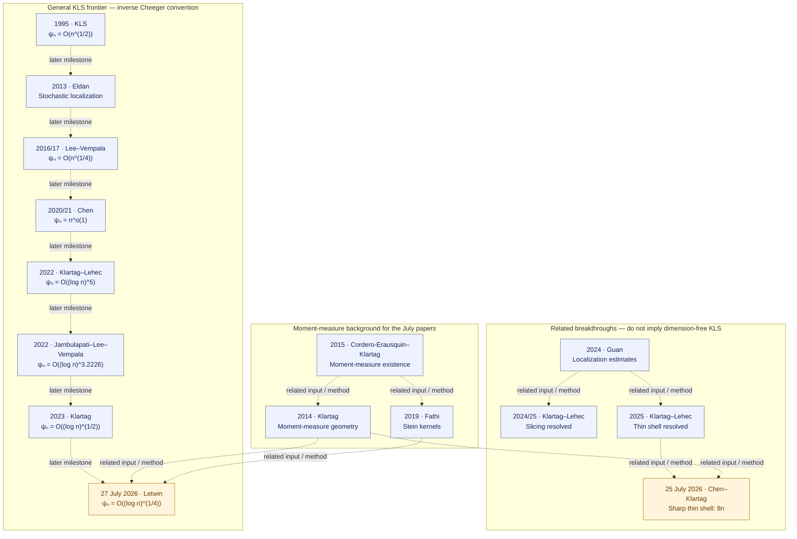
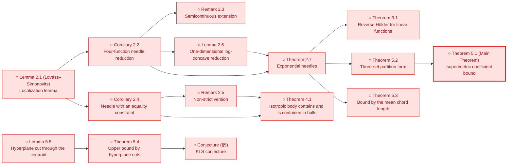
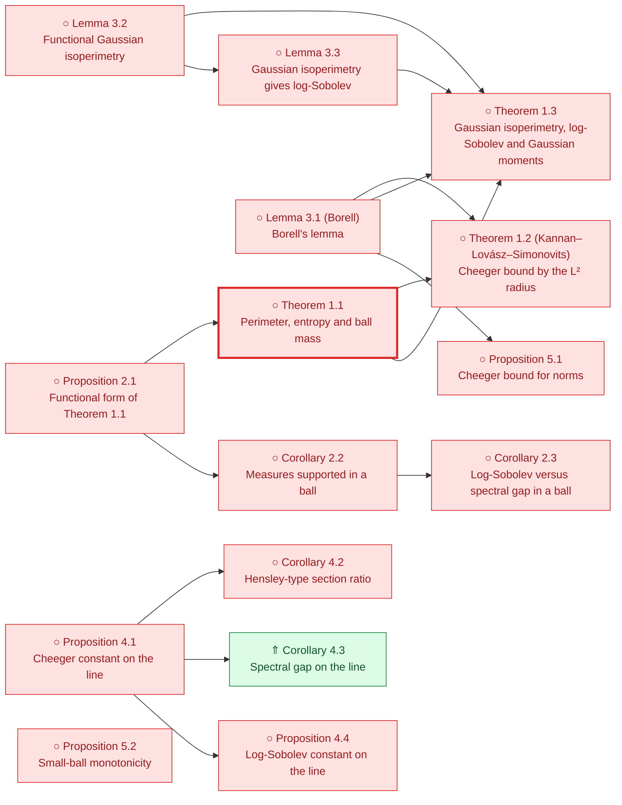
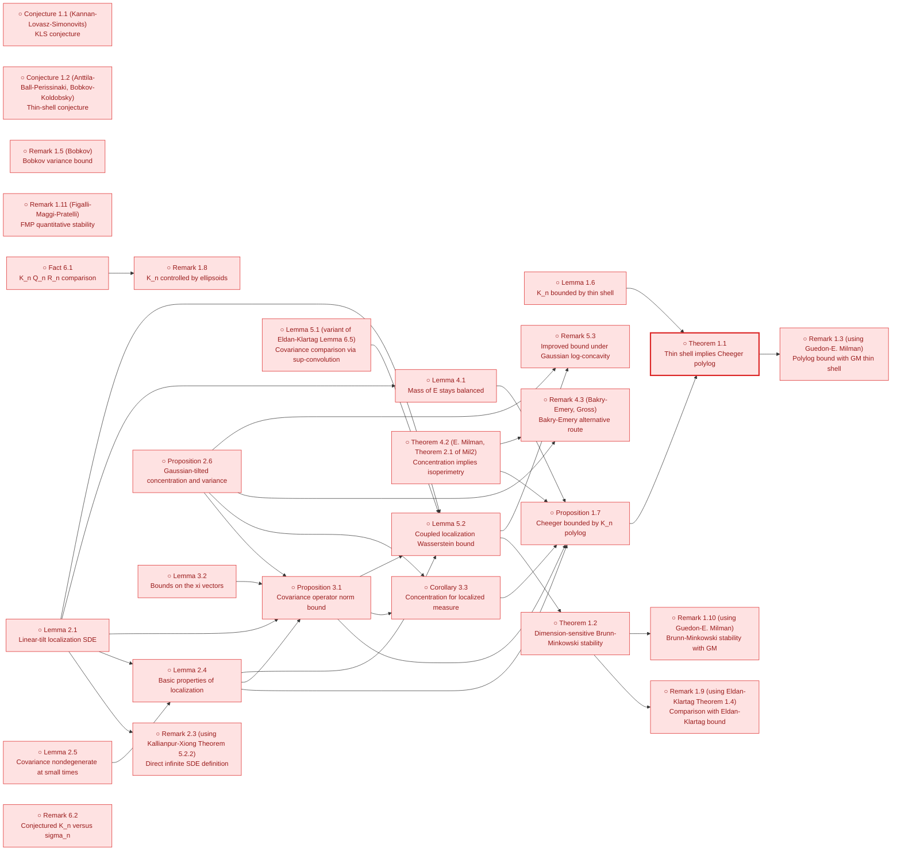
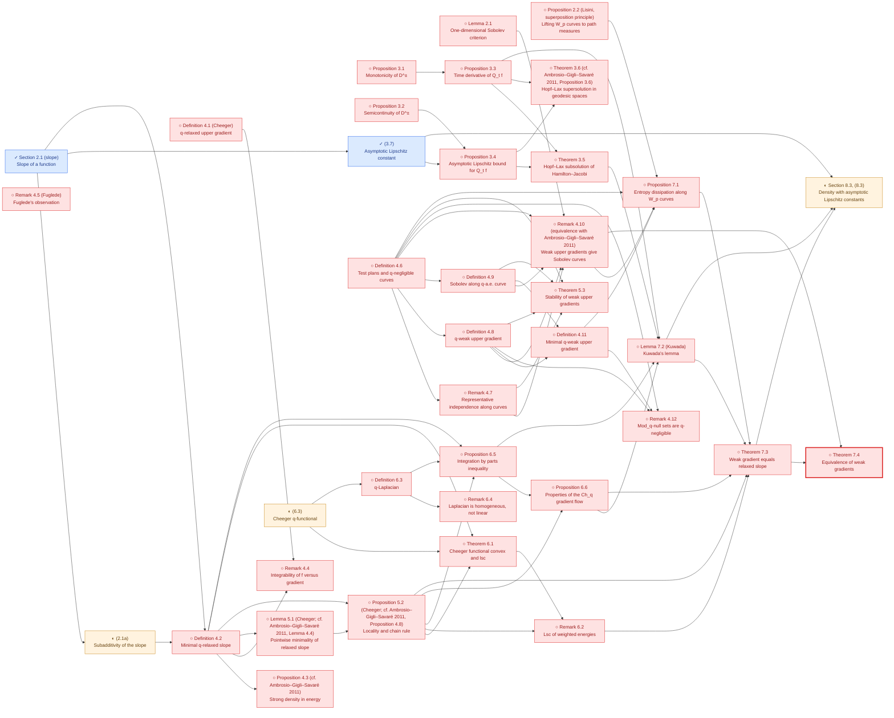
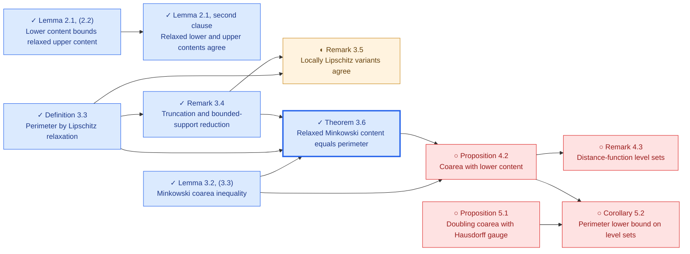
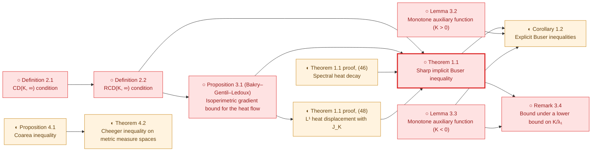

# KLS literature and local formalization

**Primary progress register** · [Progress hub](README.md) · [Route diagrams](README.md#proof-progress-tree) · [Node register](STATUS.md)

**Literature through July 2026 · Sources checked 2026-09-16 · 27 selected sources.**

Selected foundational sources, the main general KLS bound milestones, and the connected moment-map, slicing and thin-shell developments through July 2026; not an exhaustive bibliography or a paper-by-paper proof verification.

The literature has advanced to an inverse-Cheeger bound of order `(log n)^(1/4)` in the
[July 2026 Letwin preprint](https://arxiv.org/html/2607.24164v1). Our repository currently
formalizes selected analytic foundations and reductions; none of the general
dimension-dependent frontier bounds below is yet proved here. Dimension-free KLS remains open.

Publication status and local Lean status are separate columns. **◐ means named fragments or
restricted counterparts, never an entire paper; ○ means the selected main result is not
locally formalized.** A ✓ beside an individual local result is derived from the existing
Blueprint/progress records. It is not a new certificate or a certification of the source paper.

## When a paper is covered

A selected paper target is covered only after its main theorem has a faithful Lean statement
(including hypotheses, constants, normalization and dimensional scope), a proof without
nonstandard axioms, and a registered certificate with verification evidence for that exact
statement. A source review must identify the paper version and theorem being matched.
Supporting lemmas, restricted cases and conditional reductions do not meet this criterion.
**Covered by a registered paper-target certificate: Ambrosio–Di Marino–Gigli (Theorem 3.6).**
Existing fragment certificates are listed explicitly below; an unregistered proved target
is still awaiting certification.

## Current literature priorities

These are source-review and proof priorities, not claims that the targets are proved.
Every proof task must first pin its paper version, theorem, hypotheses and constants.

| Priority | Sources / target | Next action |
| --- | --- | --- |
| 1 | [Bakry–Gentil–Ledoux](https://link.springer.com/book/10.1007/978-3-319-00227-9) Audit the strongly log-concave Bakry–Émery C_P ≤ 1/ρ endpoint and select a separate Brascamp–Lieb source statement. | Pin the exact source theorem, positive-curvature assumptions and normalization; assess the existing Γ₂ and semigroup interfaces before proof work. |
| 2 | [Kannan–Lovász–Simonovits](https://link.springer.com/article/10.1007/BF02574061) Theorem 5.1, ψ(K) ≥ ln 2 / M₁(K) for convex bodies, through the needle reduction (Corollary 2.2, Lemma 2.6, Theorem 2.7). With the local Cheeger inequality it gives C_P ≲ E‖X − EX‖² for convex bodies. | Pin a proof of the cited localization lemma (Lovász–Simonovits 1993 or a modern account) and choose a Lean form for needles; keep the product denominator of (1.1) distinct from the min-denominator constant. |
| 3 | [E. Milman](https://arxiv.org/abs/0712.4092) Concentration implies a Cheeger bound under the source convexity hypotheses. | Pin the main theorem and its concentration/curvature assumptions; compare its analytic inputs with the current finite-dimensional Cheeger–Buser API. |
| 4 | [Eldan](https://arxiv.org/abs/1203.0893), [Lee–Vempala](https://annals.math.princeton.edu/2024/199-3/p02), [Chen](https://arxiv.org/abs/2011.13661), [Klartag–Lehec](https://arxiv.org/html/2203.15551v2), [Klartag](https://arxiv.org/html/2303.14938v2) Published stochastic-localization theorems and quantitative KLS bounds. | Reuse Mathlib probability foundations; build an isolated audited client of pinned external stochastic APIs before selecting the missing vector/matrix SDE bridges. |
| 5 | [Klartag–Lehec](https://arxiv.org/abs/2507.15495v2), [Chen–Klartag](https://arxiv.org/html/2607.23307v1), [Letwin](https://arxiv.org/html/2607.24164v1) Selected 2025–2026 thin-shell and quadratic-form results. | Retain exact preprint versions and assess moment-measure, stochastic and matrix-estimate dependencies; do not credit exploratory hypotheses as completed paper theorems. |

## Constant conventions

For isotropic log-concave laws, use `Var(f) ≤ C_P ∫‖∇f‖² dμ`, with no factor 1/2.
Write `h` for the Cheeger lower-bound constant with denominator `min(μ(A), 1−μ(A))`,
and `ψ = 1/h`, `ψₙ = sup_μ ψ(μ)` for the inverse convention. Some older papers use the
symbol ψ for h instead; their bounds are translated here. The original KLS paper also
uses a product denominator, so exact numerical constants cannot be copied unchanged.

The literature comparison is `ψ²/π ≤ C_P ≤ 4ψ²`; consequently `ψₙ = O((log n)^a)`
corresponds to `C_P = O((log n)^(2a))`. See [Letwin, introduction](https://arxiv.org/html/2607.24164v1#S1)
and [De Ponti–Mondino](https://arxiv.org/abs/1902.03835). The numerical comparison
for finite-dimensional log-concave laws is now a local Lean proof; the general RCD theorem
is not formalized here. Logarithmic bounds below use `n ≥ 2` (Guan’s iterated-log bound uses `n ≥ 3`).

## Literature map

Every node links to its source. Dashed arrows show later milestones or related methods,
**not logical implications, complete dependency lists, or Lean proof edges**. Blue is
literature context; amber highlights July 2026. Neither color means formalized.

The older dates in the KLS chain refer to first circulation/conference presentation;
the tables distinguish those dates from final journal publication. Slicing and thin shell
are separate achievements; their resolution does not give dimension-free KLS.

## Analytic foundations and selected local coverage

| Source and target theorem | Main result / role | Lean statements | Local coverage | Certificate | Remaining scope |
| --- | --- | --- | --- | --- | --- |
| [Borell — Convex measures on locally convex spaces](https://link.springer.com/article/10.1007/BF02384761) 1974 · Journal article Definition 1.1 and finite-dimensional density characterization | Convex/log-concave measures, inner measure and density representation on the affine support. | [Statement inventory](#borell1974-lean-statements) |  ✓ [Compact/Borel definitions with inner measure](../../formalization/blueprint/src/chapters/00-orientation-and-status.tex#L33) ✓ [Finite-dimensional intrinsic density representation](../../formalization/blueprint/src/chapters/00-orientation-and-status.tex#L95) | No paper-target certificate Supporting only: [`thm:borell-logconcave-density`](../../solutions/ThmBorellLogconcaveDensity.lean), [`thm:compact-borell-logconcavity-equivalence`](../../solutions/ThmCompactBorellLogconcavityEquivalence.lean) | The locally convex-space theory and the other convexity parameters are outside our finite-dimensional log-concave scope. |
| [Bobkov — Isoperimetric and analytic inequalities for log-concave probability measures](https://www-users.cse.umn.edu/~bobko001/papers/1999_AOP_Isop.pdf) 1999 · Journal article Corollary 4.3 and one-dimensional specialization | Cheeger/Poincaré inequalities for log-concave laws; the one-dimensional comparison yields C_P ≤ 12 Var. | [Statement inventory](#bobkov1999-lean-statements) |  ✓ [One-dimensional upper bound, now strengthened locally to 4 Var; the independent 12 Var proof is retained](../../formalization/blueprint/src/chapters/45-shared-analytic-bridges.tex#L739) | No paper-target certificate Supporting only: [`thm:one-dimensional-logconcave-poincare`](../../solutions/ThmOneDimensionalLogConcavePoincare.lean) | Our one-dimensional proof uses a different analytic argument. The paper’s general isoperimetric theory is not fully formalized. |
| [E. Milman — On the role of convexity in isoperimetry, spectral gap and concentration](https://arxiv.org/abs/0712.4092) 2009 · Journal article Main equivalence theorem | Under convexity, isoperimetry, spectral gap and concentration control one another up to universal constants. | No local target statement registered |  | No paper-target certificate | The full equivalence remains open locally; our forward infimum comparison is supporting infrastructure, not this theorem. |
| [Ambrosio–Gigli–Savaré — Density of Lipschitz functions and equivalence of weak gradients in metric measure spaces](https://arxiv.org/abs/1111.3730) 2011 preprint / 2013 publication · Journal article Weak-gradient and relaxed-energy equivalence theorems | Identifies weak-gradient notions and relaxed energies in metric measure spaces. | [Statement inventory](#ags2013-lean-statements) |  ✓ [Intrinsic absolutely-continuous E^can = 2 Ch in the local-slope convention](../../formalization/blueprint/src/chapters/30-open-canonical-bridges.tex#L121) | No paper-target certificate Supporting only: [`cor:absolutely-continuous-relaxation-two-cheeger`](../../solutions/CorAbsolutelyContinuousRelaxationTwoCheeger.lean) | The general metric-space theorem and unrestricted singular-law comparison are not formalized here. Our absolutely-continuous Euclidean identity is an independent restricted counterpart. |
| [Bakry–Gentil–Ledoux — Analysis and Geometry of Markov Diffusion Operators](https://link.springer.com/book/10.1007/978-3-319-00227-9) 2014 · Monograph Proposition 4.3.1; Gaussian Poincaré and Dirichlet-form background | Tensorization and Gaussian functional inequalities within the diffusion/Dirichlet-form framework. | [Statement inventory](#bgl2014-lean-statements) |  ✓ [Binary smooth-test tensorization](../../formalization/blueprint/src/chapters/40-certified-models.tex#L35) ✓ [Finite Hilbert-product constants, including empty products](../../formalization/blueprint/src/chapters/40-certified-models.tex#L52) ✓ [Exact one-dimensional Gaussian constant](../../formalization/blueprint/src/chapters/40-certified-models.tex#L70) | No paper-target certificate Supporting only: [`lem:poincare-finite-tensorization`](../../solutions/LemPoincareFiniteTensorization.lean), [`lem:poincare-gaussian-one-dimensional`](../../solutions/LemPoincareGaussianOneDimensional.lean), [`lem:poincare-tensorization`](../../solutions/LemPoincareTensorization.lean) | The full diffusion, semigroup and Γ-calculus theory is not covered by our selected results. |
| [Alonso-Gutiérrez–Bastero — Approaching the Kannan–Lovász–Simonovits and variance conjectures](https://link.springer.com/book/10.1007/978-3-319-13263-1) 2015 · Monograph Page 11; local source audit linked below | Records C_P ≤ 4 tr(Cov), whose one-dimensional specialization is 4 Var, in a broader account of KLS and the variance conjecture. | [Statement inventory](#alonsobastero2015-lean-statements) |  ✓ [One-dimensional 4 Var upper bound, including zero variance](../../formalization/blueprint/src/chapters/45-shared-analytic-bridges.tex#L739) | No paper-target certificate Supporting only: [`thm:one-dimensional-logconcave-poincare`](../../solutions/ThmOneDimensionalLogConcavePoincare.lean) | Only the one-dimensional bound is formalized here, by an independent proof. The high-dimensional trace bound, its original exact-constant attribution and optimality over all laws are not certified. |
| [Ambrosio–Di Marino–Gigli — Perimeter as relaxed Minkowski content in metric measure spaces](https://arxiv.org/abs/1603.08412) 2016 preprint / 2017 publication · Journal article Theorem 3.6 with Definition 3.3; Lemma 3.2 | A Minkowski coarea inequality and identification of relaxed Minkowski content with BV perimeter. | [Statement inventory](#admg2017-lean-statements) |  ✓ [Minkowski coarea inequality in the local Euclidean scope](https://github.com/numina-functional-inequalities/kls-lean/blob/main/formalization/FunctionalInequalities/KLS/Geometry/Cheeger/MinkowskiContent.lean) ✓ [Published finite-mass target / finite-on-bounded measure scope: bounded-support reduction, full coarea radius chain, lower-to-upper recovery, both actual recoveries and both relaxed identities; convex closed-support Cheeger identification](https://github.com/numina-functional-inequalities/kls-lean/blob/main/formalization/FunctionalInequalities/KLS/Geometry/Cheeger/BVIdentification.lean) | **Paper-target certificate:** [`thm:relaxed-minkowski-content-perimeter`](../../solutions/ThmRelaxedMinkowskiContentPerimeter.lean) | The complete lower/upper content, recovery and relaxation chain is formalized for finite Borel measures on arbitrary metric spaces. The new continuation proves the globally Lipschitz/global L1 bounded-support reduction of Remark 3.4 for every measurable finite-mass target under any Borel measure, the direct positive-level local-slope coarea upper bound under finite mass of a positive-support neighborhood (all levels for nonnegative functions), and perimeter at most lower content at measurable finite-mass targets. Under finiteness on bounded Borel sets, actual bounded measurable lower-recovery sets have finite mass and finite lower content term by term; indicators converge globally in L1 and lower contents converge to perimeter. The existing relaxed lower-content set infimum equals the perimeter at Theorem 3.6's measurable finite-mass target scope, including infinite perimeter and infinite total mass; convergence ensures eventual finite approximating-set masses without changing the class or excluding infinite-mass finite prefixes. Finite target mass and finite lower content imply a finite-mass positive neighborhood. Actual lower-to-upper radius recovery holds there, and a diagonal sequence gives bounded open upper-recovery sets with finite masses/contents and original global indicator L1 convergence. The existing relaxed upper infimum equals perimeter, hence the lower relaxation, at the published finite-mass target scope, including infinite perimeter by order. The full Lemma 3.2 chain is formalized with the actual right-radius liminf of integrated open-ball growth under nonnegativity and finite positive-support-neighborhood mass. Lemma 2.1 exposes the actual relaxed-upper <= lower-content bound at finite-mass Borel targets under any measure. Lemma 2.1's relaxed lower/upper-content equality is also formalized for every Borel measure at measurable finite-mass targets, and on proper metric spaces Remark 3.5's locally Lipschitz classes with global or compact-set L1 convergence have relaxation infima equal to the bounded-support perimeter at measurable finite-mass targets for every Borel measure (2026-10-01). The locally Lipschitz classes on nonproper spaces, nonconvex ambient/support transfer and general RCD comparisons remain pending. These local Lean results do not add ledger certificates; remote Lean verification is a separate check. |
| [De Ponti–Mondino — Sharp Cheeger–Buser type inequalities in RCD(K,∞) spaces](https://arxiv.org/abs/1902.03835) 2019 preprint / 2021 publication · Journal article Cheeger–Buser comparison; log-concave specialization in Letwin, introduction | Provides the sharp reverse-comparison input used to normalize ψ² and C_P; in the log-concave convention, 1/4 ≤ ψ²/C_P ≤ π. | [Statement inventory](#depontimondino2021-lean-statements) |  ✓ [Both numerical inequalities for every finite-dimensional log-concave probability law, including zero-dimensional affine support and extended optima](../../formalization/blueprint/src/chapters/45-shared-analytic-bridges.tex#L198) ✓ [Closed-support BV Cheeger constant equals the isoperimetric constant for finite-dimensional log-concave laws](https://github.com/numina-functional-inequalities/kls-lean/blob/main/formalization/FunctionalInequalities/KLS/Geometry/Cheeger/BVIdentification.lean) | No paper-target certificate | The numerical comparison is formalized for finite-dimensional log-concave laws. For the bounded-support metric BV test class, complement symmetry for finite measures, the half-mass/symmetric equality, the BV–Minkowski Cheeger identification for probability laws on normed spaces, and, for finite-dimensional log-concave laws, the identification of the BV Cheeger constant on the closed intrinsic support with the isoperimetric constant are formalized. Test-class equivalence is formalized for finite Borel measures (global Lipschitz/global L¹), and on proper spaces also for locally Lipschitz/global or compact-local L¹ approximants. The test-class comparison beyond this scope, constant identification on nonconvex supports, and the paper's RCD(K,∞) theorem remain unformalized. |

## General KLS bounds and stochastic localization

| Source and target theorem | Main result / role | Lean statements | Local coverage | Certificate | Remaining scope |
| --- | --- | --- | --- | --- | --- |
| [Kannan–Lovász–Simonovits — Isoperimetric problems for convex bodies and a localization lemma](https://link.springer.com/article/10.1007/BF02574061) 1995 · Journal article Theorem 5.1 (Main Theorem); needle reduction of Section 2 | For every convex body K, ψ(K) ≥ ln 2 / M₁(K), with M₁ the mean distance to the centroid; for isotropic bodies this is the dimension-scale bound ψₙ = O(n^(1/2)). States the KLS conjecture. The localization lemma is quoted from Lovász–Simonovits (1993) and extended to exponential needles. | No local target statement registered |  | No paper-target certificate | No statement of the paper is formalized. The localization lemma (Lemma 2.1) is only cited, so a Lean proof needs Lovász–Simonovits (1993) or a later proof. The paper proves no Poincaré or covariance bound; with the local Cheeger inequality, Theorem 5.1 would give C_P ≤ (16 / ln² 2) E‖X − EX‖² for convex bodies, the factor 2 coming from the product denominator, once the paper's boundary measure is matched with the local outer Minkowski content. |
| [Eldan — Thin shell implies spectral gap up to polylog via a stochastic localization scheme](https://arxiv.org/abs/1203.0893) 2012 preprint / 2013 publication · Journal article Main thin-shell/spectral-gap comparison | Introduces stochastic localization and transfers thin-shell control to KLS with logarithmic losses. | No local target statement registered |  | No paper-target certificate | The stochastic process, its covariance estimates and the transfer theorem are not locally formalized. |
| [Lee–Vempala — Eldan’s stochastic localization and the KLS conjecture: Isoperimetry, concentration and mixing](https://annals.math.princeton.edu/2024/199-3/p02) 2016 preprint / 2017 FOCS / 2024 journal · Journal article Main Poincaré estimate | For isotropic log-concave laws, C_P = O(n^(1/2)), equivalently ψₙ = O(n^(1/4)); the paper also studies mixing and concentration. | No local target statement registered |  | No paper-target certificate | The quantitative localization theorem, covariance bounds and mixing results are not locally formalized. |
| [Chen — An almost constant lower bound of the isoperimetric coefficient in the KLS conjecture](https://arxiv.org/abs/2011.13661) 2020 preprint / 2021 publication · Journal article Main bound, translated from the lower-bound convention for h | ψₙ ≤ exp(C√(log n · log log n)) = n^o(1); hence C_P = n^o(1), breaking the polynomial barrier. | No local target statement registered |  | No paper-target certificate | The stochastic-localization bootstrap and the subpolynomial bound are not locally formalized. |
| [Klartag–Lehec — Bourgain’s slicing problem and KLS isoperimetry up to polylog](https://arxiv.org/html/2203.15551v2) 2022 · Journal article Theorem 1.1 and end of Section 6 | First polylogarithmic KLS bound: ψₙ = O((log n)^5), hence C_P = O((log n)^10). | No local target statement registered |  | No paper-target certificate | The localization covariance window and spectral argument are not locally formalized. |
| [Jambulapati–Lee–Vempala — A slightly improved bound for the KLS constant](https://arxiv.org/html/2208.11644v2) 2022 · Preprint (v2) Theorem 2 | Improves the logarithmic exponent: ψₙ = O((log n)^3.2226), hence C_P = O((log n)^6.4452). | No local target statement registered |  | No paper-target certificate | The refined localization growth estimate and resulting bound are not locally formalized. |
| [Klartag — Logarithmic bounds for isoperimetry and slices of convex sets](https://arxiv.org/html/2303.14938v2) 2023 · Journal article Theorems 1.2 and 1.3 | ψₙ = O(√log n), hence C_P = O(log n), using an improved log-concave Lichnerowicz inequality. | No local target statement registered |  | No paper-target certificate | The improved Lichnerowicz estimate and stochastic localization remain unformalized locally. |
| [Letwin — The KLS constant is O(log^(1/4) n)](https://arxiv.org/html/2607.24164v1) 27 July 2026 · Preprint (v1) Theorems 1.1 and 1.2 | For isotropic log-concave X and symmetric M, Var(XᵀMX) ≤ 8‖M‖²_HS = 2 E‖∇(XᵀMX)‖². For n ≥ 2, ψₙ = O((log n)^(1/4)), hence C_P = O(√log n). | No local target statement registered |  | No paper-target certificate | The quadratic inequality, its moment-map/Stein proof and the κₙ-to-KLS conversion are not locally formalized. Quadratic tests do not suffice for full KLS. |

## Moment measures and Stein kernels

| Source and target theorem | Main result / role | Lean statements | Local coverage | Certificate | Remaining scope |
| --- | --- | --- | --- | --- | --- |
| [Klartag — Logarithmically-concave moment measures I](https://arxiv.org/abs/1309.2767) 2013 preprint / 2014 publication · Book chapter Theorem 1.1; weighted moment-measure geometry | Develops the Hessian metric and weighted Poincaré structure associated with log-concave moment measures. | No local target statement registered |  | No paper-target certificate | Moment-map existence/regularity, the Hessian metric and weighted geometric identities are not locally formalized. |
| [Cordero-Erausquin–Klartag — Moment measures](https://arxiv.org/abs/1304.0630) 2013 preprint / 2015 publication · Journal article Theorem 2 | A nonzero finite centered measure whose support spans the space is the moment measure of an essentially continuous convex potential, unique up to translation. | No local target statement registered |  | No paper-target certificate | The existence/uniqueness theorem is not locally formalized; generic closed forms do not supply its convex potential. |
| [Fathi — Stein kernels and moment maps](https://arxiv.org/abs/1804.04699) 2018 preprint / 2019 publication · Journal article Moment-map Stein-kernel construction | Constructs Stein kernels using moment maps, connecting Hessian geometry to probabilistic identities. | No local target statement registered |  | No paper-target certificate | The canonical moment-map Stein kernel is not locally formalized. |

## Thin shell and slicing

| Source and target theorem | Main result / role | Lean statements | Local coverage | Certificate | Remaining scope |
| --- | --- | --- | --- | --- | --- |
| [Guédon–Milman — Interpolating thin-shell and sharp large-deviation estimates for isotropic log-concave measures](https://arxiv.org/abs/1011.0943v3) 2010 preprint / 2011 publication · Journal article Main deviation estimate | Quantitative radial concentration across thin-shell and large-deviation scales for isotropic log-concave laws. | No local target statement registered |  | No paper-target certificate | Radial deviation estimates and their thin-shell/isoperimetric consequences are not locally formalized. |
| [Guan — A note on Bourgain’s slicing problem](https://arxiv.org/html/2412.09075v1) 2024 · Preprint (v1) Theorems 1.1 and 1.2; covariance estimates | Obtains an iterated-logarithmic slicing bound and localization estimates used in the later slicing and thin-shell work. | No local target statement registered |  | No paper-target certificate | The covariance process and Guan’s estimates are not locally formalized. |
| [Klartag–Lehec — Affirmative resolution of Bourgain’s slicing problem using Guan’s bound](https://arxiv.org/abs/2412.15044) 2024 preprint / 2025 publication · Journal article Main slicing theorem | Every volume-one convex body has a hyperplane section of volume at least a universal positive constant. This resolves slicing, not KLS. | No local target statement registered |  | No paper-target certificate | The slicing theorem, M-ellipsoids and entropy-stability inputs are not locally formalized. |
| [Bizeul — The slicing conjecture via small ball estimates](https://arxiv.org/abs/2501.06854) 2025 · Preprint Main alternative proof | An alternative proof of slicing via small-ball estimates and Guan’s localization bound. | No local target statement registered |  | No paper-target certificate | The small-ball argument and slicing conclusion are not locally formalized. |
| [Klartag–Lehec — Thin-shell bounds via parallel coupling](https://arxiv.org/abs/2507.15495v2) 21 July 2025 / v2 23 February 2026 · Preprint (v2) Main thin-shell theorem | For isotropic log-concave X, E(‖X‖ − √n)² ≤ C with a universal constant, via parallel coupling. | No local target statement registered |  | No paper-target certificate | The coupling construction and dimension-free thin-shell theorem are not locally formalized; thin shell alone does not remove the KLS logarithms. |
| [Chen–Klartag — Digesting the proof of the sharp thin-shell inequality](https://arxiv.org/html/2607.23307v1) 25 July 2026 · Preprint (v1) Theorems 1.1, 1.2 and 1.5 | For isotropic log-concave X: Var(‖X‖²) ≤ 8n and ‖T₃(X)‖²_HS ≤ 4n. The constants are sharp. | No local target statement registered |  | No paper-target certificate | The moment-Hessian estimate, third-order tensor identities and sharp conclusions are not locally formalized. A trace bound is not a universal matrix bound. |

## Reading guides

| Source and target theorem | Main result / role | Lean statements | Local coverage | Certificate | Remaining scope |
| --- | --- | --- | --- | --- | --- |
| [Lee–Vempala — The Kannan–Lovász–Simonovits conjecture](https://arxiv.org/abs/1807.03465) 2018 · Survey preprint Survey | A guide to KLS formulations, geometric consequences and algorithmic motivation at the 2018 frontier. | No local target statement registered |  | No paper-target certificate | Use for orientation; its historical frontier is superseded by the later papers in the frontier table. |
| [Klartag–Lehec — Isoperimetric inequalities in high-dimensional convex sets](https://arxiv.org/abs/2406.01324) 2024 preprint / 2025 publication · Published lecture notes Lecture notes | A detailed entry point to stochastic localization, KLS and slicing up to the period covered by the notes. | No local target statement registered |  | No paper-target certificate | Reading guide; the July 2026 frontier requires the newer sources in the frontier table. |

## Paper lemma maps

Each map lists the numbered statements of one pinned source and the Lean declarations
that state them. ✓, ◐ and ○ are derived from the declarations: no declaration is ○, a
declaration whose body contains `sorry` or a recorded partial scope is ◐. ⇑ marks a
reviewed stronger statement or a different proof route; dropping a hypothesis the paper
never uses stays ✓. A paper is covered only by its certified main theorem (thick border).

✓ Formalized in Lean · ◐ Partial or statement only · ○ Not yet formalized · ⇑ Stronger result or alternative route

### KLS1995 lemma map

Source: [Kannan–Lovász–Simonovits, Discrete Comput. Geom. 13 (1995), 541–559](https://link.springer.com/article/10.1007/BF02574061), reviewed 2026-10-02.

Standing assumptions: Convex bodies in R^n with Lebesgue (uniform) measure; the isoperimetric coefficient ψ(K) uses the product denominator vol(S)·vol(K∖S)/vol(K) of (1.1), within a factor 2 of the min-denominator form (1.2).

| Item | Statement | Status | Lean declarations | Note |
| --- | --- | --- | --- | --- |
| Lemma 2.1 (Lovász–Simonovits) | For lower semicontinuous integrable g, h on R^n with positive integrals, some needle (segment with a linear weight to the power n−1) has positive g- and h-integrals. | ○ Not yet formalized | — | Cited from Lovász–Simonovits (1993); its proof is not in this paper. |
| Corollary 2.2 | For nonnegative continuous f1..f4 and α, β > 0, an inequality between products of integral powers holds on every convex body iff it holds on every needle. | ○ Not yet formalized | — |  |
| Remark 2.3 | Corollary 2.2 extends to upper semicontinuous f1, f2 and lower semicontinuous f3, f4. | ○ Not yet formalized | — |  |
| Corollary 2.4 | On a bounded open convex T, if ∫g > 0 and ∫h = 0 for bounded lower semicontinuous g and continuous h, some needle in T has positive g-integral and zero h-integral. | ○ Not yet formalized | — |  |
| Remark 2.5 | Strict inequalities in Corollary 2.4 may be replaced by non-strict ones. | ○ Not yet formalized | — |  |
| Lemma 2.6 | On an interval, a four-function inequality holds for every log-concave weight iff it holds for every exponential weight on every subinterval. | ○ Not yet formalized | — |  |
| Theorem 2.7 | For nonnegative continuous f1..f4 on R^n, the four-function inequality holds for every compactly supported log-concave F iff it holds on every exponential needle. | ○ Not yet formalized | — |  |
| Theorem 3.1 | For 0 < p < q there is C(p, q), independent of n and K, with ‖f‖_q ≤ C(p, q)‖f‖_p for every linear f on a convex body K. | ○ Not yet formalized | — |  |
| Theorem 4.1 | An isotropic convex body satisfies √((n+2)/n) B ⊆ K ⊆ √(n(n+2)) B. | ○ Not yet formalized | — |  |
| **Theorem 5.1 (Main Theorem)** (main) | For every convex body K, ψ(K) ≥ ln 2 / M₁(K), where M₁ is the mean distance to the centroid. | ○ Not yet formalized | — | Convex bodies only; the later log-concave version is quoted as Theorem 5.11 of Milman (2009). |
| Theorem 5.2 | If K = K1 ∪ K2 ∪ K3 with dist(K1, K2) ≥ ε > 0, then ε·vol(K1)·vol(K2) ≤ vol(K)·vol(K3)·M₁(K)/ln 2. | ○ Not yet formalized | — |  |
| Theorem 5.3 | ψ(K) ≥ 1/χ(K), where χ(K) averages the longest chord of K centred at each point. | ○ Not yet formalized | — |  |
| Conjecture (§5) | ψ(K) is of order 1/√a(K), where a(K) is the largest eigenvalue of the inertia matrix. | ○ Not yet formalized | — | The repository states a covariance-normalized Poincaré version for log-concave laws (KLS.Conjecture); it is not a literal form of this convex-body conjecture. |
| Theorem 5.4 | ψ(K) ≤ 10/√a(K) for every convex body K. | ○ Not yet formalized | — |  |
| Lemma 5.5 | For b(K) = 0 and a unit vector u, the two halves of K cut by u^⊥ satisfy a product-volume bound against the section area and β = E(u·x)². | ○ Not yet formalized | — |  |

Not listed: Remark 2.8 is a normalization comment. The paper proves no Poincaré or trace-of-covariance bound; those appear in later literature.

### Bobkov1999 lemma map

Source: [Bobkov, Ann. Probab. 27 (1999), no. 4, 1903–1921 (author PDF)](https://www-users.cse.umn.edu/~bobko001/papers/1999_AOP_Isop.pdf), reviewed 2026-10-02.

Standing assumptions: Absolutely continuous log-concave probability measures on R^n; μ⁺ is the Minkowski boundary measure; Is(μ) is the min-denominator Cheeger constant h, λ₁ = 1/C_P is the spectral gap and ρ the log-Sobolev constant.

| Item | Statement | Status | Lean declarations | Note |
| --- | --- | --- | --- | --- |
| **Theorem 1.1** (main) | For log-concave μ on R^n, every measurable A, x₀ and r > 0: 2rμ⁺(A) ≥ μ(A)log(1/μ(A)) + (1 − μ(A))log(1/(1 − μ(A))) + log μ{&#124;x − x₀&#124; ≤ r}. | ○ Not yet formalized | — |  |
| Theorem 1.2 (Kannan–Lovász–Simonovits) | Is(μ) ≥ 1/(K‖&#124;x − x₀&#124;‖_{L²(μ)}) with x₀ the barycenter and K universal; hence λ₁ ≥ 1/(4K²‖&#124;x − x₀&#124;‖²_{L²}) by Cheeger. | ○ Not yet formalized | — | The proof gives Is(μ) ≥ 1/(6r) with r the 2/3-quantile of &#124;x − x₀&#124; (3.3). |
| Theorem 1.3 | For log-concave μ, Gaussian-type isoperimetry, a log-Sobolev inequality and ∫exp(ε&#124;x&#124;²)dμ < ∞ are equivalent, with ρ ≥ 1/(K‖&#124;x − x₀&#124;‖²_ψ) for ψ(u) = exp(u²) − 1. | ○ Not yet formalized | — |  |
| Proposition 2.1 | For locally Lipschitz f with values in [0, 1] and a symmetric convex body B: 2∫‖∇f‖_{B°}dμ ≥ Ent(f) + Ent(1 − f) + log μ(B(x₀)). | ○ Not yet formalized | — | Proved by the Prékopa–Leindler inequality. |
| Corollary 2.2 | If μ is concentrated in a ball of radius r, then 2r∫&#124;∇f&#124;dμ ≥ Ent(f) + Ent(1 − f) and 2rμ⁺(A) ≥ μ(A)log(1/μ(A)) + (1 − μ(A))log(1/(1 − μ(A))); hence Is(μ) ≥ log 2/r and λ₁ ≥ log²2/(4r²). | ○ Not yet formalized | — |  |
| Corollary 2.3 | If μ is concentrated in a ball of radius r, then λ₁/(1 + 2r√λ₁) ≤ ρ ≤ λ₁, so ρ ≥ 1/(10r²). | ○ Not yet formalized | — |  |
| Lemma 3.1 (Borell) | For symmetric convex B with θ = μ(B) > 1/2 and t ≥ 1: 1 − μ(tB) ≤ (1 − θ)((1 − θ)/θ)^((t−1)/2). | ○ Not yet formalized | — |  |
| Lemma 3.2 | If μ⁺(A) ≥ cI(μ(A)) for the Gaussian isoperimetric function I, then c[I(∫f) − ∫I(f)] ≤ ∫&#124;∇f&#124; for locally Lipschitz f with values in [0, 1]. | ○ Not yet formalized | — |  |
| Lemma 3.3 | Inequality (3.10) implies (c²/2)Ent(f²) ≤ ∫&#124;∇f&#124;² dμ. | ○ Not yet formalized | — |  |
| Proposition 4.1 | For log-concave μ on R: 1/(3Var) ≤ Is²(μ) ≤ 2/Var, with equality cases the uniform and two-sided exponential laws; Is(μ) = 2f(m) at the median. | ○ Not yet formalized | — | Locally only weaker bounds are proved: Ψ² ≤ 12 C_P on the line and Ψ² ≤ π C_P in general, which with C_P ≤ 4 Var do not give the constant 3. |
| Corollary 4.2 | For a convex body satisfying the isotropy condition, central sections by hyperplanes cutting B into equal volumes have ratio at most √6. | ○ Not yet formalized | — |  |
| Corollary 4.3 | For log-concave μ on R: 1/(12 Var) ≤ λ₁ ≤ 1/Var, i.e. Var ≤ C_P ≤ 12 Var. | ⇑ Stronger result or alternative route | [`localSlope_constant_le_four_variance`](../../formalization/FunctionalInequalities/KLS/LogConcave/Line/SharpPoincare.lean) [`localSlope_constant_le_twelve_variance_of_four`](../../formalization/FunctionalInequalities/KLS/LogConcave/Line/SharpPoincare.lean) [`evariance_le_smoothTest_constant`](../../formalization/FunctionalInequalities/KLS/LogConcave/Line/Buser.lean) | Sharper upper constant C_P ≤ 4 Var, proved by a different argument that does not use Proposition 4.1; the paper's 12 Var follows as a corollary, and Var ≤ C_P is the linear test. |
| Proposition 4.4 | For log-concave μ on R: 1/(24‖ξ − Eξ‖²_ψ) ≤ ρ ≤ 8/(3‖ξ − Eξ‖²_ψ) with ψ(x) = exp(x²) − 1. | ○ Not yet formalized | — |  |
| Proposition 5.1 | For a random vector X with log-concave law in a normed space, Is(μ_X) ≥ 1/(6r) with r the 2/3-quantile of ‖X‖, where μ_X is the law of ‖X‖. | ○ Not yet formalized | — |  |
| Proposition 5.2 | With F(t) = P(‖X‖ ≤ t), the function F(t)/t^(1/(2e)) is nondecreasing where 0 < F(t) ≤ e/(e + 1). | ○ Not yet formalized | — |  |

Not listed: The displayed consequences (1.8), (2.7), (2.8) and (2.10) are recorded with the statements they follow from.

### Milman2009 lemma map

Source: [E. Milman, arXiv:0712.4092v5](https://arxiv.org/abs/0712.4092v5), reviewed 2026-10-02.

Standing assumptions: Metric probability spaces; "convexity assumptions" mean total-variation limits of weighted Riemannian manifolds with Ric + Hess ψ ≥ 0. D_Che is the min-denominator Cheeger constant h and D_Poin = 1/√C_P, so D_Poin ≥ D_Che/2 is C_P ≤ 4Ψ². Attributed statements are quoted from the cited authors.

```mermaid
flowchart LR
    Milman2009_DChe["◐ Definition (§1.1, Cheeger)<br/>Cheeger constant D_Che"]
    Milman2009_DPoin["◐ Definition (§1.1, Poincaré)<br/>Poincaré constant D_Poin"]
    Milman2009_DExp["○ Definition (§1.1, exponential concentration)<br/>Exponential concentration D_Exp"]
    Milman2009_DFM["○ Definition (§1.3, first moment)<br/>First-moment concentration D_FM"]
    Milman2009_T11["◐ Theorem 1.1 (Maz'ya, Cheeger)<br/>Cheeger inequality"]
    Milman2009_T12["○ Theorem 1.2 (Gromov–Milman)<br/>Poincaré implies exponential concentration"]
    Milman2009_T13["○ Theorem 1.3 (Buser)<br/>Buser inequality on closed manifolds"]
    Milman2009_T14["◐ Theorem 1.4 (Ledoux)<br/>Buser–Ledoux inequality"]
    Milman2009_T15["○ Theorem 1.5 (Main Theorem)<br/>Cheeger, Poincaré and concentration are equivalent"]
    Milman2009_T16["○ Theorem 1.6<br/>Lipschitz-distance form of D_Che"]
    Milman2009_T17["○ Theorem 1.7<br/>Stability of D_Che for convex domains"]
    Milman2009_T18["○ Theorem 1.8 (Bavard–Pansu, …, Bobkov)<br/>Concavity of the isoperimetric profile"]
    Milman2009_L21["○ Lemma 2.1<br/>Mean versus median in Orlicz norms"]
    Milman2009_L22["○ Lemma 2.2 (Maz'ya, Federer–Fleming, Bobkov–Houdré)<br/>Cheeger as an L¹ Poincaré inequality"]
    Milman2009_R23["✓ Remark 2.3<br/>Metric gradient"]
    Milman2009_T24["○ Theorem 2.4<br/>All (p, q) Poincaré inequalities are equivalent"]
    Milman2009_P25["○ Proposition 2.5<br/>Monotonicity of (p, q) constants"]
    Milman2009_C26["◐ Corollary 2.6<br/>Maz'ya–Cheeger inequality, new proof"]
    Milman2009_C27["○ Corollary 2.7<br/>Gromov–Milman inequality, new proof"]
    Milman2009_R28["○ Remark 2.8<br/>Concentration from (r, r) Poincaré"]
    Milman2009_T29["○ Theorem 2.9<br/>Poincaré versus profile decay"]
    Milman2009_P210["○ Proposition 2.10 (Maz'ya, Federer–Fleming, Bobkov–Houdré)<br/>L¹-type Poincaré versus isoperimetry"]
    Milman2009_R211["○ Remark 2.11<br/>Uniform measures strengthen the results"]
    Milman2009_L31["◐ Lemma 3.1 (Bakry–Ledoux)<br/>Reverse local Poincaré inequality"]
    Milman2009_C32["◐ Corollary 3.2 (Ledoux)<br/>L¹ heat displacement"]
    Milman2009_L41["○ Lemma 4.1<br/>Paley–Zygmund-type quantile bound"]
    Milman2009_P42["○ Proposition 4.2<br/>Optimal 1-Lipschitz functions behave like linear ones"]
    Milman2009_C43["○ Corollary 4.3<br/>Slow tail decay suffices"]
    Milman2009_L51["○ Lemma 5.1<br/>Going down to a large convex subset"]
    Milman2009_L52["○ Lemma 5.2<br/>Going up to a convex superset"]
    Milman2009_C53["○ Corollary 5.3<br/>Stability under Banach–Mazur-close bodies"]
    Milman2009_L54["○ Lemma 5.4<br/>Log-concave version of Lemmas 5.1–5.2"]
    Milman2009_T55["○ Theorem 5.5<br/>Total-variation stability of D_Che"]
    Milman2009_E56["○ Example 5.6<br/>Optimality of the stability exponent"]
    Milman2009_E57["○ Example 5.7<br/>Optimality of Corollary 5.3"]
    Milman2009_R58["○ Remark 5.8<br/>Sharper stability near the Euclidean ball"]
    Milman2009_T59["○ Theorem 5.9<br/>Lipschitz-on-average transport"]
    Milman2009_T510["○ Theorem 5.10 (Payne–Weinberger, Li–Yau)<br/>Diameter bound for convex domains"]
    Milman2009_T511["○ Theorem 5.11 (Kannan–Lovász–Simonovits)<br/>KLS first-moment bound"]
    Milman2009_T512["○ Theorem 5.12<br/>First-moment bound under convexity assumptions"]
    Milman2009_T514["○ Theorem 5.14 (Kannan–Lovász–Simonovits)<br/>Mean chord bound"]
    Milman2009_T515["○ Theorem 5.15 (Bobkov)<br/>Variance-of-norm bound"]
    Milman2009_T516["○ Theorem 5.16 (Sodin)<br/>Uniform bound for ℓ_p balls"]
    Milman2009_L61["○ Lemma 6.1<br/>Profile lower semicontinuity from above"]
    Milman2009_L62["○ Lemma 6.2<br/>Profile lower semicontinuity from within"]
    Milman2009_P64["○ Proposition 6.4 (Maz'ya, Federer–Fleming, Bobkov–Houdré)<br/>Profile versus capacity"]
    Milman2009_C65["○ Corollary 6.5<br/>Profile symmetry"]
    Milman2009_L66["○ Lemma 6.6<br/>Upper semicontinuity under concavity"]
    Milman2009_P68["○ Proposition 6.8<br/>Convergence of profiles"]
    Milman2009_L69["○ Lemma 6.9<br/>Hölder continuity of the profile"]
    Milman2009_T610["○ Theorem 6.10<br/>Approximation preserves concavity"]
    Milman2009_C611["○ Corollary 6.11<br/>Convex bodies satisfy the assumptions"]
    Milman2009_C612["○ Corollary 6.12<br/>Log-concave measures satisfy the assumptions"]
    Milman2009_L613["○ Lemma 6.13<br/>Borell-type tail bound"]
    Milman2009_T614["○ Theorem 6.14 (Cordero-Erausquin–McCann–Schmuckenschläger)<br/>Riemannian Prékopa–Leindler"]
    Milman2009_TA1["○ Theorem A.1 (Bavard–Pansu, …, Bayle–Rosales)<br/>Concavity for uniform measures"]
    Milman2009_TA2["○ Theorem A.2 (Bayle, Morgan)<br/>Concavity for weighted manifolds"]
    Milman2009_TA3["○ Theorem A.3 (after Sternberg–Zumbrun, Bayle)<br/>Concavity on locally convex domains"]
    Milman2009_TA4["○ Theorem A.4 (Bobkov)<br/>One-dimensional log-concave profile"]
    Milman2009_RA5["○ Remark A.5<br/>Half-lines are minimizers"]
    Milman2009_DChe --> Milman2009_T11
    Milman2009_DPoin --> Milman2009_T11
    Milman2009_DExp --> Milman2009_T12
    Milman2009_DPoin --> Milman2009_T12
    Milman2009_L31 --> Milman2009_T14
    Milman2009_T24 --> Milman2009_T15
    Milman2009_C26 --> Milman2009_T15
    Milman2009_C27 --> Milman2009_T15
    Milman2009_T610 --> Milman2009_T15
    Milman2009_L613 --> Milman2009_T15
    Milman2009_L22 --> Milman2009_T16
    Milman2009_L21 --> Milman2009_T16
    Milman2009_T15 --> Milman2009_T16
    Milman2009_L51 --> Milman2009_T17
    Milman2009_L52 --> Milman2009_T17
    Milman2009_TA1 --> Milman2009_T18
    Milman2009_TA2 --> Milman2009_T18
    Milman2009_TA3 --> Milman2009_T18
    Milman2009_TA4 --> Milman2009_T18
    Milman2009_DChe --> Milman2009_L22
    Milman2009_T29 --> Milman2009_T24
    Milman2009_T18 --> Milman2009_T24
    Milman2009_P25 --> Milman2009_T24
    Milman2009_C65 --> Milman2009_T24
    Milman2009_P25 --> Milman2009_C26
    Milman2009_L22 --> Milman2009_C26
    Milman2009_L21 --> Milman2009_C27
    Milman2009_P25 --> Milman2009_C27
    Milman2009_C27 --> Milman2009_R28
    Milman2009_C32 --> Milman2009_T29
    Milman2009_L21 --> Milman2009_T29
    Milman2009_P25 --> Milman2009_T29
    Milman2009_P210 --> Milman2009_T29
    Milman2009_T18 --> Milman2009_R211
    Milman2009_P210 --> Milman2009_R211
    Milman2009_L31 --> Milman2009_C32
    Milman2009_C27 --> Milman2009_P42
    Milman2009_L613 --> Milman2009_P42
    Milman2009_L21 --> Milman2009_P42
    Milman2009_L41 --> Milman2009_P42
    Milman2009_P42 --> Milman2009_C43
    Milman2009_P42 --> Milman2009_L51
    Milman2009_L21 --> Milman2009_L51
    Milman2009_C611 --> Milman2009_L52
    Milman2009_C612 --> Milman2009_L52
    Milman2009_T18 --> Milman2009_L52
    Milman2009_T610 --> Milman2009_L52
    Milman2009_L51 --> Milman2009_C53
    Milman2009_L52 --> Milman2009_C53
    Milman2009_L51 --> Milman2009_L54
    Milman2009_L52 --> Milman2009_L54
    Milman2009_L54 --> Milman2009_T55
    Milman2009_T17 --> Milman2009_E56
    Milman2009_C53 --> Milman2009_E57
    Milman2009_L51 --> Milman2009_R58
    Milman2009_C53 --> Milman2009_R58
    Milman2009_L22 --> Milman2009_T59
    Milman2009_L21 --> Milman2009_T59
    Milman2009_T15 --> Milman2009_T512
    Milman2009_T514 --> Milman2009_T515
    Milman2009_T512 --> Milman2009_T515
    Milman2009_T55 --> Milman2009_T515
    Milman2009_P64 --> Milman2009_C65
    Milman2009_L61 --> Milman2009_P68
    Milman2009_L62 --> Milman2009_P68
    Milman2009_L66 --> Milman2009_P68
    Milman2009_P68 --> Milman2009_T610
    Milman2009_L69 --> Milman2009_T610
    Milman2009_T18 --> Milman2009_T610
    Milman2009_T610 --> Milman2009_C611
    Milman2009_T610 --> Milman2009_C612
    Milman2009_TA4 --> Milman2009_C612
    Milman2009_T614 --> Milman2009_L613
    Milman2009_TA4 --> Milman2009_RA5
    classDef lemma_formalized fill:#dbeafe,stroke:#2563eb,color:#1e3a8a;
    class Milman2009_R23 lemma_formalized;
    classDef lemma_partial fill:#fff3df,stroke:#c88719,color:#66420d;
    class Milman2009_DChe,Milman2009_DPoin,Milman2009_T11,Milman2009_T14,Milman2009_C26,Milman2009_L31,Milman2009_C32 lemma_partial;
    classDef lemma_pending fill:#fee2e2,stroke:#dc2626,color:#991b1b;
    class Milman2009_DExp,Milman2009_DFM,Milman2009_T12,Milman2009_T13,Milman2009_T15,Milman2009_T16,Milman2009_T17,Milman2009_T18,Milman2009_L21,Milman2009_L22,Milman2009_T24,Milman2009_P25,Milman2009_C27,Milman2009_R28,Milman2009_T29,Milman2009_P210,Milman2009_R211,Milman2009_L41,Milman2009_P42,Milman2009_C43,Milman2009_L51,Milman2009_L52,Milman2009_C53,Milman2009_L54,Milman2009_T55,Milman2009_E56,Milman2009_E57,Milman2009_R58,Milman2009_T59,Milman2009_T510,Milman2009_T511,Milman2009_T512,Milman2009_T514,Milman2009_T515,Milman2009_T516,Milman2009_L61,Milman2009_L62,Milman2009_P64,Milman2009_C65,Milman2009_L66,Milman2009_P68,Milman2009_L69,Milman2009_T610,Milman2009_C611,Milman2009_C612,Milman2009_L613,Milman2009_T614,Milman2009_TA1,Milman2009_TA2,Milman2009_TA3,Milman2009_TA4,Milman2009_RA5 lemma_pending;
    style Milman2009_T15 stroke-width:3px
```

| Item | Statement | Status | Lean declarations | Note |
| --- | --- | --- | --- | --- |
| Definition (§1.1, Cheeger) | Best D with Ĩ(t) ≥ D t on [0, 1/2], where Ĩ is the isoperimetric profile. | ◐ Partial or statement only | [`constant`](../../formalization/FunctionalInequalities/KLS/Isoperimetry.lean) | Finite-dimensional laws on their affine support, with outer Minkowski content. |
| Definition (§1.1, Poincaré) | Best D with D‖f − Ef‖₂ ≤ ‖&#124;∇f&#124;‖₂ for Lipschitz-on-balls f. | ◐ Partial or statement only | [`constant`](../../formalization/FunctionalInequalities/Poincare/LocalSlope/Basic.lean) | Stored as C_P = D_Poin^(−2) for finite-dimensional laws. |
| Definition (§1.1, exponential concentration) | Best D with μ(&#124;f − Ef&#124; ≥ t) ≤ e·exp(−Dt) for 1-Lipschitz f. | ○ Not yet formalized | — |  |
| Definition (§1.3, first moment) | Best D with ‖f − Ef‖₁ ≤ 1/D for 1-Lipschitz f. | ○ Not yet formalized | — |  |
| Theorem 1.1 (Maz'ya, Cheeger) | D_Poin ≥ D_Che/2. | ◐ Partial or statement only | [`literatureConstant_le_four_mul_inverseScale_sq`](../../formalization/FunctionalInequalities/KLS/Geometry/Cheeger/Inequality.lean) | Proved as C_P ≤ 4Ψ² for finite-dimensional log-concave laws; the paper states it on general metric probability spaces. |
| Theorem 1.2 (Gromov–Milman) | D_Exp ≥ c·D_Poin for a universal c. | ○ Not yet formalized | — |  |
| Theorem 1.3 (Buser) | For uniform measure on a closed manifold with Ric ≥ 0, D_Che ≥ c·D_Poin. | ○ Not yet formalized | — |  |
| Theorem 1.4 (Ledoux) | Under smooth convexity assumptions, D_Che ≥ c·D_Poin. | ◐ Partial or statement only | [`inverseScale_sq_le_pi_literature`](../../formalization/FunctionalInequalities/KLS/LogConcave/Density/GaussianBuser.lean) | Euclidean case only, as Ψ² ≤ π C_P, i.e. c = 1/√π, for every finite-dimensional log-concave law including nonsmooth ones; weighted manifolds are not covered. |
| **Theorem 1.5 (Main Theorem)** (main) | Under convexity assumptions, D_Che ≃ D_Poin ≃ D_Exp ≃ D_FM up to universal constants. | ○ Not yet formalized | — |  |
| Theorem 1.6 | D_Che ≃ inf over A with μ(A) ≥ 1/2 of 1/∫d(x, A)dμ. | ○ Not yet formalized | — |  |
| Theorem 1.7 | If vol(K ∩ L) ≥ v_K vol(K) and ≥ v_L vol(L), then D_Che(K) ≥ c·v_K²/log(1 + 1/v_L)·D_Che(L). | ○ Not yet formalized | — |  |
| Theorem 1.8 (Bavard–Pansu, …, Bobkov) | Under generalized smooth convexity the isoperimetric profile is concave on (0, 1); I^(n/(n−1)) is concave for uniform measures. | ○ Not yet formalized | — |  |
| Lemma 2.1 | ½‖f − Ef‖_N ≤ ‖f − Mf‖_N ≤ 3‖f − Ef‖_N for every Orlicz norm. | ○ Not yet formalized | — |  |
| Lemma 2.2 (Maz'ya, Federer–Fleming, Bobkov–Houdré) | Cheeger's inequality with D_Che holds iff D_Che‖f − Mf‖₁ ≤ ‖&#124;∇f&#124;‖₁ for all f. | ○ Not yet formalized | — |  |
| Remark 2.3 | On metric probability spaces &#124;∇f&#124;(x) is the limsup of &#124;f(y) − f(x)&#124;/d(x, y) as y → x, and 0 at isolated points. | ✓ Formalized in Lean | [`apply`](../../formalization/FunctionalInequalities/Energy/LocalSlope/Basic.lean) | Same convention, including isolated points. |
| Theorem 2.4 | Under convexity assumptions, D_{p,q} ≤ C p′ D_{p′,q′} for 1 ≤ p ≤ q ≤ ∞ and 1 ≤ p′ ≤ q′ ≤ ∞. | ○ Not yet formalized | — |  |
| Proposition 2.5 | If 1/p − 1/q = 1/p′ − 1/q′ with p ≤ p′, q ≤ q′, then D_{p′,q′} ≥ (p/p′) D_{p,q}, without convexity. | ○ Not yet formalized | — |  |
| Corollary 2.6 | D_Poin ≥ D_Che/2. | ◐ Partial or statement only | [`literatureConstant_le_four_mul_inverseScale_sq`](../../formalization/FunctionalInequalities/KLS/Geometry/Cheeger/Inequality.lean) | Same Lean result as Theorem 1.1, by a different proof; finite-dimensional log-concave laws only. |
| Corollary 2.7 | D_Exp ≥ c·D_Poin. | ○ Not yet formalized | — |  |
| Remark 2.8 | D_Exp ≥ c_r D_{r,r} for every r ≥ 1. | ○ Not yet formalized | — |  |
| Theorem 2.9 | Under smooth convexity, a (p, q) Poincaré inequality is equivalent to Ĩ(t) ≥ D′ t^r with r = 1 + 1/p − 1/q in [1/2, 2], with comparable constants. | ○ Not yet formalized | — |  |
| Proposition 2.10 (Maz'ya, Federer–Fleming, Bobkov–Houdré) | For 0 < r ≤ 1, the (1/r, 1) Poincaré inequality is equivalent to Ĩ(t) ≥ D t^r, without convexity. | ○ Not yet formalized | — |  |
| Remark 2.11 | For uniform measures, concavity of I^(n/(n−1)) upgrades the main theorem to an (n/(n−1), 1) Poincaré inequality. | ○ Not yet formalized | — |  |
| Lemma 3.1 (Bakry–Ledoux) | Under Ric + Hess ψ ≥ −K, c(t)&#124;∇P_t f&#124;² ≤ P_t(f²) − (P_t f)² pointwise, with c(t) = 2t when K = 0. | ◐ Partial or statement only | [`two_mul_integral_mul_weakGamma_le`](../../formalization/FunctionalInequalities/KLS/LogConcave/HeatSemigroup/ReversePoincare.lean) | K = 0 for smooth convex potentials on Euclidean spaces, integrated against nonnegative C_c^∞ tests (a.e. form for bounded data). |
| Corollary 3.2 (Ledoux) | ‖f − P_t f‖₁ ≤ √(2t)‖&#124;∇f&#124;‖₁. | ◐ Partial or statement only | [`integral_abs_indicator_sub_operator_le`](../../formalization/FunctionalInequalities/KLS/LogConcave/HeatSemigroup/Perimeter.lean) | Indicator data of smooth domains with relative perimeter, smooth convex potential; a sharper coefficient 2√(t/π) is also proved. |
| Lemma 4.1 | If ‖f‖₂ ≤ D‖f‖₁ then the (1 − ε) quantile of &#124;f&#124; is at least θ‖f‖₁ with ε = (1 − θ)²/D². | ○ Not yet formalized | — |  |
| Proposition 4.2 | An essentially optimal 1-Lipschitz f₀ for first-moment concentration has ‖f₀‖_Ψ₁ ≤ C₀‖f₀‖₁ and a quantile lower bound. | ○ Not yet formalized | — |  |
| Corollary 4.3 | An arbitrarily slow uniform tail decay of 1-Lipschitz functions implies the main theorem's statements with constants depending only on the decay. | ○ Not yet formalized | — |  |
| Lemma 5.1 | If L ⊆ K is convex with vol(L) ≥ v vol(K), then D_FM(L) ≥ c/log(1 + 1/v)·D_Exp(K). | ○ Not yet formalized | — |  |
| Lemma 5.2 | If L ⊆ K are convex with vol(L) ≥ v vol(K), then D_Che(K) ≥ v² D_Che(L). | ○ Not yet formalized | — |  |
| Corollary 5.3 | If d_G(K, L) ≤ 1 + s/n for 1 ≤ s ≤ C₁n, then D_Che(K) and D_Che(L) agree up to a factor C₂ s. | ○ Not yet formalized | — |  |
| Lemma 5.4 | Lemmas 5.1 and 5.2 hold for absolutely continuous log-concave measures with density domination dμ_K/dx ≥ v dμ_L/dx. | ○ Not yet formalized | — |  |
| Theorem 5.5 | If d_TV(μ₁, μ₂) ≤ 1 − ε for log-concave μ₁, μ₂, their Cheeger constants agree up to c(ε) = c′ε²/log(1 + 1/ε). | ○ Not yet formalized | — |  |
| Example 5.6 | Products of cubes and ℓ₁-balls show the quadratic dependence in Theorem 1.7 is necessary. | ○ Not yet formalized | — |  |
| Example 5.7 | Truncated ℓ₁-balls show the linear dependence on s in Corollary 5.3 is necessary. | ○ Not yet formalized | — |  |
| Remark 5.8 | Near B₂ⁿ the bound in Corollary 5.3 improves to 1/(C₂√s). | ○ Not yet formalized | — |  |
| Theorem 5.9 | If T pushes μ to ν and ν satisfies convexity assumptions, then D_Che(ν) ≥ c/∫‖DT‖_op dμ·D_Che(μ). | ○ Not yet formalized | — |  |
| Theorem 5.10 (Payne–Weinberger, Li–Yau) | For locally convex smooth K with Ric ≥ 0, D_Poin ≥ π/(2 diam K), and π/diam K in Euclidean space. | ○ Not yet formalized | — |  |
| Theorem 5.11 (Kannan–Lovász–Simonovits) | For log-concave μ on R^n, D_Che(μ) ≥ c/∫&#124;x − x₀&#124;dμ for every x₀. | ○ Not yet formalized | — |  |
| Theorem 5.12 | Under convexity assumptions, D_Che ≥ c/∫d(x, x₀)dμ for every x₀. | ○ Not yet formalized | — |  |
| Theorem 5.14 (Kannan–Lovász–Simonovits) | For log-concave μ with bounded support B, D_Che(μ) ≥ c/∫θ_B dμ, θ_B the longest symmetric chord. | ○ Not yet formalized | — |  |
| Theorem 5.15 (Bobkov) | For log-concave μ, D_Che(μ) ≥ c/Var_μ(&#124;x − x₀&#124;²)^(1/4). | ○ Not yet formalized | — |  |
| Theorem 5.16 (Sodin) | Normalized ℓ_pⁿ balls with p ∈ [1, 2] have D_Che bounded below uniformly in n. | ○ Not yet formalized | — |  |
| Lemma 6.1 | If μ_m tends to μ from above, liminf of I_{μ_m}(t) is at least the lower limit of I_μ near t. | ○ Not yet formalized | — |  |
| Lemma 6.2 | The same conclusion when μ_m tends to μ from within. | ○ Not yet formalized | — |  |
| Proposition 6.4 (Maz'ya, Federer–Fleming, Bobkov–Houdré) | inf over [a, b] of I ≤ Cap₁(a, b) ≤ inf over [a, b) of I. | ○ Not yet formalized | — |  |
| Corollary 6.5 | If I is lower semicontinuous at t and 1 − t, then I(t) = I(1 − t). | ○ Not yet formalized | — |  |
| Lemma 6.6 | If μ_m → μ in total variation with concave profiles, the lower limit of I_μ near t dominates limsup I_{μ_m}(t). | ○ Not yet formalized | — |  |
| Proposition 6.8 | Under total-variation convergence from above or within, with concave profiles, I_{μ_m}(t) converges to the lower limit of I_μ near t. | ○ Not yet formalized | — |  |
| Lemma 6.9 | For densities bounded above on balls, the profile is absolutely continuous and locally (n−1)/n-Hölder. | ○ Not yet formalized | — |  |
| Theorem 6.10 | Smooth convex approximations from above or within give pointwise profile convergence, so the limit profile is concave. | ○ Not yet formalized | — |  |
| Corollary 6.11 | Uniform measures on convex domains satisfy the convexity assumptions, with I and I^(n/(n−1)) concave. | ○ Not yet formalized | — |  |
| Corollary 6.12 | Absolutely continuous log-concave measures on R^n satisfy the convexity assumptions, with concave profile. | ○ Not yet formalized | — |  |
| Lemma 6.13 | If μ_m(B(x₀, R)) = θ > 1/2, then μ_m(M ∖ B(x₀, tR)) ≤ θ((1 − θ)/θ)^((t+1)/2) for t ≥ 1. | ○ Not yet formalized | — |  |
| Theorem 6.14 (Cordero-Erausquin–McCann–Schmuckenschläger) | Under Ric + Hess ψ ≥ 0, the weighted Prékopa–Leindler inequality holds along geodesic interpolation. | ○ Not yet formalized | — |  |
| Theorem A.1 (Bavard–Pansu, …, Bayle–Rosales) | For locally convex smooth domains in manifolds with Ric ≥ 0, I and I^(n/(n−1)) are concave. | ○ Not yet formalized | — |  |
| Theorem A.2 (Bayle, Morgan) | Under Ric + Hess ψ ≥ 0 the profile is concave. | ○ Not yet formalized | — |  |
| Theorem A.3 (after Sternberg–Zumbrun, Bayle) | On locally convex C² domains with Ric + Hess ψ ≥ 0 the profile is concave. | ○ Not yet formalized | — |  |
| Theorem A.4 (Bobkov) | For absolutely continuous log-concave μ on R, the isoperimetric profile is concave on (0, 1). | ○ Not yet formalized | — |  |
| Remark A.5 | In dimension one the minimizers are half-lines, so I(t) = min(F′∘F⁻¹(t), F′∘F⁻¹(1 − t)). | ○ Not yet formalized | — |  |

Not listed: Remarks 3.3, 4.4, 5.13, 6.3 and 6.7 are expository; the unnumbered regularity theorems for isoperimetric minimizers in the appendix are quoted background.

### Eldan2013 lemma map

Source: [Eldan, arXiv:1203.0893v5](https://arxiv.org/abs/1203.0893v5), reviewed 2026-10-03.

Standing assumptions: Universal constants c, C change from line to line. G_n^{-1} = inf over isotropic log-concave measures mu on R^n and Borel A with mu(A) <= 1/2 of mu^+(A)/mu(A), with mu^+ the lower Minkowski boundary measure of the closed eps-extension A_eps (the printed definition omits y in A); sigma_n^2 = sup E(|X| - sqrt n)^2 and K_n = sup ||E[X tensor X X_1]||_HS over isotropic log-concave X; kappa = liminf log sigma_n / log n, tau_n = max(1, max_j sigma_j j^{-kappa}). From Section 2 on the isotropic log-concave density f is assumed WLOG to satisfy supp f in n B_n (justified only by citing concentration bounds). Gamma_t(f) = f_t = f F_t is the stochastic localization driven by an n-dimensional standard Wiener process W_t, with barycenter a_t, covariance A_t, B_t = int_0^t A_s^{-1} ds; ||A||_OP is the largest eigenvalue of a positive semidefinite A.

| Item | Statement | Status | Lean declarations | Note |
| --- | --- | --- | --- | --- |
| Conjecture 1.1 (Kannan-Lovasz-Simonovits) | There is a universal constant C with G_n < C for all n, where G_n^{-1} is the infimum of mu^+(A)/mu(A) over isotropic log-concave measures mu on R^n and Borel A with mu(A) <= 1/2. | ○ Not yet formalized | — | Stated as an open conjecture, not proved in the paper. Deliberately not mapped to FunctionalInequalities.KLS.kls; the paper's G_n is the uniform Minkowski-Cheeger constant of isotropic laws. |
| Conjecture 1.2 (Anttila-Ball-Perissinaki, Bobkov-Koldobsky) | There is a universal constant C with sigma_n < C for all n, where sigma_n^2 = sup E[(&#124;X&#124; - sqrt n)^2] over isotropic log-concave random vectors X in R^n. | ○ Not yet formalized | — | Open conjecture, used only as a hypothesis in the corollary discussion after Theorem 1.1. No Lean counterpart. |
| **Theorem 1.1** (main) | There is a universal constant C > 0 such that for all n >= 2, G_n <= C sqrt((log n) sum_{k=1}^n sigma_k^2 / k). In particular sigma_k <= k^kappa for all k gives G_n <= C sqrt(log n) n^kappa, and the thin-shell conjecture gives G_n <= C log n. | ○ Not yet formalized | — | Main theorem: the title result, thin shell implies the Cheeger (equivalently, via Ledoux's comparison (4), spectral gap) constant up to polylog. Proof is the two-line combination of Lemma 1.6 and Proposition 1.7. The spectral-gap reading uses the unnumbered comparison (4) quoted from Ledoux; the Lean Cheeger half literatureConstant_le_four_mul_inverseScale_sq (KLS/Geometry/Cheeger/Inequality.lean) gives only the direction C_P <= 4 Psi^2 of that comparison and is not a restricted case of this theorem, so no declaration is mapped. |
| Remark 1.3 (using Guedon-E. Milman) | Combined with the Guedon-E. Milman bound sigma_n <= C n^{1/3}, Theorem 1.1 gives G_n <= C n^{1/3} sqrt(log n), improving the bound G_n <= C n^{5/12} obtained from Guedon-Milman and Bobkov. | ○ Not yet formalized | — | Corollary of T11 plus an external thin-shell estimate that is not proved in the paper. |
| Remark 1.5 (Bobkov) | For every log-concave random vector X and smooth phi, Var[phi(X)] / E[&#124;grad phi(X)&#124;^2] <= C E[&#124;X&#124;] sqrt(Var[&#124;X&#124;]); under the thin-shell hypothesis this gives G_n <= C n^{1/4}. | ○ Not yet formalized | — | Quoted from Bobkov for comparison only; not proved and not used in the proofs. |
| Lemma 1.6 | There is a universal constant C > 0 such that for all n >= 2, K_n <= C sqrt(sum_{k=1}^n sigma_k^2 / k), where K_n = sup over isotropic log-concave mu and unit theta of the Hilbert-Schmidt norm of int x tensor x <x,theta> dmu. | ○ Not yet formalized | — | Proved in Section 6 by projecting onto k-dimensional eigenspaces of A = E[X tensor X <X,theta>] and Cauchy-Schwarz with Var&#124;P X&#124;^2 <= C k sigma_k^2. Purely deterministic; the opening sentence of Section 6 mistakenly says the bound is in terms of tau_n and kappa. |
| Proposition 1.7 | There is a universal constant C > 0 such that for all n >= 2, G_n <= C K_n sqrt(log n). | ○ Not yet formalized | — | Core result of Section 4. For an isotropic f and E with f-mass 1/2, the martingale property (Lemma 2.4(iv)), the event F of Proposition 3.1, Lemma 4.1 at time T and Corollary 3.3 give f(E_{Theta/delta} minus E) >= c with delta = 1/(K_n sqrt(log n)); Theorem 4.2 converts this concentration bound into the isoperimetric bound. |
| Remark 1.8 | There is a universal c > 0 with K_n^{-1} >= c inf_mu inf_E mu^+(E)/mu(E), the infimum over isotropic log-concave mu and ellipsoids E with mu(E) <= 1/2; that is, K_n <= C R_n. | ○ Not yet formalized | — | Restates the second inequality chain of Fact 6.1; with Proposition 1.7 it reduces the Cheeger constant to ellipsoids up to sqrt(log n). |
| Theorem 1.2 | For every epsilon > 0 there is C(epsilon) such that for convex bodies K, T in R^n of volume 1 with barycenters at the origin and Cov(uniform on K) = L_K Id, with V = Vol_n((K+T)/2) and delta = C(epsilon) L_K V^5 tau_n n^{2(kappa - kappa^2) + epsilon}, one has Vol_n(K_delta cap T) >= 1 - epsilon. | ○ Not yet formalized | — | Second main result, independent of Theorem 1.1. kappa = liminf log sigma_n / log n and tau_n = max(1, max_j sigma_j / j^kappa). The statement says covariance L_K Id but the proof uses L_K^2 Id and concludes Vol_n(K minus T_delta) <= 2 epsilon with delta = L_K Theta / sqrt(epsilon); the roles of K and T in the conclusion differ between statement and proof. |
| Remark 1.9 (using Eldan-Klartag Theorem 1.4) | By Theorem 1.4 of Eldan-Klartag, the estimate of Theorem 1.2 also holds with delta = C(epsilon) sqrt(tau_n) n^{1/4 + kappa/2} V^{5/2}; the bound of Theorem 1.2 is tight up to C(epsilon) n^epsilon under thin shell, as shown by the cube and the cube truncated by the ball of radius sqrt n. | ○ Not yet formalized | — | Quoted external bound and an asserted tightness example; neither is proved in the paper. |
| Remark 1.10 (using Guedon-E. Milman) | With sigma_n <= C n^{1/3}, Theorem 1.2 holds with delta = C(epsilon) n^{4/9 + epsilon} V^5 L_K; without the volume assumption on (K+T)/2, even with equal covariances, the best possible bound is delta = C sqrt(n) L_K, as for a cube and a ball. | ○ Not yet formalized | — | Specialisation kappa = 1/3 of T12 plus an asserted optimality example. |
| Remark 1.11 (Figalli-Maggi-Pratelli) | Figalli-Maggi-Pratelli prove Vol_n((K + x_0) symmetric-difference T)^2 <= n^7 (Vol_n((K+T)/2) - 1) for some x_0. | ○ Not yet formalized | — | Quoted for comparison; not used. The quoted exponent is as printed in the paper. |
| Lemma 2.1 | For the solution (c_t, B_t) of the SDE (11) on [0, t_0], F_t(x) = V_t^{-1} exp(<c_t,x> - <B_t x,x>/2) satisfies F_0 = 1 and dF_t(x) = <x - a_t, A_t^{-1/2} dW_t> F_t(x) for every x, where a_t and A_t are the barycenter and covariance of f F_t. | ○ Not yet formalized | — | Proof is Ito's formula for G_t(x), V_t^{-1} and the product V_t^{-1} G_t(x), with an interchange of stochastic differential and spatial integral justified by the compact-support assumption supp f in n B_n. |
| Remark 2.3 (using Kallianpur-Xiong Theorem 5.2.2) | The process F_t may alternatively be defined directly by the infinite system of SDEs dF_t(x) = <x - a_t, A_t^{-1/2} dW_t> F_t(x), with existence and uniqueness following from Kallianpur-Xiong Theorem 5.2.2 after verifying its hypotheses. | ○ Not yet formalized | — | Asserted without proof (the paper notes extra work is needed); not used later. |
| Lemma 2.4 | (i) Gamma_t(f) is almost surely well defined, finite and log-concave for all t > 0 (the explosion time t_0 is infinite); (ii) int f_t = 1; (iii) the semigroup property Gamma_{s+t}(f) ~ det(A_s)^{-1/2} Gamma_t(sqrt(det A_s) Gamma_s(f) o L^{-1}) o L with L(x) = A_s^{-1/2}(x - a_s); (iv) for every x the process f_t(x) is a martingale. | ○ Not yet formalized | — | (ii) and (iv) follow from (13); t_0 = infinity uses Lemma 2.5 and a restart argument at the hitting times of &#124;&#124;A_t^{-1}&#124;&#124;_OP = c(n)^{-1}, i.e. a strong Markov renewal argument. (iii) is equality in law. Martingale (not merely local martingale) status is asserted from (13) without a separate integrability argument. |
| Lemma 2.5 | For every n there is c(n) > 0 such that P(A_t >= c(n) Id for all 0 <= t <= c(n)) >= c(n). | ○ Not yet formalized | — | Proved in Section 6 with dimension-dependent constants: a lower bound on A_f(c,B) for &#124;c&#124; < c_4 and B <= Id from log-concave density and exponential moment bounds (Lovasz-Vempala Theorem 5.14, Lemma 5.7), Ito's formula for &#124;c_t&#124;^2, Dambis-Dubins-Schwarz and stopping times T_1, T_2. |
| Proposition 2.6 | There is a universal Theta > 0 such that if phi is convex, K > 0 and dmu = Z exp(-phi(x) - &#124;x&#124;^2/(2K^2)) dx is a probability measure with barycenter 0, then (i) mu(A_{K Theta}) >= 0.95 for every Borel A with 0.1 <= mu(A) <= 0.9, and (ii) int <x,theta>^2 dmu <= Theta K^2 for every unit theta. | ○ Not yet formalized | — | Proof via the parallelogram law and the Prekopa-Leindler inequality, then log-concavity of the tail function for (ii). Lean has Prekopa-Leindler (prekopaLeindler in Probability/BrunnMinkowski.lean) as an ingredient, but no declaration states this proposition, so nothing is mapped. The proof applies (i) to a half-space of measure 1/2. The printed display has &#124;x&#124;^2 twice where &#124;y&#124;^2 is meant. |
| Proposition 3.1 | There are universal C, c > 0 such that for n >= 2 and isotropic log-concave f, with A_t the covariance of Gamma_t(f): (i) the event F = {&#124;&#124;A_t&#124;&#124;_OP < C K_n^2 (log n) e^{-ct} for all t > 0} has P(F) >= 1 - n^{-10}; (ii) E[Tr A_t] <= n for all t > 0; (iii) on F, for every t > 1/(K_n^2 log n), f_t(x) = exp(-&#124;x/(C K_n sqrt(log n))&#124;^2 - phi_t(x)) with phi_t convex. | ○ Not yet formalized | — | Proof: dA_t formula by Ito, the dominating process tilde A_t without drift, Ito for S_t = Tr(tilde A_t^p) with p = ceil(log n), Dambis-Dubins-Schwarz and the reflection principle on [0, 1/(K_n^2 log n)], then the deterministic bound (14) A_t <= Theta &#124;&#124;B_t^{-1}&#124;&#124;_OP Id from P26(ii) and exponential growth of B_t. The proof only establishes &#124;&#124;A_t&#124;&#124;_OP <= C' on the initial interval and C delta^{-2} e^{(delta^2 - t)/Theta} afterwards; the prefactor K_n^2 log n arises as delta^{-2}. |
| Lemma 3.2 | For the vectors xi_{i,j} of (19) one has (i) &#124;xi_{i,i}&#124; < C for a universal C and every i, and (ii) sum_j &#124;xi_{i,j}&#124;^2 <= K_n^2 for every i. | ○ Not yet formalized | — | Deterministic: after normalising f_t to the isotropic tilde f_t, (i) is Cauchy-Schwarz with the universal fourth-moment bound for isotropic log-concave marginals (Lovasz-Vempala Lemma 5.7) and (ii) is the definition of K_n. |
| Corollary 3.3 | There are universal c, Theta > 0 such that on the event F, with delta = 1/(K_n sqrt(log n)), every t > delta^2 and every measurable E with 0.1 <= int_E f_t <= 0.9 satisfy int_{E_{Theta/delta} minus E} f_t >= c. | ○ Not yet formalized | — | Immediate from P31(iii) and P26(i) with K = C K_n sqrt(log n). |
| Lemma 4.1 | If f is isotropic log-concave, int_E f = 1/2 and g(t) = int_E f_t, then there is a universal T > 0 with P(0.1 <= g(t) <= 0.9) > 0.5 for all t in [0, T]. | ○ Not yet formalized | — | dg = <int_{E_t} y tilde f_t(y) dy, dW_t> with integrand of norm at most 1 by isotropy, so d[g]_t/dt <= 1, E[(g(t) - 1/2)^2] <= t by Ito, and Chebyshev's inequality. |
| Theorem 4.2 (E. Milman, Theorem 2.1 of Mil2) | If a log-concave probability measure mu has constants 0 < lambda < 1/2 and Theta > 0 with mu(E_Theta) >= 1 - lambda for all measurable E with mu(E) >= 1/2, then mu^+(E)/mu(E) >= (1 - 2 lambda)/Theta for all measurable E with mu(E) <= 1/2. | ○ Not yet formalized | — | Quoted from E. Milman in a weakened form and not proved here; it is the only deep non-stochastic input of Theorem 1.1. No Lean counterpart. |
| Remark 4.3 (Bakry-Emery, Gross) | Proposition 2.6 can be replaced by the Bakry-Emery result that a density of the form (12), log-concave relative to a Gaussian, has a corresponding Cheeger constant, which would bound the surface area of every set under f_t directly and avoid Theorem 4.2. | ○ Not yet formalized | — | Alternative proof sketch, asserted without proof. |
| Lemma 5.1 (variant of Eldan-Klartag Lemma 6.5) | There are universal C, C_1 > 0 such that for log-concave probability densities f, g on R^n, with A = Cov(f)^{-1/2} Cov(g) Cov(f)^{-1/2} - Id and eigenvalues delta_i ordered so that &#124;delta_i - 1&#124; decreases, &#124;delta_i - 1&#124; <= C K(f,g)^4 for all i and &#124;delta_i - 1&#124; <= C K(f,g) tau_n i^{kappa - 1/2} for (log K(f,g))^{C_1} <= i <= n, where K(f,g) = int sup_y sqrt(f(x+y) g(x-y)) dx. | ○ Not yet formalized | — | Stated without proof as a variant of a lemma of Eldan-Klartag. As printed the subtraction of Id and the quantity &#124;delta_i - 1&#124; are inconsistent, and the use in Lemma 5.2 (with K^5 and j^kappa/sqrt j) does not match the printed exponents; recorded as printed. |
| Lemma 5.2 | For epsilon > 0 and log-concave densities f, g with f isotropic and g centred, there are subdensities tilde f <= f, tilde g <= g with equal mass at least 1 - epsilon and W_2(tilde f, tilde g) <= C epsilon^{-6} tau_n K(f,g)^5 n^{2(kappa - kappa^2) + epsilon}. | ○ Not yet formalized | — | Coupled localizations of f and g driven by the same W_t with the drift matrix A_t of f, the sup-convolution martingale S_t, Doob's maximal inequality, optional stopping, a trace inequality of Tam, Hoelder and the convergence of f_t to a point mass. The final display of the proof gives W_2^2 <= C epsilon^{-11} K^{10} tau_n^2 n^{4 kappa - 4 kappa^2 + epsilon}, whose square root carries epsilon^{-11/2}; this implies the stated epsilon^{-6} for epsilon <= 1. |
| Remark 5.3 | If instead f and g are log-concave with respect to the Gaussian measure, the same argument with Proposition 2.6 gives W_2(tilde f, tilde g) <= C(epsilon) K(f,g) sqrt(log n). | ○ Not yet formalized | — | Asserted without proof. |
| Fact 6.1 | There are universal C_1, C_2 with K_n <= C_1 Q_n <= C_2 R_n, where Q_n^2 = sup Var[Q(X)]/E&#124;grad Q(X)&#124;^2 over isotropic log-concave X and quadratic forms Q, and R_n^{-1} = inf mu^+(E)/mu(E) over isotropic log-concave mu and ellipsoids E with mu(E) <= 1/2. | ○ Not yet formalized | — | The left inequality is proved by duality for the Hilbert-Schmidt norm and Cauchy-Schwarz (giving K_n <= sqrt 2 Q_n); the right inequality is called standard (coarea formula and Cauchy-Schwarz) and not proved. |
| Remark 6.2 | The author suspects that K_n <= C sigma_n for a universal C but cannot prove it. | ○ Not yet formalized | — | Open question; recorded so that the paper's conjectural claims are complete. |

Not listed: Remarks 1.4 (connection to the hyperplane conjecture and Ball-Nguyen), 2.2 (heuristic discrete-step interpretation) and 2.7 (comparison with Lehec's drift construction) are expository and listed here instead of as items. Unnumbered displayed claims are covered inside the items that use them: the Ledoux Cheeger/spectral-gap comparison (4), the bounds (14)-(15) and the W_2 convergence (16) after Proposition 2.6, the Gaussian worked example at the end of Section 2, and the dA_t computation in Section 3. There is no appendix.

### AGS2013 lemma map

Source: [Ambrosio–Gigli–Savaré, arXiv:1111.3730v3](https://arxiv.org/abs/1111.3730v3), reviewed 2026-10-03.

Standing assumptions: q ∈ (1, ∞) with dual exponent p = q/(q − 1). Section 3: (X, d) compact, f Lipschitz, no reference measure. Sections 4–5: (X, d) complete and separable, m a nonnegative σ-finite Borel measure. Section 6: m finite. Section 7: (X, d) compact and m a finite Borel measure; Section 8 relaxes this to bounded complete separable spaces with finite m and to locally finite spaces.

| Item | Statement | Status | Lean declarations | Note |
| --- | --- | --- | --- | --- |
| Section 2.1 (slope) | For f : X → R on a metric space, the slope (local Lipschitz constant) is &#124;∇f&#124;(x) = limsup_{y→x} &#124;f(y) − f(x)&#124;/d(y, x). | ✓ Formalized in Lean | [`apply`](../../formalization/FunctionalInequalities/Energy/LocalSlope/Basic.lean) | Lean takes values in [0, ∞] on any metric space and is 0 at isolated points, where the paper's limsup is left unspecified. |
| (2.1a) | For Lipschitz f, g : X → R and α, β ∈ R: &#124;∇(αf + βg)&#124; ≤ &#124;α&#124;&#124;∇f&#124; + &#124;β&#124;&#124;∇g&#124;. | ◐ Partial or statement only | [`apply_le_add`](../../formalization/FunctionalInequalities/Energy/LocalSlope/Basic.lean) | Lean proves &#124;∇g&#124;(x) ≤ &#124;∇a&#124;(x) + &#124;∇b&#124;(x) whenever every secant of g near x is bounded by the sum of the secants of a and b; this gives the case α = β = 1 (for any functions), but scalar homogeneity &#124;∇(αf)&#124; = &#124;α&#124;&#124;∇f&#124; is not stated with it. |
| Lemma 2.1 | If f : (0,1) → R, q ∈ [1, ∞] and 0 ≤ g ∈ L^q(0,1) satisfy &#124;f(s) − f(t)&#124; ≤ &#124;∫_s^t g&#124; for L²-a.e. (s, t) ∈ (0,1)², then f ∈ W^{1,q}(0,1) and &#124;f′&#124; ≤ g a.e. | ○ Not yet formalized | — |  |
| Proposition 2.2 (Lisini, superposition principle) | If (X, d) is complete and separable with d bounded, p ∈ (1, ∞) and μ_t ∈ AC^p([0,T]; (P(X), W_p)), there is π ∈ P(C([0,1], X)) concentrated on AC^p([0,1], X) with (e_t)_#π = μ_t for all t and ∫&#124;γ̇_t&#124;^p dπ = &#124;μ̇_t&#124;^p for a.e. t. | ○ Not yet formalized | — | Quoted from Lisini (2007); no proof in the paper. |
| Proposition 3.1 | For compact (X, d), Lipschitz f and every x: D⁺(x, t) ≤ D⁻(x, s) for 0 ≤ t < s; hence D^±(x, ·) are nondecreasing and coincide outside a countable subset of [0, ∞). | ○ Not yet formalized | — | The printed proof says nonincreasing; nondecreasing is what is stated and proved. |
| Proposition 3.2 | For compact (X, d) and Lipschitz f, D⁺ is upper semicontinuous and D⁻ is lower semicontinuous on X × [0, ∞). | ○ Not yet formalized | — |  |
| Proposition 3.3 | For compact (X, d) and Lipschitz f, t ↦ Q_t f is Lipschitz from [0, ∞) to C(X) and, for every x, d/dt Q_t f(x) = −(1/q)[D^±(x, t)/t]^p for all t > 0 outside a countable set. | ○ Not yet formalized | — |  |
| (3.7) | Lip_a(f, x) = inf_{r>0} Lip(f, B_r(x)) = lim_{r↓0} Lip(f, B_r(x)); it satisfies Lip(f) ≥ Lip_a(f, x) ≥ &#124;∇f&#124;*(x), the upper semicontinuous envelope of the slope, with equality in length spaces. | ✓ Formalized in Lean | [`apply`](../../formalization/FunctionalInequalities/Energy/LocalSlope/Relaxation.lean) | The definition is the same (open balls, values in [0, ∞]); the comparison with the u.s.c. envelope of the slope is not stated in Lean, only the pointwise bound LocalSlope.apply_le_asymptoticLipschitz. |
| Proposition 3.4 | For compact (X, d), Lipschitz f and (x, t) ∈ X × (0, ∞): Lip_a(Q_t f, x) ≤ [D⁺(x, t)/t]^{p−1}; in particular Lip(Q_t f) ≤ p Lip(f). | ○ Not yet formalized | — |  |
| Theorem 3.5 | For compact (X, d), Lipschitz f and every x: d/dt Q_t f(x) + (1/q)&#124;∇Q_t f&#124;^q(x) ≤ 0 for all t ∈ (0, ∞) outside a countable set. | ○ Not yet formalized | — |  |
| Theorem 3.6 (cf. Ambrosio–Gigli–Savaré 2011, Proposition 3.6) | If (X, d) is also geodesic, equality holds in Proposition 3.4, hence d/dt Q_t f(x) + (1/q)&#124;∇Q_t f&#124;^q(x) = 0 for every x and all t > 0 outside a countable set. | ○ Not yet formalized | — | Stated without proof (analogous to the cited q = 2 argument); not used later. |
| Definition 4.1 (Cheeger) | g ∈ L^q(X, m) is a q-relaxed upper gradient of f ∈ L^q(X, m) if f_n → f in L^q with upper gradients g_n of f_n converging weakly in L^q to some g̃ ≤ g m-a.e.; &#124;∇f&#124;_C,q is the one of minimal L^q norm. | ○ Not yet formalized | — |  |
| Definition 4.2 | g ∈ L^q(X, m) is a q-relaxed slope of f ∈ L^q(X, m) if Lipschitz f_n → f in L^q with &#124;∇f_n&#124; converging weakly in L^q to some g̃ ≤ g m-a.e.; &#124;∇f&#124;_*,q is the one of minimal L^q norm. | ○ Not yet formalized | — | Well posed: by Mazur's lemma and (2.1a) the q-relaxed slopes form a closed convex set, and L^q is uniformly convex. Lean defines no relaxed-slope function, only relaxed energies. |
| Proposition 4.3 (cf. Ambrosio–Gigli–Savaré 2011) | If f ∈ L^q(X, m) has a q-relaxed slope, there are Lipschitz f_n with ∫&#124;f_n − f&#124;^q dm + ∫&#124;&#124;∇f_n&#124; − &#124;∇f&#124;_*,q&#124;^q dm → 0. | ○ Not yet formalized | — | Proof only sketched (uniform convexity, as in the cited q = 2 case). Not mapped: the generic Lean recovery sequences of Energy/Relaxation/Recovery.lean give energy convergence only, with no relaxed-slope function to converge to. |
| Remark 4.4 | The L^q integrability of f could be decoupled from that of the gradient or replaced by m-a.e. convergence; by locality and truncation the relaxed definitions extend beyond L^q, see (6.2). | ○ Not yet formalized | — | Mainly expository. |
| Remark 4.5 (Fuglede) | If Mod_q(Γ) = 0 and ε > 0, there is ρ ∈ L^q(X, m) with ‖ρ‖_q < ε and ∫_γ ρ = ∞ for every γ ∈ Γ. | ○ Not yet formalized | — |  |
| Definition 4.6 | A p-test plan is π ∈ P(C([0,1], X)) concentrated on AC^p with ∫∫_0^1 &#124;γ̇_t&#124;^p dt dπ < ∞ and (e_t)_#π ≤ C(π) m for all t; a Borel set of curves is q-negligible if it is π-null for every p-test plan. | ○ Not yet formalized | — |  |
| Remark 4.7 | If m-measurable f, g agree m-a.e. and T ⊂ [0,1] is countable, then f∘γ = g∘γ on T and L¹-a.e. on (0,1) for q-a.e. γ. | ○ Not yet formalized | — |  |
| Definition 4.8 | A Borel g : X → [0, ∞] is a q-weak upper gradient of f : X → R if &#124;f(γ_1) − f(γ_0)&#124; ≤ ∫_γ g for q-a.e. curve γ. | ○ Not yet formalized | — |  |
| Definition 4.9 | f : X → R is Sobolev along q-a.e. curve if for q-a.e. γ, f∘γ agrees a.e. in [0,1] and at 0, 1 with an absolutely continuous f_γ. | ○ Not yet formalized | — |  |
| Remark 4.10 (equivalence with Ambrosio–Gigli–Savaré 2011) | If g is a q-weak upper gradient of f with ∫_γ g < ∞ for q-a.e. γ (e.g. g ∈ L^q), then f is Sobolev along q-a.e. curve and &#124;d/dt(f∘γ)&#124; ≤ g∘γ &#124;γ̇&#124; a.e. for π-a.e. γ, for every p-test plan π (4.11). | ○ Not yet formalized | — |  |
| Definition 4.11 | For f Sobolev along q-a.e. curve, &#124;∇f&#124;_w,q is the q-weak upper gradient with &#124;∇f&#124;_w,q ≤ g m-a.e. for every q-weak upper gradient g; it exists and is unique up to m-null sets when m is σ-finite. | ○ Not yet formalized | — | Existence is proved after the definition by minimizing ∫θ arctan g dm. |
| Remark 4.12 | For Borel Γ and a p-test plan π: π(Γ) ≤ C(π)^{1/q} Mod_q(Γ)^{1/q} (∫∫&#124;γ̇&#124;^p)^{1/p}; hence every q-upper gradient is a q-weak upper gradient and &#124;∇f&#124;_w,q ≤ &#124;∇f&#124;_S,q m-a.e. (4.14). | ○ Not yet formalized | — |  |
| Lemma 5.1 (Cheeger; cf. Ambrosio–Gigli–Savaré 2011, Lemma 4.4) | If g_1, g_2 are q-relaxed slopes of f, so is min{g_1, g_2}; hence &#124;∇f&#124;_*,q ≤ g m-a.e. for every q-relaxed slope g of f. | ○ Not yet formalized | — | Proof by reference to the cited sources. |
| Proposition 5.2 (Cheeger; cf. Ambrosio–Gigli–Savaré 2011, Proposition 4.8) | If f ∈ L^q(X, m) has a q-relaxed slope: (a) &#124;∇h&#124;_*,q = &#124;∇f&#124;_*,q m-a.e. on {h = f} for every h with a q-relaxed slope; (b) &#124;∇φ(f)&#124;_*,q ≤ &#124;φ′(f)&#124;&#124;∇f&#124;_*,q for C¹ Lipschitz φ, with equality for nondecreasing φ. | ○ Not yet formalized | — | Proof by reference to the cited q = 2 case. |
| Theorem 5.3 | If f_n are m-measurable and Sobolev along q-a.e. curve with q-weak upper gradients g_n ∈ L^q, f_n → f ∈ R m-a.e. and g_n ⇀ g weakly in L^q, then g is a q-weak upper gradient of f and f is Sobolev along q-a.e. curve. | ○ Not yet formalized | — |  |
| (6.3) | For finite m, Ch_q(f) = (1/q)∫&#124;∇f&#124;_*,q^q dm on L²(X, m), set to +∞ outside 𝒞. | ◐ Partial or statement only | [`energy`](../../formalization/FunctionalInequalities/Energy/Cheeger/Basic.lean) | Only q = 2, on a finite-dimensional real inner-product space with a Borel probability law. Lean defines Ch directly as one half of the sequential L²-lower-semicontinuous relaxation of ∫&#124;∇f&#124;² over locally Lipschitz L² tests of finite slope energy; agreement with the relaxed-slope definition (via Proposition 4.3, Theorem 6.1, (5.1) and the reduction to Lipschitz tests) is not stated in Lean. |
| Theorem 6.1 | For complete separable (X, d), finite m and q ∈ (1, ∞), Ch_q is convex and lower semicontinuous on L²(X, m). | ○ Not yet formalized | — | Only lower semicontinuity, for q = 2 on a finite-dimensional real inner-product space with a Borel probability law; convexity is not stated. In Lean the functional is by definition a sequential L² relaxation (see E63), so lower semicontinuity holds by construction rather than by the paper's weak-compactness argument. Not mapped: the local relaxation is lower semicontinuous by construction, which does not state this theorem. |
| Remark 6.2 | For every α > 0, f ↦ ∫&#124;∇f&#124;_*,q^q / &#124;f&#124;^α dm is lower semicontinuous on 𝒞 in L²(X, m). | ○ Not yet formalized | — |  |
| Definition 6.3 | For f ∈ L²(X, m) with ∂⁻Ch_q(f) ≠ ∅, −Δ_q f is the element of minimal L² norm of ∂⁻Ch_q(f); D(Δ_q) is the set of such f. | ○ Not yet formalized | — |  |
| Remark 6.4 | Even for q = 2, Δ_q need not be linear; v ∈ ∂⁻Ch_q(f) implies λ^{q−1}v ∈ ∂⁻Ch_q(λf), so Δ_q and the gradient flow are (q − 1)-homogeneous. | ○ Not yet formalized | — |  |
| Proposition 6.5 | For f ∈ D(Δ_q) and g ∈ D(Ch_q): −∫ g Δ_q f dm ≤ ∫ &#124;∇g&#124;_*,q &#124;∇f&#124;_*,q^{q−1} dm, with equality for g = φ(f), φ ∈ C¹(R) with bounded derivative on the image of f. | ○ Not yet formalized | — |  |
| Proposition 6.6 | For the gradient flow (f_t) of Ch_q from f_0 ∈ L²(X, m): ∫f_t dm = ∫f_0 dm; f_0 ≤ C (resp. ≥ c) implies f_t ≤ C (resp. ≥ c); and if 0 < c ≤ f_0 ≤ C and Φ ∈ C²([c, C]), then t ↦ ∫Φ(f_t) dm is locally absolutely continuous with derivative −∫Φ″(f_t)&#124;∇f_t&#124;_*,q^q dm a.e. | ○ Not yet formalized | — | Not mapped: the Lean heat semigroup of KLS/LogConcave/HeatSemigroup/Markov.lean (mass preservation, sub-Markov bounds) is generated by the closed weighted-gradient form, and no Lean statement identifies it with the gradient flow of Cheeger.energy. |
| Proposition 7.1 | For compact (X, d), finite m and μ_t = f_t m ∈ AC^p([0,1], (P(X), W_p)) with c ≤ f_t ≤ C and f_0 Sobolev along q-a.e. curve with &#124;∇f_0&#124;_w,q ∈ L^q, every convex Φ ∈ C²([c, C]) satisfies ∫Φ(f_0) − ∫Φ(f_t) ≤ (1/q)∫∫_0^t (Φ″(f_0)&#124;∇f_0&#124;_w,q)^q f_s ds dm + (1/p)∫_0^t &#124;μ̇_s&#124;^p ds. | ○ Not yet formalized | — |  |
| Lemma 7.2 (Kuwada) | For compact (X, d), finite m and the gradient flow (f_t) of Ch_q from f_0 with c ≤ f_0 ≤ C and ∫f_0 dm = 1, μ_t = f_t m is W_p-absolutely continuous and &#124;μ̇_t&#124;^p ≤ ∫ &#124;∇f_t&#124;_*,q^q / f_t^{p−1} dm for a.e. t. | ○ Not yet formalized | — | The idea is credited to Kuwada (2010). |
| Theorem 7.3 | For compact (X, d) and finite m, if f : X → R is Borel, Sobolev along q-a.e. curve and &#124;∇f&#124;_w,q ∈ L^q(X, m), then f ∈ 𝒞 and &#124;∇f&#124;_*,q = &#124;∇f&#124;_w,q m-a.e. | ○ Not yet formalized | — |  |
| **Theorem 7.4** (main) | For compact (X, d), finite m and f ∈ L^q(X, m), the following are equivalent: f has a q-relaxed upper gradient; a q-relaxed slope; a q-upper gradient in L^q; a q-weak upper gradient in L^q. The four minimal gradients &#124;∇f&#124;_C,q, &#124;∇f&#124;_*,q, &#124;∇f&#124;_S,q and &#124;∇f&#124;_w,q then coincide m-a.e. | ○ Not yet formalized | — | Section 8 extends it to bounded complete separable spaces with finite m and to locally finite spaces (S81, S82). No Lean declaration states weak, Mod_q or test-plan gradients. |
| Section 8.3, (8.3) | Under the hypotheses of Theorem 7.3 there are Lipschitz f_n → f m-a.e. with &#124;∇f_n&#124; → &#124;∇f&#124;_w,q in L^q, and even with Lip_a(f_n, ·) → &#124;∇f&#124;_w,q in L^q: the Cheeger energy relaxed from Lip_a coincides with Ch_q. | ◐ Partial or statement only | [`conventions_agree`](../../solutions/ThmSmoothGradientRelaxationTwoCheeger.lean) [`relaxation_eq_asymptoticLipschitz`](../../formalization/FunctionalInequalities/Energy/Cheeger/Identification.lean) [`energy_eq_ofAsymptoticLipschitz`](../../formalization/FunctionalInequalities/Energy/Cheeger/Identification.lean) | Lean proves the energy-level identity (relaxation of ∫Lip_a² equals relaxation of ∫&#124;∇f&#124;², and the two Cheeger conventions agree) only for q = 2 and Borel probability laws on finite-dimensional real inner-product spaces, by a different route (McShane patches and mollification, not Hopf–Lax); weak upper gradients and the L^q convergence of Lip_a(f_n) are not stated. The paper only sketches the argument. |

Not listed: Nothing numbered is omitted: the source has 33 numbered statements (Lemma 2.1 to Theorem 7.4; Section 8 and the introduction have none, and there is no appendix). Unnumbered expository passages are omitted: the introduction's outline, the independence-of-q conjecture in Section 5, the Orlicz–Wasserstein outlook of Section 8.4, and the acknowledgement. Unnumbered displayed claims are listed only where a local Lean declaration states them; 21 other unnumbered claims (Sections 1–8) are not listed.

### ADMG2017 lemma map

Source: [Ambrosio–Di Marino–Gigli, arXiv:1603.08412v1](https://arxiv.org/abs/1603.08412v1), reviewed 2026-10-02.

Standing assumptions: Metric space with a Borel measure finite on bounded Borel sets; contents are defined for Borel sets of finite measure.

| Item | Statement | Status | Lean declarations | Note |
| --- | --- | --- | --- | --- |
| Lemma 2.1, (2.2) | For a Borel set A of finite measure, the relaxed upper Minkowski content is at most the lower Minkowski content. | ✓ Formalized in Lean | [`relaxedUpperMinkowskiContent_le_minkowskiContent_of_measure_lt_top`](../../formalization/FunctionalInequalities/KLS/Geometry/Perimeter/RelaxedMinkowski.lean) | Holds for every Borel measure; the standing finiteness on bounded sets is not needed. |
| Lemma 2.1, second clause | The relaxed lower and upper Minkowski contents coincide. | ✓ Formalized in Lean | [`relaxedUpperMinkowskiContent_eq_relaxedMinkowskiContent_of_measure_lt_top`](../../formalization/FunctionalInequalities/KLS/Geometry/Perimeter/RelaxedMinkowski.lean) | Measurable finite-mass targets under every Borel measure. |
| Lemma 3.2, (3.3) | For a nonnegative Lipschitz f with a finite-mass neighbourhood of {f > 0}, the integrated lower content of superlevel sets is at most the liminf of the integrated open-ball growth, which is at most the slope integral. | ✓ Formalized in Lean | [`setLIntegral_minkowskiContent_superlevel_coarea_of_finite_neighborhood`](../../formalization/FunctionalInequalities/KLS/Geometry/Cheeger/LocalSlopeCoarea.lean) | Both inequalities of the chain, with the actual open-ball supremum semigroup. |
| Definition 3.3 | Per(A) is the infimum of liminf of slope integrals over Lipschitz approximants converging to the indicator of A in L¹. | ✓ Formalized in Lean | [`lipschitzRelaxation`](../../formalization/FunctionalInequalities/KLS/Geometry/Perimeter/TestClassRelaxation.lean) | The library perimeter uses bounded-support tests; lipschitzRelaxation_eq_perimeter_of_measure_lt_top identifies the two at finite-mass targets. |
| Remark 3.4 | Only approximants with values in [0, 1] and bounded positivity set need to be considered in Definition 3.3. | ✓ Formalized in Lean | [`exists_approximatingSequence_of_lipschitz_of_measure_lt_top`](../../formalization/FunctionalInequalities/KLS/Geometry/Perimeter/MetricBV.lean) [`lipschitzRelaxation_eq_perimeter_of_measure_lt_top`](../../formalization/FunctionalInequalities/KLS/Geometry/Perimeter/TestClassRelaxation.lean) | Measurable finite-mass targets under every Borel measure. |
| Remark 3.5 | The locally Lipschitz variants of the perimeter (L¹ or L¹_loc convergence) agree with Definition 3.3 on proper spaces, and on complete separable spaces by a non-elementary argument. | ◐ Partial or statement only | [`locallyLipschitzRelaxation_eq_perimeter_of_measure_lt_top`](../../formalization/FunctionalInequalities/KLS/Geometry/Perimeter/TestClassRelaxation.lean) [`compactLocallyLipschitzRelaxation_eq_perimeter_of_measure_lt_top`](../../formalization/FunctionalInequalities/KLS/Geometry/Perimeter/TestClassRelaxation.lean) | Proper spaces only. The complete separable case, cited from Di Marino's thesis, is not formalized. |
| **Theorem 3.6** (main) | For every Borel set A with finite measure, the relaxed lower Minkowski content equals Per(A) of Definition 3.3. | ✓ Formalized in Lean | [`certificate`](../../solutions/ThmRelaxedMinkowskiContentPerimeter.lean) [`relaxedMinkowskiContent_eq_perimeter_of_finite_on_bounded`](../../formalization/FunctionalInequalities/KLS/Geometry/Perimeter/RelaxedMinkowski.lean) [`lipschitzRelaxation_eq_perimeter_of_measure_lt_top`](../../formalization/FunctionalInequalities/KLS/Geometry/Perimeter/TestClassRelaxation.lean) | Exact Definition 3.3 form, registered as the paper-target certificate thm:relaxed-minkowski-content-perimeter; the two library identities compose under the standing assumption. |
| Proposition 4.2 | Under the regularity assumption (4.2), the total variation of a nonnegative Lipschitz f equals the integrated lower content of its superlevel sets; lower content equals perimeter for almost every level, and lower and upper contents agree for unit-slope functions. | ○ Not yet formalized | — | Needs the BV total variation of functions and the Fleming–Rishel coarea formula (4.1), which the paper cites. |
| Remark 4.3 | Under a length assumption and (4.2), almost every level set of a distance function has equal lower content, upper content and perimeter, and has a Minkowski content. | ○ Not yet formalized | — |  |
| Proposition 5.1 | For a doubling measure and nonnegative Lipschitz f with finite-mass positivity set, the integrated gauge-Hausdorff measure of B ∩ {f = t} is bounded by the asymptotic Lipschitz integral and by twice the slope integral over B. | ○ Not yet formalized | — | Needs the Carathéodory gauge measure and Vitali covering for doubling measures. |
| Corollary 5.2 | On complete doubling spaces satisfying (4.2), almost every superlevel set has finite perimeter with perimeter measure at least half the gauge-Hausdorff measure on its essential boundary. | ○ Not yet formalized | — |  |

Not listed: Remarks 3.1, 4.1 and 4.4 are expository (literature context, Euclidean background and a cited counterexample) and are not separate formalization targets.

### Chen2021 lemma map

Source: [Chen, arXiv:2011.13661v2](https://arxiv.org/abs/2011.13661v2), reviewed 2026-10-03.

Standing assumptions: Log-concave probability densities p on R^d (absolutely continuous, hence full-dimensional). ψ(p) is the Cheeger isoperimetric coefficient of (2), a lower-bound quantity (larger is better), with p⁺ the lower outer Minkowski content over closed ε-neighbourhoods; ρ(p) = ‖Cov_p‖_op; log is natural; KLS reads ψ(p) ≥ c/√ρ(p). ψ_d of (7) is the infimum of ψ(p)√ρ(p) over compactly supported log-concave densities on R^d. The repository's Isoperimetry.constant is ψ on the affine support and Isoperimetry.inverseScale is Ψ = 1/ψ, so Chen's lower bounds on ψ are upper bounds on Ψ. The localization statements (Lemmas 3–8) assume compact support and invertible covariance A, with d ≥ 3 where stated; q = ⌈1/β⌉ + 1 ≥ 3 for 0 < β ≤ 1/2; c denotes unspecified universal constants.

```mermaid
flowchart LR
    Chen2021_CJ1["○ Conjecture 1 (Kannan–Lovász–Simonovits)<br/>KLS conjecture"]
    Chen2021_D2["◐ Equation (2)<br/>Isoperimetric coefficient ψ(p)"]
    Chen2021_T1["○ Theorem 1<br/>Almost constant KLS lower bound"]
    Chen2021_C1["○ Theorem 1, unnumbered corollary<br/>Subpolynomial form d^{-o(1)}"]
    Chen2021_L1["○ Lemma 1<br/>Main bound for compact support"]
    Chen2021_L2["○ Lemma 2<br/>One bootstrap step"]
    Chen2021_L3["○ Lemma 3<br/>Localization SDE well-posed"]
    Chen2021_L4["○ Lemma 4 (Lee–Vempala, Lemma 29)<br/>Half-mass set stays balanced"]
    Chen2021_L5["○ Lemma 5<br/>Spectral norm control"]
    Chen2021_L6["○ Lemma 6<br/>Potential drift and diffusion bounds"]
    Chen2021_L7["○ Lemma 7<br/>Potential stays small up to T₁"]
    Chen2021_L8["○ Lemma 8<br/>Polynomial growth of E Γ^{1/q}"]
    Chen2021_L9["○ Lemma 9<br/>Vector third-moment bound"]
    Chen2021_L10["○ Lemma 10<br/>Tensor bound from the hypothesis"]
    Chen2021_L11["○ Lemma 11<br/>Tensor bound under a Gaussian factor"]
    Chen2021_L12["○ Lemma 12 (Lee–Vempala, arXiv v2 Lemma 43)<br/>Tensor exponent swap"]
    Chen2021_L13a["○ Lemma 13, part 1 (Lee–Vempala, arXiv v2 Lemma 41; Eldan Lemma 6)<br/>Δ-trace bound for projections"]
    Chen2021_L13b["○ Lemma 13, part 2<br/>Δ-trace bound for PSD weights"]
    Chen2021_CH["◐ Proof of Lemma 13, step (ii) (Maz'ya; Cheeger; Milman Theorem 1.1)<br/>Cheeger's inequality"]
    Chen2021_L1 --> Chen2021_T1
    Chen2021_T1 --> Chen2021_C1
    Chen2021_L2 --> Chen2021_L1
    Chen2021_L3 --> Chen2021_L2
    Chen2021_L4 --> Chen2021_L2
    Chen2021_L5 --> Chen2021_L2
    Chen2021_L3 --> Chen2021_L4
    Chen2021_L7 --> Chen2021_L5
    Chen2021_L8 --> Chen2021_L5
    Chen2021_L9 --> Chen2021_L6
    Chen2021_L10 --> Chen2021_L6
    Chen2021_L11 --> Chen2021_L6
    Chen2021_L12 --> Chen2021_L6
    Chen2021_L6 --> Chen2021_L7
    Chen2021_L6 --> Chen2021_L8
    Chen2021_L12 --> Chen2021_L10
    Chen2021_L13b --> Chen2021_L10
    Chen2021_L12 --> Chen2021_L11
    Chen2021_CH --> Chen2021_L13a
    Chen2021_L13a --> Chen2021_L13b
    classDef lemma_partial fill:#fff3df,stroke:#c88719,color:#66420d;
    class Chen2021_D2,Chen2021_CH lemma_partial;
    classDef lemma_pending fill:#fee2e2,stroke:#dc2626,color:#991b1b;
    class Chen2021_CJ1,Chen2021_T1,Chen2021_C1,Chen2021_L1,Chen2021_L2,Chen2021_L3,Chen2021_L4,Chen2021_L5,Chen2021_L6,Chen2021_L7,Chen2021_L8,Chen2021_L9,Chen2021_L10,Chen2021_L11,Chen2021_L12,Chen2021_L13a,Chen2021_L13b lemma_pending;
    style Chen2021_T1 stroke-width:3px
```

| Item | Statement | Status | Lean declarations | Note |
| --- | --- | --- | --- | --- |
| Conjecture 1 (Kannan–Lovász–Simonovits) | There is a universal constant c > 0 such that every log-concave density p on R^d satisfies ψ(p) ≥ c/√ρ(p), where ρ(p) = ‖Cov_p‖_op is the spectral norm of the covariance and ψ is the coefficient of (2). | ○ Not yet formalized | — | Quoted and open. The repository names a covariance-normalized Poincaré form (KLS.Conjecture, C_P ≤ C‖Cov‖_op); it is equivalent to this form through the proved comparisons C_P ≤ 4Ψ² and Ψ² ≤ π C_P, but no Lean declaration states Conjecture 1 itself and none is mapped. |
| Equation (2) | For a density p on R^d, ψ(p) = inf over S ⊂ R^d of p⁺(∂S)/min(p(S), p(S^c)), where p⁺(∂S) = liminf as ε → 0⁺ of (p({x : d(x, S) ≤ ε}) − p(S))/ε. | ◐ Partial or statement only | [`constant`](../../formalization/FunctionalInequalities/KLS/Isoperimetry.lean) | Lean takes measurable sets of mass in (0, 1), open thickenings and the induced metric on the affine support of an arbitrary finite-dimensional law, with value ⊤ in dimension zero; Isoperimetry.inverseScale is Ψ = 1/ψ. Agreement with the closed-neighbourhood, all-subsets convention of (2) is not stated in Lean. |
| **Theorem 1** (main) | There is a universal constant c such that for every log-concave density p on R^d and every integer ℓ ≥ 1, ψ(p) ≥ 1/([c·ℓ(log(d) + 1)]^{ℓ/2} d^{16/ℓ} √ρ(p)), where ρ(p) = ‖Cov_p‖_op. | ○ Not yet formalized | — | Main theorem; the d^{-o(1)} form is its unnumbered corollary C1. Proof: truncate p to a ball B about its mean with p(B^c) ≤ 0.2, so ψ(p) ≥ ψ(ϱ)/2 for the compactly supported truncation ϱ (via P0), then apply Lemma 1; the needed ρ(ϱ) ≤ ρ(p)/p(B) ≤ 1.25 ρ(p) is used tacitly. In repository notation Ψ ≤ [cℓ(log d + 1)]^{ℓ/2} d^{16/ℓ}√ρ, and Cheeger's C_P ≤ 4Ψ² converts it to a Poincaré bound. No Lean statement. |
| Theorem 1, unnumbered corollary | Taking ℓ = ⌈(log(d)/log log(d))^{1/2}⌉ in Theorem 1 gives a constant c' with ψ(p) ≥ d^{−c'(log log(d)/log(d))^{1/2}}/√ρ(p), i.e. ψ(p)√ρ(p) ≥ exp(−c'√(log d · log log d)) = d^{−o(1)}, for d large enough that log log d > 0. | ○ Not yet formalized | — | The register's ψₙ ≤ exp(C√(log n log log n)) = n^{o(1)} is this bound in the inverse-scale convention. |
| Lemma 1 | There is a universal constant c such that every log-concave density p on R^d with compact support and every integer ℓ ≥ 1 satisfy ψ(p) ≥ 1/([c·ℓ(log(d) + 1)]^{ℓ/2} d^{16/ℓ} √ρ(p)). | ○ Not yet formalized | — | Induction on ℓ: assuming ψ_k ≥ 1/(α_ℓ(log d + 1)^{ℓ/2} k^{β_ℓ}) for k ≤ d, Lemma 2 with α = α_ℓ(log d + 1)^{ℓ/2} and q ≤ 2/β_ℓ yields the step ℓ + 1; the bounds (24) give the stated form. |
| Lemma 2 | If ψ_k ≥ 1/(αk^β) for all k ≤ d, with 0 ≤ β ≤ 1/2 and α ≥ 1, then for q = ⌈1/β⌉ + 1 there is a universal constant c with ψ_d ≥ 1/(c·q^{1/2} α log(d)^{1/2} d^{β − β/(8q)}). | ○ Not yet formalized | — | q requires β > 0 (Lemma 5 assumes 0 < β). For d ≥ 3: for p(E) = 1/2, p(∂E) ≥ E p_{T₂}(∂E) ≥ (1/8)T₂^{1/2}‖A‖^{−1/2} min(p(E), p(E^c)) using GI, Lemmas 4–5 and B_t = tA^{−1} (the martingale identity for the boundary measure needs Fatou, giving the correct inequality direction). As printed, the right side is undefined at d = 1 (log 1 = 0); the d = 1, 2 cases from (3) hold with log(d) read as log(d) + 1, which is how Lemma 1 uses it. |
| Lemma 3 | If p is a density on R^d with compact support and invertible covariance A, the SDE dc_t = A^{−1/2}dW_t + A^{−1}μ_t dt, dB_t = A^{−1}dt, c₀ = 0, B₀ = 0, with p_t(x) ∝ exp(c_tᵀx − xᵀB_t x/2)p(x) and μ_t its mean, has a unique solution on [0, T] for every T > 0, and for each x, p_t(x) is a martingale with dp_t(x) = (x − μ_t)ᵀA^{−1/2}dW_t p_t(x). | ○ Not yet formalized | — | Log-concavity is not assumed. Proved in Appendix A: Lipschitz coefficients from compact support, then Itô's formula for G_t(x) = exp(c_tᵀx − xᵀB_tx/2)p(x), V_t = ∫G_t and V_t^{−1}. |
| Lemma 4 (Lee–Vempala, Lemma 29) | Under the assumptions of Lemma 3, for every measurable E with p(E) = 1/2 and every t > 0, P(1/4 ≤ p_t(E) ≤ 3/4) ≥ 9/10 − P(∫₀ᵗ ‖A^{−1/2}A_sA^{−1/2}‖_op ds ≥ 1/64). | ○ Not yet formalized | — | The integrand is printed with A_t; read A_s. Proof: d[g]_t ≤ ‖Q_t‖_op dt for g_t = p_t(E) by Cauchy–Schwarz, then Dambis–Dubins–Schwarz, the reflection principle and P(N > 2) < 0.023. |
| Lemma 5 | Under the assumptions of Lemma 3, if ψ_k ≥ 1/(αk^β) for all k ≤ d with 0 < β ≤ 1/2 and α ≥ 1, then for q = ⌈1/β⌉ + 1, d ≥ 3 and T₂ = 1/(c·qα²log(d)d^{2β−β/(4q)}) with c universal, P(∫₀^{T₂} ‖A^{−1/2}A_tA^{−1/2}‖_op dt ≥ 1/64) < 4/10. | ○ Not yet formalized | — | The proof takes T₁ = 1/(32768qα²log(d)d^{2β}) and T₂ = d^{β/(4q)}T₁/40, i.e. c = 1310720: probability ≤ 3/10 on [0, T₁] by Lemma 7 and ≤ 1/10 on [T₁, T₂] by (18), Lemma 8 and Markov. Log-concavity of p, not part of Lemma 3, is needed through Lemma 6. |
| Lemma 6 | Under the assumptions of Lemma 5, dΓ_t = v_tᵀdW_t + δ_t dt with ‖v_t‖₂ ≤ 16qΓ_t^{1+1/(2q)} and δ_t ≤ min{64q²α²log(d)d^{2β−1/q}Γ_t^{1+1/q}, 2q²Γ_t/t}. | ○ Not yet formalized | — | The 1/t bound is new relative to Lee–Vempala: ϱ_t, the law of A^{−1/2}(X − μ_t), is log-concave (linear images of log-concave laws) and more log-concave than N(0, I_d/t). |
| Lemma 7 | Under the assumptions of Lemma 6, with h(a) = −(a + 1)^{−1/q} and T₁ = 1/(32768qα²log(d)d^{2β}), P(max_{t∈[0,T₁]} h(Γ_t) ≥ −(d + 1)^{−1/q}/2) ≤ exp(−(2/3)q log(d)) ≤ 3/10. | ○ Not yet formalized | — | Γ₀ = d. Itô's formula for the concave h drops the correction; the proof gives exp(−(2/3)qα²log(d)d^{2β−2/q}), which implies the printed bound since βq ≥ 1 and α ≥ 1; d ≥ 3 and q ≥ 2 give ≤ 3/10. |
| Lemma 8 | Under the assumptions of Lemma 6, with f(a) = a^{1/q}, E f(Γ_{t₂}) ≤ E f(Γ_{t₁})(t₂/t₁)^{2q} for all t₂ > t₁ > 0. | ○ Not yet formalized | — | Itô's formula for the concave f, the bound δ_t ≤ 2q²Γ_t/t and the asserted martingale property of ∫Γ_t^{1/q−1}v_tᵀdW_t give d E f(Γ_t) ≤ (2q/t)E f(Γ_t)dt, integrated by Grönwall. |
| Lemma 9 | If p is log-concave with mean μ and covariance A, then for all positive semi-definite B, C, ‖∫B^{1/2}(x − μ)(x − μ)ᵀC(x − μ)p(x)dx‖₂ ≤ 16‖A^{1/2}BA^{1/2}‖_op^{1/2} Tr(A^{1/2}CA^{1/2}). | ○ Not yet formalized | — | Eigen-decomposition of C, Cauchy–Schwarz and (29) with a = 4, b = 2. |
| Lemma 10 | If ψ_k ≥ 1/(αk^β) for all k ≤ d with 0 ≤ β ≤ 1/2 and α ≥ 1, and p is log-concave on R^d with invertible covariance A, then for q ≥ 1/(2β), T_p(A^{q−2}, I_d, I_d) ≤ 128α²log(d)d^{2β−1/q}Tr(A^q)^{1+1/q}. | ○ Not yet formalized | — | Standardize to the isotropic law ϱ, swap exponents by Lemma 12, expand A^q in eigenvectors and apply Lemma 13(2), then Hölder (called Cauchy–Schwarz). Effectively β > 0. Lemma 13 is applied to ϱ, which has compact support in the application. |
| Lemma 11 | If τ > 0 and p is log-concave, more log-concave than N(0, τ^{−1}I_d), with invertible covariance A, then for q ≥ 3, T_p(A^{q−2}, I_d, I_d) ≤ (4/τ)Tr(A^q). | ○ Not yet formalized | — | Eigen-decomposition of A, Brascamp–Lieb for the quadratics xᵀΔ_ix, Cauchy–Schwarz, Lemma 12 to raise A^{q−3}, then rearrangement. |
| Lemma 12 (Lee–Vempala, arXiv v2 Lemma 43) | If p is log-concave on R^d, δ ∈ [0, 1] and A, B, C are positive semi-definite, then T_p(B^{1/2}A^δB^{1/2}, B^{1/2}A^{1−δ}B^{1/2}, C) ≤ T_p(B^{1/2}AB^{1/2}, B, C). | ○ Not yet formalized | — | The proof does not use log-concavity, only finite third moments: both sides are sums of traces Tr(A^δΔ_iA^{1−δ}Δ_i) and Tr(AΔ_iΔ_i). |
| Lemma 13, part 1 (Lee–Vempala, arXiv v2 Lemma 41; Eldan Lemma 6) | If p is an isotropic log-concave density on R^d, v a unit vector and Δ = E(Xᵀv)XXᵀ, then Tr(ΔPΔ) ≤ 16ψ_{min(2r,d)}^{−2} for every orthogonal projection P of rank r. | ○ Not yet formalized | — | Cauchy–Schwarz and Cheeger's inequality for the quadratic xᵀΔPx, which depends on a projection of rank ≤ min(2r, d). The ψ_k hypothesis of the lemma is not needed for this part; ψ_k is defined over compactly supported densities, which holds in the application. |
| Lemma 13, part 2 | If ψ_k ≥ 1/(αk^β) for all k ≤ d with 0 < β ≤ 1/2 and α ≥ 1, then with p, v, Δ as in part 1, Tr(ΔAΔ) ≤ 128α²log(d)(Tr A^{1/(2β)})^{2β} for every positive semi-definite A. | ○ Not yet formalized | — | Groups the eigenvalues of A into J = ⌈log d⌉ exponential blocks plus a small remainder, applies part 1 and the hypothesis to each block, then Hölder. |
| Proof of Lemma 13, step (ii) (Maz'ya; Cheeger; Milman Theorem 1.1) | For a probability density with isoperimetric coefficient ψ, Var(g) ≤ 4ψ^{−2}E‖∇g‖² for locally Lipschitz g; equivalently the Poincaré constant satisfies C_P ≤ 4/ψ². | ◐ Partial or statement only | [`literatureConstant_le_four_mul_inverseScale_sq`](../../formalization/FunctionalInequalities/KLS/Geometry/Cheeger/Inequality.lean) [`minkowskiConstant_sq_mul_evariance_le`](../../formalization/FunctionalInequalities/KLS/Geometry/Cheeger/Inequality.lean) | Lean proves C_P ≤ 4Ψ² (Ψ = 1/ψ) for finite-dimensional log-concave laws, and h² Var(g) ≤ 4∫‖∇g‖² for bounded C¹ Lipschitz g under every probability law with the Minkowski constant h. Chen applies it to an unbounded quadratic on a marginal; that instance is not separately stated in Lean. |

Not listed: Figure 1 (proof diagram), the expository introduction (consequences for slicing, thin-shell, concentration and MCMC, and the cited bounds of Bourgain, Klartag, Eldan–Klartag and Eldan), the remark after Lemma 6 and the Notation paragraph are not items. Displays (1), (5)–(6), (8)–(14), (17), (19)–(22), (24), (27)–(28), (30)–(33) and (35) are definitions or proof steps recorded with the statements they define or prove. Appendix A contains only the proofs of Lemma 3 and (15)–(16); the paper has no numbered Definition, Proposition, Corollary or Remark environments, and a lemma commented out in the LaTeX source is not printed. Unnumbered displayed claims and cited tools are listed only where a local Lean declaration states them; 14 others (equations, cited SDE, Itô and Brascamp–Lieb tools) are not listed.

### DePontiMondino2021 lemma map

Source: [De Ponti–Mondino, arXiv:1902.03835v2](https://arxiv.org/abs/1902.03835v2), reviewed 2026-10-02.

Standing assumptions: RCD(K, ∞) metric measure spaces; h(X) is the min-denominator Cheeger constant and λ₁ = 1/C_P the spectral gap (λ₀ the bottom of the spectrum when m(X) = ∞). Finite-dimensional log-concave laws on Euclidean spaces are RCD(0, ∞) with m(X) = 1. Unnumbered proof steps (46) and (48) are listed because local Lean results state them.

| Item | Statement | Status | Lean declarations | Note |
| --- | --- | --- | --- | --- |
| **Theorem 1.1** (main) | On RCD(K, ∞) spaces with m(X) = 1, h(X) ≥ sup over t > 0 of (1 − e^(−λ₁t))/J_K(t), sharp for the Gaussian when K > 0; with m(X) = ∞, h(X) ≥ 2 sup (1 − e^(−λ₀t))/J_K(t). Here J₀(t) = 2√t/√π. | ○ Not yet formalized | — | No implicit (supremum over t) form is stated locally; only the explicit π bound of Corollary 1.2 is proved, in the Euclidean log-concave case. |
| Corollary 1.2 | For K > 0 and K/λ₁ ≥ c: λ₁ ≤ (π/2c)h²; for K = 0 and m(X) = 1: λ₁ ≤ (4/π)h² inf_T T/(1 − e^(−T))² < πh²; explicit bounds for K < 0 and for infinite measure. | ◐ Partial or statement only | [`inverseScale_sq_le_pi_literature`](../../formalization/FunctionalInequalities/KLS/LogConcave/Density/GaussianBuser.lean) | The K = 0, m(X) = 1 case in its weaker displayed form λ₁ ≤ πh², i.e. Ψ² ≤ π C_P, for every finite-dimensional log-concave law; the sharper constant (4/π) inf_T T/(1 − e^(−T))², the K ≠ 0 cases and infinite measure are not formalized. |
| Definition 2.1 | Entropy is K-convex along some W₂-geodesic between any two measures of finite entropy. | ○ Not yet formalized | — |  |
| Definition 2.2 | CD(K, ∞) together with a quadratic Cheeger energy. | ○ Not yet formalized | — |  |
| Proposition 3.1 (Bakry–Gentil–Ledoux) | For f with values in [0, 1]: &#124;D(H_t f)&#124;² ≤ j_K(t)([I(H_t f)]² − [H_t(I(f))]²) with I the Gaussian isoperimetric profile; hence ‖&#124;D H_t f&#124;‖_∞ ≤ √(2/π)√(j_K(t))‖f‖_∞, with j₀(t) = 1/(2t). | ○ Not yet formalized | — | Not stated locally. The local reverse Poincaré inequality gives &#124;∇P_t f&#124; ≤ ‖f‖_∞/√(2t), a weaker constant for the L^∞ gradient bound. |
| Theorem 1.1 proof, (46) | For mean-zero f ∈ L²: ‖H_t f‖₂ ≤ e^(−λ₁t)‖f‖₂. | ◐ Partial or statement only | [`norm_center_operator_sq_le_exp_of_literature_le`](../../formalization/FunctionalInequalities/KLS/LogConcave/HeatSemigroup/Decay.lean) | Squared form with C = 1/λ₁ for the weighted-gradient heat semigroup of a smooth convex tilted law. |
| Theorem 1.1 proof, (48) | ‖f − H_t f‖₁ ≤ J_K(t)‖&#124;Df&#124;‖₁ for bounded Lipschitz f. | ◐ Partial or statement only | [`integral_abs_indicator_sub_operator_le_pi`](../../formalization/FunctionalInequalities/KLS/LogConcave/HeatSemigroup/Perimeter.lean) | K = 0 coefficient J₀(t) = 2√(t/π), for indicator data of smooth domains with relative perimeter under a smooth convex potential. |
| Lemma 3.2 | f₁(x) = √x / arctan(√(e^(Tx) − 1)) is increasing on (0, ∞) with f₁ ≥ 1/√T. | ○ Not yet formalized | — |  |
| Lemma 3.3 | f₂(x) = √x / log(e^(Tx) + √(e^(2Tx) − 1)) is decreasing on (0, ∞). | ○ Not yet formalized | — |  |
| Remark 3.4 | If K/λ₁ ≥ −c, an explicit lower bound for h(X) in terms of √λ₁ and c follows from Theorem 1.1 and Lemma 3.3. | ○ Not yet formalized | — |  |
| Proposition 4.1 | On a complete metric space with a measure finite on bounded sets, for bounded Lipschitz u ≥ 0 with M = sup u: ∫₀^M Per({u > t})dt ≤ ∫&#124;∇u&#124;dm, and almost every {u > t} has finite perimeter. | ◐ Partial or statement only | [`lintegral_perimeter_superlevel_le_localSlope`](../../formalization/FunctionalInequalities/KLS/Geometry/Perimeter/MetricBVMinkowski.lean) | Finite measures and closed superlevel sets {u ≥ t}, for every globally Lipschitz u; the local-finiteness case is not stated in this form. |
| Theorem 4.2 | On a complete metric space with a measure finite on bounded sets: λ₁ ≥ h²/4 if m(X) < ∞, and λ₀ ≥ h²/4 if m(X) = ∞. | ◐ Partial or statement only | [`literatureConstant_le_four_mul_inverseScale_sq`](../../formalization/FunctionalInequalities/KLS/Geometry/Cheeger/Inequality.lean) | Finite-dimensional log-concave probability laws only, as C_P ≤ 4Ψ². |

Not listed: Remark 1.3 (discreteness of the spectrum) is expository.

## Local Lean statement inventory

The links below retain the actual declarations and their full hypotheses.
Mappings labelled supporting are not the complete paper target.

### Borell1974 Lean statements

- Supporting scope: [Compact/Borel definitions with inner measure](../../formalization/blueprint/src/chapters/00-orientation-and-status.tex#L33).
  Declaration: `FunctionalInequalities.KLS.BorelLogConcave`.
  Declaration: `FunctionalInequalities.KLS.LogConcave.borel_iff`.
  Declaration: `FunctionalInequalities.KLS.innerMeasure`.
  Declaration: `Solutions.ThmCompactBorellLogconcavityEquivalence.certificate`.
- Supporting scope: [Finite-dimensional intrinsic density representation](../../formalization/blueprint/src/chapters/00-orientation-and-status.tex#L95).
  Declaration: `FunctionalInequalities.KLS.IsBorellDensity`.
  Declaration: `FunctionalInequalities.KLS.IsBorellDensity.exists_bounds_of_isCompact`.
  Declaration: `FunctionalInequalities.KLS.IsBorellDensity.pos_of_mem_interior_support`.
  Declaration: `FunctionalInequalities.KLS.LogConcave.closure_convexHull_intrinsic_support`.
  Declaration: `FunctionalInequalities.KLS.LogConcave.exists_isBorellDensity`.
  Declaration: `FunctionalInequalities.KLS.LogConcave.intrinsic_integrable_exp_norm`.
  Declaration: `FunctionalInequalities.KLS.LogConcave.intrinsic_integrable_norm_pow`.
  Declaration: `FunctionalInequalities.KLS.LogConcave.intrinsic_interior_support_compl`.
  Declaration: `Solutions.ThmBorellLogconcaveDensity.certificate`.

### Bobkov1999 Lean statements

- Supporting scope: [One-dimensional upper bound, now strengthened locally to 4 Var; the independent 12 Var proof is retained](../../formalization/blueprint/src/chapters/45-shared-analytic-bridges.tex#L739).
  Declaration: `FunctionalInequalities.KLS.LineDensity`.
  Declaration: `FunctionalInequalities.KLS.LineDensity.cdf_mul_one_sub_cdf_le_sd_mul`.
  Declaration: `FunctionalInequalities.KLS.LineDensity.exists_supergradient`.
  Declaration: `FunctionalInequalities.KLS.LineDensity.groundState_inequality`.
  Declaration: `FunctionalInequalities.KLS.LineDensity.integral_sq_clipCentered_eq`.
  Declaration: `FunctionalInequalities.KLS.LineDensity.integral_sq_div_le`.
  Declaration: `FunctionalInequalities.KLS.LineDensity.le_add_mul_cdf_sub`.
  Declaration: `FunctionalInequalities.KLS.LineDensity.le_add_mul_cdf_sub_of_mem`.
  Declaration: `FunctionalInequalities.KLS.LineDensity.mul_le_mul_of_add_eq`.
  Declaration: `FunctionalInequalities.KLS.LineDensity.one_div_le_variance`.
  Declaration: `FunctionalInequalities.KLS.LineDensity.setIntegral_Iic_sq_sub_le_of_le`.
  Declaration: `FunctionalInequalities.KLS.LineDensity.setIntegral_Ioi_sq_sub_le_of_le`.
  Declaration: `FunctionalInequalities.KLS.LineDensity.smoothTest_holds`.
  Declaration: `FunctionalInequalities.KLS.LineDensity.two_mul_cdf_le`.
  Declaration: `FunctionalInequalities.KLS.LineDensity.two_mul_measureReal_Ioi_le`.
  Declaration: `FunctionalInequalities.KLS.LineDensity.variance_clip_le`.
  Declaration: `FunctionalInequalities.KLS.LineDensity.variance_ge_of_affine_bound`.
  Declaration: `FunctionalInequalities.KLS.LineDensity.variance_le_four_variance_mul`.
  Declaration: `FunctionalInequalities.KLS.LogConcave.exists_lineDensity`.
  Declaration: `FunctionalInequalities.KLS.LogConcave.localSlope_constant_le_four_evariance`.
  Declaration: `FunctionalInequalities.KLS.LogConcave.localSlope_constant_le_four_variance`.
  Declaration: `FunctionalInequalities.KLS.LogConcave.localSlope_constant_le_twelve_evariance`.
  Declaration: `FunctionalInequalities.KLS.LogConcave.localSlope_constant_le_twelve_variance`.
  Declaration: `FunctionalInequalities.KLS.LogConcave.smoothTest_holds_four_variance`.
  Declaration: `FunctionalInequalities.KLS.LogConcave.smoothTest_holds_twelve_variance`.
  Declaration: `FunctionalInequalities.KLS.clip`.
  Declaration: `FunctionalInequalities.KLS.logConcave_dirac`.
  Declaration: `FunctionalInequalities.Probability.Line.affineQuantile`.
  Declaration: `FunctionalInequalities.Probability.Line.cdf`.
  Declaration: `FunctionalInequalities.Probability.Line.map_cdf_eq_uniform`.
  Declaration: `FunctionalInequalities.Probability.Line.one_div_le_variance_affineQuantile`.
  Declaration: `Solutions.ThmOneDimensionalLogConcavePoincare.certificate`.

### AGS2013 Lean statements

- Supporting scope: [Intrinsic absolutely-continuous E^can = 2 Ch in the local-slope convention](../../formalization/blueprint/src/chapters/30-open-canonical-bridges.tex#L121).
  Declaration: `FunctionalInequalities.Energy.Cheeger.Intrinsic.energy`.
  Declaration: `FunctionalInequalities.Energy.Cheeger.energy`.
  Declaration: `FunctionalInequalities.Energy.SmoothGradient.Intrinsic.energy_eq_two_mul_cheeger_of_absolutelyContinuous`.
  Declaration: `FunctionalInequalities.Energy.SmoothGradient.relaxation_eq_localSlope_of_absolutelyContinuous`.
  Declaration: `FunctionalInequalities.KLS.LogConcave.intrinsicSmooth_energy_eq_two_mul_cheeger`.
  Declaration: `Solutions.CorAbsolutelyContinuousRelaxationTwoCheeger.certificate`.

### BGL2014 Lean statements

- Supporting scope: [Binary smooth-test tensorization](../../formalization/blueprint/src/chapters/40-certified-models.tex#L35).
  Declaration: `Solutions.LemPoincareTensorization.certificate`.
- Supporting scope: [Finite Hilbert-product constants, including empty products](../../formalization/blueprint/src/chapters/40-certified-models.tex#L52).
  Declaration: `Solutions.LemPoincareFiniteTensorization.certificate`.
- Supporting scope: [Exact one-dimensional Gaussian constant](../../formalization/blueprint/src/chapters/40-certified-models.tex#L70).
  Declaration: `Solutions.LemPoincareGaussianOneDimensional.certificate`.

### AlonsoBastero2015 Lean statements

- Supporting scope: [One-dimensional 4 Var upper bound, including zero variance](../../formalization/blueprint/src/chapters/45-shared-analytic-bridges.tex#L739).
  Declaration: `FunctionalInequalities.KLS.LineDensity`.
  Declaration: `FunctionalInequalities.KLS.LineDensity.cdf_mul_one_sub_cdf_le_sd_mul`.
  Declaration: `FunctionalInequalities.KLS.LineDensity.exists_supergradient`.
  Declaration: `FunctionalInequalities.KLS.LineDensity.groundState_inequality`.
  Declaration: `FunctionalInequalities.KLS.LineDensity.integral_sq_clipCentered_eq`.
  Declaration: `FunctionalInequalities.KLS.LineDensity.integral_sq_div_le`.
  Declaration: `FunctionalInequalities.KLS.LineDensity.le_add_mul_cdf_sub`.
  Declaration: `FunctionalInequalities.KLS.LineDensity.le_add_mul_cdf_sub_of_mem`.
  Declaration: `FunctionalInequalities.KLS.LineDensity.mul_le_mul_of_add_eq`.
  Declaration: `FunctionalInequalities.KLS.LineDensity.one_div_le_variance`.
  Declaration: `FunctionalInequalities.KLS.LineDensity.setIntegral_Iic_sq_sub_le_of_le`.
  Declaration: `FunctionalInequalities.KLS.LineDensity.setIntegral_Ioi_sq_sub_le_of_le`.
  Declaration: `FunctionalInequalities.KLS.LineDensity.smoothTest_holds`.
  Declaration: `FunctionalInequalities.KLS.LineDensity.two_mul_cdf_le`.
  Declaration: `FunctionalInequalities.KLS.LineDensity.two_mul_measureReal_Ioi_le`.
  Declaration: `FunctionalInequalities.KLS.LineDensity.variance_clip_le`.
  Declaration: `FunctionalInequalities.KLS.LineDensity.variance_ge_of_affine_bound`.
  Declaration: `FunctionalInequalities.KLS.LineDensity.variance_le_four_variance_mul`.
  Declaration: `FunctionalInequalities.KLS.LogConcave.exists_lineDensity`.
  Declaration: `FunctionalInequalities.KLS.LogConcave.localSlope_constant_le_four_evariance`.
  Declaration: `FunctionalInequalities.KLS.LogConcave.localSlope_constant_le_four_variance`.
  Declaration: `FunctionalInequalities.KLS.LogConcave.localSlope_constant_le_twelve_evariance`.
  Declaration: `FunctionalInequalities.KLS.LogConcave.localSlope_constant_le_twelve_variance`.
  Declaration: `FunctionalInequalities.KLS.LogConcave.smoothTest_holds_four_variance`.
  Declaration: `FunctionalInequalities.KLS.LogConcave.smoothTest_holds_twelve_variance`.
  Declaration: `FunctionalInequalities.KLS.clip`.
  Declaration: `FunctionalInequalities.KLS.logConcave_dirac`.
  Declaration: `FunctionalInequalities.Probability.Line.affineQuantile`.
  Declaration: `FunctionalInequalities.Probability.Line.cdf`.
  Declaration: `FunctionalInequalities.Probability.Line.map_cdf_eq_uniform`.
  Declaration: `FunctionalInequalities.Probability.Line.one_div_le_variance_affineQuantile`.
  Declaration: `Solutions.ThmOneDimensionalLogConcavePoincare.certificate`.

### ADMG2017 Lean statements

- Selected target: [`FunctionalInequalities.KLS.MetricBV.lipschitzRelaxation_eq_perimeter_of_measure_lt_top`](../../formalization/FunctionalInequalities/KLS/Geometry/Perimeter/TestClassRelaxation.lean).
- Selected target: [`FunctionalInequalities.KLS.MetricBV.relaxedMinkowskiContent_eq_perimeter_of_finite_on_bounded`](../../formalization/FunctionalInequalities/KLS/Geometry/Perimeter/RelaxedMinkowski.lean).
- Selected target: [`FunctionalInequalities.KLS.MetricBV.relaxedUpperMinkowskiContent_eq_perimeter_of_finite_on_bounded`](../../formalization/FunctionalInequalities/KLS/Geometry/Perimeter/RelaxedMinkowski.lean).
- [Target scope review](../../research/decisions/2026-10-02-literature-register.md#admg-target-review); no registered target certificate.
- Supporting scope: [Minkowski coarea inequality in the local Euclidean scope](https://github.com/numina-functional-inequalities/kls-lean/blob/main/formalization/FunctionalInequalities/KLS/Geometry/Cheeger/MinkowskiContent.lean).
  This auxiliary assessment links to source; it has no separate Blueprint declaration inventory or ledger certificate.
- Supporting scope: [Published finite-mass target / finite-on-bounded measure scope: bounded-support reduction, full coarea radius chain, lower-to-upper recovery, both actual recoveries and both relaxed identities; convex closed-support Cheeger identification](https://github.com/numina-functional-inequalities/kls-lean/blob/main/formalization/FunctionalInequalities/KLS/Geometry/Cheeger/BVIdentification.lean).
  This auxiliary assessment links to source; it has no separate Blueprint declaration inventory or ledger certificate.

### DePontiMondino2021 Lean statements

- Supporting scope: [Both numerical inequalities for every finite-dimensional log-concave probability law, including zero-dimensional affine support and extended optima](../../formalization/blueprint/src/chapters/45-shared-analytic-bridges.tex#L198).
  Declaration: `FunctionalInequalities.KLS.Isoperimetry.smoothTest_constant_le`.
  Declaration: `FunctionalInequalities.KLS.LogConcave.inverseScale_sq_le_pi_literature`.
  Declaration: `FunctionalInequalities.KLS.LogConcave.literatureConstant_le_four_mul_inverseScale_sq`.
- Supporting scope: [Closed-support BV Cheeger constant equals the isoperimetric constant for finite-dimensional log-concave laws](https://github.com/numina-functional-inequalities/kls-lean/blob/main/formalization/FunctionalInequalities/KLS/Geometry/Cheeger/BVIdentification.lean).
  This auxiliary assessment links to source; it has no separate Blueprint declaration inventory or ledger certificate.

## What the July papers would require here

Both July results need a local moment-measure construction and its regularity theory.
The sharp thin-shell paper then needs the weighted Hessian identities and third-order
tensor estimates. The quadratic-form paper additionally needs its matrix inequality,
Stein/H⁻¹ argument and the conversion through the directional third-moment parameter.
These are missing mathematical developments, despite our existing density, closed-form
and Euclidean calculus infrastructure. The existing CMH and spectral route propositions
are conditional research routes and do not certify either paper.

## Source and coverage notes

- July statements are pinned to `2607.23307v1` and `2607.24164v1`. Both are preprints;
  this map checks bibliographic data, main statements and normalization, not every proof step.
- The 2025 parallel-coupling preprint is read at `2507.15495v2` (23 February 2026).
- The book’s coefficient 4 is a recorded statement; our one-dimensional proof is independent.
  The original attribution remains distinct from mathematical proof and formal verification:
  see the [source audit](../explorations/2026-09-11-poincare-constant-4-audit.md).
  Book metadata was checked on the publisher pages; detailed book-page correspondences
  use the existing source audits, rather than a fresh reading of the complete monographs.
- General auxiliary progress, such as locally Lipschitz coarea and smooth recovery, is listed
  in the [supporting node register](STATUS.md); it is not automatically credited
  as a completed fragment of every paper that could use it.
- No percentage of a paper is reported: result counts do not measure proof coverage.

### Additional primary-source metadata

- Kannan–Lovász–Simonovits, 1995: [additional primary source 1](https://arxiv.org/abs/2406.01324).
- Klartag, 2013 preprint / 2014 publication: [additional primary source 1](https://www.weizmann.ac.il/math/klartag/publications-0).
- Cordero-Erausquin–Klartag, 2013 preprint / 2015 publication: [additional primary source 1](https://webusers.imj-prg.fr/~dario.cordero/Docs/articles/2015_moment_measures.pdf).
- Lee–Vempala, 2016 preprint / 2017 FOCS / 2024 journal: [additional primary source 1](https://arxiv.org/abs/1612.01507).
- Chen, 2020 preprint / 2021 publication: [additional primary source 1](https://link.springer.com/article/10.1007/s00039-021-00558-4).
- De Ponti–Mondino, 2019 preprint / 2021 publication: [additional primary source 1](https://arxiv.org/html/2607.24164v1#S1).
- Klartag–Lehec, 2024 preprint / 2025 publication: [additional primary source 1](https://lehec.pages.math.cnrs.fr/website/).
- Klartag–Lehec, 2024 preprint / 2025 publication: [additional primary source 1](https://lehec.pages.math.cnrs.fr/website/).

### Maintenance

Edit [literature.json](literature.json), then run `python3 research/progress/update.py`
with the intended canonical proof/metadata inputs staged. Coverage is derived from
the same resolved node records as the route map. Generated files are not edited by hand.
