# KLS progress

| View | Purpose |
| --- | --- |
| [Route diagrams](#proof-progress-tree) | Complete route diagram and current analytic work |
| [Progress table](STATUS.md) | Local node IDs, mathematical provenance, recorded Lean status, certificates, dependencies, and gaps |

These views describe our formalization work. Upstream mathematical proofs and conditional
arguments remain separate from local Lean proofs. A completed auxiliary result is not necessarily
a separately registered certificate. KLS remains open.

## Proof progress tree

Last updated: **2026-09-15**. **✓** Formalized in Lean · **◐** Partially formalized · **○** Pending.
The orange outline marks the next proof step. Upstream mathematical proofs alone do not earn a ✓.

One large diagram shows the four sufficient routes and their shared proof infrastructure.
Arrows point toward KLS: AND within each route, OR between routes. Dotted arrows show context.
The diagram uses a larger font and full canvas width; [open its source](TREE.mmd) for a separate view.

```mermaid
%%{init: {"themeVariables": {"fontSize": "20px"}, "flowchart": {"useMaxWidth": false, "nodeSpacing": 40, "rankSpacing": 65}}}%%
flowchart LR
    subgraph FOUND["Shared foundations"]
    DENS["✓ Log-concave density<br/>Intrinsic support"]
    NORM["✓ Affine / isotropic<br/>Reduction"]
    FORMS["✓ Closed forms<br/>Dirichlet property"]
    ENERGY["✓ Canonical energy<br/>= 2 × Cheeger energy"]
    CONST["✓ Poincaré frontend<br/>Equivalence"]
    end
    subgraph ANALYSIS["Analytic comparison"]
    MEAS["✓ Slice measurability"]
    GRAPH["✓ Open-domain<br/>Graph area"]
    REG["✓ Regular-domain<br/>Coarea"]
    CRIT["✓ Critical-slice nullity"]
    C1["○ General C¹ coarea<br/>Next step"]
    WHIT["○ Whitney extension<br/>Exact C¹ pieces"]
    LIP["○ Lipschitz coarea"]
    GG["✓ Global Gauss–Green"]
    REC["✓ Smooth recovery"]
    FWD["✓ h_M ≤ h_S"]
    SARD["✓ Smooth Sard"]
    SCI["○ Smooth coarea<br/>Inequality"]
    CUT["✓ Distance cutoffs"]
    REV["○ h_S ≤ h_M"]
    EQ["◐ h_M = h_S"]
    FRONT["○ Density Cheeger<br/>Identification"]
    CB["○ Cheeger–Buser<br/>Comparison"]
    MINK["✓ Minkowski coarea"]
    end
    subgraph ELDAN["Eldan localization"]
    EG["○ Tight-prefix<br/>Carleson estimate"]
    EC["○ Tight-window<br/>Consumption"]
    EAND{"AND<br/>○ Eldan route"}
    end
    subgraph SPECTRAL["Moment-map spectral"]
    SG["○ Full-damping<br/>Occupation bound"]
    SC["○ Spectral<br/>Sufficiency"]
    SAND{"AND<br/>○ Spectral route"}
    end
    subgraph CMH["Moment-map CMH"]
    MH["○ W₂ limit and<br/>CMH comparison"]
    MG["○ Bounded CMH<br/>Recovery envelope"]
    MT["✓ Affine constant<br/>Translation invariance"]
    MC["○ Recovery-sequence<br/>Sufficiency"]
    MAND{"AND<br/>○ CMH route"}
    end
    subgraph FIBER["Conditional-fiber frames"]
    ONE["✓ One-dimensional<br/>Poincaré ≤ 4 Var"]
    FLOG["✓ Fiber log-concavity"]
    FP["✓ Fiber-bound<br/>Energy comparison"]
    F4["✓ Fiber energy<br/>≤ 4 × gradient energy"]
    FC["✓ Fiber Dirichlet form"]
    FG["○ Universal<br/>Frame bound"]
    FAND{"AND<br/>◐ Fiber route"}
    end
    ANY{"OR<br/>Any completed route"}
    KLS["○ KLS<br/>Dimension-free bound"]
    EG --> EAND
    EC --> EAND
    CB --> EAND
    SG --> SAND
    SC --> SAND
    NORM --> SAND
    MH --> MAND
    MG --> MAND
    MT --> MAND
    MC --> MAND
    NORM --> MAND
    ONE --> F4
    FLOG --> F4
    FP --> F4
    FC --> FAND
    F4 --> FAND
    FG --> FAND
    NORM --> FAND
    DENS --> NORM
    FORMS -.-> ENERGY
    GRAPH --> REG
    MEAS -.-> REG
    REG --> C1
    CRIT --> C1
    C1 --> LIP
    WHIT --> LIP
    MEAS --> LIP
    GG --> REC
    REC --> FWD
    C1 --> SCI
    SARD --> SCI
    SCI --> REV
    CUT --> REV
    FWD --> EQ
    REV --> EQ
    EQ --> FRONT
    FRONT --> CB
    EAND --> ANY
    SAND --> ANY
    MAND --> ANY
    FAND --> ANY
    ANY --> KLS
    CONST -.-> ANY
    classDef done fill:#e8f5e9,stroke:#388e3c,color:#183b1c;
    class NORM,MT,ONE,FLOG,FP,F4,FC,DENS,FORMS,ENERGY,CONST,MEAS,GRAPH,REG,CRIT,GG,REC,FWD,SARD,CUT,MINK done;
    classDef partial fill:#fff3df,stroke:#c88719,color:#66420d;
    class FAND,EQ partial;
    classDef todo fill:#f2f2f2,stroke:#888,color:#333;
    class EG,EC,CB,EAND,SG,SC,SAND,MH,MG,MC,MAND,FG,WHIT,LIP,SCI,REV,FRONT,KLS todo;
    classDef focus fill:#fff0dc,stroke:#d47b13,color:#663800,stroke-width:3px;
    class C1 focus;
    classDef logic fill:#fff,stroke:#555,color:#222;
    class ANY logic;
    click EG href "https://github.com/numina-functional-inequalities/kls-lean/blob/main/formalization/blueprint/src/chapters/50-kls-routes.tex" "○ Tight-prefix — Carleson estimate" _blank
    click EC href "https://github.com/numina-functional-inequalities/kls-lean/blob/main/formalization/blueprint/src/chapters/50-kls-routes.tex" "○ Tight-window — Consumption" _blank
    click CB href "https://github.com/numina-functional-inequalities/kls-lean/blob/main/formalization/blueprint/src/chapters/45-shared-analytic-bridges.tex" "○ Cheeger–Buser — Comparison" _blank
    click EAND href "https://github.com/numina-functional-inequalities/kls-lean/blob/main/formalization/blueprint/route-composition.yaml" "AND — ○ Eldan route" _blank
    click SG href "https://github.com/numina-functional-inequalities/kls-lean/blob/main/formalization/blueprint/src/chapters/50-kls-routes.tex" "○ Full-damping — Occupation bound" _blank
    click SC href "https://github.com/numina-functional-inequalities/kls-lean/blob/main/formalization/blueprint/src/chapters/50-kls-routes.tex" "○ Spectral — Sufficiency" _blank
    click NORM href "https://github.com/numina-functional-inequalities/kls-lean/blob/main/formalization/FunctionalInequalities/KLS/LogConcave/Isotropic.lean" "✓ Affine / isotropic — Reduction" _blank
    click SAND href "https://github.com/numina-functional-inequalities/kls-lean/blob/main/formalization/blueprint/route-composition.yaml" "AND — ○ Spectral route" _blank
    click MH href "https://github.com/numina-functional-inequalities/kls-lean/blob/main/formalization/blueprint/src/chapters/50-kls-routes.tex" "○ W₂ limit and — CMH comparison" _blank
    click MG href "https://github.com/numina-functional-inequalities/kls-lean/blob/main/formalization/blueprint/src/chapters/50-kls-routes.tex" "○ Bounded CMH — Recovery envelope" _blank
    click MT href "https://github.com/numina-functional-inequalities/kls-lean/blob/main/formalization/FunctionalInequalities/Poincare/CovarianceGradient/Translation.lean" "✓ Affine constant — Translation invariance" _blank
    click MC href "https://github.com/numina-functional-inequalities/kls-lean/blob/main/formalization/blueprint/src/chapters/50-kls-routes.tex" "○ Recovery-sequence — Sufficiency" _blank
    click MAND href "https://github.com/numina-functional-inequalities/kls-lean/blob/main/formalization/blueprint/route-composition.yaml" "AND — ○ CMH route" _blank
    click ONE href "https://github.com/numina-functional-inequalities/kls-lean/blob/main/formalization/FunctionalInequalities/KLS/LogConcave/Line/SharpPoincare.lean" "✓ One-dimensional — Poincaré ≤ 4 Var" _blank
    click FLOG href "https://github.com/numina-functional-inequalities/kls-lean/blob/main/formalization/FunctionalInequalities/KLS/LogConcave/ConditionalFiber.lean" "✓ Fiber log-concavity" _blank
    click FP href "https://github.com/numina-functional-inequalities/kls-lean/blob/main/formalization/FunctionalInequalities/KLS/ConditionalFiber/EnergyComparison.lean" "✓ Fiber-bound — Energy comparison" _blank
    click F4 href "https://github.com/numina-functional-inequalities/kls-lean/blob/main/formalization/FunctionalInequalities/KLS/LogConcave/ConditionalFiber.lean" "✓ Fiber energy — ≤ 4 × gradient energy" _blank
    click FC href "https://github.com/numina-functional-inequalities/kls-lean/blob/main/formalization/FunctionalInequalities/KLS/ConditionalFiber/Closed.lean" "✓ Fiber Dirichlet form" _blank
    click FG href "https://github.com/numina-functional-inequalities/kls-lean/blob/main/formalization/blueprint/src/chapters/50-kls-routes.tex" "○ Universal — Frame bound" _blank
    click FAND href "https://github.com/numina-functional-inequalities/kls-lean/blob/main/formalization/blueprint/route-composition.yaml" "AND — ◐ Fiber route" _blank
    click DENS href "https://github.com/numina-functional-inequalities/kls-lean/blob/main/formalization/FunctionalInequalities/KLS/LogConcave/BorellRepresentation.lean" "✓ Log-concave density — Intrinsic support" _blank
    click FORMS href "https://github.com/numina-functional-inequalities/kls-lean/blob/main/formalization/FunctionalInequalities/Energy/SmoothGradient/Dirichlet.lean" "✓ Closed forms — Dirichlet property" _blank
    click ENERGY href "https://github.com/numina-functional-inequalities/kls-lean/blob/main/formalization/FunctionalInequalities/Energy/Cheeger.lean" "✓ Canonical energy — = 2 × Cheeger energy" _blank
    click CONST href "https://github.com/numina-functional-inequalities/kls-lean/blob/main/formalization/FunctionalInequalities/KLS/LogConcave/Poincare.lean" "✓ Poincaré frontend — Equivalence" _blank
    click MEAS href "https://github.com/numina-functional-inequalities/kls-lean/blob/main/formalization/FunctionalInequalities/KLS/Geometry/LevelSetMeasurable.lean" "✓ Slice measurability" _blank
    click GRAPH href "https://github.com/numina-functional-inequalities/kls-lean/blob/main/formalization/FunctionalInequalities/Analysis/OpenGraphIntegral.lean" "✓ Open-domain — Graph area" _blank
    click REG href "https://github.com/numina-functional-inequalities/kls-lean/blob/main/formalization/FunctionalInequalities/KLS/Geometry/RegularCoarea.lean" "✓ Regular-domain — Coarea" _blank
    click CRIT href "https://github.com/numina-functional-inequalities/kls-lean/blob/main/formalization/FunctionalInequalities/KLS/Geometry/CriticalSlice.lean" "✓ Critical-slice nullity" _blank
    click C1 href "https://github.com/numina-functional-inequalities/kls-lean/blob/main/research/decisions/2026-09-15-weighted-coarea-route.md#l11" "○ General C¹ coarea — Next step" _blank
    click WHIT href "https://github.com/numina-functional-inequalities/kls-lean/blob/main/research/decisions/2026-09-15-weighted-coarea-route.md#l6" "○ Whitney extension — Exact C¹ pieces" _blank
    click LIP href "https://github.com/numina-functional-inequalities/kls-lean/blob/main/research/decisions/2026-09-15-weighted-coarea-route.md#l12" "○ Lipschitz coarea" _blank
    click GG href "https://github.com/numina-functional-inequalities/kls-lean/blob/main/formalization/FunctionalInequalities/KLS/Geometry/GaussGreen.lean" "✓ Global Gauss–Green" _blank
    click REC href "https://github.com/numina-functional-inequalities/kls-lean/blob/main/formalization/FunctionalInequalities/KLS/Geometry/PerimeterRecovery.lean" "✓ Smooth recovery" _blank
    click FWD href "https://github.com/numina-functional-inequalities/kls-lean/blob/main/formalization/FunctionalInequalities/KLS/Geometry/CheegerInfimum.lean" "✓ h_M ≤ h_S" _blank
    click SARD href "https://github.com/numina-functional-inequalities/kls-lean/blob/main/formalization/FunctionalInequalities/Analysis/SmoothSard.lean" "✓ Smooth Sard" _blank
    click SCI href "https://github.com/numina-functional-inequalities/kls-lean/blob/main/formalization/FunctionalInequalities/KLS/WIP/CheegerInfimum.lean" "○ Smooth coarea — Inequality" _blank
    click CUT href "https://github.com/numina-functional-inequalities/kls-lean/blob/main/formalization/FunctionalInequalities/KLS/Geometry/DistanceCutoff.lean" "✓ Distance cutoffs" _blank
    click REV href "https://github.com/numina-functional-inequalities/kls-lean/blob/main/formalization/FunctionalInequalities/KLS/WIP/CheegerInfimum.lean" "○ h_S ≤ h_M" _blank
    click EQ href "https://github.com/numina-functional-inequalities/kls-lean/blob/main/formalization/FunctionalInequalities/KLS/WIP/CheegerInfimum.lean" "◐ h_M = h_S" _blank
    click FRONT href "https://github.com/numina-functional-inequalities/kls-lean/blob/main/formalization/blueprint/src/chapters/45-shared-analytic-bridges.tex" "○ Density Cheeger — Identification" _blank
    click MINK href "https://github.com/numina-functional-inequalities/kls-lean/blob/main/formalization/FunctionalInequalities/KLS/Geometry/MinkowskiContent.lean" "✓ Minkowski coarea" _blank
    click ANY href "https://github.com/numina-functional-inequalities/kls-lean/blob/main/formalization/blueprint/route-composition.yaml" "OR — Any completed route" _blank
    click KLS href "https://github.com/numina-functional-inequalities/kls-lean/blob/main/formalization/FunctionalInequalities/KLS/Statement.lean" "○ KLS — Dimension-free bound" _blank
```



### Scope of the diagram

- The energy identity uses the local-slope convention for log-concave laws.
- The one-dimensional coefficient is 4; this does not prove dimension-free KLS.
- The fiber route still needs one universal frame independent of the test function.
- Smooth Sard here means C∞ Sard; sharp finite-regularity Sard remains pending.
- General C¹ coarea is the next step. Lipschitz coarea needs additional Whitney work.
- The Cheeger–Buser comparison feeds the Eldan route and does not alone prove KLS.
- CMH sufficiency requires a regular recovery sequence; it is not an equivalence.
- Refuted packages and parked probes appear in the table, outside the active implication chain.

## Nicolas’s route and approach register

One row per approach in the synchronized upstream portfolio: **19 approaches across four active
families and one parked family**. This inventory is complete for the pinned snapshot
[`34b5fcd`](https://github.com/numina-functional-inequalities/kls-conjecture-search/blob/34b5fcd57fef17089e781616005fe6d3641bd11e/research/program/portfolio.yaml); it does not claim to include subsequent upstream changes.
Upstream states describe research activity, not Lean completion. None of the 20 full approach
objectives is yet formalized in Lean; completed supporting results are listed immediately below.

| Family | Approach | Upstream state | Our Lean formalization | Objective / remaining work |
| --- | --- | --- | --- | --- |
| Eldan | [`ap:eldan-trace-upgrade`](https://github.com/numina-functional-inequalities/kls-conjecture-search/blob/34b5fcd57fef17089e781616005fe6d3641bd11e/research/program/portfolio.yaml) | active | ○ Not yet formalized | Upgrade directional occupation control to trace scale for all balanced cuts, producing the tight-prefix absorptive trace estimate with every source and damping term matched to the scalar Riccati bound. |
| Eldan | [`ap:eldan-weighted-excess`](https://github.com/numina-functional-inequalities/kls-conjecture-search/blob/34b5fcd57fef17089e781616005fe6d3641bd11e/research/program/portfolio.yaml) | blocked (original package refuted) | ○ Not yet formalized | Propagate the perimeter excess with a global operator-norm covariance weight at the unit-rate scale. |
| Eldan | [`ap:eldan-screened-supply`](https://github.com/numina-functional-inequalities/kls-conjecture-search/blob/34b5fcd57fef17089e781616005fe6d3641bd11e/research/program/portfolio.yaml) | active | ○ Not yet formalized | Charge the weighted excess only on the aligned screen where the trace term dominates, and return at most an absorbable fraction on its complement. |
| Eldan | [`ap:eldan-stein-weighted`](https://github.com/numina-functional-inequalities/kls-conjecture-search/blob/34b5fcd57fef17089e781616005fe6d3641bd11e/research/program/portfolio.yaml) | queued | ○ Not yet formalized | Specify the tensor-stable replacement for the refuted weighted package and supply the matching localization-uniform almost-stability trace theorem modulo Jacobi zero modes. |
| Eldan | [`ap:eldan-taming-splitting`](https://github.com/numina-functional-inequalities/kls-conjecture-search/blob/34b5fcd57fef17089e781616005fe6d3641bd11e/research/program/portfolio.yaml) | queued | ○ Not yet formalized | Define one bridge object carrying both the cut-free covariance index and the cut-indexed boundary geometry, and prove the covariance-taming or almost-splitting estimate from it. |
| Eldan | [`ap:eldan-alignment`](https://github.com/numina-functional-inequalities/kls-conjecture-search/blob/34b5fcd57fef17089e781616005fe6d3641bd11e/research/program/portfolio.yaml) | queued | ○ Not yet formalized | Decide the incident-high product-cut model with a uniform analytic bound for fixed balanced product cuts, or a certified counterexample. |
| Spectral | [`ap:spectral-occupation`](https://github.com/numina-functional-inequalities/kls-conjecture-search/blob/34b5fcd57fef17089e781616005fe6d3641bd11e/research/program/portfolio.yaml) | active | ○ Not yet formalized | Prove the universal-time full-damping source estimate uniformly on regular approximants, preserving tensor orientation under unwhitening. |
| Spectral | [`ap:spectral-window-chain`](https://github.com/numina-functional-inequalities/kls-conjecture-search/blob/34b5fcd57fef17089e781616005fe6d3641bd11e/research/program/portfolio.yaml) | completed (conditional on Letwin; short-time only) | ○ Not yet formalized | Close the occupation estimate on the published polylogarithmic covariance window through the initial-layer window chain. |
| CMH | [`ap:cmh-recovery-envelope`](https://github.com/numina-functional-inequalities/kls-conjecture-search/blob/34b5fcd57fef17089e781616005fe6d3641bd11e/research/program/portfolio.yaml) | active | ○ Not yet formalized | Construct, for every centered log-concave law, one regular compact-target moment-map recovery sequence with a universal bound on the CMH liminf. |
| CMH | [`ap:cmh-anisotropic-bootstrap`](https://github.com/numina-functional-inequalities/kls-conjecture-search/blob/34b5fcd57fef17089e781616005fe6d3641bd11e/research/program/portfolio.yaml) | queued | ○ Not yet formalized | Prove the anisotropic source-retention inequality that would bound the linear-test quotient through the exact isotropic-coordinate matrices, working from the weak column equation of the linear-sector gate-matrix spectral resolution without assuming its strong operator-domain form, and supplying the integrated corrector or nonlocal coercivity that matrix polarization alone cannot. |
| CMH | [`ap:cmh-uniform-approximants`](https://github.com/numina-functional-inequalities/kls-conjecture-search/blob/34b5fcd57fef17089e781616005fe6d3641bd11e/research/program/portfolio.yaml) | queued | ○ Not yet formalized | Bound the CMH constant uniformly along the certified regular approximant families, a stronger premise than the recovery envelope and not needed if that one is discharged. |
| CMH | [`ap:cmh-invariant-lift`](https://github.com/numina-functional-inequalities/kls-conjecture-search/blob/34b5fcd57fef17089e781616005fe6d3641bd11e/research/program/portfolio.yaml) | queued | ○ Not yet formalized | Derive the target-flat multiplier invariantly and reduce arbitrary split dimensions to controlled Codazzi components paired with named positive squares. |
| CMH | [`ap:cmh-square-root-commutator`](https://github.com/numina-functional-inequalities/kls-conjecture-search/blob/34b5fcd57fef17089e781616005fe6d3641bd11e/research/program/portfolio.yaml) | queued | ○ Not yet formalized | Control the complete Haar sum of square-root commutators on a common core, accounting for every retained positive and error term without double spending. |
| CMH | [`ap:cmh-solenoidal-perturbation`](https://github.com/numina-functional-inequalities/kls-conjecture-search/blob/34b5fcd57fef17089e781616005fe6d3641bd11e/research/program/portfolio.yaml) | queued | ○ Not yet formalized | Compute the exact second variation through the Hodge split at an admissible target-side perturbation of the saturating one-sided-exponential product, aimed at the radial Gamma factor rather than at the base of an exponential cone. |
| CMH | [`ap:cmh-gate-zero`](https://github.com/numina-functional-inequalities/kls-conjecture-search/blob/34b5fcd57fef17089e781616005fe6d3641bd11e/research/program/portfolio.yaml) | active | ○ Not yet formalized | Decide the necessary linear moment-map inequality, first in the sharp form of gate zero and then at the CMH constant itself, by an independently checked analytic argument or a genuine moment-map counterexample, using the certified third-moment decomposition of the linear sector and the exact exponential-cone battery as the equality set any argument must be tight on. |
| Conditional fibers | [`ap:fiber-frame-construction`](https://github.com/numina-functional-inequalities/kls-conjecture-search/blob/34b5fcd57fef17089e781616005fe6d3641bd11e/research/program/portfolio.yaml) | active | ○ Not yet formalized | Construct one test-independent isotropic frame with a universal L2 gap on the maximal closed form domain. |
| Conditional fibers | [`ap:fiber-simplex-dual`](https://github.com/numina-functional-inequalities/kls-conjecture-search/blob/34b5fcd57fef17089e781616005fe6d3641bd11e/research/program/portfolio.yaml) | queued | ○ Not yet formalized | Refute the all-frame gate with an exact uniform-simplex dual certificate of polynomial degree at least three whose objective tends to zero, the certified degree-two floors of the root-frame degree-two pencil identity having ruled out every degree-two refuter. |
| Parked probes | [`ap:cone-boundary-gap`](https://github.com/numina-functional-inequalities/kls-conjecture-search/blob/34b5fcd57fef17089e781616005fe6d3641bd11e/research/program/portfolio.yaml) | blocked | ○ Not yet formalized | Establish a universal tangential Poincare gap for normalized cone measure, feeding the published Hardy boundary bridge. |
| Parked probes | [`ap:laplace-brenier-simplex`](https://github.com/numina-functional-inequalities/kls-conjecture-search/blob/34b5fcd57fef17089e781616005fe6d3641bd11e/research/program/portfolio.yaml) | blocked | ○ Not yet formalized | Decide the rotation-optimized simplex transmission bound before registering a Laplace-Brenier route. |

### Formalized results and remaining proof steps

The statuses below refer to the linked local result, with its stated assumptions and scope.
**✓ Formalized in Lean** means that result is proved; it does not mean the entire route is complete.
The [full node register](STATUS.md) separately lists definitions and registered certificates.

| Result / step | Our Lean formalization | Source |
| --- | --- | --- |
| Tight-prefix — Carleson estimate | ○ Not yet formalized | [Source](https://github.com/numina-functional-inequalities/kls-lean/blob/main/formalization/blueprint/src/chapters/50-kls-routes.tex) |
| Tight-window — Consumption | ○ Not yet formalized | [Source](https://github.com/numina-functional-inequalities/kls-lean/blob/main/formalization/blueprint/src/chapters/50-kls-routes.tex) |
| Cheeger–Buser — Comparison | ○ Not yet formalized | [Source](https://github.com/numina-functional-inequalities/kls-lean/blob/main/formalization/blueprint/src/chapters/45-shared-analytic-bridges.tex) |
| Full-damping — Occupation bound | ○ Not yet formalized | [Source](https://github.com/numina-functional-inequalities/kls-lean/blob/main/formalization/blueprint/src/chapters/50-kls-routes.tex) |
| Spectral — Sufficiency | ○ Not yet formalized | [Source](https://github.com/numina-functional-inequalities/kls-lean/blob/main/formalization/blueprint/src/chapters/50-kls-routes.tex) |
| Affine / isotropic — Reduction | ✓ Formalized in Lean | [Source](https://github.com/numina-functional-inequalities/kls-lean/blob/main/formalization/FunctionalInequalities/KLS/LogConcave/Isotropic.lean) |
| W₂ limit and — CMH comparison | ○ Not yet formalized | [Source](https://github.com/numina-functional-inequalities/kls-lean/blob/main/formalization/blueprint/src/chapters/50-kls-routes.tex) |
| Bounded CMH — Recovery envelope | ○ Not yet formalized | [Source](https://github.com/numina-functional-inequalities/kls-lean/blob/main/formalization/blueprint/src/chapters/50-kls-routes.tex) |
| Affine constant — Translation invariance | ✓ Formalized in Lean | [Source](https://github.com/numina-functional-inequalities/kls-lean/blob/main/formalization/FunctionalInequalities/Poincare/CovarianceGradient/Translation.lean) |
| Recovery-sequence — Sufficiency | ○ Not yet formalized | [Source](https://github.com/numina-functional-inequalities/kls-lean/blob/main/formalization/blueprint/src/chapters/50-kls-routes.tex) |
| One-dimensional — Poincaré ≤ 4 Var | ✓ Formalized in Lean | [Source](https://github.com/numina-functional-inequalities/kls-lean/blob/main/formalization/FunctionalInequalities/KLS/LogConcave/Line/SharpPoincare.lean) |
| Fiber log-concavity | ✓ Formalized in Lean | [Source](https://github.com/numina-functional-inequalities/kls-lean/blob/main/formalization/FunctionalInequalities/KLS/LogConcave/ConditionalFiber.lean) |
| Fiber-bound — Energy comparison | ✓ Formalized in Lean | [Source](https://github.com/numina-functional-inequalities/kls-lean/blob/main/formalization/FunctionalInequalities/KLS/ConditionalFiber/EnergyComparison.lean) |
| Fiber energy — ≤ 4 × gradient energy | ✓ Formalized in Lean | [Source](https://github.com/numina-functional-inequalities/kls-lean/blob/main/formalization/FunctionalInequalities/KLS/LogConcave/ConditionalFiber.lean) |
| Fiber Dirichlet form | ✓ Formalized in Lean | [Source](https://github.com/numina-functional-inequalities/kls-lean/blob/main/formalization/FunctionalInequalities/KLS/ConditionalFiber/Closed.lean) |
| Universal — Frame bound | ○ Not yet formalized | [Source](https://github.com/numina-functional-inequalities/kls-lean/blob/main/formalization/blueprint/src/chapters/50-kls-routes.tex) |
| Log-concave density — Intrinsic support | ✓ Formalized in Lean | [Source](https://github.com/numina-functional-inequalities/kls-lean/blob/main/formalization/FunctionalInequalities/KLS/LogConcave/BorellRepresentation.lean) |
| Closed forms — Dirichlet property | ✓ Formalized in Lean | [Source](https://github.com/numina-functional-inequalities/kls-lean/blob/main/formalization/FunctionalInequalities/Energy/SmoothGradient/Dirichlet.lean) |
| Canonical energy — = 2 × Cheeger energy | ✓ Formalized in Lean | [Source](https://github.com/numina-functional-inequalities/kls-lean/blob/main/formalization/FunctionalInequalities/Energy/Cheeger.lean) |
| Poincaré frontend — Equivalence | ✓ Formalized in Lean | [Source](https://github.com/numina-functional-inequalities/kls-lean/blob/main/formalization/FunctionalInequalities/KLS/LogConcave/Poincare.lean) |
| Slice measurability | ✓ Formalized in Lean | [Source](https://github.com/numina-functional-inequalities/kls-lean/blob/main/formalization/FunctionalInequalities/KLS/Geometry/LevelSetMeasurable.lean) |
| Open-domain — Graph area | ✓ Formalized in Lean | [Source](https://github.com/numina-functional-inequalities/kls-lean/blob/main/formalization/FunctionalInequalities/Analysis/OpenGraphIntegral.lean) |
| Regular-domain — Coarea | ✓ Formalized in Lean | [Source](https://github.com/numina-functional-inequalities/kls-lean/blob/main/formalization/FunctionalInequalities/KLS/Geometry/RegularCoarea.lean) |
| Critical-slice nullity | ✓ Formalized in Lean | [Source](https://github.com/numina-functional-inequalities/kls-lean/blob/main/formalization/FunctionalInequalities/KLS/Geometry/CriticalSlice.lean) |
| General C¹ coarea — Next step | ○ Not yet formalized | [Source](https://github.com/numina-functional-inequalities/kls-lean/blob/main/research/decisions/2026-09-15-weighted-coarea-route.md#l11) |
| Whitney extension — Exact C¹ pieces | ○ Not yet formalized | [Source](https://github.com/numina-functional-inequalities/kls-lean/blob/main/research/decisions/2026-09-15-weighted-coarea-route.md#l6) |
| Lipschitz coarea | ○ Not yet formalized | [Source](https://github.com/numina-functional-inequalities/kls-lean/blob/main/research/decisions/2026-09-15-weighted-coarea-route.md#l12) |
| Global Gauss–Green | ✓ Formalized in Lean | [Source](https://github.com/numina-functional-inequalities/kls-lean/blob/main/formalization/FunctionalInequalities/KLS/Geometry/GaussGreen.lean) |
| Smooth recovery | ✓ Formalized in Lean | [Source](https://github.com/numina-functional-inequalities/kls-lean/blob/main/formalization/FunctionalInequalities/KLS/Geometry/PerimeterRecovery.lean) |
| h_M ≤ h_S | ✓ Formalized in Lean | [Source](https://github.com/numina-functional-inequalities/kls-lean/blob/main/formalization/FunctionalInequalities/KLS/Geometry/CheegerInfimum.lean) |
| Smooth Sard | ✓ Formalized in Lean | [Source](https://github.com/numina-functional-inequalities/kls-lean/blob/main/formalization/FunctionalInequalities/Analysis/SmoothSard.lean) |
| Smooth coarea — Inequality | ○ Not yet formalized | [Source](https://github.com/numina-functional-inequalities/kls-lean/blob/main/formalization/FunctionalInequalities/KLS/WIP/CheegerInfimum.lean) |
| Distance cutoffs | ✓ Formalized in Lean | [Source](https://github.com/numina-functional-inequalities/kls-lean/blob/main/formalization/FunctionalInequalities/KLS/Geometry/DistanceCutoff.lean) |
| h_S ≤ h_M | ○ Not yet formalized | [Source](https://github.com/numina-functional-inequalities/kls-lean/blob/main/formalization/FunctionalInequalities/KLS/WIP/CheegerInfimum.lean) |
| h_M = h_S | ◐ Partially formalized | [Source](https://github.com/numina-functional-inequalities/kls-lean/blob/main/formalization/FunctionalInequalities/KLS/WIP/CheegerInfimum.lean) |
| Density Cheeger — Identification | ○ Not yet formalized | [Source](https://github.com/numina-functional-inequalities/kls-lean/blob/main/formalization/blueprint/src/chapters/45-shared-analytic-bridges.tex) |
| Minkowski coarea | ✓ Formalized in Lean | [Source](https://github.com/numina-functional-inequalities/kls-lean/blob/main/formalization/FunctionalInequalities/KLS/Geometry/MinkowskiContent.lean) |

### Benchmarks and upstream research beyond the four route gates

These results calibrate or investigate the program. They do not provide additional completed
routes to KLS, and no solid implication arrow from a model calculation to a universal gate is intended.

| Result or research direction | Recorded status and boundary | Source |
| --- | --- | --- |
| Sharp one-dimensional Gaussian constant | ✓ Lean-proved; Gaussian laws only | [Lean source](../../formalization/FunctionalInequalities/Poincare/Gaussian/Real.lean) |
| Finite Poincaré tensorization | ✓ Lean-proved; independent-product infrastructure | [Lean source](../../formalization/FunctionalInequalities/Poincare/FiniteProduct/Tensorization.lean) |
| Spectral restart and fourth-moment estimates | Upstream reviewed; not Lean; do not close uniform-time occupation | [Synchronization record](../../research/decisions/2026-09-12-upstream-research-sync.md) |
| Letwin-dependent short-time spectral chain | Conditional upstream result; not Lean; not dimension-free KLS | [Synchronization record](../../research/decisions/2026-09-12-upstream-research-sync.md) |
| Screened localization on a regular split class | Restricted upstream result; the universal gate remains open | [Synchronization record](../../research/decisions/2026-09-12-upstream-research-sync.md) |
| CMH linear spectral resolution and third-moment decomposition | Upstream reviewed weak/closed-form statements; no universal higher-order remainder bound | [Synchronization record](../../research/decisions/2026-09-12-upstream-research-sync.md) |
| Sharp gate-zero matrix bound | Upstream conjecture; not proved or Lean-certified | [Synchronization record](../../research/decisions/2026-09-12-upstream-research-sync.md) |
| Exponential-cone and cube-cone models | Exact restricted models; not a universal CMH or recovery-envelope bound | [Synchronization record](../../research/decisions/2026-09-12-upstream-research-sync.md) |
| Simplex root-frame degree-two result | Upstream reviewed polynomial-sector result; not a full L² frame bound | [Synchronization record](../../research/decisions/2026-09-12-upstream-research-sync.md) |
| Historical weighted near-Cheeger package | REFUTED upstream by the exponential-spectator obstruction; excluded from the four active routes | [Historical branch](../../formalization/blueprint/src/chapters/50-kls-routes.tex) |

### Reading the diagram

Solid arrows point from inputs toward consumers; all inputs to an AND diamond are required.
The final junction joins the four alternatives with OR. Arrows through pending nodes describe the
planned proof route, not an already established implication. Only selected dependencies are shown.
The [route composition](../../formalization/blueprint/route-composition.yaml) and Blueprint give
precise statements. The upstream roadmap remains pinned to
`34b5fcd57fef17089e781616005fe6d3641bd11e`; this is a route-level overview, not every upstream lemma.

Every node has a link. If diagram links are disabled in your viewer, use this directory.

<details>
<summary>Node links: Lean sources and documentation</summary>

| Node | Source |
| --- | --- |
| ○ KLS — Dimension-free bound | [Open source](https://github.com/numina-functional-inequalities/kls-lean/blob/main/formalization/FunctionalInequalities/KLS/Statement.lean) |
| OR — Any completed route | [Open source](https://github.com/numina-functional-inequalities/kls-lean/blob/main/formalization/blueprint/route-composition.yaml) |
| ✓ Log-concave density — Intrinsic support | [Open source](https://github.com/numina-functional-inequalities/kls-lean/blob/main/formalization/FunctionalInequalities/KLS/LogConcave/BorellRepresentation.lean) |
| ✓ Affine / isotropic — Reduction | [Open source](https://github.com/numina-functional-inequalities/kls-lean/blob/main/formalization/FunctionalInequalities/KLS/LogConcave/Isotropic.lean) |
| ✓ Closed forms — Dirichlet property | [Open source](https://github.com/numina-functional-inequalities/kls-lean/blob/main/formalization/FunctionalInequalities/Energy/SmoothGradient/Dirichlet.lean) |
| ✓ Canonical energy — = 2 × Cheeger energy | [Open source](https://github.com/numina-functional-inequalities/kls-lean/blob/main/formalization/FunctionalInequalities/Energy/Cheeger.lean) |
| ✓ Poincaré frontend — Equivalence | [Open source](https://github.com/numina-functional-inequalities/kls-lean/blob/main/formalization/FunctionalInequalities/KLS/LogConcave/Poincare.lean) |
| ○ Cheeger–Buser — Comparison | [Open source](https://github.com/numina-functional-inequalities/kls-lean/blob/main/formalization/blueprint/src/chapters/45-shared-analytic-bridges.tex) |
| ○ Tight-prefix — Carleson estimate | [Open source](https://github.com/numina-functional-inequalities/kls-lean/blob/main/formalization/blueprint/src/chapters/50-kls-routes.tex) |
| ○ Tight-window — Consumption | [Open source](https://github.com/numina-functional-inequalities/kls-lean/blob/main/formalization/blueprint/src/chapters/50-kls-routes.tex) |
| AND — ○ Eldan route | [Open source](https://github.com/numina-functional-inequalities/kls-lean/blob/main/formalization/blueprint/route-composition.yaml) |
| ○ Full-damping — Occupation bound | [Open source](https://github.com/numina-functional-inequalities/kls-lean/blob/main/formalization/blueprint/src/chapters/50-kls-routes.tex) |
| ○ Spectral — Sufficiency | [Open source](https://github.com/numina-functional-inequalities/kls-lean/blob/main/formalization/blueprint/src/chapters/50-kls-routes.tex) |
| AND — ○ Spectral route | [Open source](https://github.com/numina-functional-inequalities/kls-lean/blob/main/formalization/blueprint/route-composition.yaml) |
| ○ W₂ limit and — CMH comparison | [Open source](https://github.com/numina-functional-inequalities/kls-lean/blob/main/formalization/blueprint/src/chapters/50-kls-routes.tex) |
| ○ Bounded CMH — Recovery envelope | [Open source](https://github.com/numina-functional-inequalities/kls-lean/blob/main/formalization/blueprint/src/chapters/50-kls-routes.tex) |
| ✓ Affine constant — Translation invariance | [Open source](https://github.com/numina-functional-inequalities/kls-lean/blob/main/formalization/FunctionalInequalities/Poincare/CovarianceGradient/Translation.lean) |
| ○ Recovery-sequence — Sufficiency | [Open source](https://github.com/numina-functional-inequalities/kls-lean/blob/main/formalization/blueprint/src/chapters/50-kls-routes.tex) |
| AND — ○ CMH route | [Open source](https://github.com/numina-functional-inequalities/kls-lean/blob/main/formalization/blueprint/route-composition.yaml) |
| ✓ Fiber Dirichlet form | [Open source](https://github.com/numina-functional-inequalities/kls-lean/blob/main/formalization/FunctionalInequalities/KLS/ConditionalFiber/Closed.lean) |
| ✓ One-dimensional — Poincaré ≤ 4 Var | [Open source](https://github.com/numina-functional-inequalities/kls-lean/blob/main/formalization/FunctionalInequalities/KLS/LogConcave/Line/SharpPoincare.lean) |
| ✓ Fiber log-concavity | [Open source](https://github.com/numina-functional-inequalities/kls-lean/blob/main/formalization/FunctionalInequalities/KLS/LogConcave/ConditionalFiber.lean) |
| ✓ Fiber-bound — Energy comparison | [Open source](https://github.com/numina-functional-inequalities/kls-lean/blob/main/formalization/FunctionalInequalities/KLS/ConditionalFiber/EnergyComparison.lean) |
| ✓ Fiber energy — ≤ 4 × gradient energy | [Open source](https://github.com/numina-functional-inequalities/kls-lean/blob/main/formalization/FunctionalInequalities/KLS/LogConcave/ConditionalFiber.lean) |
| ○ Universal — Frame bound | [Open source](https://github.com/numina-functional-inequalities/kls-lean/blob/main/formalization/blueprint/src/chapters/50-kls-routes.tex) |
| AND — ◐ Fiber route | [Open source](https://github.com/numina-functional-inequalities/kls-lean/blob/main/formalization/blueprint/route-composition.yaml) |
| ✓ Global Gauss–Green | [Open source](https://github.com/numina-functional-inequalities/kls-lean/blob/main/formalization/FunctionalInequalities/KLS/Geometry/GaussGreen.lean) |
| ✓ Smooth recovery | [Open source](https://github.com/numina-functional-inequalities/kls-lean/blob/main/formalization/FunctionalInequalities/KLS/Geometry/PerimeterRecovery.lean) |
| ✓ h_M ≤ h_S | [Open source](https://github.com/numina-functional-inequalities/kls-lean/blob/main/formalization/FunctionalInequalities/KLS/Geometry/CheegerInfimum.lean) |
| ✓ Minkowski coarea | [Open source](https://github.com/numina-functional-inequalities/kls-lean/blob/main/formalization/FunctionalInequalities/KLS/Geometry/MinkowskiContent.lean) |
| ✓ Smooth Sard | [Open source](https://github.com/numina-functional-inequalities/kls-lean/blob/main/formalization/FunctionalInequalities/Analysis/SmoothSard.lean) |
| ✓ Slice measurability | [Open source](https://github.com/numina-functional-inequalities/kls-lean/blob/main/formalization/FunctionalInequalities/KLS/Geometry/LevelSetMeasurable.lean) |
| ✓ Open-domain — Graph area | [Open source](https://github.com/numina-functional-inequalities/kls-lean/blob/main/formalization/FunctionalInequalities/Analysis/OpenGraphIntegral.lean) |
| ✓ Regular-domain — Coarea | [Open source](https://github.com/numina-functional-inequalities/kls-lean/blob/main/formalization/FunctionalInequalities/KLS/Geometry/RegularCoarea.lean) |
| ✓ Critical-slice nullity | [Open source](https://github.com/numina-functional-inequalities/kls-lean/blob/main/formalization/FunctionalInequalities/KLS/Geometry/CriticalSlice.lean) |
| ○ General C¹ coarea — Next step | [Open source](https://github.com/numina-functional-inequalities/kls-lean/blob/main/research/decisions/2026-09-15-weighted-coarea-route.md#l11) |
| ○ Whitney extension — Exact C¹ pieces | [Open source](https://github.com/numina-functional-inequalities/kls-lean/blob/main/research/decisions/2026-09-15-weighted-coarea-route.md#l6) |
| ○ Lipschitz coarea | [Open source](https://github.com/numina-functional-inequalities/kls-lean/blob/main/research/decisions/2026-09-15-weighted-coarea-route.md#l12) |
| ○ Smooth coarea — Inequality | [Open source](https://github.com/numina-functional-inequalities/kls-lean/blob/main/formalization/FunctionalInequalities/KLS/WIP/CheegerInfimum.lean) |
| ✓ Distance cutoffs | [Open source](https://github.com/numina-functional-inequalities/kls-lean/blob/main/formalization/FunctionalInequalities/KLS/Geometry/DistanceCutoff.lean) |
| ○ h_S ≤ h_M | [Open source](https://github.com/numina-functional-inequalities/kls-lean/blob/main/formalization/FunctionalInequalities/KLS/WIP/CheegerInfimum.lean) |
| ◐ h_M = h_S | [Open source](https://github.com/numina-functional-inequalities/kls-lean/blob/main/formalization/FunctionalInequalities/KLS/WIP/CheegerInfimum.lean) |
| ○ Density Cheeger — Identification | [Open source](https://github.com/numina-functional-inequalities/kls-lean/blob/main/formalization/blueprint/src/chapters/45-shared-analytic-bridges.tex) |

</details>

## Where the records come from

- [Blueprint](../../formalization/blueprint/src/chapters/) supplies local node statements,
  dependencies, and Lean annotations.
- [Ledger](../a-series/ledger.yaml) supplies registered certificate records.
- [Task metadata](../tasks.json) supplies mathematical classifications and infrastructure gaps.
- [Route composition](../../formalization/blueprint/route-composition.yaml) supplies explicit
  upstream provenance and the four sufficient-route alternatives.
- [Complete pinned approach inventory](portfolio.json) lists all approaches in the upstream portfolio.
- [Selected upstream snapshot](../upstream/2026-09-12-kls-research.json) preserves additional
  pinned research records. It is a selection, not the complete upstream ledger.

The table is a derived documentation view, not a new source of proof status. It does not execute
Lean or attest to the latest remote CI result. Follow the [verification guide](../verification.md)
for those checks. The diagrams remain a reviewed summary; their auxiliary nodes need not have
individual Blueprint IDs.

## Updating after proof work

1. Maintain the short English explanations in `node-descriptions.json` when adding, removing, or
   changing a local Blueprint statement. These explanations describe the statement, not its proof status.
   Update the relevant source, ledger/Blueprint annotations, and task metadata with the appropriate
   proof evidence. Review [the complete diagram](#proof-progress-tree), their links, and the next-step highlight.
2. Stage only the intended proof and metadata changes, then run from the repository root:

   ```sh
   python3 research/progress/update.py
   ```

   The generator reads canonical records from the Git index, so unrelated unstaged changes do not
   silently enter the published table. It reads `README.md` from the working tree for the diagram
   node directory. Input hashes in the table identify the records used.
3. Review and stage `STATUS.md`, `README.md`, and the adjacent root README status summary as needed.
   Use `python3 research/progress/update.py --check` to check that the table is current.

Commits containing only non-Lean files do not trigger CI, as requested by the owner. Both
GitHub workflows automatically run only when `**/*.lean` changes. Keep `[skip ci]` on this initial
non-Lean publication as well. Commits containing Lean changes follow the normal verification and
CI workflow; do not add `[skip ci]` to those commits. Blueprint retains its existing manual trigger.
