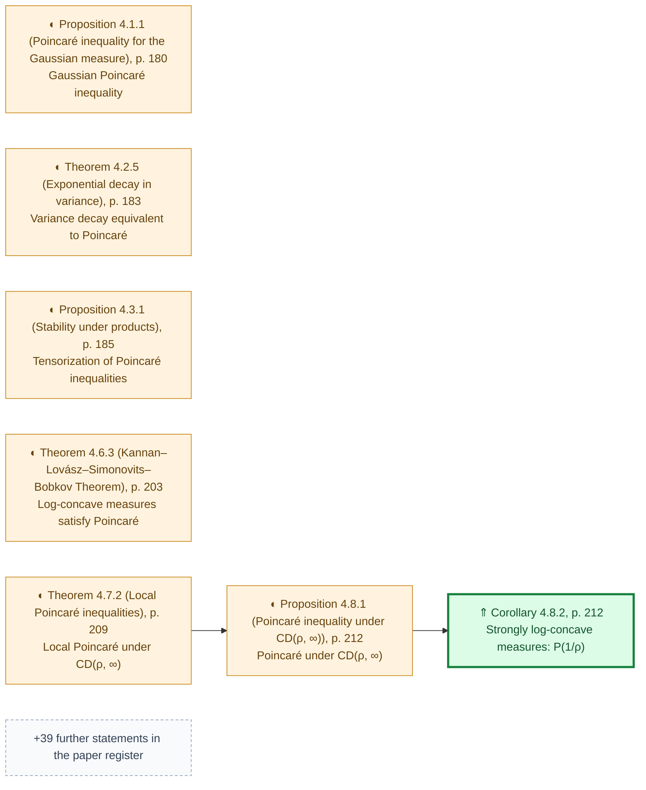
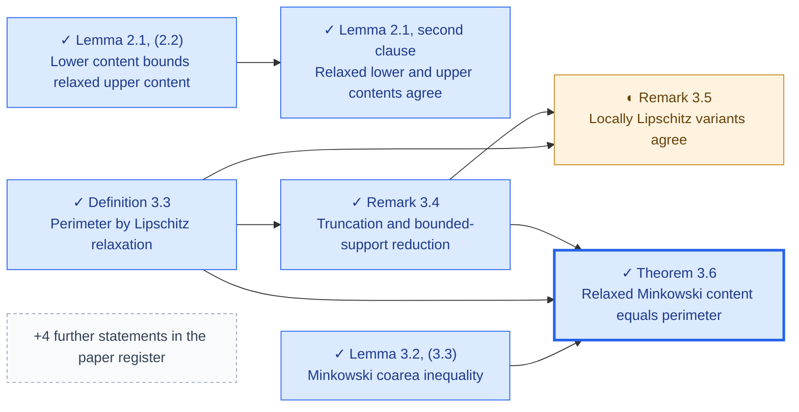
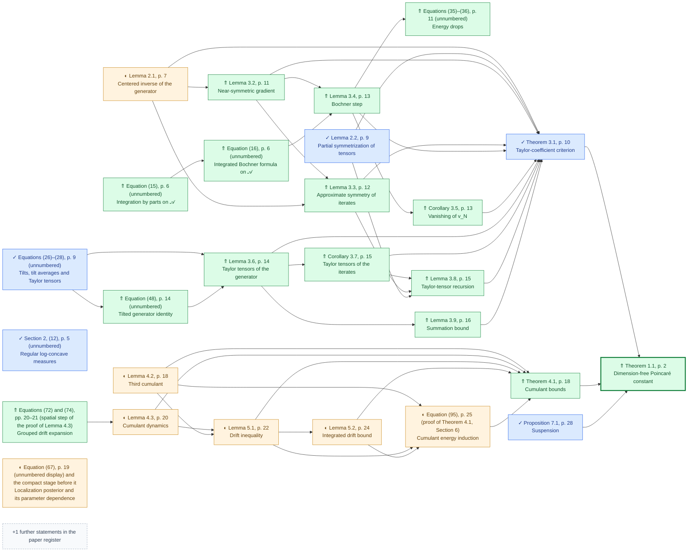
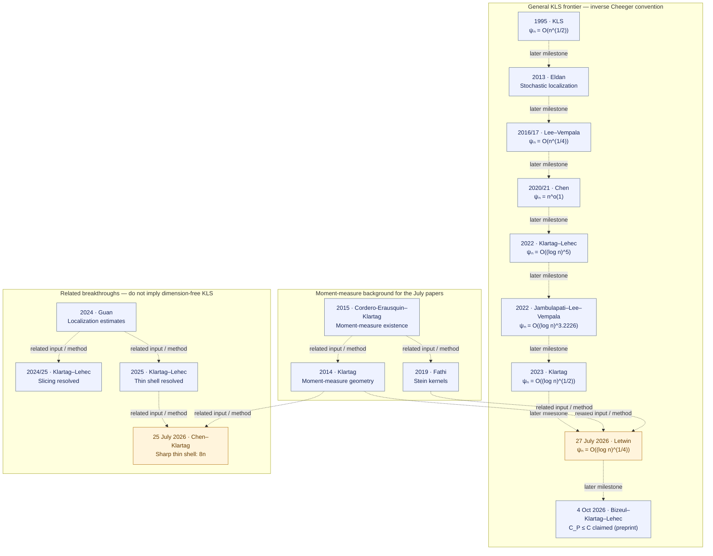

# KLS progress

| View | Purpose |
| --- | --- |
| [Proof path](PROOF-PATH.md) | Reading guide: Letwin constant 8 → stochastic localization → BKL Theorem 4.1 → KLS, with exact inputs |
| [BKL main proof chain](#bkl-main-proof-chain) | Short reading order, Lean entries and remaining inputs |
| [Literature register](LITERATURE.md) | **Primary progress view.** Paper by paper: target theorem, local Lean statements, local status and certificates |
| [Route diagrams](#proof-progress-tree) | Exploratory proof routes and the shared analytic infrastructure behind them |
| [Progress table](STATUS.md) | Local node IDs, mathematical provenance, recorded Lean status, certificates, dependencies, and gaps |

The project goal is to formalize as much of the published KLS literature as possible. Work is
selected by a named paper, pinned version and target theorem. The four exploratory routes in the diagram
below share our analytic infrastructure. They are not current formalization targets and are retained
as historical records; their unproved hypotheses remain open mathematically.

Apply the register's [paper-coverage criteria](LITERATURE.md#when-a-paper-is-covered).
Upstream mathematical proofs and conditional arguments remain separate from local Lean proofs.
`KLS.kls` is proved locally through BKL Theorem 1.1;
it does not complete the four exploratory routes.

<!-- BEGIN GENERATED COVERAGE -->
**Covered by a registered paper-target certificate: Bakry–Gentil–Ledoux (Corollary 4.8.2, p. 212), Ambrosio–Di Marino–Gigli (Theorem 3.6), Bizeul–Klartag–Lehec (Theorem 1.1, p. 2).**
<!-- END GENERATED COVERAGE -->

The current analytic frontier is summarized under [Proof progress tree](#proof-progress-tree):
the numerical π Cheeger–Buser comparison holds for every finite-dimensional log-concave law,
and metric BV relaxation and recovery are proved within their stated measure and space scope.

As of 2026-10-17, stage 1 of the [proof path](PROOF-PATH.md), Letwin's compact constant-8 bound, is proved:
`letwinCompactBound : LetwinCompactBound` holds for every n > 0, every compactly supported isotropic log-concave law and
every self-adjoint quadratic form, and is certified in source form (`thm:letwin-compact-quadratic-bound`). It rests on the
actual regular-class moment potential (weak C^{1,1} Monge–Ampère analysis and Theorem 2.5's trace bound with the exact
constant 2), the Gaussian product coupling with a compact dual bound, the H⁻¹ inequality on the Gaussian-smoothed law, a
spectral sign/noise energy identity with noise removal, and the singular extension (Lemma A.2, stronger form). The
[proof path](PROOF-PATH.md#stage-1-letwins-constant-8) lists source steps, declarations, owners and exact hypothesis
boundaries; [HANDOFF](../../HANDOFF.md) records the current evidence boundary.

Letwin's noncompact Theorem 1.2 is not formalized, so that paper is not covered. Stage 2, BKL's stochastic localization
(Sections 4–6), is accepted on the owner-selected cutoff route (`lem:bkl-cutoff-energy`); the uncut Eldan process and the
literal stochastic identities are not proved. Stage 3, BKL Theorem 4.1 in the source form, is certified
(`thm:bkl-cumulant-bound`). Stage 4, BKL Theorem 1.1 in the source form, is certified (`thm:bkl-poincare`), and `KLS.kls`
is proved from it through the affine/isotropic reduction; the BKL paper is covered in the exact sense of its main theorem.
See the register's [coverage criteria](LITERATURE.md#when-a-paper-is-covered) for supporting source statements.

## BKL main proof chain

<!-- BEGIN GENERATED BKL -->
Pinned main source: [Bizeul–Klartag–Lehec, arXiv:2610.05474v1](https://arxiv.org/abs/2610.05474v1).

Read the main theorem first, then its analytic inputs and the separate
Letwin/localization statements. This is a reading order, not a new dependency graph.
Status comes from the existing paper lemma maps. A ✓ proves the displayed statement
with its hypotheses; it does not discharge an input or cover the whole paper.

| Source step | Lean entry | Local status | Input boundary / remaining work | Evidence |
| --- | --- | --- | --- | --- |
| [Bizeul–Klartag–Lehec: Theorem 1.1, p. 2](https://arxiv.org/abs/2610.05474v1) | [`Solutions.ThmBklPoincare.certificate`](../../solutions/ThmBklPoincare.lean)<br/>[`FunctionalInequalities.KLS.BKL.Localization.exists_isotropicBound`](../../formalization/FunctionalInequalities/KLS/BKL/Poincare.lean)<br/>[`FunctionalInequalities.KLS.kls`](../../formalization/FunctionalInequalities/KLS/Target.lean) | ⇑ Stronger result or alternative route | Source-form Theorem 1.1 certified: one C > 0, every n ≥ 1 and every isotropic log-concave law, through the cutoff route, Theorems 3.1 and 4.1, Proposition 7.1 and the regular approximation; KLS.kls follows through the affine/isotropic reduction. The conditional conjecture_of_letwinCompact interface is unchanged. | [Item map](LITERATURE.md#bkl2026-lemma-map)<br/>[Certificate](../../solutions/ThmBklPoincare.lean) |
| [Bizeul–Klartag–Lehec: Theorem 3.1, p. 10](https://arxiv.org/abs/2610.05474v1) | [`Solutions.ThmBklTaylorCriterion.certificate`](../../solutions/ThmBklTaylorCriterion.lean) | ✓ Formalized in Lean | Source-form Taylor criterion for centered regular laws, covariance at most Id and the Taylor coefficient hypothesis. Operator route with an approximate first eigenfunction. | [Item map](LITERATURE.md#bkl2026-lemma-map)<br/>[Certificate](../../solutions/ThmBklTaylorCriterion.lean) |
| [Bizeul–Klartag–Lehec: Proposition 7.1, p. 28](https://arxiv.org/abs/2610.05474v1) | [`Solutions.PropBklSuspension.certificate`](../../solutions/PropBklSuspension.lean) | ✓ Formalized in Lean | Source-form suspension implication in all dimensions; CumulantBound d b is a retained premise, supplied in thm:bkl-poincare by the certified Theorem 4.1. | [Item map](LITERATURE.md#bkl2026-lemma-map)<br/>[Certificate](../../solutions/PropBklSuspension.lean) |
| [Bizeul–Klartag–Lehec: Theorem 4.1, p. 18](https://arxiv.org/abs/2610.05474v1) | [`Solutions.ThmBklCumulantBound.certificate`](../../solutions/ThmBklCumulantBound.lean)<br/>[`FunctionalInequalities.KLS.BKL.Localization.exists_cumulantBound_of_letwinCompact`](../../formalization/FunctionalInequalities/KLS/BKL/CumulantInduction.lean) | ⇑ Stronger result or alternative route | Source-form Theorem 4.1 certified: one universal K ≥ 1 (153), every m ≥ 2, every dimension and every isotropic log-concave law, through the cutoff route and the compact-to-general passage; exists_cumulantBound_of_letwinCompact stays the conditional interface. The uncut process and the literal (68)–(73) are not formalized. | [Item map](LITERATURE.md#bkl2026-lemma-map)<br/>[Certificate](../../solutions/ThmBklCumulantBound.lean) |
| [Bizeul–Klartag–Lehec: Equation (95), p. 25 (proof of Theorem 4.1, Section 6)](https://arxiv.org/abs/2610.05474v1) | [`Solutions.LemBklCutoffEnergy.certificate`](../../solutions/LemBklCutoffEnergy.lean) | ◐ Partial or statement only | Finite-horizon cutoff form of (95) for every order m = d + 1 ≥ 2, with the exact ½, b_m and a universal K = 153, for every actual cutoff Eldan process; the uncut infinite-horizon (95), the uncut process and the literal (68)–(73) are not formalized. | [Item map](LITERATURE.md#bkl2026-lemma-map)<br/>[Certificate](../../solutions/LemBklCutoffEnergy.lean) |
| [Bizeul–Klartag–Lehec: Lemma 4.3, p. 20](https://arxiv.org/abs/2610.05474v1) | [`FunctionalInequalities.Analysis.BakryEmery.iteratedFDeriv_inner_centeredGradient_zero_grouped_of_compact`](../../formalization/FunctionalInequalities/Analysis/BakryEmery/Cumulant/Leibniz.lean) | ◐ Partial or statement only | Spatial grouping and the registered compact cutoff-localization supports are available. This row is partial and does not certify an unrestricted source-form stochastic identity; the conditional Theorem 4.1 assembly is linked above. | [Item map](LITERATURE.md#bkl2026-lemma-map) |
| [Bizeul–Klartag–Lehec: Lemma 4.2, p. 18](https://arxiv.org/abs/2610.05474v1) | [`FunctionalInequalities.KLS.LogConcave.sum_sq_cumulant_three_le_of_letwin`](../../formalization/FunctionalInequalities/KLS/BKL/LocalThirdCumulant.lean) | ◐ Partial or statement only | Conditional source-scope counterpart retaining LetwinQuadraticBound; for compact laws that input is supplied by letwinCompactBound, but this item keeps its stated hypothesis. | [Item map](LITERATURE.md#bkl2026-lemma-map) |
| [Letwin: Theorem 1.2](https://arxiv.org/abs/2607.24164v1) | [`FunctionalInequalities.KLS.LogConcave.Suspension.letwinCompactBound`](../../formalization/FunctionalInequalities/KLS/Letwin/CompactBound.lean) | ✓ Formalized in Lean | Exact compact counterpart proved and certified: every n > 0, compactly supported isotropic log-concave laws, every self-adjoint form, constant 8. The noncompact theorem (full Lemma A.1) is not formalized. | [Item map](LITERATURE.md#letwin2026-lemma-map)<br/>[Certificate](../../solutions/ThmLetwinCompactQuadraticBound.lean) |
| [Letwin: Theorem 2.5](https://arxiv.org/abs/2607.24164v1) | [`FunctionalInequalities.Analysis.symmetric_trace_integral_extension`](../../formalization/FunctionalInequalities/Analysis/Matrix/Integral.lean) | ◐ Partial or statement only | Matrix, cutoff, given-potential trace/BL and weak-symmetry/mollification supports are proved. The weak R0 regularity package, the weak C1,1 generator identities of (2.2), the integrated Hessian-increment energy estimate (N11b), the original weak third-derivative tensor (N11d) and its source-law application producing actual weak locally L2 derivatives of the Hessian entries (the potential's weak third-derivative tensor) from the exact R0 hypotheses are formalized, together with weak product and finite polynomial calculus (weak determinant, first weak derivative of tr(BHBH)) for bounded Hessian entries with compact-local L2 derivatives; the identification of the weak determinant density with the outer Jacobi differential; and the actual-source first weak Monge-Ampere identity (2.4) with weak log-det derivative tr(H^-1 T_k); and the actual-source weak inverse formula (2.5) with compact-local L2 derivatives and compact-local essential inverse bounds; the rough compact curl identity, the C1 unprimed generator identity and the actual-source mean Hessian Id; the actual-source weighted weak second evolution identity (2.6) and its bounded H1 testing against psi * H_lk; the actual C1 weak inverse-Hessian height cutoffs with C/R generator defect at the same source witness; and, at the same actual source witness, the weak trace contraction (2.8)/(2.10), A.5 consumption, the (2.14) comparison, the weak Brascamp-Lieb consumer and the all-symmetric trace bound E_nu tr(BHBH) <= 2 tr(B^2) (weak C^{1,1} form, exact constant 2). The smooth source theorem is not covered. | [Item map](LITERATURE.md#letwin2026-lemma-map) |
| [Letwin: Lemma 2.1 (Cordero-Erausquin and Klartag [21, Theorem 2])](https://arxiv.org/abs/2607.24164v1) | [`FunctionalInequalities.KLS.CEK.exists_momentMap_of_isotropic_of_ae_norm_le`](../../formalization/FunctionalInequalities/KLS/CEK/MomentMap.lean) | ◐ Partial or statement only | Actual moment-map existence and pushforward for bounded isotropic probability laws. General finite-mass/unbounded existence and uniqueness, and source smooth regularity, remain open. | [Item map](LITERATURE.md#letwin2026-lemma-map) |

Certificates and item maps identify statements and source reviews, not a fresh run.
For snapshot-specific acceptance use [verification](../verification.md#receipts-and-trust-scope)
and the [current handoff](../../HANDOFF.md). **`KLS.kls` is proved through BKL Theorem 1.1 (`thm:bkl-poincare`) and the affine/isotropic reduction.**
<!-- END GENERATED BKL -->

## Literature priorities

<!-- BEGIN GENERATED PRIORITIES -->
These are source-review and proof priorities, not claims that the targets are proved.
Every proof task must first pin its paper version, theorem, hypotheses and constants.

| Priority | Sources / target | Next action |
| --- | --- | --- |
| 1 | [Bizeul–Klartag–Lehec](https://arxiv.org/abs/2610.05474v1)<br/>BKL Theorem 1.1 in the source form, certified (thm:bkl-poincare) through the source-form Theorem 3.1, Proposition 7.1 and Theorem 4.1 certificates on the reviewed cutoff localization route, with the regular approximation; KLS.kls is proved from it through the affine/isotropic reduction. Paper coverage is the exact main-theorem sense; the uncut Eldan process, the literal (68)–(73) and the noncompact Letwin theorem are separate. | All four stages of the selected main line are independently accepted: compact Letwin constant 8, cutoff stochastic localization, source-form BKL Theorem 4.1, and source-form BKL Theorem 1.1 with the unchanged KLS.kls. No proof construction remains on this route. HANDOFF.md owns current receipt pointers and delivery coordination; use the design and calling-example guides for library entry points. |
| 2 | [Bakry–Gentil–Ledoux](https://link.springer.com/book/10.1007/978-3-319-00227-9)<br/>Corollary 4.8.2 (strongly log-concave Bakry–Émery C_P ≤ 1/ρ) is certified as thm:bakry-emery-poincare and committed in 36e7c78 (remote run 37516844384 succeeded); select a separate Brascamp–Lieb source statement. | Deferred as an independent paper target under the 2026-10-10 BKL-first scope. Resume only for a reviewed referenced result or necessary prerequisite with an explicit BKL proof consumer; existing formalization and certificates are retained. |
| 3 | [Kannan–Lovász–Simonovits](https://link.springer.com/article/10.1007/BF02574061)<br/>Theorem 5.1, ψ(K) ≥ ln 2 / M₁(K) for convex bodies, through the needle reduction (Corollary 2.2, Lemma 2.6, Theorem 2.7). With the local Cheeger inequality it gives C_P ≲ E‖X − EX‖² for convex bodies. | Deferred as an independent paper target under the 2026-10-10 BKL-first scope. Resume only for a reviewed referenced result or necessary prerequisite with an explicit BKL proof consumer; existing formalization and certificates are retained. |
| 4 | [E. Milman](https://arxiv.org/abs/0712.4092)<br/>Concentration implies a Cheeger bound under the source convexity hypotheses. | Deferred as an independent paper target under the 2026-10-10 BKL-first scope. Resume only for a reviewed referenced result or necessary prerequisite with an explicit BKL proof consumer; existing formalization and certificates are retained. |
| 5 | [Eldan](https://arxiv.org/abs/1203.0893), [Lee–Vempala](https://annals.math.princeton.edu/2024/199-3/p02), [Chen](https://arxiv.org/abs/2011.13661), [Klartag–Lehec](https://arxiv.org/html/2203.15551v2), [Klartag](https://arxiv.org/html/2303.14938v2)<br/>Published stochastic-localization theorems and quantitative KLS bounds. | Deferred as an independent paper target under the 2026-10-10 BKL-first scope. Resume only for a reviewed referenced result or necessary prerequisite with an explicit BKL proof consumer; existing formalization and certificates are retained. |
| 6 | [Klartag–Lehec](https://arxiv.org/abs/2507.15495v2), [Chen–Klartag](https://arxiv.org/html/2607.23307v1), [Letwin](https://arxiv.org/html/2607.24164v1)<br/>Selected 2025–2026 thin-shell and quadratic-form results. Letwin Theorem 1.2 is now formalized locally without compact support, with exact constant 8; Theorem 1.1 and the full smooth regular approximation remain separate. | The 2026-10-20 maintenance scope completes and verifies the noncompact quadratic bound after the accepted BKL main line. Retain the compact certificate and the separate noncompact theorem; select a new pinned literature target before further proof construction. The other thin-shell sources remain deferred. |
<!-- END GENERATED PRIORITIES -->

## Paper lemma map

Covered papers, with the same Lean status notation as the route diagrams.

<!-- BEGIN GENERATED LEMMAS -->
Full maps for every selected paper are in [LITERATURE.md](LITERATURE.md#paper-lemma-maps).

Each diagram below shows a covered paper's main theorem (thick border, rightmost) with the statements its
proof uses, plus every statement with local Lean progress. Arrows run from a statement to
the results that use it.

✓ Formalized in Lean · ◐ Partial or statement only · ○ Not yet formalized · ⇑ Stronger result or alternative route

### Bakry–Gentil–Ledoux (Springer 2014, Grundlehren der mathematischen Wissenschaften 348 (DOI 10.1007/978-3-319-00227-9), Chapter 4)

46 statements: 6 ◐, 39 ○, 1 ⇑. [Full map](LITERATURE.md#bgl2014-lemma-map).



### Ambrosio–Di Marino–Gigli (arXiv:1603.08412v1)

11 statements: 6 ✓, 1 ◐, 4 ○. [Full map](LITERATURE.md#admg2017-lemma-map).



### Bizeul–Klartag–Lehec (arXiv:2610.05474v1)

28 statements: 5 ✓, 7 ◐, 1 ○, 15 ⇑. [Full map](LITERATURE.md#bkl2026-lemma-map).


<!-- END GENERATED LEMMAS -->

## KLS literature through July 2026

<!-- BEGIN GENERATED LITERATURE -->
**28 selected sources, from foundational results to July 2026.**

The [paper-by-paper literature register](LITERATURE.md) records statements, publication
versions, exact local coverage and remaining work. The general KLS-bound milestones
in this diagram are all still pending locally; completed supporting results appear in
the paper and node registers. Dashed edges mean chronology or related methods, not proof.



| Latest source | Literature result | Our Lean status |
| --- | --- | --- |
| [Chen–Klartag, 25 July 2026](https://arxiv.org/html/2607.23307v1) · Preprint (v1) | For isotropic log-concave X: Var(‖X‖²) ≤ 8n and ‖T₃(X)‖²_HS ≤ 4n. The constants are sharp. |  |
| [Letwin, 27 July 2026](https://arxiv.org/html/2607.24164v1) · Preprint (v1) | For isotropic log-concave X and symmetric M, Var(XᵀMX) ≤ 8‖M‖²_HS = 2 E‖∇(XᵀMX)‖². For n ≥ 2, ψₙ = O((log n)^(1/4)), hence C_P = O(√log n). |  |

Here ψ is the inverse Cheeger constant, so its logarithmic exponent is half the
Poincaré exponent. The sharp thin-shell result does not resolve dimension-free KLS.
See the [full tables and normalization](LITERATURE.md#constant-conventions).
<!-- END GENERATED LITERATURE -->

## Proof progress tree

KLS is proved through the accepted BKL main line. The four exploratory routes are not current
formalization targets and are retained as historical records; their unproved hypotheses remain
open mathematically. `◇ Open hypothesis, not a target` marks mathematical assumptions and
questions that remain open, including those outside these routes.
`○ Not formalized, superseded route` marks not-formalized results and route junctions exclusive
to those historical routes. Formalized results, refuted claims and shared analytic bridges
retain their existing states; the neutral badges distinguish research records from pending work.

<!-- BEGIN GENERATED DATE -->
Last updated: **2026-10-22**.

 ·  ·  ·  ·  · 

Open hypotheses remain open mathematically; they are assumptions or questions, not current formalization targets. Superseded results and route junctions belong to historical exploratory routes. KLS is proved through the accepted BKL main line. The four exploratory routes are not current formalization targets and are retained as historical records; their unproved hypotheses remain open mathematically.
<!-- END GENERATED DATE -->
Scalar sharp Sard, vector coarea through locally Lipschitz maps, the Cheeger infimum equality,
heat-semigroup construction, and the full numerical Cheeger–Buser comparison are formalized
in Lean. The general π bound uses actual Gaussian smoothing and a Cheeger test stability
argument; no individual-domain perimeter limit is asserted.
The scoped metric BV comparison includes closed-support identification for finite-dimensional
log-concave laws, exact test-class relaxation infima, and relaxed lower Minkowski content.
**Current task:** verify the noncompact Letwin Theorem 1.2 endpoint and its moment-limit tools,
with the hypotheses and exact constant 8 retained. Theorem 1.1 and the full smooth
approximation remain outside this batch.

**Library use:** exercise the accepted KLS bound through the
[calling examples](../../examples/README.md) and
[separate-project walkthrough](../../examples/FIRST-USE.md). Select any further proof target
from the [literature priorities](#literature-priorities) before beginning new mathematics.
The following scope summary records earlier supporting work, rather than the active work queue.
The ADMG Theorem 3.6 paper-target certificate is remotely certified
(see the [paper lemma map](#paper-lemma-map)).
The locally Lipschitz classes on nonproper spaces and the general metric-measure/RCD
comparison bridges remain open. The extended ADMG sections 2–3 finite-target
scope (2026-10-01) is frozen and locally verified. Lemma 2.1's equality of the relaxed lower and upper
contents now holds for every Borel measure at measurable finite-mass targets, and on proper
spaces the Remark 3.5 locally Lipschitz classes (global or compact-set L1) give the
bounded-support perimeter at such targets for every Borel measure. Remark 3.4's bounded-support reduction,
Lemma 2.1's actual radius recovery, both recoveries and both relaxed identities
are proved at measurable finite-mass Borel targets for measures finite on bounded
Borel sets, including infinite total mass and nonproper spaces. The full Lemma 3.2
chain retains the actual right-radius liminf of integrated open-ball growth under
finite positive-support-neighborhood mass and nonnegativity. No new ledger
certificate or remote CI is claimed. The locally Lipschitz classes on nonproper
spaces, nonconvex support transfer and general RCD comparisons are
outside this completed proof scope. KLS is proved through the accepted BKL main line.
The four exploratory routes are not current formalization targets and are retained as historical
records; their unproved hypotheses remain open mathematically.
The content chain proves lower content `≤` upper content, almost-everywhere differentiability of
the monotone radius mass, the derivative and integrated bounds on the upper content of
thickenings, the local-slope Minkowski coarea inequality, the recovery of every measurable set of
finite lower content and of every set of finite BV perimeter by measurable sets converging in
`L¹`, and the equality of the relaxed upper Minkowski content with the perimeter and with the
relaxed lower content, on arbitrary metric spaces with a finite Borel measure (phases 24–29,
independently accepted; the generic coarea uses the lower semicontinuous open-ball supremum;
scaling, the zero measure and normalization are explicit). The upper-content chain for measures finite on bounded sets
with infinite total mass is proved at measurable finite-mass targets (above); pointwise
equality of the upper content with the perimeter and general RCD comparisons are not proved locally.
KLS is proved through the accepted BKL main line. The four exploratory routes are not current
formalization targets and are retained as historical records; their unproved hypotheses remain
open mathematically.

Complement symmetry for finite Borel
measures, including the closed intrinsic support law, is formalized in Lean, and so is
the equality of the half-mass and symmetric BV Cheeger constants on every probability
metric space; for a finite measure, globally Lipschitz approximants converging in global
`L¹` may replace bounded-support tests (on a proper metric space also locally Lipschitz
approximants, even under `L¹` convergence on every closed ball only), epsilon recovery tests exist below every threshold
above the perimeter, and every finite perimeter is the limit of the costs of an explicitly
selected approximating sequence; the perimeter is lower semicontinuous under global `L¹`
convergence of measurable sets and is at most the outer Minkowski content of every measurable
set for every probability law (one inequality); the Minkowski coarea inequality holds with the
actual local slope for every globally Lipschitz function, and every test has a quantitative
superlevel selection (content at most `cost / (1 - 2δ) + ε`, indicator error at most its error
over `δ`), and every set of finite BV perimeter has explicit measurable Minkowski recovery sets
(`L¹` convergence, contents converging to the perimeter), whose masses and, for mass in
`(0, 1)`, symmetric Cheeger quotients converge. Consequently the symmetric and half-mass BV
Cheeger constants equal the Minkowski Cheeger constant for every probability law on a normed
space, and for the intrinsic coordinate law they equal the isoperimetric constant (an equality of
infima). Restriction to the closed measure support does not increase the metric BV perimeter
(one inequality), with equality under a nonexpansive retraction onto a full-mass subset, in
particular for every law on a Hilbert space with convex closed support; for every
finite-dimensional log-concave law the BV Cheeger constant on the closed intrinsic support
therefore equals the isoperimetric constant. The relaxation infimum over globally Lipschitz
approximants equals this perimeter for finite measures, and over locally Lipschitz
approximants on proper spaces (with global or compact-set `L¹` convergence), in particular on
the closed intrinsic support, and the relaxed
lower Minkowski set infimum equals it for probability laws on normed spaces; `L¹_loc`
convergence beyond proper spaces with finite measures, and nonconvex supports remain open.
KLS is proved through the accepted BKL main line. The four exploratory [KLS routes](#proof-progress-tree)
are not current formalization targets and are retained as historical records; their unproved
hypotheses remain open mathematically.
These statuses record local proofs and do not claim a remote CI receipt.
Upstream mathematical proofs alone do not earn a ✓.

One large diagram shows the four historical sufficient-route plans and their shared proof infrastructure.
Arrows point toward KLS: AND within each route, OR between routes. The completed BKL literature route enters KLS
through its own AND junction with the affine/isotropic reduction; it is not a fifth exploratory route. Dotted arrows show context. The vector-coarea extension is shown separately and does not
assert an additional implication to KLS.
The diagram uses a larger font and full canvas width; [open its source](TREE.mmd) for a separate view.

<!-- BEGIN GENERATED TREE -->
```mermaid
%%{init: {"themeVariables": {"fontSize": "20px"}, "flowchart": {"useMaxWidth": false, "nodeSpacing": 40, "rankSpacing": 65}}}%%
flowchart LR
    subgraph FOUND["Shared foundations"]
    DENS["✓ Log-concave density<br/>Intrinsic support"]
    NORM["✓ Affine / isotropic<br/>Reduction"]
    FORMS["✓ Closed forms<br/>Dirichlet property"]
    ENERGY["✓ Canonical energy<br/>= 2 × Cheeger energy"]
    CONST["✓ Poincaré frontend<br/>Equivalence"]
    end
    subgraph ANALYSIS["Analytic comparison"]
    MEAS["✓ Slice measurability"]
    GRAPH["✓ Open-domain<br/>Graph area"]
    REG["✓ Regular-domain<br/>Coarea"]
    CRIT["✓ Critical-slice nullity"]
    C1["✓ General C¹ coarea"]
    WHIT["✓ Compact Whitney jets<br/>Exact C¹ pieces"]
    LIP["✓ Coarea: Lipschitz<br/>and locally Lipschitz"]
    GG["✓ Global Gauss–Green"]
    REC["✓ Smooth recovery"]
    FWD["✓ h_M ≤ h_S"]
    SARD["✓ Scalar Sard<br/>Sharp finite regularity"]
    SCI["✓ Cheeger superlevel<br/>Integral bound"]
    CUT["✓ Distance cutoffs"]
    REV["✓ h_S ≤ h_M"]
    EQ["✓ h_M = h_S"]
    FRONT["✓ Density Cheeger<br/>Identification"]
    CB["✓ Cheeger–Buser<br/>4 and pi bounds"]
    MINK["✓ Minkowski coarea"]
    BV["✓ Closed-support BV<br/>identification (log-concave)"]
    end
    subgraph HEATPROGRAM["Buser analytic program — dotted links show related work"]
    SEMI["✓ Weighted-gradient<br/>Heat semigroup"]
    MARKOV["✓ Heat semigroup<br/>Markov properties"]
    DECAY["✓ Centered heat decay<br/>and literature gap"]
    GAUSS["✓ Gaussian convolution<br/>Smooth potential"]
    GSTAB["✓ Gaussian convolution<br/>Poincaré stability"]
    BE["◐ Generator / Bochner<br/>Gradient estimates"]
    HEAT["◐ Small-time heat bounds<br/>and pi Buser assembly"]
    end
    subgraph ELDAN["Eldan localization"]
    EG["◇ Tight-prefix<br/>Carleson estimate"]
    EC["○ Tight-window<br/>Consumption"]
    EAND{"AND<br/>○ Eldan route"}
    end
    subgraph SPECTRAL["Moment-map spectral"]
    SG["◇ Full-damping<br/>Occupation bound"]
    SC["○ Spectral<br/>Sufficiency"]
    SAND{"AND<br/>○ Spectral route"}
    end
    subgraph CMH["Moment-map CMH"]
    MH["○ W₂ limit and<br/>CMH comparison"]
    MG["◇ Bounded CMH<br/>Recovery envelope"]
    MT["✓ Affine constant<br/>Translation invariance"]
    MC["○ Recovery-sequence<br/>Sufficiency"]
    MAND{"AND<br/>○ CMH route"}
    end
    subgraph FIBER["Conditional-fiber frames"]
    ONE["✓ One-dimensional<br/>Poincaré ≤ 4 Var"]
    FLOG["✓ Fiber log-concavity"]
    FP["✓ Fiber-bound<br/>Energy comparison"]
    F4["✓ Fiber energy<br/>≤ 4 × gradient energy"]
    FC["✓ Fiber Dirichlet form"]
    FG["◇ Universal<br/>Frame bound"]
    FAND{"AND<br/>◐ Fiber route"}
    end
    subgraph VECTOR["Vector coarea extension — separate from the KLS implication routes"]
    VREG["✓ Vector coarea<br/>Regular region"]
    VZERO["✓ Vector slices<br/>Zero derivative"]
    VR123["✓ Rank and kernel<br/>R1–R3"]
    VR4["✓ Tangential estimate<br/>R4"]
    VFULL["✓ C¹ vector coarea<br/>Rank-deficient part closed"]
    VLIP["✓ Vector coarea<br/>Lipschitz and local"]
    end
    subgraph LETWINWEAK["Letwin constant 8 — compact and noncompact bounds; weak regularity and Gaussian route"]
    CEKMAP["✓ Bounded CEK source<br/>Actual moment map"]
    WEAKHESS["✓ C1 Hessian<br/>Gradient derivative at a point"]
    REGMOM["✓ Regular-class R0<br/>C1,1 and a.e. Hessian package"]
    WEAKINVINT["✓ Inverse Hessian<br/>Bounded compact integrability"]
    WEAKGEN["✓ Weak generator identities<br/>Letwin (2.2) at C1,1"]
    HESSENT["✓ Hessian entries<br/>Measurable, bounded by G"]
    CDIFF["✓ Centered difference<br/>C1,1 and 0 <= w <= D|h|^2"]
    WEAKGENINT["✓ Weak generator<br/>Density integrability"]
    INCINT["✓ Hessian increments<br/>Weighted integrability"]
    INCENERGY["✓ Hessian-increment energy<br/>Original N11b estimate"]
    TRANSCUT["✓ Translated cutoffs<br/>Uniform smooth majorant"]
    HESSL2["✓ Hessian entries<br/>Local and cutoff L2"]
    HESSDIFF["✓ Cutoff Hessian entries<br/>Difference energy C t^2"]
    WEAKTHIRD["✓ Weak third-derivative tensor<br/>Original N11d (Hessian entries)"]
    SRCDIFF["✓ Moment potential<br/>Second differences ≤ 4/κ"]
    EXPLIP["✓ Lipschitz exponent<br/>−u + V(∇u)"]
    REGTENSOR["✓ Regular source law<br/>Weak third-derivative tensor"]
    WPRODG["✓ Weak product<br/>Global L2 factors"]
    WPRODL["✓ Weak product<br/>Bounded, local L2 derivative"]
    WLIN["✓ Weak linearity<br/>Finite real combinations"]
    WFPROD["✓ Weak product<br/>Finite bounded factors"]
    WDET["✓ Weak determinant<br/>Permutation polynomial"]
    WTRACE["✓ Weak trace quadratic<br/>tr(BABA), arbitrary B"]
    WJAC["✓ Weak determinant density<br/>= outer Jacobi differential"]
    EXPHALF["✓ Exponential Lipschitz<br/>on a half-line"]
    WAECONGR["✓ Weak derivative<br/>a.e. transport"]
    AEEXP["✓ A.e. exponent derivative<br/>−u + V(∇u)"]
    WMA1["✓ Regular source law<br/>First weak Monge–Ampère (2.4)"]
    WEXPNEG["✓ Weak negative exponential<br/>Lipschitz exponent"]
    WPRODLB["✓ Weak product<br/>Compact-locally bounded factors"]
    WMATINV["✓ Weak matrix inverse<br/>DR = −R DA R a.e."]
    WADJ["✓ Hessian adjugate<br/>Bound and weak derivative"]
    WINVH["✓ Intrinsic weak inverse Hessian<br/>Letwin (2.5)"]
    WINV["✓ Regular source law<br/>Weak inverse Hessian (2.5)"]
    WSMOOTH["✓ Common-support smooth<br/>approximation of weak derivatives"]
    WCURL["✓ Rough compact curl testing<br/>∫ p b = ∫ q a"]
    WEAKGENC1["✓ Weak generator identity<br/>C¹ multipliers"]
    MEANC11["✓ Mean Hessian identity<br/>C¹,¹ potential"]
    WMEANH["✓ Regular source law<br/>Mean Hessian = Id"]
    WBAPPROX["✓ Bounded all-coordinate approximation<br/>common support, a.e. limit"]
    WBTEST["✓ Bounded weak-test extension<br/>of divergence identities"]
    WINVROW["✓ Weak Piola row divergence<br/>of the inverse Hessian"]
    WGRADCOMP["✓ Weak derivative of<br/>∂ₐW(∇u)"]
    WMARHS["✓ Weak derivative of the<br/>first Monge–Ampère right side"]
    WFLUXLOC["✓ Hessian flux L2 and<br/>trace forcing locally L1"]
    WFLUX["✓ Unweighted weak<br/>Hessian flux identity"]
    WEVOL["✓ Weighted weak Hessian evolution<br/>Letwin (2.6)"]
    WEVOLB["✓ Weak Hessian evolution<br/>bounded H¹ tests"]
    WEVOLSRC["✓ Regular source law<br/>weak Hessian evolution (2.6)"]
    WHTEST["✓ Regular source law<br/>bounded ψ·H tests"]
    WCUTR["✓ Weak inverse-Hessian cutoffs<br/>real R ≥ 1, defect ≤ C/R"]
    WCUTN["✓ Weak inverse-Hessian cutoffs<br/>natural index, defect ≤ C/(m+1)"]
    WCUTSRC["✓ Regular source law<br/>weak height cutoffs"]
    WCFLUX["✓ Compact flux IBP<br/>bounded weak test"]
    WBTRQ["✓ Bounded weak trace<br/>quadratic data"]
    WROUGH["✓ Rough eta against<br/>C1 cutoff generator"]
    WTRCON["✓ Weak trace contraction<br/>(2.8)/(2.10)"]
    TRPOS["✓ Trace density<br/>positivity"]
    TRGRAM["✓ Trace-Gram comparison<br/>(2.12), 4D <= g + 2f"]
    WCUTTEST["✓ Regular source law<br/>rough cutoff testing"]
    WLAP["✓ Rough weak pairing<br/>weighted Laplacian"]
    C11COER["✓ C^{1,1} ordinary<br/>diffusion coercivity"]
    WBL["✓ Weak finite-energy<br/>Brascamp-Lieb (A.6)"]
    MPTRACE["✓ Matrix product entry<br/>trace identities"]
    MVAR["✓ Random matrix<br/>variance trace"]
    WT25["✓ Weak Hessian trace bound<br/>(Theorem 2.5, PSD B)"]
    SYMAE["✓ AE PSD symmetric<br/>trace extension"]
    S1["✓ Integrable weak derivative<br/>has zero integral"]
    WIBP["✓ Tilted IBP<br/>bounded Lipschitz tests"]
    C1CHAIN["✓ C1 gradient<br/>chain coordinate"]
    SRCSTEIN["✓ Weak source<br/>Stein identity"]
    DUALB["✓ Compact source<br/>dual bound"]
    GAUSSID["✓ Gaussian directional<br/>identity (C1 tests)"]
    WSTEINSRC["✓ Regular source law<br/>T2.5 exact 2 + source Stein"]
    REGINV["✓ Regular source law<br/>gradient inverse, local ellipticity"]
    TGTSTEIN["✓ Regular source law<br/>target Stein kernel (a.e. PD, HS² ≤ 2n)"]
    DIRSUB["✓ Regular source law<br/>directional weak subsolution, local coefficient bounds"]
    ROUGHTEST["✓ Weak H1 tools<br/>chain rule, log/power, rough tests"]
    H1ENERGY["✓ H1 energy tools<br/>Caccioppoli, weak Sobolev"]
    MOSERIN["✓ Moser inputs<br/>log/power energy, cutoffs, Lp limit"]
    MORREYPOT["✓ Morrey and potential inputs<br/>all-ball Morrey, critical potential exp"]
    BOUNDEDJN["✓ Bounded weak JN<br/>convex representation, John-Nirenberg"]
    LOCALMOSER["✓ Local Moser inputs<br/>local energies, fixed-S joint inputs, one-step gain"]
    WEAKHARNACK["✓ Bounded weak Harnack<br/>Moser iteration, essential infimum, n = 1, 2, > 2"]
    GIVENHARNACK["✓ Given-data weak Harnack<br/>GT 8.18 bounded, joint regular potential"]
    FRAME1713["✓ Fixed rank-one frame<br/>GT 17.13, coefficients in [lower, hi]"]
    MODULUS823["✓ Scalar iteration lemma<br/>GT 8.23"]
    ESSDEFICIT["✓ Essential deficit identity<br/>essinf(M - f) = M - esssup f"]
    FRAMEOSC["✓ Frame oscillation decay<br/>log-det matrix field, GT 17.14 rough form"]
    HOLDERREG["✓ Hölder representatives and C2<br/>continuous Hessian, everywhere equation"]
    HESSHOLDER["✓ C2 Hölder Hessian at the regular moment potential<br/>everywhere log-det equation, strong class"]
    LOGDETAVG["✓ Averaged-inverse log-det coefficients<br/>GT (17.56), Hölder averaged inverse"]
    CONVGRADINV["✓ Strictly convex gradient<br/>open map, homeomorphism, C^k inverse"]
    MAPGRADRANGE["✓ Transport gradient range = int K<br/>homeomorphism and inverse, given potential"]
    MOMENTGRADINV["✓ Gradient homeomorphism onto int K, C1 inverse<br/>regular moment potential, strong class"]
    MNTRACE["✓ Trace identities<br/>noise shift, involution"]
    SPECGEO["✓ Spectral geometry<br/>B, S, sign Q"]
    SYMINV["✓ Invertible symmetric<br/>approximation"]
    MTRMEAN["✓ Trace against a<br/>mean-Id field"]
    HSSYM["✓ Symmetric operator<br/>HS sum = tr(A^2)"]
    GRADAFF["✓ Gradient of an<br/>affine precomposition"]
    ACTALG["✓ Matrix action<br/>algebra"]
    HESSACT["✓ Hessian action<br/>in L2"]
    QACTION["✓ Quadratic forms<br/>of the action"]
    SIGNNOISE["✓ Spectral sign/noise<br/>identity"]
    NOISEINT["✓ Integrated spectral<br/>noise energy"]
    QFOURTH["✓ Quadratic form in L2<br/>from L4"]
    FINVAR["✓ Variance continuity<br/>finite combinations"]
    QVARCONT["✓ Variance continuity<br/>quadratic matrix forms"]
    LA2EXT["✓ Singular extension<br/>(Lemma A.2, stronger)"]
    NOISECONV["✓ Centered noise keeps<br/>quadratic variance"]
    G4MOM["✓ Gaussian, smoothed and<br/>linear-image L4"]
    GTRANS["✓ Translated Gaussian<br/>directional identity"]
    GLATENT["✓ Product latent map<br/>onto smoothed image"]
    GPOT["✓ Smooth convex potential<br/>of smoothed image"]
    SRCAFF["✓ Directional and affine<br/>source Stein"]
    GPRODSTEIN["✓ Gaussian product<br/>source Stein"]
    GPRODDUAL["✓ Compact dual bound<br/>product coupling"]
    NOISELIM["✓ Removal of a<br/>vanishing noise error"]
    GSMVAR["✓ Smoothing keeps<br/>quadratic variance"]
    GHMINUS["✓ Smoothed quadratic<br/>variance via H^-1"]
    RESTEXP["✓ Restricted exponential<br/>log-concavity"]
    OPMAT["✓ Operator and matrix<br/>forms of the bound"]
    REGCLASS8["✓ Regular class<br/>constant 8"]
    LA1REG["✓ Letwin Lemma A.1<br/>regular approximation"]
    LCOMPACT8["✓ Compact Letwin bound<br/>constant 8 (certified)"]
    AFFMOM["✓ Truncated affine laws<br/>mixed moments converge"]
    LGENERAL8["✓ Letwin Theorem 1.2<br/>constant 8, no compactness"]
    end
    subgraph BKLCUTOFF["BKL cutoff localization — supporting endpoint; uncut process open"]
    BCUT["✓ BKL (95) cutoff<br/>energy induction (certified)"]
    end
    subgraph BKLCUMULANT["BKL cumulant bound — Theorem 4.1 (source form); KLS composition separate"]
    BCUM["✓ BKL Theorem 4.1<br/>cumulant bound (certified)"]
    end
    subgraph BKLTHM11["BKL Theorem 1.1 — completed literature route to KLS (not an exploratory branch)"]
    BT31["✓ BKL Theorem 3.1<br/>Taylor criterion (certified)"]
    BP71["✓ BKL Proposition 7.1<br/>suspension (certified)"]
    BREG["✓ BKL Section 2<br/>regular approximation"]
    BKLMAIN["✓ BKL Theorem 1.1<br/>dimension-free Poincaré (certified)"]
    BKLAND{"AND<br/>BKL route"}
    end
    KLS["✓ KLS<br/>Dimension-free bound"]
    ANY{"OR<br/>Any completed route"}
    EG --> EAND
    EC --> EAND
    CB --> EAND
    SG --> SAND
    SC --> SAND
    NORM --> SAND
    MH --> MAND
    MG --> MAND
    MT --> MAND
    MC --> MAND
    NORM --> MAND
    ONE --> F4
    FLOG --> F4
    FP --> F4
    FC --> FAND
    F4 --> FAND
    FG --> FAND
    NORM --> FAND
    DENS --> NORM
    FORMS -.-> ENERGY
    GRAPH --> REG
    MEAS -.-> REG
    REG --> C1
    CRIT --> C1
    C1 --> LIP
    WHIT --> LIP
    MEAS --> LIP
    GG --> REC
    REC --> FWD
    C1 --> SCI
    SARD --> SCI
    SCI --> REV
    CUT --> REV
    FWD --> EQ
    REV --> EQ
    EQ --> FRONT
    FRONT --> CB
    EAND --> ANY
    SAND --> ANY
    MAND --> ANY
    FAND --> ANY
    ANY --> KLS
    CONST -.-> ANY
    VR123 --> VR4
    VREG -.-> VFULL
    VZERO -.-> VFULL
    VR4 -.-> VFULL
    SEMI -.-> MARKOV
    MARKOV -.-> BE
    MARKOV -.-> DECAY
    DECAY -.-> HEAT
    BE -.-> HEAT
    GAUSS -.-> CB
    GSTAB -.-> CB
    HEAT -.-> CB
    VFULL -.-> VLIP
    CEKMAP --> REGMOM
    WEAKHESS --> REGMOM
    WEAKINVINT --> WEAKGEN
    WEAKHESS --> WEAKGEN
    HESSENT --> WEAKGENINT
    WEAKINVINT --> WEAKGENINT
    HESSENT --> INCINT
    CDIFF --> INCENERGY
    INCINT --> INCENERGY
    WEAKGENINT --> INCENERGY
    WEAKGEN --> INCENERGY
    HESSENT --> HESSL2
    TRANSCUT --> HESSDIFF
    HESSL2 --> HESSDIFF
    INCINT --> HESSDIFF
    INCENERGY --> HESSDIFF
    HESSL2 --> WEAKTHIRD
    HESSDIFF --> WEAKTHIRD
    SRCDIFF --> REGTENSOR
    EXPLIP --> REGTENSOR
    REGMOM --> REGTENSOR
    WEAKTHIRD --> REGTENSOR
    WPRODG --> WPRODL
    WPRODL --> WFPROD
    WFPROD --> WDET
    WLIN --> WDET
    WPRODL --> WTRACE
    WLIN --> WTRACE
    WDET --> WJAC
    REGTENSOR --> WMA1
    WDET --> WMA1
    WJAC --> WMA1
    AEEXP --> WMA1
    EXPHALF --> WMA1
    WAECONGR --> WMA1
    WPRODL --> WPRODLB
    WPRODLB --> WMATINV
    WLIN --> WMATINV
    WAECONGR --> WMATINV
    WDET --> WADJ
    WEXPNEG --> WINVH
    WADJ --> WINVH
    WPRODLB --> WINVH
    WAECONGR --> WINVH
    WMATINV --> WINVH
    WMA1 --> WINV
    WINVH --> WINV
    HESSENT --> WADJ
    WSMOOTH --> WCURL
    WEAKGEN --> WEAKGENC1
    WINV --> WMEANH
    MEANC11 --> WMEANH
    HESSENT --> WMEANH
    WBAPPROX --> WBTEST
    WEAKINVINT --> WINVROW
    AEEXP --> WGRADCOMP
    WGRADCOMP --> WMARHS
    WPRODLB --> WMARHS
    WLIN --> WMARHS
    HESSENT --> WMARHS
    WFLUXLOC --> WFLUX
    WCURL --> WFLUX
    WMARHS --> WEVOL
    WFLUX --> WEVOL
    WINVROW --> WEVOL
    AEEXP --> WEVOL
    WEVOL --> WEVOLB
    WBTEST --> WEVOLB
    WMEANH --> WEVOLSRC
    WMARHS --> WEVOLSRC
    WFLUX --> WEVOLSRC
    WEVOL --> WEVOLSRC
    WEVOLSRC --> WHTEST
    WEVOLB --> WHTEST
    HESSL2 --> WHTEST
    HESSENT --> WHTEST
    WEAKINVINT --> WCUTR
    WEAKGENC1 --> WCUTR
    HESSENT --> WCUTR
    WCUTR --> WCUTN
    WHTEST --> WCUTSRC
    WCUTR --> WCUTSRC
    WBTEST --> WCFLUX
    WTRACE --> WBTRQ
    WCFLUX --> WROUGH
    WEAKGENC1 --> WROUGH
    WBTRQ --> WTRCON
    WEVOLB --> WTRCON
    TRPOS --> TRGRAM
    WCUTSRC --> WCUTTEST
    WROUGH --> WCUTTEST
    WCFLUX --> WLAP
    WLAP --> WBL
    C11COER --> WBL
    MPTRACE --> MVAR
    WBL --> WT25
    WBTRQ --> WT25
    MPTRACE --> WT25
    MVAR --> WT25
    S1 --> WIBP
    WEAKHESS --> C1CHAIN
    WIBP --> SRCSTEIN
    C1CHAIN --> SRCSTEIN
    S1 --> GAUSSID
    WCUTTEST --> WSTEINSRC
    WTRCON --> WSTEINSRC
    TRGRAM --> WSTEINSRC
    WT25 --> WSTEINSRC
    SYMAE --> WSTEINSRC
    WIBP --> WSTEINSRC
    SRCSTEIN --> WSTEINSRC
    HESSENT --> HESSACT
    ACTALG --> QACTION
    SPECGEO --> SIGNNOISE
    ACTALG --> SIGNNOISE
    MNTRACE --> SIGNNOISE
    SIGNNOISE --> NOISEINT
    MTRMEAN --> NOISEINT
    SPECGEO --> NOISEINT
    FINVAR --> QVARCONT
    SYMINV --> LA2EXT
    QVARCONT --> LA2EXT
    QFOURTH --> NOISECONV
    GAUSSID --> GTRANS
    DENS --> GPOT
    SRCSTEIN --> SRCAFF
    GRADAFF --> SRCAFF
    HESSACT --> GPRODSTEIN
    GTRANS --> GPRODSTEIN
    SRCAFF --> GPRODSTEIN
    G4MOM --> GPRODSTEIN
    GPRODSTEIN --> GPRODDUAL
    GLATENT --> GPRODDUAL
    DUALB --> GPRODDUAL
    WEAKHESS --> GPRODDUAL
    NOISECONV --> GSMVAR
    G4MOM --> GSMVAR
    GPRODDUAL --> GHMINUS
    GPOT --> GHMINUS
    QFOURTH --> GHMINUS
    G4MOM --> GHMINUS
    DENS --> RESTEXP
    HSSYM --> OPMAT
    QACTION --> OPMAT
    WSTEINSRC --> REGCLASS8
    REGMOM --> REGINV
    WSTEINSRC --> TGTSTEIN
    REGINV --> TGTSTEIN
    SRCSTEIN --> TGTSTEIN
    WEVOLSRC --> DIRSUB
    REGINV --> DIRSUB
    DIRSUB --> ROUGHTEST
    ROUGHTEST --> H1ENERGY
    H1ENERGY --> MOSERIN
    MOSERIN --> MORREYPOT
    MORREYPOT --> LOCALMOSER
    MORREYPOT --> BOUNDEDJN
    BOUNDEDJN --> LOCALMOSER
    LOCALMOSER --> WEAKHARNACK
    BOUNDEDJN --> WEAKHARNACK
    WEAKHARNACK --> GIVENHARNACK
    LOCALMOSER --> GIVENHARNACK
    BOUNDEDJN --> GIVENHARNACK
    RESTEXP --> REGCLASS8
    GHMINUS --> REGCLASS8
    NOISEINT --> REGCLASS8
    QACTION --> REGCLASS8
    LA2EXT --> REGCLASS8
    GSMVAR --> REGCLASS8
    NOISELIM --> REGCLASS8
    SPECGEO --> REGCLASS8
    OPMAT --> REGCLASS8
    REGCLASS8 --> LCOMPACT8
    LCOMPACT8 --> BCUT
    BCUT --> BCUM
    BCUM --> BKLMAIN
    BT31 --> BKLMAIN
    BP71 --> BKLMAIN
    BREG --> BKLMAIN
    BKLMAIN --> BKLAND
    NORM --> BKLAND
    BKLAND --> KLS
    LCOMPACT8 --> LGENERAL8
    AFFMOM --> LGENERAL8
    AFFMOM --> LA1REG
    LA1REG --> LCOMPACT8
    FRAME1713 --> FRAMEOSC
    ESSDEFICIT --> FRAMEOSC
    MODULUS823 --> FRAMEOSC
    FRAMEOSC --> HOLDERREG
    GIVENHARNACK --> HESSHOLDER
    FRAMEOSC --> HESSHOLDER
    HOLDERREG --> HESSHOLDER
    CONVGRADINV --> MAPGRADRANGE
    MAPGRADRANGE --> MOMENTGRADINV
    HESSHOLDER --> MOMENTGRADINV
    classDef done fill:#dbeafe,stroke:#2563eb,color:#1e3a8a;
    class KLS,ENERGY,F4,MT,FP,FC,EQ,NORM,DENS,FRONT,CB,ONE,CONST,FORMS,MEAS,GRAPH,REG,CRIT,C1,WHIT,LIP,GG,REC,FWD,SARD,SCI,CUT,REV,MINK,BV,FLOG,VREG,VZERO,VR123,VR4,VFULL,SEMI,MARKOV,DECAY,GAUSS,GSTAB,VLIP,BT31,BP71,BREG,WEAKHESS,CEKMAP,REGMOM,WEAKINVINT,WEAKGEN,HESSENT,CDIFF,WEAKGENINT,INCINT,INCENERGY,TRANSCUT,HESSL2,HESSDIFF,WEAKTHIRD,SRCDIFF,EXPLIP,REGTENSOR,WPRODG,WPRODL,WLIN,WFPROD,WDET,WTRACE,WJAC,EXPHALF,WAECONGR,AEEXP,WMA1,WEXPNEG,WPRODLB,WMATINV,WADJ,WINVH,WINV,WSMOOTH,WCURL,WEAKGENC1,MEANC11,WMEANH,WBAPPROX,WBTEST,WINVROW,WGRADCOMP,WMARHS,WFLUXLOC,WFLUX,WEVOL,WEVOLB,WEVOLSRC,WHTEST,WCUTR,WCUTN,WCUTSRC,WCFLUX,WBTRQ,WROUGH,WTRCON,TRPOS,TRGRAM,WCUTTEST,WLAP,C11COER,WBL,MPTRACE,MVAR,WT25,SYMAE,S1,WIBP,C1CHAIN,SRCSTEIN,DUALB,GAUSSID,WSTEINSRC,REGINV,TGTSTEIN,DIRSUB,ROUGHTEST,H1ENERGY,MOSERIN,MORREYPOT,BOUNDEDJN,LOCALMOSER,WEAKHARNACK,FRAME1713,MODULUS823,ESSDEFICIT,GIVENHARNACK,MNTRACE,SPECGEO,SYMINV,MTRMEAN,HSSYM,GRADAFF,ACTALG,HESSACT,QACTION,SIGNNOISE,NOISEINT,QFOURTH,FINVAR,QVARCONT,LA2EXT,NOISECONV,G4MOM,GTRANS,GLATENT,GPOT,SRCAFF,GPRODSTEIN,GPRODDUAL,NOISELIM,GSMVAR,GHMINUS,RESTEXP,OPMAT,REGCLASS8,LCOMPACT8,BCUT,BCUM,BKLMAIN,AFFMOM,LGENERAL8,LA1REG,FRAMEOSC,HOLDERREG,HESSHOLDER,LOGDETAVG,CONVGRADINV,MAPGRADRANGE,MOMENTGRADINV done;
    classDef partial fill:#fff3df,stroke:#c88719,color:#66420d;
    class FAND,BE,HEAT partial;
    classDef hypothesis fill:#f1f5f9,stroke:#64748b,color:#334155;
    class MG,EG,FG,SG hypothesis;
    classDef superseded fill:#f8fafc,stroke:#94a3b8,color:#475569,stroke-dasharray:5 4;
    class MC,EC,SC,MH,EAND,SAND,MAND superseded;
    classDef logic fill:#fff,stroke:#555,color:#222;
    class ANY,BKLAND logic;
    click MG href "https://github.com/human-ai-mathematics/kls-lean/blob/main/formalization/blueprint/src/chapters/50-kls-routes.tex" "Bounded CMH — Recovery envelope" _blank
    click EG href "https://github.com/human-ai-mathematics/kls-lean/blob/main/formalization/blueprint/src/chapters/50-kls-routes.tex" "Tight-prefix — Carleson estimate" _blank
    click KLS href "https://github.com/human-ai-mathematics/kls-lean/blob/main/formalization/FunctionalInequalities/KLS/Statement.lean" "KLS — Dimension-free bound" _blank
    click ENERGY href "https://github.com/human-ai-mathematics/kls-lean/blob/main/formalization/FunctionalInequalities/Energy/Cheeger/Basic.lean" "Canonical energy — = 2 × Cheeger energy" _blank
    click MC href "https://github.com/human-ai-mathematics/kls-lean/blob/main/formalization/blueprint/src/chapters/50-kls-routes.tex" "Recovery-sequence — Sufficiency" _blank
    click F4 href "https://github.com/human-ai-mathematics/kls-lean/blob/main/formalization/FunctionalInequalities/KLS/LogConcave/ConditionalFiber.lean" "Fiber energy — ≤ 4 × gradient energy" _blank
    click EC href "https://github.com/human-ai-mathematics/kls-lean/blob/main/formalization/blueprint/src/chapters/50-kls-routes.tex" "Tight-window — Consumption" _blank
    click MT href "https://github.com/human-ai-mathematics/kls-lean/blob/main/formalization/FunctionalInequalities/Poincare/CovarianceGradient/Translation.lean" "Affine constant — Translation invariance" _blank
    click FP href "https://github.com/human-ai-mathematics/kls-lean/blob/main/formalization/FunctionalInequalities/KLS/ConditionalFiber/EnergyComparison.lean" "Fiber-bound — Energy comparison" _blank
    click FC href "https://github.com/human-ai-mathematics/kls-lean/blob/main/formalization/FunctionalInequalities/KLS/ConditionalFiber/Closed.lean" "Fiber Dirichlet form" _blank
    click EQ href "https://github.com/human-ai-mathematics/kls-lean/blob/main/formalization/FunctionalInequalities/KLS/Geometry/Cheeger/Equality.lean" "h_M = h_S" _blank
    click SC href "https://github.com/human-ai-mathematics/kls-lean/blob/main/formalization/blueprint/src/chapters/50-kls-routes.tex" "Spectral — Sufficiency" _blank
    click FG href "https://github.com/human-ai-mathematics/kls-lean/blob/main/formalization/blueprint/src/chapters/50-kls-routes.tex" "Universal — Frame bound" _blank
    click SG href "https://github.com/human-ai-mathematics/kls-lean/blob/main/formalization/blueprint/src/chapters/50-kls-routes.tex" "Full-damping — Occupation bound" _blank
    click NORM href "https://github.com/human-ai-mathematics/kls-lean/blob/main/formalization/FunctionalInequalities/KLS/LogConcave/Isotropic.lean" "Affine / isotropic — Reduction" _blank
    click DENS href "https://github.com/human-ai-mathematics/kls-lean/blob/main/formalization/FunctionalInequalities/KLS/LogConcave/Density/BorellRepresentation/Intrinsic.lean" "Log-concave density — Intrinsic support" _blank
    click MH href "https://github.com/human-ai-mathematics/kls-lean/blob/main/formalization/blueprint/src/chapters/50-kls-routes.tex" "W₂ limit and — CMH comparison" _blank
    click FRONT href "https://github.com/human-ai-mathematics/kls-lean/blob/main/formalization/blueprint/src/chapters/45-shared-analytic-bridges.tex" "Density Cheeger — Identification" _blank
    click CB href "https://github.com/human-ai-mathematics/kls-lean/blob/main/formalization/blueprint/src/chapters/45-shared-analytic-bridges.tex" "Cheeger–Buser — 4 and pi bounds" _blank
    click ONE href "https://github.com/human-ai-mathematics/kls-lean/blob/main/formalization/FunctionalInequalities/KLS/LogConcave/Line/SharpPoincare.lean" "One-dimensional — Poincaré ≤ 4 Var" _blank
    click CONST href "https://github.com/human-ai-mathematics/kls-lean/blob/main/formalization/FunctionalInequalities/KLS/LogConcave/Poincare.lean" "Poincaré frontend — Equivalence" _blank
    click FORMS href "https://github.com/human-ai-mathematics/kls-lean/blob/main/formalization/FunctionalInequalities/Energy/SmoothGradient/Dirichlet.lean" "Closed forms — Dirichlet property" _blank
    click MEAS href "https://github.com/human-ai-mathematics/kls-lean/blob/main/formalization/FunctionalInequalities/Analysis/Hausdorff/Slice/Measurable.lean" "Slice measurability" _blank
    click GRAPH href "https://github.com/human-ai-mathematics/kls-lean/blob/main/formalization/FunctionalInequalities/Analysis/Graph/OpenIntegral.lean" "Open-domain — Graph area" _blank
    click REG href "https://github.com/human-ai-mathematics/kls-lean/blob/main/formalization/FunctionalInequalities/Analysis/Coarea/Regular.lean" "Regular-domain — Coarea" _blank
    click CRIT href "https://github.com/human-ai-mathematics/kls-lean/blob/main/formalization/FunctionalInequalities/Analysis/Hausdorff/Slice/Critical.lean" "Critical-slice nullity" _blank
    click C1 href "https://github.com/human-ai-mathematics/kls-lean/blob/main/formalization/FunctionalInequalities/Analysis/Coarea/Smooth.lean" "General C¹ coarea" _blank
    click WHIT href "https://github.com/human-ai-mathematics/kls-lean/blob/main/formalization/FunctionalInequalities/Analysis/Whitney/Construction.lean" "Compact Whitney jets — Exact C¹ pieces" _blank
    click LIP href "https://github.com/human-ai-mathematics/kls-lean/blob/main/formalization/FunctionalInequalities/Analysis/Coarea/LocallyLipschitz.lean" "Coarea: Lipschitz — and locally Lipschitz" _blank
    click GG href "https://github.com/human-ai-mathematics/kls-lean/blob/main/formalization/FunctionalInequalities/KLS/Geometry/SmoothDomain/GaussGreen.lean" "Global Gauss–Green" _blank
    click REC href "https://github.com/human-ai-mathematics/kls-lean/blob/main/formalization/FunctionalInequalities/KLS/Geometry/Perimeter/Recovery.lean" "Smooth recovery" _blank
    click FWD href "https://github.com/human-ai-mathematics/kls-lean/blob/main/formalization/FunctionalInequalities/KLS/Geometry/Cheeger/Infimum.lean" "h_M ≤ h_S" _blank
    click SARD href "https://github.com/human-ai-mathematics/kls-lean/blob/main/formalization/FunctionalInequalities/Analysis/Sard/Sharp.lean" "Scalar Sard — Sharp finite regularity" _blank
    click SCI href "https://github.com/human-ai-mathematics/kls-lean/blob/main/formalization/FunctionalInequalities/KLS/Geometry/Cheeger/Equality.lean" "Cheeger superlevel — Integral bound" _blank
    click CUT href "https://github.com/human-ai-mathematics/kls-lean/blob/main/formalization/FunctionalInequalities/KLS/Geometry/Cheeger/DistanceCutoff.lean" "Distance cutoffs" _blank
    click REV href "https://github.com/human-ai-mathematics/kls-lean/blob/main/formalization/FunctionalInequalities/KLS/Geometry/Cheeger/Equality.lean" "h_S ≤ h_M" _blank
    click MINK href "https://github.com/human-ai-mathematics/kls-lean/blob/main/formalization/FunctionalInequalities/KLS/Geometry/Cheeger/MinkowskiContent.lean" "Minkowski coarea" _blank
    click BV href "https://github.com/human-ai-mathematics/kls-lean/blob/main/formalization/FunctionalInequalities/KLS/Geometry/Cheeger/BVIdentification.lean" "Closed-support BV — identification (log-concave)" _blank
    click EAND href "https://github.com/human-ai-mathematics/kls-lean/blob/main/formalization/blueprint/route-composition.yaml" "AND — Eldan route" _blank
    click SAND href "https://github.com/human-ai-mathematics/kls-lean/blob/main/formalization/blueprint/route-composition.yaml" "AND — Spectral route" _blank
    click MAND href "https://github.com/human-ai-mathematics/kls-lean/blob/main/formalization/blueprint/route-composition.yaml" "AND — CMH route" _blank
    click FLOG href "https://github.com/human-ai-mathematics/kls-lean/blob/main/formalization/FunctionalInequalities/KLS/LogConcave/ConditionalFiber.lean" "Fiber log-concavity" _blank
    click FAND href "https://github.com/human-ai-mathematics/kls-lean/blob/main/formalization/blueprint/route-composition.yaml" "AND — Fiber route" _blank
    click ANY href "https://github.com/human-ai-mathematics/kls-lean/blob/main/formalization/blueprint/route-composition.yaml" "OR — Any completed route" _blank
    click VREG href "https://github.com/human-ai-mathematics/kls-lean/blob/main/formalization/FunctionalInequalities/Analysis/Vector/Coarea/Regular.lean" "Vector coarea — Regular region" _blank
    click VZERO href "https://github.com/human-ai-mathematics/kls-lean/blob/main/formalization/FunctionalInequalities/Analysis/Vector/Slice/Critical.lean" "Vector slices — Zero derivative" _blank
    click VR123 href "https://github.com/human-ai-mathematics/kls-lean/blob/main/research/audits/RightInverseBoundAudit.lean" "Rank and kernel — R1–R3" _blank
    click VR4 href "https://github.com/human-ai-mathematics/kls-lean/blob/main/formalization/FunctionalInequalities/Analysis/Vector/RankDeficient/TangentialLipschitz.lean" "Tangential estimate — R4" _blank
    click VFULL href "https://github.com/human-ai-mathematics/kls-lean/blob/main/formalization/FunctionalInequalities/Analysis/Vector/RankDeficient/Coarea.lean" "C¹ vector coarea — Rank-deficient part closed" _blank
    click SEMI href "https://github.com/human-ai-mathematics/kls-lean/blob/main/formalization/FunctionalInequalities/KLS/LogConcave/HeatSemigroup/Basic.lean" "Weighted-gradient — Heat semigroup" _blank
    click MARKOV href "https://github.com/human-ai-mathematics/kls-lean/blob/main/formalization/FunctionalInequalities/KLS/LogConcave/HeatSemigroup/Markov.lean" "Heat semigroup — Markov properties" _blank
    click DECAY href "https://github.com/human-ai-mathematics/kls-lean/blob/main/formalization/FunctionalInequalities/KLS/LogConcave/HeatSemigroup/Decay.lean" "Centered heat decay — and literature gap" _blank
    click GAUSS href "https://github.com/human-ai-mathematics/kls-lean/blob/main/formalization/FunctionalInequalities/KLS/LogConcave/Density/GaussianSmoothing/Basic.lean" "Gaussian convolution — Smooth potential" _blank
    click GSTAB href "https://github.com/human-ai-mathematics/kls-lean/blob/main/formalization/FunctionalInequalities/KLS/LogConcave/Density/GaussianSmoothing/Poincare.lean" "Gaussian convolution — Poincaré stability" _blank
    click BE href "https://github.com/human-ai-mathematics/kls-lean/blob/main/formalization/FunctionalInequalities/Analysis/BakryEmery/Bochner/Basic.lean" "Generator / Bochner — Gradient estimates" _blank
    click HEAT href "https://github.com/human-ai-mathematics/kls-lean/blob/main/formalization/FunctionalInequalities/KLS/LogConcave/SmoothBuser.lean" "Small-time heat bounds — and pi Buser assembly" _blank
    click VLIP href "https://github.com/human-ai-mathematics/kls-lean/blob/main/formalization/FunctionalInequalities/Analysis/Lipschitz/Local.lean" "Vector coarea — Lipschitz and local" _blank
    click BT31 href "../../solutions/ThmBklTaylorCriterion.lean" "BKL Theorem 3.1 — Taylor criterion (certified)" _blank
    click BP71 href "../../solutions/PropBklSuspension.lean" "BKL Proposition 7.1 — suspension (certified)" _blank
    click BREG href "../../formalization/FunctionalInequalities/KLS/LogConcave/Density/GaussianSmoothing/RegularApproximation.lean" "BKL Section 2 — regular approximation" _blank
    click WEAKHESS href "../../formalization/FunctionalInequalities/Analysis/BakryEmery/WeakHessian.lean" "C1 Hessian — Gradient derivative at a point" _blank
    click CEKMAP href "../../formalization/FunctionalInequalities/KLS/CEK/MomentMap.lean" "Bounded CEK source — Actual moment map" _blank
    click REGMOM href "../../formalization/FunctionalInequalities/KLS/CEK/MomentRegularity/Potential.lean" "Regular-class R0 — C1,1 and a.e. Hessian package" _blank
    click WEAKINVINT href "../../formalization/FunctionalInequalities/Analysis/Matrix/Piola.lean" "Inverse Hessian — Bounded compact integrability" _blank
    click WEAKGEN href "../../formalization/FunctionalInequalities/Analysis/BakryEmery/IntegrationByParts/InverseHessian/Weak.lean" "Weak generator identities — Letwin (2.2) at C1,1" _blank
    click HESSENT href "../../formalization/FunctionalInequalities/Analysis/BakryEmery/WeakHessian.lean" "Hessian entries — Measurable, bounded by G" _blank
    click CDIFF href "../../formalization/FunctionalInequalities/Analysis/Convex/SecondDifference.lean" "Centered difference — C1,1 and 0 <= w <= D|h|^2" _blank
    click WEAKGENINT href "../../formalization/FunctionalInequalities/Analysis/BakryEmery/IntegrationByParts/InverseHessian/Weak.lean" "Weak generator — Density integrability" _blank
    click INCINT href "../../formalization/FunctionalInequalities/Analysis/Convex/HessianIncrement.lean" "Hessian increments — Weighted integrability" _blank
    click INCENERGY href "../../formalization/FunctionalInequalities/Analysis/Convex/HessianIncrement.lean" "Hessian-increment energy — Original N11b estimate" _blank
    click TRANSCUT href "../../formalization/FunctionalInequalities/Analysis/Cutoff/Translation.lean" "Translated cutoffs — Uniform smooth majorant" _blank
    click HESSL2 href "../../formalization/FunctionalInequalities/Analysis/BakryEmery/WeakHessian.lean" "Hessian entries — Local and cutoff L2" _blank
    click HESSDIFF href "../../formalization/FunctionalInequalities/Analysis/Convex/HessianIncrement.lean" "Cutoff Hessian entries — Difference energy C t^2" _blank
    click WEAKTHIRD href "../../formalization/FunctionalInequalities/Analysis/Convex/HessianRegularity.lean" "Weak third-derivative tensor — Original N11d (Hessian entries)" _blank
    click SRCDIFF href "../../formalization/FunctionalInequalities/Analysis/Convex/GradientLipschitz.lean" "Moment potential — Second differences ≤ 4/κ" _blank
    click EXPLIP href "../../formalization/FunctionalInequalities/Analysis/Lipschitz/Gradient.lean" "Lipschitz exponent — −u + V(∇u)" _blank
    click REGTENSOR href "../../formalization/FunctionalInequalities/KLS/CEK/MomentRegularity/WeakDerivative.lean" "Regular source law — Weak third-derivative tensor" _blank
    click WPRODG href "../../formalization/FunctionalInequalities/Analysis/WeakDerivative/Calculus.lean" "Weak product — Global L2 factors" _blank
    click WPRODL href "../../formalization/FunctionalInequalities/Analysis/WeakDerivative/Calculus.lean" "Weak product — Bounded, local L2 derivative" _blank
    click WLIN href "../../formalization/FunctionalInequalities/Analysis/WeakDerivative/Calculus.lean" "Weak linearity — Finite real combinations" _blank
    click WFPROD href "../../formalization/FunctionalInequalities/Analysis/WeakDerivative/Calculus.lean" "Weak product — Finite bounded factors" _blank
    click WDET href "../../formalization/FunctionalInequalities/Analysis/Matrix/WeakDerivative.lean" "Weak determinant — Permutation polynomial" _blank
    click WTRACE href "../../formalization/FunctionalInequalities/Analysis/Matrix/WeakDerivative.lean" "Weak trace quadratic — tr(BABA), arbitrary B" _blank
    click WJAC href "../../formalization/FunctionalInequalities/Analysis/Matrix/DeterminantDerivative.lean" "Weak determinant density — = outer Jacobi differential" _blank
    click EXPHALF href "../../formalization/FunctionalInequalities/Analysis/Lipschitz/Exponential.lean" "Exponential Lipschitz — on a half-line" _blank
    click WAECONGR href "../../formalization/FunctionalInequalities/Analysis/WeakDerivative/Basic.lean" "Weak derivative — a.e. transport" _blank
    click AEEXP href "../../formalization/FunctionalInequalities/Analysis/BakryEmery/IntegrationByParts/InverseHessian/Weak.lean" "A.e. exponent derivative — −u + V(∇u)" _blank
    click WMA1 href "../../formalization/FunctionalInequalities/KLS/CEK/MomentRegularity/WeakDerivative.lean" "Regular source law — First weak Monge–Ampère (2.4)" _blank
    click WEXPNEG href "../../formalization/FunctionalInequalities/Analysis/WeakDerivative/Calculus.lean" "Weak negative exponential — Lipschitz exponent" _blank
    click WPRODLB href "../../formalization/FunctionalInequalities/Analysis/WeakDerivative/Calculus.lean" "Weak product — Compact-locally bounded factors" _blank
    click WMATINV href "../../formalization/FunctionalInequalities/Analysis/Matrix/WeakDerivative.lean" "Weak matrix inverse — DR = −R DA R a.e." _blank
    click WADJ href "../../formalization/FunctionalInequalities/Analysis/Matrix/Piola.lean" "Hessian adjugate — Bound and weak derivative" _blank
    click WINVH href "../../formalization/FunctionalInequalities/Analysis/BakryEmery/IntegrationByParts/InverseHessian/Weak.lean" "Intrinsic weak inverse Hessian — Letwin (2.5)" _blank
    click WINV href "../../formalization/FunctionalInequalities/KLS/CEK/MomentRegularity/WeakHessian.lean" "Regular source law — Weak inverse Hessian (2.5)" _blank
    click WSMOOTH href "../../formalization/FunctionalInequalities/Analysis/WeakDerivative/Approximation.lean" "Common-support smooth — approximation of weak derivatives" _blank
    click WCURL href "../../formalization/FunctionalInequalities/Analysis/WeakDerivative/Calculus.lean" "Rough compact curl testing — ∫ p b = ∫ q a" _blank
    click WEAKGENC1 href "../../formalization/FunctionalInequalities/Analysis/BakryEmery/IntegrationByParts/InverseHessian/Weak.lean" "Weak generator identity — C¹ multipliers" _blank
    click MEANC11 href "../../formalization/FunctionalInequalities/Analysis/BakryEmery/IntegrationByParts/LipschitzHessian.lean" "Mean Hessian identity — C¹,¹ potential" _blank
    click WMEANH href "../../formalization/FunctionalInequalities/KLS/CEK/MomentRegularity/WeakHessian.lean" "Regular source law — Mean Hessian = Id" _blank
    click WBAPPROX href "../../formalization/FunctionalInequalities/Analysis/WeakDerivative/Approximation.lean" "Bounded all-coordinate approximation — common support, a.e. limit" _blank
    click WBTEST href "../../formalization/FunctionalInequalities/Analysis/WeakDerivative/Calculus.lean" "Bounded weak-test extension — of divergence identities" _blank
    click WINVROW href "../../formalization/FunctionalInequalities/Analysis/BakryEmery/IntegrationByParts/InverseHessian/Weak.lean" "Weak Piola row divergence — of the inverse Hessian" _blank
    click WGRADCOMP href "../../formalization/FunctionalInequalities/Analysis/BakryEmery/IntegrationByParts/WeakHessianEvolution.lean" "Weak derivative of — ∂ₐW(∇u)" _blank
    click WMARHS href "../../formalization/FunctionalInequalities/Analysis/BakryEmery/IntegrationByParts/WeakHessianEvolution.lean" "Weak derivative of the — first Monge–Ampère right side" _blank
    click WFLUXLOC href "../../formalization/FunctionalInequalities/Analysis/BakryEmery/IntegrationByParts/WeakHessianEvolution.lean" "Hessian flux L2 and — trace forcing locally L1" _blank
    click WFLUX href "../../formalization/FunctionalInequalities/Analysis/BakryEmery/IntegrationByParts/WeakHessianEvolution.lean" "Unweighted weak — Hessian flux identity" _blank
    click WEVOL href "../../formalization/FunctionalInequalities/Analysis/BakryEmery/IntegrationByParts/WeakHessianEvolution.lean" "Weighted weak Hessian evolution — Letwin (2.6)" _blank
    click WEVOLB href "../../formalization/FunctionalInequalities/Analysis/BakryEmery/IntegrationByParts/WeakHessianEvolution.lean" "Weak Hessian evolution — bounded H¹ tests" _blank
    click WEVOLSRC href "../../formalization/FunctionalInequalities/KLS/CEK/MomentRegularity/WeakHessian.lean" "Regular source law — weak Hessian evolution (2.6)" _blank
    click WHTEST href "../../formalization/FunctionalInequalities/KLS/CEK/MomentRegularity/WeakHessian.lean" "Regular source law — bounded ψ·H tests" _blank
    click WCUTR href "../../formalization/FunctionalInequalities/Analysis/BakryEmery/IntegrationByParts/InverseHessian/WeakCutoff.lean" "Weak inverse-Hessian cutoffs — real R ≥ 1, defect ≤ C/R" _blank
    click WCUTN href "../../formalization/FunctionalInequalities/Analysis/BakryEmery/IntegrationByParts/InverseHessian/WeakCutoff.lean" "Weak inverse-Hessian cutoffs — natural index, defect ≤ C/(m+1)" _blank
    click WCUTSRC href "../../formalization/FunctionalInequalities/KLS/CEK/MomentRegularity/Cutoff.lean" "Regular source law — weak height cutoffs" _blank
    click WCFLUX href "../../formalization/FunctionalInequalities/Analysis/WeakDerivative/Calculus.lean" "Compact flux IBP — bounded weak test" _blank
    click WBTRQ href "../../formalization/FunctionalInequalities/Analysis/Matrix/WeakDerivative.lean" "Bounded weak trace — quadratic data" _blank
    click WROUGH href "../../formalization/FunctionalInequalities/Analysis/BakryEmery/IntegrationByParts/InverseHessian/WeakCutoff.lean" "Rough eta against — C1 cutoff generator" _blank
    click WTRCON href "../../formalization/FunctionalInequalities/Analysis/Matrix/WeakTrace.lean" "Weak trace contraction — (2.8)/(2.10)" _blank
    click TRPOS href "../../formalization/FunctionalInequalities/Analysis/Matrix/Positivity.lean" "Trace density — positivity" _blank
    click TRGRAM href "../../formalization/FunctionalInequalities/Analysis/Matrix/TraceGram.lean" "Trace-Gram comparison — (2.12), 4D <= g + 2f" _blank
    click WCUTTEST href "../../formalization/FunctionalInequalities/KLS/CEK/MomentRegularity/Cutoff.lean" "Regular source law — rough cutoff testing" _blank
    click WLAP href "../../formalization/FunctionalInequalities/Analysis/BakryEmery/IntegrationByParts/WeakLaplacian.lean" "Rough weak pairing — weighted Laplacian" _blank
    click C11COER href "../../formalization/FunctionalInequalities/Analysis/BakryEmery/Bochner/Lipschitz.lean" "C^{1,1} ordinary — diffusion coercivity" _blank
    click WBL href "../../formalization/FunctionalInequalities/KLS/LogConcave/WeakBrascampLieb.lean" "Weak finite-energy — Brascamp-Lieb (A.6)" _blank
    click MPTRACE href "../../formalization/FunctionalInequalities/Analysis/Matrix/Trace/Algebra.lean" "Matrix product entry — trace identities" _blank
    click MVAR href "../../formalization/FunctionalInequalities/Probability/Moments.lean" "Random matrix — variance trace" _blank
    click WT25 href "../../formalization/FunctionalInequalities/KLS/LogConcave/HessianTrace.lean" "Weak Hessian trace bound — (Theorem 2.5, PSD B)" _blank
    click SYMAE href "../../formalization/FunctionalInequalities/Analysis/Matrix/Integral.lean" "AE PSD symmetric — trace extension" _blank
    click S1 href "../../formalization/FunctionalInequalities/Analysis/WeakDerivative/Calculus.lean" "Integrable weak derivative — has zero integral" _blank
    click WIBP href "../../formalization/FunctionalInequalities/Analysis/BakryEmery/IntegrationByParts/LipschitzHessian.lean" "Tilted IBP — bounded Lipschitz tests" _blank
    click C1CHAIN href "../../formalization/FunctionalInequalities/Analysis/BakryEmery/WeakHessian.lean" "C1 gradient — chain coordinate" _blank
    click SRCSTEIN href "../../formalization/FunctionalInequalities/KLS/LogConcave/HessianStein.lean" "Weak source — Stein identity" _blank
    click DUALB href "../../formalization/FunctionalInequalities/Probability/Stein/SourceDualBound.lean" "Compact source — dual bound" _blank
    click GAUSSID href "../../formalization/FunctionalInequalities/KLS/LogConcave/Density/GaussianSmoothing/Moments.lean" "Gaussian directional — identity (C1 tests)" _blank
    click WSTEINSRC href "../../formalization/FunctionalInequalities/KLS/CEK/MomentRegularity/TraceStein.lean" "Regular source law — T2.5 exact 2 + source Stein" _blank
    click REGINV href "../../formalization/FunctionalInequalities/KLS/CEK/MomentRegularity/Potential.lean" "Regular source law — gradient inverse, local ellipticity" _blank
    click TGTSTEIN href "../../formalization/FunctionalInequalities/KLS/CEK/MomentRegularity/TraceStein.lean" "Regular source law — target Stein kernel (a.e. PD, HS² ≤ 2n)" _blank
    click DIRSUB href "../../formalization/FunctionalInequalities/KLS/CEK/MomentRegularity/WeakHessian.lean" "Regular source law — directional weak subsolution, local coefficient bounds" _blank
    click ROUGHTEST href "../../formalization/FunctionalInequalities/Analysis/WeakDerivative/Calculus.lean" "Weak H1 tools — chain rule, log/power, rough tests" _blank
    click H1ENERGY href "../../formalization/FunctionalInequalities/Analysis/WeakDerivative/Caccioppoli.lean" "H1 energy tools — Caccioppoli, weak Sobolev" _blank
    click MOSERIN href "../../formalization/FunctionalInequalities/Analysis/WeakDerivative/Caccioppoli.lean" "Moser inputs — log/power energy, cutoffs, Lp limit" _blank
    click MORREYPOT href "../../formalization/FunctionalInequalities/Analysis/MorreyGrowth.lean" "Morrey and potential inputs — all-ball Morrey, critical potential exp" _blank
    click BOUNDEDJN href "../../formalization/FunctionalInequalities/Analysis/WeakDerivative/Representation.lean" "Bounded weak JN — convex representation, John-Nirenberg" _blank
    click LOCALMOSER href "../../formalization/FunctionalInequalities/Analysis/WeakDerivative/Caccioppoli.lean" "Local Moser inputs — local energies, fixed-S joint inputs, one-step gain" _blank
    click WEAKHARNACK href "../../formalization/FunctionalInequalities/Analysis/WeakDerivative/Moser.lean" "Bounded weak Harnack — Moser iteration, essential infimum, n = 1, 2, > 2" _blank
    click FRAME1713 href "../../formalization/FunctionalInequalities/Analysis/Matrix/RankOneFrame.lean" "Fixed rank-one frame — GT 17.13, coefficients in [lower, hi]" _blank
    click MODULUS823 href "../../formalization/FunctionalInequalities/Analysis/Modulus.lean" "Scalar iteration lemma — GT 8.23" _blank
    click ESSDEFICIT href "../../formalization/FunctionalInequalities/Analysis/EssentialExtrema.lean" "Essential deficit identity — essinf(M - f) = M - esssup f" _blank
    click GIVENHARNACK href "../../formalization/FunctionalInequalities/Analysis/WeakDerivative/Harnack.lean" "Given-data weak Harnack — GT 8.18 bounded, joint regular potential" _blank
    click MNTRACE href "../../formalization/FunctionalInequalities/Analysis/Matrix/Trace/Algebra.lean" "Trace identities — noise shift, involution" _blank
    click SPECGEO href "../../formalization/FunctionalInequalities/Analysis/Matrix/Sign.lean" "Spectral geometry — B, S, sign Q" _blank
    click SYMINV href "../../formalization/FunctionalInequalities/Analysis/Matrix/Sign.lean" "Invertible symmetric — approximation" _blank
    click MTRMEAN href "../../formalization/FunctionalInequalities/Analysis/Matrix/Integral.lean" "Trace against a — mean-Id field" _blank
    click HSSYM href "../../formalization/FunctionalInequalities/Analysis/Operator/HilbertSchmidt.lean" "Symmetric operator — HS sum = tr(A^2)" _blank
    click GRADAFF href "../../formalization/FunctionalInequalities/Analysis/BakryEmery/Calculus.lean" "Gradient of an — affine precomposition" _blank
    click ACTALG href "../../formalization/FunctionalInequalities/Probability/Stein/Kernel.lean" "Matrix action — algebra" _blank
    click HESSACT href "../../formalization/FunctionalInequalities/Probability/Stein/HessianKernel.lean" "Hessian action — in L2" _blank
    click QACTION href "../../formalization/FunctionalInequalities/Probability/Stein/QuadraticAction.lean" "Quadratic forms — of the action" _blank
    click SIGNNOISE href "../../formalization/FunctionalInequalities/Probability/Stein/QuadraticAction.lean" "Spectral sign/noise — identity" _blank
    click NOISEINT href "../../formalization/FunctionalInequalities/Probability/Stein/QuadraticAction.lean" "Integrated spectral — noise energy" _blank
    click QFOURTH href "../../formalization/FunctionalInequalities/Probability/Moments.lean" "Quadratic form in L2 — from L4" _blank
    click FINVAR href "../../formalization/FunctionalInequalities/L2/MeanVariance.lean" "Variance continuity — finite combinations" _blank
    click QVARCONT href "../../formalization/FunctionalInequalities/Probability/QuadraticVariance.lean" "Variance continuity — quadratic matrix forms" _blank
    click LA2EXT href "../../formalization/FunctionalInequalities/Probability/QuadraticVariance.lean" "Singular extension — (Lemma A.2, stronger)" _blank
    click NOISECONV href "../../formalization/FunctionalInequalities/Probability/QuadraticVariance.lean" "Centered noise keeps — quadratic variance" _blank
    click G4MOM href "../../formalization/FunctionalInequalities/KLS/LogConcave/Density/GaussianSmoothing/Moments.lean" "Gaussian, smoothed and — linear-image L4" _blank
    click GTRANS href "../../formalization/FunctionalInequalities/KLS/LogConcave/Density/GaussianSmoothing/Moments.lean" "Translated Gaussian — directional identity" _blank
    click GLATENT href "../../formalization/FunctionalInequalities/KLS/LogConcave/Density/GaussianSmoothing/LinearImage.lean" "Product latent map — onto smoothed image" _blank
    click GPOT href "../../formalization/FunctionalInequalities/KLS/LogConcave/Density/GaussianSmoothing/LinearImage.lean" "Smooth convex potential — of smoothed image" _blank
    click SRCAFF href "../../formalization/FunctionalInequalities/KLS/LogConcave/HessianStein.lean" "Directional and affine — source Stein" _blank
    click GPRODSTEIN href "../../formalization/FunctionalInequalities/KLS/LogConcave/Density/GaussianSmoothing/ProductCoupling.lean" "Gaussian product — source Stein" _blank
    click GPRODDUAL href "../../formalization/FunctionalInequalities/KLS/LogConcave/Density/GaussianSmoothing/ProductCoupling.lean" "Compact dual bound — product coupling" _blank
    click NOISELIM href "../../formalization/FunctionalInequalities/KLS/LogConcave/Density/GaussianSmoothing/QuadraticVariance.lean" "Removal of a — vanishing noise error" _blank
    click GSMVAR href "../../formalization/FunctionalInequalities/KLS/LogConcave/Density/GaussianSmoothing/QuadraticVariance.lean" "Smoothing keeps — quadratic variance" _blank
    click GHMINUS href "../../formalization/FunctionalInequalities/KLS/LogConcave/Density/GaussianSmoothing/QuadraticVariance.lean" "Smoothed quadratic — variance via H^-1" _blank
    click RESTEXP href "../../formalization/FunctionalInequalities/KLS/LogConcave/Density/Tilted.lean" "Restricted exponential — log-concavity" _blank
    click OPMAT href "../../formalization/FunctionalInequalities/KLS/Letwin/RegularClass.lean" "Operator and matrix — forms of the bound" _blank
    click REGCLASS8 href "../../formalization/FunctionalInequalities/KLS/Letwin/RegularClass.lean" "Regular class — constant 8" _blank
    click LCOMPACT8 href "../../formalization/FunctionalInequalities/KLS/Letwin/CompactBound.lean" "Compact Letwin bound — constant 8 (certified)" _blank
    click BCUT href "../../solutions/LemBklCutoffEnergy.lean" "BKL (95) cutoff — energy induction (certified)" _blank
    click BCUM href "../../solutions/ThmBklCumulantBound.lean" "BKL Theorem 4.1 — cumulant bound (certified)" _blank
    click BKLMAIN href "../../solutions/ThmBklPoincare.lean" "BKL Theorem 1.1 — dimension-free Poincaré (certified)" _blank
    click BKLAND href "https://github.com/human-ai-mathematics/kls-lean/blob/main/formalization/FunctionalInequalities/KLS/Target.lean" "AND — BKL route" _blank
    click AFFMOM href "../../formalization/FunctionalInequalities/Probability/Conditioning.lean" "Truncated affine laws — mixed moments converge" _blank
    click LGENERAL8 href "../../formalization/FunctionalInequalities/KLS/Letwin/QuadraticBound.lean" "Letwin Theorem 1.2 — constant 8, no compactness" _blank
    click LA1REG href "../../formalization/FunctionalInequalities/KLS/Letwin/Approximation.lean" "Letwin Lemma A.1 — regular approximation" _blank
    click FRAMEOSC href "../../formalization/FunctionalInequalities/Analysis/Matrix/LogDetOscillation.lean" "Frame oscillation decay — log-det matrix field, GT 17.14 rough form" _blank
    click HOLDERREG href "../../formalization/FunctionalInequalities/Analysis/HessianRegularity.lean" "Hölder representatives and C2 — continuous Hessian, everywhere equation" _blank
    click HESSHOLDER href "../../formalization/FunctionalInequalities/KLS/CEK/MomentRegularity/HessianHolder.lean" "C2 Hölder Hessian at the regular moment potential — everywhere log-det equation, strong class" _blank
    click LOGDETAVG href "../../formalization/FunctionalInequalities/Analysis/Matrix/LogDetSegment.lean" "Averaged-inverse log-det coefficients — GT (17.56), Hölder averaged inverse" _blank
    click CONVGRADINV href "../../formalization/FunctionalInequalities/Analysis/Convex/GradientInverse.lean" "Strictly convex gradient — open map, homeomorphism, C^k inverse" _blank
    click MAPGRADRANGE href "../../formalization/FunctionalInequalities/Probability/MomentMeasure/Gradient.lean" "Transport gradient range = int K — homeomorphism and inverse, given potential" _blank
    click MOMENTGRADINV href "../../formalization/FunctionalInequalities/KLS/CEK/MomentRegularity/Inverse.lean" "Gradient homeomorphism onto int K, C1 inverse — regular moment potential, strong class" _blank
```
<!-- END GENERATED TREE -->

### Scope of the diagram

- The energy identity uses local-slope Cheeger energy and is proved for every Borel probability law.
- The one-dimensional Poincaré coefficient is 4; this does not prove dimension-free KLS.
- The historical fiber route assumes one universal frame independent of the test function;
  this hypothesis remains open mathematically and is not a current formalization target.
- Scalar Sard is proved at sharp finite regularity. Scalar and vector weighted coarea are proved
  for C¹, Lipschitz and locally Lipschitz maps; this is not a general vector-valued sharp Sard theorem.
- The Cheeger superlevel integral bound, both infimum comparisons and their equality are proved.
  Smooth recovery is an existing local Lean proof, without a separate ledger certificate.
- Semigroup generation and the stated Markov properties on `L²` are proved. Dotted links in the
  Buser program show planned analytic work, not proved implications or an additional sufficient KLS route.
- Both numerical Cheeger–Buser bounds are proved for every finite-dimensional log-concave
  law, including zero-dimensional affine support and extended optima. This comparison
  feeds the Eldan route and does not alone prove KLS.
- Metric BV relaxation and recovery are formalized within the stated measure and space
  assumptions: globally Lipschitz relaxation for finite Borel measures on metric spaces,
  and locally Lipschitz relaxation with global or compact-local `L¹` convergence on proper
  spaces with finite measures. Minkowski recovery and the relaxed lower Minkowski set
  infimum are formalized for probability laws on normed spaces.
- The half-mass and symmetric BV Cheeger constants equal the Minkowski Cheeger constant
  for probability laws on normed spaces. For finite-dimensional log-concave laws, the
  constant on the closed intrinsic support equals `Isoperimetry.constant`. These are
  equalities of infima; individual BV perimeters and Minkowski contents need not agree.
  The general metric-measure comparison, the nonconvex-support identification, and the
  `L¹_loc` result beyond proper spaces with finite measures remain open locally.
- Registered certificates are listed in the [certification ledger](../a-series/ledger.yaml). `KLS.kls` is
  proved and audited like every other local declaration; the former WIP modules are removed.
- CMH sufficiency requires a regular recovery sequence; it is not an equivalence.
- Refuted packages and parked probes remain outside the implication chain. The pinned
  upstream portfolio and its four route requirements are unchanged; their upstream `active`
  classification does not make these routes current formalization targets. They are retained
  as historical records; their unproved hypotheses remain open mathematically.

## Nicolas’s route and approach register

This pinned upstream research inventory is historical. Mapped hypotheses use the hypothesis
badge; unmapped approach assessments retain their recorded formalization state and do not
establish route membership or a current local work item.

<!-- BEGIN GENERATED APPROACHES -->
**19 approaches in the [pinned upstream portfolio](https://github.com/human-ai-mathematics/kls-conjecture-search/blob/34b5fcd57fef17089e781616005fe6d3641bd11e/research/program/portfolio.yaml)** (`34b5fcd`).
Upstream activity and local Lean formalization are separate. Supporting results appear below.

| Family | Approach | Upstream state | Our Lean formalization | Objective / remaining work |
| --- | --- | --- | --- | --- |
| Eldan | [`ap:eldan-trace-upgrade`](https://github.com/human-ai-mathematics/kls-conjecture-search/blob/34b5fcd57fef17089e781616005fe6d3641bd11e/research/program/portfolio.yaml) | active |  | Upgrade directional occupation control to trace scale for all balanced cuts, producing the tight-prefix absorptive trace estimate with every source and damping term matched to the scalar Riccati bound. |
| Eldan | [`ap:eldan-weighted-excess`](https://github.com/human-ai-mathematics/kls-conjecture-search/blob/34b5fcd57fef17089e781616005fe6d3641bd11e/research/program/portfolio.yaml) | blocked; Original package refuted. |  | Propagate the perimeter excess with a global operator-norm covariance weight at the unit-rate scale. |
| Eldan | [`ap:eldan-screened-supply`](https://github.com/human-ai-mathematics/kls-conjecture-search/blob/34b5fcd57fef17089e781616005fe6d3641bd11e/research/program/portfolio.yaml) | active |  | Charge the weighted excess only on the aligned screen where the trace term dominates, and return at most an absorbable fraction on its complement. |
| Eldan | [`ap:eldan-stein-weighted`](https://github.com/human-ai-mathematics/kls-conjecture-search/blob/34b5fcd57fef17089e781616005fe6d3641bd11e/research/program/portfolio.yaml) | queued |  | Specify the tensor-stable replacement for the refuted weighted package and supply the matching localization-uniform almost-stability trace theorem modulo Jacobi zero modes. |
| Eldan | [`ap:eldan-taming-splitting`](https://github.com/human-ai-mathematics/kls-conjecture-search/blob/34b5fcd57fef17089e781616005fe6d3641bd11e/research/program/portfolio.yaml) | queued |  | Define one bridge object carrying both the cut-free covariance index and the cut-indexed boundary geometry, and prove the covariance-taming or almost-splitting estimate from it. |
| Eldan | [`ap:eldan-alignment`](https://github.com/human-ai-mathematics/kls-conjecture-search/blob/34b5fcd57fef17089e781616005fe6d3641bd11e/research/program/portfolio.yaml) | queued |  | Decide the incident-high product-cut model with a uniform analytic bound for fixed balanced product cuts, or a certified counterexample. |
| Spectral | [`ap:spectral-occupation`](https://github.com/human-ai-mathematics/kls-conjecture-search/blob/34b5fcd57fef17089e781616005fe6d3641bd11e/research/program/portfolio.yaml) | active |  | Prove the universal-time full-damping source estimate uniformly on regular approximants, preserving tensor orientation under unwhitening. |
| Spectral | [`ap:spectral-window-chain`](https://github.com/human-ai-mathematics/kls-conjecture-search/blob/34b5fcd57fef17089e781616005fe6d3641bd11e/research/program/portfolio.yaml) | completed; Conditional on Letwin; short-time only. |  | Close the occupation estimate on the published polylogarithmic covariance window through the initial-layer window chain. |
| CMH | [`ap:cmh-recovery-envelope`](https://github.com/human-ai-mathematics/kls-conjecture-search/blob/34b5fcd57fef17089e781616005fe6d3641bd11e/research/program/portfolio.yaml) | active |  | Construct, for every centered log-concave law, one regular compact-target moment-map recovery sequence with a universal bound on the CMH liminf. |
| CMH | [`ap:cmh-anisotropic-bootstrap`](https://github.com/human-ai-mathematics/kls-conjecture-search/blob/34b5fcd57fef17089e781616005fe6d3641bd11e/research/program/portfolio.yaml) | queued |  | Prove the anisotropic source-retention inequality that would bound the linear-test quotient through the exact isotropic-coordinate matrices, working from the weak column equation of the linear-sector gate-matrix spectral resolution without assuming its strong operator-domain form, and supplying the integrated corrector or nonlocal coercivity that matrix polarization alone cannot. |
| CMH | [`ap:cmh-uniform-approximants`](https://github.com/human-ai-mathematics/kls-conjecture-search/blob/34b5fcd57fef17089e781616005fe6d3641bd11e/research/program/portfolio.yaml) | queued |  | Bound the CMH constant uniformly along the certified regular approximant families, a stronger premise than the recovery envelope and not needed if that one is discharged. |
| CMH | [`ap:cmh-invariant-lift`](https://github.com/human-ai-mathematics/kls-conjecture-search/blob/34b5fcd57fef17089e781616005fe6d3641bd11e/research/program/portfolio.yaml) | queued |  | Derive the target-flat multiplier invariantly and reduce arbitrary split dimensions to controlled Codazzi components paired with named positive squares. |
| CMH | [`ap:cmh-square-root-commutator`](https://github.com/human-ai-mathematics/kls-conjecture-search/blob/34b5fcd57fef17089e781616005fe6d3641bd11e/research/program/portfolio.yaml) | queued |  | Control the complete Haar sum of square-root commutators on a common core, accounting for every retained positive and error term without double spending. |
| CMH | [`ap:cmh-solenoidal-perturbation`](https://github.com/human-ai-mathematics/kls-conjecture-search/blob/34b5fcd57fef17089e781616005fe6d3641bd11e/research/program/portfolio.yaml) | queued |  | Compute the exact second variation through the Hodge split at an admissible target-side perturbation of the saturating one-sided-exponential product, aimed at the radial Gamma factor rather than at the base of an exponential cone. |
| CMH | [`ap:cmh-gate-zero`](https://github.com/human-ai-mathematics/kls-conjecture-search/blob/34b5fcd57fef17089e781616005fe6d3641bd11e/research/program/portfolio.yaml) | active |  | Decide the necessary linear moment-map inequality, first in the sharp form of gate zero and then at the CMH constant itself, by an independently checked analytic argument or a genuine moment-map counterexample, using the certified third-moment decomposition of the linear sector and the exact exponential-cone battery as the equality set any argument must be tight on. |
| Conditional fibers | [`ap:fiber-frame-construction`](https://github.com/human-ai-mathematics/kls-conjecture-search/blob/34b5fcd57fef17089e781616005fe6d3641bd11e/research/program/portfolio.yaml) | active |  | Construct one test-independent isotropic frame with a universal L2 gap on the maximal closed form domain. |
| Conditional fibers | [`ap:fiber-simplex-dual`](https://github.com/human-ai-mathematics/kls-conjecture-search/blob/34b5fcd57fef17089e781616005fe6d3641bd11e/research/program/portfolio.yaml) | queued |  | Refute the all-frame gate with an exact uniform-simplex dual certificate of polynomial degree at least three whose objective tends to zero, the certified degree-two floors of the root-frame degree-two pencil identity having ruled out every degree-two refuter. |
| Parked probes | [`ap:cone-boundary-gap`](https://github.com/human-ai-mathematics/kls-conjecture-search/blob/34b5fcd57fef17089e781616005fe6d3641bd11e/research/program/portfolio.yaml) | blocked |  | Establish a universal tangential Poincare gap for normalized cone measure, feeding the published Hardy boundary bridge. |
| Parked probes | [`ap:laplace-brenier-simplex`](https://github.com/human-ai-mathematics/kls-conjecture-search/blob/34b5fcd57fef17089e781616005fe6d3641bd11e/research/program/portfolio.yaml) | blocked |  | Decide the rotation-optimized simplex transmission bound before registering a Laplace-Brenier route. |
<!-- END GENERATED APPROACHES -->

### Formalized results and remaining proof steps

The statuses below refer to the linked local result, with its stated assumptions and scope.
**✓ Formalized in Lean** means that result is proved; it does not mean the entire route is complete.
The [full node register](STATUS.md) separately lists definitions and registered certificates.

<!-- BEGIN GENERATED RESULTS -->
| Result / step | Our Lean formalization | Source |
| --- | --- | --- |
| Bounded CMH — Recovery envelope |  | [Source](https://github.com/human-ai-mathematics/kls-lean/blob/main/formalization/blueprint/src/chapters/50-kls-routes.tex) |
| Tight-prefix — Carleson estimate |  | [Source](https://github.com/human-ai-mathematics/kls-lean/blob/main/formalization/blueprint/src/chapters/50-kls-routes.tex) |
| Canonical energy — = 2 × Cheeger energy |  | [Source](https://github.com/human-ai-mathematics/kls-lean/blob/main/formalization/FunctionalInequalities/Energy/Cheeger/Basic.lean) |
| Recovery-sequence — Sufficiency |  | [Source](https://github.com/human-ai-mathematics/kls-lean/blob/main/formalization/blueprint/src/chapters/50-kls-routes.tex) |
| Fiber energy — ≤ 4 × gradient energy |  | [Source](https://github.com/human-ai-mathematics/kls-lean/blob/main/formalization/FunctionalInequalities/KLS/LogConcave/ConditionalFiber.lean) |
| Tight-window — Consumption |  | [Source](https://github.com/human-ai-mathematics/kls-lean/blob/main/formalization/blueprint/src/chapters/50-kls-routes.tex) |
| Affine constant — Translation invariance |  | [Source](https://github.com/human-ai-mathematics/kls-lean/blob/main/formalization/FunctionalInequalities/Poincare/CovarianceGradient/Translation.lean) |
| Fiber-bound — Energy comparison |  | [Source](https://github.com/human-ai-mathematics/kls-lean/blob/main/formalization/FunctionalInequalities/KLS/ConditionalFiber/EnergyComparison.lean) |
| Fiber Dirichlet form |  | [Source](https://github.com/human-ai-mathematics/kls-lean/blob/main/formalization/FunctionalInequalities/KLS/ConditionalFiber/Closed.lean) |
| h_M = h_S |  | [Source](https://github.com/human-ai-mathematics/kls-lean/blob/main/formalization/FunctionalInequalities/KLS/Geometry/Cheeger/Equality.lean) |
| Spectral — Sufficiency |  | [Source](https://github.com/human-ai-mathematics/kls-lean/blob/main/formalization/blueprint/src/chapters/50-kls-routes.tex) |
| Universal — Frame bound |  | [Source](https://github.com/human-ai-mathematics/kls-lean/blob/main/formalization/blueprint/src/chapters/50-kls-routes.tex) |
| Full-damping — Occupation bound |  | [Source](https://github.com/human-ai-mathematics/kls-lean/blob/main/formalization/blueprint/src/chapters/50-kls-routes.tex) |
| Affine / isotropic — Reduction |  | [Source](https://github.com/human-ai-mathematics/kls-lean/blob/main/formalization/FunctionalInequalities/KLS/LogConcave/Isotropic.lean) |
| Log-concave density — Intrinsic support |  | [Source](https://github.com/human-ai-mathematics/kls-lean/blob/main/formalization/FunctionalInequalities/KLS/LogConcave/Density/BorellRepresentation/Intrinsic.lean) |
| W₂ limit and — CMH comparison |  | [Source](https://github.com/human-ai-mathematics/kls-lean/blob/main/formalization/blueprint/src/chapters/50-kls-routes.tex) |
| Density Cheeger — Identification |  | [Source](https://github.com/human-ai-mathematics/kls-lean/blob/main/formalization/blueprint/src/chapters/45-shared-analytic-bridges.tex) |
| Cheeger–Buser — 4 and pi bounds |  | [Source](https://github.com/human-ai-mathematics/kls-lean/blob/main/formalization/blueprint/src/chapters/45-shared-analytic-bridges.tex) |
| One-dimensional — Poincaré ≤ 4 Var |  | [Source](https://github.com/human-ai-mathematics/kls-lean/blob/main/formalization/FunctionalInequalities/KLS/LogConcave/Line/SharpPoincare.lean) |
| Poincaré frontend — Equivalence |  | [Source](https://github.com/human-ai-mathematics/kls-lean/blob/main/formalization/FunctionalInequalities/KLS/LogConcave/Poincare.lean) |
| Closed forms — Dirichlet property |  | [Source](https://github.com/human-ai-mathematics/kls-lean/blob/main/formalization/FunctionalInequalities/Energy/SmoothGradient/Dirichlet.lean) |
| Slice measurability |  | [Source](https://github.com/human-ai-mathematics/kls-lean/blob/main/formalization/FunctionalInequalities/Analysis/Hausdorff/Slice/Measurable.lean) |
| Open-domain — Graph area |  | [Source](https://github.com/human-ai-mathematics/kls-lean/blob/main/formalization/FunctionalInequalities/Analysis/Graph/OpenIntegral.lean) |
| Regular-domain — Coarea |  | [Source](https://github.com/human-ai-mathematics/kls-lean/blob/main/formalization/FunctionalInequalities/Analysis/Coarea/Regular.lean) |
| Critical-slice nullity |  | [Source](https://github.com/human-ai-mathematics/kls-lean/blob/main/formalization/FunctionalInequalities/Analysis/Hausdorff/Slice/Critical.lean) |
| General C¹ coarea |  | [Source](https://github.com/human-ai-mathematics/kls-lean/blob/main/formalization/FunctionalInequalities/Analysis/Coarea/Smooth.lean) |
| Compact Whitney jets — Exact C¹ pieces |  | [Source](https://github.com/human-ai-mathematics/kls-lean/blob/main/formalization/FunctionalInequalities/Analysis/Whitney/Construction.lean) |
| Coarea: Lipschitz — and locally Lipschitz |  | [Source](https://github.com/human-ai-mathematics/kls-lean/blob/main/formalization/FunctionalInequalities/Analysis/Coarea/LocallyLipschitz.lean) |
| Global Gauss–Green |  | [Source](https://github.com/human-ai-mathematics/kls-lean/blob/main/formalization/FunctionalInequalities/KLS/Geometry/SmoothDomain/GaussGreen.lean) |
| Smooth recovery |  | [Source](https://github.com/human-ai-mathematics/kls-lean/blob/main/formalization/FunctionalInequalities/KLS/Geometry/Perimeter/Recovery.lean) |
| h_M ≤ h_S |  | [Source](https://github.com/human-ai-mathematics/kls-lean/blob/main/formalization/FunctionalInequalities/KLS/Geometry/Cheeger/Infimum.lean) |
| Scalar Sard — Sharp finite regularity |  | [Source](https://github.com/human-ai-mathematics/kls-lean/blob/main/formalization/FunctionalInequalities/Analysis/Sard/Sharp.lean) |
| Cheeger superlevel — Integral bound |  | [Source](https://github.com/human-ai-mathematics/kls-lean/blob/main/formalization/FunctionalInequalities/KLS/Geometry/Cheeger/Equality.lean) |
| Distance cutoffs |  | [Source](https://github.com/human-ai-mathematics/kls-lean/blob/main/formalization/FunctionalInequalities/KLS/Geometry/Cheeger/DistanceCutoff.lean) |
| h_S ≤ h_M |  | [Source](https://github.com/human-ai-mathematics/kls-lean/blob/main/formalization/FunctionalInequalities/KLS/Geometry/Cheeger/Equality.lean) |
| Minkowski coarea |  | [Source](https://github.com/human-ai-mathematics/kls-lean/blob/main/formalization/FunctionalInequalities/KLS/Geometry/Cheeger/MinkowskiContent.lean) |
| Closed-support BV — identification (log-concave) |  | [Source](https://github.com/human-ai-mathematics/kls-lean/blob/main/formalization/FunctionalInequalities/KLS/Geometry/Cheeger/BVIdentification.lean) |
| Fiber log-concavity |  | [Source](https://github.com/human-ai-mathematics/kls-lean/blob/main/formalization/FunctionalInequalities/KLS/LogConcave/ConditionalFiber.lean) |
| Vector coarea — Regular region |  | [Source](https://github.com/human-ai-mathematics/kls-lean/blob/main/formalization/FunctionalInequalities/Analysis/Vector/Coarea/Regular.lean) |
| Vector slices — Zero derivative |  | [Source](https://github.com/human-ai-mathematics/kls-lean/blob/main/formalization/FunctionalInequalities/Analysis/Vector/Slice/Critical.lean) |
| Rank and kernel — R1–R3 |  | [Source](https://github.com/human-ai-mathematics/kls-lean/blob/main/research/audits/RightInverseBoundAudit.lean) |
| Tangential estimate — R4 |  | [Source](https://github.com/human-ai-mathematics/kls-lean/blob/main/formalization/FunctionalInequalities/Analysis/Vector/RankDeficient/TangentialLipschitz.lean) |
| C¹ vector coarea — Rank-deficient part closed |  | [Source](https://github.com/human-ai-mathematics/kls-lean/blob/main/formalization/FunctionalInequalities/Analysis/Vector/RankDeficient/Coarea.lean) |
| Weighted-gradient — Heat semigroup |  | [Source](https://github.com/human-ai-mathematics/kls-lean/blob/main/formalization/FunctionalInequalities/KLS/LogConcave/HeatSemigroup/Basic.lean) |
| Heat semigroup — Markov properties |  | [Source](https://github.com/human-ai-mathematics/kls-lean/blob/main/formalization/FunctionalInequalities/KLS/LogConcave/HeatSemigroup/Markov.lean) |
| Centered heat decay — and literature gap |  | [Source](https://github.com/human-ai-mathematics/kls-lean/blob/main/formalization/FunctionalInequalities/KLS/LogConcave/HeatSemigroup/Decay.lean) |
| Gaussian convolution — Smooth potential |  | [Source](https://github.com/human-ai-mathematics/kls-lean/blob/main/formalization/FunctionalInequalities/KLS/LogConcave/Density/GaussianSmoothing/Basic.lean) |
| Gaussian convolution — Poincaré stability |  | [Source](https://github.com/human-ai-mathematics/kls-lean/blob/main/formalization/FunctionalInequalities/KLS/LogConcave/Density/GaussianSmoothing/Poincare.lean) |
| Generator / Bochner — Gradient estimates |  | [Source](https://github.com/human-ai-mathematics/kls-lean/blob/main/formalization/FunctionalInequalities/Analysis/BakryEmery/Bochner/Basic.lean) |
| Small-time heat bounds — and pi Buser assembly |  | [Source](https://github.com/human-ai-mathematics/kls-lean/blob/main/formalization/FunctionalInequalities/KLS/LogConcave/SmoothBuser.lean) |
| Vector coarea — Lipschitz and local |  | [Source](https://github.com/human-ai-mathematics/kls-lean/blob/main/formalization/FunctionalInequalities/Analysis/Lipschitz/Local.lean) |
| BKL Theorem 3.1 — Taylor criterion (certified) |  | [Source](../../solutions/ThmBklTaylorCriterion.lean) |
| BKL Proposition 7.1 — suspension (certified) |  | [Source](../../solutions/PropBklSuspension.lean) |
| BKL Section 2 — regular approximation |  | [Source](../../formalization/FunctionalInequalities/KLS/LogConcave/Density/GaussianSmoothing/RegularApproximation.lean) |
| C1 Hessian — Gradient derivative at a point |  | [Source](../../formalization/FunctionalInequalities/Analysis/BakryEmery/WeakHessian.lean) |
| Bounded CEK source — Actual moment map |  | [Source](../../formalization/FunctionalInequalities/KLS/CEK/MomentMap.lean) |
| Regular-class R0 — C1,1 and a.e. Hessian package |  | [Source](../../formalization/FunctionalInequalities/KLS/CEK/MomentRegularity/Potential.lean) |
| Inverse Hessian — Bounded compact integrability |  | [Source](../../formalization/FunctionalInequalities/Analysis/Matrix/Piola.lean) |
| Weak generator identities — Letwin (2.2) at C1,1 |  | [Source](../../formalization/FunctionalInequalities/Analysis/BakryEmery/IntegrationByParts/InverseHessian/Weak.lean) |
| Hessian entries — Measurable, bounded by G |  | [Source](../../formalization/FunctionalInequalities/Analysis/BakryEmery/WeakHessian.lean) |
| Centered difference — C1,1 and 0 <= w <= D&#124;h&#124;^2 |  | [Source](../../formalization/FunctionalInequalities/Analysis/Convex/SecondDifference.lean) |
| Weak generator — Density integrability |  | [Source](../../formalization/FunctionalInequalities/Analysis/BakryEmery/IntegrationByParts/InverseHessian/Weak.lean) |
| Hessian increments — Weighted integrability |  | [Source](../../formalization/FunctionalInequalities/Analysis/Convex/HessianIncrement.lean) |
| Hessian-increment energy — Original N11b estimate |  | [Source](../../formalization/FunctionalInequalities/Analysis/Convex/HessianIncrement.lean) |
| Translated cutoffs — Uniform smooth majorant |  | [Source](../../formalization/FunctionalInequalities/Analysis/Cutoff/Translation.lean) |
| Hessian entries — Local and cutoff L2 |  | [Source](../../formalization/FunctionalInequalities/Analysis/BakryEmery/WeakHessian.lean) |
| Cutoff Hessian entries — Difference energy C t^2 |  | [Source](../../formalization/FunctionalInequalities/Analysis/Convex/HessianIncrement.lean) |
| Weak third-derivative tensor — Original N11d (Hessian entries) |  | [Source](../../formalization/FunctionalInequalities/Analysis/Convex/HessianRegularity.lean) |
| Moment potential — Second differences ≤ 4/κ |  | [Source](../../formalization/FunctionalInequalities/Analysis/Convex/GradientLipschitz.lean) |
| Lipschitz exponent — −u + V(∇u) |  | [Source](../../formalization/FunctionalInequalities/Analysis/Lipschitz/Gradient.lean) |
| Regular source law — Weak third-derivative tensor |  | [Source](../../formalization/FunctionalInequalities/KLS/CEK/MomentRegularity/WeakDerivative.lean) |
| Weak product — Global L2 factors |  | [Source](../../formalization/FunctionalInequalities/Analysis/WeakDerivative/Calculus.lean) |
| Weak product — Bounded, local L2 derivative |  | [Source](../../formalization/FunctionalInequalities/Analysis/WeakDerivative/Calculus.lean) |
| Weak linearity — Finite real combinations |  | [Source](../../formalization/FunctionalInequalities/Analysis/WeakDerivative/Calculus.lean) |
| Weak product — Finite bounded factors |  | [Source](../../formalization/FunctionalInequalities/Analysis/WeakDerivative/Calculus.lean) |
| Weak determinant — Permutation polynomial |  | [Source](../../formalization/FunctionalInequalities/Analysis/Matrix/WeakDerivative.lean) |
| Weak trace quadratic — tr(BABA), arbitrary B |  | [Source](../../formalization/FunctionalInequalities/Analysis/Matrix/WeakDerivative.lean) |
| Weak determinant density — = outer Jacobi differential |  | [Source](../../formalization/FunctionalInequalities/Analysis/Matrix/DeterminantDerivative.lean) |
| Exponential Lipschitz — on a half-line |  | [Source](../../formalization/FunctionalInequalities/Analysis/Lipschitz/Exponential.lean) |
| Weak derivative — a.e. transport |  | [Source](../../formalization/FunctionalInequalities/Analysis/WeakDerivative/Basic.lean) |
| A.e. exponent derivative — −u + V(∇u) |  | [Source](../../formalization/FunctionalInequalities/Analysis/BakryEmery/IntegrationByParts/InverseHessian/Weak.lean) |
| Regular source law — First weak Monge–Ampère (2.4) |  | [Source](../../formalization/FunctionalInequalities/KLS/CEK/MomentRegularity/WeakDerivative.lean) |
| Weak negative exponential — Lipschitz exponent |  | [Source](../../formalization/FunctionalInequalities/Analysis/WeakDerivative/Calculus.lean) |
| Weak product — Compact-locally bounded factors |  | [Source](../../formalization/FunctionalInequalities/Analysis/WeakDerivative/Calculus.lean) |
| Weak matrix inverse — DR = −R DA R a.e. |  | [Source](../../formalization/FunctionalInequalities/Analysis/Matrix/WeakDerivative.lean) |
| Hessian adjugate — Bound and weak derivative |  | [Source](../../formalization/FunctionalInequalities/Analysis/Matrix/Piola.lean) |
| Intrinsic weak inverse Hessian — Letwin (2.5) |  | [Source](../../formalization/FunctionalInequalities/Analysis/BakryEmery/IntegrationByParts/InverseHessian/Weak.lean) |
| Regular source law — Weak inverse Hessian (2.5) |  | [Source](../../formalization/FunctionalInequalities/KLS/CEK/MomentRegularity/WeakHessian.lean) |
| Common-support smooth — approximation of weak derivatives |  | [Source](../../formalization/FunctionalInequalities/Analysis/WeakDerivative/Approximation.lean) |
| Rough compact curl testing — ∫ p b = ∫ q a |  | [Source](../../formalization/FunctionalInequalities/Analysis/WeakDerivative/Calculus.lean) |
| Weak generator identity — C¹ multipliers |  | [Source](../../formalization/FunctionalInequalities/Analysis/BakryEmery/IntegrationByParts/InverseHessian/Weak.lean) |
| Mean Hessian identity — C¹,¹ potential |  | [Source](../../formalization/FunctionalInequalities/Analysis/BakryEmery/IntegrationByParts/LipschitzHessian.lean) |
| Regular source law — Mean Hessian = Id |  | [Source](../../formalization/FunctionalInequalities/KLS/CEK/MomentRegularity/WeakHessian.lean) |
| Bounded all-coordinate approximation — common support, a.e. limit |  | [Source](../../formalization/FunctionalInequalities/Analysis/WeakDerivative/Approximation.lean) |
| Bounded weak-test extension — of divergence identities |  | [Source](../../formalization/FunctionalInequalities/Analysis/WeakDerivative/Calculus.lean) |
| Weak Piola row divergence — of the inverse Hessian |  | [Source](../../formalization/FunctionalInequalities/Analysis/BakryEmery/IntegrationByParts/InverseHessian/Weak.lean) |
| Weak derivative of — ∂ₐW(∇u) |  | [Source](../../formalization/FunctionalInequalities/Analysis/BakryEmery/IntegrationByParts/WeakHessianEvolution.lean) |
| Weak derivative of the — first Monge–Ampère right side |  | [Source](../../formalization/FunctionalInequalities/Analysis/BakryEmery/IntegrationByParts/WeakHessianEvolution.lean) |
| Hessian flux L2 and — trace forcing locally L1 |  | [Source](../../formalization/FunctionalInequalities/Analysis/BakryEmery/IntegrationByParts/WeakHessianEvolution.lean) |
| Unweighted weak — Hessian flux identity |  | [Source](../../formalization/FunctionalInequalities/Analysis/BakryEmery/IntegrationByParts/WeakHessianEvolution.lean) |
| Weighted weak Hessian evolution — Letwin (2.6) |  | [Source](../../formalization/FunctionalInequalities/Analysis/BakryEmery/IntegrationByParts/WeakHessianEvolution.lean) |
| Weak Hessian evolution — bounded H¹ tests |  | [Source](../../formalization/FunctionalInequalities/Analysis/BakryEmery/IntegrationByParts/WeakHessianEvolution.lean) |
| Regular source law — weak Hessian evolution (2.6) |  | [Source](../../formalization/FunctionalInequalities/KLS/CEK/MomentRegularity/WeakHessian.lean) |
| Regular source law — bounded ψ·H tests |  | [Source](../../formalization/FunctionalInequalities/KLS/CEK/MomentRegularity/WeakHessian.lean) |
| Weak inverse-Hessian cutoffs — real R ≥ 1, defect ≤ C/R |  | [Source](../../formalization/FunctionalInequalities/Analysis/BakryEmery/IntegrationByParts/InverseHessian/WeakCutoff.lean) |
| Weak inverse-Hessian cutoffs — natural index, defect ≤ C/(m+1) |  | [Source](../../formalization/FunctionalInequalities/Analysis/BakryEmery/IntegrationByParts/InverseHessian/WeakCutoff.lean) |
| Regular source law — weak height cutoffs |  | [Source](../../formalization/FunctionalInequalities/KLS/CEK/MomentRegularity/Cutoff.lean) |
| Compact flux IBP — bounded weak test |  | [Source](../../formalization/FunctionalInequalities/Analysis/WeakDerivative/Calculus.lean) |
| Bounded weak trace — quadratic data |  | [Source](../../formalization/FunctionalInequalities/Analysis/Matrix/WeakDerivative.lean) |
| Rough eta against — C1 cutoff generator |  | [Source](../../formalization/FunctionalInequalities/Analysis/BakryEmery/IntegrationByParts/InverseHessian/WeakCutoff.lean) |
| Weak trace contraction — (2.8)/(2.10) |  | [Source](../../formalization/FunctionalInequalities/Analysis/Matrix/WeakTrace.lean) |
| Trace density — positivity |  | [Source](../../formalization/FunctionalInequalities/Analysis/Matrix/Positivity.lean) |
| Trace-Gram comparison — (2.12), 4D <= g + 2f |  | [Source](../../formalization/FunctionalInequalities/Analysis/Matrix/TraceGram.lean) |
| Regular source law — rough cutoff testing |  | [Source](../../formalization/FunctionalInequalities/KLS/CEK/MomentRegularity/Cutoff.lean) |
| Rough weak pairing — weighted Laplacian |  | [Source](../../formalization/FunctionalInequalities/Analysis/BakryEmery/IntegrationByParts/WeakLaplacian.lean) |
| C^{1,1} ordinary — diffusion coercivity |  | [Source](../../formalization/FunctionalInequalities/Analysis/BakryEmery/Bochner/Lipschitz.lean) |
| Weak finite-energy — Brascamp-Lieb (A.6) |  | [Source](../../formalization/FunctionalInequalities/KLS/LogConcave/WeakBrascampLieb.lean) |
| Matrix product entry — trace identities |  | [Source](../../formalization/FunctionalInequalities/Analysis/Matrix/Trace/Algebra.lean) |
| Random matrix — variance trace |  | [Source](../../formalization/FunctionalInequalities/Probability/Moments.lean) |
| Weak Hessian trace bound — (Theorem 2.5, PSD B) |  | [Source](../../formalization/FunctionalInequalities/KLS/LogConcave/HessianTrace.lean) |
| AE PSD symmetric — trace extension |  | [Source](../../formalization/FunctionalInequalities/Analysis/Matrix/Integral.lean) |
| Integrable weak derivative — has zero integral |  | [Source](../../formalization/FunctionalInequalities/Analysis/WeakDerivative/Calculus.lean) |
| Tilted IBP — bounded Lipschitz tests |  | [Source](../../formalization/FunctionalInequalities/Analysis/BakryEmery/IntegrationByParts/LipschitzHessian.lean) |
| C1 gradient — chain coordinate |  | [Source](../../formalization/FunctionalInequalities/Analysis/BakryEmery/WeakHessian.lean) |
| Weak source — Stein identity |  | [Source](../../formalization/FunctionalInequalities/KLS/LogConcave/HessianStein.lean) |
| Compact source — dual bound |  | [Source](../../formalization/FunctionalInequalities/Probability/Stein/SourceDualBound.lean) |
| Gaussian directional — identity (C1 tests) |  | [Source](../../formalization/FunctionalInequalities/KLS/LogConcave/Density/GaussianSmoothing/Moments.lean) |
| Regular source law — T2.5 exact 2 + source Stein |  | [Source](../../formalization/FunctionalInequalities/KLS/CEK/MomentRegularity/TraceStein.lean) |
| Regular source law — gradient inverse, local ellipticity |  | [Source](../../formalization/FunctionalInequalities/KLS/CEK/MomentRegularity/Potential.lean) |
| Regular source law — target Stein kernel (a.e. PD, HS² ≤ 2n) |  | [Source](../../formalization/FunctionalInequalities/KLS/CEK/MomentRegularity/TraceStein.lean) |
| Regular source law — directional weak subsolution, local coefficient bounds |  | [Source](../../formalization/FunctionalInequalities/KLS/CEK/MomentRegularity/WeakHessian.lean) |
| Weak H1 tools — chain rule, log/power, rough tests |  | [Source](../../formalization/FunctionalInequalities/Analysis/WeakDerivative/Calculus.lean) |
| H1 energy tools — Caccioppoli, weak Sobolev |  | [Source](../../formalization/FunctionalInequalities/Analysis/WeakDerivative/Caccioppoli.lean) |
| Moser inputs — log/power energy, cutoffs, Lp limit |  | [Source](../../formalization/FunctionalInequalities/Analysis/WeakDerivative/Caccioppoli.lean) |
| Morrey and potential inputs — all-ball Morrey, critical potential exp |  | [Source](../../formalization/FunctionalInequalities/Analysis/MorreyGrowth.lean) |
| Bounded weak JN — convex representation, John-Nirenberg |  | [Source](../../formalization/FunctionalInequalities/Analysis/WeakDerivative/Representation.lean) |
| Local Moser inputs — local energies, fixed-S joint inputs, one-step gain |  | [Source](../../formalization/FunctionalInequalities/Analysis/WeakDerivative/Caccioppoli.lean) |
| Bounded weak Harnack — Moser iteration, essential infimum, n = 1, 2, > 2 |  | [Source](../../formalization/FunctionalInequalities/Analysis/WeakDerivative/Moser.lean) |
| Fixed rank-one frame — GT 17.13, coefficients in [lower, hi] |  | [Source](../../formalization/FunctionalInequalities/Analysis/Matrix/RankOneFrame.lean) |
| Scalar iteration lemma — GT 8.23 |  | [Source](../../formalization/FunctionalInequalities/Analysis/Modulus.lean) |
| Essential deficit identity — essinf(M - f) = M - esssup f |  | [Source](../../formalization/FunctionalInequalities/Analysis/EssentialExtrema.lean) |
| Given-data weak Harnack — GT 8.18 bounded, joint regular potential |  | [Source](../../formalization/FunctionalInequalities/Analysis/WeakDerivative/Harnack.lean) |
| Trace identities — noise shift, involution |  | [Source](../../formalization/FunctionalInequalities/Analysis/Matrix/Trace/Algebra.lean) |
| Spectral geometry — B, S, sign Q |  | [Source](../../formalization/FunctionalInequalities/Analysis/Matrix/Sign.lean) |
| Invertible symmetric — approximation |  | [Source](../../formalization/FunctionalInequalities/Analysis/Matrix/Sign.lean) |
| Trace against a — mean-Id field |  | [Source](../../formalization/FunctionalInequalities/Analysis/Matrix/Integral.lean) |
| Symmetric operator — HS sum = tr(A^2) |  | [Source](../../formalization/FunctionalInequalities/Analysis/Operator/HilbertSchmidt.lean) |
| Gradient of an — affine precomposition |  | [Source](../../formalization/FunctionalInequalities/Analysis/BakryEmery/Calculus.lean) |
| Matrix action — algebra |  | [Source](../../formalization/FunctionalInequalities/Probability/Stein/Kernel.lean) |
| Hessian action — in L2 |  | [Source](../../formalization/FunctionalInequalities/Probability/Stein/HessianKernel.lean) |
| Quadratic forms — of the action |  | [Source](../../formalization/FunctionalInequalities/Probability/Stein/QuadraticAction.lean) |
| Spectral sign/noise — identity |  | [Source](../../formalization/FunctionalInequalities/Probability/Stein/QuadraticAction.lean) |
| Integrated spectral — noise energy |  | [Source](../../formalization/FunctionalInequalities/Probability/Stein/QuadraticAction.lean) |
| Quadratic form in L2 — from L4 |  | [Source](../../formalization/FunctionalInequalities/Probability/Moments.lean) |
| Variance continuity — finite combinations |  | [Source](../../formalization/FunctionalInequalities/L2/MeanVariance.lean) |
| Variance continuity — quadratic matrix forms |  | [Source](../../formalization/FunctionalInequalities/Probability/QuadraticVariance.lean) |
| Singular extension — (Lemma A.2, stronger) |  | [Source](../../formalization/FunctionalInequalities/Probability/QuadraticVariance.lean) |
| Centered noise keeps — quadratic variance |  | [Source](../../formalization/FunctionalInequalities/Probability/QuadraticVariance.lean) |
| Gaussian, smoothed and — linear-image L4 |  | [Source](../../formalization/FunctionalInequalities/KLS/LogConcave/Density/GaussianSmoothing/Moments.lean) |
| Translated Gaussian — directional identity |  | [Source](../../formalization/FunctionalInequalities/KLS/LogConcave/Density/GaussianSmoothing/Moments.lean) |
| Product latent map — onto smoothed image |  | [Source](../../formalization/FunctionalInequalities/KLS/LogConcave/Density/GaussianSmoothing/LinearImage.lean) |
| Smooth convex potential — of smoothed image |  | [Source](../../formalization/FunctionalInequalities/KLS/LogConcave/Density/GaussianSmoothing/LinearImage.lean) |
| Directional and affine — source Stein |  | [Source](../../formalization/FunctionalInequalities/KLS/LogConcave/HessianStein.lean) |
| Gaussian product — source Stein |  | [Source](../../formalization/FunctionalInequalities/KLS/LogConcave/Density/GaussianSmoothing/ProductCoupling.lean) |
| Compact dual bound — product coupling |  | [Source](../../formalization/FunctionalInequalities/KLS/LogConcave/Density/GaussianSmoothing/ProductCoupling.lean) |
| Removal of a — vanishing noise error |  | [Source](../../formalization/FunctionalInequalities/KLS/LogConcave/Density/GaussianSmoothing/QuadraticVariance.lean) |
| Smoothing keeps — quadratic variance |  | [Source](../../formalization/FunctionalInequalities/KLS/LogConcave/Density/GaussianSmoothing/QuadraticVariance.lean) |
| Smoothed quadratic — variance via H^-1 |  | [Source](../../formalization/FunctionalInequalities/KLS/LogConcave/Density/GaussianSmoothing/QuadraticVariance.lean) |
| Restricted exponential — log-concavity |  | [Source](../../formalization/FunctionalInequalities/KLS/LogConcave/Density/Tilted.lean) |
| Operator and matrix — forms of the bound |  | [Source](../../formalization/FunctionalInequalities/KLS/Letwin/RegularClass.lean) |
| Regular class — constant 8 |  | [Source](../../formalization/FunctionalInequalities/KLS/Letwin/RegularClass.lean) |
| Compact Letwin bound — constant 8 (certified) |  | [Source](../../formalization/FunctionalInequalities/KLS/Letwin/CompactBound.lean) |
| BKL (95) cutoff — energy induction (certified) |  | [Source](../../solutions/LemBklCutoffEnergy.lean) |
| BKL Theorem 4.1 — cumulant bound (certified) |  | [Source](../../solutions/ThmBklCumulantBound.lean) |
| BKL Theorem 1.1 — dimension-free Poincaré (certified) |  | [Source](../../solutions/ThmBklPoincare.lean) |
| Truncated affine laws — mixed moments converge |  | [Source](../../formalization/FunctionalInequalities/Probability/Conditioning.lean) |
| Letwin Theorem 1.2 — constant 8, no compactness |  | [Source](../../formalization/FunctionalInequalities/KLS/Letwin/QuadraticBound.lean) |
| Letwin Lemma A.1 — regular approximation |  | [Source](../../formalization/FunctionalInequalities/KLS/Letwin/Approximation.lean) |
| Frame oscillation decay — log-det matrix field, GT 17.14 rough form |  | [Source](../../formalization/FunctionalInequalities/Analysis/Matrix/LogDetOscillation.lean) |
| Hölder representatives and C2 — continuous Hessian, everywhere equation |  | [Source](../../formalization/FunctionalInequalities/Analysis/HessianRegularity.lean) |
| C2 Hölder Hessian at the regular moment potential — everywhere log-det equation, strong class |  | [Source](../../formalization/FunctionalInequalities/KLS/CEK/MomentRegularity/HessianHolder.lean) |
| Averaged-inverse log-det coefficients — GT (17.56), Hölder averaged inverse |  | [Source](../../formalization/FunctionalInequalities/Analysis/Matrix/LogDetSegment.lean) |
| Strictly convex gradient — open map, homeomorphism, C^k inverse |  | [Source](../../formalization/FunctionalInequalities/Analysis/Convex/GradientInverse.lean) |
| Transport gradient range = int K — homeomorphism and inverse, given potential |  | [Source](../../formalization/FunctionalInequalities/Probability/MomentMeasure/Gradient.lean) |
| Gradient homeomorphism onto int K, C1 inverse — regular moment potential, strong class |  | [Source](../../formalization/FunctionalInequalities/KLS/CEK/MomentRegularity/Inverse.lean) |
<!-- END GENERATED RESULTS -->

### Benchmarks and upstream research beyond the four route gates

These results calibrate or investigate the program. They do not provide additional completed
routes to KLS, and no solid implication arrow from a model calculation to a universal gate is intended.

| Result or research direction | Recorded status and boundary | Source |
| --- | --- | --- |
| Sharp one-dimensional Gaussian constant | ✓ Lean-proved; Gaussian laws only | [Lean source](../../formalization/FunctionalInequalities/Poincare/Gaussian/Real.lean) |
| Finite Poincaré tensorization | ✓ Lean-proved; independent-product infrastructure | [Lean source](../../formalization/FunctionalInequalities/Poincare/FiniteProduct/Tensorization.lean) |
| Spectral restart and fourth-moment estimates | Upstream reviewed; not Lean; do not close uniform-time occupation | [Pinned upstream inventory](../upstream/2026-09-12-kls-research.json) |
| Letwin-dependent short-time spectral chain | Conditional upstream result; not Lean; not dimension-free KLS | [Pinned upstream inventory](../upstream/2026-09-12-kls-research.json) |
| Screened localization on a regular split class | Restricted upstream result; the universal gate remains open | [Pinned upstream inventory](../upstream/2026-09-12-kls-research.json) |
| CMH linear spectral resolution and third-moment decomposition | Upstream reviewed weak/closed-form statements; no universal higher-order remainder bound | [Pinned upstream inventory](../upstream/2026-09-12-kls-research.json) |
| Sharp gate-zero matrix bound | Upstream conjecture; not proved or Lean-certified | [Pinned upstream inventory](../upstream/2026-09-12-kls-research.json) |
| Exponential-cone and cube-cone models | Exact restricted models; not a universal CMH or recovery-envelope bound | [Pinned upstream inventory](../upstream/2026-09-12-kls-research.json) |
| Simplex root-frame degree-two result | Upstream reviewed polynomial-sector result; not a full L² frame bound | [Pinned upstream inventory](../upstream/2026-09-12-kls-research.json) |
| Historical weighted near-Cheeger package | REFUTED upstream by the exponential-spectator obstruction; excluded from the four active routes | [Historical branch](../../formalization/blueprint/src/chapters/50-kls-routes.tex) |

### Reading the diagram

Solid arrows point from inputs toward consumers; all inputs to an AND diamond are required.
The OR junction joins the four exploratory alternatives; the separate BKL AND junction joins BKL
Theorem 1.1 with the affine/isotropic reduction. Arrows through hypothesis and superseded nodes
describe historical conditional proof plans, not established proofs of their open inputs.
Only selected dependencies are shown.
The [route composition](../../formalization/blueprint/route-composition.yaml) and Blueprint give
precise statements. The upstream roadmap remains pinned to
`34b5fcd57fef17089e781616005fe6d3641bd11e`; this is a route-level overview, not every upstream lemma.

Every node has a link. If diagram links are disabled in your viewer, use this directory.

<details>
<summary>Node links: Lean sources and documentation</summary>

<!-- BEGIN GENERATED LINKS -->
| Node | Source |
| --- | --- |
| Bounded CMH — Recovery envelope | [Source](https://github.com/human-ai-mathematics/kls-lean/blob/main/formalization/blueprint/src/chapters/50-kls-routes.tex) |
| Tight-prefix — Carleson estimate | [Source](https://github.com/human-ai-mathematics/kls-lean/blob/main/formalization/blueprint/src/chapters/50-kls-routes.tex) |
| KLS — Dimension-free bound | [Source](https://github.com/human-ai-mathematics/kls-lean/blob/main/formalization/FunctionalInequalities/KLS/Statement.lean) |
| Canonical energy — = 2 × Cheeger energy | [Source](https://github.com/human-ai-mathematics/kls-lean/blob/main/formalization/FunctionalInequalities/Energy/Cheeger/Basic.lean) |
| Recovery-sequence — Sufficiency | [Source](https://github.com/human-ai-mathematics/kls-lean/blob/main/formalization/blueprint/src/chapters/50-kls-routes.tex) |
| Fiber energy — ≤ 4 × gradient energy | [Source](https://github.com/human-ai-mathematics/kls-lean/blob/main/formalization/FunctionalInequalities/KLS/LogConcave/ConditionalFiber.lean) |
| Tight-window — Consumption | [Source](https://github.com/human-ai-mathematics/kls-lean/blob/main/formalization/blueprint/src/chapters/50-kls-routes.tex) |
| Affine constant — Translation invariance | [Source](https://github.com/human-ai-mathematics/kls-lean/blob/main/formalization/FunctionalInequalities/Poincare/CovarianceGradient/Translation.lean) |
| Fiber-bound — Energy comparison | [Source](https://github.com/human-ai-mathematics/kls-lean/blob/main/formalization/FunctionalInequalities/KLS/ConditionalFiber/EnergyComparison.lean) |
| Fiber Dirichlet form | [Source](https://github.com/human-ai-mathematics/kls-lean/blob/main/formalization/FunctionalInequalities/KLS/ConditionalFiber/Closed.lean) |
| h_M = h_S | [Source](https://github.com/human-ai-mathematics/kls-lean/blob/main/formalization/FunctionalInequalities/KLS/Geometry/Cheeger/Equality.lean) |
| Spectral — Sufficiency | [Source](https://github.com/human-ai-mathematics/kls-lean/blob/main/formalization/blueprint/src/chapters/50-kls-routes.tex) |
| Universal — Frame bound | [Source](https://github.com/human-ai-mathematics/kls-lean/blob/main/formalization/blueprint/src/chapters/50-kls-routes.tex) |
| Full-damping — Occupation bound | [Source](https://github.com/human-ai-mathematics/kls-lean/blob/main/formalization/blueprint/src/chapters/50-kls-routes.tex) |
| Affine / isotropic — Reduction | [Source](https://github.com/human-ai-mathematics/kls-lean/blob/main/formalization/FunctionalInequalities/KLS/LogConcave/Isotropic.lean) |
| Log-concave density — Intrinsic support | [Source](https://github.com/human-ai-mathematics/kls-lean/blob/main/formalization/FunctionalInequalities/KLS/LogConcave/Density/BorellRepresentation/Intrinsic.lean) |
| W₂ limit and — CMH comparison | [Source](https://github.com/human-ai-mathematics/kls-lean/blob/main/formalization/blueprint/src/chapters/50-kls-routes.tex) |
| Density Cheeger — Identification | [Source](https://github.com/human-ai-mathematics/kls-lean/blob/main/formalization/blueprint/src/chapters/45-shared-analytic-bridges.tex) |
| Cheeger–Buser — 4 and pi bounds | [Source](https://github.com/human-ai-mathematics/kls-lean/blob/main/formalization/blueprint/src/chapters/45-shared-analytic-bridges.tex) |
| One-dimensional — Poincaré ≤ 4 Var | [Source](https://github.com/human-ai-mathematics/kls-lean/blob/main/formalization/FunctionalInequalities/KLS/LogConcave/Line/SharpPoincare.lean) |
| Poincaré frontend — Equivalence | [Source](https://github.com/human-ai-mathematics/kls-lean/blob/main/formalization/FunctionalInequalities/KLS/LogConcave/Poincare.lean) |
| Closed forms — Dirichlet property | [Source](https://github.com/human-ai-mathematics/kls-lean/blob/main/formalization/FunctionalInequalities/Energy/SmoothGradient/Dirichlet.lean) |
| Slice measurability | [Source](https://github.com/human-ai-mathematics/kls-lean/blob/main/formalization/FunctionalInequalities/Analysis/Hausdorff/Slice/Measurable.lean) |
| Open-domain — Graph area | [Source](https://github.com/human-ai-mathematics/kls-lean/blob/main/formalization/FunctionalInequalities/Analysis/Graph/OpenIntegral.lean) |
| Regular-domain — Coarea | [Source](https://github.com/human-ai-mathematics/kls-lean/blob/main/formalization/FunctionalInequalities/Analysis/Coarea/Regular.lean) |
| Critical-slice nullity | [Source](https://github.com/human-ai-mathematics/kls-lean/blob/main/formalization/FunctionalInequalities/Analysis/Hausdorff/Slice/Critical.lean) |
| General C¹ coarea | [Source](https://github.com/human-ai-mathematics/kls-lean/blob/main/formalization/FunctionalInequalities/Analysis/Coarea/Smooth.lean) |
| Compact Whitney jets — Exact C¹ pieces | [Source](https://github.com/human-ai-mathematics/kls-lean/blob/main/formalization/FunctionalInequalities/Analysis/Whitney/Construction.lean) |
| Coarea: Lipschitz — and locally Lipschitz | [Source](https://github.com/human-ai-mathematics/kls-lean/blob/main/formalization/FunctionalInequalities/Analysis/Coarea/LocallyLipschitz.lean) |
| Global Gauss–Green | [Source](https://github.com/human-ai-mathematics/kls-lean/blob/main/formalization/FunctionalInequalities/KLS/Geometry/SmoothDomain/GaussGreen.lean) |
| Smooth recovery | [Source](https://github.com/human-ai-mathematics/kls-lean/blob/main/formalization/FunctionalInequalities/KLS/Geometry/Perimeter/Recovery.lean) |
| h_M ≤ h_S | [Source](https://github.com/human-ai-mathematics/kls-lean/blob/main/formalization/FunctionalInequalities/KLS/Geometry/Cheeger/Infimum.lean) |
| Scalar Sard — Sharp finite regularity | [Source](https://github.com/human-ai-mathematics/kls-lean/blob/main/formalization/FunctionalInequalities/Analysis/Sard/Sharp.lean) |
| Cheeger superlevel — Integral bound | [Source](https://github.com/human-ai-mathematics/kls-lean/blob/main/formalization/FunctionalInequalities/KLS/Geometry/Cheeger/Equality.lean) |
| Distance cutoffs | [Source](https://github.com/human-ai-mathematics/kls-lean/blob/main/formalization/FunctionalInequalities/KLS/Geometry/Cheeger/DistanceCutoff.lean) |
| h_S ≤ h_M | [Source](https://github.com/human-ai-mathematics/kls-lean/blob/main/formalization/FunctionalInequalities/KLS/Geometry/Cheeger/Equality.lean) |
| Minkowski coarea | [Source](https://github.com/human-ai-mathematics/kls-lean/blob/main/formalization/FunctionalInequalities/KLS/Geometry/Cheeger/MinkowskiContent.lean) |
| Closed-support BV — identification (log-concave) | [Source](https://github.com/human-ai-mathematics/kls-lean/blob/main/formalization/FunctionalInequalities/KLS/Geometry/Cheeger/BVIdentification.lean) |
| AND — Eldan route | [Source](https://github.com/human-ai-mathematics/kls-lean/blob/main/formalization/blueprint/route-composition.yaml) |
| AND — Spectral route | [Source](https://github.com/human-ai-mathematics/kls-lean/blob/main/formalization/blueprint/route-composition.yaml) |
| AND — CMH route | [Source](https://github.com/human-ai-mathematics/kls-lean/blob/main/formalization/blueprint/route-composition.yaml) |
| Fiber log-concavity | [Source](https://github.com/human-ai-mathematics/kls-lean/blob/main/formalization/FunctionalInequalities/KLS/LogConcave/ConditionalFiber.lean) |
| AND — Fiber route | [Source](https://github.com/human-ai-mathematics/kls-lean/blob/main/formalization/blueprint/route-composition.yaml) |
| OR — Any completed route | [Source](https://github.com/human-ai-mathematics/kls-lean/blob/main/formalization/blueprint/route-composition.yaml) |
| Vector coarea — Regular region | [Source](https://github.com/human-ai-mathematics/kls-lean/blob/main/formalization/FunctionalInequalities/Analysis/Vector/Coarea/Regular.lean) |
| Vector slices — Zero derivative | [Source](https://github.com/human-ai-mathematics/kls-lean/blob/main/formalization/FunctionalInequalities/Analysis/Vector/Slice/Critical.lean) |
| Rank and kernel — R1–R3 | [Source](https://github.com/human-ai-mathematics/kls-lean/blob/main/research/audits/RightInverseBoundAudit.lean) |
| Tangential estimate — R4 | [Source](https://github.com/human-ai-mathematics/kls-lean/blob/main/formalization/FunctionalInequalities/Analysis/Vector/RankDeficient/TangentialLipschitz.lean) |
| C¹ vector coarea — Rank-deficient part closed | [Source](https://github.com/human-ai-mathematics/kls-lean/blob/main/formalization/FunctionalInequalities/Analysis/Vector/RankDeficient/Coarea.lean) |
| Weighted-gradient — Heat semigroup | [Source](https://github.com/human-ai-mathematics/kls-lean/blob/main/formalization/FunctionalInequalities/KLS/LogConcave/HeatSemigroup/Basic.lean) |
| Heat semigroup — Markov properties | [Source](https://github.com/human-ai-mathematics/kls-lean/blob/main/formalization/FunctionalInequalities/KLS/LogConcave/HeatSemigroup/Markov.lean) |
| Centered heat decay — and literature gap | [Source](https://github.com/human-ai-mathematics/kls-lean/blob/main/formalization/FunctionalInequalities/KLS/LogConcave/HeatSemigroup/Decay.lean) |
| Gaussian convolution — Smooth potential | [Source](https://github.com/human-ai-mathematics/kls-lean/blob/main/formalization/FunctionalInequalities/KLS/LogConcave/Density/GaussianSmoothing/Basic.lean) |
| Gaussian convolution — Poincaré stability | [Source](https://github.com/human-ai-mathematics/kls-lean/blob/main/formalization/FunctionalInequalities/KLS/LogConcave/Density/GaussianSmoothing/Poincare.lean) |
| Generator / Bochner — Gradient estimates | [Source](https://github.com/human-ai-mathematics/kls-lean/blob/main/formalization/FunctionalInequalities/Analysis/BakryEmery/Bochner/Basic.lean) |
| Small-time heat bounds — and pi Buser assembly | [Source](https://github.com/human-ai-mathematics/kls-lean/blob/main/formalization/FunctionalInequalities/KLS/LogConcave/SmoothBuser.lean) |
| Vector coarea — Lipschitz and local | [Source](https://github.com/human-ai-mathematics/kls-lean/blob/main/formalization/FunctionalInequalities/Analysis/Lipschitz/Local.lean) |
| BKL Theorem 3.1 — Taylor criterion (certified) | [Source](../../solutions/ThmBklTaylorCriterion.lean) |
| BKL Proposition 7.1 — suspension (certified) | [Source](../../solutions/PropBklSuspension.lean) |
| BKL Section 2 — regular approximation | [Source](../../formalization/FunctionalInequalities/KLS/LogConcave/Density/GaussianSmoothing/RegularApproximation.lean) |
| C1 Hessian — Gradient derivative at a point | [Source](../../formalization/FunctionalInequalities/Analysis/BakryEmery/WeakHessian.lean) |
| Bounded CEK source — Actual moment map | [Source](../../formalization/FunctionalInequalities/KLS/CEK/MomentMap.lean) |
| Regular-class R0 — C1,1 and a.e. Hessian package | [Source](../../formalization/FunctionalInequalities/KLS/CEK/MomentRegularity/Potential.lean) |
| Inverse Hessian — Bounded compact integrability | [Source](../../formalization/FunctionalInequalities/Analysis/Matrix/Piola.lean) |
| Weak generator identities — Letwin (2.2) at C1,1 | [Source](../../formalization/FunctionalInequalities/Analysis/BakryEmery/IntegrationByParts/InverseHessian/Weak.lean) |
| Hessian entries — Measurable, bounded by G | [Source](../../formalization/FunctionalInequalities/Analysis/BakryEmery/WeakHessian.lean) |
| Centered difference — C1,1 and 0 <= w <= D&#124;h&#124;^2 | [Source](../../formalization/FunctionalInequalities/Analysis/Convex/SecondDifference.lean) |
| Weak generator — Density integrability | [Source](../../formalization/FunctionalInequalities/Analysis/BakryEmery/IntegrationByParts/InverseHessian/Weak.lean) |
| Hessian increments — Weighted integrability | [Source](../../formalization/FunctionalInequalities/Analysis/Convex/HessianIncrement.lean) |
| Hessian-increment energy — Original N11b estimate | [Source](../../formalization/FunctionalInequalities/Analysis/Convex/HessianIncrement.lean) |
| Translated cutoffs — Uniform smooth majorant | [Source](../../formalization/FunctionalInequalities/Analysis/Cutoff/Translation.lean) |
| Hessian entries — Local and cutoff L2 | [Source](../../formalization/FunctionalInequalities/Analysis/BakryEmery/WeakHessian.lean) |
| Cutoff Hessian entries — Difference energy C t^2 | [Source](../../formalization/FunctionalInequalities/Analysis/Convex/HessianIncrement.lean) |
| Weak third-derivative tensor — Original N11d (Hessian entries) | [Source](../../formalization/FunctionalInequalities/Analysis/Convex/HessianRegularity.lean) |
| Moment potential — Second differences ≤ 4/κ | [Source](../../formalization/FunctionalInequalities/Analysis/Convex/GradientLipschitz.lean) |
| Lipschitz exponent — −u + V(∇u) | [Source](../../formalization/FunctionalInequalities/Analysis/Lipschitz/Gradient.lean) |
| Regular source law — Weak third-derivative tensor | [Source](../../formalization/FunctionalInequalities/KLS/CEK/MomentRegularity/WeakDerivative.lean) |
| Weak product — Global L2 factors | [Source](../../formalization/FunctionalInequalities/Analysis/WeakDerivative/Calculus.lean) |
| Weak product — Bounded, local L2 derivative | [Source](../../formalization/FunctionalInequalities/Analysis/WeakDerivative/Calculus.lean) |
| Weak linearity — Finite real combinations | [Source](../../formalization/FunctionalInequalities/Analysis/WeakDerivative/Calculus.lean) |
| Weak product — Finite bounded factors | [Source](../../formalization/FunctionalInequalities/Analysis/WeakDerivative/Calculus.lean) |
| Weak determinant — Permutation polynomial | [Source](../../formalization/FunctionalInequalities/Analysis/Matrix/WeakDerivative.lean) |
| Weak trace quadratic — tr(BABA), arbitrary B | [Source](../../formalization/FunctionalInequalities/Analysis/Matrix/WeakDerivative.lean) |
| Weak determinant density — = outer Jacobi differential | [Source](../../formalization/FunctionalInequalities/Analysis/Matrix/DeterminantDerivative.lean) |
| Exponential Lipschitz — on a half-line | [Source](../../formalization/FunctionalInequalities/Analysis/Lipschitz/Exponential.lean) |
| Weak derivative — a.e. transport | [Source](../../formalization/FunctionalInequalities/Analysis/WeakDerivative/Basic.lean) |
| A.e. exponent derivative — −u + V(∇u) | [Source](../../formalization/FunctionalInequalities/Analysis/BakryEmery/IntegrationByParts/InverseHessian/Weak.lean) |
| Regular source law — First weak Monge–Ampère (2.4) | [Source](../../formalization/FunctionalInequalities/KLS/CEK/MomentRegularity/WeakDerivative.lean) |
| Weak negative exponential — Lipschitz exponent | [Source](../../formalization/FunctionalInequalities/Analysis/WeakDerivative/Calculus.lean) |
| Weak product — Compact-locally bounded factors | [Source](../../formalization/FunctionalInequalities/Analysis/WeakDerivative/Calculus.lean) |
| Weak matrix inverse — DR = −R DA R a.e. | [Source](../../formalization/FunctionalInequalities/Analysis/Matrix/WeakDerivative.lean) |
| Hessian adjugate — Bound and weak derivative | [Source](../../formalization/FunctionalInequalities/Analysis/Matrix/Piola.lean) |
| Intrinsic weak inverse Hessian — Letwin (2.5) | [Source](../../formalization/FunctionalInequalities/Analysis/BakryEmery/IntegrationByParts/InverseHessian/Weak.lean) |
| Regular source law — Weak inverse Hessian (2.5) | [Source](../../formalization/FunctionalInequalities/KLS/CEK/MomentRegularity/WeakHessian.lean) |
| Common-support smooth — approximation of weak derivatives | [Source](../../formalization/FunctionalInequalities/Analysis/WeakDerivative/Approximation.lean) |
| Rough compact curl testing — ∫ p b = ∫ q a | [Source](../../formalization/FunctionalInequalities/Analysis/WeakDerivative/Calculus.lean) |
| Weak generator identity — C¹ multipliers | [Source](../../formalization/FunctionalInequalities/Analysis/BakryEmery/IntegrationByParts/InverseHessian/Weak.lean) |
| Mean Hessian identity — C¹,¹ potential | [Source](../../formalization/FunctionalInequalities/Analysis/BakryEmery/IntegrationByParts/LipschitzHessian.lean) |
| Regular source law — Mean Hessian = Id | [Source](../../formalization/FunctionalInequalities/KLS/CEK/MomentRegularity/WeakHessian.lean) |
| Bounded all-coordinate approximation — common support, a.e. limit | [Source](../../formalization/FunctionalInequalities/Analysis/WeakDerivative/Approximation.lean) |
| Bounded weak-test extension — of divergence identities | [Source](../../formalization/FunctionalInequalities/Analysis/WeakDerivative/Calculus.lean) |
| Weak Piola row divergence — of the inverse Hessian | [Source](../../formalization/FunctionalInequalities/Analysis/BakryEmery/IntegrationByParts/InverseHessian/Weak.lean) |
| Weak derivative of — ∂ₐW(∇u) | [Source](../../formalization/FunctionalInequalities/Analysis/BakryEmery/IntegrationByParts/WeakHessianEvolution.lean) |
| Weak derivative of the — first Monge–Ampère right side | [Source](../../formalization/FunctionalInequalities/Analysis/BakryEmery/IntegrationByParts/WeakHessianEvolution.lean) |
| Hessian flux L2 and — trace forcing locally L1 | [Source](../../formalization/FunctionalInequalities/Analysis/BakryEmery/IntegrationByParts/WeakHessianEvolution.lean) |
| Unweighted weak — Hessian flux identity | [Source](../../formalization/FunctionalInequalities/Analysis/BakryEmery/IntegrationByParts/WeakHessianEvolution.lean) |
| Weighted weak Hessian evolution — Letwin (2.6) | [Source](../../formalization/FunctionalInequalities/Analysis/BakryEmery/IntegrationByParts/WeakHessianEvolution.lean) |
| Weak Hessian evolution — bounded H¹ tests | [Source](../../formalization/FunctionalInequalities/Analysis/BakryEmery/IntegrationByParts/WeakHessianEvolution.lean) |
| Regular source law — weak Hessian evolution (2.6) | [Source](../../formalization/FunctionalInequalities/KLS/CEK/MomentRegularity/WeakHessian.lean) |
| Regular source law — bounded ψ·H tests | [Source](../../formalization/FunctionalInequalities/KLS/CEK/MomentRegularity/WeakHessian.lean) |
| Weak inverse-Hessian cutoffs — real R ≥ 1, defect ≤ C/R | [Source](../../formalization/FunctionalInequalities/Analysis/BakryEmery/IntegrationByParts/InverseHessian/WeakCutoff.lean) |
| Weak inverse-Hessian cutoffs — natural index, defect ≤ C/(m+1) | [Source](../../formalization/FunctionalInequalities/Analysis/BakryEmery/IntegrationByParts/InverseHessian/WeakCutoff.lean) |
| Regular source law — weak height cutoffs | [Source](../../formalization/FunctionalInequalities/KLS/CEK/MomentRegularity/Cutoff.lean) |
| Compact flux IBP — bounded weak test | [Source](../../formalization/FunctionalInequalities/Analysis/WeakDerivative/Calculus.lean) |
| Bounded weak trace — quadratic data | [Source](../../formalization/FunctionalInequalities/Analysis/Matrix/WeakDerivative.lean) |
| Rough eta against — C1 cutoff generator | [Source](../../formalization/FunctionalInequalities/Analysis/BakryEmery/IntegrationByParts/InverseHessian/WeakCutoff.lean) |
| Weak trace contraction — (2.8)/(2.10) | [Source](../../formalization/FunctionalInequalities/Analysis/Matrix/WeakTrace.lean) |
| Trace density — positivity | [Source](../../formalization/FunctionalInequalities/Analysis/Matrix/Positivity.lean) |
| Trace-Gram comparison — (2.12), 4D <= g + 2f | [Source](../../formalization/FunctionalInequalities/Analysis/Matrix/TraceGram.lean) |
| Regular source law — rough cutoff testing | [Source](../../formalization/FunctionalInequalities/KLS/CEK/MomentRegularity/Cutoff.lean) |
| Rough weak pairing — weighted Laplacian | [Source](../../formalization/FunctionalInequalities/Analysis/BakryEmery/IntegrationByParts/WeakLaplacian.lean) |
| C^{1,1} ordinary — diffusion coercivity | [Source](../../formalization/FunctionalInequalities/Analysis/BakryEmery/Bochner/Lipschitz.lean) |
| Weak finite-energy — Brascamp-Lieb (A.6) | [Source](../../formalization/FunctionalInequalities/KLS/LogConcave/WeakBrascampLieb.lean) |
| Matrix product entry — trace identities | [Source](../../formalization/FunctionalInequalities/Analysis/Matrix/Trace/Algebra.lean) |
| Random matrix — variance trace | [Source](../../formalization/FunctionalInequalities/Probability/Moments.lean) |
| Weak Hessian trace bound — (Theorem 2.5, PSD B) | [Source](../../formalization/FunctionalInequalities/KLS/LogConcave/HessianTrace.lean) |
| AE PSD symmetric — trace extension | [Source](../../formalization/FunctionalInequalities/Analysis/Matrix/Integral.lean) |
| Integrable weak derivative — has zero integral | [Source](../../formalization/FunctionalInequalities/Analysis/WeakDerivative/Calculus.lean) |
| Tilted IBP — bounded Lipschitz tests | [Source](../../formalization/FunctionalInequalities/Analysis/BakryEmery/IntegrationByParts/LipschitzHessian.lean) |
| C1 gradient — chain coordinate | [Source](../../formalization/FunctionalInequalities/Analysis/BakryEmery/WeakHessian.lean) |
| Weak source — Stein identity | [Source](../../formalization/FunctionalInequalities/KLS/LogConcave/HessianStein.lean) |
| Compact source — dual bound | [Source](../../formalization/FunctionalInequalities/Probability/Stein/SourceDualBound.lean) |
| Gaussian directional — identity (C1 tests) | [Source](../../formalization/FunctionalInequalities/KLS/LogConcave/Density/GaussianSmoothing/Moments.lean) |
| Regular source law — T2.5 exact 2 + source Stein | [Source](../../formalization/FunctionalInequalities/KLS/CEK/MomentRegularity/TraceStein.lean) |
| Regular source law — gradient inverse, local ellipticity | [Source](../../formalization/FunctionalInequalities/KLS/CEK/MomentRegularity/Potential.lean) |
| Regular source law — target Stein kernel (a.e. PD, HS² ≤ 2n) | [Source](../../formalization/FunctionalInequalities/KLS/CEK/MomentRegularity/TraceStein.lean) |
| Regular source law — directional weak subsolution, local coefficient bounds | [Source](../../formalization/FunctionalInequalities/KLS/CEK/MomentRegularity/WeakHessian.lean) |
| Weak H1 tools — chain rule, log/power, rough tests | [Source](../../formalization/FunctionalInequalities/Analysis/WeakDerivative/Calculus.lean) |
| H1 energy tools — Caccioppoli, weak Sobolev | [Source](../../formalization/FunctionalInequalities/Analysis/WeakDerivative/Caccioppoli.lean) |
| Moser inputs — log/power energy, cutoffs, Lp limit | [Source](../../formalization/FunctionalInequalities/Analysis/WeakDerivative/Caccioppoli.lean) |
| Morrey and potential inputs — all-ball Morrey, critical potential exp | [Source](../../formalization/FunctionalInequalities/Analysis/MorreyGrowth.lean) |
| Bounded weak JN — convex representation, John-Nirenberg | [Source](../../formalization/FunctionalInequalities/Analysis/WeakDerivative/Representation.lean) |
| Local Moser inputs — local energies, fixed-S joint inputs, one-step gain | [Source](../../formalization/FunctionalInequalities/Analysis/WeakDerivative/Caccioppoli.lean) |
| Bounded weak Harnack — Moser iteration, essential infimum, n = 1, 2, > 2 | [Source](../../formalization/FunctionalInequalities/Analysis/WeakDerivative/Moser.lean) |
| Fixed rank-one frame — GT 17.13, coefficients in [lower, hi] | [Source](../../formalization/FunctionalInequalities/Analysis/Matrix/RankOneFrame.lean) |
| Scalar iteration lemma — GT 8.23 | [Source](../../formalization/FunctionalInequalities/Analysis/Modulus.lean) |
| Essential deficit identity — essinf(M - f) = M - esssup f | [Source](../../formalization/FunctionalInequalities/Analysis/EssentialExtrema.lean) |
| Given-data weak Harnack — GT 8.18 bounded, joint regular potential | [Source](../../formalization/FunctionalInequalities/Analysis/WeakDerivative/Harnack.lean) |
| Trace identities — noise shift, involution | [Source](../../formalization/FunctionalInequalities/Analysis/Matrix/Trace/Algebra.lean) |
| Spectral geometry — B, S, sign Q | [Source](../../formalization/FunctionalInequalities/Analysis/Matrix/Sign.lean) |
| Invertible symmetric — approximation | [Source](../../formalization/FunctionalInequalities/Analysis/Matrix/Sign.lean) |
| Trace against a — mean-Id field | [Source](../../formalization/FunctionalInequalities/Analysis/Matrix/Integral.lean) |
| Symmetric operator — HS sum = tr(A^2) | [Source](../../formalization/FunctionalInequalities/Analysis/Operator/HilbertSchmidt.lean) |
| Gradient of an — affine precomposition | [Source](../../formalization/FunctionalInequalities/Analysis/BakryEmery/Calculus.lean) |
| Matrix action — algebra | [Source](../../formalization/FunctionalInequalities/Probability/Stein/Kernel.lean) |
| Hessian action — in L2 | [Source](../../formalization/FunctionalInequalities/Probability/Stein/HessianKernel.lean) |
| Quadratic forms — of the action | [Source](../../formalization/FunctionalInequalities/Probability/Stein/QuadraticAction.lean) |
| Spectral sign/noise — identity | [Source](../../formalization/FunctionalInequalities/Probability/Stein/QuadraticAction.lean) |
| Integrated spectral — noise energy | [Source](../../formalization/FunctionalInequalities/Probability/Stein/QuadraticAction.lean) |
| Quadratic form in L2 — from L4 | [Source](../../formalization/FunctionalInequalities/Probability/Moments.lean) |
| Variance continuity — finite combinations | [Source](../../formalization/FunctionalInequalities/L2/MeanVariance.lean) |
| Variance continuity — quadratic matrix forms | [Source](../../formalization/FunctionalInequalities/Probability/QuadraticVariance.lean) |
| Singular extension — (Lemma A.2, stronger) | [Source](../../formalization/FunctionalInequalities/Probability/QuadraticVariance.lean) |
| Centered noise keeps — quadratic variance | [Source](../../formalization/FunctionalInequalities/Probability/QuadraticVariance.lean) |
| Gaussian, smoothed and — linear-image L4 | [Source](../../formalization/FunctionalInequalities/KLS/LogConcave/Density/GaussianSmoothing/Moments.lean) |
| Translated Gaussian — directional identity | [Source](../../formalization/FunctionalInequalities/KLS/LogConcave/Density/GaussianSmoothing/Moments.lean) |
| Product latent map — onto smoothed image | [Source](../../formalization/FunctionalInequalities/KLS/LogConcave/Density/GaussianSmoothing/LinearImage.lean) |
| Smooth convex potential — of smoothed image | [Source](../../formalization/FunctionalInequalities/KLS/LogConcave/Density/GaussianSmoothing/LinearImage.lean) |
| Directional and affine — source Stein | [Source](../../formalization/FunctionalInequalities/KLS/LogConcave/HessianStein.lean) |
| Gaussian product — source Stein | [Source](../../formalization/FunctionalInequalities/KLS/LogConcave/Density/GaussianSmoothing/ProductCoupling.lean) |
| Compact dual bound — product coupling | [Source](../../formalization/FunctionalInequalities/KLS/LogConcave/Density/GaussianSmoothing/ProductCoupling.lean) |
| Removal of a — vanishing noise error | [Source](../../formalization/FunctionalInequalities/KLS/LogConcave/Density/GaussianSmoothing/QuadraticVariance.lean) |
| Smoothing keeps — quadratic variance | [Source](../../formalization/FunctionalInequalities/KLS/LogConcave/Density/GaussianSmoothing/QuadraticVariance.lean) |
| Smoothed quadratic — variance via H^-1 | [Source](../../formalization/FunctionalInequalities/KLS/LogConcave/Density/GaussianSmoothing/QuadraticVariance.lean) |
| Restricted exponential — log-concavity | [Source](../../formalization/FunctionalInequalities/KLS/LogConcave/Density/Tilted.lean) |
| Operator and matrix — forms of the bound | [Source](../../formalization/FunctionalInequalities/KLS/Letwin/RegularClass.lean) |
| Regular class — constant 8 | [Source](../../formalization/FunctionalInequalities/KLS/Letwin/RegularClass.lean) |
| Compact Letwin bound — constant 8 (certified) | [Source](../../formalization/FunctionalInequalities/KLS/Letwin/CompactBound.lean) |
| BKL (95) cutoff — energy induction (certified) | [Source](../../solutions/LemBklCutoffEnergy.lean) |
| BKL Theorem 4.1 — cumulant bound (certified) | [Source](../../solutions/ThmBklCumulantBound.lean) |
| BKL Theorem 1.1 — dimension-free Poincaré (certified) | [Source](../../solutions/ThmBklPoincare.lean) |
| AND — BKL route | [Source](https://github.com/human-ai-mathematics/kls-lean/blob/main/formalization/FunctionalInequalities/KLS/Target.lean) |
| Truncated affine laws — mixed moments converge | [Source](../../formalization/FunctionalInequalities/Probability/Conditioning.lean) |
| Letwin Theorem 1.2 — constant 8, no compactness | [Source](../../formalization/FunctionalInequalities/KLS/Letwin/QuadraticBound.lean) |
| Letwin Lemma A.1 — regular approximation | [Source](../../formalization/FunctionalInequalities/KLS/Letwin/Approximation.lean) |
| Frame oscillation decay — log-det matrix field, GT 17.14 rough form | [Source](../../formalization/FunctionalInequalities/Analysis/Matrix/LogDetOscillation.lean) |
| Hölder representatives and C2 — continuous Hessian, everywhere equation | [Source](../../formalization/FunctionalInequalities/Analysis/HessianRegularity.lean) |
| C2 Hölder Hessian at the regular moment potential — everywhere log-det equation, strong class | [Source](../../formalization/FunctionalInequalities/KLS/CEK/MomentRegularity/HessianHolder.lean) |
| Averaged-inverse log-det coefficients — GT (17.56), Hölder averaged inverse | [Source](../../formalization/FunctionalInequalities/Analysis/Matrix/LogDetSegment.lean) |
| Strictly convex gradient — open map, homeomorphism, C^k inverse | [Source](../../formalization/FunctionalInequalities/Analysis/Convex/GradientInverse.lean) |
| Transport gradient range = int K — homeomorphism and inverse, given potential | [Source](../../formalization/FunctionalInequalities/Probability/MomentMeasure/Gradient.lean) |
| Gradient homeomorphism onto int K, C1 inverse — regular moment potential, strong class | [Source](../../formalization/FunctionalInequalities/KLS/CEK/MomentRegularity/Inverse.lean) |
<!-- END GENERATED LINKS -->

</details>

## Where the records come from

- [Literature records](literature.json) own the paper inventory, target theorem locators,
  selected target declarations, local result mappings and the literature priorities. Paper
  status is derived from the mapped node records; certificates are reported as supporting only.
- [Node records](nodes.json) own English descriptions, diagram labels, source links, layout,
  and evidence-backed assessments for auxiliary results. Nodes with a `blueprint` mapping obtain
  their proof status from the staged Blueprint; they cannot override it here. `route_display`
  identifies the accepted BKL junction and shared analytic groups. The accepted junction must be
  the unique route branch whose recorded requirement closure is entirely formalized; exploratory
  inputs come from route-composition records, and the separate literature AND junction uses its
  recorded dependency edges. Shared groups must contain no route-branch records.
  An explicit `display_state: hypothesis` annotation is allowed only on unmapped assessment
  records, such as pinned portfolio approaches. Blueprint assumptions and questions receive the
  hypothesis badge automatically; a manual annotation on any Blueprint-mapped record is rejected.
  Neither rule replaces a formalized or refuted state.
- [Blueprint](../../formalization/blueprint/src/chapters/), [ledger](../a-series/ledger.yaml),
  and [task metadata](../tasks.json) remain the canonical mathematical and certification records.
- [Route composition](../../formalization/blueprint/route-composition.yaml) records the four sufficient
  alternatives and explicit upstream provenance. The displayed edges are a selected explanation
  of those dependencies, not a second certificate.
- [Pinned portfolio](portfolio.json) owns the upstream approach inventory and explicit local-node
  mappings. Approach completion is never inferred from upstream activity alone.

`update.py` resolves these inputs once and generates the literature register and priorities, the README diagram, both progress tables,
node links, `STATUS.md`, `TREE.mmd`, and local SVG status badges. Generated blocks and badges
must not be edited by hand. Table badges use blue for formalized, red for pending, orange for
partial, and neutral slate for hypotheses, superseded routes and excluded results. Hypotheses
use a diamond mark; superseded diagram nodes have dashed borders. Text labels preserve the meaning without color.
The auxiliary assessments preserve the reviewed status at the cited baseline commit; they do not
claim a new kernel audit. See the [verification guide](../verification.md) for proof verification.

## Maintaining these views

Use the [maintainer index](../README.md) for current work and repository operations.
The [progress-generation guide](../verification.md#progress-generation) owns canonical inputs,
index isolation and regeneration commands; the [workflow](../workflow.md) owns change-appropriate checks.
