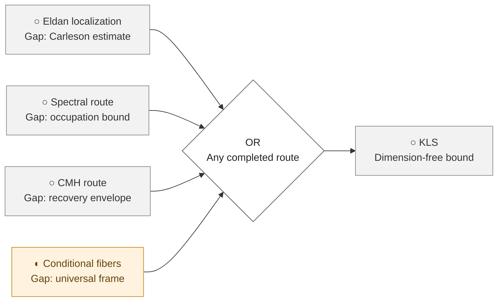
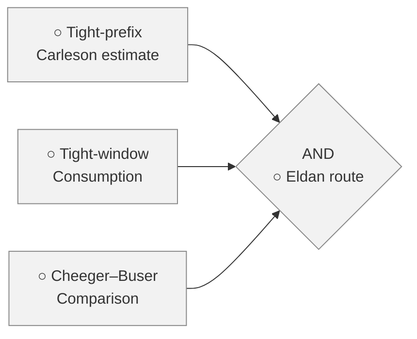
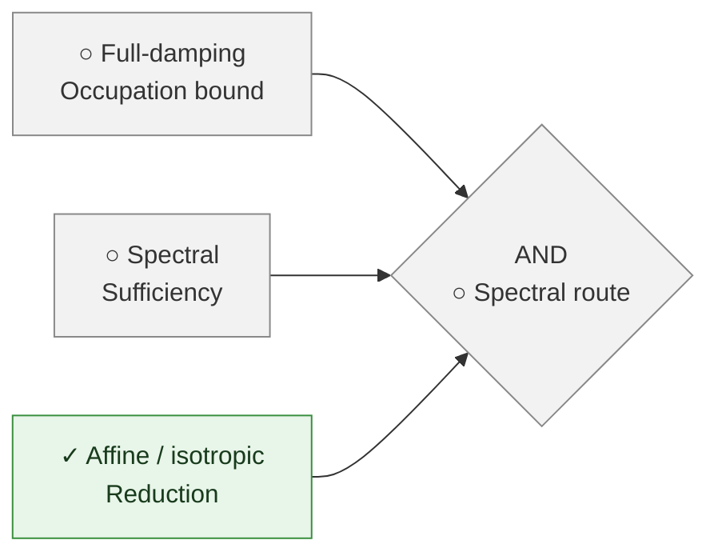
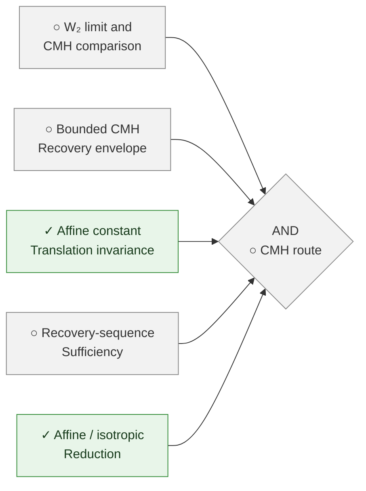
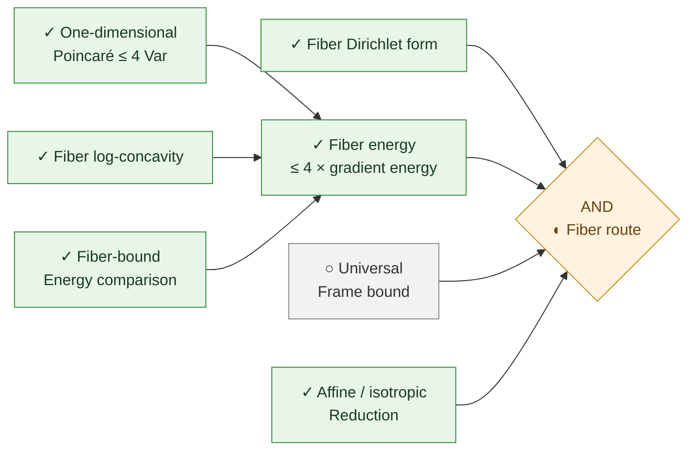
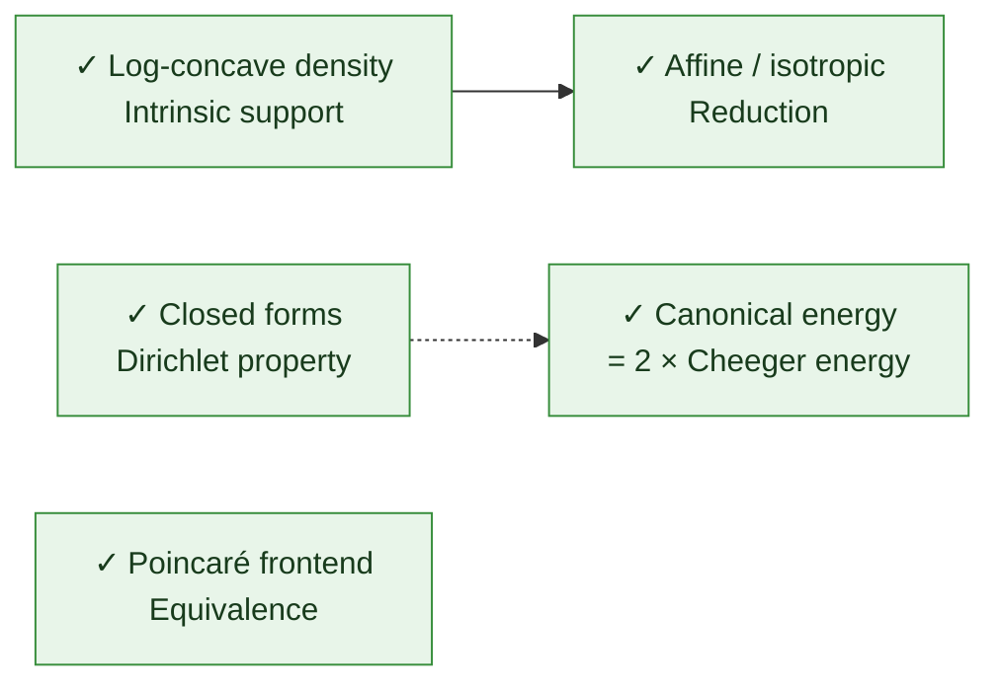
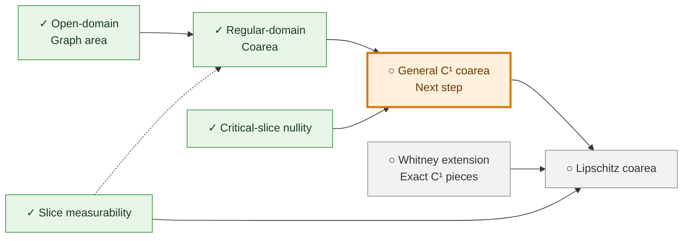
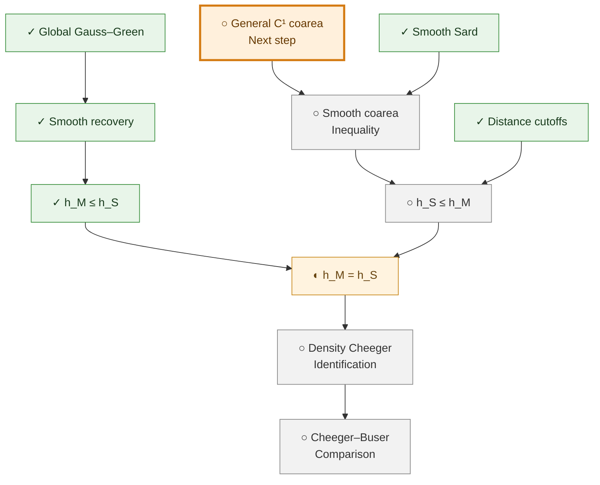

# KLS progress

| View | Purpose |
| --- | --- |
| [Route diagrams](#proof-progress-tree) | Compact overview, route details, and current analytic work |
| [Progress table](STATUS.md) | Local node IDs, mathematical provenance, recorded Lean status, certificates, dependencies, and gaps |

These views describe our formalization work. Upstream mathematical proofs and conditional
arguments remain separate from local Lean proofs. A completed auxiliary result is not necessarily
a separately registered certificate. KLS remains open.

## Proof progress tree

Last updated: **2026-09-15**. **✓** Completed in Lean · **◐** Partially formalized · **○** Pending.
The orange outline marks the next proof step. Upstream mathematical proofs alone do not earn a ✓.

### Overview

Each route below still has open obligations. The label names its central gap; the detailed graphs
list the other required inputs. **Any one completed route suffices for KLS.** Click a route to jump
to its details.



### Eldan localization

All three inputs are needed. Tight-window consumption has an upstream reviewed argument,
but no local Lean proof. The Cheeger–Buser bridge is expanded under [analytic progress](#analytic-progress).



### Moment-map spectral

The occupation estimate is open. Spectral sufficiency is an upstream implication from that
estimate, still awaiting Lean formalization. The affine/isotropic reduction is already proved.



### Moment-map CMH

The recovery envelope is open. The W₂/CMH comparison and recovery-sequence implication have
upstream mathematical arguments, not local Lean proofs. The source requires a regular recovery
sequence. This route is sufficient for KLS, not an equivalent reformulation.



### Conditional-fiber frames

The fiber form and comparisons are proved. What remains is a universal frame, chosen independently
of the test function, controlling variance by fiber energy. The form-bound constant would then give
the isotropic `4C` Poincaré bound; the reduction handles general affine support and zero dimension.



### Shared foundations

The density, normalization, energy, and frontend results support the routes. Dotted arrows show
context, not a standalone implication to KLS. The energy identity uses the local-slope convention
for log-concave laws; it is distinct from comparison of isoperimetric constants.



### Analytic progress

#### Coarea: the next proof step

General C¹ coarea combines the regular region with critical-slice nullity. The later Lipschitz
extension additionally needs Whitney extension and exact C¹ pieces; it is not a prerequisite for
the smooth C¹ application below.



#### Isoperimetric comparison

`h_M` is the Minkowski Cheeger constant; `h_S` is the smooth-boundary constant. The forward
comparison is proved. The reverse comparison needs smooth coarea and cutoff arguments.
Smooth Sard means C∞ Sard here; sharp finite-regularity Sard remains a separate open obligation.



The resulting Cheeger–Buser bridge feeds the Eldan route; it does not by itself prove KLS.
The following related inequality is already proved and is distinct from the weighted coarea equality:


### Benchmarks and upstream research beyond the four route gates

These results calibrate or investigate the program. They do not provide additional completed
routes to KLS, and no solid implication arrow from a model calculation to a universal gate is intended.

| Result or research direction | Recorded status and boundary | Source |
| --- | --- | --- |
| Sharp one-dimensional Gaussian constant | ✓ Lean-proved; Gaussian laws only | [Lean source](../../formalization/FunctionalInequalities/Poincare/Gaussian/Real.lean) |
| Finite Poincaré tensorization | ✓ Lean-proved; independent-product infrastructure | [Lean source](../../formalization/FunctionalInequalities/Poincare/FiniteProduct/Tensorization.lean) |
| Spectral restart and fourth-moment estimates | Upstream reviewed; not Lean; do not close uniform-time occupation | [Synchronization record](../../research/decisions/2026-09-12-upstream-research-sync.md) |
| Letwin-dependent short-time spectral chain | Conditional upstream result; not Lean; not dimension-free KLS | [Synchronization record](../../research/decisions/2026-09-12-upstream-research-sync.md) |
| Screened localization on a regular split class | Restricted upstream result; the universal gate remains open | [Synchronization record](../../research/decisions/2026-09-12-upstream-research-sync.md) |
| CMH linear spectral resolution and third-moment decomposition | Upstream reviewed weak/closed-form statements; no universal higher-order remainder bound | [Synchronization record](../../research/decisions/2026-09-12-upstream-research-sync.md) |
| Sharp gate-zero matrix bound | Upstream conjecture; not proved or Lean-certified | [Synchronization record](../../research/decisions/2026-09-12-upstream-research-sync.md) |
| Exponential-cone and cube-cone models | Exact restricted models; not a universal CMH or recovery-envelope bound | [Synchronization record](../../research/decisions/2026-09-12-upstream-research-sync.md) |
| Simplex root-frame degree-two result | Upstream reviewed polynomial-sector result; not a full L² frame bound | [Synchronization record](../../research/decisions/2026-09-12-upstream-research-sync.md) |
| Historical weighted near-Cheeger package | REFUTED upstream by the exponential-spectator obstruction; excluded from the four active routes | [Historical branch](../../formalization/blueprint/src/chapters/50-kls-routes.tex) |

### Reading the diagrams

Solid arrows point from inputs toward consumers; all inputs to an AND diamond are required.
The overview joins the four alternatives with OR. Arrows through pending nodes describe the
planned proof route, not an already established implication. Only selected dependencies are shown.
The [route composition](../../formalization/blueprint/route-composition.yaml) and Blueprint give
precise statements. The upstream roadmap remains pinned to
`34b5fcd57fef17089e781616005fe6d3641bd11e`; this is a route-level overview, not every upstream lemma.

Every node has a link. If diagram links are disabled in your viewer, use this directory.

<details>
<summary>Node links: Lean sources and documentation</summary>

| Node | Source |
| --- | --- |
| ○ KLS — Dimension-free bound | [Open source](https://github.com/numina-functional-inequalities/kls-lean/blob/main/formalization/FunctionalInequalities/KLS/Statement.lean) |
| OR — Any completed route | [Open source](https://github.com/numina-functional-inequalities/kls-lean/blob/main/formalization/blueprint/route-composition.yaml) |
| ✓ Log-concave density — Intrinsic support | [Open source](https://github.com/numina-functional-inequalities/kls-lean/blob/main/formalization/FunctionalInequalities/KLS/LogConcave/BorellRepresentation.lean) |
| ✓ Affine / isotropic — Reduction | [Open source](https://github.com/numina-functional-inequalities/kls-lean/blob/main/formalization/FunctionalInequalities/KLS/LogConcave/Isotropic.lean) |
| ✓ Closed forms — Dirichlet property | [Open source](https://github.com/numina-functional-inequalities/kls-lean/blob/main/formalization/FunctionalInequalities/Energy/SmoothGradient/Dirichlet.lean) |
| ✓ Canonical energy — = 2 × Cheeger energy | [Open source](https://github.com/numina-functional-inequalities/kls-lean/blob/main/formalization/FunctionalInequalities/Energy/Cheeger.lean) |
| ✓ Poincaré frontend — Equivalence | [Open source](https://github.com/numina-functional-inequalities/kls-lean/blob/main/formalization/FunctionalInequalities/KLS/LogConcave/Poincare.lean) |
| ○ Cheeger–Buser — Comparison | [Open source](https://github.com/numina-functional-inequalities/kls-lean/blob/main/formalization/blueprint/src/chapters/45-shared-analytic-bridges.tex) |
| ○ Tight-prefix — Carleson estimate | [Open source](https://github.com/numina-functional-inequalities/kls-lean/blob/main/formalization/blueprint/src/chapters/50-kls-routes.tex) |
| ○ Tight-window — Consumption | [Open source](https://github.com/numina-functional-inequalities/kls-lean/blob/main/formalization/blueprint/src/chapters/50-kls-routes.tex) |
| AND — ○ Eldan route | [Open source](https://github.com/numina-functional-inequalities/kls-lean/blob/main/formalization/blueprint/route-composition.yaml) |
| ○ Full-damping — Occupation bound | [Open source](https://github.com/numina-functional-inequalities/kls-lean/blob/main/formalization/blueprint/src/chapters/50-kls-routes.tex) |
| ○ Spectral — Sufficiency | [Open source](https://github.com/numina-functional-inequalities/kls-lean/blob/main/formalization/blueprint/src/chapters/50-kls-routes.tex) |
| AND — ○ Spectral route | [Open source](https://github.com/numina-functional-inequalities/kls-lean/blob/main/formalization/blueprint/route-composition.yaml) |
| ○ W₂ limit and — CMH comparison | [Open source](https://github.com/numina-functional-inequalities/kls-lean/blob/main/formalization/blueprint/src/chapters/50-kls-routes.tex) |
| ○ Bounded CMH — Recovery envelope | [Open source](https://github.com/numina-functional-inequalities/kls-lean/blob/main/formalization/blueprint/src/chapters/50-kls-routes.tex) |
| ✓ Affine constant — Translation invariance | [Open source](https://github.com/numina-functional-inequalities/kls-lean/blob/main/formalization/FunctionalInequalities/Poincare/CovarianceGradient/Translation.lean) |
| ○ Recovery-sequence — Sufficiency | [Open source](https://github.com/numina-functional-inequalities/kls-lean/blob/main/formalization/blueprint/src/chapters/50-kls-routes.tex) |
| AND — ○ CMH route | [Open source](https://github.com/numina-functional-inequalities/kls-lean/blob/main/formalization/blueprint/route-composition.yaml) |
| ✓ Fiber Dirichlet form | [Open source](https://github.com/numina-functional-inequalities/kls-lean/blob/main/formalization/FunctionalInequalities/KLS/ConditionalFiber/Closed.lean) |
| ✓ One-dimensional — Poincaré ≤ 4 Var | [Open source](https://github.com/numina-functional-inequalities/kls-lean/blob/main/formalization/FunctionalInequalities/KLS/LogConcave/Line/SharpPoincare.lean) |
| ✓ Fiber log-concavity | [Open source](https://github.com/numina-functional-inequalities/kls-lean/blob/main/formalization/FunctionalInequalities/KLS/LogConcave/ConditionalFiber.lean) |
| ✓ Fiber-bound — Energy comparison | [Open source](https://github.com/numina-functional-inequalities/kls-lean/blob/main/formalization/FunctionalInequalities/KLS/ConditionalFiber/EnergyComparison.lean) |
| ✓ Fiber energy — ≤ 4 × gradient energy | [Open source](https://github.com/numina-functional-inequalities/kls-lean/blob/main/formalization/FunctionalInequalities/KLS/LogConcave/ConditionalFiber.lean) |
| ○ Universal — Frame bound | [Open source](https://github.com/numina-functional-inequalities/kls-lean/blob/main/formalization/blueprint/src/chapters/50-kls-routes.tex) |
| AND — ◐ Fiber route | [Open source](https://github.com/numina-functional-inequalities/kls-lean/blob/main/formalization/blueprint/route-composition.yaml) |
| ✓ Global Gauss–Green | [Open source](https://github.com/numina-functional-inequalities/kls-lean/blob/main/formalization/FunctionalInequalities/KLS/Geometry/GaussGreen.lean) |
| ✓ Smooth recovery | [Open source](https://github.com/numina-functional-inequalities/kls-lean/blob/main/formalization/FunctionalInequalities/KLS/Geometry/PerimeterRecovery.lean) |
| ✓ h_M ≤ h_S | [Open source](https://github.com/numina-functional-inequalities/kls-lean/blob/main/formalization/FunctionalInequalities/KLS/Geometry/CheegerInfimum.lean) |
| ✓ Minkowski coarea | [Open source](https://github.com/numina-functional-inequalities/kls-lean/blob/main/formalization/FunctionalInequalities/KLS/Geometry/MinkowskiContent.lean) |
| ✓ Smooth Sard | [Open source](https://github.com/numina-functional-inequalities/kls-lean/blob/main/formalization/FunctionalInequalities/Analysis/SmoothSard.lean) |
| ✓ Slice measurability | [Open source](https://github.com/numina-functional-inequalities/kls-lean/blob/main/formalization/FunctionalInequalities/KLS/Geometry/LevelSetMeasurable.lean) |
| ✓ Open-domain — Graph area | [Open source](https://github.com/numina-functional-inequalities/kls-lean/blob/main/formalization/FunctionalInequalities/Analysis/OpenGraphIntegral.lean) |
| ✓ Regular-domain — Coarea | [Open source](https://github.com/numina-functional-inequalities/kls-lean/blob/main/formalization/FunctionalInequalities/KLS/Geometry/RegularCoarea.lean) |
| ✓ Critical-slice nullity | [Open source](https://github.com/numina-functional-inequalities/kls-lean/blob/main/formalization/FunctionalInequalities/KLS/Geometry/CriticalSlice.lean) |
| ○ General C¹ coarea — Next step | [Open source](https://github.com/numina-functional-inequalities/kls-lean/blob/main/research/decisions/2026-09-15-weighted-coarea-route.md#l11) |
| ○ Whitney extension — Exact C¹ pieces | [Open source](https://github.com/numina-functional-inequalities/kls-lean/blob/main/research/decisions/2026-09-15-weighted-coarea-route.md#l6) |
| ○ Lipschitz coarea | [Open source](https://github.com/numina-functional-inequalities/kls-lean/blob/main/research/decisions/2026-09-15-weighted-coarea-route.md#l12) |
| ○ Smooth coarea — Inequality | [Open source](https://github.com/numina-functional-inequalities/kls-lean/blob/main/formalization/FunctionalInequalities/KLS/WIP/CheegerInfimum.lean) |
| ✓ Distance cutoffs | [Open source](https://github.com/numina-functional-inequalities/kls-lean/blob/main/formalization/FunctionalInequalities/KLS/Geometry/DistanceCutoff.lean) |
| ○ h_S ≤ h_M | [Open source](https://github.com/numina-functional-inequalities/kls-lean/blob/main/formalization/FunctionalInequalities/KLS/WIP/CheegerInfimum.lean) |
| ◐ h_M = h_S | [Open source](https://github.com/numina-functional-inequalities/kls-lean/blob/main/formalization/FunctionalInequalities/KLS/WIP/CheegerInfimum.lean) |
| ○ Density Cheeger — Identification | [Open source](https://github.com/numina-functional-inequalities/kls-lean/blob/main/formalization/blueprint/src/chapters/45-shared-analytic-bridges.tex) |
| ○ Eldan localization — Gap: Carleson estimate | [Open source](https://github.com/numina-functional-inequalities/kls-lean/tree/main/research/progress#eldan-localization) |
| ○ Spectral route — Gap: occupation bound | [Open source](https://github.com/numina-functional-inequalities/kls-lean/tree/main/research/progress#moment-map-spectral) |
| ○ CMH route — Gap: recovery envelope | [Open source](https://github.com/numina-functional-inequalities/kls-lean/tree/main/research/progress#moment-map-cmh) |
| ◐ Conditional fibers — Gap: universal frame | [Open source](https://github.com/numina-functional-inequalities/kls-lean/tree/main/research/progress#conditional-fiber-frames) |

</details>

## Where the records come from

- [Blueprint](../../formalization/blueprint/src/chapters/) supplies local node statements,
  dependencies, and Lean annotations.
- [Ledger](../a-series/ledger.yaml) supplies registered certificate records.
- [Task metadata](../tasks.json) supplies mathematical classifications and infrastructure gaps.
- [Route composition](../../formalization/blueprint/route-composition.yaml) supplies explicit
  upstream provenance and the four sufficient-route alternatives.
- [Selected upstream snapshot](../upstream/2026-09-12-kls-research.json) preserves additional
  pinned research records. It is a selection, not the complete upstream ledger.

The table is a derived documentation view, not a new source of proof status. It does not execute
Lean or attest to the latest remote CI result. Follow the [verification guide](../verification.md)
for those checks. The diagrams remain a reviewed summary; their auxiliary nodes need not have
individual Blueprint IDs.

## Updating after proof work

1. Update the relevant source, ledger/Blueprint annotations, and task metadata with the appropriate
   proof evidence. Review [the overview and detail diagrams](#proof-progress-tree), their links, and the next-step highlight.
2. Stage only the intended proof and metadata changes, then run from the repository root:

   ```sh
   python3 research/progress/update.py
   ```

   The generator reads canonical records from the Git index, so unrelated unstaged changes do not
   silently enter the published table. It reads `README.md` from the working tree for the diagram
   node directory. Input hashes in the table identify the records used.
3. Review and stage `STATUS.md`, `README.md`, and the adjacent root README status summary as needed.
   Use `python3 research/progress/update.py --check` to check that the table is current.

Commits containing only non-Lean files do not trigger CI, as requested by the owner. Both
GitHub workflows automatically run only when `**/*.lean` changes. Keep `[skip ci]` on this initial
non-Lean publication as well. Commits containing Lean changes follow the normal verification and
CI workflow; do not add `[skip ci]` to those commits. Blueprint retains its existing manual trigger.
