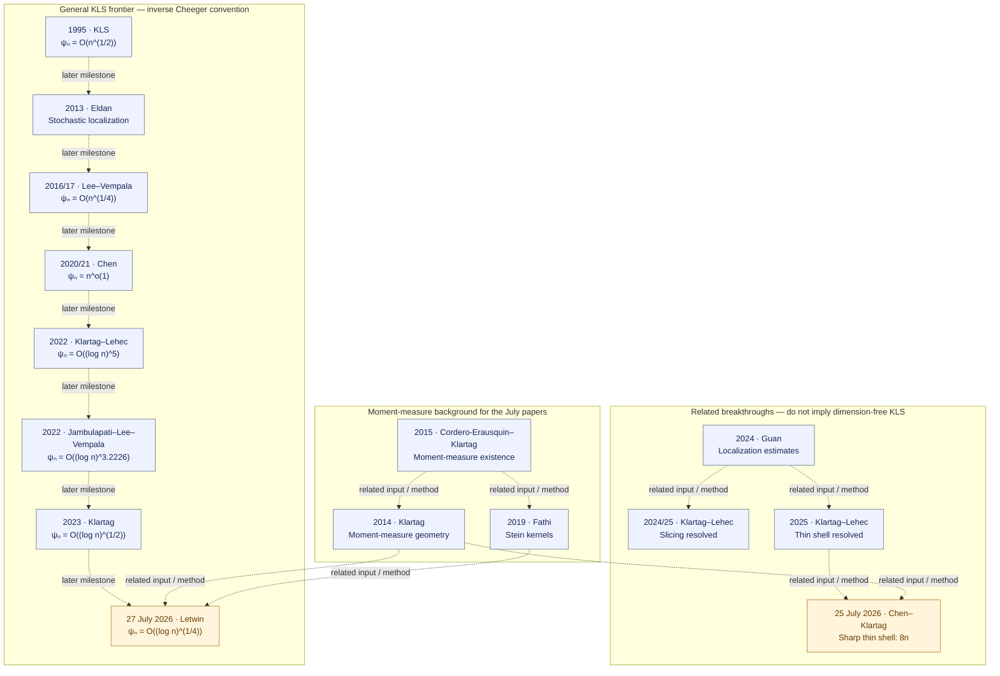

# KLS literature progress

**Primary work plan: formalize published KLS literature, one source theorem at a time.**
Start with the [paper-by-paper register](LITERATURE.md), which records the source/version,
target theorem, local Lean statements, certificate and remaining mathematical scope.
The [supporting node register](STATUS.md) retains the complete statement/evidence inventory.

<!-- BEGIN GENERATED DATE -->
Progress view updated: **2026-10-02**.
<!-- END GENERATED DATE -->

A paper target is covered only when its main theorem is faithfully stated, proved and
registered with a certificate and exact-statement verification evidence. A ✓ on a supporting
lemma does not cover the source paper. No complete paper target is currently registered as
covered. The dimension-free KLS conjecture remains open.

## Current literature priorities

<!-- BEGIN GENERATED PRIORITIES -->
These are source-review and proof priorities, not claims that the targets are proved.
Every proof task must first pin its paper version, theorem, hypotheses and constants.

| Priority | Sources / target | Next action |
| --- | --- | --- |
| 1 | [Bakry–Gentil–Ledoux](https://link.springer.com/book/10.1007/978-3-319-00227-9)<br/>Audit the strongly log-concave Bakry–Émery C_P ≤ 1/ρ endpoint and select a separate Brascamp–Lieb source statement. | Pin the exact source theorem, positive-curvature assumptions and normalization; assess the existing Γ₂ and semigroup interfaces before proof work. |
| 2 | [Kannan–Lovász–Simonovits](https://link.springer.com/article/10.1007/BF02574061)<br/>Localization lemma and the dimension-dependent trace/covariance bound. | Separate the localization theorem from the Poincaré consequence; audit denominator and constant conventions before defining either Lean target. |
| 3 | [E. Milman](https://arxiv.org/abs/0712.4092)<br/>Concentration implies a Cheeger bound under the source convexity hypotheses. | Pin the main theorem and its concentration/curvature assumptions; compare its analytic inputs with the current finite-dimensional Cheeger–Buser API. |
| 4 | [Eldan](https://arxiv.org/abs/1203.0893), [Lee–Vempala](https://annals.math.princeton.edu/2024/199-3/p02), [Chen](https://arxiv.org/abs/2011.13661), [Klartag–Lehec](https://arxiv.org/html/2203.15551v2), [Klartag](https://arxiv.org/html/2303.14938v2)<br/>Published stochastic-localization theorems and quantitative KLS bounds. | Reuse Mathlib probability foundations; build an isolated audited client of pinned external stochastic APIs before selecting the missing vector/matrix SDE bridges. |
| 5 | [Klartag–Lehec](https://arxiv.org/abs/2507.15495v2), [Chen–Klartag](https://arxiv.org/html/2607.23307v1), [Letwin](https://arxiv.org/html/2607.24164v1)<br/>Selected 2025–2026 thin-shell and quadratic-form results. | Retain exact preprint versions and assess moment-measure, stochastic and matrix-estimate dependencies; do not credit exploratory hypotheses as completed paper theorems. |
<!-- END GENERATED PRIORITIES -->

## Literature map through July 2026

<!-- BEGIN GENERATED LITERATURE -->
**27 selected sources, from foundational results to July 2026.**

The [paper-by-paper literature register](LITERATURE.md) records statements, publication
versions, exact local coverage and remaining work. The general KLS-bound milestones
in this diagram are all still pending locally; completed supporting results appear in
the paper and node registers. Dashed edges mean chronology or related methods, not proof.



| Latest source | Literature result | Our Lean status |
| --- | --- | --- |
| [Chen–Klartag, 25 July 2026](https://arxiv.org/html/2607.23307v1) · Preprint (v1) | For isotropic log-concave X: Var(‖X‖²) ≤ 8n and ‖T₃(X)‖²_HS ≤ 4n. The constants are sharp. |  |
| [Letwin, 27 July 2026](https://arxiv.org/html/2607.24164v1) · Preprint (v1) | For isotropic log-concave X and symmetric M, Var(XᵀMX) ≤ 8‖M‖²_HS = 2 E‖∇(XᵀMX)‖². For n ≥ 2, ψₙ = O((log n)^(1/4)), hence C_P = O(√log n). |  |

Here ψ is the inverse Cheeger constant, so its logarithmic exponent is half the
Poincaré exponent. The sharp thin-shell result does not resolve dimension-free KLS.
See the [full tables and normalization](LITERATURE.md#constant-conventions).
<!-- END GENERATED LITERATURE -->

## Work and evidence

Before proof work, pin the source version and theorem locator, review every assumption and
constant, compare the intended Lean statement with the source, and name any missing interface.
Infrastructure work must support a named paper target. Use the [current handoff](../../HANDOFF.md)
and [workflow](../workflow.md#0-select-a-literature-target) for task selection and validation.

The [literature catalog](literature.json) owns paper mappings and priorities.
[Node records](nodes.json), Blueprint annotations, ledger and task records retain exact proof
and certificate status. Stage intended canonical changes before running:

```sh
python3 research/progress/update.py
python3 research/progress/update.py --check
```

The generator reads all canonical inventories from the Git index and generates this page,
`LITERATURE.md`, `STATUS.md`, `TREE.mmd`, `LITERATURE.mmd`, badges and separate exploratory views.
Review and stage generated outputs together. Documentation generation does not verify proofs.
Remote CI is Lean-only at manual or tagged milestones; prose changes do not require a Lean rebuild.

[Exploratory research records](../explorations/ROUTES.md) are retained separately as non-targets;
they do not select future formalization tasks or contribute paper coverage.
