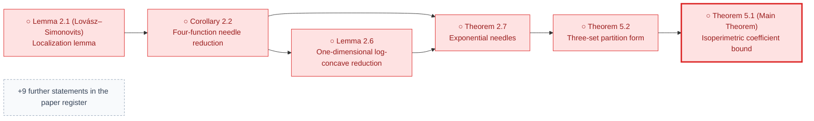
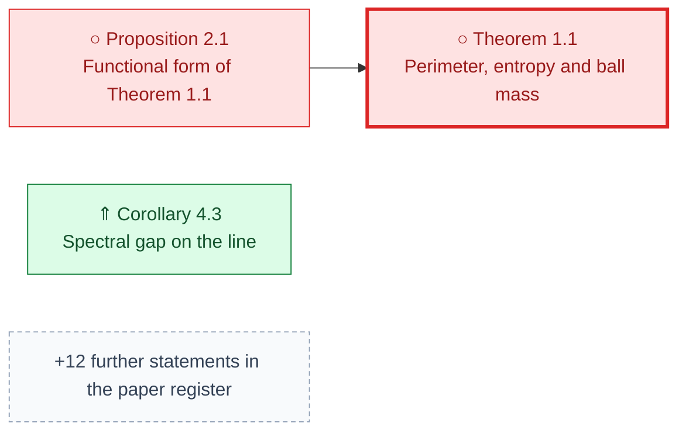
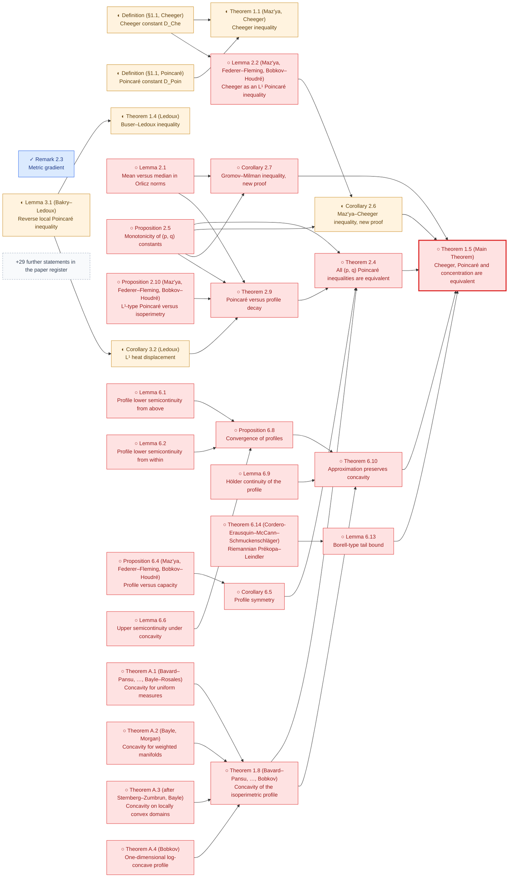
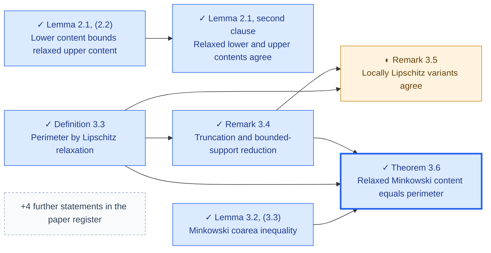
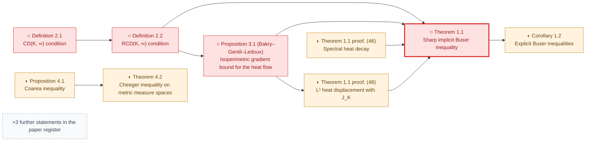
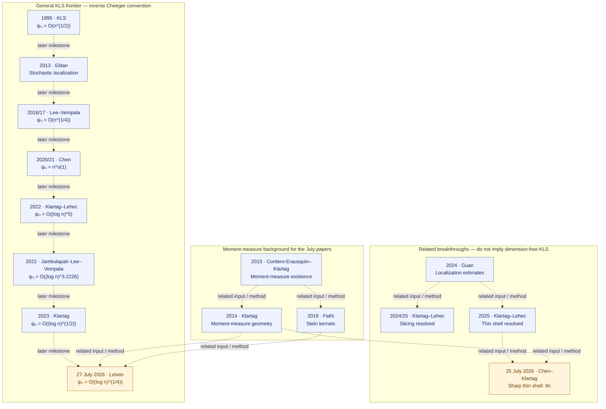

# KLS progress

| View | Purpose |
| --- | --- |
| [Literature register](LITERATURE.md) | **Primary progress view.** Paper by paper: target theorem, local Lean statements, local status and certificates |
| [Route diagrams](#proof-progress-tree) | Exploratory proof routes and the shared analytic infrastructure behind them |
| [Progress table](STATUS.md) | Local node IDs, mathematical provenance, recorded Lean status, certificates, dependencies, and gaps |

The project goal is to formalize as much of the published KLS literature as possible. Work is
selected by a named paper, pinned version and target theorem. The four routes in the diagram
below are exploratory research records that share our analytic infrastructure; they are not
formalization targets in their own right.

A paper is **covered** only when its main theorem is stated faithfully in Lean (same hypotheses,
constants, normalization and dimensional scope), proved without nonstandard axioms, and
registered with a certificate and verification evidence for that exact statement. Supporting
lemmas, restricted cases and conditional reductions do not cover a paper. **No paper is covered
yet.** Upstream mathematical proofs and conditional arguments remain separate from local Lean
proofs. KLS remains open.

The current analytic frontier is summarized under [Proof progress tree](#proof-progress-tree):
the numerical π Cheeger–Buser comparison holds for every finite-dimensional log-concave law,
and metric BV relaxation and recovery are proved within their stated measure and space scope.

## Literature priorities

<!-- BEGIN GENERATED PRIORITIES -->
These are source-review and proof priorities, not claims that the targets are proved.
Every proof task must first pin its paper version, theorem, hypotheses and constants.

| Priority | Sources / target | Next action |
| --- | --- | --- |
| 1 | [Bakry–Gentil–Ledoux](https://link.springer.com/book/10.1007/978-3-319-00227-9)<br/>Audit the strongly log-concave Bakry–Émery C_P ≤ 1/ρ endpoint and select a separate Brascamp–Lieb source statement. | Pin the exact source theorem, positive-curvature assumptions and normalization; assess the existing Γ₂ and semigroup interfaces before proof work. |
| 2 | [Kannan–Lovász–Simonovits](https://link.springer.com/article/10.1007/BF02574061)<br/>Theorem 5.1, ψ(K) ≥ ln 2 / M₁(K) for convex bodies, through the needle reduction (Corollary 2.2, Lemma 2.6, Theorem 2.7). With the local Cheeger inequality it gives C_P ≲ E‖X − EX‖² for convex bodies. | Pin a proof of the cited localization lemma (Lovász–Simonovits 1993 or a modern account) and choose a Lean form for needles; keep the product denominator of (1.1) distinct from the min-denominator constant. |
| 3 | [E. Milman](https://arxiv.org/abs/0712.4092)<br/>Concentration implies a Cheeger bound under the source convexity hypotheses. | Pin the main theorem and its concentration/curvature assumptions; compare its analytic inputs with the current finite-dimensional Cheeger–Buser API. |
| 4 | [Eldan](https://arxiv.org/abs/1203.0893), [Lee–Vempala](https://annals.math.princeton.edu/2024/199-3/p02), [Chen](https://arxiv.org/abs/2011.13661), [Klartag–Lehec](https://arxiv.org/html/2203.15551v2), [Klartag](https://arxiv.org/html/2303.14938v2)<br/>Published stochastic-localization theorems and quantitative KLS bounds. | Reuse Mathlib probability foundations; build an isolated audited client of pinned external stochastic APIs before selecting the missing vector/matrix SDE bridges. |
| 5 | [Klartag–Lehec](https://arxiv.org/abs/2507.15495v2), [Chen–Klartag](https://arxiv.org/html/2607.23307v1), [Letwin](https://arxiv.org/html/2607.24164v1)<br/>Selected 2025–2026 thin-shell and quadratic-form results. | Retain exact preprint versions and assess moment-measure, stochastic and matrix-estimate dependencies; do not credit exploratory hypotheses as completed paper theorems. |
<!-- END GENERATED PRIORITIES -->

## Paper lemma map

Numbered statements of the reviewed papers, with the same Lean status notation as the route
diagrams. Full tables, sources and notes are in the [paper register](LITERATURE.md#paper-lemma-maps).

<!-- BEGIN GENERATED LEMMAS -->
Each diagram shows a paper's main theorem (thick border, rightmost) with the statements its
proof uses, plus every statement with local Lean progress. Arrows run from a statement to
the results that use it. Full maps, statements and notes are in the paper register.

✓ Formalized in Lean · ◐ Partial or statement only · ○ Not yet formalized · ⇑ Stronger result or alternative route

### Kannan–Lovász–Simonovits (Discrete Comput. Geom. 13 (1995), 541–559)

15 statements: 15 ○. [Full map](LITERATURE.md#kls1995-lemma-map).



### Bobkov (Ann. Probab. 27 (1999), no. 4, 1903–1921 (author PDF))

15 statements: 14 ○, 1 ⇑. [Full map](LITERATURE.md#bobkov1999-lemma-map).



### E. Milman (arXiv:0712.4092v5)

60 statements: 1 ✓, 7 ◐, 52 ○. [Full map](LITERATURE.md#milman2009-lemma-map).



### Ambrosio–Di Marino–Gigli (arXiv:1603.08412v1)

11 statements: 6 ✓, 1 ◐, 4 ○. [Full map](LITERATURE.md#admg2017-lemma-map).



### De Ponti–Mondino (arXiv:1902.03835v2)

12 statements: 5 ◐, 7 ○. [Full map](LITERATURE.md#depontimondino2021-lemma-map).


<!-- END GENERATED LEMMAS -->

## KLS literature through July 2026

<!-- BEGIN GENERATED LITERATURE -->
**27 selected sources, from foundational results to July 2026.**

The [paper-by-paper literature register](LITERATURE.md) records statements, publication
versions, exact local coverage and remaining work. The general KLS-bound milestones
in this diagram are all still pending locally; completed supporting results appear in
the paper and node registers. Dashed edges mean chronology or related methods, not proof.



| Latest source | Literature result | Our Lean status |
| --- | --- | --- |
| [Chen–Klartag, 25 July 2026](https://arxiv.org/html/2607.23307v1) · Preprint (v1) | For isotropic log-concave X: Var(‖X‖²) ≤ 8n and ‖T₃(X)‖²_HS ≤ 4n. The constants are sharp. |  |
| [Letwin, 27 July 2026](https://arxiv.org/html/2607.24164v1) · Preprint (v1) | For isotropic log-concave X and symmetric M, Var(XᵀMX) ≤ 8‖M‖²_HS = 2 E‖∇(XᵀMX)‖². For n ≥ 2, ψₙ = O((log n)^(1/4)), hence C_P = O(√log n). |  |

Here ψ is the inverse Cheeger constant, so its logarithmic exponent is half the
Poincaré exponent. The sharp thin-shell result does not resolve dimension-free KLS.
See the [full tables and normalization](LITERATURE.md#constant-conventions).
<!-- END GENERATED LITERATURE -->

## Proof progress tree

<!-- BEGIN GENERATED DATE -->
Last updated: **2026-10-02**.

 ·  ·  · 
<!-- END GENERATED DATE -->
Scalar sharp Sard, vector coarea through locally Lipschitz maps, the Cheeger infimum equality,
heat-semigroup construction, and the full numerical Cheeger–Buser comparison are formalized
in Lean. The general π bound uses actual Gaussian smoothing and a Cheeger test stability
argument; no individual-domain perimeter limit is asserted.
The scoped metric BV comparison includes closed-support identification for finite-dimensional
log-concave laws, exact test-class relaxation infima, and relaxed lower Minkowski content.
**Next step:** prepare a certificate for ADMG Theorem 3.6 in the paper's own Definition 3.3
form, the first paper target close to coverage (see the [paper lemma map](#paper-lemma-map)).
The priority-1 Bakry–Émery target waits for the Bakry–Gentil–Ledoux source text.
The locally Lipschitz classes on nonproper spaces and the general metric-measure/RCD
comparison bridges remain open. The extended ADMG sections 2–3 finite-target
scope (2026-10-01) is frozen and locally verified. Lemma 2.1's equality of the relaxed lower and upper
contents now holds for every Borel measure at measurable finite-mass targets, and on proper
spaces the Remark 3.5 locally Lipschitz classes (global or compact-set L1) give the
bounded-support perimeter at such targets for every Borel measure. Remark 3.4's bounded-support reduction,
Lemma 2.1's actual radius recovery, both recoveries and both relaxed identities
are proved at measurable finite-mass Borel targets for measures finite on bounded
Borel sets, including infinite total mass and nonproper spaces. The full Lemma 3.2
chain retains the actual right-radius liminf of integrated open-ball growth under
finite positive-support-neighborhood mass and nonnegativity. No new ledger
certificate or remote CI is claimed. The locally Lipschitz classes on nonproper
spaces, nonconvex support transfer and general RCD comparisons are
outside this completed proof scope; the dimension-free KLS routes remain open.
The content chain proves lower content `≤` upper content, almost-everywhere differentiability of
the monotone radius mass, the derivative and integrated bounds on the upper content of
thickenings, the local-slope Minkowski coarea inequality, the recovery of every measurable set of
finite lower content and of every set of finite BV perimeter by measurable sets converging in
`L¹`, and the equality of the relaxed upper Minkowski content with the perimeter and with the
relaxed lower content, on arbitrary metric spaces with a finite Borel measure (phases 24–29,
independently accepted; the generic coarea uses the lower semicontinuous open-ball supremum;
scaling, the zero measure and normalization are explicit). The upper-content chain for measures finite on bounded sets
with infinite total mass is proved at measurable finite-mass targets (above); pointwise
equality of the upper content with the perimeter, general RCD comparisons and the
dimension-free KLS routes are not proved locally.

Complement symmetry for finite Borel
measures, including the closed intrinsic support law, is formalized in Lean, and so is
the equality of the half-mass and symmetric BV Cheeger constants on every probability
metric space; for a finite measure, globally Lipschitz approximants converging in global
`L¹` may replace bounded-support tests (on a proper metric space also locally Lipschitz
approximants, even under `L¹` convergence on every closed ball only), epsilon recovery tests exist below every threshold
above the perimeter, and every finite perimeter is the limit of the costs of an explicitly
selected approximating sequence; the perimeter is lower semicontinuous under global `L¹`
convergence of measurable sets and is at most the outer Minkowski content of every measurable
set for every probability law (one inequality); the Minkowski coarea inequality holds with the
actual local slope for every globally Lipschitz function, and every test has a quantitative
superlevel selection (content at most `cost / (1 - 2δ) + ε`, indicator error at most its error
over `δ`), and every set of finite BV perimeter has explicit measurable Minkowski recovery sets
(`L¹` convergence, contents converging to the perimeter), whose masses and, for mass in
`(0, 1)`, symmetric Cheeger quotients converge. Consequently the symmetric and half-mass BV
Cheeger constants equal the Minkowski Cheeger constant for every probability law on a normed
space, and for the intrinsic coordinate law they equal the isoperimetric constant (an equality of
infima). Restriction to the closed measure support does not increase the metric BV perimeter
(one inequality), with equality under a nonexpansive retraction onto a full-mass subset, in
particular for every law on a Hilbert space with convex closed support; for every
finite-dimensional log-concave law the BV Cheeger constant on the closed intrinsic support
therefore equals the isoperimetric constant. The relaxation infimum over globally Lipschitz
approximants equals this perimeter for finite measures, and over locally Lipschitz
approximants on proper spaces (with global or compact-set `L¹` convergence), in particular on
the closed intrinsic support, and the relaxed
lower Minkowski set infimum equals it for probability laws on normed spaces; `L¹_loc`
convergence beyond proper spaces with finite measures, and nonconvex supports remain open. The four dimension-free
[KLS routes](#proof-progress-tree) remain open.
These statuses record local proofs and do not claim a remote CI receipt.
Upstream mathematical proofs alone do not earn a ✓.

One large diagram shows the four sufficient routes and their shared proof infrastructure.
Arrows point toward KLS: AND within each route, OR between routes. Dotted arrows show context. The vector-coarea extension is shown separately and does not
assert an additional implication to KLS.
The diagram uses a larger font and full canvas width; [open its source](TREE.mmd) for a separate view.

```mermaid
%%{init: {"themeVariables": {"fontSize": "20px"}, "flowchart": {"useMaxWidth": false, "nodeSpacing": 40, "rankSpacing": 65}}}%%
flowchart LR
    subgraph FOUND["Shared foundations"]
    DENS["✓ Log-concave density<br/>Intrinsic support"]
    NORM["✓ Affine / isotropic<br/>Reduction"]
    FORMS["✓ Closed forms<br/>Dirichlet property"]
    ENERGY["✓ Canonical energy<br/>= 2 × Cheeger energy"]
    CONST["✓ Poincaré frontend<br/>Equivalence"]
    end
    subgraph ANALYSIS["Analytic comparison"]
    MEAS["✓ Slice measurability"]
    GRAPH["✓ Open-domain<br/>Graph area"]
    REG["✓ Regular-domain<br/>Coarea"]
    CRIT["✓ Critical-slice nullity"]
    C1["✓ General C¹ coarea"]
    WHIT["✓ Compact Whitney jets<br/>Exact C¹ pieces"]
    LIP["✓ Coarea: Lipschitz<br/>and locally Lipschitz"]
    GG["✓ Global Gauss–Green"]
    REC["✓ Smooth recovery"]
    FWD["✓ h_M ≤ h_S"]
    SARD["✓ Scalar Sard<br/>Sharp finite regularity"]
    SCI["✓ Cheeger superlevel<br/>Integral bound"]
    CUT["✓ Distance cutoffs"]
    REV["✓ h_S ≤ h_M"]
    EQ["✓ h_M = h_S"]
    FRONT["✓ Density Cheeger<br/>Identification"]
    CB["✓ Cheeger–Buser<br/>4 and pi bounds"]
    MINK["✓ Minkowski coarea"]
    BV["✓ Closed-support BV<br/>identification (log-concave)"]
    end
    subgraph HEATPROGRAM["Buser analytic program — dotted links show related work"]
    SEMI["✓ Weighted-gradient<br/>Heat semigroup"]
    MARKOV["✓ Heat semigroup<br/>Markov properties"]
    DECAY["✓ Centered heat decay<br/>and literature gap"]
    GAUSS["✓ Gaussian convolution<br/>Smooth potential"]
    GSTAB["✓ Gaussian convolution<br/>Poincaré stability"]
    BE["◐ Generator / Bochner<br/>Gradient estimates"]
    HEAT["◐ Small-time heat bounds<br/>and pi Buser assembly"]
    end
    subgraph ELDAN["Eldan localization"]
    EG["○ Tight-prefix<br/>Carleson estimate"]
    EC["○ Tight-window<br/>Consumption"]
    EAND{"AND<br/>○ Eldan route"}
    end
    subgraph SPECTRAL["Moment-map spectral"]
    SG["○ Full-damping<br/>Occupation bound"]
    SC["○ Spectral<br/>Sufficiency"]
    SAND{"AND<br/>○ Spectral route"}
    end
    subgraph CMH["Moment-map CMH"]
    MH["○ W₂ limit and<br/>CMH comparison"]
    MG["○ Bounded CMH<br/>Recovery envelope"]
    MT["✓ Affine constant<br/>Translation invariance"]
    MC["○ Recovery-sequence<br/>Sufficiency"]
    MAND{"AND<br/>○ CMH route"}
    end
    subgraph FIBER["Conditional-fiber frames"]
    ONE["✓ One-dimensional<br/>Poincaré ≤ 4 Var"]
    FLOG["✓ Fiber log-concavity"]
    FP["✓ Fiber-bound<br/>Energy comparison"]
    F4["✓ Fiber energy<br/>≤ 4 × gradient energy"]
    FC["✓ Fiber Dirichlet form"]
    FG["○ Universal<br/>Frame bound"]
    FAND{"AND<br/>◐ Fiber route"}
    end
    subgraph VECTOR["Vector coarea extension — separate from the KLS implication routes"]
    VREG["✓ Vector coarea<br/>Regular region"]
    VZERO["✓ Vector slices<br/>Zero derivative"]
    VR123["✓ Rank and kernel<br/>R1–R3"]
    VR4["✓ Tangential estimate<br/>R4"]
    VFULL["✓ C¹ vector coarea<br/>Rank-deficient part closed"]
    VLIP["✓ Vector coarea<br/>Lipschitz and local"]
    end
    KLS["○ KLS<br/>Dimension-free bound"]
    ANY{"OR<br/>Any completed route"}
    EG --> EAND
    EC --> EAND
    CB --> EAND
    SG --> SAND
    SC --> SAND
    NORM --> SAND
    MH --> MAND
    MG --> MAND
    MT --> MAND
    MC --> MAND
    NORM --> MAND
    ONE --> F4
    FLOG --> F4
    FP --> F4
    FC --> FAND
    F4 --> FAND
    FG --> FAND
    NORM --> FAND
    DENS --> NORM
    FORMS -.-> ENERGY
    GRAPH --> REG
    MEAS -.-> REG
    REG --> C1
    CRIT --> C1
    C1 --> LIP
    WHIT --> LIP
    MEAS --> LIP
    GG --> REC
    REC --> FWD
    C1 --> SCI
    SARD --> SCI
    SCI --> REV
    CUT --> REV
    FWD --> EQ
    REV --> EQ
    EQ --> FRONT
    FRONT --> CB
    EAND --> ANY
    SAND --> ANY
    MAND --> ANY
    FAND --> ANY
    ANY --> KLS
    CONST -.-> ANY
    VR123 --> VR4
    VREG -.-> VFULL
    VZERO -.-> VFULL
    VR4 -.-> VFULL
    SEMI -.-> MARKOV
    MARKOV -.-> BE
    MARKOV -.-> DECAY
    DECAY -.-> HEAT
    BE -.-> HEAT
    GAUSS -.-> CB
    GSTAB -.-> CB
    HEAT -.-> CB
    VFULL -.-> VLIP
    classDef done fill:#dbeafe,stroke:#2563eb,color:#1e3a8a;
    class ENERGY,F4,MT,FP,FC,EQ,NORM,DENS,FRONT,CB,ONE,CONST,FORMS,MEAS,GRAPH,REG,CRIT,C1,WHIT,LIP,GG,REC,FWD,SARD,SCI,CUT,REV,MINK,BV,FLOG,VREG,VZERO,VR123,VR4,VFULL,SEMI,MARKOV,DECAY,GAUSS,GSTAB,VLIP done;
    classDef partial fill:#fff3df,stroke:#c88719,color:#66420d;
    class FAND,BE,HEAT partial;
    classDef todo fill:#fee2e2,stroke:#dc2626,color:#991b1b;
    class MG,EG,KLS,MC,EC,SC,FG,SG,MH,EAND,SAND,MAND todo;
    classDef logic fill:#fff,stroke:#555,color:#222;
    class ANY logic;
    click MG href "https://github.com/numina-functional-inequalities/kls-lean/blob/main/formalization/blueprint/src/chapters/50-kls-routes.tex" "Bounded CMH — Recovery envelope" _blank
    click EG href "https://github.com/numina-functional-inequalities/kls-lean/blob/main/formalization/blueprint/src/chapters/50-kls-routes.tex" "Tight-prefix — Carleson estimate" _blank
    click KLS href "https://github.com/numina-functional-inequalities/kls-lean/blob/main/formalization/FunctionalInequalities/KLS/Statement.lean" "KLS — Dimension-free bound" _blank
    click ENERGY href "https://github.com/numina-functional-inequalities/kls-lean/blob/main/formalization/FunctionalInequalities/Energy/Cheeger/Basic.lean" "Canonical energy — = 2 × Cheeger energy" _blank
    click MC href "https://github.com/numina-functional-inequalities/kls-lean/blob/main/formalization/blueprint/src/chapters/50-kls-routes.tex" "Recovery-sequence — Sufficiency" _blank
    click F4 href "https://github.com/numina-functional-inequalities/kls-lean/blob/main/formalization/FunctionalInequalities/KLS/LogConcave/ConditionalFiber.lean" "Fiber energy — ≤ 4 × gradient energy" _blank
    click EC href "https://github.com/numina-functional-inequalities/kls-lean/blob/main/formalization/blueprint/src/chapters/50-kls-routes.tex" "Tight-window — Consumption" _blank
    click MT href "https://github.com/numina-functional-inequalities/kls-lean/blob/main/formalization/FunctionalInequalities/Poincare/CovarianceGradient/Translation.lean" "Affine constant — Translation invariance" _blank
    click FP href "https://github.com/numina-functional-inequalities/kls-lean/blob/main/formalization/FunctionalInequalities/KLS/ConditionalFiber/EnergyComparison.lean" "Fiber-bound — Energy comparison" _blank
    click FC href "https://github.com/numina-functional-inequalities/kls-lean/blob/main/formalization/FunctionalInequalities/KLS/ConditionalFiber/Closed.lean" "Fiber Dirichlet form" _blank
    click EQ href "https://github.com/numina-functional-inequalities/kls-lean/blob/main/formalization/FunctionalInequalities/KLS/Geometry/Cheeger/Equality.lean" "h_M = h_S" _blank
    click SC href "https://github.com/numina-functional-inequalities/kls-lean/blob/main/formalization/blueprint/src/chapters/50-kls-routes.tex" "Spectral — Sufficiency" _blank
    click FG href "https://github.com/numina-functional-inequalities/kls-lean/blob/main/formalization/blueprint/src/chapters/50-kls-routes.tex" "Universal — Frame bound" _blank
    click SG href "https://github.com/numina-functional-inequalities/kls-lean/blob/main/formalization/blueprint/src/chapters/50-kls-routes.tex" "Full-damping — Occupation bound" _blank
    click NORM href "https://github.com/numina-functional-inequalities/kls-lean/blob/main/formalization/FunctionalInequalities/KLS/LogConcave/Isotropic.lean" "Affine / isotropic — Reduction" _blank
    click DENS href "https://github.com/numina-functional-inequalities/kls-lean/blob/main/formalization/FunctionalInequalities/KLS/LogConcave/Density/BorellRepresentation/Intrinsic.lean" "Log-concave density — Intrinsic support" _blank
    click MH href "https://github.com/numina-functional-inequalities/kls-lean/blob/main/formalization/blueprint/src/chapters/50-kls-routes.tex" "W₂ limit and — CMH comparison" _blank
    click FRONT href "https://github.com/numina-functional-inequalities/kls-lean/blob/main/formalization/blueprint/src/chapters/45-shared-analytic-bridges.tex" "Density Cheeger — Identification" _blank
    click CB href "https://github.com/numina-functional-inequalities/kls-lean/blob/main/formalization/blueprint/src/chapters/45-shared-analytic-bridges.tex" "Cheeger–Buser — 4 and pi bounds" _blank
    click ONE href "https://github.com/numina-functional-inequalities/kls-lean/blob/main/formalization/FunctionalInequalities/KLS/LogConcave/Line/SharpPoincare.lean" "One-dimensional — Poincaré ≤ 4 Var" _blank
    click CONST href "https://github.com/numina-functional-inequalities/kls-lean/blob/main/formalization/FunctionalInequalities/KLS/LogConcave/Poincare.lean" "Poincaré frontend — Equivalence" _blank
    click FORMS href "https://github.com/numina-functional-inequalities/kls-lean/blob/main/formalization/FunctionalInequalities/Energy/SmoothGradient/Dirichlet.lean" "Closed forms — Dirichlet property" _blank
    click MEAS href "https://github.com/numina-functional-inequalities/kls-lean/blob/main/formalization/FunctionalInequalities/KLS/Geometry/Slice/Measurable.lean" "Slice measurability" _blank
    click GRAPH href "https://github.com/numina-functional-inequalities/kls-lean/blob/main/formalization/FunctionalInequalities/Analysis/Graph/OpenIntegral.lean" "Open-domain — Graph area" _blank
    click REG href "https://github.com/numina-functional-inequalities/kls-lean/blob/main/formalization/FunctionalInequalities/KLS/Geometry/Coarea/Regular.lean" "Regular-domain — Coarea" _blank
    click CRIT href "https://github.com/numina-functional-inequalities/kls-lean/blob/main/formalization/FunctionalInequalities/KLS/Geometry/Slice/Critical.lean" "Critical-slice nullity" _blank
    click C1 href "https://github.com/numina-functional-inequalities/kls-lean/blob/main/formalization/FunctionalInequalities/KLS/Geometry/Coarea/Smooth.lean" "General C¹ coarea" _blank
    click WHIT href "https://github.com/numina-functional-inequalities/kls-lean/blob/main/research/decisions/2026-09-16-lipschitz-coarea.md" "Compact Whitney jets — Exact C¹ pieces" _blank
    click LIP href "https://github.com/numina-functional-inequalities/kls-lean/blob/main/formalization/FunctionalInequalities/KLS/Geometry/Coarea/LocallyLipschitz.lean" "Coarea: Lipschitz — and locally Lipschitz" _blank
    click GG href "https://github.com/numina-functional-inequalities/kls-lean/blob/main/formalization/FunctionalInequalities/KLS/Geometry/SmoothDomain/GaussGreen.lean" "Global Gauss–Green" _blank
    click REC href "https://github.com/numina-functional-inequalities/kls-lean/blob/main/formalization/FunctionalInequalities/KLS/Geometry/Perimeter/Recovery.lean" "Smooth recovery" _blank
    click FWD href "https://github.com/numina-functional-inequalities/kls-lean/blob/main/formalization/FunctionalInequalities/KLS/Geometry/Cheeger/Infimum.lean" "h_M ≤ h_S" _blank
    click SARD href "https://github.com/numina-functional-inequalities/kls-lean/blob/main/formalization/FunctionalInequalities/Analysis/Sard/Sharp.lean" "Scalar Sard — Sharp finite regularity" _blank
    click SCI href "https://github.com/numina-functional-inequalities/kls-lean/blob/main/formalization/FunctionalInequalities/KLS/Geometry/Cheeger/Equality.lean" "Cheeger superlevel — Integral bound" _blank
    click CUT href "https://github.com/numina-functional-inequalities/kls-lean/blob/main/formalization/FunctionalInequalities/KLS/Geometry/Cheeger/DistanceCutoff.lean" "Distance cutoffs" _blank
    click REV href "https://github.com/numina-functional-inequalities/kls-lean/blob/main/formalization/FunctionalInequalities/KLS/Geometry/Cheeger/Equality.lean" "h_S ≤ h_M" _blank
    click MINK href "https://github.com/numina-functional-inequalities/kls-lean/blob/main/formalization/FunctionalInequalities/KLS/Geometry/Cheeger/MinkowskiContent.lean" "Minkowski coarea" _blank
    click BV href "https://github.com/numina-functional-inequalities/kls-lean/blob/main/formalization/FunctionalInequalities/KLS/Geometry/Cheeger/BVIdentification.lean" "Closed-support BV — identification (log-concave)" _blank
    click EAND href "https://github.com/numina-functional-inequalities/kls-lean/blob/main/formalization/blueprint/route-composition.yaml" "AND — Eldan route" _blank
    click SAND href "https://github.com/numina-functional-inequalities/kls-lean/blob/main/formalization/blueprint/route-composition.yaml" "AND — Spectral route" _blank
    click MAND href "https://github.com/numina-functional-inequalities/kls-lean/blob/main/formalization/blueprint/route-composition.yaml" "AND — CMH route" _blank
    click FLOG href "https://github.com/numina-functional-inequalities/kls-lean/blob/main/formalization/FunctionalInequalities/KLS/LogConcave/ConditionalFiber.lean" "Fiber log-concavity" _blank
    click FAND href "https://github.com/numina-functional-inequalities/kls-lean/blob/main/formalization/blueprint/route-composition.yaml" "AND — Fiber route" _blank
    click ANY href "https://github.com/numina-functional-inequalities/kls-lean/blob/main/formalization/blueprint/route-composition.yaml" "OR — Any completed route" _blank
    click VREG href "https://github.com/numina-functional-inequalities/kls-lean/blob/main/formalization/FunctionalInequalities/Analysis/Vector/Coarea/Regular.lean" "Vector coarea — Regular region" _blank
    click VZERO href "https://github.com/numina-functional-inequalities/kls-lean/blob/main/formalization/FunctionalInequalities/Analysis/Vector/Slice/Critical.lean" "Vector slices — Zero derivative" _blank
    click VR123 href "https://github.com/numina-functional-inequalities/kls-lean/blob/main/research/audits/RightInverseBoundAudit.lean" "Rank and kernel — R1–R3" _blank
    click VR4 href "https://github.com/numina-functional-inequalities/kls-lean/blob/main/research/decisions/2026-09-17-tangential-lipschitz.md" "Tangential estimate — R4" _blank
    click VFULL href "https://github.com/numina-functional-inequalities/kls-lean/blob/main/research/decisions/2026-09-17-rank-deficient-coarea.md" "C¹ vector coarea — Rank-deficient part closed" _blank
    click SEMI href "https://github.com/numina-functional-inequalities/kls-lean/blob/main/formalization/FunctionalInequalities/KLS/LogConcave/HeatSemigroup/Basic.lean" "Weighted-gradient — Heat semigroup" _blank
    click MARKOV href "https://github.com/numina-functional-inequalities/kls-lean/blob/main/formalization/FunctionalInequalities/KLS/LogConcave/HeatSemigroup/Markov.lean" "Heat semigroup — Markov properties" _blank
    click DECAY href "https://github.com/numina-functional-inequalities/kls-lean/blob/main/formalization/FunctionalInequalities/KLS/LogConcave/HeatSemigroup/Decay.lean" "Centered heat decay — and literature gap" _blank
    click GAUSS href "https://github.com/numina-functional-inequalities/kls-lean/blob/main/formalization/FunctionalInequalities/KLS/LogConcave/Density/GaussianSmoothing.lean" "Gaussian convolution — Smooth potential" _blank
    click GSTAB href "https://github.com/numina-functional-inequalities/kls-lean/blob/main/formalization/FunctionalInequalities/KLS/LogConcave/Density/GaussianPoincare.lean" "Gaussian convolution — Poincaré stability" _blank
    click BE href "https://github.com/numina-functional-inequalities/kls-lean/blob/main/formalization/FunctionalInequalities/Analysis/BakryEmery/Bochner.lean" "Generator / Bochner — Gradient estimates" _blank
    click HEAT href "https://github.com/numina-functional-inequalities/kls-lean/blob/main/formalization/FunctionalInequalities/KLS/LogConcave/SmoothBuser.lean" "Small-time heat bounds — and pi Buser assembly" _blank
    click VLIP href "https://github.com/numina-functional-inequalities/kls-lean/blob/main/formalization/FunctionalInequalities/Analysis/Lipschitz/Local.lean" "Vector coarea — Lipschitz and local" _blank
```

<!-- BEGIN GENERATED TREE -->

<!-- END GENERATED TREE -->

### Scope of the diagram

- The energy identity uses local-slope Cheeger energy and is proved for every Borel probability law.
- The one-dimensional Poincaré coefficient is 4; this does not prove dimension-free KLS.
- The fiber route still needs one universal frame independent of the test function.
- Scalar Sard is proved at sharp finite regularity. Scalar and vector weighted coarea are proved
  for C¹, Lipschitz and locally Lipschitz maps; this is not a general vector-valued sharp Sard theorem.
- The Cheeger superlevel integral bound, both infimum comparisons and their equality are proved.
  Smooth recovery is an existing local Lean proof, without a separate ledger certificate.
- Semigroup generation and the stated Markov properties on `L²` are proved. Dotted links in the
  Buser program show planned analytic work, not proved implications or an additional sufficient KLS route.
- Both numerical Cheeger–Buser bounds are proved for every finite-dimensional log-concave
  law, including zero-dimensional affine support and extended optima. This comparison
  feeds the Eldan route and does not alone prove KLS.
- Metric BV relaxation and recovery are formalized within the stated measure and space
  assumptions: globally Lipschitz relaxation for finite Borel measures on metric spaces,
  and locally Lipschitz relaxation with global or compact-local `L¹` convergence on proper
  spaces with finite measures. Minkowski recovery and the relaxed lower Minkowski set
  infimum are formalized for probability laws on normed spaces.
- The half-mass and symmetric BV Cheeger constants equal the Minkowski Cheeger constant
  for probability laws on normed spaces. For finite-dimensional log-concave laws, the
  constant on the closed intrinsic support equals `Isoperimetry.constant`. These are
  equalities of infima; individual BV perimeters and Minkowski contents need not agree.
  The general metric-measure comparison, the nonconvex-support identification, and the
  `L¹_loc` result beyond proper spaces with finite measures remain open locally.
- There are 26 registered certificates and one isolated `KLS.kls` target hole. The former WIP
  modules are removed; the target is outside every certificate closure.
- CMH sufficiency requires a regular recovery sequence; it is not an equivalence.
- Refuted packages and parked probes remain outside the active implication chain. The pinned
  upstream portfolio and its four active route requirements are unchanged.

## Nicolas’s route and approach register

<!-- BEGIN GENERATED APPROACHES -->
**19 approaches in the [pinned upstream portfolio](https://github.com/numina-functional-inequalities/kls-conjecture-search/blob/34b5fcd57fef17089e781616005fe6d3641bd11e/research/program/portfolio.yaml)** (`34b5fcd`).
Upstream activity and local Lean formalization are separate. Supporting results appear below.

| Family | Approach | Upstream state | Our Lean formalization | Objective / remaining work |
| --- | --- | --- | --- | --- |
| Eldan | [`ap:eldan-trace-upgrade`](https://github.com/numina-functional-inequalities/kls-conjecture-search/blob/34b5fcd57fef17089e781616005fe6d3641bd11e/research/program/portfolio.yaml) | active |  | Upgrade directional occupation control to trace scale for all balanced cuts, producing the tight-prefix absorptive trace estimate with every source and damping term matched to the scalar Riccati bound. |
| Eldan | [`ap:eldan-weighted-excess`](https://github.com/numina-functional-inequalities/kls-conjecture-search/blob/34b5fcd57fef17089e781616005fe6d3641bd11e/research/program/portfolio.yaml) | blocked; Original package refuted. |  | Propagate the perimeter excess with a global operator-norm covariance weight at the unit-rate scale. |
| Eldan | [`ap:eldan-screened-supply`](https://github.com/numina-functional-inequalities/kls-conjecture-search/blob/34b5fcd57fef17089e781616005fe6d3641bd11e/research/program/portfolio.yaml) | active |  | Charge the weighted excess only on the aligned screen where the trace term dominates, and return at most an absorbable fraction on its complement. |
| Eldan | [`ap:eldan-stein-weighted`](https://github.com/numina-functional-inequalities/kls-conjecture-search/blob/34b5fcd57fef17089e781616005fe6d3641bd11e/research/program/portfolio.yaml) | queued |  | Specify the tensor-stable replacement for the refuted weighted package and supply the matching localization-uniform almost-stability trace theorem modulo Jacobi zero modes. |
| Eldan | [`ap:eldan-taming-splitting`](https://github.com/numina-functional-inequalities/kls-conjecture-search/blob/34b5fcd57fef17089e781616005fe6d3641bd11e/research/program/portfolio.yaml) | queued |  | Define one bridge object carrying both the cut-free covariance index and the cut-indexed boundary geometry, and prove the covariance-taming or almost-splitting estimate from it. |
| Eldan | [`ap:eldan-alignment`](https://github.com/numina-functional-inequalities/kls-conjecture-search/blob/34b5fcd57fef17089e781616005fe6d3641bd11e/research/program/portfolio.yaml) | queued |  | Decide the incident-high product-cut model with a uniform analytic bound for fixed balanced product cuts, or a certified counterexample. |
| Spectral | [`ap:spectral-occupation`](https://github.com/numina-functional-inequalities/kls-conjecture-search/blob/34b5fcd57fef17089e781616005fe6d3641bd11e/research/program/portfolio.yaml) | active |  | Prove the universal-time full-damping source estimate uniformly on regular approximants, preserving tensor orientation under unwhitening. |
| Spectral | [`ap:spectral-window-chain`](https://github.com/numina-functional-inequalities/kls-conjecture-search/blob/34b5fcd57fef17089e781616005fe6d3641bd11e/research/program/portfolio.yaml) | completed; Conditional on Letwin; short-time only. |  | Close the occupation estimate on the published polylogarithmic covariance window through the initial-layer window chain. |
| CMH | [`ap:cmh-recovery-envelope`](https://github.com/numina-functional-inequalities/kls-conjecture-search/blob/34b5fcd57fef17089e781616005fe6d3641bd11e/research/program/portfolio.yaml) | active |  | Construct, for every centered log-concave law, one regular compact-target moment-map recovery sequence with a universal bound on the CMH liminf. |
| CMH | [`ap:cmh-anisotropic-bootstrap`](https://github.com/numina-functional-inequalities/kls-conjecture-search/blob/34b5fcd57fef17089e781616005fe6d3641bd11e/research/program/portfolio.yaml) | queued |  | Prove the anisotropic source-retention inequality that would bound the linear-test quotient through the exact isotropic-coordinate matrices, working from the weak column equation of the linear-sector gate-matrix spectral resolution without assuming its strong operator-domain form, and supplying the integrated corrector or nonlocal coercivity that matrix polarization alone cannot. |
| CMH | [`ap:cmh-uniform-approximants`](https://github.com/numina-functional-inequalities/kls-conjecture-search/blob/34b5fcd57fef17089e781616005fe6d3641bd11e/research/program/portfolio.yaml) | queued |  | Bound the CMH constant uniformly along the certified regular approximant families, a stronger premise than the recovery envelope and not needed if that one is discharged. |
| CMH | [`ap:cmh-invariant-lift`](https://github.com/numina-functional-inequalities/kls-conjecture-search/blob/34b5fcd57fef17089e781616005fe6d3641bd11e/research/program/portfolio.yaml) | queued |  | Derive the target-flat multiplier invariantly and reduce arbitrary split dimensions to controlled Codazzi components paired with named positive squares. |
| CMH | [`ap:cmh-square-root-commutator`](https://github.com/numina-functional-inequalities/kls-conjecture-search/blob/34b5fcd57fef17089e781616005fe6d3641bd11e/research/program/portfolio.yaml) | queued |  | Control the complete Haar sum of square-root commutators on a common core, accounting for every retained positive and error term without double spending. |
| CMH | [`ap:cmh-solenoidal-perturbation`](https://github.com/numina-functional-inequalities/kls-conjecture-search/blob/34b5fcd57fef17089e781616005fe6d3641bd11e/research/program/portfolio.yaml) | queued |  | Compute the exact second variation through the Hodge split at an admissible target-side perturbation of the saturating one-sided-exponential product, aimed at the radial Gamma factor rather than at the base of an exponential cone. |
| CMH | [`ap:cmh-gate-zero`](https://github.com/numina-functional-inequalities/kls-conjecture-search/blob/34b5fcd57fef17089e781616005fe6d3641bd11e/research/program/portfolio.yaml) | active |  | Decide the necessary linear moment-map inequality, first in the sharp form of gate zero and then at the CMH constant itself, by an independently checked analytic argument or a genuine moment-map counterexample, using the certified third-moment decomposition of the linear sector and the exact exponential-cone battery as the equality set any argument must be tight on. |
| Conditional fibers | [`ap:fiber-frame-construction`](https://github.com/numina-functional-inequalities/kls-conjecture-search/blob/34b5fcd57fef17089e781616005fe6d3641bd11e/research/program/portfolio.yaml) | active |  | Construct one test-independent isotropic frame with a universal L2 gap on the maximal closed form domain. |
| Conditional fibers | [`ap:fiber-simplex-dual`](https://github.com/numina-functional-inequalities/kls-conjecture-search/blob/34b5fcd57fef17089e781616005fe6d3641bd11e/research/program/portfolio.yaml) | queued |  | Refute the all-frame gate with an exact uniform-simplex dual certificate of polynomial degree at least three whose objective tends to zero, the certified degree-two floors of the root-frame degree-two pencil identity having ruled out every degree-two refuter. |
| Parked probes | [`ap:cone-boundary-gap`](https://github.com/numina-functional-inequalities/kls-conjecture-search/blob/34b5fcd57fef17089e781616005fe6d3641bd11e/research/program/portfolio.yaml) | blocked |  | Establish a universal tangential Poincare gap for normalized cone measure, feeding the published Hardy boundary bridge. |
| Parked probes | [`ap:laplace-brenier-simplex`](https://github.com/numina-functional-inequalities/kls-conjecture-search/blob/34b5fcd57fef17089e781616005fe6d3641bd11e/research/program/portfolio.yaml) | blocked |  | Decide the rotation-optimized simplex transmission bound before registering a Laplace-Brenier route. |
<!-- END GENERATED APPROACHES -->

### Formalized results and remaining proof steps

The statuses below refer to the linked local result, with its stated assumptions and scope.
**✓ Formalized in Lean** means that result is proved; it does not mean the entire route is complete.
The [full node register](STATUS.md) separately lists definitions and registered certificates.

<!-- BEGIN GENERATED RESULTS -->
| Result / step | Our Lean formalization | Source |
| --- | --- | --- |
| Bounded CMH — Recovery envelope |  | [Source](https://github.com/numina-functional-inequalities/kls-lean/blob/main/formalization/blueprint/src/chapters/50-kls-routes.tex) |
| Tight-prefix — Carleson estimate |  | [Source](https://github.com/numina-functional-inequalities/kls-lean/blob/main/formalization/blueprint/src/chapters/50-kls-routes.tex) |
| Canonical energy — = 2 × Cheeger energy |  | [Source](https://github.com/numina-functional-inequalities/kls-lean/blob/main/formalization/FunctionalInequalities/Energy/Cheeger/Basic.lean) |
| Recovery-sequence — Sufficiency |  | [Source](https://github.com/numina-functional-inequalities/kls-lean/blob/main/formalization/blueprint/src/chapters/50-kls-routes.tex) |
| Fiber energy — ≤ 4 × gradient energy |  | [Source](https://github.com/numina-functional-inequalities/kls-lean/blob/main/formalization/FunctionalInequalities/KLS/LogConcave/ConditionalFiber.lean) |
| Tight-window — Consumption |  | [Source](https://github.com/numina-functional-inequalities/kls-lean/blob/main/formalization/blueprint/src/chapters/50-kls-routes.tex) |
| Affine constant — Translation invariance |  | [Source](https://github.com/numina-functional-inequalities/kls-lean/blob/main/formalization/FunctionalInequalities/Poincare/CovarianceGradient/Translation.lean) |
| Fiber-bound — Energy comparison |  | [Source](https://github.com/numina-functional-inequalities/kls-lean/blob/main/formalization/FunctionalInequalities/KLS/ConditionalFiber/EnergyComparison.lean) |
| Fiber Dirichlet form |  | [Source](https://github.com/numina-functional-inequalities/kls-lean/blob/main/formalization/FunctionalInequalities/KLS/ConditionalFiber/Closed.lean) |
| h_M = h_S |  | [Source](https://github.com/numina-functional-inequalities/kls-lean/blob/main/formalization/FunctionalInequalities/KLS/Geometry/Cheeger/Equality.lean) |
| Spectral — Sufficiency |  | [Source](https://github.com/numina-functional-inequalities/kls-lean/blob/main/formalization/blueprint/src/chapters/50-kls-routes.tex) |
| Universal — Frame bound |  | [Source](https://github.com/numina-functional-inequalities/kls-lean/blob/main/formalization/blueprint/src/chapters/50-kls-routes.tex) |
| Full-damping — Occupation bound |  | [Source](https://github.com/numina-functional-inequalities/kls-lean/blob/main/formalization/blueprint/src/chapters/50-kls-routes.tex) |
| Affine / isotropic — Reduction |  | [Source](https://github.com/numina-functional-inequalities/kls-lean/blob/main/formalization/FunctionalInequalities/KLS/LogConcave/Isotropic.lean) |
| Log-concave density — Intrinsic support |  | [Source](https://github.com/numina-functional-inequalities/kls-lean/blob/main/formalization/FunctionalInequalities/KLS/LogConcave/Density/BorellRepresentation/Intrinsic.lean) |
| W₂ limit and — CMH comparison |  | [Source](https://github.com/numina-functional-inequalities/kls-lean/blob/main/formalization/blueprint/src/chapters/50-kls-routes.tex) |
| Density Cheeger — Identification |  | [Source](https://github.com/numina-functional-inequalities/kls-lean/blob/main/formalization/blueprint/src/chapters/45-shared-analytic-bridges.tex) |
| Cheeger–Buser — 4 and pi bounds |  | [Source](https://github.com/numina-functional-inequalities/kls-lean/blob/main/formalization/blueprint/src/chapters/45-shared-analytic-bridges.tex) |
| One-dimensional — Poincaré ≤ 4 Var |  | [Source](https://github.com/numina-functional-inequalities/kls-lean/blob/main/formalization/FunctionalInequalities/KLS/LogConcave/Line/SharpPoincare.lean) |
| Poincaré frontend — Equivalence |  | [Source](https://github.com/numina-functional-inequalities/kls-lean/blob/main/formalization/FunctionalInequalities/KLS/LogConcave/Poincare.lean) |
| Closed forms — Dirichlet property |  | [Source](https://github.com/numina-functional-inequalities/kls-lean/blob/main/formalization/FunctionalInequalities/Energy/SmoothGradient/Dirichlet.lean) |
| Slice measurability |  | [Source](https://github.com/numina-functional-inequalities/kls-lean/blob/main/formalization/FunctionalInequalities/KLS/Geometry/Slice/Measurable.lean) |
| Open-domain — Graph area |  | [Source](https://github.com/numina-functional-inequalities/kls-lean/blob/main/formalization/FunctionalInequalities/Analysis/Graph/OpenIntegral.lean) |
| Regular-domain — Coarea |  | [Source](https://github.com/numina-functional-inequalities/kls-lean/blob/main/formalization/FunctionalInequalities/KLS/Geometry/Coarea/Regular.lean) |
| Critical-slice nullity |  | [Source](https://github.com/numina-functional-inequalities/kls-lean/blob/main/formalization/FunctionalInequalities/KLS/Geometry/Slice/Critical.lean) |
| General C¹ coarea |  | [Source](https://github.com/numina-functional-inequalities/kls-lean/blob/main/formalization/FunctionalInequalities/KLS/Geometry/Coarea/Smooth.lean) |
| Compact Whitney jets — Exact C¹ pieces |  | [Source](https://github.com/numina-functional-inequalities/kls-lean/blob/main/research/decisions/2026-09-16-lipschitz-coarea.md) |
| Coarea: Lipschitz — and locally Lipschitz |  | [Source](https://github.com/numina-functional-inequalities/kls-lean/blob/main/formalization/FunctionalInequalities/KLS/Geometry/Coarea/LocallyLipschitz.lean) |
| Global Gauss–Green |  | [Source](https://github.com/numina-functional-inequalities/kls-lean/blob/main/formalization/FunctionalInequalities/KLS/Geometry/SmoothDomain/GaussGreen.lean) |
| Smooth recovery |  | [Source](https://github.com/numina-functional-inequalities/kls-lean/blob/main/formalization/FunctionalInequalities/KLS/Geometry/Perimeter/Recovery.lean) |
| h_M ≤ h_S |  | [Source](https://github.com/numina-functional-inequalities/kls-lean/blob/main/formalization/FunctionalInequalities/KLS/Geometry/Cheeger/Infimum.lean) |
| Scalar Sard — Sharp finite regularity |  | [Source](https://github.com/numina-functional-inequalities/kls-lean/blob/main/formalization/FunctionalInequalities/Analysis/Sard/Sharp.lean) |
| Cheeger superlevel — Integral bound |  | [Source](https://github.com/numina-functional-inequalities/kls-lean/blob/main/formalization/FunctionalInequalities/KLS/Geometry/Cheeger/Equality.lean) |
| Distance cutoffs |  | [Source](https://github.com/numina-functional-inequalities/kls-lean/blob/main/formalization/FunctionalInequalities/KLS/Geometry/Cheeger/DistanceCutoff.lean) |
| h_S ≤ h_M |  | [Source](https://github.com/numina-functional-inequalities/kls-lean/blob/main/formalization/FunctionalInequalities/KLS/Geometry/Cheeger/Equality.lean) |
| Minkowski coarea |  | [Source](https://github.com/numina-functional-inequalities/kls-lean/blob/main/formalization/FunctionalInequalities/KLS/Geometry/Cheeger/MinkowskiContent.lean) |
| Closed-support BV — identification (log-concave) |  | [Source](https://github.com/numina-functional-inequalities/kls-lean/blob/main/formalization/FunctionalInequalities/KLS/Geometry/Cheeger/BVIdentification.lean) |
| Fiber log-concavity |  | [Source](https://github.com/numina-functional-inequalities/kls-lean/blob/main/formalization/FunctionalInequalities/KLS/LogConcave/ConditionalFiber.lean) |
| Vector coarea — Regular region |  | [Source](https://github.com/numina-functional-inequalities/kls-lean/blob/main/formalization/FunctionalInequalities/Analysis/Vector/Coarea/Regular.lean) |
| Vector slices — Zero derivative |  | [Source](https://github.com/numina-functional-inequalities/kls-lean/blob/main/formalization/FunctionalInequalities/Analysis/Vector/Slice/Critical.lean) |
| Rank and kernel — R1–R3 |  | [Source](https://github.com/numina-functional-inequalities/kls-lean/blob/main/research/audits/RightInverseBoundAudit.lean) |
| Tangential estimate — R4 |  | [Source](https://github.com/numina-functional-inequalities/kls-lean/blob/main/research/decisions/2026-09-17-tangential-lipschitz.md) |
| C¹ vector coarea — Rank-deficient part closed |  | [Source](https://github.com/numina-functional-inequalities/kls-lean/blob/main/research/decisions/2026-09-17-rank-deficient-coarea.md) |
| Weighted-gradient — Heat semigroup |  | [Source](https://github.com/numina-functional-inequalities/kls-lean/blob/main/formalization/FunctionalInequalities/KLS/LogConcave/HeatSemigroup/Basic.lean) |
| Heat semigroup — Markov properties |  | [Source](https://github.com/numina-functional-inequalities/kls-lean/blob/main/formalization/FunctionalInequalities/KLS/LogConcave/HeatSemigroup/Markov.lean) |
| Centered heat decay — and literature gap |  | [Source](https://github.com/numina-functional-inequalities/kls-lean/blob/main/formalization/FunctionalInequalities/KLS/LogConcave/HeatSemigroup/Decay.lean) |
| Gaussian convolution — Smooth potential |  | [Source](https://github.com/numina-functional-inequalities/kls-lean/blob/main/formalization/FunctionalInequalities/KLS/LogConcave/Density/GaussianSmoothing.lean) |
| Gaussian convolution — Poincaré stability |  | [Source](https://github.com/numina-functional-inequalities/kls-lean/blob/main/formalization/FunctionalInequalities/KLS/LogConcave/Density/GaussianPoincare.lean) |
| Generator / Bochner — Gradient estimates |  | [Source](https://github.com/numina-functional-inequalities/kls-lean/blob/main/formalization/FunctionalInequalities/Analysis/BakryEmery/Bochner.lean) |
| Small-time heat bounds — and pi Buser assembly |  | [Source](https://github.com/numina-functional-inequalities/kls-lean/blob/main/formalization/FunctionalInequalities/KLS/LogConcave/SmoothBuser.lean) |
| Vector coarea — Lipschitz and local |  | [Source](https://github.com/numina-functional-inequalities/kls-lean/blob/main/formalization/FunctionalInequalities/Analysis/Lipschitz/Local.lean) |
<!-- END GENERATED RESULTS -->

### Benchmarks and upstream research beyond the four route gates

These results calibrate or investigate the program. They do not provide additional completed
routes to KLS, and no solid implication arrow from a model calculation to a universal gate is intended.

| Result or research direction | Recorded status and boundary | Source |
| --- | --- | --- |
| Sharp one-dimensional Gaussian constant | ✓ Lean-proved; Gaussian laws only | [Lean source](../../formalization/FunctionalInequalities/Poincare/Gaussian/Real.lean) |
| Finite Poincaré tensorization | ✓ Lean-proved; independent-product infrastructure | [Lean source](../../formalization/FunctionalInequalities/Poincare/FiniteProduct/Tensorization.lean) |
| Spectral restart and fourth-moment estimates | Upstream reviewed; not Lean; do not close uniform-time occupation | [Synchronization record](../../research/decisions/2026-09-12-upstream-research-sync.md) |
| Letwin-dependent short-time spectral chain | Conditional upstream result; not Lean; not dimension-free KLS | [Synchronization record](../../research/decisions/2026-09-12-upstream-research-sync.md) |
| Screened localization on a regular split class | Restricted upstream result; the universal gate remains open | [Synchronization record](../../research/decisions/2026-09-12-upstream-research-sync.md) |
| CMH linear spectral resolution and third-moment decomposition | Upstream reviewed weak/closed-form statements; no universal higher-order remainder bound | [Synchronization record](../../research/decisions/2026-09-12-upstream-research-sync.md) |
| Sharp gate-zero matrix bound | Upstream conjecture; not proved or Lean-certified | [Synchronization record](../../research/decisions/2026-09-12-upstream-research-sync.md) |
| Exponential-cone and cube-cone models | Exact restricted models; not a universal CMH or recovery-envelope bound | [Synchronization record](../../research/decisions/2026-09-12-upstream-research-sync.md) |
| Simplex root-frame degree-two result | Upstream reviewed polynomial-sector result; not a full L² frame bound | [Synchronization record](../../research/decisions/2026-09-12-upstream-research-sync.md) |
| Historical weighted near-Cheeger package | REFUTED upstream by the exponential-spectator obstruction; excluded from the four active routes | [Historical branch](../../formalization/blueprint/src/chapters/50-kls-routes.tex) |

### Reading the diagram

Solid arrows point from inputs toward consumers; all inputs to an AND diamond are required.
The final junction joins the four alternatives with OR. Arrows through pending nodes describe the
planned proof route, not an already established implication. Only selected dependencies are shown.
The [route composition](../../formalization/blueprint/route-composition.yaml) and Blueprint give
precise statements. The upstream roadmap remains pinned to
`34b5fcd57fef17089e781616005fe6d3641bd11e`; this is a route-level overview, not every upstream lemma.

Every node has a link. If diagram links are disabled in your viewer, use this directory.

<details>
<summary>Node links: Lean sources and documentation</summary>

<!-- BEGIN GENERATED LINKS -->
| Node | Source |
| --- | --- |
| Bounded CMH — Recovery envelope | [Source](https://github.com/numina-functional-inequalities/kls-lean/blob/main/formalization/blueprint/src/chapters/50-kls-routes.tex) |
| Tight-prefix — Carleson estimate | [Source](https://github.com/numina-functional-inequalities/kls-lean/blob/main/formalization/blueprint/src/chapters/50-kls-routes.tex) |
| KLS — Dimension-free bound | [Source](https://github.com/numina-functional-inequalities/kls-lean/blob/main/formalization/FunctionalInequalities/KLS/Statement.lean) |
| Canonical energy — = 2 × Cheeger energy | [Source](https://github.com/numina-functional-inequalities/kls-lean/blob/main/formalization/FunctionalInequalities/Energy/Cheeger/Basic.lean) |
| Recovery-sequence — Sufficiency | [Source](https://github.com/numina-functional-inequalities/kls-lean/blob/main/formalization/blueprint/src/chapters/50-kls-routes.tex) |
| Fiber energy — ≤ 4 × gradient energy | [Source](https://github.com/numina-functional-inequalities/kls-lean/blob/main/formalization/FunctionalInequalities/KLS/LogConcave/ConditionalFiber.lean) |
| Tight-window — Consumption | [Source](https://github.com/numina-functional-inequalities/kls-lean/blob/main/formalization/blueprint/src/chapters/50-kls-routes.tex) |
| Affine constant — Translation invariance | [Source](https://github.com/numina-functional-inequalities/kls-lean/blob/main/formalization/FunctionalInequalities/Poincare/CovarianceGradient/Translation.lean) |
| Fiber-bound — Energy comparison | [Source](https://github.com/numina-functional-inequalities/kls-lean/blob/main/formalization/FunctionalInequalities/KLS/ConditionalFiber/EnergyComparison.lean) |
| Fiber Dirichlet form | [Source](https://github.com/numina-functional-inequalities/kls-lean/blob/main/formalization/FunctionalInequalities/KLS/ConditionalFiber/Closed.lean) |
| h_M = h_S | [Source](https://github.com/numina-functional-inequalities/kls-lean/blob/main/formalization/FunctionalInequalities/KLS/Geometry/Cheeger/Equality.lean) |
| Spectral — Sufficiency | [Source](https://github.com/numina-functional-inequalities/kls-lean/blob/main/formalization/blueprint/src/chapters/50-kls-routes.tex) |
| Universal — Frame bound | [Source](https://github.com/numina-functional-inequalities/kls-lean/blob/main/formalization/blueprint/src/chapters/50-kls-routes.tex) |
| Full-damping — Occupation bound | [Source](https://github.com/numina-functional-inequalities/kls-lean/blob/main/formalization/blueprint/src/chapters/50-kls-routes.tex) |
| Affine / isotropic — Reduction | [Source](https://github.com/numina-functional-inequalities/kls-lean/blob/main/formalization/FunctionalInequalities/KLS/LogConcave/Isotropic.lean) |
| Log-concave density — Intrinsic support | [Source](https://github.com/numina-functional-inequalities/kls-lean/blob/main/formalization/FunctionalInequalities/KLS/LogConcave/Density/BorellRepresentation/Intrinsic.lean) |
| W₂ limit and — CMH comparison | [Source](https://github.com/numina-functional-inequalities/kls-lean/blob/main/formalization/blueprint/src/chapters/50-kls-routes.tex) |
| Density Cheeger — Identification | [Source](https://github.com/numina-functional-inequalities/kls-lean/blob/main/formalization/blueprint/src/chapters/45-shared-analytic-bridges.tex) |
| Cheeger–Buser — 4 and pi bounds | [Source](https://github.com/numina-functional-inequalities/kls-lean/blob/main/formalization/blueprint/src/chapters/45-shared-analytic-bridges.tex) |
| One-dimensional — Poincaré ≤ 4 Var | [Source](https://github.com/numina-functional-inequalities/kls-lean/blob/main/formalization/FunctionalInequalities/KLS/LogConcave/Line/SharpPoincare.lean) |
| Poincaré frontend — Equivalence | [Source](https://github.com/numina-functional-inequalities/kls-lean/blob/main/formalization/FunctionalInequalities/KLS/LogConcave/Poincare.lean) |
| Closed forms — Dirichlet property | [Source](https://github.com/numina-functional-inequalities/kls-lean/blob/main/formalization/FunctionalInequalities/Energy/SmoothGradient/Dirichlet.lean) |
| Slice measurability | [Source](https://github.com/numina-functional-inequalities/kls-lean/blob/main/formalization/FunctionalInequalities/KLS/Geometry/Slice/Measurable.lean) |
| Open-domain — Graph area | [Source](https://github.com/numina-functional-inequalities/kls-lean/blob/main/formalization/FunctionalInequalities/Analysis/Graph/OpenIntegral.lean) |
| Regular-domain — Coarea | [Source](https://github.com/numina-functional-inequalities/kls-lean/blob/main/formalization/FunctionalInequalities/KLS/Geometry/Coarea/Regular.lean) |
| Critical-slice nullity | [Source](https://github.com/numina-functional-inequalities/kls-lean/blob/main/formalization/FunctionalInequalities/KLS/Geometry/Slice/Critical.lean) |
| General C¹ coarea | [Source](https://github.com/numina-functional-inequalities/kls-lean/blob/main/formalization/FunctionalInequalities/KLS/Geometry/Coarea/Smooth.lean) |
| Compact Whitney jets — Exact C¹ pieces | [Source](https://github.com/numina-functional-inequalities/kls-lean/blob/main/research/decisions/2026-09-16-lipschitz-coarea.md) |
| Coarea: Lipschitz — and locally Lipschitz | [Source](https://github.com/numina-functional-inequalities/kls-lean/blob/main/formalization/FunctionalInequalities/KLS/Geometry/Coarea/LocallyLipschitz.lean) |
| Global Gauss–Green | [Source](https://github.com/numina-functional-inequalities/kls-lean/blob/main/formalization/FunctionalInequalities/KLS/Geometry/SmoothDomain/GaussGreen.lean) |
| Smooth recovery | [Source](https://github.com/numina-functional-inequalities/kls-lean/blob/main/formalization/FunctionalInequalities/KLS/Geometry/Perimeter/Recovery.lean) |
| h_M ≤ h_S | [Source](https://github.com/numina-functional-inequalities/kls-lean/blob/main/formalization/FunctionalInequalities/KLS/Geometry/Cheeger/Infimum.lean) |
| Scalar Sard — Sharp finite regularity | [Source](https://github.com/numina-functional-inequalities/kls-lean/blob/main/formalization/FunctionalInequalities/Analysis/Sard/Sharp.lean) |
| Cheeger superlevel — Integral bound | [Source](https://github.com/numina-functional-inequalities/kls-lean/blob/main/formalization/FunctionalInequalities/KLS/Geometry/Cheeger/Equality.lean) |
| Distance cutoffs | [Source](https://github.com/numina-functional-inequalities/kls-lean/blob/main/formalization/FunctionalInequalities/KLS/Geometry/Cheeger/DistanceCutoff.lean) |
| h_S ≤ h_M | [Source](https://github.com/numina-functional-inequalities/kls-lean/blob/main/formalization/FunctionalInequalities/KLS/Geometry/Cheeger/Equality.lean) |
| Minkowski coarea | [Source](https://github.com/numina-functional-inequalities/kls-lean/blob/main/formalization/FunctionalInequalities/KLS/Geometry/Cheeger/MinkowskiContent.lean) |
| Closed-support BV — identification (log-concave) | [Source](https://github.com/numina-functional-inequalities/kls-lean/blob/main/formalization/FunctionalInequalities/KLS/Geometry/Cheeger/BVIdentification.lean) |
| AND — Eldan route | [Source](https://github.com/numina-functional-inequalities/kls-lean/blob/main/formalization/blueprint/route-composition.yaml) |
| AND — Spectral route | [Source](https://github.com/numina-functional-inequalities/kls-lean/blob/main/formalization/blueprint/route-composition.yaml) |
| AND — CMH route | [Source](https://github.com/numina-functional-inequalities/kls-lean/blob/main/formalization/blueprint/route-composition.yaml) |
| Fiber log-concavity | [Source](https://github.com/numina-functional-inequalities/kls-lean/blob/main/formalization/FunctionalInequalities/KLS/LogConcave/ConditionalFiber.lean) |
| AND — Fiber route | [Source](https://github.com/numina-functional-inequalities/kls-lean/blob/main/formalization/blueprint/route-composition.yaml) |
| OR — Any completed route | [Source](https://github.com/numina-functional-inequalities/kls-lean/blob/main/formalization/blueprint/route-composition.yaml) |
| Vector coarea — Regular region | [Source](https://github.com/numina-functional-inequalities/kls-lean/blob/main/formalization/FunctionalInequalities/Analysis/Vector/Coarea/Regular.lean) |
| Vector slices — Zero derivative | [Source](https://github.com/numina-functional-inequalities/kls-lean/blob/main/formalization/FunctionalInequalities/Analysis/Vector/Slice/Critical.lean) |
| Rank and kernel — R1–R3 | [Source](https://github.com/numina-functional-inequalities/kls-lean/blob/main/research/audits/RightInverseBoundAudit.lean) |
| Tangential estimate — R4 | [Source](https://github.com/numina-functional-inequalities/kls-lean/blob/main/research/decisions/2026-09-17-tangential-lipschitz.md) |
| C¹ vector coarea — Rank-deficient part closed | [Source](https://github.com/numina-functional-inequalities/kls-lean/blob/main/research/decisions/2026-09-17-rank-deficient-coarea.md) |
| Weighted-gradient — Heat semigroup | [Source](https://github.com/numina-functional-inequalities/kls-lean/blob/main/formalization/FunctionalInequalities/KLS/LogConcave/HeatSemigroup/Basic.lean) |
| Heat semigroup — Markov properties | [Source](https://github.com/numina-functional-inequalities/kls-lean/blob/main/formalization/FunctionalInequalities/KLS/LogConcave/HeatSemigroup/Markov.lean) |
| Centered heat decay — and literature gap | [Source](https://github.com/numina-functional-inequalities/kls-lean/blob/main/formalization/FunctionalInequalities/KLS/LogConcave/HeatSemigroup/Decay.lean) |
| Gaussian convolution — Smooth potential | [Source](https://github.com/numina-functional-inequalities/kls-lean/blob/main/formalization/FunctionalInequalities/KLS/LogConcave/Density/GaussianSmoothing.lean) |
| Gaussian convolution — Poincaré stability | [Source](https://github.com/numina-functional-inequalities/kls-lean/blob/main/formalization/FunctionalInequalities/KLS/LogConcave/Density/GaussianPoincare.lean) |
| Generator / Bochner — Gradient estimates | [Source](https://github.com/numina-functional-inequalities/kls-lean/blob/main/formalization/FunctionalInequalities/Analysis/BakryEmery/Bochner.lean) |
| Small-time heat bounds — and pi Buser assembly | [Source](https://github.com/numina-functional-inequalities/kls-lean/blob/main/formalization/FunctionalInequalities/KLS/LogConcave/SmoothBuser.lean) |
| Vector coarea — Lipschitz and local | [Source](https://github.com/numina-functional-inequalities/kls-lean/blob/main/formalization/FunctionalInequalities/Analysis/Lipschitz/Local.lean) |
<!-- END GENERATED LINKS -->

</details>

## Where the records come from

- [Literature records](literature.json) own the paper inventory, target theorem locators,
  selected target declarations, local result mappings and the literature priorities. Paper
  status is derived from the mapped node records; certificates are reported as supporting only.
- [Node records](nodes.json) own English descriptions, diagram labels, source links, layout,
  and evidence-backed assessments for auxiliary results. Nodes with a `blueprint` mapping obtain
  their proof status from the staged Blueprint; they cannot override it here.
- [Blueprint](../../formalization/blueprint/src/chapters/), [ledger](../a-series/ledger.yaml),
  and [task metadata](../tasks.json) remain the canonical mathematical and certification records.
- [Route composition](../../formalization/blueprint/route-composition.yaml) records the four sufficient
  alternatives and explicit upstream provenance. The displayed edges are a selected explanation
  of those dependencies, not a second certificate.
- [Pinned portfolio](portfolio.json) owns the upstream approach inventory and explicit local-node
  mappings. Approach completion is never inferred from upstream activity alone.

`update.py` resolves these inputs once and generates the literature register and priorities, the README diagram, both progress tables,
node links, `STATUS.md`, `TREE.mmd`, and local SVG status badges. Generated blocks and badges
must not be edited by hand. Table badges use blue for formalized, red for pending, orange for
partial, and gray for excluded results; text labels preserve the meaning without color.
The auxiliary assessments preserve the reviewed status at the cited baseline commit; they do not
claim a new kernel audit. See the [verification guide](../verification.md) for proof verification.

## Updating after proof work

1. Update the proof, Blueprint/ledger annotations, and task metadata with the appropriate evidence.
   Update the corresponding `nodes.json` description and links if the statement or source moved.
   Auxiliary results without a Blueprint node need an updated assessment and evidence reference.
2. Review the paper mappings, target declarations and priorities in `literature.json`.
   Review the selected diagram dependencies against route composition. Update the next-step
   highlight and `last_updated` in `nodes.json`. Maintain `portfolio.json` when synchronizing upstream.
3. Stage only the intended canonical proof and metadata changes, then run:

   ```sh
   python3 research/progress/update.py
   python3 research/progress/update.py --check
   ```

   Canonical proof records come from the Git index, excluding unrelated unstaged work. The view
   records (`nodes.json` and `portfolio.json`) come from the working tree. Both input sets are
   identified by digests in `STATUS.md`.
4. Review and stage the view records and all three generated outputs together. Review the root
   README current-status summary too. Missing node descriptions, invalid links between records,
   and stale generated blocks must be fixed before publication.

Non-Lean-only commits do not trigger automatic CI. Commits containing Lean changes retain the
normal verification and CI workflow; never skip CI merely because they also update these views.
