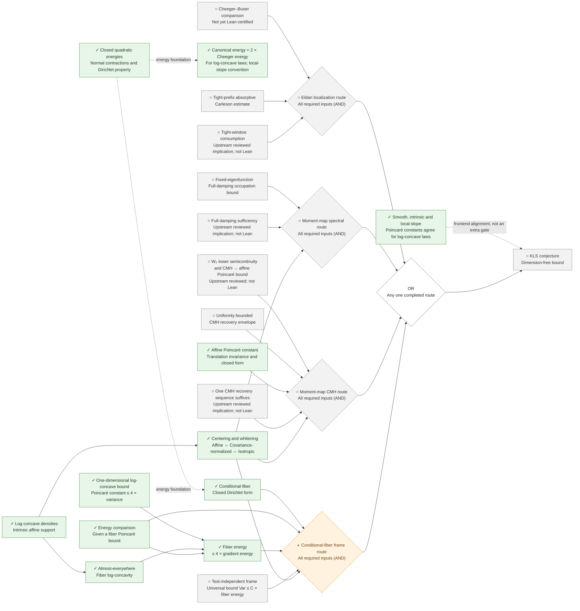

# Proof progress tree

Last updated: **2026-09-15**. All four active sufficient routes in the
[route composition](../../formalization/blueprint/route-composition.yaml) are shown below.
The upstream roadmap is pinned to `34b5fcd57fef17089e781616005fe6d3641bd11e`, as recorded in
[the September 12 synchronization](../../research/decisions/2026-09-12-upstream-research-sync.md).
This is a complete overview of those four routes, not an enumeration of every upstream lemma.

**Read from left to right, toward KLS.** Solid arrows carry required inputs toward a consumer or
route assembly. All inputs to an **AND** diamond are required; the **OR** diamond means any one
completed route suffices. Dotted arrows show supporting context or frontend alignment, not
additional sufficient implications. An arrow records how an input would be used; it does not
assert that an open input or an unformalized consumer has been proved. Only selected dependencies
are displayed; the Blueprint and route composition retain the precise statements and dependencies.

**Legend:** ✓ Completed in Lean · ◐ Partially formalized · ○ Not yet completed in Lean.
Green marks completed results, amber marks partial progress, gray marks pending work, and the
orange outline highlights the next proof step. These symbols describe **our formalization
progress**. An upstream mathematical proof or conditional argument alone does not earn a ✓;
its provenance is noted separately. A ✓ does not imply a separate ledger certificate.

### Four routes converging on KLS

The four AND nodes describe unfinished route assemblies. The conditional-fiber route is ◐
because its route-specific form and comparison results are proved; the universal frame gate is
still ○. The other three route assemblies remain ○: shared foundations or upstream arguments
alone do not amount to completed local route proofs.
In particular, no upstream theorem named `thm:conditional-fiber-frame-suffices` is invented:
the fiber route assembles the named form, comparison, one-dimensional bound, frame gate, and
normalization inputs. The CMH route requires a regular recovery sequence; it is a sufficient
condition, not an equivalence with KLS. The metric Cheeger **energy** identity is distinct from
the isoperimetric Cheeger **constant** comparison.

### Shared analytic progress: coarea and isoperimetric comparison

The endpoint below is the Cheeger–Buser input to the Eldan assembly above. Completing this
analytic chain alone does not complete that route: the tight-prefix gate and its formalized
consumer are still needed. Here `h_M` is the Minkowski Cheeger constant and `h_S` the
smooth-boundary Cheeger constant. Multiple incoming solid arrows are joint inputs.

```mermaid
flowchart LR
    GG["✓ Global Gauss–Green"]
    REC["✓ Smooth recovery sequences"]
    FWD["✓ Forward comparison<br/>h_M ≤ h_S"]
    MINK["✓ Minkowski coarea inequality"]
    SARD["✓ Smooth Sard theorem<br/>Regular superlevel sets"]
    MEAS["✓ Level-set integral measurability"]
    GRAPH["✓ Weighted graph area<br/>On open domains"]
    REG["✓ Coarea on regular open domains<br/>Parametric inverse and substitution"]
    CRIT["✓ Critical slices are null<br/>For almost every level"]
    C1["○ Assemble general C¹ coarea<br/>Next proof step"]
    WHIT["○ Whitney extension<br/>Exact Lipschitz-to-C¹ pieces"]
    LIP["○ General Lipschitz<br/>Weighted coarea formula"]
    SCI["○ Smooth coarea inequality"]
    CUT["✓ Distance-cutoff estimates<br/>and smooth approximation"]
    REV["○ Reverse comparison<br/>h_S ≤ h_M"]
    EQ["◐ Equality h_M = h_S<br/>Lean proof still incomplete"]
    FRONT["○ Density Cheeger<br/>Frontend identification; not Lean"]
    CB["○ Cheeger–Buser comparison<br/>Not yet Lean-certified"]

    GG --> REC
    REC --> FWD
    GRAPH --> REG
    MEAS -.->|localized measurability| REG
    REG --> C1
    CRIT --> C1
    C1 --> LIP
    WHIT --> LIP
    MEAS --> LIP
    C1 --> SCI
    SARD --> SCI
    SCI --> REV
    CUT --> REV
    FWD --> EQ
    REV --> EQ
    EQ --> FRONT
    FRONT --> CB

    classDef done fill:#e8f5e9,stroke:#388e3c,color:#183b1c;
    classDef partial fill:#fff3df,stroke:#c88719,color:#66420d;
    classDef todo fill:#f2f2f2,stroke:#888,color:#333;
    classDef focus fill:#fff0dc,stroke:#d47b13,color:#663800,stroke-width:3px;
    classDef logic fill:#ffffff,stroke:#555,color:#222;
    class GG,REC,FWD,MINK,SARD,MEAS,GRAPH,REG,CRIT,CUT done;
    class FRONT,CB todo;
    class EQ partial;
    class WHIT,LIP,SCI,REV todo;
    class C1 focus;
    click GG href "https://github.com/numina-functional-inequalities/kls-lean/blob/main/formalization/FunctionalInequalities/KLS/Geometry/GaussGreen.lean" "✓ Global Gauss–Green" _blank
    click REC href "https://github.com/numina-functional-inequalities/kls-lean/blob/main/formalization/FunctionalInequalities/KLS/Geometry/PerimeterRecovery.lean" "✓ Smooth recovery sequences" _blank
    click FWD href "https://github.com/numina-functional-inequalities/kls-lean/blob/main/formalization/FunctionalInequalities/KLS/Geometry/CheegerInfimum.lean" "✓ Forward comparison — h_M ≤ h_S" _blank
    click MINK href "https://github.com/numina-functional-inequalities/kls-lean/blob/main/formalization/FunctionalInequalities/KLS/Geometry/MinkowskiContent.lean" "✓ Minkowski coarea inequality" _blank
    click SARD href "https://github.com/numina-functional-inequalities/kls-lean/blob/main/formalization/FunctionalInequalities/Analysis/SmoothSard.lean" "✓ Smooth Sard theorem — Regular superlevel sets" _blank
    click MEAS href "https://github.com/numina-functional-inequalities/kls-lean/blob/main/formalization/FunctionalInequalities/KLS/Geometry/LevelSetMeasurable.lean" "✓ Level-set integral measurability" _blank
    click GRAPH href "https://github.com/numina-functional-inequalities/kls-lean/blob/main/formalization/FunctionalInequalities/Analysis/OpenGraphIntegral.lean" "✓ Weighted graph area — On open domains" _blank
    click REG href "https://github.com/numina-functional-inequalities/kls-lean/blob/main/formalization/FunctionalInequalities/KLS/Geometry/RegularCoarea.lean" "✓ Coarea on regular open domains — Parametric inverse and substitution" _blank
    click CRIT href "https://github.com/numina-functional-inequalities/kls-lean/blob/main/formalization/FunctionalInequalities/KLS/Geometry/CriticalSlice.lean" "✓ Critical slices are null — For almost every level" _blank
    click C1 href "https://github.com/numina-functional-inequalities/kls-lean/blob/main/research/decisions/2026-09-15-weighted-coarea-route.md#l11" "○ Assemble general C¹ coarea — Next proof step" _blank
    click WHIT href "https://github.com/numina-functional-inequalities/kls-lean/blob/main/research/decisions/2026-09-15-weighted-coarea-route.md#l6" "○ Whitney extension — Exact Lipschitz-to-C¹ pieces" _blank
    click LIP href "https://github.com/numina-functional-inequalities/kls-lean/blob/main/research/decisions/2026-09-15-weighted-coarea-route.md#l12" "○ General Lipschitz — Weighted coarea formula" _blank
    click SCI href "https://github.com/numina-functional-inequalities/kls-lean/blob/main/formalization/FunctionalInequalities/KLS/WIP/CheegerInfimum.lean" "○ Smooth coarea inequality" _blank
    click CUT href "https://github.com/numina-functional-inequalities/kls-lean/blob/main/formalization/FunctionalInequalities/KLS/Geometry/DistanceCutoff.lean" "✓ Distance-cutoff estimates — and smooth approximation" _blank
    click REV href "https://github.com/numina-functional-inequalities/kls-lean/blob/main/formalization/FunctionalInequalities/KLS/WIP/CheegerInfimum.lean" "○ Reverse comparison — h_S ≤ h_M" _blank
    click EQ href "https://github.com/numina-functional-inequalities/kls-lean/blob/main/formalization/FunctionalInequalities/KLS/WIP/CheegerInfimum.lean" "◐ Equality h_M = h_S — Lean proof still incomplete" _blank
    click FRONT href "https://github.com/numina-functional-inequalities/kls-lean/blob/main/formalization/blueprint/src/chapters/45-shared-analytic-bridges.tex" "○ Density Cheeger — Frontend identification; not Lean" _blank
    click CB href "https://github.com/numina-functional-inequalities/kls-lean/blob/main/formalization/blueprint/src/chapters/45-shared-analytic-bridges.tex" "○ Cheeger–Buser comparison — Not yet Lean-certified" _blank
```

The general C¹ formula combines regular-region coarea with critical-slice nullity. The Lipschitz
extension has its own Whitney/decomposition obligations and is not a prerequisite for the C¹
specialization used by smooth coarea. The proved Minkowski coarea inequality is shown separately;
it is not the still-open weighted coarea equality. Smooth Sard here means the C∞ theorem, not
the still-open sharp finite-regularity Sard statement.

### Benchmarks and upstream research beyond the four route gates

These results calibrate or investigate the program. They do not provide additional completed
routes to KLS, and no solid implication arrow from a model calculation to a universal gate is intended.

| Result or research direction | Recorded status and boundary | Source |
| --- | --- | --- |
| Sharp one-dimensional Gaussian constant | ✓ Lean-proved; Gaussian laws only | [Lean source](../../formalization/FunctionalInequalities/Poincare/Gaussian/Real.lean) |
| Finite Poincaré tensorization | ✓ Lean-proved; independent-product infrastructure | [Lean source](../../formalization/FunctionalInequalities/Poincare/FiniteProduct/Tensorization.lean) |
| Spectral restart and fourth-moment estimates | Upstream reviewed; not Lean; do not close uniform-time occupation | [Synchronization record](../../research/decisions/2026-09-12-upstream-research-sync.md) |
| Letwin-dependent short-time spectral chain | Conditional upstream result; not Lean; not dimension-free KLS | [Synchronization record](../../research/decisions/2026-09-12-upstream-research-sync.md) |
| Screened localization on a regular split class | Restricted upstream result; the universal gate remains open | [Synchronization record](../../research/decisions/2026-09-12-upstream-research-sync.md) |
| CMH linear spectral resolution and third-moment decomposition | Upstream reviewed weak/closed-form statements; no universal higher-order remainder bound | [Synchronization record](../../research/decisions/2026-09-12-upstream-research-sync.md) |
| Sharp gate-zero matrix bound | Upstream conjecture; not proved or Lean-certified | [Synchronization record](../../research/decisions/2026-09-12-upstream-research-sync.md) |
| Exponential-cone and cube-cone models | Exact restricted models; not a universal CMH or recovery-envelope bound | [Synchronization record](../../research/decisions/2026-09-12-upstream-research-sync.md) |
| Simplex root-frame degree-two result | Upstream reviewed polynomial-sector result; not a full L² frame bound | [Synchronization record](../../research/decisions/2026-09-12-upstream-research-sync.md) |
| Historical weighted near-Cheeger package | REFUTED upstream by the exponential-spectator obstruction; excluded from the four active routes | [Historical branch](../../formalization/blueprint/src/chapters/50-kls-routes.tex) |

Click a node to open its source in a new tab. Links follow `main`; the upstream provenance remains
pinned as stated above. If diagram links are disabled in your viewer, use the directory below.

Node links: Lean sources and documentation

| Node | Source |
| --- | --- |
| ○ KLS conjecture — Dimension-free bound | [Open source](../../formalization/FunctionalInequalities/KLS/Statement.lean) |
| OR — Any one completed route | [Open source](../../formalization/blueprint/route-composition.yaml) |
| ✓ Log-concave densities — Intrinsic affine support | [Open source](../../formalization/FunctionalInequalities/KLS/LogConcave/BorellRepresentation.lean) |
| ✓ Centering and whitening — Affine ⇔ Covariance-normalized ⇔ Isotropic | [Open source](../../formalization/FunctionalInequalities/KLS/LogConcave/Isotropic.lean) |
| ✓ Closed quadratic energies — Normal contractions and Dirichlet property | [Open source](../../formalization/FunctionalInequalities/Energy/SmoothGradient/Dirichlet.lean) |
| ✓ Canonical energy = 2 × Cheeger energy — For log-concave laws; local-slope convention | [Open source](../../formalization/FunctionalInequalities/Energy/Cheeger.lean) |
| ✓ Smooth, intrinsic and local-slope — Poincaré constants agree for log-concave laws | [Open source](../../formalization/FunctionalInequalities/KLS/LogConcave/Poincare.lean) |
| ○ Cheeger–Buser comparison — Not yet Lean-certified | [Open source](../../formalization/blueprint/src/chapters/45-shared-analytic-bridges.tex) |
| ○ Tight-prefix absorptive — Carleson estimate | [Open source](../../formalization/blueprint/src/chapters/50-kls-routes.tex) |
| ○ Tight-window consumption — Upstream reviewed implication; not Lean | [Open source](../../formalization/blueprint/src/chapters/50-kls-routes.tex) |
| ○ Eldan localization route — All required inputs (AND) | [Open source](../../formalization/blueprint/route-composition.yaml) |
| ○ Fixed-eigenfunction — Full-damping occupation bound | [Open source](../../formalization/blueprint/src/chapters/50-kls-routes.tex) |
| ○ Full-damping sufficiency — Upstream reviewed implication; not Lean | [Open source](../../formalization/blueprint/src/chapters/50-kls-routes.tex) |
| ○ Moment-map spectral route — All required inputs (AND) | [Open source](../../formalization/blueprint/route-composition.yaml) |
| ○ W₂ lower semicontinuity — and CMH → affine Poincaré bound — Upstream reviewed; not Lean | [Open source](../../formalization/blueprint/src/chapters/50-kls-routes.tex) |
| ○ Uniformly bounded — CMH recovery envelope | [Open source](../../formalization/blueprint/src/chapters/50-kls-routes.tex) |
| ✓ Affine Poincaré constant — Translation invariance and closed form | [Open source](../../formalization/FunctionalInequalities/Poincare/CovarianceGradient/Translation.lean) |
| ○ One CMH recovery sequence suffices — Upstream reviewed implication; not Lean | [Open source](../../formalization/blueprint/src/chapters/50-kls-routes.tex) |
| ○ Moment-map CMH route — All required inputs (AND) | [Open source](../../formalization/blueprint/route-composition.yaml) |
| ✓ Conditional-fiber — Closed Dirichlet form | [Open source](../../formalization/FunctionalInequalities/KLS/ConditionalFiber/Closed.lean) |
| ✓ One-dimensional log-concave bound — Poincaré constant ≤ 4 × variance | [Open source](../../formalization/FunctionalInequalities/KLS/LogConcave/Line/SharpPoincare.lean) |
| ✓ Almost-everywhere — Fiber log-concavity | [Open source](../../formalization/FunctionalInequalities/KLS/LogConcave/ConditionalFiber.lean) |
| ✓ Energy comparison — Given a fiber Poincaré bound | [Open source](../../formalization/FunctionalInequalities/KLS/ConditionalFiber/EnergyComparison.lean) |
| ✓ Fiber energy — ≤ 4 × gradient energy | [Open source](../../formalization/FunctionalInequalities/KLS/LogConcave/ConditionalFiber.lean) |
| ○ Test-independent frame — Universal bound Var ≤ C × fiber energy | [Open source](../../formalization/blueprint/src/chapters/50-kls-routes.tex) |
| ◐ Conditional-fiber frame route — All required inputs (AND) | [Open source](../../formalization/blueprint/route-composition.yaml) |
| ✓ Global Gauss–Green | [Open source](../../formalization/FunctionalInequalities/KLS/Geometry/GaussGreen.lean) |
| ✓ Smooth recovery sequences | [Open source](../../formalization/FunctionalInequalities/KLS/Geometry/PerimeterRecovery.lean) |
| ✓ Forward comparison — h_M ≤ h_S | [Open source](../../formalization/FunctionalInequalities/KLS/Geometry/CheegerInfimum.lean) |
| ✓ Minkowski coarea inequality | [Open source](../../formalization/FunctionalInequalities/KLS/Geometry/MinkowskiContent.lean) |
| ✓ Smooth Sard theorem — Regular superlevel sets | [Open source](../../formalization/FunctionalInequalities/Analysis/SmoothSard.lean) |
| ✓ Level-set integral measurability | [Open source](../../formalization/FunctionalInequalities/KLS/Geometry/LevelSetMeasurable.lean) |
| ✓ Weighted graph area — On open domains | [Open source](../../formalization/FunctionalInequalities/Analysis/OpenGraphIntegral.lean) |
| ✓ Coarea on regular open domains — Parametric inverse and substitution | [Open source](../../formalization/FunctionalInequalities/KLS/Geometry/RegularCoarea.lean) |
| ✓ Critical slices are null — For almost every level | [Open source](../../formalization/FunctionalInequalities/KLS/Geometry/CriticalSlice.lean) |
| ○ Assemble general C¹ coarea — Next proof step | [Open source](../../research/decisions/2026-09-15-weighted-coarea-route.md#l11) |
| ○ Whitney extension — Exact Lipschitz-to-C¹ pieces | [Open source](../../research/decisions/2026-09-15-weighted-coarea-route.md#l6) |
| ○ General Lipschitz — Weighted coarea formula | [Open source](../../research/decisions/2026-09-15-weighted-coarea-route.md#l12) |
| ○ Smooth coarea inequality | [Open source](../../formalization/FunctionalInequalities/KLS/WIP/CheegerInfimum.lean) |
| ✓ Distance-cutoff estimates — and smooth approximation | [Open source](../../formalization/FunctionalInequalities/KLS/Geometry/DistanceCutoff.lean) |
| ○ Reverse comparison — h_S ≤ h_M | [Open source](../../formalization/FunctionalInequalities/KLS/WIP/CheegerInfimum.lean) |
| ◐ Equality h_M = h_S — Lean proof still incomplete | [Open source](../../formalization/FunctionalInequalities/KLS/WIP/CheegerInfimum.lean) |
| ○ Density Cheeger — Frontend identification; not Lean | [Open source](../../formalization/blueprint/src/chapters/45-shared-analytic-bridges.tex) |

**Maintenance:** Review both diagrams after every proof update. Update the affected labels,
✓/◐/○ markers, colors, dependencies, date, source links, directory, and current-status summary together
with the proof and its verification records. Preserve prerequisite-to-conclusion arrow direction,
AND within routes, OR between routes, and the distinction between upstream mathematics and
local Lean proofs. Keep the diagrams and their surrounding documentation in English.
